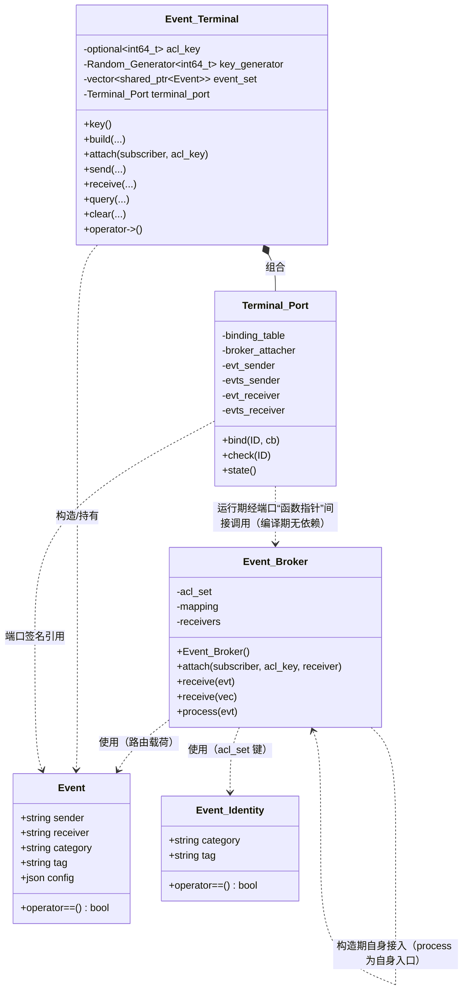
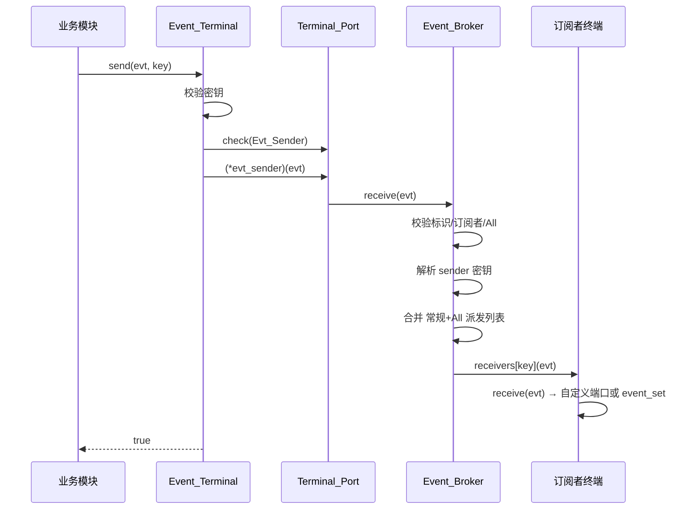
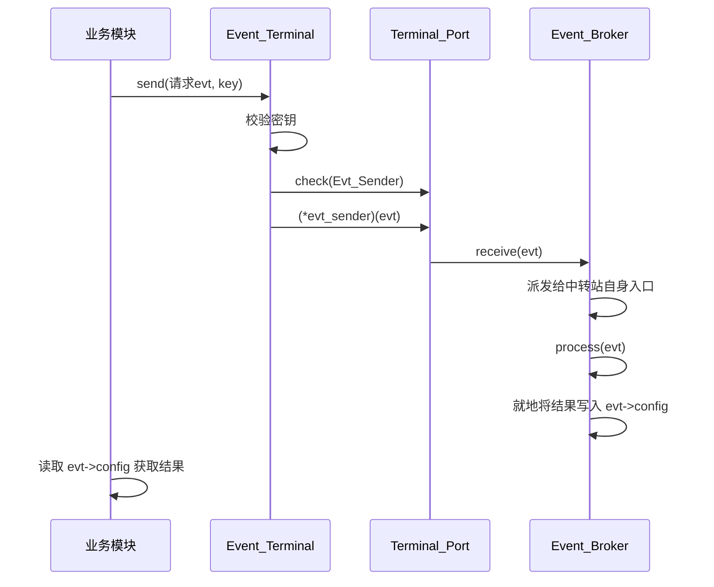

# 事件系统 · 模块架构

> 源码根相对路径：`Engine/EngineCore/src/core/event/`
> 本文覆盖 `event/` 下的三个子部件：**事件数据结构（`Event/`）**、**事件中转器（`Event_Broker/`）**、**事件终端与终端端口（`Event_Terminal/`）**，以及聚合头文件 `事件系统运行包.h`。
> 记录依据为当前工作区源码（EngineCore 版次 `1c02806`）；本模块近期发生过一次结构性变更：**订阅者编号取消、改由订阅者提交自身权限密钥；中转站自身接入事件系统、经事件发送接口交互；中转站呼叫端口与终端 `interact` 接口删除；接入端口检查补齐；满订广播纳入发起者排除；头文件包含大小写修正**。本文以当前源码为准。

---

## 一、文件内目录

- [二、模块功能介绍](#二模块功能介绍)
- [三、模块公开接口介绍](#三模块公开接口介绍)
- [四、模块私有方法介绍](#四模块私有方法介绍)
- [五、模块内部架构介绍](#五模块内部架构介绍)
- [六、模块设计/实现细节](#六模块设计实现细节)
- [七、模块运行链路详例](#七模块运行链路详例)
- [附录、待确认条目](#附录待确认条目)

---

## 二、模块功能介绍

### 2.1 模块定位

事件系统是 `EngineCore` `core` 层中的**模块间通信基础设施（事件总线）**。它以「发布–订阅」为基本范式，把「谁产生了事件」与「谁关心事件」在代码层面彻底解耦：事件产生方只负责把 `Event` 投递进总线，事件关心方只声明自己关心哪些「事件标识（category + tag）」，二者之间不需要互相持有头文件、指针或引用。

事件系统由三个职责单一的子部件构成，三者是**严格的分层调用关系**：

1. `Event`（`Event/事件.h`）：纯数据载体，描述「一条事件长什么样」。
2. `Event_Broker`（`Event_Broker/`）：事件中转器，即总线内核。负责订阅登记、权限表维护、事件按标识路由与广播，并内置系统级「订阅管理契约」。**中转器自身也是一个订阅者**：构造时即接入事件系统（见 2.4），借由事件发送接口接收订阅管理请求。
3. `Event_Terminal` + `Terminal_Port`（`Event_Terminal/`）：事件终端与终端端口。终端是「模块侧」与总线交互的**门面（Facade）**；终端端口是终端与总线之间的**函数指针契约层**，用于把终端与中转器的直接依赖反转掉（详见 2.4）。

### 2.2 职责边界

| 子部件 | 负责 | 不负责 |
| --- | --- | --- |
| `Event`（结构体） | 事件字段（发起者/目标/分类/标签/配置包 JSON）的承载、等值比较、哈希支持 | 不含任何路由逻辑；不持有订阅者信息 |
| `Event_Broker` | 订阅登记（`attach`）、订阅者名↔权限密钥映射（`mapping`）、订阅权限表（`acl_set`）、接收入口表（`receivers`）、事件路由/广播（`receive`）、订阅管理契约（`process`：存在性查询 `Subscriber/Check`、下线 `Subscriber/Detach`、订阅增删 `Subscribed_Events/Add|Remove`）、自身接入事件系统 | 不解释业务事件语义（除保留标识契约外）；构造期之外不做密钥校验（密钥由调用方提交并比对） |
| `Event_Terminal` | 权限密钥的生成与校验、事件对象构造、向总线接入、事件发送、事件接收、事件查阅、事件清空 | 不实现路由算法（全部经端口转调 `Event_Broker`）；不持有总线对象；**不再提供「中转站呼叫（interact）」接口**，与中转站交互一律改由事件发送完成 |
| `Terminal_Port` | 端口（函数指针）的注册、类型分派校验、已注册端口查询 | 不实现任何业务逻辑；端口函数体由外部「接线方」注入 |

### 2.3 在整体架构中的位置

- 事件系统处于 `EngineCore/src/core/` 之下，与对象系统、空间系统、配置系统并列，属于「被多方依赖的底层横向设施」。
- **被依赖方向**：上层各系统（典型如空间系统的 `Collision_Proxy`、对象系统、渲染/应用层）通过 `Event_Terminal` 接入总线。各系统一般**不直接持有 `Event_Broker`**，而是经 `Terminal_Port` 注入的端口函数访问中转器。
- **依赖方向**：事件系统对外部依赖极少——
  - 依赖 `tools/Detail/哈希混合.h`（`engine::detail::hash_combine`，用于 `Event` 与 `Event_Identity` 的 `std::hash` 特化）；
  - 依赖 `tools/Detail/package/数据校验工具.h`（`engine::detail::field_check`，用于中转器 `process` 的配置包字段校验）；
  - 依赖 `tools/Random_Generator/随机数生成器.h`（`Random_Generator<int64_t>`，用于终端权限密钥生成）；
  - 依赖 `tools/Logging/日志系统运行包.h`（全局 `logger`，用于告警/错误输出）；
  - 依赖外部库 `nlohmann/json`（`Event::config` 的载荷类型）。
- **边界说明**：事件系统**不感知任何业务事件的具体语义**。唯一的几处「系统级语义硬编码」是：
  1. `Event_Broker::process` 识别 `category == "Subscriber"` 且 `tag ∈ {"Check","Detach"}` 的查询/下线契约，以及 `category == "Subscribed_Events"` 且 `tag ∈ {"Add","Remove"}` 的订阅增删契约；
  2. `Event_Broker::receive` 保留 `tag == "All"` 作为「整类满订」通配标签，并禁止业务事件冒用该标签。
  3. `Event_Broker` 构造期约定的自身登记名 `"Event_Broker"` 与四条保留事件标识。
  这些是本文第五章重点分析的「隐式约定」，其字符串硬编码现状见 6.6。

### 2.4 三者关系概述（关键）

三者的关系可以概括为「**数据结构 → 总线内核 → 门面 + 接线契约**」：

- `Event_Terminal` **不包含** `Event_Broker` 的头文件，二者在源码层面**零编译依赖**。终端与总线之间的调用全部经由 `Terminal_Port` 内 **5 个函数指针端口**（`Broker_Attacher`、`Evt_Sender`、`Evts_Sender`、`Evt_Receiver`、`Evts_Receiver`）完成。
- `Terminal_Port` 的端口是**空的（未绑定）**，需要在某处由「接线方」（通常是引擎启动/装配阶段）调用 `Terminal_Port::bind(...)` 注入具体实现。可注入的实现正是 `Event_Broker` 的成员函数（签名一一对应，见 6.8）。
- `Event_Broker` 是**无密钥校验的开放总线**：任何人只要拿到它的引用即可注入事件；准入校验被上移到 `Event_Terminal`（密钥比对）与 `Event_Broker::attach`（是否携带有效接收入口）。因此，模块级代码只应持有 `Event_Terminal`。
- **中转器自身接入事件系统**：`Event_Broker` 的构造函数会以名 `"Event_Broker"`、密钥 `static_cast<uint64_t>(std::hash<std::string>{}("Event_Broker"))` 调用自身的 `attach`，把内部的 `process` 注册为它的接收入口，并把四条保留事件标识登记进 `acl_set`。因此「模块与中转站交互」不再需要终端 `interact` 接口，而是**直接发送事件**（如 `Subscriber/Check`），由总线路由回中转站自身的 `process` 处理（见 6.6）。
- 聚合头 `事件系统运行包.h` 只引入 `Event` 与 `Event_Terminal`，**刻意不引入 `Event_Broker`**，从「头文件层面」保证业务模块拿不到总线本体。

---

## 三、模块公开接口介绍

> 约定：
> - 除特别说明外，所有类型均位于 `namespace engine`。
> - 所有头文件均以 `#pragma once` 作为防重包含，并统一先引入预编译头 `Engine/EngineCore/common/前置头文件包含.h`。
> - 「相对路径」一律相对源码根 `d:\代码存储\代码仓库\白银纪元`。
> - 变量/函数命名为 `snake_case`（单词间 `_` 分隔、首字母小写）；类型名为 `PascalCase`（各单词首字母大写、无分隔）。
> - 本节只列**对外公开**接口；`Terminal_Port` 的私有辅助函数归第四节，各类私有数据成员归第五节。

### 3.1 聚合头：`事件系统运行包.h`

相对路径：`Engine/EngineCore/src/core/event/事件系统运行包.h`

该文件是本模块的对外「打包头文件」，一次性引入事件系统对业务模块可见的全部内容：

```cpp
#pragma once
//预编译头
#include "Engine/EngineCore/common/前置头文件包含.h"
//获取事件类型
#include "Event/事件.h"
//获取事件终端类型
#include "Event_Terminal/事件终端.h"
```

| 引入项 | 是否可见 | 说明 |
| --- | --- | --- |
| `Event` | 是 | 事件数据结构 |
| `Event_Terminal` / `Terminal_Port` / `Port_ID` | 是（经 `事件终端.h` → `终端端口.h` 传递） | 终端门面与端口契约 |
| `Event_Broker` | **否**（故意） | 总线内核不暴露给业务模块 |

约束：交付给业务方时应只包含本头文件；`Event_Broker` 由装配层单独包含。

---

### 3.2 事件数据结构：`Event/事件.h`

相对路径：`Engine/EngineCore/src/core/event/Event/事件.h`

#### 3.2.1 `struct Event`

一条事件的纯粹数据载体。

字段：

| 字段 | 类型 | 默认值 | 含义 |
| --- | --- | --- | --- |
| `sender` | `std::string` | `{}`（空串） | 事件发起者名（用于「排除自身」） |
| `receiver` | `std::string` | `{}`（空串） | 事件目标名；非空且存在于总线时表示「定向发送」 |
| `category` | `std::string` | 无显式初始化（默认构造为空串） | 事件分类（路由主键之一） |
| `tag` | `std::string` | 无显式初始化（默认构造为空串） | 事件标签（路由主键之一） |
| `config` | `nlohmann::json` | 无显式初始化（空 JSON） | 事件配置包/载荷；任意结构化数据 |

构造函数：

| 签名 | 参数含义 | 行为 |
| --- | --- | --- |
| `Event()` | 无 | 默认构造；`sender`/`receiver` 为空串，`category`/`tag` 空串，`config` 空 JSON |
| `Event(const std::string& category, const std::string& tag)` | 仅构造「事件标识」 | 写入 `category`、`tag`；`sender`/`receiver` 保持空串 |
| `Event(const std::string& sender, const std::string& receiver, const std::string& category, const std::string& tag)` | 构造「对象标签」 | 写入 `sender`、`receiver`、`category`、`tag` |
| `Event(const std::string& sender, const std::string& receiver, const std::string& category, const std::string& tag, const nlohmann::json& config)` | 全量构造 | 写入全部五个字段 |

析构：`~Event()` 显式声明为默认体（无资源特殊处理）。

等值比较：

| 签名 | 行为 | 约束 |
| --- | --- | --- |
| `bool operator==(const Event& other) const` | 依次比较 `category`、`tag`、`receiver`、`config` 四项，全等返回 `true`，否则 `false` | **不比较 `sender`**；`config` 走 `nlohmann::json::operator==`（结构化比较） |

> **明确约定**：`operator==` 刻意排除 `sender`，即「两条仅在发起者上不同的事件」被视为同一事件。此口径为**预期设计**（哈希须与之保持一致，见 3.2.2 与 6.10）。

#### 3.2.2 `std::hash<engine::Event>` 特化

相对路径同上（在 `事件.h` 底部的 `namespace std` 中定义）。

| 签名 | 行为 | 约束 |
| --- | --- | --- |
| `size_t operator()(const engine::Event& evt) const noexcept` | 以 `std::hash<std::string>` 计算 `category`，再依次 `hash_combine` 混入 `tag`、`receiver`、以及 `config.dump()` 的字符串哈希 | 与 `operator==` 保持**一致的口径**：同样**不纳入 `sender`**；`noexcept` 标记要求内部不抛异常，但 `config.dump()` 理论上可能抛（源码注释已自陈此风险） |

> 设计要点：`operator==` 与 `hash` 均排除 `sender`，因此「两条只在 `sender` 上不同」的事件被视为同一事件。此口径为**预期设计**，并在 `Event_Broker` 的容器键设计中被继承（见第五章）。

---

### 3.3 事件标识：`Event_Broker/事件中转器.h` 中的 `Event_Identity`

相对路径：`Engine/EngineCore/src/core/event/Event_Broker/事件中转器.h`

#### 3.3.1 `struct Event_Identity`

`Event` 的「路由键」投影：只保留参与订阅/路由的两个字段。

字段：

| 字段 | 类型 | 默认值 | 含义 |
| --- | --- | --- | --- |
| `category` | `std::string` | `{}` | 事件分类 |
| `tag` | `std::string` | `{}` | 事件标签 |

接口：

| 签名 | 行为 |
| --- | --- |
| `Event_Identity()` | 默认构造；两字段为空串 |
| `Event_Identity(const std::string& category, const std::string& tag)` | 带参构造 |
| `bool operator==(const Event_Identity& other) const` | 比较 `category` 与 `tag`，全等 `true` |

#### 3.3.2 `std::hash<engine::Event_Identity>` 特化

| 签名 | 行为 | 约束 |
| --- | --- | --- |
| `size_t operator()(const engine::Event_Identity& acl) const noexcept` | `hash_combine(seed, hash<string>{}(category))` 后再混入 `tag` 的哈希 | 定义位置**必须先于** `Event_Broker` 内 `unordered_map<Event_Identity,...>` 的实例化（源码注释已强调） |

---

### 3.4 事件中转器：`Event_Broker`

相对路径：`Engine/EngineCore/src/core/event/Event_Broker/事件中转器.h`（声明）、`.../core/事件中转器.cpp`（实现）

#### 3.4.1 类 `Event_Broker` 概览

私有成员（字段说明见 5.3）：

| 成员 | 类型 |
| --- | --- |
| `acl_set` | `std::unordered_map<Event_Identity, std::vector<uint64_t>>` |
| `mapping` | `std::unordered_map<std::string, uint64_t>` |
| `receivers` | `std::unordered_map<uint64_t, std::function<void(std::shared_ptr<Event>)>>` |

> 说明：早期版本的 `mapping_set`（订阅者名→订阅者**编号**）现已更名为 `mapping`（订阅者名→订阅者**权限密钥**）。订阅者编号机制已取消（见 6.3）。

#### 3.4.2 `Event_Broker(void)` 构造函数

- **作用**：构造中转器并**让中转器自身接入事件系统**。
- 行为：
  1. 以 `std::hash<std::string>{}("Event_Broker")` 生成自身权限密钥（`uint64_t`）；
  2. 封装 `evt_process = [this](shared_ptr<Event> evt){ this->process(evt); }` 作为接收入口；
  3. 调用 `attach("Event_Broker", acl_key, evt_process)` 登记自身；
  4. 逐条向 `acl_set` 登记四条**保留事件标识**：`("Subscriber","Check")`、`("Subscriber","Detach")`、`("Subscribed_Events","Add")`、`("Subscribed_Events","Remove")`（否则这些事件会被 `receive` 因「无订阅者」直接丢弃）。

规则五：`~Event_Broker()`、拷贝构造、拷贝赋值、移动构造、移动赋值全部 `= default`。

#### 3.4.3 `void attach(const std::string& subscriber, const uint64_t& acl_key, std::function<void(std::shared_ptr<Event>)> receiver)`

- **作用**：订阅者登记 / 重新登记（登记「名字→密钥映射」与「密钥→接收入口」）。
- 参数：

  | 参数 | 含义 |
  | --- | --- |
  | `subscriber` | 订阅者名（映射键） |
  | `acl_key` | 订阅者提交的**自身权限密钥**（映射值，即该订阅者今后在总线上的身份） |
  | `receiver` | 事件送达入口回调；总线在派发命中时以 `evt` 调用之 |

- 返回：`void`。
- 行为与边界：
  1. `subscriber` 为空**或** `receiver` 为空函数 → 打印 `warn`（"订阅者为空或未包含有效事件接收器"）与 `info`（"接入失败"），直接返回（**不登记**）。
  2. 否则执行 `mapping.insert_or_assign(subscriber, acl_key)` 与 `receivers.insert_or_assign(acl_key, receiver)`（同名重复登记会覆盖旧映射与旧入口）。
- 备注：本函数**不再接收 `needed_events` 形参**，也不做密钥校验。订阅关系（`acl_set`）改由 `process` 处理 `Subscribed_Events/Add|Remove` 事件时动态增删；注销改由 `Subscriber/Detach` 事件触发（见 6.6、链路 2/7）。

#### 3.4.4 `void receive(std::shared_ptr<Event> evt)` —— 单事件重载

- **作用**：接收并派发一条事件（广播或定向）。
- 参数：`evt` —— 待派发事件；**按值**接收 `shared_ptr`。
- 返回：`void`。
- 约束与边界行为（顺序校验）：
  1. `evt->category` 或 `evt->tag` 为空 → `warn`，丢弃。
  2. 该 `(category,tag)` 未在 `acl_set` 中注册（无任何订阅者）→ `warn`，丢弃。
  3. `evt->tag == "All"` → `warn`，丢弃（**禁止业务事件冒用保留标签**）。
  4. **定向发送分支**：若 `evt->receiver` 非空且存在于 `mapping` → 以 `mapping[receiver]` 取得目标密钥，调用 `receivers[target_key](evt)` 后返回；**此分支不排除发起者自身**。
  5. **广播分支**：查询发起者密钥（若 `sender` 存在于 `mapping` 则记录，否则视为「无来源」）。将 `acl_set[{category,tag}]` 与 `acl_set[{category,"All"}]` 两个列表**合并**成一个派发列表，逐项派发，并**统一排除发起者自身密钥**。即：若发起者密钥存在，则跳过列表中等于该密钥的项，无论它是常规订阅还是满订（见 6.4）。
- 备注：派发前**不校验 `evt` 是否为空指针**（空指针在此重载中不做检查）。

#### 3.4.5 `void receive(std::vector<std::shared_ptr<Event>> event_set)` —— 多事件重载

- **作用**：批量派发。
- 参数：`event_set` —— 事件列表；**按值**接收。
- 返回：`void`。
- 行为：顺序对每个元素调用单事件重载 `receive(evt)`。无额外校验。

#### 3.4.6 `void process(std::shared_ptr<Event> evt)`

- **作用**：处理「订阅管理」请求（系统级契约，非纯路由）。返回类型已由旧的 `std::shared_ptr<Event>` 改为 `void`；结果不再以「回复事件」返回，而是就地写入请求事件自身的 `config`（详见 6.6）。
- 参数：`evt` —— 请求事件。
- 返回：`void`。
- 约束与边界行为：
  1. `evt == nullptr` → `warn`（**注意：随后并未 `return`，会继续访问 `evt->config`，属当前实现的空指针风险，见 6.10-6**）。
  2. 取 `config = evt->config`；若 `config` 缺少有效 `"object"` 字符串字段（`detail::field_check<string>(config,"object")` 失败）→ `warn`，返回。
  3. **订阅者分支**（`evt->category == "Subscriber"`）：
     - `tag == "Check"`：读 `object = config["object"]`，查 `mapping` 是否含该名，将结果写入 `config["subscribed"]`（存在 `true` / 不存在 `false`）。
     - `tag == "Detach"`：读 `object = config["object"]`，查 `mapping`；若不存在 → 两条 `warn`，返回。校验 `config["acl_key"]` 字段有效（`detail::field_check<uint64_t>`）；若与该订阅者密钥相等 → `mapping.erase(object)`、`receivers.erase(suscriber_key)`、遍历 `acl_set` 清除该密钥的全部授权，打印 `info`（"接入已下线"）；否则两条 `error`（"权限密钥不匹配"/"已驳回该违规操作"）。
  4. **订阅事件分支**（`evt->category == "Subscribed_Events"`）：
     - 读 `object = config["object"]`，查 `mapping`；不存在 → 两条 `warn`，返回。校验 `config["acl_key"]` 字段有效；与订阅者密钥比对：
       - `tag == "Add"`：`config["subscribed_events"]` 须存在且为数组，否则 `warn` 返回；逐条读 `{category,tag}`（须为字符串），构造 `Event_Identity` 并向 `acl_set[identity]` 追加该订阅者密钥（去重），打印 `info`。
       - `tag == "Remove"`：同样的字段校验；逐条从 `acl_set[identity]` 中移除该订阅者密钥，打印 `info`。
       - 密钥不匹配 → 两条 `error` 驳回。
- 注意：`process` **无中间订阅权限表参与路由**，它直接使用 `mapping`/`receivers`/`acl_set`；`evt->config` 会被读取/写入。两个分支为**独立 `if`**（非 `else if`）。

---

### 3.5 事件终端与终端端口：`Event_Terminal/`

相对路径：
- `Engine/EngineCore/src/core/event/Event_Terminal/事件终端.h`（`Event_Terminal` 声明）
- `Engine/EngineCore/src/core/event/Event_Terminal/终端端口.h`（`Port_ID` 与 `Terminal_Port` 定义）
- `Engine/EngineCore/src/core/event/Event_Terminal/core/事件终端.cpp`（`Event_Terminal` 实现）

#### 3.5.1 `enum class Port_ID`

终端端口编号，定义于 `终端端口.h`（**已删除 `Evt_Broker_Caller`/`Evts_Broker_Caller` 两个呼叫端口**）：

| 枚举值 | 含义 | 对应端口成员 | 期望回调签名（`Ret(Args...)`） |
| --- | --- | --- | --- |
| `None` | 占位/未绑定 | —— | —— |
| `Broker_Attacher` | 中转站接入 | `broker_attacher` | `void(const std::string&, const uint64_t&, std::function<void(std::shared_ptr<Event>)>)` |
| `Evt_Sender` | 单事件发送 | `evt_sender` | `void(std::shared_ptr<Event>)` |
| `Evts_Sender` | 多事件发送 | `evts_sender` | `void(std::vector<std::shared_ptr<Event>>)` |
| `Evt_Receiver` | 单事件接收 | `evt_receiver` | `void(std::shared_ptr<Event>)` |
| `Evts_Receiver` | 多事件接收 | `evts_receiver` | `void(std::vector<std::shared_ptr<Event>>)` |

#### 3.5.2 类 `Terminal_Port`

私有类型别名：

| 别名 | 定义 |
| --- | --- |
| `Event_Handler` | `std::function<void(std::shared_ptr<Event>)>`（**已由模板 `template<typename T> std::function<T(...)>` 简化为非模板 `void` 版本**） |
| `Events_Handler` | `std::function<void(std::vector<std::shared_ptr<Event>>)>`（同上简化） |
| `Broker_Attacher` | `std::function<void(const std::string& name, const uint64_t& acl_key, Event_Handler receiver)>` |

私有成员（字段说明见 5.4）：

| 成员 | 类型 |
| --- | --- |
| `binding_table` | `std::vector<Port_ID>` |
| `broker_attacher` | `std::unique_ptr<Broker_Attacher>` |
| `evt_sender` | `std::unique_ptr<Event_Handler>` |
| `evts_sender` | `std::unique_ptr<Events_Handler>` |
| `evt_receiver` | `std::unique_ptr<Event_Handler>` |
| `evts_receiver` | `std::unique_ptr<Events_Handler>` |

私有辅助（`终端端口.h` 内联定义；详见第四节）：

| 签名 | 行为 |
| --- | --- |
| `template<typename Ret, typename... Args> bool memory_malloc(std::unique_ptr<std::function<Ret(Args...)>>& target) const` | 以 `new(std::nothrow)` 为函数包装器分配内存，返回是否成功 |
| `template<typename Ret, typename... Args> bool function_register(Port_ID ID, std::unique_ptr<std::function<Ret(Args...)>>& target, std::function<Ret(Args...)> function)` | 先 `memory_malloc`；成功则赋值函数体、把 `ID` 记入 `binding_table`，返回 `true`；失败返回 `false` |

对外开放接口：

#### `template<typename T> Terminal_Port& bind(const Port_ID& ID, T callback)`

- **作用**：把一个具体回调按「编译期类型分派」绑定到对应端口。
- 参数：

  | 参数 | 含义 |
  | --- | --- |
  | `ID` | 期望绑定的端口编号 |
  | `callback` | 任意可调用对象（lambda/函数对象/函数指针） |

- 返回：`*this`（支持链式调用 `port.bind(...).bind(...)`）。
- 分派规则（`if constexpr`，按可调用性依次判定）：
  1. 若 `callback` 可以 `(const std::string&, const uint64_t&, Event_Handler)` 调用且返回 `void`：要求 `ID == Broker_Attacher`，否则 `logger.error` 并驳回；通过则绑定 `broker_attacher`。
  2. 否则若可 `(std::shared_ptr<Event>)` 调用且返回 `void`：要求 `ID == Evt_Sender`（绑 `evt_sender`）或 `ID == Evt_Receiver`（绑 `evt_receiver`）；否则 `logger.error` 驳回。
  3. 否则若可 `(std::vector<std::shared_ptr<Event>>)` 调用且返回 `void`：要求 `ID == Evts_Sender`（绑 `evts_sender`）或 `ID == Evts_Receiver`（绑 `evts_receiver`）；否则 `logger.error` 驳回。
  4. 以上皆不匹配 → **编译期断言** `static_assert(!sizeof(T), "Terminal_Port::bind: 不支持的callback类型")`。
- 约束：类型与 `ID` 必须一致，否则**运行时打印错误日志并静默驳回**（不抛异常、不中止）；不支持的 `callback` 类型在**编译期**拒绝。（因 `Event_Handler`/`Events_Handler` 已非模板，`bind` 不再以「返回类型」区分端口，呼叫端口分支随之消失。）

#### `bool check(const Port_ID& ID) const`

- **作用**：查询某端口是否已注册。
- 参数：`ID` —— 端口编号。
- 返回：已注册 `true` / 未注册 `false`。

#### `std::vector<Port_ID> state(void) const`

- **作用**：返回已注册端口的编号列表（`binding_table` 的副本）。
- 返回：`std::vector<Port_ID>`。

#### 友元

| 声明 | 说明 |
| --- | --- |
| `friend class Event_Terminal;` | 允许 `Event_Terminal` 直接访问 `Terminal_Port` 的私有端口成员 |

#### 3.5.3 类 `Event_Terminal`

私有成员（字段说明见 5.5）：

| 成员 | 类型 |
| --- | --- |
| `acl_key` | `std::optional<int64_t>` |
| `key_generator` | `Random_Generator<int64_t>` |
| `event_set` | `std::vector<std::shared_ptr<Event>>` |
| `terminal_port` | `Terminal_Port` |

构造/析构/移动：

| 签名 | 说明 |
| --- | --- |
| `Event_Terminal() = default` | 默认构造；`acl_key` 为空、端口全未绑定 |
| `~Event_Terminal() = default` | 默认析构 |
| `Event_Terminal(Event_Terminal&&) = default` | 移动构造 |
| `Event_Terminal& operator=(Event_Terminal&&) = default` | 移动赋值 |
| （拷贝被隐式删除） | 因 `Terminal_Port` 含 `unique_ptr` 成员，`Event_Terminal` 不可拷贝 |

#### `Terminal_Port* operator->(void)`

- **作用**：终端接口「快捷通道」，使 `terminal->bind(...)`、`terminal->check(...)` 直接作用于内部端口。
- 返回：指向内部 `terminal_port` 的指针。
- 约束：该重载使 `terminal->X` 转账到端口，而非终端自身成员；这是端口绑定的主要入口。

#### `std::optional<int64_t> key(void)`

- **作用**：生成并返回终端权限密钥。
- 返回：**首次**调用返回刚生成的密钥（`int64_t` 包在 `optional` 中）；**若已生成过**则返回 `nullopt`（不重复发放）。
- 约束：密钥一经生成即锁定于 `acl_key`；本类**无密钥重置/轮换接口**。

#### `std::shared_ptr<Event> build(void) const`

- **作用**：构造空事件。
- 返回：`new(std::nothrow) Event()` 包装的 `shared_ptr`（分配失败则为空 `shared_ptr`）。
- 约束：`const` 成员函数。

#### `std::shared_ptr<Event> build(const std::string& category, const std::string& tag) const`

- **作用**：构造带事件标识的事件。
- 返回：`Event(category, tag)` 的 `shared_ptr`（`nothrow`）。

#### `std::shared_ptr<Event> build(const std::string& sender, const std::string& receiver, const std::string& category, const std::string& tag) const`

- **作用**：构造带收发对象与标识的事件。
- 返回：`Event(sender, receiver, category, tag)` 的 `shared_ptr`（`nothrow`）。
- 备注：终端**不提供**「全量构造（含 config）」的 `build` 重载；`config` 需在拿到事件对象后自行填充。

#### `bool attach(const std::string& subscriber, const int64_t& acl_key)`

- **作用**：以 `subscriber` 之名向中转站接入，登记接收入口。
- 参数：

  | 参数 | 含义 |
  | --- | --- |
  | `subscriber` | 本终端在总线中的订阅者名（对应 `Event_Broker::attach` 的 `subscriber`） |
  | `acl_key` | 调用者持有的密钥，须与终端自身 `acl_key` 相等 |

- 返回：接入成功 `true` / 失败 `false`。
- 约束与边界行为：
  1. 终端自身 `acl_key` 无值（未生成密钥）→ `warn`「密钥未生成，功能已锁定」，返回 `false`。
  2. `acl_key` 与自身密钥不匹配 → `warn`「密钥匹配失败」，返回 `false`。
  3. **先检查 `Broker_Attacher` 端口是否已注册**（`check(Port_ID::Broker_Attacher)`）：未绑定 → 两条 `error`（"事件中转站接入端口未绑定"/"接入失败"），返回 `false`（不再出现空指针解引用，见 6.7-3）。
  4. 检查 `Evt_Receiver` 端口：
     - 未注册 → 传入包装 lambda（`this->receive(evt)`）；
     - 已注册 → 直接传入已绑定的 `*evt_receiver`。
  5. 以 `(*Tinterface.broker_attacher)(subscriber, this->acl_key.value(), 回调)` 转调总线（提交**自身密钥**，形参类型 `const uint64_t&` 由 `int64_t` 隐式转换）。
  6. 返回 `true`。
- 备注：本接口**不再接收 `needed_events`/`receiver` 形参**；订阅关系改由发送 `Subscribed_Events/Add|Remove` 事件登记（见链路 2）。

#### `bool send(std::shared_ptr<Event> evt, const int64_t& acl_key) const`

- **作用**：发送（投递）一条事件到总线。
- 参数：`evt` 事件；`acl_key` 密钥。
- 返回：成功 `true` / 失败 `false`。
- 约束与边界行为：
  1. 密钥未生成 → `warn`，`false`。
  2. 密钥匹配时：已注册 `Evt_Sender` → `(*evt_sender)(evt)`，`true`；否则若注册 `Evts_Sender` → 降级 `(*evts_sender)({evt})`，两条 `warn`，`true`；否则 `error`，`false`。
  3. 密钥不匹配 → `error`，`false`。

#### `bool send(std::vector<std::shared_ptr<Event>> events, const int64_t& acl_key) const`

- **作用**：批量发送。
- 参数：`events` 列表；`acl_key` 密钥。
- 返回：成功 `true` / 失败 `false`。
- 约束与边界行为：已注册 `Evts_Sender` → `(*evts_sender)(events)`，`true`；否则若注册 `Evt_Sender` → 逐事件 `(*evt_sender)(evt)`，两条 `warn`，`true`；否则 `error`，`false`；密钥未生成/不匹配同单事件版。

#### `void receive(std::shared_ptr<Event> evt)`

- **作用**：终端「原生」接收入口（亦作为接入总线时传入的送达回调）。
- 参数：`evt` 事件。
- 返回：`void`。
- 行为：
  1. 已注册 `Evt_Receiver` → `(*evt_receiver)(evt)`；
  2. 否则若注册 `Evts_Receiver` → 降级 `(*evts_receiver)({evt})`，两条 `warn`；
  3. 否则（无自定义接收端口）→ `event_set.push_back(evt)`（落入终端自有事件集合）。
- 约束：本接口**不校验密钥**（作为总线回调，由总线在授权后调用）。

#### `void receive(std::vector<std::shared_ptr<Event>> events)`

- **作用**：批量接收入口。
- 返回：`void`。
- 行为：已注册 `Evts_Receiver` → `(*evts_receiver)(events)`；否则若注册 `Evt_Receiver` → 逐事件 `(*evt_receiver)(evt)`，两条 `warn`；否则 `event_set.insert(...)` 追加。

#### `const std::vector<std::shared_ptr<Event>>* query(const int64_t& acl_key) const`

- **作用**：查阅终端自有事件集合。
- 参数：`acl_key` 密钥。
- 返回：指向内部 `event_set` 的**只读指针**；密钥未生成或密钥不匹配时返回 `nullptr`。
- 约束：返回的是**内部容器的地址**（非副本），生命周期与终端一致；`const` 成员函数。

#### `bool clear(const int64_t& acl_key)`

- **作用**：清空终端自有事件集合。
- 参数：`acl_key` 密钥。
- 返回：清空成功 `true` / 无权或密钥未生成 `false`。
- 约束：密钥未生成 → `warn` + `false`；密钥不匹配 → 静默 `false`。

> **已删除接口**：`Event_Terminal::interact(...)`（单/多事件两个重载）与 `Terminal_Port` 的 `Evt_Broker_Caller`/`Evts_Broker_Caller` 呼叫端口一并移除。与中转站的交互（存在性查询等）改由**事件发送**完成：发送 `Subscriber/Check` 等保留事件，由中转站自身 `process` 处理并就地改写 `config`（见 6.6、链路 6）。

---

### 3.6 局部命名空间使用头

两处 `局部命名空间使用.h`（相对路径分别为 `.../Event_Broker/局部命名空间使用.h`、`.../Event_Terminal/局部命名空间使用.h`）只做 `using` 声明，不提供任何对外接口，详见 5.6。

---

## 四、模块私有方法介绍

本节逐条列出模块内**类私有/内部实现函数**。经排查，本模块仅 `Terminal_Port` 含两个私有辅助函数（`Event_Broker`、`Event_Terminal`、`Event`、`Event_Identity` 均无私有函数）。两者均为模板，定义内联于 `终端端口.h`，由公开接口 `bind` 间接调用。

#### `template<typename Ret, typename... Args> bool memory_malloc(std::unique_ptr<std::function<Ret(Args...)>>& target) const`

- **作用**：为端口函数包装器分配内存。
- 参数：`target` —— 待分配的函数包装器 `unique_ptr` 引用。
- 返回：分配成功 `true` / 失败 `false`。
- 关键行为：`target.reset(new(std::nothrow) std::function<Ret(Args...)>);`，以 `nothrow` 分配、**禁用异常**；返回 `static_cast<bool>(target)`。
- 约束：`const` 成员函数（只改 `target`，不改端口自身状态）。

#### `template<typename Ret, typename... Args> bool function_register(Port_ID ID, std::unique_ptr<std::function<Ret(Args...)>>& target, std::function<Ret(Args...)> function)`

- **作用**：注册端口函数体并登记端口编号。
- 参数：

  | 参数 | 含义 |
  | --- | --- |
  | `ID` | 端口编号 |
  | `target` | 目标端口函数包装器 |
  | `function` | 待注册的函数体 |

- 返回：注册成功 `true` / 失败 `false`。
- 关键行为：
  1. 先调 `memory_malloc(target)`；
  2. 分配成功则 `*(target) = function`，并把 `ID` `push_back` 进 `binding_table`，返回 `true`；
  3. 分配失败则返回 `false`（**不登记 `binding_table`**）。
- 约束：`binding_table` **不查重**，同一 `Port_ID` 重复注册会重复入表（见 6.10-3）。

---

## 五、模块内部架构介绍

### 5.1 目录/文件结构树

```
Engine/EngineCore/src/core/event/
│
├── 事件系统运行包.h                      # 聚合头：引入 Event + Event_Terminal（不含 Event_Broker）
│
├── Event/
│   └── 事件.h                            # struct Event + std::hash<Event> 特化
│
├── Event_Broker/
│   ├── 事件中转器.h                      # struct Event_Identity + std::hash 特化 + class Event_Broker 声明
│   ├── 局部命名空间使用.h                # 中转器实现单元的 using 声明
│   └── core/
│       └── 事件中转器.cpp                # Event_Broker 全部成员函数实现（含构造函数）
│
└── Event_Terminal/
    ├── 事件终端.h                        # class Event_Terminal 声明
    ├── 终端端口.h                        # enum class Port_ID + class Terminal_Port
    ├── 局部命名空间使用.h                # 终端实现单元的 using 声明
    └── core/
        └── 事件终端.cpp                  # Event_Terminal 全部成员函数实现
```

### 5.2 各编译单元职责

| 编译单元 | 职责 |
| --- | --- |
| `Event/事件.h`（纯头，无 cpp） | 定义事件数据结构 `Event`，提供 `std::hash<Event>` 以使事件可入无序容器；不产生目标代码（全部内联/模板） |
| `Event_Broker/事件中转器.h`（纯头声明 + 少量内联） | 定义路由键 `Event_Identity` 及其哈希；声明总线类 `Event_Broker`（含规则五与构造函数）与成员函数；引入 `数据校验工具.h` |
| `Event_Broker/core/事件中转器.cpp` | 实现构造期自接入、订阅登记、事件路由、订阅管理契约 |
| `Event_Terminal/终端端口.h`（纯头） | 定义端口编号 `Port_ID` 与端口容器 `Terminal_Port`（含编译期类型分派与运行期注册），全部方法内联；引入 `日志系统运行包.h` |
| `Event_Terminal/事件终端.h`（纯头声明） | 声明终端门面类 `Event_Terminal` 与其成员函数、成员数据 |
| `Event_Terminal/core/事件终端.cpp` | 实现密钥生成、事件构造、接入/发送/接收/查阅/清空 |
| `事件系统运行包.h`（纯头） | 打包引入 `Event` 与 `Event_Terminal`，作为业务方唯一入口头 |

### 5.3 `Event_Broker` 内部数据结构逐字段说明

#### `acl_set`：`std::unordered_map<Event_Identity, std::vector<uint64_t>>`

「事件标识 → 授权订阅者**权限密钥**列表」的权限表（Access Control List）。键是 `(category, tag)` 组合；值是所有声明关心该事件标识的订阅者**权限密钥**（不再是订阅者编号）。`receive` 派发时据此决定「广播给谁」。

- 特殊键 `(category, "All")`：表示「整分类满订」，`receive` 在广播分支一并并入派发列表。
- 构造期即包含中转站自身的四条保留标识授权（见 3.4.2）。

#### `mapping`：`std::unordered_map<std::string, uint64_t>`

「订阅者名 → 订阅者**权限密钥**」的反查表。用于：
- 判断某名字是否已注册（`Subscriber/Check` 存在性查询）；
- 把 `Event::receiver`（定向发送目标名）与 `Event::sender`（发起者名）解析成密钥；
- 在 `Subscriber/Detach`、`Subscribed_Events/Add|Remove` 中定位目标订阅者。

#### `receivers`：`std::unordered_map<uint64_t, std::function<void(std::shared_ptr<Event> evt)>>`

「订阅者**权限密钥** → 事件送达回调」的入口表。总线在派发命中时调用对应回调；回调通常最终落到某终端的 `receive`（或中转站自身的 `process`）。

### 5.4 `Terminal_Port` 内部数据结构逐字段说明

- `binding_table`：`std::vector<Port_ID>`，记录**已成功注册**的端口编号，供 `check`/`state` 查询。注意：同一 `Port_ID` 若重复注册会被**重复入表**（`function_register` 不查重）。
- `broker_attacher`：接入端口函数对象；由外部 `bind(Port_ID::Broker_Attacher, ...)` 注入，语义对应 `Event_Broker::attach`。
- `evt_sender`：单事件发送端口；对应 `Event_Broker::receive(shared_ptr<Event>)`。
- `evts_sender`：多事件发送端口；对应 `Event_Broker::receive(vector<shared_ptr<Event>>)`。
- `evt_receiver` / `evts_receiver`：调用方自定义的「送达回调」端口；若不注册，则终端使用自带 `event_set` 兜底。

> 全部端口用 `std::unique_ptr` 持有：未绑定时为 `nullptr`，`check` 依赖 `binding_table` 判定。`Event_Terminal` 在解引用前均先 `check`（现 `attach` 亦已补齐，见 6.7-3）。
> **已删除成员**：`Needed_Events` 别名与 `evt_broker_caller`/`evts_broker_caller` 两个呼叫端口指针。

### 5.5 `Event_Terminal` 内部数据结构逐字段说明

- `acl_key`：`std::optional<int64_t>`，终端权限密钥。空表示「未生成」，此时所有需密钥的接口被锁定；一旦生成即固定，无重置接口。
- `key_generator`：`Random_Generator<int64_t>`，密钥来源。默认构造（时间/计数器混合种子）；`key()` 调用其 `operator()` 生成全范围 `int64_t`。
- `event_set`：`std::vector<std::shared_ptr<Event>>`，终端**原生接收缓冲**。当没有绑定任何 `*_Receiver` 端口时，总线送达的事件落入此集合，供 `query`/`clear` 使用。
- `terminal_port`：`Terminal_Port`，端口容器，承载与总线的全部接线。

### 5.6 `局部命名空间使用.h` 的做法

两个实现单元各有一份 `局部命名空间使用.h`，遵循「`using` 声明集中前置、实现文件正文不再写命名空间前缀」的工程约定：

`Event_Broker/局部命名空间使用.h`：

```cpp
#pragma once
#include "事件中转器.h"

// ---------- 基础类型 ----------
using std::string;
using std::hash;

// ---------- 容器 ----------
using std::unordered_map;
using std::vector;
using std::optional;
using std::nullopt;

// ---------- 智能指针 ----------
using std::shared_ptr;
using std::nothrow;

// ---------- 函数对象 ----------
using std::function;
```

`Event_Terminal/局部命名空间使用.h`：

```cpp
#pragma once
#include "终端端口.h"
#include "事件终端.h"

// ---------- 基本类型 ---------
using std::string;
using std::optional;
using std::nullopt;

// ---------- 容器 ----------
using std::vector;

// ---------- 智能指针 ----------
using std::nothrow;
using std::unique_ptr;
using std::shared_ptr;

// ---------- 函数包装器 ----------
using std::function;
```

要点：
- 头文件内部**不做** `using` 污染（避免向包含者泄漏 `using` 声明），只在 `.cpp` 实现单元前置一次性声明；
- `事件中转器.cpp` 首行 `#include "src/core/event/Event_Broker/局部命名空间使用.h"`（实现单元跨目录包含按**本层根相对**口径），因此其函数签名写成 `void Event_Broker::attach(const string&, ...)` 而非 `std::string`；
- 与旧版相比，中转器的 using 表**新增 `using std::hash;`**（构造函数用 `std::hash<std::string>{}("Event_Broker")` 生成自身密钥）；
- 该约定同时服务于「函数排列风格约束」——把跨文件重复的类型前置收敛到一处。

### 5.7 类关系图



> 关键：`Terminal_Port → Event_Broker` 是**运行期间接依赖**（靠外部注入的函数指针），源码层面二者**无 `#include` 关系**；而 `Event_Broker → Event_Broker` 的自接入发生在运行期的构造流程内（经自身 `attach`/`receive`）。

---

## 六、模块设计/实现细节

### 6.1 分层与「依赖反转」设计意图

事件系统刻意把「总线内核」与「模块门面」拆开，并用 `Terminal_Port` 作为中间契约：

- 若 `Event_Terminal` 直接 `#include Event_Broker`，则任何业务模块只要拿到终端，就同时能拿到总线类型，准入边界（密钥）形同虚设，且头文件依赖会把总线类型扩散到全工程。
- 把「接入/发送/接收」抽象成 5 个函数指针端口后，`Event_Terminal` 只依赖端口契约；总线实现由装配层通过 `bind` 注入。这样：
  1. 业务模块编译期**看不到** `Event_Broker`；
  2. `Terminal_Port` 可被替换/打桩（测试或多种总线实现）；
  3. `Event_Terminal` 与 `Event_Broker` 可独立编译。

### 6.2 权限密钥（`acl_key`）机制

- 每个 `Event_Terminal` 持有独立密钥，由 `key()` 生成并返回。
- `key()` 是**一次性发放语义**：首次返回密钥，二次调用返回 `nullopt`。这样密钥只在「生成它的那次调用点」被知晓，终端不再重复外泄。
- `attach`/`send`/`query`/`clear` 全部要求传入等于 `this->acl_key` 的 `acl_key`；密钥未生成时统一锁定（`warn` + 失败），密钥不匹配时失败。
- `receive` 是**唯一不校验密钥**的接口：它本身就是「总线已授权后回呼」的入口。
- `Event_Terminal::attach` 通过后会把**自身密钥**提交给总线（作为该订阅者的总线身份），而非旧的「订阅者编号」。
- 由于没有重置接口，密钥一旦丢失（返回的 `nullopt` 被丢弃）将无法再获取；这是刻意的安全取向而非疏漏。

### 6.3 订阅者身份＝权限密钥（编号机制已取消）

旧版 `Event_Broker::attach` 以 `subscriber_ID = mapping_set.size()` 分配**订阅者编号**，注销 `erase` 会使 `size` 回退，进而引入「编号复用/碰撞」与回调错绑隐患。

**现状（已重构）**：

- 订阅者编号**整体取消**。订阅者在总线上的身份即其**自身权限密钥**（`uint64_t`）。
- `attach` 仅登记两组映射：`mapping[subscriber] = acl_key`、`receivers[acl_key] = receiver`，均使用 `insert_or_assign`（同名重复登记直接覆盖）。
- `acl_set` 中保存的也是**权限密钥**而非编号，`receive` 依据密钥派发。
- 因此不再存在「容器规模当编号」导致的复用问题；也无需旧的「首次/二次注册」分支与「双空即注销」约定。注销改由订阅者发送 `Subscriber/Detach` 事件、经中转站 `process` 校验密钥后执行（见 6.6）。

> 该重构为**预期设计**。需注意由此产生的**密钥唯一性前提**：`mapping`/`receivers` 均以密钥为键，若两个不同订阅者提交了相同密钥，后者会覆盖前者的接收入口与映射（密钥分发方须保证唯一）。当前各终端由 `Random_Generator<int64_t>` 独立生成密钥，中转站自身密钥取 `hash("Event_Broker")`。

### 6.4 路由规则与「发起者排除」（两类订阅已统一）

`receive` 的广播分支中：

- 先把 `acl_set[{category,tag}]`（常规订阅者）与 `acl_set[{category,"All"}]`（整类满订者）**合并为一个派发列表**；
- 派发时**统一执行发起者排除**：若事件发起者密钥存在（`sender` 命中 `mapping`），则跳过列表中等于该密钥的项；反之（发起者未注册/无来源）则不排除任何项。
- 即「常规订阅」与「满订订阅」在发起者排除上**口径一致**（满订广播已补入发起者排除机制）。

`"All"` 作为保留通配标签的语义是「订阅某分类下的全部事件」。总线在 `receive` 中显式拒绝 `evt->tag == "All"` 的**业务事件**进入总线路由，防止与保留标签冲突。这属于**隐式协议**：业务侧必须知晓「tag 不能取 `All`」。

### 6.5 定向发送与广播的优先级

`receive` 在通过前置校验后，**优先判定定向**：只要 `evt->receiver` 非空且命中 `mapping`，就只发给该目标并直接返回，**不**再走广播。这意味着：

- 定向发送**不会**触发满订广播；
- 定向发送**不排除发起者**（发起者可给自己定向发送）；
- 若 `receiver` 非空但**未命中** `mapping`，则**回落**为广播（按 6.4 规则发给订阅者）。

### 6.6 中转站自身接入事件系统与系统级订阅管理契约

**自身接入**：`Event_Broker` 构造期以名 `"Event_Broker"`、密钥 `hash("Event_Broker")` 调用自身 `attach`，把内部 `process` 注册为接收入口，并登记四条保留标识授权（`Subscriber/Check`、`Subscriber/Detach`、`Subscribed_Events/Add`、`Subscribed_Events/Remove`）。此后模块与中转站的交互方式为：**构造并发送相应事件**，由总线路由回中转站自身 `process` 处理；**不再使用终端 `interact` 出参回传**。

**契约细节**（`process` 内，均要求 `config["object"]` 为有效字符串）：

| 请求（category/tag） | `config` 关键字段 | 处理结果（就地写入请求事件 `config` 或执行副作用） |
| --- | --- | --- |
| `Subscriber/Check` | `object`=待查询名 | 写 `config["subscribed"] = (mapping 含该名)` |
| `Subscriber/Detach` | `object`=订阅者名、`acl_key`=其密钥 | 密钥匹配则删除其 `mapping`/`receivers`，并从全部 `acl_set` 清除其密钥；不匹配则 `error` 驳回 |
| `Subscribed_Events/Add` | `object`=订阅者名、`acl_key`、`subscribed_events`=[{category,tag},…] | 密钥匹配则向 `acl_set[identity]` 追加该订阅者密钥（去重） |
| `Subscribed_Events/Remove` | 同上 | 密钥匹配则从 `acl_set[identity]` 移除该订阅者密钥 |

> 中转站 `process` 是两条独立 `if` 分支（`Subscriber` 与 `Subscribed_Events`），非互斥的 `else if`。

**硬编码现状（`EVENT-06`）**：`"Subscriber"`、`"Check"`、`"Detach"`、`"Subscribed_Events"`、`"Add"`、`"Remove"`、`"All"` 以及 `config` 键 `"object"`、`"acl_key"`、`"subscribed"`、`"subscribed_events"`、自身登记名 `"Event_Broker"` 等**仍以字符串硬编码散落**在总线实现与构造函数中，**未集中常量化**。经确认该问题**暂不处理**，属当前已知现状（修改需全模块检索字符串，成本较高）。

### 6.7 终端的「降级策略」与易错点

#### 6.7.1 单/多事件端口互为降级

终端的 `send`/`receive` 在所需端口未注册时，会尝试用「另一粒度」的端口降级接管（如多事件接口拆成逐条单事件，或单事件接口包成单元素向量），并打印两条 `warn`。设计意图是**提高接线容错**：调用方只需绑定一对粒度中任意一个，功能即可工作。代价是性能（多次转调）与语义细微差异。

#### 6.7.2 交互能力改由事件发送承载（`interact` 已删除）

旧的 `interact` 接口——尤其多事件重载的 `receiver` 为**按值形参**、写入无法回传——已被**整体删除**。与中转站的交互（如存在性查询）改由 `send` 投递保留事件，由中转站 `process` 就地改写请求事件的 `config`；调用方持有同一 `shared_ptr<Event>` 即可读取结果。故不再存在「出参回传丢失」的不对称问题。

#### 6.7.3 接入端口检查已补齐

`Event_Terminal::attach` 现在**先 `check(Port_ID::Broker_Attacher)`**，未绑定时打印两条 `error` 并返回 `false`，再解引用 `broker_attacher`；不会再出现旧版「未 `check` 即解引用空 `unique_ptr`」的空指针解引用。至此 `attach`/`send`/`receive` 在解引用端口前均已 `check`，行为一致。

### 6.8 端口与总线成员函数的签名对应（接线契约）

装配层把 `Event_Broker` 成员函数注入 `Terminal_Port` 端口时，签名一一对应：

| 端口 | 端口期望签名 | 可注入的 `Event_Broker` 成员 | 适配 |
| --- | --- | --- | --- |
| `Broker_Attacher` | `void(const std::string&, const uint64_t&, std::function<void(shared_ptr<Event>)>)` | `attach(const std::string&, const uint64_t&, std::function<void(shared_ptr<Event>)>)` | 直接匹配 |
| `Evt_Sender` | `void(shared_ptr<Event>)` | `receive(shared_ptr<Event>)` | 直接匹配 |
| `Evts_Sender` | `void(vector<shared_ptr<Event>>)` | `receive(vector<shared_ptr<Event>>)` | 直接匹配 |
| `Evt_Receiver` / `Evts_Receiver` | `void(shared_ptr<Event>)` / `void(vector<...>)` | （非总线接口；由业务方自定义送达处理） | 业务注入 |

> 即：**「事件发送」在总线上就是 `receive`，「中转站接入」就是 `attach`**。终端侧的命名（send/attach）与总线侧命名（receive/attach）刻意不同，前者是「模块视角」，后者是「总线视角」。
> 注意签名类型细节：终端 `attach` 的密钥形参为 `const int64_t&`，在转调时把 `acl_key.value()`（`int64_t`）传给期望 `const uint64_t&` 的 `Broker_Attacher`（隐式数值转换）；总线 `attach` 与 `mapping` 均以 `uint64_t` 存储密钥。
> **已删除**：`Evt_Broker_Caller`/`Evts_Broker_Caller` 两端口及其对应 `process` 的旧返回值适配（`process` 现返回 `void`，不再经端口回传回复事件）。

### 6.9 内存所有权与异常约定

- 事件对象一律经 `shared_ptr<Event>` 传递，所有权共享；`Event_Broker::receivers` 与 `Event_Terminal::event_set` 均以 `shared_ptr` 持有。
- 所有 `new` 均使用 `new(std::nothrow)`（终端的 `build`、端口的 `memory_malloc`）。**全面禁用异常**，分配失败以空指针/`false` 表达。
- `Event_Terminal::build` 若 `nothrow` 分配失败将返回空 `shared_ptr`，调用方需自行判空；`Event_Broker::process` 对空 `evt` 会 `warn`，但**未 `return`**（见 6.10-6），`receive` 亦**不**判空。
- `query` 返回内部容器地址而非副本，属「零拷贝查阅」取舍，但暴露了内部存储的生命周期依赖。

### 6.10 其它一致性观察（易错点汇总）

1. **`Event` 等值与哈希均排除 `sender`（预期设计）**：`operator==` 比 `category/tag/receiver/config`，`std::hash` 亦不含 `sender`。二者口径一致（这是正确实现哈希的必要条件），且经确认为**预期设计**——「两条仅发起者不同的事件判为同一事件」符合「事件内容等价」的语义。
2. **`Event::operator==` 与 `std::hash<Event>` 的一致性依赖 `config.dump()`**：`dump()` 在 `noexcept` 哈希函数中被调用，若 `config` 含无法序列化的值理论上会抛出并 `std::terminate`；源码注释已自陈该假设。
3. **`binding_table` 不去重**：重复 `bind` 同一 `Port_ID` 会重复入表，`state()` 会返回重复项（`check` 不受影响）。
4. **头文件包含大小写已修正**：`Event_Broker/事件中转器.h` 原用 `#include "../event/事件.h"`（小写 `event`），现改为 `#include "../Event/事件.h"`（与目录名 `Event` 一致）。**跨平台大小写隐患已消除**，Linux/macOS 亦可正确解析。
5. **两个实现单元各含一份同名 `局部命名空间使用.h`**：因二者目录不同，不会冲突，但同名文件在 IDE 全局搜索时易混淆。
6. **`Event_Broker::process` 对空 `evt` 只告警不返回（潜在空指针）**：其首段 `if (!evt) logger.warn(...);` 后**未 `return`**，随即执行 `auto& config = evt->config;`，对空指针解引用。此为当前实现的行为（旧版此处 `return nullptr`），调用方应避免向 `process` 传入空事件。

### 6.11 线程/并发约定（无锁）

整个事件系统**不含任何同步原语**（无 `mutex`/`atomic`）：
- `Event_Broker` 的三张无序表在 `receive`/`attach`/`process` 中被读写，`Event_Terminal` 的端口表与 `event_set` 亦然。
- 因此约定为：**事件系统的接入、发送、接收必须在同一线程（或由调用方自行串行化）**。跨线程共享同一终端/总线需外部加锁。这是「保持内核轻量」的取舍，源码未提供保护。

### 6.12 编码约定

- 文件编码：UTF-8（含中文文件名、中文注释）。
- 类型命名 `PascalCase`（`Event_Broker`、`Terminal_Port`、`Event_Terminal`、`Event_Identity`、`Port_ID`）；函数/变量 `snake_case`（`acl_key`、`binding_table`、`subscribed_events`）。
- 注释采用换行注释、及时说明条件与变量用途；函数头注释翻译函数名（如「中转站接入」「事件接收 —— 单事件重载」「事件处理」）。
- 大括号独占行；单语句 `if`/`for` 不加大括号（但嵌套时外层加块）——可在 `事件中转器.cpp`、`事件终端.cpp` 中见到若干单语句无块写法。

---

## 七、模块运行链路详例

> 变量说明：下文用 `T` 表示某业务模块持有的 `Event_Terminal`，`B` 表示 `Event_Broker`，`P` 表示 `T.terminal_port`。装配阶段已完成 `P.bind(...)` 注入（见链路 0）。
> 说明：中转站 `B` 在构造时已完成「自身接入」并登记四条保留标识授权（见 6.6），因此 `Subscriber/Check`、`Subscriber/Detach`、`Subscribed_Events/Add|Remove` 均可正常入总线路由。

### 链路 0：装配接线（启动阶段，一次性）

1. 引擎创建全局 `Event_Broker B`（或以单例形式持有）；`B` 构造期自动生成自身密钥并 `attach("Event_Broker", key, process-lambda)`、登记保留标识。
2. 为每个业务模块创建 `Event_Terminal T`。
3. 调用 `T->bind(...)` 把 `B` 的成员函数注入 `P` 的端口：
   - `T->bind(Port_ID::Broker_Attacher, [&B](const std::string& n, const uint64_t& k, std::function<void(std::shared_ptr<Event>)> r){ B.attach(n,k,r); })`
   - `T->bind(Port_ID::Evt_Sender, [&B](std::shared_ptr<Event> e){ B.receive(e); })`
   - `T->bind(Port_ID::Evts_Sender, [&B](std::vector<std::shared_ptr<Event>> v){ B.receive(v); })`
   - （可选）`T->bind(Port_ID::Evt_Receiver, ...)` / `Evts_Receiver` 注入业务自定义送达处理。
4. 业务模块调用 `T.key()` 取得密钥并自行保管（首次且唯一一次）。

### 链路 1（主流程）：模块接入总线

1. `T.attach("模块名", key)`（不再传 `needed_events`/回调）。
2. 终端校验 `T.acl_key` 是否有值：无 → `warn`「密钥未生成」并返回 `false`。
3. 校验传入 `key` 是否等于 `T.acl_key`：不等 → `warn`「密钥匹配失败」返回 `false`。
4. 终端 `check(Port_ID::Broker_Attacher)`：未绑定 → 两条 `error` 返回 `false`。
5. 终端检查 `Evt_Receiver` 端口是否已注册：
   - 未注册 → 构造 lambda `it = [this](evt){ this->receive(evt); }`，作为送达回调；
   - 已注册 → 直接取 `*P.evt_receiver` 作为送达回调。
6. 终端调用接入端口：`(*P.broker_attacher)("模块名", 自身密钥, 回调)`。
7. **转入总线** `B.attach(名, 密钥, 回调)`：名为空或回调为空 → 两条日志返回；否则 `mapping.insert_or_assign(名, 密钥)`、`receivers.insert_or_assign(密钥, 回调)`。
8. 终端返回 `true`。

异常分支：密钥未生成（步骤 2）、密钥不匹配（步骤 3）、`Broker_Attacher` 未绑定（步骤 4）、名空/回调空（步骤 7）。

### 链路 2（主流程）：订阅登记 / 注销（`Subscribed_Events` 事件）

1. 业务模块构造请求事件：`category="Subscribed_Events"`、`tag="Add"`（或 `"Remove"`），`config["object"]=模块名`、`config["acl_key"]=自身密钥`、`config["subscribed_events"]=[{ "category":…, "tag":… }, …]`。
2. `T.send(evt, key)` 校验密钥后经 `Evt_Sender` 转调 `B.receive(evt)`。
3. **转入总线** `B.receive`：校验标识完整、`(Subscribed_Events,Add)` 已登记、`tag != "All"`；广播分支解析发起者密钥；合并派发列表；派发给中转站自身入口 `receivers[broker_key](evt)` → `process(evt)`。
4. `process`：校验 `config["object"]` 有效、目标订阅者存在于 `mapping`、`config["acl_key"]` 与目标密钥一致；`Add` 则逐条向 `acl_set[identity]` 追加订阅者密钥（去重），`Remove` 则移除；密钥不匹配 → `error` 驳回。

### 链路 3（主流程）：事件广播

1. 业务模块经 `build(...)` 构造事件，填好 `category`/`tag`（可选 `config`；`sender` 建议填模块名；广播场景 `receiver` 留空）。
2. `T.send(evt, key)`：密钥未生成 → `warn` `false`；不匹配 → `error` `false`；已注册 `Evt_Sender` → `(*P.evt_sender)(evt)`，否则若注册 `Evts_Sender` → 降级 `(*P.evts_sender)({evt})`（两条 `warn`），否则 `error` `false`；返回 `true`。
3. **转入总线** `B.receive(evt)`：
   1. `category`/`tag` 空 → `warn` 丢弃。
   2. `(category,tag)` 无任何订阅者 → `warn` 丢弃。
   3. `tag == "All"` → `warn` 丢弃。
   4. `receiver` 非空且命中 → 定向发给该目标后返回（见链路 4）。
   5. 解析 `sender` 对应密钥（存入 `sender_key`）。
   6. 合并 `acl_set[{category,tag}]` 与 `acl_set[{category,"All"}]` 为派发列表，逐项派发，**跳过等于 `sender_key` 的项**（发起者排除，见链路 5）。
4. 每个命中订阅者的 `receivers[key](evt)` 被调用；该回调即链路 1 步骤 5 注入的送达回调。
5. **回落到接收终端** `T.receive(evt)`：注册 `Evt_Receiver` → `(*P.evt_receiver)(evt)`；否则注册 `Evts_Receiver` → 降级 `(*P.evts_receiver)({evt})`（两条 `warn`）；否则 `T.event_set.push_back(evt)`。

### 链路 4（分支）：定向发送

与链路 3 相同，直到总线 `receive` 的步骤 4 命中 `evt->receiver`：此时只调用 `receivers[target_key](evt)` 并**直接返回**——不触发常规订阅者、也不触发 `All` 满订广播。

### 链路 5（分支）：整类满订广播（`All`）

订阅方通过链路 2 的 `Subscribed_Events/Add` 事件，把 `(某分类, "All")` 登记进 `acl_set` 即声明满订。此后任何该分类下的事件（未被定向分支截获时）都会额外派发给满订者；满订者与其他订阅者一样，**受发起者排除约束**（发起者自订满订时不接收自己发出的事件）。

### 链路 6（主流程）：中转站交互 —— 存在性查询（`Subscriber/Check`）

1. 业务模块构造请求：`category="Subscriber"`、`tag="Check"`，`config["object"]=目标名`，`sender` 建议填模块名。
2. `T.send(evt, key)` → 经 `Evt_Sender` 转调 `B.receive(evt)`。
3. 总线校验通过后广播派发给中转站自身入口 `process(evt)`。
4. `process`：`config["object"]` 有效前提下，查 `mapping` 是否含目标名，写 `config["subscribed"] = true/false`。
5. 调用方仍持有同一 `shared_ptr<Event>`，读取 `evt->config["subscribed"]` 即得目标存在性（**不再有回复事件经出参回传**）。

### 链路 7（主流程）：订阅者下线（`Subscriber/Detach`）

1. 业务模块构造请求：`category="Subscriber"`、`tag="Detach"`，`config["object"]=自身名`、`config["acl_key"]=自身密钥`。
2. 经 `T.send` → `B.receive` → 中转站 `process`。
3. `process`：查 `mapping` 确认存在；校验 `config["acl_key"]` 与目标密钥一致，则 `mapping.erase(名)`、`receivers.erase(密钥)` 并从全部 `acl_set` 清除该密钥，打印 `info`；不一致 → `error` 驳回。
4. 此后该名不再收到任何事件；再以该名重新 `attach` 即视为重新登记。

### 链路 8（主流程）：事件接收与查阅

1. 业务模块未注册任何 `*_Receiver` 端口时，总线送达的事件由 `T.receive` 落入 `T.event_set`。
2. 业务模块定时 `T.query(key)` 取回 `event_set` 只读指针进行消费；密钥不符返回 `nullptr`。
3. 消费完毕调用 `T.clear(key)` 清空；密钥不符返回 `false`。

### 关键异常/边界分支汇总

| 触发条件 | 发生位置 | 行为 |
| --- | --- | --- |
| 订阅者名为空 / 接收入口为空 | `Event_Broker::attach` | `warn`+`info`，不登记 |
| 事件标识不完整 | `receive` / `process`（`Add`/`Remove` 内） | `warn`，丢弃/跳过 |
| 事件无订阅者 | `Event_Broker::receive` | `warn`，丢弃 |
| `tag == "All"` 的业务事件 | `Event_Broker::receive` | `warn`，丢弃 |
| `evt` 为空指针 | `Event_Broker::receive` | **无判空**（潜在解引用风险） |
| `evt` 为空指针 | `Event_Broker::process` | `warn` 后**未 return**，继续解引用 `evt->config`（潜在崩溃，见 6.10-6） |
| `config["object"]` 无效 | `Event_Broker::process` | `warn`，返回 |
| 目标订阅者不存在（`Detach`/`Add`/`Remove`） | `Event_Broker::process` | 两条 `warn`，返回 |
| `config["acl_key"]` 无效或不匹配 | `Event_Broker::process` | `warn` 返回 / 两条 `error` 驳回 |
| `subscribed_events` 缺失或非数组 | `Event_Broker::process` | `warn`，返回 |
| 密钥未生成 | 终端各接口 | `warn` + 失败 |
| 密钥不匹配 | `attach` `warn` 失败；`send` 等 `error` 失败；`clear` 静默失败 | 失败 |
| 所需端口未注册 | 终端 `send`/`receive` | `error` 失败（`receive` 无自定义端口则回落 `event_set`） |
| `Broker_Attacher` 端口未注册 | `Event_Terminal::attach` | 两条 `error`，返回 `false`（已补齐检查） |
| 不支持的 `callback` 类型 | `Terminal_Port::bind` | 编译期 `static_assert` 拒绝 |
| 端口 `ID` 与 `callback` 类型不符 | `Terminal_Port::bind` | `error` 日志，静默驳回 |

### 端到端时序（广播为例）





---

## 附录、待确认条目

### A. 待确认条目

本模块原有待确认条目 `EVENT-01` ~ `EVENT-07` **七条均已答复**，并已按答复与当前源码（EngineCore 版次 `1c02806`）落实、撤标，**本模块无遗留待确认条目**：

| 编号 | 原问题摘要 | 落实结论 |
| --- | --- | --- |
| `EVENT-01` | 订阅者编号用容器规模分配、注销后可能复用 | 订阅者编号**整体取消**；改由订阅者提交**自身权限密钥**（`mapping`/`receivers`/`acl_set` 均以密钥为键）；见 6.3 |
| `EVENT-02` | `interact` 多事件重载 `receiver` 按值传参、回复丢失 | **多事件重载接口已删除**；中转站**自身接入事件系统**，交互改为**直接经事件发送接口**完成；见 3.5.3、6.6、6.7.2 |
| `EVENT-03` | `attach` 未校验 `Broker_Attacher` 即解引用 | **已补齐接入端口检查**（先 `check` 再解引用）；见 6.7.3 |
| `EVENT-04` | `Event` 等值/哈希排除 `sender` 是否预期 | 属**预期设计**，已写成明确约定；见 3.2.1、6.10-1 |
| `EVENT-05` | 满订广播不排除发起者、两类订阅不一致 | **满订广播已加入发起者排除机制**，两类订阅口径统一；见 6.4 |
| `EVENT-06` | 保留标识字符串硬编码未常量化 | **暂不处理**，属当前已知现状；见 6.6 |
| `EVENT-07` | 头文件包含大小写不一致（`../event/` vs `Event`） | **已消除该跨平台隐患**（改回 `../Event/事件.h`）；见 6.10-4 |

### B. 本文涉及的全部源码文件清单（相对源码根）

| 相对路径 | 角色 |
| --- | --- |
| `Engine/EngineCore/src/core/event/事件系统运行包.h` | 聚合头 |
| `Engine/EngineCore/src/core/event/Event/事件.h` | 事件数据结构 + 哈希特化 |
| `Engine/EngineCore/src/core/event/Event_Broker/事件中转器.h` | 事件标识 + 总线声明（含构造函数与规则五） |
| `Engine/EngineCore/src/core/event/Event_Broker/局部命名空间使用.h` | 中转器 using 声明（含 `using std::hash;`） |
| `Engine/EngineCore/src/core/event/Event_Broker/core/事件中转器.cpp` | 总线实现（构造自接入 + 路由 + 订阅管理契约） |
| `Engine/EngineCore/src/core/event/Event_Terminal/事件终端.h` | 终端声明 |
| `Engine/EngineCore/src/core/event/Event_Terminal/终端端口.h` | `Port_ID` + `Terminal_Port` |
| `Engine/EngineCore/src/core/event/Event_Terminal/局部命名空间使用.h` | 终端 using 声明 |
| `Engine/EngineCore/src/core/event/Event_Terminal/core/事件终端.cpp` | 终端实现 |

---

## 本版次增量（引擎核心 e121e5c：空事件防御与配置事件名区分）

1. `Event_Broker` 分派入口新增空事件防御：`evt` 为空时告警并跳过；接收者映射查表前先判 `mapping.count(receiver)`，未登记不再以 `operator[]` 隐式插入空键。
2. `Event_Terminal` 发送入口对空事件告警并取消发送（与中转器同口径）。
3. 配置事件类别由 `Config` 调整为 **`Config_File`**：`Config_Loader` 订阅 `Config_File/Load`、`Config_File/Unload`；`Log_Config_Bridge` 仍订阅 `Config/Load`、`Config/Unload`，两类事件互不串线。
4. `Config_Loader` 路由条目的 `event_category` / `event_tag` 改为**可选**：缺省回落 `Config` / `Load`，不再因缺字段中止投递。
