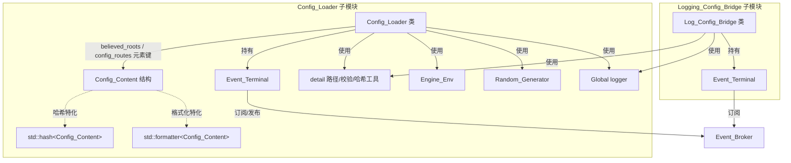

# 配置系统 · 模块架构

> 收录范围：`Engine/EngineCore/src/core/config/` 下的两个子模块——`Config_Loader/`（配置加载器）与桥接目录 `bridge/Logging_Config_Bridge/`（日志配置桥接）。本轮日志配置桥接模块自 `src/core/config/Logging_Config_Bridge/` 迁入 `src/core/config/bridge/Logging_Config_Bridge/`，本文档收录范围与底本一致（仍收录两子模块），并据此更新其路径与接口描述。
> 本文档为「白银纪元」引擎核心层（core）的配置系统模块导航，描述其功能定位、对外接口、私有方法、内部架构、设计细节与运行链路。
> 文中所有路径均为相对源码根（`工作区`）的相对路径。

---

## 一、文件内目录

- [二、模块功能介绍](#二模块功能介绍)
- [三、模块公开接口介绍](#三模块公开接口介绍)
- [四、模块私有方法介绍](#四模块私有方法介绍)
- [五、模块内部架构介绍](#五模块内部架构介绍)
- [六、模块设计/实现细节](#六模块设计实现细节)
- [七、模块运行链路详例](#七模块运行链路详例)
- [附录、待确认条目](#附录待确认条目)

---

## 二、模块功能介绍

### 2.1 模块定位

配置系统位于引擎核心层（`Engine/EngineCore/src/core/`），与事件系统（`core/event/`）同级，是「事件驱动的配置下发中枢」。它由两个职责分离、可独立接入事件中转站的子模块构成：

| 子模块 | 源码目录 | 定位 |
| --- | --- | --- |
| `Config_Loader` | `Engine/EngineCore/src/core/config/Config_Loader/` | 配置加载器：以「路由文件 + 配置文件」为数据源，把磁盘上的 JSON 配置，按「对象」维度安全地投递到各订阅对象 |
| `Logging_Config_Bridge` | `Engine/EngineCore/src/core/config/bridge/Logging_Config_Bridge/` | 日志配置桥接：把经事件中转站下发的日志配置，翻译为日志系统（`Log`）的纯数据设置调用 |

二者都不直接参与业务逻辑，也不直接读写事件中转站内部的转发逻辑；它们的共同形态是「订阅若干事件类别 → 在事件处理入口内完成一次可幂等的状态变更」。

### 2.2 职责边界与解决的问题

**`Config_Loader` 解决的问题**：

1. **配置的集中登记与分发**：引擎各对象（子系统、模块）需要读取 JSON 配置，但不希望各自处理「配置目录扫描、文件读取、路径安全、重复加载」等共性问题。`Config_Loader` 以「路由文件（`config_routes` 条目数组）」声明「哪个对象的哪份配置位于哪个路径」，从而把「配置的物理分布」与「配置的逻辑归属」解耦。
2. **可信根目录隔离**：通过「可信根目录（Believed_Root）」显式登记允许加载的配置目录根，防止任意路径被加载；每条路由条目在投递前还要通过 `path_safety_check` 做「无 `..` 跳转、必须落在声明配置目录之下、必须真实存在」三重校验。
3. **重复加载抑制（脏标记）**：同一进程运行期内，同一「对象 × 配置文件」被反复请求加载时，不应重复投递；`Config_Loader` 用「运行盐 + 哈希」生成运行期脏标记，写入路由条目并落盘，命中即短路。
4. **配置的按需重投**：配置投递要求接收者已接入事件中转站；接收者未接入时，该条目仍会被写入内存缓存（见 §6.11）。对象稍后接入后，可经 `Config/Load` 按缓存重投（本轮已移除「接收者上线自动补投」特性，见 §6.3）。

**`Logging_Config_Bridge` 解决的问题**：

日志系统（`Log`）只暴露一组「纯数据设置接口」（根目录、输出流绑定、三张输出许可表），且**不能反向包含事件系统**——否则 `Logging` 与 `Event_Broker` 之间会形成头文件循环依赖。因此需要一个位于 `core` 层、同时依赖事件系统与日志系统的「桥接」：它订阅 `Log/Load`、`Log/Unload` 事件，把事件载荷翻译为 `Log` 的设置调用。

### 2.3 在整体架构中的位置

```
                   ┌──────────────────────────────────────────┐
                   │           事件中转站 (Event_Broker)        │
                   └──────────┬───────────────────┬───────────┘
        Believed_Root/Route/Config 事件          Log/Load、Log/Unload 事件
                              │                       │
                   ┌──────────▼──────────┐  ┌─────────▼──────────────┐
                   │    Config_Loader    │  │  Logging_Config_Bridge │
                   │  （配置加载器）      │  │  （日志配置桥接）       │
                   └───┬──────────┬──────┘  └─────────┬──────────────┘
                       │          │                   │
      Config/Load 事件 │          │ 磁盘 JSON         │ Log 纯数据设置调用
     （投递给配置接收者）│          │ 路由/配置文件      │
                       ▼          ▼                   ▼
                  业务对象     std::filesystem     Log 日志系统
                              nlohmann::json      (根目录/流/许可表)
```

- 向上：两者都是事件中转站的**订阅者**，同时 `Config_Loader` 还是配置事件的**发布者**。
- 向下：`Config_Loader` 依赖 `tools/Detail`（路径转换、路径可见性、JSON 字段校验、哈希混合）、`tools/Engine_Env`（可执行文件目录）、`tools/Random_Generator`（运行盐）、`tools/Logging`（日志）、外部库 `nlohmann::json`；`Logging_Config_Bridge` 依赖 `tools/Detail`、`tools/Logging`。
- 横向：两者互不依赖。

### 2.4 与相邻模块的职责分界

| 相邻模块 | 分界 |
| --- | --- |
| 事件系统（`core/event/`） | 配置系统只负责「构造事件、订阅事件、在事件处理入口做状态变更」；事件的转发、路由、权限密钥校验由事件中转站负责。配置系统持有的 `Event_Terminal` 是订阅侧终端。 |
| 日志系统（`tools/Logging/`） | `Config_Loader` 只把 `logger` 当作输出通道；`Logging_Config_Bridge` 是唯一把「事件下发的日志配置」写入 `Log` 的设置接口的桥接，`Logging` 本身不感知事件系统。 |
| 工具集（`tools/Detail/`） | 路径字符串与 `std::filesystem::path` 的互转（UTF-8 ↔ 本地编码）、路径规范化、路径可见性校验、JSON 字段可用性校验统一由 `tools/Detail` 提供，配置系统不重复造轮子。 |
| 各业务对象 | 业务对象是配置事件的**接收者**；它们经事件中转站被查询接入状态（`Subscriber/Check`），并在收到配置投递事件后自行解析 `evt->config`。 |

---

## 三、模块公开接口介绍

本章列出配置系统**对外可见的类型与成员**。类内的私有/内部实现函数另见 §四。

### 3.1 `Config_Content`（配置目录数据体）

**声明位置**：`Engine/EngineCore/src/core/config/Config_Loader/配置加载器.h`

以 `struct` 形式定义在 `engine` 命名空间中，是「一对目录」的封装：`route`（索引目录）与 `config`（配置目录）。它同时是 `Config_Loader` 内部三张缓存的键（或键的一部分），因此配套提供了哈希与格式化特化。

| 成员 | 类型 | 含义 | 约束 |
| --- | --- | --- | --- |
| `route` | `std::filesystem::path` | 索引目录（该目录下存放路由文件） | 构造时经 `detail::path_normalize` 规范化 |
| `config` | `std::filesystem::path` | 配置目录（该目录下存放被投递的配置文件） | 构造时经 `detail::path_normalize` 规范化 |
| `operator==` | `bool operator==(const Config_Content&) const = default` | 默认等于重载，按 `route`、`config` 两字段逐项比较 | 依赖 `std::filesystem::path::operator==` |
| `Config_Content(const std::filesystem::path& route = {}, const std::filesystem::path& config = {})` | 构造函数（`explicit`） | 路径重载：直接接收两个 `path`，各自经 `path_normalize` 规范化 | 参数默认空；两参均有默认值 |
| `Config_Content(const std::string& route = {}, const std::string& config = {})` | 构造函数（`explicit`） | 字符串重载：接收两个 **UTF-8** 字符串，经 `detail::string_to_path` 转为 `path` 后再 `path_normalize` | 字符串必须是 UTF-8；中文路径依赖 `string_to_path` 的 UTF-8 → 本地编码转换 |

**易错点**：两个构造函数的参数**同时**带默认值，因此 `Config_Content{}` 的默认构造会因两个重载均可匹配而产生歧义。当前源码中不存在默认构造调用点，故未暴露；后续若需默认构造，应显式指定类型。

### 3.2 `std::hash<engine::Config_Content>`（哈希特化）

**声明位置**：`配置加载器.h`（`namespace std` 内）

| 签名 | 说明 |
| --- | --- |
| `std::size_t operator()(const engine::Config_Content& c) const noexcept` | 以 `seed = 0` 起，两次调用 `engine::detail::hash_combine`，分别混入 `std::hash<std::filesystem::path>{}(c.route)` 与 `...{}(c.config)`；返回 `seed` |

**约束**：`noexcept`；依赖 `detail::hash_combine`。因为 `Config_Content` 是 `std::unordered_set` 的元素类型，此特化是必需的。

### 3.3 `std::formatter<engine::Config_Content>`（格式化特化）

**声明位置**：`配置加载器.h`（`namespace std` 内）

| 签名 | 说明 |
| --- | --- |
| `constexpr auto parse(format_parse_context& ctx)` | 忽略格式说明符，返回 `ctx.begin()`（不做特殊解析） |
| `auto format(const engine::Config_Content& content, format_context& ctx) const` | 输出「索引[索引目录] 配置[配置目录]」，两个目录均经 `detail::path_to_string` 转为 **UTF-8 文本**后格式化 |

**用途**：使 `Config_Content` 可直接用于 `std::format`/日志格式化（例如错误日志中打印配置目录）。**约束**：输出的目录为 UTF-8 文本，符合全项目「跨接口字符串统一 UTF-8」的约定。

### 3.4 `Config_Loader`（配置加载器）

**声明位置**：`Engine/EngineCore/src/core/config/Config_Loader/配置加载器.h`
**实现位置**：`Engine/EngineCore/src/core/config/Config_Loader/core/` 下六个编译单元

#### 3.4.1 公开成员

| 成员 | 签名 | 参数含义 | 返回值 | 约束与异常行为 |
| --- | --- | --- | --- | --- |
| `event_terminal` | `Event_Terminal event_terminal;` | 订阅/发布侧事件终端（**public** 数据成员） | — | 由外部（引擎装配期）持有并使用；`Config_Loader` 自身只在构造与 `attach` 中使用 |
| 构造函数 | `Config_Loader()` | 无 | — | 构造体内 `this->acl_key = event_terminal.key().value();`——生成权限密钥。`key()` 返回 `std::optional<int64_t>`，此处直接 `.value()`；构造函数中的调用必为首次，故**不存在失败路径**（见 §6.7），不会抛出 `std::bad_optional_access` |
| 析构函数 | `~Config_Loader() = default` | — | — | 默认析构；不主动清理已登记的 `believed_roots`、缓存与监听 |
| 事件终端接入 | `void attach(void)` | 无 | `void`（无返回值） | 注册 `Evt_Receiver` 端口回调、接入中转站，并以 `Subscribed_Events/Add` 事件登记六类订阅事件；任一步失败仅记错误日志并提前返回，**不抛异常、不返回错误码** |

`reserved_events_get()` 返回的订阅事件清单（逐条；同时用于 `event_identifier_reserved` 保留判定，二者同源）：

| 序号 | 事件类别 `category` | 标签 `tag` | 语义 |
| --- | --- | --- | --- |
| 1 | `Believed_Root` | `Load` | 登记可信根目录并增量加载 |
| 2 | `Believed_Root` | `Unload` | 卸载可信根目录及其下缓存 |
| 3 | `Route` | `Load` | 重新加载指定对象的指定配置目录 |
| 4 | `Route` | `Unload` | 卸载指定对象的指定配置目录 |
| 5 | `Config` | `Load` | 按对象/文件清单加载配置 |
| 6 | `Config` | `Unload` | 按对象/文件清单卸载配置缓存 |

> 注意：本轮订阅清单中的标签已统一为大写（`Believed_Root`/`Route`/`Config` 三类事件的标签均为 `Load`/`Unload`）；此前 `Route` 与 `Config` 的加载标签曾为小写 `load`，历史契约中可信根登记标签曾为 `Add`，现均已统一为 `Load`。
>
> 订阅声明方式亦已变更：`attach()` 不再把订阅清单作为 `event_terminal.attach(...)` 的参数传入，而是先 `event_terminal.attach("Config_Loader", acl_key)` 仅登记订阅者身份与接收入口，再构造 `Subscribed_Events/Add` 事件（载荷 `object`、`acl_key`、`subscribed_events` 数组）发送给中转站完成订阅登记（详见 §7.9）。

#### 3.4.2 `Config_Loader` 发出的对外事件契约

`Config_Loader` 不只有接收面，还会向事件中转站**发送**两类事件，构成它与各业务对象之间的隐式契约：

| 事件 | 类别 / 标签 | 目标 `receiver` | 载荷 `config` | 触发时机 |
| --- | --- | --- | --- | --- |
| 订阅登记 | `Subscribed_Events` / `Add` | 空（由中转站自身处理） | `object`、`acl_key`、`subscribed_events` | `attach()` 中，接入后 |
| 接收者存在性查询 | `Subscriber` / `Check` | 空（目标对象名经载荷 `object` 传递） | `object` | `receiver_check` 中，投递前 |
| 配置投递 | 由路由条目 `event_category` / `event_tag` **指定** | 目标对象名 | 该配置文件的 JSON 数据（**已剔除 `dirty_mark` 字段**） | `object_config_deliver` 中 |

- 配置投递事件的类别与标签**完全由路由条目决定**：条目必须同时含有效字符串字段 `event_category` 与 `event_tag`，否则该条目被判为「事件标识无效」并驳回（**不再提供缺省回落 `Config`/`Load`**）。这允许同一加载器为不同对象定制个性化事件名。
- 为避免命名冲突，投递前会调用 `event_identifier_reserved(category, tag)`：若条目事件标识命中预定义订阅事件（含中转站保留标签 `All`），则驳回该条目，不再投递。

#### 3.4.3 `Config_Loader` 消费的路由文件格式契约

被扫描到的每个路由文件为 JSON 对象，字段契约如下：

| 字段 | 类型 | 必需 | 含义 |
| --- | --- | --- | --- |
| `dirty_mark` | 无符号整数 | 否（由加载器写入） | 顶层脏标记，值等于 `mark_make(路由文件绝对路径字符串)`；命中则整份路由文件跳过 |
| `config_routes` | 数组 | 是（缺省视为非法，直接报错返回） | 路由条目数组，元素为对象 |

每个路由条目（`config_routes` 元素）字段契约：

| 字段 | 类型 | 必需 | 含义 |
| --- | --- | --- | --- |
| `object` | 字符串 | 是 | 配置接收者对象名 |
| `config_path` | 字符串 | 是 | 配置文件相对路径（**UTF-8**，相对配置基目录），也是 `config_files` 二级缓存的键 |
| `event_category` | 字符串 | 是 | 投递事件的 `category`（本轮起**必需**，无缺省回落） |
| `event_tag` | 字符串 | 是 | 投递事件的 `tag`（本轮起**必需**，无缺省回落） |
| `dirty_mark` | 无符号整数 | 否（由加载器写入） | 条目脏标记，值等于 `mark_make(object, config_path)`；命中则该条目跳过 |

> 说明：条目的 `event_category`/`event_tag` 除「必需」外，还须**不命中预定义订阅事件**（否则驳回）。二者共同构成当前路由条目的合法要件。

### 3.5 `Log_Config_Bridge`（日志配置桥接）

**声明位置**：`Engine/EngineCore/src/core/config/bridge/Logging_Config_Bridge/日志配置桥接.h`
**实现位置**：`Engine/EngineCore/src/core/config/bridge/Logging_Config_Bridge/core/日志配置桥接.cpp`

> 本轮该子模块自 `Engine/EngineCore/src/core/config/Logging_Config_Bridge/` 迁至 `Engine/EngineCore/src/core/config/bridge/Logging_Config_Bridge/`（头文件与源码内容基本不变，仅 `attach()` 订阅声明方式随中转站接口变更同步调整）。

#### 3.5.1 公开成员

| 成员 | 签名 | 参数含义 | 返回值 | 约束与异常行为 |
| --- | --- | --- | --- | --- |
| `event_terminal` | `Event_Terminal event_terminal;` | 订阅侧事件终端（**public** 数据成员） | — | 同 `Config_Loader` 的对外终端 |
| 构造函数 | `Log_Config_Bridge()` | 无 | — | 构造体内 `acl_key = event_terminal.key().value();`；构造函数中的调用必为首次，**不存在失败路径**（同 `Config_Loader`，见 §6.7），不会抛 `bad_optional_access` |
| 析构函数 | `~Log_Config_Bridge() = default` | — | — | 默认析构；不主动还原已应用的日志配置 |
| 事件终端接入 | `void attach(void)` | 无 | `void` | 注册 `Evt_Receiver` 回调，接入中转站，并以 `Subscribed_Events/Add` 事件登记 `Log/Load`、`Log/Unload` 两条订阅；失败仅记错误日志 |

订阅事件清单：

| 事件类别 `category` | 标签 `tag` | 语义 |
| --- | --- | --- |
| `Log` | `Load` | 应用日志配置（根目录 / 输出流 / 文件 / 目录 / 级别许可） |
| `Log` | `Unload` | 卸载日志配置，恢复初始态 |

#### 3.5.2 `Log_Config_Bridge` 消费的事件载荷契约

`Log/Load` 事件载荷（`evt->config`）字段契约：

| 字段 | 类型 | 必需 | 缺省行为 | 非法处理 |
| --- | --- | --- | --- | --- |
| `root` | 字符串 | 否 | 不设置 | 非字符串 → 记 `error`，跳过该项 |
| `streams` | 数组（元素 `{path, file}`） | 否 | 不绑定 | 非数组 → 记 `error` 跳过整项；元素字段无效/绑定失败 → 记 `warn` 跳过该元素 |
| `files` | 对象（`string → bool`） | 否 | 不设置 | 非对象 → 记 `error` 跳过整项；值非布尔 → 记 `warn` 跳过该条 |
| `dirs` | 对象（`string → bool`） | 否 | 不设置 | 同上 |
| `levels` | 对象（`string → bool`） | 否 | 不设置 | 同上 |

`Log/Unload` 事件载荷：不使用任何字段（`config_unload()` 无参）。

---

## 四、模块私有方法介绍

本章逐条列出两个子模块类内**私有/内部实现函数**（签名 + 作用 + 关键行为）。数据成员说明见 §五。

### 4.1 `Config_Loader` 私有方法（按头文件注释划分的八组）

私有数据成员（逐字段说明见 §5.3）：`believed_roots`、`config_routes`、`config_files`、`acl_key`。

**组1 路径与文件**（`core/路径与文件.cpp`）

| 方法 | 签名 | 说明 |
| --- | --- | --- |
| 基目录获取 | `const std::filesystem::path base_dir_get(void) const` | 返回 `Engine_Env::exe_dir_get()`（可执行文件所在目录）作为配置基目录 |
| 异常信息输出 | `bool error_out(std::error_code& info) const` | 若 `info` 有值则经 `logger.error` 输出、`clear()` 并返回 `true`；无值返回 `false` |
| 路径前缀判定 | `static bool path_prefix_check(const std::filesystem::path& prefix, const std::filesystem::path& target)` | 判断 `prefix` 是否为 `target` 的**逐节目录前缀**；空前缀返回 `false` |
| 文件读取 | `void file_read(const std::filesystem::path& file_path, nlohmann::json& receiver) const` | 打开并解析 JSON 到 `receiver`；失败时 `receiver` 被置为 `json()` 空值 |
| 目录递归扫描 | `void content_scan(const std::string& route, std::vector<std::string>& receiver) const` | 递归扫描 `base_dir_get()/route`，把常规文件以 **UTF-8 绝对路径字符串**收集到 `receiver` |
| 路径安全检查 | `bool path_safety_check(const Config_Content& content, const std::string& config_path) const` | 对 `config_path` 做「非空、无 `..`、以 `content.config` 为前缀、真实存在且为常规文件」四重校验 |

**组2 脏标记**（`core/脏标记.cpp`）

| 方法 | 签名 | 说明 |
| --- | --- | --- |
| 运行盐获取 | `static uint64_t run_salt_get(void)` | 进程内单次生成、跨运行随机的 64 位盐（函数局部 `static const`） |
| 脏标记计算（路由文件） | `static uint64_t mark_make(const std::string& file_key)` | `盐 ⊕ hash(file_key)`，用于路由文件顶层脏标记 |
| 脏标记计算（对象×文件） | `static uint64_t mark_make(const std::string& object, const std::string& config_path)` | `盐 ⊕ hash(object) ⊕ hash(config_path)`，用于路由条目脏标记 |

**组3 路由文件读写**（`core/路由文件操作.cpp`）

| 方法 | 签名 | 说明 |
| --- | --- | --- |
| 路由文件读取 | `void route_file_read(const std::filesystem::path& file_path, nlohmann::json& mark, nlohmann::json& entries) const` | 解出顶层 `dirty_mark`（→`mark`）与 `config_routes`（→`entries`）；格式非法时 `entries` 为 `json()` |
| 路由文件写回 | `bool route_file_write(const std::filesystem::path& file_path, const nlohmann::json& mark, const nlohmann::json& entries) const` | 以 `dump(4)` 写回；`mark` 为空值（`null`）时**不写**顶层 `dirty_mark`（用于卸载后抹除文件头标记） |

**组4 配置投递**（`core/配置加载.cpp`）

| 方法 | 签名 | 说明 |
| --- | --- | --- |
| 接收者存在性检查 | `bool receiver_check(const std::string& object)` | 向事件中转站发 `Subscriber/Check` 查询（目标留空、对象名经载荷传递）；答复字段 `subscribed` 无效或为 `false` 则返回 `false`（**不再登记待发送对象**） |
| 对象配置投递 | `bool object_config_deliver(const std::string& object, const std::string& config_path, uint64_t mark, nlohmann::json& entry)` | 读配置 → 校验条目 `event_category`/`event_tag`（必需且不得命中预定义事件）→ 构造并发送配置事件 → 成功后写 `entry["dirty_mark"] = mark` |
| 单份配置文件处理 | `bool config_file_process(const std::string& config_path, nlohmann::json& entry, const std::string& object)` | 先查条目脏标记，命中则短路；否则执行投递；返回「本轮是否真正投递」 |

**组5 路由文件处理**（`core/路由文件操作.cpp`）

| 方法 | 签名 | 说明 |
| --- | --- | --- |
| 单份路由文件处理 | `bool route_file_process(const Config_Content& content, const std::filesystem::path& file_path, const std::string& only_object, const std::vector<std::string>& only_files, bool deliver = true)` | 按可选过滤条件处理其中条目；`deliver` 表示是否投递配置；**仅本轮真正投递过（`delivered`）才回写路由文件** |
| 单份路由文件卸载 | `bool route_file_unload(const Config_Content& content, const std::filesystem::path& file_path, const std::string& only_object, const nlohmann::json& only_files)` | 按可选过滤条件抹除条目标记与顶层标记，并移除对应配置文件缓存；**仅本轮真正改动过（`changed`）才回写** |

**组6 配置加载**（`core/配置加载.cpp`）

| 方法 | 签名 | 说明 |
| --- | --- | --- |
| 配置路由加载 | `void route_load(const Config_Content& content, bool delivery = true, const std::string& object = {})` | 扫描 `content.route` 下路由文件，逐份读取顶层脏标记并（必要时）处理 |
| 配置加载 | `void config_load(const std::string object, const nlohmann::json& request)` | 依据 `config_files` 缓存，按 `request["files"]` 清单或全量加载对象配置 |

**组7 缓存清除**（`core/缓存清除.cpp`）

| 方法 | 签名 | 说明 |
| --- | --- | --- |
| 可信根目录缓存清除 | `void root_cache_clear(const Config_Content& root)` | **先在清除登记前**收集该根下「对象 × 目录对」命中集合，逐份 `route_unload` 落盘抹除条目标记与顶层标记，随后再按前缀清除 `config_routes` 与 `config_files` 内存缓存（见 §6.1、§7.5） |
| 配置路由卸载 | `void route_unload(const Config_Content& content, const std::string& object)` | 扫描并逐份卸载路由文件（保留配置目录登记） |
| 配置卸载 | `void config_unload(const std::string object, const nlohmann::json& request)` | 按对象与可选文件清单清除内存缓存，并抹除对应路由条目标记 |

**组8 事件分发**（`core/事件处理.cpp`）

| 方法 | 签名 | 说明 |
| --- | --- | --- |
| 预定义事件标识表 | `static const std::vector<std::pair<std::string, std::string>>& reserved_events_get(void)` | 返回本模块订阅的全部事件标识（6 条），使订阅清单与保留判定共用同一来源、避免两处漂移 |
| 事件标识保留判定 | `static bool event_identifier_reserved(const std::string& category, const std::string& tag)` | 判断 `{category, tag}` 是否为本模块预定义事件（含中转站保留标签 `All`）；用于拒绝命中保留标识的投递条目 |
| 事件处理 | `void Config_Loader::event_process(std::shared_ptr<Event> evt)` | 事件接收入口的实际分派函数，覆盖 `Believed_Root/*`、`Route/Load`、`Route/Unload`、`Config/Load`、`Config/Unload` 五类（`Subscriber/Call` 分支已于本轮删除，见 §6.3） |

### 4.2 `Log_Config_Bridge` 私有方法（三组）

私有数据成员（逐字段说明见 §5.4）：`acl_key`、`bound_paths`。

**组1 配置应用**（均接收 `const nlohmann::json& config`，返回 `void`，逐字段容错）

| 方法 | 签名 | 处理的载荷字段 | 调用的日志接口 |
| --- | --- | --- | --- |
| 根目录配置应用 | `void root_apply(const nlohmann::json& config)` | `root`（字符串，允许空串表示整个项目） | `logger.root_set(root)` |
| 输出流配置应用 | `void streams_apply(const nlohmann::json& config)` | `streams`（数组，元素含 `path`、`file` 字符串） | `logger.stream_bind(path, file)`，成功则记录 `bound_paths` |
| 文件许可配置应用 | `void files_apply(const nlohmann::json& config)` | `files`（对象，`文件 → bool`） | `logger.file_rule_set(file, allowed)` |
| 目录许可配置应用 | `void dirs_apply(const nlohmann::json& config)` | `dirs`（对象，`目录 → bool`） | `logger.dir_rule_set(dir, allowed)` |
| 级别许可配置应用 | `void levels_apply(const nlohmann::json& config)` | `levels`（对象，`级别 → bool`，`INFO/WARN/ERROR/DEBUG`） | `logger.level_rule_set(level, allowed)` |

**组2 配置卸载**

| 方法 | 签名 | 说明 |
| --- | --- | --- |
| 输出流绑定还原 | `void streams_revert(void)` | 按 `bound_paths` 逐条 `logger.stream_clear(path)`，然后清空记录 |
| 配置卸载 | `void config_unload(void)` | 依次 `streams_revert()` → `logger.rule_clear()` → `logger.root_clear()`，并记日志 |

**组3 事件分发**

| 方法 | 签名 | 说明 |
| --- | --- | --- |
| 事件处理 | `void event_process(std::shared_ptr<Event> evt)` | `Log/Load` → 依次调用五个 `*_apply`；`Log/Unload` → `config_unload()` |

---

## 五、模块内部架构介绍

### 5.1 目录与文件结构树

```
Engine/EngineCore/src/core/config/
├── Config_Loader/                              # 配置加载器
│   ├── 配置加载器.h                             # 对外头文件：Config_Content + 哈希/格式化特化 + Config_Loader 类声明
│   ├── 局部命名空间使用.h                        # 私有 using 声明集合
│   └── core/
│       ├── 路径与文件.cpp                        # 组1：基目录、异常输出、前缀判定、文件读取、目录扫描、路径安全
│       ├── 脏标记.cpp                            # 组2：运行盐获取、两类脏标记计算
│       ├── 路由文件操作.cpp                      # 组3+组5：路由文件读/写、单份路由文件处理、单份路由文件卸载
│       ├── 配置加载.cpp                          # 组4+组6：接收者检查、对象投递、单文件处理、route_load、config_load
│       ├── 缓存清除.cpp                          # 组7：可信根缓存清除、路由卸载、配置卸载
│       └── 事件处理.cpp                          # 组8：attach 接入、预定义事件标识表/保留判定、event_process 事件分派
└── bridge/                                     # 桥接类子模块目录（本轮新增中间层目录）
    └── Logging_Config_Bridge/                  # 日志配置桥接
        ├── 日志配置桥接.h                        # 对外头文件：Log_Config_Bridge 类声明
        ├── 局部命名空间使用.h                    # 私有 using 声明集合
        └── core/
            └── 日志配置桥接.cpp                  # 全部实现：attach + 三组方法
```

> 说明一：`配置加载器.h` 的类注释写有「实现分散在 `core/` 下的**九个**编译单元」，而实际 `Config_Loader/core/` 下为**六个** `.cpp`。此为拆分后注释未同步更新的**事实性不一致**，不影响接口与行为，记录于此以便后续修订注释。
>
> 说明二：本轮日志配置桥接模块自 `Engine/EngineCore/src/core/config/Logging_Config_Bridge/` 迁移至 `Engine/EngineCore/src/core/config/bridge/Logging_Config_Bridge/`（新增 `bridge/` 中间层目录）。该模块仍在本文档收录范围内。

### 5.2 每个编译单元的职责

| 编译单元 | 覆盖方法组 | 职责 |
| --- | --- | --- |
| `core/路径与文件.cpp` | 组1 | 提供「与操作系统文件系统打交道」的底层能力：定位配置基目录、递归枚举文件、读 JSON、判断路径前缀、做路径安全校验、统一异常信息输出。本单元是唯一直接使用 `std::ifstream`/`std::filesystem` 迭代器的地方。 |
| `core/脏标记.cpp` | 组2 | 提供「运行期唯一盐」与「确定性标记函数」。所有标记函数均为 `static`，不依赖对象状态，纯粹由「盐 + 内容哈希」决定。 |
| `core/路由文件操作.cpp` | 组3 + 组5 | 路由文件的读写，以及「单份路由文件」这一粒度上的整体处理/卸载。该单元是**内存缓存的唯一写入点**（`config_routes[object].insert(...)`、`config_files[object][config_path] = entry`），也是**路由文件落盘的唯一触发点**。 |
| `core/配置加载.cpp` | 组4 + 组6 | 配置投递（接收者检查、读配置、发事件、写条目标记），以及两个入口级加载函数 `route_load`（按目录）与 `config_load`（按对象/文件清单）。该单元是**配置事件的唯一发送点**。 |
| `core/缓存清除.cpp` | 组7 | 缓存与登记的清除：按可信根前缀批量清除、按目录对卸载、按对象与文件清单卸载。该单元是**内存缓存的唯一删除点**，并在可信根卸载时按目录对落盘抹标记（见 `root_cache_clear`）。 |
| `core/事件处理.cpp` | 组8 | `attach()` 完成端口绑定、中转站接入与订阅登记；`reserved_events_get()`/`event_identifier_reserved()` 提供订阅清单与保留判定同源；`event_process()` 是事件分派中枢，把「类别×标签」映射到上述各组方法。 |
| `bridge/Logging_Config_Bridge/core/日志配置桥接.cpp` | 桥接全部 | 桥接模块的全部实现，含 `attach()`、五个 `*_apply`、`streams_revert`、`config_unload`、`event_process`。 |

**关键取舍：为何把「缓存的增删点」集中**。`route_file_process`（增/改）在 `路由文件操作.cpp`，`root_cache_clear`/`route_unload`/`config_unload`（删）在 `缓存清除.cpp`。这样 `config_routes`/`config_files` 两张表的写点与删点各自聚集，读点则散落在 `配置加载.cpp`、`事件处理.cpp`。好处是「谁改表」一目了然；代价是跨文件的表结构耦合（无访问器封装），因此变更表结构时须同时核对这三个单元。

### 5.3 `Config_Loader` 内部数据成员逐字段说明

| 字段 | 类型 | 语义 | 不变量/说明 |
| --- | --- | --- | --- |
| `believed_roots` | `std::unordered_set<Config_Content>` | 已登记的**可信加载根目录**集合 | 元素为规范化后的「索引目录 + 配置目录」对；`Believed_Root/Load` 时插入，`Believed_Root/Unload` 时按前缀落盘抹标记并清除相关缓存后移除 |
| `config_routes` | `std::unordered_map<std::string, std::unordered_set<Config_Content>>` | 「对象名 → 该对象登记过的配置目录对集合」 | 键为对象名；值为对象自身的目录对（`route` = 路由文件所在目录相对基目录、`config` = 配置文件所在目录）。用于对象级加载/卸载时重新定位路由文件，以及可信根卸载时的前缀剔除 |
| `config_files` | `std::unordered_map<std::string, std::unordered_map<std::string, nlohmann::json>>` | 「对象名 → (配置文件相对路径 → 路由条目 JSON 快照)」 | 二级键为 `config_path`（UTF-8 相对路径）；值为该条目在路由文件中的**内存副本**（含脏标记）。`config_load` 直接据此投递，避免再次读盘 |
| `event_terminal` | `Event_Terminal` | 事件终端 | **public**；`acl_key` 由它派生 |
| `acl_key` | `int64_t`（初值 `0`） | 事件中转站权限密钥 | 构造期由 `event_terminal.key().value()` 赋值；所有 `attach`/`interact`/`send` 调用均传此密钥 |

> 本轮变更：原数据成员 `waited_objects`（配置待发送对象集合）已**删除**（随 `Subscriber/Call` 补投链路一并移除，见 §6.3）。

### 5.4 `Log_Config_Bridge` 内部数据成员逐字段说明

| 字段 | 类型 | 语义 | 不变量/说明 |
| --- | --- | --- | --- |
| `event_terminal` | `Event_Terminal` | 事件终端 | **public**；`acl_key` 由它派生 |
| `acl_key` | `int64_t`（初值 `0`） | 权限密钥 | 构造期赋值 |
| `bound_paths` | `std::vector<std::string>`（初值空） | 已绑定输出流的**路径清单** | 每次 `logger.stream_bind(path, file)` 成功后追加 `path`；卸载时据此逐条 `stream_clear`。**只记路径、不记文件名**：`stream_bind` 经 `group_append` 把输出目标**追加**进节点自有容器（同一路径重复绑定为多路同时输出），而 `stream_clear(path)` 是**整组清除**（与绑定次数无关），故只记路径即为充分（见 §6.9） |

### 5.5 内部类之间的关系



两子模块之间**无直接依赖**；它们的唯一交汇点是「事件中转站」与「全局 `logger`」。

### 5.6 `局部命名空间使用.h` 的做法说明

两个子模块各有一份 `局部命名空间使用.h`，作用是：在 `.cpp` 实现文件中**彻底去掉 `std::`/`nlohmann::` 等命名空间前缀**，使业务代码保持整洁。其写法要点：

- 只 `include` 本模块的对外头文件（`配置加载器.h` / `日志配置桥接.h`），其余依赖通过对外头文件的传递包含获得。
- 按类别分组罗列 `using` 声明并加中文分组注释（容器、输入输出与流、错误与异常、函数对象与内存管理、字符串与容器、文件系统、`nlohmann::json`）。
- **只引入 `.cpp` 与头文件中实际会用到的名字**，不做无差别 `using namespace std`。

`Config_Loader/局部命名空间使用.h` 引入的关键名字：

| 分组 | 名字 |
| --- | --- |
| 容器 | `vector` |
| 输入输出与流 | `ifstream`、`ofstream` |
| 错误与异常 | `error_code`、`exception` |
| 函数对象与内存管理 | `function`、`nothrow`、`shared_ptr` |
| 字符串与容器 | `string`、`u8string`、`vector` |
| 文件系统（C++20） | `exists`、`is_regular_file`、`path`、`recursive_directory_iterator` |
| nlohmann | `json` |

`Logging_Config_Bridge/局部命名空间使用.h` 引入：`string`、`vector`、`shared_ptr`、`json`。

**注意**：头文件 `配置加载器.h` 本身不用 `using`，其中涉及类型处均写全限定名（如 `std::filesystem::path`、`std::unordered_set`），符合《文件架构约束》中「对外头文件除类声明外应加命名空间前缀」的要求。

### 5.7 对外头文件的依赖构成

`配置加载器.h` 顶部显式包含四类依赖（逐条）:

| 包含 | 用途 |
| --- | --- |
| `Engine/EngineCore/common/前置头文件包含.h` | 预编译头（标准库、`nlohmann::json`、`std::filesystem` 等） |
| `Engine/EngineCore/src/core/event/事件系统运行包.h` | `Event_Terminal`、`Event`、`Port_ID` |
| `Engine/EngineCore/src/tools/Engine_Env/引擎环境.h` | `Engine_Env::exe_dir_get()` |
| `Engine/EngineCore/src/tools/Detail/package/数据校验工具.h` | `detail::field_check<T>`、`detail::path_check` |
| `Engine/EngineCore/src/tools/Detail/package/路径操作工具.h` | `detail::path_normalize`、`detail::string_to_path`、`detail::path_to_string`、`detail::hash_combine` |

`日志配置桥接.h` 顶部只包含预编译头与 `Engine/EngineCore/src/core/event/事件系统运行包.h`；其余依赖（`detail::field_check`、`logger`）由 `.cpp` 就地包含，以减小对外头文件的传染面。

**跨目录包含口径（本轮统一）**：头文件跨目录包含写**项目根全路径**（`Engine/EngineCore/...`，如上表）；实现文件（`.cpp`）跨目录包含写**本层根相对**（`src/...`），例如本模块各 `.cpp` 现以 `#include "src/core/config/Config_Loader/局部命名空间使用.h"`、`#include "src/tools/Logging/日志系统运行包.h"` 引入（此前为 `"../局部命名空间使用.h"` 等相对写法）。本模块对应 `CMakeLists.txt` 的私有包含根为「项目根 ＋ 本层根」，随该口径一并调整。

---

## 六、模块设计/实现细节

### 6.1 脏标记机制（核心设计）

**目标**：在「同一进程运行期内，同一份配置不应被重复投递；而跨进程重启后，上一轮遗留的标记必须自动失效」这两个约束下，用**无需额外状态文件、无需时间戳比对**的方式实现去重。

**实现三要素**：

1. **运行盐**（`run_salt_get`）：函数局部 `static const uint64_t salt`，只在首次调用时求值一次：
   - 以 `Random_Generator<int64_t>()()` 产生随机种子 `seed`；
   - `detail::hash_combine(seed, steady_clock::now().time_since_epoch().count())` 混入当前时间，保证**跨运行随机**；
   - 返回该 `salt`。由于是函数局部静态量，**进程内所有 `Config_Loader` 实例共享同一盐**。

2. **两类标记函数**（均为 `static`，纯函数）：
   - `mark_make(file_key)` = `盐 ⊕ hash(路由文件标识串)` —— 作为路由文件**顶层** `dirty_mark`；
   - `mark_make(object, config_path)` = `盐 ⊕ hash(object) ⊕ hash(config_path)` —— 作为路由**条目**的 `dirty_mark`。

3. **标记的落盘与命中判定**：
   - 投递成功后，条目被写入 `entry["dirty_mark"] = want_mark`（`object_config_deliver`），随后整份条目数组连同顶层标记被 `route_file_write` **写回路由文件**（`dump(4)`）。
   - 下次加载时：路由文件顶层标记若为无符号整数且等于 `mark_make(路由文件标识串)`，则整份文件跳过；条目标记若等于 `mark_make(object, config_path)`，则该条目跳过。

**为什么这样设计有效**：

- **进程内去重**：盐在进程内稳定，因此同一对象×文件的标记在本次运行内可复现，命中即短路。即使中途新建了一个 `Config_Loader` 实例（`config_files` 缓存为空），也能因为标记**已落盘**而避免重复投递。
- **跨运行自动失效**：盐含随机数与时钟，重启后必然不同，于是上一轮落盘的标记**必然不命中**，等价于「全量重新加载」，无需任何清理逻辑。
- **记忆载体就是路由文件本身**：脏标记随 `config_routes` 条目一起存放，不引入额外的状态文件。这使「配置路由」这一份 JSON 同时承担「静态声明」与「运行期状态」双重角色——此为**有意为之**的设计取舍（不引入额外状态文件）。

**写回已最小化（本轮）**：`route_file_write` 虽以 `dump(4)` **整份重写**路由文件，但落盘被严格收窄到「确有变更」的情形：

- `route_file_process`：仅当本轮**真正投递过配置**（`delivered == true`）才写回；仅缓存路由（如 `route_load` 以 `delivery=false` 扫描）时**不写盘**，也不写顶层标记。
- `route_file_unload`：仅当本轮**真正改动过条目**（`changed == true`）才写回。
- 无变化时不写盘，因此运行程序不会因纯扫描而对路由文件造成无谓变更。

**副作用与取舍**：一旦发生上述变更，`route_file_write` 仍会用 `dump(4)` 重写整份路由文件：

- 该文件会被加载器改写（首次加载即在文件顶层与各条目追加 `dirty_mark`，卸载时又抹除标记）；
- 原有文件的缩进/键序等格式会被统一为 `dump(4)` 的风格；
- 若这些路由文件被纳入版本控制，则运行程序在**确有加载/卸载变更**时会造成工作区文件变更。

**卸载时的标记语义**：

- `route_file_unload` 抹除命中的条目 `dirty_mark`，并在本轮确有改动时以 `route_file_write(file_path, json(), entries)` 写回——**顶层标记传 `json()`（null）**，据 `route_file_write` 的实现，此时**不写**顶层 `dirty_mark` 字段，从而实现「抹除文件头脏标记」。
- 这保证了卸载后同一进程内再次加载该路由文件不会被顶层标记短路。

### 6.2 缓存副本回写机制

`route_file_process` 内的顺序是：先 `config_files[object][config_path] = entry;`（把**投递前**的条目快照写入缓存），随后才调用 `config_file_process` → `object_config_deliver`（后者向循环内的 `entry` 写入 `dirty_mark`）。因此**缓存里最初存的是不含脏标记的快照**。

在投递成功后，源码显式执行一次回写：

```cpp
//投递成功后刷新内存缓存副本：缓存里存的是投递前的条目快照，脏标记只写进了
//循环内的 entry（并随路由文件落盘），不回写会让同一进程内再次加载重复投递
if (delivered)
    config_files[object][config_path] = entry;
```

**为什么需要**：`config_load`（按对象/文件清单加载）是直接读 `config_files` 缓存里的条目快照来投递的，它**不再读盘**。如果缓存快照不含脏标记，那么 `config_load` 路径下的 `config_file_process` 判定 `marked = false`，就会重复投递。回写把「带标记的条目」同步进缓存，使两条投递路径（按目录的 `route_load` 与按缓存的 `config_load`）共享同一份去重依据。

**注意点**：`config_files[object][config_path] = entry` 是 **JSON 值拷贝**，因此后续对循环变量 `entry` 的修改不会自动反映到缓存；反之缓存也是独立副本。这既是回写必要性的来源，也是「缓存与路由文件可能短暂不一致」的来源。

### 6.3 接收者存在性检查（本轮起无自动补投）

投递前，`receiver_check(object)` 会：

1. 构造 `Subscriber/Check` 查询事件（`build("", "", "Subscriber", "Check")`，**事件目标留空**，待查询对象名经载荷 `object` 传递，以命中中转站自身处理契约）；
2. 写 `evt->config["object"] = object`，随后 `event_terminal.send(evt, acl_key)`（中转站同步处理并就地写入答复字段）；
3. 构造失败、发送失败，或答复 `config["subscribed"]` 不是有效布尔或为 `false`，则返回 `false`；否则返回 `true`。

当接收者尚未接入时，`route_file_process` 记为 `warn` 并 `continue`——**跳过投递但不中断整份路由文件处理**，同时该条目的配置文件缓存**已经写入**（缓存写入在 `receiver_check` 之前），因此对象一旦接入即可经 `Config/Load`（见 §7.3）按缓存重投。

**本轮移除的链路（定案：未完成链路）**：此前 `event_process` 设有 `Subscriber/Call` 分支，配合数据成员 `waited_objects` 实现「接收者上线自动补投」。经核实该链路为**未完成链路**并已于本轮**整体删除**：

- `Subscriber/Call` 在全仓**无任何发送方**（仅本模块 `event_process` 曾有一处分支判断）；
- `attach()` 订阅清单（6 条）从未包含该项；
- 中转站 `Event_Broker::receive` **先**判 `acl_set.count({category, tag})`，未订阅即丢弃，故「答复/声明类事件由中转站统一转发」在当前实现中并不存在；
- 中转站 `process()` 的 `Subscriber` 分支为空壳（`Check` 构造了 `response_event` 却未回填与返回，`Detach` 为空体）。

**处置**：删除该分派分支及配套 `waited_objects`（含 `receiver_check` 内 3 处写入），一并移除「接收者上线自动补投」特性。对象稍后仍可经 `Config/Load` 按缓存重投，只是不再有自动补投。若日后补全中转站答复机制，再按新接口重新设计本模块的补投路径。

### 6.4 路径安全（三道闸门）

`path_safety_check(content, config_path)` 对每条配置路径依次校验：

1. **非空**：`string_to_path(config_path)` 为空则报错返回 `false`；
2. **无父目录跳转**：逐节遍历，任一节为 `".."` 即报错返回 `false`（防路径逃逸）；
3. **前缀包含**：以 `content.config` 为基准逐节比对，`config_path` 必须以配置目录为前缀，否则报错；
4. **存在性与类型**：`detail::path_check(base_dir_get() / suspect_path)` 必须为「存在且为常规文件」。

任一失败均记 `logger.error` 并跳过该条目（不中断整份文件）。`route_file_unload` 使用较弱的 `path_prefix_check`（仅前缀判定），因为卸载时**不要求配置文件仍存在**。

### 6.5 事件契约的演进要点

- 可信根登记事件的标签已由历史上的 `Add` 统一为 `Load`；当前源码订阅 `Believed_Root/Load`，`event_process` 亦按 `evt->tag == "Load"` 分支。
- `Route` 与 `Config` 的加载/卸载标签本轮统一为大写 `Load`/`Unload`（此前加载标签为小写 `load`）。
- 配置投递事件的类别/标签**完全由路由条目决定**：条目须含有效字符串字段 `event_category` 与 `event_tag`（本轮起为**必需**，此前曾提供缺省回落 `Config`/`Load`，现已移除）；并须**不命中预定义订阅事件**（否则驳回）。这实现「同一加载器、不同对象不同事件名」，同时避免与预定义事件命名冲突。
- 订阅清单与「保留判定」由同一份 `reserved_events_get()` 提供，避免两处漂移；`event_identifier_reserved` 额外把中转站保留标签 `All` 判为保留。
- `Config_Loader` 发出的配置载荷在投递前会**剔除 `config_data` 中的 `dirty_mark` 字段**（`if (config_data.is_object()) config_data.erase("dirty_mark");`），防止脏标记污染业务配置。

### 6.6 编码约定：中文路径与 UTF-8 / 本地编码（GBK）转换

本模块是「中文路径」最容易出问题的区域，其处理规则如下（依托 `tools/Detail/路径字符串转换.h`）：

| 工具 | 方向 | 行为 |
| --- | --- | --- |
| `detail::string_to_path(const std::string&)` | 字符串 → `std::filesystem::path` | 把入参按 **UTF-8** 逐字节视为 `std::u8string`，再构造 `path`。C++20 下 `path` 内部存储平台原生表示：Windows 为 `wchar_t`（按 UTF-8 → UTF-16 正确转换，**中文不乱码**），POSIX 为 `char` 字节序列（UTF-8 直接可用） |
| `detail::path_to_string(const std::filesystem::path&)` | `path` → 字符串 | 取 `path.u8string()` 后逐字节拷入 `std::string`，输出**定长 UTF-8** 文本 |

**本模块使用规则**（关键、**跨接口字符串一律 UTF-8**）：

1. 一切「进入本模块的路径字符串」按 UTF-8 处理：路由条目 `config_path`、事件载荷里的 `route`/`config`、`content_scan` 的入参 `route`、均经 `string_to_path` 转为 `path`。
2. 一切「离开本模块的路径字符串」按 UTF-8 输出：`content_scan` 收集的文件路径经 `path_to_string` 变回 UTF-8 字符串；日志中的路径亦经 `path_to_string`（避免直接把 `path` 交给 `std::format` 造成平台编码差异）。
3. **基目录**来自 `Engine_Env::exe_dir_get()`——Windows 平台由 `GetModuleFileNameW` 宽字符 API 取得，天然支持中文路径。
4. 拼接方式统一为 `base_dir_get() / detail::string_to_path(相对路径)`，即**先转 `path` 再 `operator/` 拼接**，由 `path` 负责平台分隔符。
5. **不手写编码转换**：本模块不自行做 UTF-8 ↔ GBK 的转换代码；若某处出现中文乱码，成因通常在于「入参未按 UTF-8 传入」而非本模块。`std::filesystem::path` 在 Windows 上默认不采用本地 GBK 作为内部存储，故只要**统一走 UTF-8 字符串出入口**即可规避中文路径不兼容问题。
6. `path_safety_check` 中以 `part.string() == ".."` 检测跳转符号——此处仅比较 ASCII 的 `".."`，不受中文编码影响。

**易错点**：`file_read`/`route_file_write` 中的 `ifstream file(file_path)` / `ofstream file(file_path)` 接收的是**已转换好的 `path`**，因此中文路径可正确打开；但若后续新增代码把 UTF-8 字符串**直接**传给 `std::ifstream`（而非先 `string_to_path`），在 Windows 上会因宽窄字符不匹配而失败。

### 6.7 异常与错误处理约定

- **内存/文件操作失败不抛异常向外扩散**：`file_read` 以 `try/catch` 包住 JSON 解析，捕获 `json::parse_error` 与 `std::exception`，失败时把 `receiver` 置为 `json()` 空值并记日志；调用方以 `config_data.is_null()` 判定失败。
- **文件系统异常走 `error_code` 而非异常**：`content_scan` 全程使用 `error_code` 重载，配合 `error_out` 输出并清零，避免 `std::filesystem` 抛异常。
- **字段校验用 `detail::field_check<T>`**：统一做「存在性 + 类型 + 非空（对字符串/容器）」三重检查，并自带 `logger` 输出。
- **`event_process` 采用「无效载荷即记日志并返回/跳过」**：绝不因单个非法事件而抛出或中断进程。
- **`attach()` 失败仅记日志**：端口注册失败、中转站接入失败或订阅事件构造/发送失败都不会抛异常，只是功能不可用。
- **不再存在密钥生成的例外点**：两个子模块构造函数中的 `event_terminal.key().value()` **不存在失败路径**——`Event_Terminal::key()` 仅在「尚未生成密钥」时执行 `acl_key = key_generator()` 并返回值（`Random_Generator<int64_t>` 按值返回、无异常路径）；只有**第二次**调用才返回 `nullopt`。构造函数中的调用必为首次，故 `.value()` 不会抛 `std::bad_optional_access`（`Log_Config_Bridge` 同理）。此前底本标记的失败保护顾虑据此撤除。

### 6.8 线程/并发约定

`Config_Loader` 与 `Log_Config_Bridge` 内部**均无互斥锁**，其数据成员（`config_routes`、`config_files`、`believed_roots`、`bound_paths`）均为非原子容器。此为本模块的**明确约定**：**配置事件始终在单一线程串行投递**，故不加锁。依据：本模块缓存容器只被事件分发路径读写，而分发由事件中转站在同一线程串行调用，跨线程并发投递**不在当前设计范围内**。若日后需支持跨线程，须为上述容器补同步——改动面较大且与事件系统的线程模型耦合，应一并定夺。

### 6.9 内存与所有权约定

- **事件对象**以 `std::shared_ptr<Event>` 传递与持有；`event_terminal.build(...)` 返回可能为 `nullptr`，调用点均先判空再使用。
- `Config_Loader` 自身**不持有事件对象**，只临时构造并发送。
- 缓存中的配置为 `nlohmann::json` **值语义拷贝**；`config_files[object][config_path] = entry` 是拷贝赋值，缓存与循环变量、磁盘文件是**三份独立数据**（这正是 §6.2 回写机制的前提）。
- `Log_Config_Bridge` 的 `bound_paths` 只是「路径字符串」记录，用于卸载时还原绑定；不持有 `Log_Stream` 对象。**按路径清除即完整还原**：`Stream_Tree::stream_bind` 经 `group_append` 把输出目标**追加**进节点自有容器（`own_group->push_back`），故同一路径重复绑定时是**多路同时输出**（多个输出目标并存），而非「等价于最后一次」；`stream_clear(path)` 则是**整组清除**——`node->own_group.reset()` 并清空共享缓存、`epoch_bump()`，与绑定次数无关。故 `bound_paths` 只记路径是充分的：无论同一路径被绑定过几次、绑定的是哪些文件，按路径 `stream_clear` 都能一并清除、完整还原到「回落共享父节点输出流」的初始态；重复路径的第二次 `stream_clear` 为空操作（`reset` 幂等）。

### 6.10 `Logging_Config_Bridge` 的分层意图

头文件注释明确了本桥接的存在理由：

> 本模块位于 `core` 层，与 `Config_Loader` 同级。向下只依赖 `Logging` 的公开设置接口，不反向让 `Logging` 包含事件系统（否则 `Logging` 与 `Event_Broker` 之间形成头文件循环）。

因此，桥接模块是「**打破循环依赖的适配层**」：事件系统不知道日志系统的存在，日志系统也不知道事件系统的存在，二者只通过本桥接单向连接。这也解释了为何「日志配置」不放在日志模块内部处理，而放在 `core/config/` 下（本轮进一步归入 `core/config/bridge/` 子目录）。

`event_process` 中五个 `*_apply` 的**固定调用顺序**（root → streams → files → dirs → levels）具有语义意义：先设置根目录作用域（`stream_bind` 有「根目录未设置则拒绝绑定」的门禁），再绑定输出流，最后设置三张许可表。

### 6.11 清理与幂等语义

| 场景 | 行为 | 幂等性 |
| --- | --- | --- |
| 重复 `Believed_Root/Load` 同一根 | 已登记则记 `warn` 跳过 | 幂等 |
| `Believed_Root/Unload` 未登记根 | 记 `warn` 跳过 | 幂等 |
| 同一条目本轮已投递 | 条目脏标记命中 → `config_file_process` 返回 `false` | 幂等（不重复投递） |
| 路由文件本轮已处理 | 顶层脏标记命中 → `route_load` 跳过该文件 | 幂等 |
| `route_file_unload` 无匹配条目 | `changed` 保持 `false` → 不回写文件 | 幂等 |
| `route_file_process` 无投递 | `delivered` 保持 `false` → 不写顶层标记（仅缓存路由） | 幂等 |
| 接收者未接入 | `receiver_check` 返回 `false` → 记 `warn` 跳过该条目；缓存已写入，对象接入后可经 `Config/Load` 重投 | 幂等（不重复投递，无自动补投） |
| `Config/Unload` 指定对象无缓存 | 记 `error`/`warn` 后返回 | 幂等 |

**要点**：`route_file_process` 的注释「仅缓存路由不加脏标记」表明——**仅被 `route_load` 扫描（`delivery=false`）时也会写内存缓存，但不落盘顶层标记**；只有真正投递过配置（`delivered == true`）才回写文件。这使得「路由登记」与「配置投递」两个动作在落盘层面可区分。

### 6.12 事件分派的条件顺序与易错点

`event_process` 的分支是**顺序 if（非 else-if）**，各分支末尾多带 `return`。本轮起已无 `Subscriber/Call` 分支（见 §6.3）。易错点：

1. `Believed_Root` 分支先做字段校验，再按 `tag == "Load"` / `"Unload"` 分派；`Load` 分支先查重、再 `insert`、再 `route_load(root, true)` 全量扫描；`Unload` 分支先查登记、再 `root_cache_clear`、再 `believed_roots.erase`。
2. `Route/Load` 分支要求 `object`、`route`、`config` 三字段齐全，并校验「对象已缓存」且「该目录对已缓存」，否则记 `warn` 跳过。
3. `Config/Load` 分支取 `object` 后调用 `config_load(object, evt->config)`——注意 `config_load` 的 `request` 即整个事件载荷，故 `files` 字段直接从载荷读取。
4. `Route/Unload` 分支卸载后**保留 `config_routes` 登记**（见 `route_unload` 注释：使同目录对可再次加载重建）。
5. 三个加载/卸载分支的标签判定均为大写 `"Load"`/`"Unload"`（本轮统一，此前加载标签为小写）。

### 6.13 `route_load` 的一处冗余读取

`route_load` 先 `route_file_read` 一次以读取顶层脏标记，命中则跳过；未命中则调用 `route_file_process`，而后者内部**再次** `route_file_read`。即未命中路径下每份路由文件会被读取两次。这是「顶层跳过」与「条目处理」职责分离带来的可接受冗余，功能无误。记录于此以便理解性能特征。

### 6.14 投递事件的命名约束（本轮新增）

- `object_config_deliver` 在一次投递中会连续做两道命名检查：① 条目须具备有效字符串 `event_category`/`event_tag`（否则驳回）；② 二者组合不得命中 `event_identifier_reserved`（否则驳回）。
- 该约束同时存在于「逐条目处理」（`route_file_process`）与「投递」（`object_config_deliver`）两处，形成双保险：即便条目通过了 `route_file_process` 的检查，投递前仍会再检一次。

---

## 七、模块运行链路详例

### 7.1 主链路一：可信根登记与配置首次加载

调用方：引擎装配期 / 配置发起方 —（事件 `Believed_Root/Load`）→ `Event_Broker` —→ `Config_Loader::event_process`

1. 调用方发出 `Believed_Root/Load` 事件，载荷含 `route`（索引目录）与 `config`（配置目录），均为 UTF-8 字符串。
2. 事件中转站按订阅关系把事件投递给 `Config_Loader` 的 `Evt_Receiver` 端口，进入绑定回调 → `event_process(evt)`。
3. `event_process` 判定 `category == "Believed_Root"`：
   1. 校验 `route`、`config` 两字段为有效字符串（`field_check<string>`）；无效 → 记 `error` 返回。
   2. 构造 `Config_Content root(route, config)`（字符串重载 → `string_to_path` → `path_normalize`）；若任一目录为空 → 记 `error` 返回。
   3. 进入 `tag == "Load"` 分支：若 `believed_roots` 已含 `root` → 记 `warn` 跳过；否则 `insert` 登记。
4. 调用 `route_load(root, true)`：
   1. `content_scan(root.route 字符串, route_files)` —— `base_dir_get()/root.route` 递归扫描，收集所有常规文件的 **UTF-8 绝对路径**。
   2. 若无文件 → 记 `error` 返回。
   3. 对每个路由文件：
      1. `string_to_path` 转路径；`route_file_read` 解出 `mark`（顶层脏标记）与 `entries`。
      2. `entries` 非数组 → 记 `error`，`continue`。
      3. `want_mark = mark_make(路由文件绝对路径串)`；若 `mark` 为无符号整数且等于 `want_mark` → 记 `warn` 跳过该文件。
      4. 否则 `route_file_process(root, file_path, {}, {}, true)`。
5. `route_file_process` 逐条目处理：
   1. 校验条目 `object`、`config_path`（字符串、非空）。
   2. 校验条目 `event_category`、`event_tag`（字符串、非空）；命中预定义事件 → 记 `error` 跳过该条目。
   3. 过滤条件（本次为空，全部通过）。
   4. `path_safety_check(root, config_path)` 四重校验；失败 → 记 `error` 跳过该条目。
   5. 推导对象目录对 `object_content(路由文件相对基目录的父目录, config_path 的父目录)`，写入 `config_routes[object]` 与 `config_files[object][config_path] = entry`（投递前快照）。
   6. `receiver_check(object)`：向中转站发 `Subscriber/Check` 查询；未接入 → 记 `warn`、`continue`（条目已缓存，可经 `Config/Load` 重投）。
   7. `config_file_process(config_path, entry, object)`：
      1. `want_mark = mark_make(object, config_path)`；若条目 `dirty_mark` 命中 → 返回 `false`（跳过）。
      2. 否则 `object_config_deliver(object, config_path, want_mark, entry)`：
         1. `file_read(base_dir/string_to_path(config_path), config_data)`；为 `null` → 记 `error` 返回 `false`。
         2. `config_data.erase("dirty_mark")`。
         3. 校验条目 `event_category`/`event_tag`（必需且不得命中预定义事件）；不合法 → 记 `error` 返回 `false`。
         4. `build("Config_Loader", object, event_category, event_tag)`；为 `nullptr` → 记 `error` 返回 `false`。
         5. `evt->config = config_data`；若绑定 `Evt_Sender` 则 `send(evt, acl_key)`，否则若绑定 `Evts_Sender` 则批量发送，否则记 `error` 返回 `false`。
         6. `entry["dirty_mark"] = mark`；记 `info`；返回 `true`。
      3. 投递成功 → `config_file_process` 返回 `true`。
   8. `delivered == true` → `config_files[object][config_path] = entry`（**缓存副本回写**）。
   9. 整份文件处理完毕若 `delivered == true` → `route_file_write(file_path, mark_make(路由文件串), entries)`（**落盘**，含顶层标记与条目脏标记）。

**结果**：路由文件被登记为已加载（顶层脏标记落盘），各条目被投递为配置事件，且缓存中保存了带标记的条目副本。

### 7.2 主链路二：`Route/Load` 定向重加载

调用方 —（`Route/Load`，载荷 `object`、`route`、`config`）→ `event_process`

1. 校验 `object`、`route`、`config` 字段；无效 → 记 `error` 返回。
2. `string_to_path` 转换后构造 `content`。
3. 若 `config_routes` 不含 `object` → 记 `warn` 跳过；若不含 `content` 目录对 → 记 `warn` 跳过。
4. `route_load(content, true, object)`：扫描目录、读顶层标记、逐份 `route_file_process(content, file_path, object, {}, true)`，其中 `only_object = object` 使仅处理该对象的条目。

**用途**：对象声明「我要重新加载某目录下的我的配置」——内存缓存已存在，但强制走一次「读盘 → 判定脏标记 → 必要时投递」的流程。

### 7.3 主链路三：`Config/Load` 按缓存清单加载

调用方 —（`Config/Load`，载荷 `object`，可选 `files` 数组）→ `event_process`

1. 校验 `object` 字段；无效 → 记 `error` 返回。
2. `config_load(object, evt->config)`：
   1. `config_files.find(object)`；不存在 → 记 `error` 返回。
   2. 若 `request["files"]` 为有效非空 `vector<string>`：
      1. 逐个文件在二级缓存中查找；找到 → `config_file_process(file, file_cache->second, object)`；未找到 → 记 `warn`（提示更新配置路由索引）。
   3. 否则（未指定清单）：遍历该对象**全部**缓存文件 → 逐个 `config_file_process`。

**要点**：此链路**不读盘**，是「基于内存副本的再次投递」；其去重完全依赖 `config_files` 中条目是否带正确脏标记。**这也是接收者未接入时条目的重投路径**（本轮已无自动补投，见 §6.3）。

### 7.4 原「延迟投递（接收者补投）」链路（本轮删除）

底本记载的「主链路四：延迟投递」通过 `Subscriber/Call` 事件与 `waited_objects` 实现「接收者上线自动补投」。本轮定案为**未完成链路并整体删除**（详见 §6.3）。当前行为：接收者未接入时条目仅写入内存缓存、记 `warn` 跳过，不再登记待发送对象、不再自动补投；对象接入后可经 §7.3 的 `Config/Load` 按缓存重投。

### 7.5 卸载链路

**`Config/Unload`（卸载对象配置）**

1. `event_process` 校验 `object` → `config_unload(object, evt->config)`。
2. `config_files.find(object)`；不存在 → 记 `error` 返回。
3. 取 `only_files = request["files"]`（有效则用，否则为 `null`）：
   - 为 `null` → 整体 `config_files.erase`（清除该对象全部配置缓存）；
   - 否则 → 逐项 `erase` 指定文件；若该对象二级缓存空则删一级条目。
4. `config_routes.find(object)`；不存在或空 → 记 `warn`（仅清除内存缓存）返回。
5. 对每个目录对 `content`：`content_scan` 扫描路由文件 → 每份 `route_file_unload(content, file_path, object, only_files)`。
6. `route_file_unload`：
   1. 读文件；`entries` 非数组 → 记 `error` 返回 `false`。
   2. 逐条目：校验字段 → `only_object` 过滤 → `only_files` 过滤 → `path_prefix_check(content.config, config_path 父目录)` 过滤。
   3. 命中则 `config_files[object].erase(config_path)`；若条目含 `dirty_mark` 则 `erase` 并置 `changed = true`。
   4. `changed` 为真 → `route_file_write(file_path, json(), entries)`（**顶层标记置空 → 抹除文件头脏标记**）。
7. **注意**：`config_routes` 登记被保留（`route_unload`/`route_file_unload` 均不删目录对登记）。

**`Route/Unload`（卸载指定目录对）**

与 §7.2 对称：校验三字段 → 命中 `config_routes` 才继续 → `route_unload(content, object)` → 逐份 `route_file_unload(content, file_path, object, json())`（`json()` 表示不过滤文件、卸载该对象在该目录下的全部条目）。

**`Believed_Root/Unload`（卸载可信根，本轮改为落盘抹标记）**

1. 校验 `route`/`config` 字段 → 构造 `root`。
2. 若 `believed_roots` 不含 `root` → 记 `warn` 跳过。
3. `root_cache_clear(root)`：
   1. **先在清除登记之前**收集待卸载的「对象 × 目录对」命中集合：遍历 `config_routes`，凡「`route` 与 `config` 均以 `root` 对应目录为前缀」的目录对，记入 `hits`。**须在清除登记之前收集**，否则登记一旦清除便无法定位路由文件。
   2. **逐份落盘抹标记**：对每份命中 `route_unload(hit.second, hit.first)`（即逐份路由文件 `route_file_unload`），抹除条目脏标记与顶层脏标记——与 `Route/Unload` 同径。
   3. 随后执行原有内存清除：遍历 `config_routes`，`std::erase_if` 剔除命中目录对；对象记录为空则删该对象条目。遍历 `config_files`，`std::erase_if` 剔除「配置文件路径以 `root.config` 为前缀」的条目；对象记录为空则删该对象条目。
4. `believed_roots.erase(root)`。

**定案与代价**：原先 `Believed_Root/Unload` 只清内存缓存、依赖「跨运行盐随机失效」兜底；本轮**已改为落盘抹标记**，与 `Route/Unload` 对齐。因此同一可信根在**同一进程内**卸载后重新 `Believed_Root/Load` 即可重新投递，不再依赖跨运行兜底；代价是该事件现在会写盘（抹除标记后以 `dump(4)` 整份重写命中的路由文件）。

### 7.6 脏标记短路链路（同一进程内二次请求）

1. 二次请求 `Believed_Root/Load` 同一根 → `believed_roots` 命中 → `warn` 跳过（不再扫描）。
2. 若绕过 `believed_roots`（如新建加载器实例后发 `Route/Load`）：
   1. `route_load` 读顶层 `dirty_mark`，命中 → 整份文件跳过。
   2. 未命中文件被 `route_file_process` 逐条处理：条目 `dirty_mark` 命中 → `config_file_process` 返回 `false`，不投递。
   3. 因本次无投递（`delivered == false`），`config_files` 仅保留原有缓存，且**不落盘**。
3. 若走 `Config/Load`（基于缓存）：`config_file_process` 读缓存条目脏标记，命中即短路。

### 7.7 主链路五：日志配置加载（`Log/Load`）

调用方 —（`Log/Load`，载荷为日志配置对象）→ `Event_Broker` —→ `Log_Config_Bridge::event_process`

1. `event_process` 判定 `category == "Log" && tag == "Load"`。
2. `root_apply(config)`：若含 `root` 字符串 → `logger.root_set(root)`；非字符串 → 记 `error` 跳过。
3. `streams_apply(config)`：若含 `streams` 数组 → 逐元素校验 `path`、`file` → `logger.stream_bind(path, file)`；成功则 `bound_paths.push_back(path)`；失败/字段无效 → 记 `warn` 跳过。
4. `files_apply(config)`：若含 `files` 对象 → 逐条 `logger.file_rule_set(file, bool)`。
5. `dirs_apply(config)`：若含 `dirs` 对象 → 逐条 `logger.dir_rule_set(dir, bool)`。
6. `levels_apply(config)`：若含 `levels` 对象 → 逐条 `logger.level_rule_set(level, bool)`。
7. 返回。

**边界**：`stream_bind` 内部有「根目录未设置则拒绝绑定」门禁；若 `root` 未提供或设置在 `streams` 之后（本模块顺序保证不会），绑定可能失败并记 `warn`。

### 7.8 主链路六：日志配置卸载（`Log/Unload`）

1. `event_process` 判定 `category == "Log" && tag == "Unload"` → `config_unload()`。
2. `streams_revert()`：按 `bound_paths` 逐条 `logger.stream_clear(path)`（整组清除该路径绑定的全部输出目标），清空记录。
3. `logger.rule_clear()`：清空三张输出许可表（保留根目录设置）。
4. `logger.root_clear()`：清除根目录，回到「未设置」状态（此后禁止绑定输出流）。
5. 记 `info`「日志配置已卸载，恢复初始态」。

> 还原完整性：因 `stream_bind` 为**追加式**多路输出、而 `stream_clear` 为**整组清除**，按路径逐条还原即可回到初始态（见 §6.9），重复路径的第二次 `stream_clear` 为幂等空操作。

### 7.9 接入链路（`attach`）

两个子模块的接入流程一致（本轮订阅声明方式已变更）：

1. `event_terminal->bind(Port_ID::Evt_Receiver, [this](shared_ptr<Event> evt){ this->event_process(evt); })`。
2. `event_terminal->check(Port_ID::Evt_Receiver)` 验证注册是否成功；失败 → 记 `error`（「事件接收入口注册失败，接入中止」）返回。
3. `event_terminal.attach("Config_Loader" / "Log_Config_Bridge", acl_key)`：**仅登记订阅者身份与接收入口**（不再把订阅清单作为参数传入）；失败 → 记 `error` 返回。
4. 构造订阅清单（`Config_Loader` 由 `reserved_events_get()` 生成；桥接由本地 `needed_events` 生成），组装为 `subscribed_events` JSON 数组。
5. 构造 `Subscribed_Events/Add` 事件（`build("", "", "Subscribed_Events", "Add")`）；失败 → 记 `error` 返回。
6. 写入载荷 `object`（模块名）、`acl_key`、`subscribed_events`；`event_terminal.send(attach_evt, acl_key)`；失败 → 记 `error`（订阅事件发送失败）。

**约定**：`attach` 必须在使用本模块前调用一次；调用方负责持有 `Config_Loader`/`Log_Config_Bridge` 实例并在装配期接入。

### 7.10 关键异常/边界分支汇总

| 场景 | 分支位置 | 处理 |
| --- | --- | --- |
| 路由文件打开/解析失败 | `file_read` | `catch` 后 `receiver = json()`；调用方据 `is_null()`/`is_array()` 判失败 |
| 路由文件非对象 | `route_file_read` | `entries = json()` |
| 路由文件 `config_routes` 缺失/非数组 | `route_load` / `route_file_process` / `route_file_unload` | 记 `error` 后 `continue`/`return false` |
| 条目缺 `object`/`config_path` | `route_file_process` / `route_file_unload` | 记 `error`（含三种可能成因提示）后跳过该条目 |
| 条目缺 `event_category`/`event_tag` 或命中预定义事件 | `route_file_process` / `object_config_deliver` | 记 `error` 后跳过该条目 / 中止投递并返回 `false` |
| 配置文件不存在 | `path_safety_check` → `path_check` | 记日志（`path_check` 内）并返回 `false`，跳过条目 |
| 路径含 `..` 或超出配置目录 | `path_safety_check` | 记 `error` 跳过条目 |
| 配置事件构造失败 | `object_config_deliver` | 记 `error` 返回 `false` |
| 无发送端口（`Evt_Sender`/`Evts_Sender` 均未绑定） | `object_config_deliver` | 记 `error`「配置工作无法完成」返回 `false` |
| 接收者未接入 | `receiver_check` | 记 `warn` 跳过该条目（缓存已写入，无自动补投） |
| 卸载时配置文件已不存在 | `route_file_unload` | 仅前缀判定，不要求存在，正常抹标记 |
| 可信根重复登记 / 未登记卸载 | `event_process` | 记 `warn` 跳过 |
| 目录扫描无文件 | `route_load` / `route_unload` | 记 `error`「未检测到任何路由文件」返回 |
| 日志配置字段类型非法 | 桥接各 `*_apply` | 记 `error` 跳过整项；元素级非法记 `warn` 跳过该元素 |

### 7.11 端到端时序（首次加载 + 日志配置）

```
引擎装配期
  ├─ 构造 Config_Loader / Log_Config_Bridge（各生成 acl_key）
  ├─ 分别 attach()（绑定 Evt_Receiver、接入中转站、发 Subscribed_Events/Add 登记订阅）
  │
  ├─【事件】Believed_Root/Load ─→ Config_Loader
  │        └─ 登记可信根 → route_load → content_scan → 逐份路由文件
  │             └─ route_file_process → path_safety_check → 写缓存
  │                  → receiver_check(Subscriber/Check)
  │                  → object_config_deliver（读 JSON → 发配置事件）
  │                  → 写条目脏标记 → 缓存回写 → 路由文件落盘
  │
  ├─【事件】Config/Load ─→ 各业务对象（接收并应用配置；接收者后接入时亦经此路径重投）
  │
  └─【事件】Log/Load ─→ Log_Config_Bridge
           └─ root_apply → streams_apply → files_apply → dirs_apply → levels_apply
                └─ 写入 Log（根目录 / 流绑定 / 三张许可表）
```

以上即为配置系统从「登记可信根」到「配置投递」再到「日志配置应用」的完整主链路。

---

## 附录、待确认条目

- 本模块底本登记的 6 条待确认条目（`CFG-01`～`CFG-06`）**已全部答复并撤标**，正文按答复与当前源码改写，本轮**无遗留待确认标记**。
- 既往答复要点索引（正文对应见括号）：
  - `CFG-01`：`Subscriber/Call` 补投定为未完成链路、本轮删除（§6.3、§7.4）；对象仍可经 `Config/Load` 重投。
  - `CFG-02`：路由文件兼作脏标记载体为有意为之；写回已最小化（§6.1、§6.11）。
  - `CFG-03`：构造函数密钥生成为首次调用，无失败路径（§6.7）。
  - `CFG-04`：约定配置事件单线程串行投递，故不加锁（§6.8）。
  - `CFG-05`：`stream_bind` 为追加式多路输出、`stream_clear` 为整组清除；按路径还原充分（§6.9、§7.8）。
  - `CFG-06`：`root_cache_clear` 已改为落盘抹标记（§6.1、§7.5）。

---

## 本版次增量（引擎核心 e121e5c：路由事件可缺省与日志配置桥接扩展）

1. `Config_Loader` 路由条目 `event_category` / `event_tag` 由必填改为**可选**；缺省分别为 `Config` / `Load`，投递不再因字段缺失中止。
2. 配置加载器自身订阅的事件类别改为 `Config_File/Load` 与 `Config_File/Unload`，与日志配置桥接的 `Config/Load`、`Config/Unload` 区分。
3. `Log_Config_Bridge` 新增两项配置下发：`priority`（字符串 `scope_first` / `level_first` → `logger.priority_set`）与 `verdict_invert`（布尔 → `logger.verdict_invert_set`）；字段缺失静默略过，类型错误告警驳回。
4. 配置加载 / 卸载事件分别触发 `priority_apply` / `verdict_apply`，卸载时随既有复位流程还原默认（`Scope_First`、不反转）。
