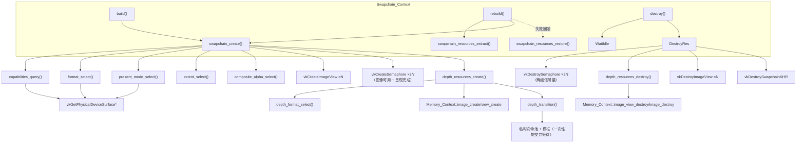

# 交换链 · 模块架构

> 源码根相对路径：`Application/Renderer/src/render/Swapchain/`
> 本文覆盖 `Swapchain/` 下的对外头 `交换链.h`（单一门面类型 `Swapchain_Context`）、私有头 `局部命名空间使用.h`，以及 `core/` 下的三个编译单元：`交换链.cpp`、`交换链查询.cpp`、`交换链重建.cpp`。
> 本模块的职责是「把 Vulkan 交换链（`VkSwapchainKHR`）及其全部『每交换链图像』资源（图像视图、图像可用信号量、呈现完成信号量、深度图像）收拢为一个可重建的门面」，并提供表面能力查询、格式/呈现模式/范围选择与重建能力。
> 记录依据为当前工作区源码（Renderer 版次 `b2ffe50`；相对上一版次增量含头文件包含口径统一与「每交换链图像」呈现完成信号量的引入）。文中所有路径均为相对源码根（`工作区`）的相对路径。
> 本模块的全部 `VkResult` 检查走渲染层统一出口 `Application/Renderer/src/render/Renderer/core/结果检查.h` 提供的 `vk_result_check`；该头物理上归属「渲染层-渲染器」模块，本文在需要处标注其归属。

---

## 一、文件内目录

- [二、模块功能介绍](#二模块功能介绍)
  - 2.1 模块定位 ／ 2.2 职责边界与解决的问题 ／ 2.3 在整体架构中的位置 ／ 2.4 与相邻模块的职责分界 ／ 2.5 生命周期
- [三、模块公开接口介绍](#三模块公开接口介绍)
  - 3.1 可见性总览与 `engine::Swapchain_Context` 类总览 ／ 3.2 构造与析构 ／ 3.3 `build` ／ 3.4 `destroy` ／ 3.5 `valid` ／ 3.6 `rebuild` ／ 3.7 全部 getter
- [四、模块私有方法介绍](#四模块私有方法介绍)
  - 4.1 `swapchain_create` ／ 4.2 `swapchain_resources_destroy` ／ 4.3 `depth_format_select` ／ 4.4 `depth_resources_create` ／ 4.5 `depth_resources_destroy` ／ 4.6 `depth_transition` ／ 4.7 查询类私有方法 ／ 4.8 `composite_alpha_select`（文件内静态函数） ／ 4.9 `swapchain_resources_extract`（本轮新增） ／ 4.10 `swapchain_resources_restore`（本轮新增）
- [五、模块内部架构介绍](#五模块内部架构介绍)
  - 5.1 目录与文件结构树 ／ 5.2 各编译单元职责与包含口径 ／ 5.3 内部数据结构：`Swapchain_Context` 字段逐项说明 ／ 5.4 内部关系图 ／ 5.5 `局部命名空间使用.h` 的做法说明 ／ 5.6 依赖接口（本模块消费、非本模块提供）
- [六、模块设计/实现细节](#六模块设计实现细节)
  - 6.1 深度附件随交换链一并管理（U5）／ 6.2 交换链查询与选择策略 ／ 6.3 交换链重建路径 ／ 6.4 与帧模块的围栏/图像获取顺序约定 ／ 6.5 同步原语归属 ／ 6.6 队列族共享模式 ／ 6.7 内存所有权约定 ／ 6.8 错误检查与异常禁用 ／ 6.9 资源销毁顺序 ／ 6.10 易错点汇总
- [七、模块运行链路详例](#七模块运行链路详例)
  - 7.1 构建链路 ／ 7.2 使用链路 ／ 7.3 重建链路 ／ 7.4 销毁链路 ／ 7.5 关键边界与异常分支汇总
- [附录、待确认条目](#附录待确认条目)

---

## 二、模块功能介绍

### 2.1 模块定位

「交换链」模块位于渲染层源码目录 `Application/Renderer/src/render/Swapchain/`，与设备模块（`render/Device/`）、平台模块（`render/Platform/`）、内存模块（`render/Memory/`）并列为渲染层的底层基础模块之一。它把 Vulkan 中「交换链创建 → 图像获取 → 图像视图 → 深度附件 → 窗口尺寸变化后重建 → 销毁」这一段与**呈现目标生命周期**强相关的工作，全部收拢进一个门面类 `Swapchain_Context`，对外只暴露「构建一次 + 重建 + 销毁 + 一组 getter」的极简接口。

一句话概括：**本模块是渲染层「拿到可渲染的交换链图像、其图像视图、其『每交换链图像』图像可用信号量、呈现完成信号量与深度图像」的唯一入口，是帧模块绘制与呈现的前置依赖。**

### 2.2 职责边界与解决的问题

`Swapchain_Context` 解决的问题可归纳为五点：

1. **完成「交换链创建」的全部前置查询与选择**。Vulkan 创建交换链前必须先向表面查询能力（`vkGetPhysicalDeviceSurfaceCapabilitiesKHR`）、可用格式（`vkGetPhysicalDeviceSurfaceFormatsKHR`）与可用呈现模式（`vkGetPhysicalDeviceSurfacePresentModesKHR`），再据此选格式、选呈现模式、定范围、定图像数、定合成模式与共享模式。本模块把这一整套「查询—选择—填装 `VkSwapchainCreateInfoKHR`」流程封装在 `core/交换链查询.cpp` 与 `core/交换链重建.cpp` 的 `swapchain_create` 中，调用方只需给出设备/表面/窗口尺寸/垂直同步开关。

2. **管理交换链图像的「图像视图」派生资源**。Vulkan 交换链图像由驱动持有，但渲染需要 `VkImageView` 作为附件绑定。本模块在拿到交换链图像后逐张创建二维颜色图像视图，并在销毁/重建时一并释放，使调用方拿到的是「可立即绑定到渲染」的视图句柄。

3. **管理「每交换链图像」的两组信号量（图像可用 + 呈现完成）**。交换链同步原语按归属分为「每交换链图像」与「每帧槽」两类。图像可用信号量由 `vkAcquireNextImageKHR` 在成功获取图像后置信号；呈现完成信号量在 `vkQueueSubmit` 时被提交信号、在 `vkQueuePresentKHR` 时被等待（present 完成取走信号）。两者的数量都必须等于交换链图像数，且**随交换链重建而变化**。因此本模块持有并随重建重建这两组信号量，把「每帧槽」的帧栅栏留给帧模块（见 §6.5）。呈现完成信号量之所以按图像持有而非按帧：同一信号量只会在同一张交换链图像被再次获取时才复用，而那时上一次 present 必然已消费它（帧栅栏只保证提交完成、不保证 present 已取走信号量）。

4. **把深度附件纳入交换链生命周期一并管理**。本项目采用「深度图像随交换链一并创建/销毁/重建」（源码注释记为 U5）的路线：每交换链图像配一张深度图像，数量与交换链图像数一致，格式在设备支持的深度格式中择优，且首帧前完成一次 `UNDEFINED → DEPTH_ATTACHMENT_OPTIMAL` 的布局转换。这样交换链重建时深度图像自动同步重建，避免上层分别管理两套尺寸相关资源而产生的尺寸不一致。

5. **提供幂等销毁与「无整帧停顿」的按新尺寸重建**。窗口尺寸变化（含最小化后恢复）需要按新尺寸重建交换链。本模块的 `rebuild(width, height, old_out)` **不再 `vkDeviceWaitIdle`**，而是把旧交换链及其全部附属资源（图像视图 / 两类信号量 / 深度图像与内存与视图）**整体移出**到出参 `old_out`（不销毁），并以旧交换链作 `oldSwapchain` 建新链；旧资源的**实际释放**由调用方（门面）组装为帧模块的「延迟销毁条目」，待在途帧用尽后释放（§6.4、§6.3）。重建失败则回滚（恢复旧资源句柄与派生状态，交换链仍可用）并返回假；`destroy()` 幂等且析构兜底。

### 2.3 在整体架构中的位置

交换链模块处于渲染层依赖链的中低层：它**向下**依赖设备模块（逻辑设备、图形/呈现队列族）、平台模块（`VkSurfaceKHR`）与内存模块（深度图像创建/销毁）；**向上**被帧模块（或渲染器门面）用于获取可渲染图像与其附件、信号量。

```
                ┌───────────────────────────────────────────────────┐
                │              Renderer（渲染器门面）                 │
                │  init()：按依赖顺序编排各模块；驱动 rebuild/destroy  │
                └───────────────┬───────────────────┬───────────────┘
                                │                   │
                 build(...)     │                   │ rebuild(w,h) / destroy()
                                ▼                   ▼
        ┌───────────────────────────────────────────────────────────┐
        │                  Swapchain_Context（交换链上下文）          │
        │  swapchain / images / image_views / image_available_sems   │
        │  render_finished_sems / depth_images / depth_allocations   │
        │  depth_views / depth_format                                │
        └───┬───────────────┬───────────────────┬───────────────────┘
            │依赖            │依赖                │依赖
            ▼                ▼                   ▼
    ┌───────────────┐ ┌────────────────┐ ┌────────────────────┐
    │ 设备模块       │ │ 平台模块        │ │ 内存模块            │
    │ 物理/逻辑设备  │ │ VkSurfaceKHR    │ │ 深度图像创建/销毁    │
    │ 图形/呈现队列族│ │ （表面）        │ │ （VMA 分配器）       │
    └───────────────┘ └────────────────┘ └────────────────────┘
                                            ▲
         提供：交换链图像/视图/信号量/深度   │
                                            │
                                   ┌────────▼────────┐
                                   │ 帧模块           │
                                   │ 获取图像 / 提交   │
                                   │ 呈现 / 同步       │
                                   └─────────────────┘
```

- **向上**：调用方是帧模块与渲染器门面。门面在其 `init` 编排中先建平台/设备/内存，再调用本模块的 `build(...)`；帧循环中按窗口尺寸变化标志调用 `rebuild(w, h)`；退出时调用 `destroy()`。
- **向下**：依赖设备模块（`Device_Context` 提供 `VkPhysicalDevice`、`VkDevice`、`graphics_family`、`present_family`）、平台模块（`Platform_Context` 提供 `VkSurfaceKHR`）、内存模块（`Memory_Context` 提供深度图像的创建与销毁）、引擎日志系统（`logger`）、Vulkan Loader（`vk*` 全部调用）。
- **横向**：交换链模块不依赖帧、着色器、管线、网格、纹理等模块；它只把「图像 + 视图 + 两组信号量 + 深度」交给帧模块。
- **与渲染器门面的两条协作（当日提交 `0f985ec` 已落地）**：① 门面 `init` 在建帧模块前调用本模块 `image_available_count_get()`，若在途帧数 `frame_overlap` 超过图像可用信号量数则**下调并告警**（使「先等帧栅栏」能保证被取用的信号量已在前一次被消费，即 K13 前提的显式化）；② 门面 `frame_render` 的两条交换链重建路径（窗口尺寸变化分支、帧链路 `rebuild_needed` 分支）经私有 `swapchain_rebuild_deferred(w, h)` 调用本模块 `rebuild(w, h, old)`（并把旧资源组装为延迟销毁条目压入帧模块，延迟 = 在途帧数 + 1），随后即执行 `pipeline.pipeline_rebuild(swapchain.format_get(), swapchain.depth_format_get())`——图形管线把颜色/深度格式固化在 `VkPipelineRenderingCreateInfo` 中，交换链重建若换了格式，旧管线即与新渲染目标不匹配、必须重建；**格式未变时为空操作**。为此本模块提供 `format_get()`/`depth_format_get()`/`image_available_count_get()` 三项取值接口供门面读取。

### 2.4 与相邻模块的职责分界

| 相邻模块 | 分界 |
| --- | --- |
| 设备模块（`render/Device/`，`Device_Context`） | 设备模块负责选物理设备、建逻辑设备、取图形/呈现队列与族索引；本模块**只消费**其 `physical_device_get()` / `device_get()` / `graphics_family_get()` / `present_family_get()` 结果，不创建任何设备对象。`VK_KHR_swapchain` 设备扩展是否受支持由设备模块在选型阶段先行把关。 |
| 平台模块（`render/Platform/`，`Platform_Context`） | 平台模块负责创建窗口与 `VkSurfaceKHR`，并把「窗口尺寸是否变化」剥离为标志（`resized_consume()`）；本模块**消费**表面句柄与（由上层转交的）窗口客户区尺寸，**不创建表面**，也**不决策何时重建**（决策由上层帧链路统一做出，源码注释「事件泵只置标志……交换链重建由上层帧链路统一决策」）。 |
| 内存模块（`render/Memory/`，`Memory_Context`） | 本模块通过 `memory.image_create` / `memory.image_view_create` 创建深度图像与其视图，通过 `memory.image_view_destroy` / `memory.image_destroy` 归还。**交换链图像本身及其图像视图不走内存模块**——交换链图像由驱动持有，`VkImageView` 直接由本模块 `vkCreateImageView` 创建。**所有权约定**：深度图像句柄由本模块持有，但销毁一律回到 `Memory_Context`。 |
| 帧模块（`render/Frame/`） | 帧模块持有「每帧槽」的帧栅栏，负责每帧的命令录制、提交与呈现。本模块**持有「每交换链图像」的图像可用信号量与呈现完成信号量**，并对外提供 `image_available_semaphore_get(index)`（帧模块在获取图像时作为「图像可用」等待信号量）与 `render_finished_semaphore_get(index)`（帧模块提交时作为信号量、present 时作为等待信号量）。两者共同遵守「围栏/图像获取顺序」约定（见 §6.4）。**本轮起另有一条跨模块线**：本模块 `rebuild` 把旧资源经出参 `Swapchain_Old_Resources` 交给调用方，由门面组装为 `Deferred_Entry` 压入帧模块的延迟销毁队列（帧模块据此延迟释放旧交换链 / 视图 / 信号量 / 深度资源），本模块**不再自行销毁旧资源**（见 §6.3、§6.4）。 |
| 「渲染层-渲染器」模块的 `结果检查.h` | 本模块的全部 `VkResult` 检查都调用该头提供的 `vk_result_check`；该头是渲染层内所有模块共用的唯一检查出口。 |
| 本层设计文档（含 Phase/K 编号、§ 编号） | 源码注释多处引用 `§5.2`/`§5.3`/`§5.4`、`K3`~`K7`/`K10`、`U5` 等编号，均指向本层设计文档《渲染层架构设计》，落点为 `任务报告合集/main/2026年/10月/10日/渲染层架构设计_待实施/渲染层架构设计.md`：§5 为生命周期与同步口径（§5.2 同步原语归属表）、§6 为交换链口径（§6.4 延迟销毁），`K3`~`K7`/`K10` 为 §7 坑位编号、`U5` 为上一轮《执行计划》的阶段编号。该文档为设计期产物，未纳入本轮导航收录范围。 |

### 2.5 生命周期

`Swapchain_Context` 的完整生命周期为：

```
构造（default，不创建任何 Vulkan 对象）
   → build(physical_device, memory, device, surface,
            graphics_family, present_family, width, height, vsync)   ← 创建交换链与全部「每交换链图像」资源
   → [被帧模块使用：获取图像 / 绑定视图 / 绑定深度 / 等待图像可用信号量 / 提交以呈现完成信号量为信号]
   → rebuild(width, height, old_out)（可选，可多次；窗口尺寸变化时由上层调用；旧资源经 old_out 移交、不在此销毁）
   → destroy()                                                        ← 幂等；先 vkDeviceWaitIdle 再逆序销毁
   → 析构（兜底再调用一次 destroy，保证资源不泄漏）
```

- 状态机只有两态：**未构建完成**与**构建完成**。`valid()` 的判据是「交换链句柄非空且图像列表非空」。
- `build` 内部失败会调用 `destroy()` 回退可能已创建的部分资源；`rebuild` 内部失败会先 `swapchain_resources_destroy()` 清除半成品，再 `swapchain_resources_restore(old)` 恢复旧资源与派生状态（交换链仍可用）。
- `destroy()` 可重复调用，第二次及以后为无操作；析构函数内部再调一次 `destroy()`，因此「显式销毁 + 析构」不会重复释放。
- 类**不可拷贝、不可移动**（持有 Vulkan 句柄），以 `= delete` 显式删除拷贝构造与拷贝赋值；未声明移动，故移动亦不可用。

---

## 三、模块公开接口介绍

本章列出交换链模块**对外层与层内可见的公开类型与成员**；模块内部私有的方法、以及本模块消费的依赖接口，分别见 §4 与 §5.6。

- **对外层**（渲染层外/其它模块可见）：`engine::Swapchain_Context` 类与 `engine::Swapchain_Old_Resources` 结构（**本轮新增**，见 §3.1 与 §5.3），均声明于 `Application/Renderer/src/render/Swapchain/交换链.h`。该头虽通过包含 `<vulkan/vulkan.h>` 与 `<vk_mem_alloc.h>` 暴露 Vulkan/VMA 类型，但该头属渲染层「实现细节」，不进渲染层公共头；层外看不到 Vulkan 类型（依据头文件注释「见 cmake/对外接口.cmake 的私有包含根」）。该私有包含根约定为「**项目根 ＋ 本层根**」，由 `Application/Renderer/CMakeLists.txt` 的 `target_include_directories(... PRIVATE ...)` 段声明、不进 `BYJY_RENDERER_OUT_INC`，各层内模块头所引「见 cmake/对外接口.cmake 的私有包含根」即指该节。
- **模块内部层**（仅本模块编译单元可见）：`core/` 下的私有成员函数（`swapchain_create`、`swapchain_resources_extract`、`swapchain_resources_restore`、`swapchain_resources_destroy`、`depth_format_select`、`depth_resources_create`、`depth_resources_destroy`、`depth_transition`、`capabilities_query`、`format_select`、`present_mode_select`、`extent_select`）与 `core/交换链重建.cpp` 内的静态函数 `composite_alpha_select`。为便于「凭本文直接理解与复现」，这些私有方法逐条列于 §4。

### 3.1 `engine::Swapchain_Context` 类总览

**声明位置**：`Application/Renderer/src/render/Swapchain/交换链.h`
**实现位置**：
- `core/交换链.cpp`（析构、`build`、`destroy`、`valid`、`rebuild`、`swapchain_resources_destroy`、全部 13 个 getter）
- `core/交换链查询.cpp`（`capabilities_query`、`format_select`、`present_mode_select`、`extent_select`）
- `core/交换链重建.cpp`（静态 `composite_alpha_select`、`swapchain_create`、`depth_format_select`、`depth_resources_create`、`depth_resources_destroy`、`depth_transition`）

| 类别 | 成员 | 签名 | 可见性 |
| --- | --- | --- | --- |
| 构造 | `Swapchain_Context` | `Swapchain_Context(void) = default` | public |
| 析构 | `~Swapchain_Context` | `~Swapchain_Context(void)` | public |
| 删除拷贝 | 拷贝构造/赋值 | `Swapchain_Context(const Swapchain_Context&) = delete` / `operator=` 删除 | public |
| 构建 | `build` | `bool build(VkPhysicalDevice, Memory_Context&, VkDevice, VkSurfaceKHR, uint32_t, uint32_t, uint32_t, uint32_t, bool)` | public |
| 销毁 | `destroy` | `void destroy(void)` | public |
| 查询 | `valid` | `bool valid(void) const` | public |
| 类型 | `Swapchain_Old_Resources` | `struct Swapchain_Old_Resources`（8 字段：`swapchain` / `images` / `image_views` / `image_available_semaphores` / `render_finished_semaphores` / `depth_images` / `depth_allocations` / `depth_views`） | public（**本轮新增**） |
| 重建 | `rebuild` | `bool rebuild(uint32_t width, uint32_t height, Swapchain_Old_Resources& old_out)` | public（**本轮改签名**） |
| 取值 | `image_get` | `VkImage image_get(uint32_t index) const` | public |
| 取值 | `image_view_get` | `VkImageView image_view_get(uint32_t index) const` | public |
| 取值 | `image_count_get` | `uint32_t image_count_get(void) const` | public |
| 取值 | `format_get` | `VkFormat format_get(void) const` | public |
| 取值 | `extent_get` | `VkExtent2D extent_get(void) const` | public |
| 取值 | `handle_get` | `VkSwapchainKHR handle_get(void) const` | public |
| 取值 | `image_available_semaphore_get` | `VkSemaphore image_available_semaphore_get(uint32_t index) const` | public |
| 取值 | `image_available_count_get` | `uint32_t image_available_count_get(void) const` | public |
| 取值 | `render_finished_semaphore_get` | `VkSemaphore render_finished_semaphore_get(uint32_t index) const` | public |
| 取值 | `render_finished_count_get` | `uint32_t render_finished_count_get(void) const` | public |
| 取值 | `depth_image_get` | `VkImage depth_image_get(uint32_t index) const` | public |
| 取值 | `depth_view_get` | `VkImageView depth_view_get(uint32_t index) const` | public |
| 取值 | `depth_format_get` | `VkFormat depth_format_get(void) const` | public |

### 3.2 构造与析构

#### 3.2.1 `Swapchain_Context(void) = default`

- **签名**：隐式等价于默认构造。
- **参数**：无。
- **返回值**：无（构造）。
- **约束**：构造**不创建任何 Vulkan 对象**。全部句柄成员保持 `VK_NULL_HANDLE` 初值，`graphics_family`/`present_family` 保持 `0`，`vsync` 保持 `true`，`format`/`depth_format` 保持 `VK_FORMAT_UNDEFINED`，`extent` 保持 `{0, 0}`，各 `std::vector` 为空。因此默认构造后的对象处于「未构建完成」态，`valid()` 为假。

#### 3.2.2 `~Swapchain_Context(void)`

- **签名**：`~Swapchain_Context(void)`
- **参数**：无。
- **返回值**：无（析构）。
- **约束与行为**：实现见 `core/交换链.cpp`，函数体只有一步——调用 `destroy()`。因此析构是**资源不泄漏的最后兜底**：即便调用方忘记显式 `destroy()`，析构也会释放已创建的交换链、图像视图、两组信号量与深度图像。因 `destroy()` 幂等，析构不会重复释放。

#### 3.2.3 拷贝/移动删除

- **签名**：`Swapchain_Context(const Swapchain_Context&) = delete` 与 `Swapchain_Context& operator=(const Swapchain_Context&) = delete`。
- **约束**：显式删除拷贝构造与拷贝赋值；未声明移动构造/移动赋值，故移动同样不可用（拷贝被删除即移动被隐式抑制）。原因：对象持有 Vulkan 句柄与 VMA 分配记录，浅拷贝会导致同一句柄被 `destroy` 两次。

### 3.3 `build`（构建交换链）

- **签名**：
  ```cpp
  bool build(VkPhysicalDevice physical_device, Memory_Context& memory, VkDevice device, VkSurfaceKHR surface,
      uint32_t graphics_family, uint32_t present_family,
      uint32_t width, uint32_t height, bool vsync);
  ```
- **声明**：`交换链.h`；**实现**：`core/交换链.cpp`。

| 参数 | 类型 | 含义 | 约束 |
| --- | --- | --- | --- |
| `physical_device` | `VkPhysicalDevice` | 物理设备句柄，用于查询表面能力/格式/呈现模式与深度格式特性 | 不得为 `VK_NULL_HANDLE`，否则记 error 并返回假 |
| `memory` | `Memory_Context&` | 内存模块引用，深度图像的创建/销毁依赖它 | 必须已构建（`memory.valid()` 为真），否则记 error 并返回假；其生命周期须覆盖本对象使用期 |
| `device` | `VkDevice` | 逻辑设备句柄，用于创建交换链/图像视图/信号量/命令池 | 不得为 `VK_NULL_HANDLE` |
| `surface` | `VkSurfaceKHR` | 呈现目标表面 | 不得为 `VK_NULL_HANDLE` |
| `graphics_family` | `uint32_t` | 图形队列族索引；用于判断共享模式与深度转换临时命令池归属 | 应与设备模块给出的图形族一致 |
| `present_family` | `uint32_t` | 呈现队列族索引；用于判断共享模式 | 与 `graphics_family` 相同 → 独占共享；不同 → 并发共享 |
| `width` | `uint32_t` | 窗口客户区宽度（像素） | `currentExtent` 为 `UINT32_MAX` 时据此决定交换链宽度；为 `0` 时记 warn 并返回假（K7） |
| `height` | `uint32_t` | 窗口客户区高度（像素） | 同上 |
| `vsync` | `bool` | 垂直同步开关 | 为假且表面支持 MAILBOX → 用 MAILBOX；否则用 FIFO |

- **返回值**：`bool`。`true` 表示交换链及全部派生的「每交换链图像」资源（图像视图、图像可用信号量、呈现完成信号量、深度图像与视图）均已成功创建，`valid()` 随之为真；`false` 表示前置条件不满足或创建流程中任一步失败，且失败时已尽数回退。
- **前置校验与失败行为**（按源码顺序）：
  1. `physical_device`、`device`、`surface` 任一为 `VK_NULL_HANDLE` → `logger.error("交换链:: 构建设备句柄或表面不完整")`，返回假。
  2. `!memory.valid()` → `logger.error("交换链:: 内存上下文尚未构建，无法建立交换链（深度图像依赖）")`，返回假。
  3. `width == 0 || height == 0` → `logger.warn("交换链:: 窗口尺寸为零，跳过交换链创建（K7）")`，返回假。**注意此判据在记录成员之前**，此时对象仍为初始态。
  4. 记录 `physical_device`/`memory`/`device`/`surface`/`graphics_family`/`present_family`/`vsync` 到成员。
  5. 调用私有 `swapchain_create(width, height)`；若失败 → `logger.error("交换链:: 创建失败，回退")`，调用 `destroy()` 回退已创建的部分资源，返回假。
  6. 成功后 `logger.info("交换链:: 交换链已建立（{} 张图像，{}×{}）", images.size(), extent.width, extent.height)`，返回真。
- **幂等性/重入**：本函数**不是**幂等的。若在已构建对象上再次调用 `build`，会先覆盖成员记录再 `swapchain_create`，而旧资源未被销毁，将造成泄漏。**约定：`build` 仅在一次生命周期内调用一次**；需要按新尺寸重建应使用 `rebuild`。

### 3.4 `destroy`（销毁）

- **签名**：`void destroy(void)`
- **声明**：`交换链.h`；**实现**：`core/交换链.cpp`。
- **参数**：无。**返回值**：无。
- **行为（按源码顺序）**：
  1. 若 `device != VK_NULL_HANDLE`：先调用 `vkDeviceWaitIdle(device)`（注释：避免销毁仍在使用的对象，§5.4），再调用私有 `swapchain_resources_destroy()`。
  2. 复位全部记录：`physical_device`、`memory`、`device`、`surface` 置空句柄/空指针；`graphics_family = 0`；`present_family = 0`；`vsync = true`；`format = VK_FORMAT_UNDEFINED`；`depth_format = VK_FORMAT_UNDEFINED`；`depth_initialized = false`；`extent = {0, 0}`。
- **约束**：**幂等**。第二次及以后调用时 `device` 已为 `VK_NULL_HANDLE`，跳过资源销毁与 `vkDeviceWaitIdle`，仅重复复位已复位的记录，等价于无操作。
- **注意**：`destroy()` **不**复位各容器句柄自身——七个容器（`images`/`image_views`/`image_available_semaphores`/`render_finished_semaphores`/`depth_images`/`depth_allocations`/`depth_views`）由 `swapchain_resources_destroy` → `depth_resources_destroy` 负责清空。

### 3.5 `valid`（是否已构建完成）

- **签名**：`bool valid(void) const`
- **声明**：`交换链.h`；**实现**：`core/交换链.cpp`。
- **参数**：无。**返回值**：`bool`。
- **判据**：`return swapchain != VK_NULL_HANDLE && !images.empty();`
- **约束**：`true` 表示交换链句柄有效**且**图像列表非空（即「交换链与图像齐备」）。判据**不**纳入图像视图、信号量、深度图像的完备性；但按 `swapchain_create` 的实现，图像齐备即意味着前述资源在同一次调用中一并成功（任一失败会回退 `swapchain` 与 `images`），故判据在实践中等价于「全套资源齐备」。

### 3.6 `rebuild`（按新尺寸重建；本轮改为「无整帧停顿」）

- **签名**：`bool rebuild(uint32_t width, uint32_t height, Swapchain_Old_Resources& old_out)`
- **声明**：`交换链.h`；**实现**：`core/交换链.cpp`。

| 参数 | 类型 | 含义 | 约束 |
| --- | --- | --- | --- |
| `width` | `uint32_t` | 新窗口客户区宽度（像素） | 为 `0` 时记 warn 并返回假（K7，最小化场景） |
| `height` | `uint32_t` | 新窗口客户区高度（像素） | 同上 |
| `old_out` | `Swapchain_Old_Resources&`（出参） | 旧交换链及其全部附属资源（**成功时**写出；调用方据此延迟销毁） | 重建失败时不写出（保持调用方传入值不变） |

- **返回值**：`bool`。`true` 表示重建成功（新尺寸资源已建好，旧资源已移交 `old_out`、**尚未销毁**）；`false` 表示前置不满足或重建失败（**已回滚，旧交换链仍可用**）。
- **前置校验与失败行为**（按源码顺序）：
  1. `device == VK_NULL_HANDLE || surface == VK_NULL_HANDLE` → `logger.error("交换链:: 重建失败，交换链尚未构建")`，返回假。
  2. `width == 0 || height == 0` → `logger.warn("交换链:: 重建请求尺寸为零，跳过重建（K7）")`，返回假。
- **核心流程（成功路径）**：
  1. **先保存五项派生状态**：`format` / `depth_format` / `extent` / `depth_initialized` / `color_transfer_src`（供失败回滚）。
  2. `swapchain_resources_extract(old)`：把成员中的交换链 / 图像视图 / 两类信号量 / 深度图像与内存与视图**整体移出**到局部 `old`（`std::move`，**不销毁**），并复位派生状态（`format = UNDEFINED`、`extent = {0,0}`、`color_transfer_src = false`、`depth_initialized = false`；`depth_format` 保留）。
  3. `swapchain_create(width, height, old.swapchain)`：以旧交换链作 `oldSwapchain` 建新链。
  4. 成功后 `old_out = std::move(old)`，记 `logger.info("交换链:: 交换链已重建（{} 张图像，{}×{}）", ...)`，返回真。
- **失败回滚（返回假、旧链仍可用）**：
  1. `logger.error("交换链:: 重建失败，清理半成品并回滚旧资源")`；
  2. `swapchain_resources_destroy()` 清除可能已创建的半成品新资源；
  3. `swapchain_resources_restore(old)` 把旧资源句柄**原样恢复**回成员；
  4. 恢复五项派生状态（`format` / `depth_format` / `extent` / `depth_initialized` / `color_transfer_src`）后返回假。
- **约束与要点**：
  - 仅可在 `build` 成功的对象上调用；重建沿用 `vsync` 与 `graphics_family`/`present_family` 记录（不重新传入）；重建后 `memory`/`device`/`surface` 记录保持不变。
  - **不再 `vkDeviceWaitIdle`、不再立即销毁旧资源**：旧资源可能仍被在途帧引用，故整体移交给调用方，由门面组装为帧模块的延迟销毁条目，待在途帧用尽后释放（§6.3、§6.4）。
  - **`depth_initialized` 必须在析出时复位为 `false`**：否则新深度图像会漏掉首帧前的一次布局转换（`depth_resources_create` 只在 `!depth_initialized` 时调用 `depth_transition`），导致后续以其为深度附件时布局不符。

### 3.7 全部 getter

以下 getter 均声明于 `交换链.h`、实现在 `core/交换链.cpp`，全部为 `const` 且无副作用。

| getter | 签名 | 返回 | 越界/约束 |
| --- | --- | --- | --- |
| `image_get` | `VkImage image_get(uint32_t index) const` | 指定索引的交换链图像 `VkImage` | `index >= images.size()` 时返回 `VK_NULL_HANDLE` |
| `image_view_get` | `VkImageView image_view_get(uint32_t index) const` | 指定索引的交换链图像视图 | `index >= image_views.size()` 时返回 `VK_NULL_HANDLE` |
| `image_count_get` | `uint32_t image_count_get(void) const` | 交换链图像数（`images.size()`） | 未构建时为 `0` |
| `format_get` | `VkFormat format_get(void) const` | 已选定的表面格式 | 未构建时为 `VK_FORMAT_UNDEFINED` |
| `extent_get` | `VkExtent2D extent_get(void) const` | 交换链范围 | 未构建时为 `{0, 0}` |
| `handle_get` | `VkSwapchainKHR handle_get(void) const` | 交换链句柄 | 未构建时为 `VK_NULL_HANDLE` |
| `image_available_semaphore_get` | `VkSemaphore image_available_semaphore_get(uint32_t index) const` | 指定索引的图像可用信号量 | `index >= image_available_semaphores.size()` 时返回 `VK_NULL_HANDLE` |
| `image_available_count_get` | `uint32_t image_available_count_get(void) const` | 图像可用信号量数量（=交换链图像数） | 未构建时为 `0` |
| `render_finished_semaphore_get` | `VkSemaphore render_finished_semaphore_get(uint32_t index) const` | 指定索引的呈现完成信号量（提交信号 / present 等待用） | `index >= render_finished_semaphores.size()` 时返回 `VK_NULL_HANDLE` |
| `render_finished_count_get` | `uint32_t render_finished_count_get(void) const` | 呈现完成信号量数量（=交换链图像数） | 未构建时为 `0` |
| `depth_image_get` | `VkImage depth_image_get(uint32_t index) const` | 指定索引的深度图像 | `index >= depth_images.size()` 时返回 `VK_NULL_HANDLE` |
| `depth_view_get` | `VkImageView depth_view_get(uint32_t index) const` | 指定索引的深度图像视图 | `index >= depth_views.size()` 时返回 `VK_NULL_HANDLE` |
| `depth_format_get` | `VkFormat depth_format_get(void) const` | 已选定的深度格式 | 未构建时为 `VK_FORMAT_UNDEFINED` |
| `color_transfer_src_get` | `bool color_transfer_src_get(void) const` | 交换链图像是否具备传输源用法（像素回读前提） | 建链时按表面能力确定并记录；未构建时为 `false`（本版次新增） |

- **约束与意图**：带索引的 getter 一律做**越界保护**，越界返回 `VK_NULL_HANDLE` 而非崩溃，方便上层对「图像数可能随重建变化」的容错（帧模块取图像索引时应与 `image_count_get()` 配合）。

### 3.8 `engine::Swapchain_Old_Resources`（重建移交的旧资源集合；本轮新增）

**声明位置**：`Application/Renderer/src/render/Swapchain/交换链.h`

```cpp
struct Swapchain_Old_Resources
{
    VkSwapchainKHR swapchain = VK_NULL_HANDLE;              // 旧交换链（建新链时作 oldSwapchain，其后延时销毁）
    std::vector<VkImage> images;                            // 旧交换链图像（句柄由交换链持有，此处仅作索引记录）
    std::vector<VkImageView> image_views;                   // 旧图像视图
    std::vector<VkSemaphore> image_available_semaphores;    // 旧图像可用信号量
    std::vector<VkSemaphore> render_finished_semaphores;    // 旧呈现完成信号量
    std::vector<VkImage> depth_images;                     // 旧深度图像
    std::vector<VmaAllocation> depth_allocations;          // 旧深度图像内存
    std::vector<VkImageView> depth_views;                  // 旧深度图像视图
};
```

**作用与语义**：本结构是 `rebuild` 的出参，承载「被交换链重建牵连」的旧交换链及其全部附属资源。本模块把它们**整体移出**（`std::move`，不销毁）后交给调用方；调用方（门面）把它组装为帧模块的延迟销毁条目，待在途帧用尽后释放（§6.3、§6.4）。这是本模块「无整帧停顿重建」的数据载体。

| 字段 | 类型 | 含义 | 销毁归属 |
| --- | --- | --- | --- |
| `swapchain` | `VkSwapchainKHR` | 旧交换链句柄（建新链时作 `oldSwapchain`） | 帧模块延迟销毁（`vkDestroySwapchainKHR`） |
| `images` | `std::vector<VkImage>` | 旧交换链图像句柄（仅索引记录） | **不单独销毁**，随旧交换链销毁 |
| `image_views` | `std::vector<VkImageView>` | 旧图像视图 | 帧模块延迟销毁（`vkDestroyImageView`） |
| `image_available_semaphores` | `std::vector<VkSemaphore>` | 旧图像可用信号量 | 帧模块延迟销毁（`vkDestroySemaphore`） |
| `render_finished_semaphores` | `std::vector<VkSemaphore>` | 旧呈现完成信号量 | 帧模块延迟销毁（`vkDestroySemaphore`） |
| `depth_images` | `std::vector<VkImage>` | 旧深度图像 | 经**内存模块**归还（`image_destroy`） |
| `depth_allocations` | `std::vector<VmaAllocation>` | 旧深度图像内存 | 随 `image_destroy` 一并归还 |
| `depth_views` | `std::vector<VkImageView>` | 旧深度图像视图 | 经**内存模块**归还（`image_view_destroy`） |

> 说明：结构体字段类型写 `VmaAllocation`（实为 `std::vector<VmaAllocation>`），故本头须包含 `<vk_mem_alloc.h>`（见 §5.2 的包含口径）。旧深度资源**不**由本模块或帧模块直接用原生 Vulkan 归还，而是**回到内存模块**（`image_view_destroy` / `image_destroy`），符合「跨模块创建的资源销毁必回其创建模块」的总原则（§6.7）。

---

## 四、模块私有方法介绍

本节逐条列出 `Swapchain_Context` 类内私有方法与文件内静态辅助函数。数据成员说明见 §5.3。

### 4.0 私有成员函数一览（签名）

| 类别 | 成员 | 签名 |
| --- | --- | --- |
| 内部构建 | `swapchain_create` | `bool swapchain_create(uint32_t width, uint32_t height, VkSwapchainKHR old_swapchain)`（**本轮增第三形参**） |
| 内部销毁 | `swapchain_resources_destroy` | `void swapchain_resources_destroy(void)` |
| 内部移交 | `swapchain_resources_extract` | `void swapchain_resources_extract(Swapchain_Old_Resources& old_out)`（**本轮新增**） |
| 内部移交 | `swapchain_resources_restore` | `void swapchain_resources_restore(Swapchain_Old_Resources& old_in)`（**本轮新增**） |
| 内部 | `depth_format_select` | `bool depth_format_select(void)` |
| 内部 | `depth_resources_create` | `bool depth_resources_create(void)` |
| 内部 | `depth_resources_destroy` | `void depth_resources_destroy(void)` |
| 内部 | `depth_transition` | `bool depth_transition(void)` |
| 内部查询 | `capabilities_query` | `bool capabilities_query(VkSurfaceCapabilitiesKHR& capabilities_out) const` |
| 内部查询 | `format_select` | `bool format_select(VkSurfaceFormatKHR& format_out) const` |
| 内部查询 | `present_mode_select` | `VkPresentModeKHR present_mode_select(bool vsync) const` |
| 内部查询 | `extent_select` | `VkExtent2D extent_select(const VkSurfaceCapabilitiesKHR&, uint32_t, uint32_t) const` |

### 4.1 `bool swapchain_create(uint32_t width, uint32_t height, VkSwapchainKHR old_swapchain)`

- **实现**：`core/交换链重建.cpp`。**作用**：创建交换链本体、交换链图像、图像视图、图像可用信号量与呈现完成信号量（两组各 `actual_count` 个），并调用 `depth_resources_create()` 建立深度附件。
- **本轮改动**：新增第三形参 `old_swapchain`，直接写入 `create_info.oldSwapchain`——首次创建（`build`）传 `VK_NULL_HANDLE`，重建时由 `rebuild` 传旧交换链句柄（驱动可复用其资源，旧链在新链创建后即被退休）。
- **流程**：见 §7.1。任一步失败返回假（调用方负责回退）。

### 4.2 `void swapchain_resources_destroy(void)`

- **实现**：`core/交换链.cpp`。**作用**：销毁交换链侧全部资源。
- **流程（源码顺序）**：
  1. 若 `device == VK_NULL_HANDLE` 直接返回。
  2. 遍历 `image_available_semaphores`，对非空句柄 `vkDestroySemaphore`。
  3. 遍历 `render_finished_semaphores`，对非空句柄 `vkDestroySemaphore`。
  4. 调用 `depth_resources_destroy()`（深度图像与视图随交换链一并重建，U5）。
  5. 遍历 `image_views`，对非空句柄 `vkDestroyImageView`。
  6. 若 `swapchain != VK_NULL_HANDLE`，`vkDestroySwapchainKHR`。
  7. 清空 `image_available_semaphores`、`render_finished_semaphores`、`image_views`、`images`，并置 `swapchain = VK_NULL_HANDLE`。
- **注意**：清理顺序为「信号量（两组）→ 深度 → 图像视图 → 交换链」，即先销毁依赖交换链图像/句柄派生出的对象，最后销毁交换链本体，符合 Vulkan 对象依赖方向。

### 4.3 `bool depth_format_select(void)`

- **实现**：`core/交换链重建.cpp`。**作用**：在候选深度格式中择优，写入成员 `depth_format`。
- **候选与判据**：`{ VK_FORMAT_D32_SFLOAT, VK_FORMAT_D32_SFLOAT_S8_UINT, VK_FORMAT_D24_UNORM_S8_UINT }`，逐项调用 `vkGetPhysicalDeviceFormatProperties`，凡 `properties.optimalTilingFeatures & VK_FORMAT_FEATURE_DEPTH_STENCIL_ATTACHMENT_BIT` 非零即选中并返回真。全部不中 → `logger.error("交换链:: 无任何可用深度格式（D32/D24 均不可作深度附件）")`，返回假。
- **注意**：仅检查 `optimalTilingFeatures`（因内存模块创建的图像固定用 `VK_IMAGE_TILING_OPTIMAL`）。

### 4.4 `bool depth_resources_create(void)`

- **实现**：`core/交换链重建.cpp`。**作用**：为每张交换链图像创建一张深度图像与视图，并在首次（`!depth_initialized`）执行一次布局转换。
- **前置**：`memory != nullptr && memory->valid()`，否则记 error 返回假；`depth_format == VK_FORMAT_UNDEFINED` 时先 `depth_format_select()`。
- **流程**：
  1. `count = images.size()`；`depth_images`/`depth_allocations`/`depth_views` 均 `assign(count, VK_NULL_HANDLE)`。
  2. 逐张：`memory->image_create(depth_images[i], depth_allocations[i], extent.width, extent.height, depth_format, VK_IMAGE_USAGE_DEPTH_STENCIL_ATTACHMENT_BIT)`；再 `memory->image_view_create(depth_views[i], depth_images[i], depth_format, VK_IMAGE_ASPECT_DEPTH_BIT)`。任一失败返回假。
  3. 若 `!depth_initialized`：调用 `depth_transition()`；成功后置 `depth_initialized = true`。
  4. `logger.info("交换链:: 深度图像已建立（{} 张，格式 {}）", count, (int32_t)depth_format)`，返回真。

### 4.5 `void depth_resources_destroy(void)`

- **实现**：`core/交换链重建.cpp`。**作用**：归还全部深度图像与视图。
- **流程**：若 `memory != nullptr`，逐索引 `memory->image_view_destroy(depth_views[i])`、`memory->image_destroy(depth_images[i], depth_allocations[i])`；随后清空三个容器、`depth_initialized = false`、`depth_format = VK_FORMAT_UNDEFINED`。
- **注意**：此函数将 `depth_format` 复位为 `UNDEFINED`，因此每次重建都会**重新选择**深度格式（而非沿用），在设备/表面未变时结果一般一致。

### 4.6 `bool depth_transition(void)`

- **实现**：`core/交换链重建.cpp`。**作用**：把全部深度图像从 `UNDEFINED` 一次性转为 `DEPTH_ATTACHMENT_OPTIMAL`。
- **前置**：`device != VK_NULL_HANDLE && !depth_images.empty()`。
- **流程**：创建瞬态临时命令池（`VK_COMMAND_POOL_CREATE_TRANSIENT_BIT`，队列族 `graphics_family`）→ 分配一个主级命令缓冲 → `vkBeginCommandBuffer`（`VK_COMMAND_BUFFER_USAGE_ONE_TIME_SUBMIT_BIT`）→ 对每张深度图像录制一个图像内存屏障（旧布局 `UNDEFINED`、新布局 `DEPTH_ATTACHMENT_OPTIMAL`、`srcQueueFamilyIndex`/`dstQueueFamilyIndex` 为 `IGNORED`、`aspectMask = DEPTH`、`srcAccessMask = 0`、`dstAccessMask = DEPTH_STENCIL_ATTACHMENT_WRITE`、`srcStage = TOP_OF_PIPE`、`dstStage = EARLY_FRAGMENT_TESTS | LATE_FRAGMENT_TESTS`）→ `vkEndCommandBuffer` → 创建未触发态栅栏 → `vkGetDeviceQueue(device, graphics_family, 0, &queue)` → `vkQueueSubmit(queue, 1, &submit_info, fence)` → `vkWaitForFences(device, 1, &fence, VK_TRUE, UINT64_MAX)` → 销毁栅栏与命令池。提交或等待失败则返回假。
- **注意**：该转换**自带**临时命令池与栅栏并同步等待，**不依赖帧模块**；屏障的 `srcQueueFamilyIndex`/`dstQueueFamilyIndex` 均为 `IGNORED`，故不涉及队列族所有权转移。

### 4.7 查询类私有方法

| 接口 | 签名 | 实现 | 作用 |
| --- | --- | --- | --- |
| `capabilities_query` | `bool capabilities_query(VkSurfaceCapabilitiesKHR& capabilities_out) const` | `core/交换链查询.cpp` | 调 `vkGetPhysicalDeviceSurfaceCapabilitiesKHR`，经 `vk_result_check` 返回成败 |
| `format_select` | `bool format_select(VkSurfaceFormatKHR& format_out) const` | `core/交换链查询.cpp` | 选择表面格式与色彩空间（见 §4.7.1） |
| `present_mode_select` | `VkPresentModeKHR present_mode_select(bool vsync) const` | `core/交换链查询.cpp` | 选择呈现模式（见 §4.7.2） |
| `extent_select` | `VkExtent2D extent_select(const VkSurfaceCapabilitiesKHR&, uint32_t, uint32_t) const` | `core/交换链查询.cpp` | 选择交换链范围（见 §4.7.3） |

#### 4.7.1 `format_select`

- 先查询格式数量；为 `0` → `logger.error("交换链查询:: 表面不提供任何可用格式")` 返回假。
- 收集格式清单后，若「仅一项且 `format == VK_FORMAT_UNDEFINED`」→ 视为「任意格式皆可」，取 `VK_FORMAT_B8G8R8A8_SRGB` + `VK_COLOR_SPACE_SRGB_NONLINEAR_KHR`，返回真。
- 否则按首选序列 `{ B8G8R8A8_SRGB, R8G8B8A8_SRGB, B8G8R8A8_UNORM, R8G8B8A8_UNORM }` 依优先级匹配；命中即输出该项（**保留该候选自带的色彩空间**）。
- 全部不中 → 兜底 `formats[0]`（K3），返回真。

#### 4.7.2 `present_mode_select`

- 查询呈现模式数量；查询失败或为 `0` → 直接返回 `VK_PRESENT_MODE_FIFO_KHR`。
- 收集模式清单；若收集失败 → 返回 FIFO。
- 若 `!vsync`：遍历清单，命中 `VK_PRESENT_MODE_MAILBOX_KHR` → 返回 MAILBOX（低延迟无撕裂）。
- 否则（`vsync` 为真，或未找到 MAILBOX）→ 返回 `VK_PRESENT_MODE_FIFO_KHR`（规范保证始终可用，K4）。

#### 4.7.3 `extent_select`

- 若 `capabilities.currentExtent.width != UINT32_MAX` → 直接返回 `currentExtent`（表面已给出明确范围）。
- 否则用窗口客户区 `{width, height}`，并将其**夹取**到 `[minImageExtent, maxImageExtent]`（`std::clamp`，K6），返回夹取后的范围。

### 4.8 `composite_alpha_select`（文件内静态函数）

- **签名**：`static VkCompositeAlphaFlagBitsKHR composite_alpha_select(VkCompositeAlphaFlagsKHR supported)`；**实现**：`core/交换链重建.cpp`。**作用**：在受支持的合成模式位中选择一种。
- **策略**：优先 `VK_COMPOSITE_ALPHA_OPAQUE_BIT_KHR`；否则按 `{ PRE_MULTIPLIED, POST_MULTIPLIED, INHERIT }` 顺序取首个受支持者；全不中兜底 `OPAQUE`（能力查询保证至少支持一项）。

### 4.9 `void swapchain_resources_extract(Swapchain_Old_Resources& old_out)`（本轮新增）

- **实现**：`core/交换链.cpp`。**作用**：把成员中的交换链侧全部资源（交换链句柄 / 图像句柄记录 / 图像视图 / 两类信号量 / 深度图像与内存与视图）**整体移出**到 `old_out`（`std::move`，**不销毁**），并复位派生状态，使本对象处于「资源已抽出、待新建」的可重建态。
- **流程（源码顺序）**：
  1. `old_out.swapchain = swapchain; swapchain = VK_NULL_HANDLE;`
  2. `old_out.images = std::move(images); images.clear();`（`image_views` / `image_available_semaphores` / `render_finished_semaphores` / `depth_images` / `depth_allocations` / `depth_views` 同理 `std::move` 后 `clear()`）；
  3. 复位派生状态：`format = VK_FORMAT_UNDEFINED`、`extent = { 0, 0 }`、`color_transfer_src = false`、`depth_initialized = false`（`depth_format` **保留**）。
- **要点**：`depth_initialized` **必须复位为 `false`**，否则新深度图像会漏掉首帧前的一次布局转换（`depth_resources_create` 只在 `!depth_initialized` 时调 `depth_transition`），致后续以其为深度附件时布局不符。

### 4.10 `void swapchain_resources_restore(Swapchain_Old_Resources& old_in)`（本轮新增）

- **实现**：`core/交换链.cpp`。**作用**：把 `old_in` 中的旧资源句柄**原样恢复**回成员（重建失败回滚用），与 §4.9 的 `extract` 对称。
- **流程**：`swapchain = old_in.swapchain;` 再把 `images` / `image_views` / `image_available_semaphores` / `render_finished_semaphores` / `depth_images` / `depth_allocations` / `depth_views` 逐项 `std::move` 回成员。
- **要点**：仅恢复句柄，**不**恢复派生状态（派生状态由 `rebuild` 自行恢复，见 §3.6）；恢复后旧交换链仍可正常使用。

---

## 五、模块内部架构介绍

### 5.1 目录与文件结构树

```
Application/Renderer/src/render/Swapchain/
├── 交换链.h                    # 对外头：Swapchain_Context 类声明（含私有成员与其职责注释）
├── 局部命名空间使用.h           # 私有头：引入 .cpp 使用的类型别名
└── core/
    ├── 交换链.cpp              # 析构/build/destroy/valid/rebuild/swapchain_resources_destroy/全部 13 个 getter
    ├── 交换链查询.cpp          # capabilities_query/format_select/present_mode_select/extent_select
    └── 交换链重建.cpp          # composite_alpha_select/swapchain_create/depth_*（格式选择、创建、销毁、转换）
```

### 5.2 各编译单元职责与包含口径

| 文件 | 相对路径 | 职责 |
| --- | --- | --- |
| 交换链.h | `Application/Renderer/src/render/Swapchain/交换链.h` | 声明门面类型与全部成员；头内注释承担「设计与约定」的第一手说明（同步原语归属、深度随交换链重建等） |
| 局部命名空间使用.h | `Application/Renderer/src/render/Swapchain/局部命名空间使用.h` | 私有头，包含 `交换链.h`，并以 `using` 引入 `std::string`、`std::vector` 到全局作用域，令本模块 `.cpp` 免写 `std::` 前缀 |
| 交换链.cpp | `.../Swapchain/core/交换链.cpp` | 生命周期与查询入口：`~`、`build`、`destroy`、`valid`、`rebuild`、资源批量销毁、13 个 getter |
| 交换链查询.cpp | `.../Swapchain/core/交换链查询.cpp` | 表面能力/格式/呈现模式/范围四类查询与选择，纯「读能力、做选择」，不创建任何对象 |
| 交换链重建.cpp | `.../Swapchain/core/交换链重建.cpp` | 「创建」侧的实现：合成模式选择、交换链创建（含视图与两组信号量）、深度资源的格式选择/创建/销毁/一次性布局转换 |

**依赖包含关系与包含口径**（本轮统一）。私有包含根＝**项目根 ＋ 本层根**（本层＝`Application/Renderer`），由 `Application/Renderer/CMakeLists.txt` 的 `target_include_directories(... PRIVATE ...)` 段声明，故同一头可用「项目根相对」或「本层根相对」两种写法访问。本轮统一口径为：**头文件跨目录包含写项目根全路径；实现文件（.cpp）跨目录包含写本层根相对**。据此：

- 三个 `.cpp` 均以**本层根相对**路径包含：先 `#include "src/render/Swapchain/局部命名空间使用.h"`（进而包含 `交换链.h`），再按需 `#include "src/render/Renderer/core/结果检查.h"`（含日志系统）与 `#include "src/render/Memory/内存上下文.h"`（内存上下文完整定义）。
- `交换链.h` 自身以**项目根全路径**包含本层预编译头 `Application/Renderer/common/前置头文件包含.h`，并包含 `<vulkan/vulkan.h>`（合法暴露 Vulkan 类型，因本头属层内实现细节）与 `<vk_mem_alloc.h>`（深度图像需 `VmaAllocation` 类型）。`交换链.h` 对 `Memory_Context` 只做**前置声明**（`class Memory_Context;`），其完整定义由 `.cpp` 包含。

### 5.3 内部数据结构：`Swapchain_Context` 字段逐项说明

`Swapchain_Context` 为单一门面类，其私有字段即模块全部状态。

| 字段 | 类型 | 初值 | 含义 |
| --- | --- | --- | --- |
| `physical_device` | `VkPhysicalDevice` | `VK_NULL_HANDLE` | 物理设备，供能力/格式/呈现模式/深度格式特性查询 |
| `memory` | `Memory_Context*` | `nullptr` | 内存模块指针（**非拥有**，仅引用），深度图像创建/销毁依赖它 |
| `device` | `VkDevice` | `VK_NULL_HANDLE` | 逻辑设备，供创建交换链/视图/信号量/命令池与销毁、等待空闲 |
| `surface` | `VkSurfaceKHR` | `VK_NULL_HANDLE` | 呈现目标表面，供能力/格式/呈现模式查询 |
| `graphics_family` | `uint32_t` | `0` | 图形队列族索引；判断共享模式、命令池归属、取图形队列 |
| `present_family` | `uint32_t` | `0` | 呈现队列族索引；判断共享模式 |
| `vsync` | `bool` | `true` | 垂直同步开关；重建沿用；决定是否尝试 MAILBOX |
| `swapchain` | `VkSwapchainKHR` | `VK_NULL_HANDLE` | 交换链句柄；`valid()` 判据之一 |
| `format` | `VkFormat` | `VK_FORMAT_UNDEFINED` | 已选定的表面格式（亦用于图像视图格式） |
| `depth_format` | `VkFormat` | `VK_FORMAT_UNDEFINED` | 已选定的深度格式；每次重建由 `depth_resources_destroy` 复位后再选 |
| `depth_initialized` | `bool` | `false` | 深度图像是否已完成首帧前的一次布局转换；控制 `depth_transition` 只执行一次 |
| `color_transfer_src` | `bool` | `false` | 交换链图像是否具备传输源用法（像素回读前提）；建链时按表面能力确定并记录（本版次新增） |
| `extent` | `VkExtent2D` | `{0, 0}` | 交换链范围；深度图像尺寸亦取自此 |
| `images` | `std::vector<VkImage>` | 空 | 交换链图像（由驱动持有，本模块不销毁） |
| `image_views` | `std::vector<VkImageView>` | 空 | 交换链图像视图（本模块创建并销毁） |
| `image_available_semaphores` | `std::vector<VkSemaphore>` | 空 | 图像可用信号量，每交换链图像一个（本模块创建并销毁） |
| `render_finished_semaphores` | `std::vector<VkSemaphore>` | 空 | 呈现完成信号量，每交换链图像一个（本模块创建并销毁；提交信号 / present 等待用） |
| `depth_images` | `std::vector<VkImage>` | 空 | 深度图像，每交换链图像一张（经 `Memory_Context` 创建/销毁） |
| `depth_allocations` | `std::vector<VmaAllocation>` | 空 | 深度图像对应的 VMA 分配记录，销毁时随图像一并归还 |
| `depth_views` | `std::vector<VkImageView>` | 空 | 深度图像视图，每张深度图像一个 |

**字段间的隐式不变式**（构建成功态下）：
- `images.size() == image_views.size() == image_available_semaphores.size() == render_finished_semaphores.size() == depth_images.size() == depth_allocations.size() == depth_views.size()`（全部等于交换链实际图像数）。
- `extent` 与深度图像创建尺寸同源，故深度图像尺寸恒等于交换链范围。
- `format` 同时是交换链图像格式与图像视图格式的来源。
- `depth_initialized` 在 `depth_resources_destroy` 中被复位为 `false`，使 `depth_resources_create` 在重建后再次转换新深度图像。
- 两组信号量均按图像持有：图像可用信号量由帧模块以轮转游标取用、呈现完成信号量由帧模块以图像索引取用（见 §6.4）。

### 5.4 内部关系图



### 5.5 `局部命名空间使用.h` 的做法说明

`局部命名空间使用.h` 是本模块的私有头，内容极简：

```cpp
#pragma once
#include "交换链.h"

// ---------- 基本类型别名 ----------
using std::string;
using std::vector;
```

- 它在包含对外头 `交换链.h` 之后，把 `std::string` 与 `std::vector` 以 `using` 声明引入**全局作用域**，使本模块 `.cpp` 中书写 `vector<VkSurfaceFormatKHR>` 无需 `std::` 前缀（如 `交换链查询.cpp` 的 `vector<VkSurfaceFormatKHR> formats(format_count);`）。
- 该头只被本模块 `.cpp` 包含，**不**进对外头，因此这些 `using` 不会污染层外或其它模块的命名空间——符合「局部命名空间使用」的隔离意图。
- 注：`交换链.h` 自身在类成员声明中直接写 `std::vector<...>`（未依赖该别名），因为对外头不包含 `局部命名空间使用.h`；别名仅在 `.cpp` 编译单元内生效。

### 5.6 依赖接口（本模块消费、非本模块提供）

为便于复现，列出本模块调用到的外部接口。

**`engine::Memory_Context`（`Application/Renderer/src/render/Memory/内存上下文.h`）**：

| 接口 | 签名 | 本模块用途 |
| --- | --- | --- |
| `valid` | `bool valid(void) const` | `build` 前置校验与 `depth_resources_create` 前置校验 |
| `image_create` | `bool image_create(VkImage& image_out, VmaAllocation& alloc_out, uint32_t width, uint32_t height, VkFormat format, VkImageUsageFlags usage)` | 创建深度图像（布局固定 `OPTIMAL`） |
| `image_destroy` | `void image_destroy(VkImage image, VmaAllocation alloc)` | 归还深度图像与其内存 |
| `image_view_create` | `bool image_view_create(VkImageView& view_out, VkImage image, VkFormat format, VkImageAspectFlags aspect)` | 创建深度图像视图（二维、单层、单 mip） |
| `image_view_destroy` | `void image_view_destroy(VkImageView view)` | 归还深度图像视图 |

**`engine`（`Application/Renderer/src/render/Renderer/core/结果检查.h`）**：

| 接口 | 签名 | 本模块用途 |
| --- | --- | --- |
| `vk_result_check` | `inline bool vk_result_check(VkResult result, const char* operation)` | 本模块全部 Vulkan 调用的唯一检查出口；成功返回真；`VK_ERROR_OUT_OF_DATE_KHR`/`VK_SUBOPTIMAL_KHR`/`VK_TIMEOUT` 记为「可接受」返回假并记 debug；其它非成功码记 error 返回假 |
| `logger`（全局） | `logger.debug/info/warn/error` | 本模块日志输出 |

---

## 六、模块设计/实现细节

### 6.1 深度附件随交换链一并管理（U5）

本项目采用「深度图像不由上层单独管理，而随交换链重建一并创建/销毁/重建」的设计（源码注释记为 U5）。其落点：

- **创建**：`swapchain_create` 末尾调用 `depth_resources_create()`；深度图像数量取交换链图像数 `images.size()`，尺寸取 `extent`。
- **销毁**：`swapchain_resources_destroy` 中调用 `depth_resources_destroy()`，位置在「销毁两组信号量之后、销毁图像视图之前」。
- **重建**：`rebuild` 先 `swapchain_resources_extract` 把旧深度资源（连同旧交换链与其余附属资源）**整体移交**给调用方（由帧模块延迟销毁），再由 `swapchain_create` 按新尺寸创建新深度资源——即「旧深度图像随旧交换链一并移交、新深度图像随新交换链创建」，避免上层分别管理两套尺寸相关资源。**（本轮改动：旧深度资源不再在本模块立即销毁，而随旧资源集合移交；`depth_initialized` 在析出时复位，使新深度图像重新做首帧前转换。）**

**设计意图**：深度附件是「每交换链图像」资源（同图像视图、图像可用信号量、呈现完成信号量），其数量与尺寸都随交换链而变；若由上层分别管理，则每次重建都要上层同步两套尺寸，易致尺寸不一致或漏建。把深度纳入本模块生命周期，使「一次 `rebuild(width, height)` 调完，交换链图像、视图、两组信号量、深度图像全部同步就位」。

**深度格式选择**：`depth_format_select` 在 `{ D32_SFLOAT, D32_SFLOAT_S8_UINT, D24_UNORM_S8_UINT }` 中按序选中首个 `optimalTilingFeatures` 含 `VK_FORMAT_FEATURE_DEPTH_STENCIL_ATTACHMENT_BIT` 者；均不可用则记 error 返回假。此选择**不做**模板用途与深度用途的区分（`D32_SFLOAT` 无模板分量仍被接受），图像视图 aspect 固定为 `VK_IMAGE_ASPECT_DEPTH_BIT`。之所以取「每交换链图像一张深度」而非「单张共享深度」（**已确证，属有意设计**）：深度附件必须与颜色附件「同尺寸、同帧序号」，否则在途多帧时同一张深度会被并发读写（前帧写入与后帧写入交错，破坏深度测试结果）；采用「每交换链图像一张、随重建重建」使深度图像数量恒等于交换链图像数、尺寸随重建自动同步，无需额外的索引映射与容量管理；若改为单张共享深度，则须在每帧开始处等设备空闲或插入图像布局屏障，代价更高且更易出错。当前版本取前者。

### 6.2 交换链查询与选择策略

四类查询集中在 `core/交换链查询.cpp`，选择策略如下：

| 决策项 | 策略 | 对应编号 |
| --- | --- | --- |
| 表面格式/色彩空间 | 单格式且 `UNDEFINED` → B8G8R8A8_SRGB+SRGB_NONLINEAR；否则按 `BGRA8_SRGB → RGBA8_SRGB → BGRA8_UNORM → RGBA8_UNORM` 优先匹配，兜底首个可用 | K3 / §6.3 |
| 呈现模式 | `!vsync` 且支持 MAILBOX → MAILBOX；否则 FIFO（规范保证可用） | K4 / §6.2 |
| 交换链范围 | `currentExtent != UINT32_MAX` → 用之；否则窗口尺寸夹取到 `[min, max]` | K6 |
| 图像数 | `minImageCount + 1`；`maxImageCount > 0` 时上夹 | K5 |
| 合成模式 | OPAQUE 优先，否则 `PRE_MULTIPLIED → POST_MULTIPLIED → INHERIT`，兜底 OPAQUE | — |
| 共享模式 | `graphics_family == present_family` → EXCLUSIVE；否则 CONCURRENT（给出两族索引） | — |
| 图像用法 | `(VK_IMAGE_USAGE_COLOR_ATTACHMENT_BIT \| VK_IMAGE_USAGE_TRANSFER_SRC_BIT) & supportedUsageFlags`；交集不含颜色附件即记 error 返回假；不含传输源则记 `logger.warn` 并置 `color_transfer_src = false`（**本版次新增传输源位**） | — |
| 信号量组 | 图像可用 + 呈现完成各 `actual_count` 个，均在 `swapchain_create` 内创建 | K10 / §5.2 |

**设计意图**：所有「能力相关」的取值一律**先查询、再择优、最后兜底**，绝不硬编码「某设备一定支持的格式/模式」（注释明确「不硬编码格式（K3 / §6.3）」）。这保证了在各类显卡/驱动上都能创建出合法的交换链。

### 6.3 交换链重建路径

**触发来源**：本模块**不**自行感知窗口尺寸变化。尺寸变化由平台模块事件泵置标志（`resized_consume()`），由上层帧链路统一决策在合适的时机调用 `rebuild(width, height)`（源码/相邻模块注释：「交换链重建由上层帧链路统一决策」）。

**重建顺序（关键；本轮改为「无整帧停顿」）**：
1. 前置校验（`device`/`surface` 齐备；尺寸非零，K7）。
2. 保存五项派生状态（`format` / `depth_format` / `extent` / `depth_initialized` / `color_transfer_src`，供失败回滚）。
3. `swapchain_resources_extract(old)` —— 把旧交换链及其全部附属资源**整体移出**到局部（**不销毁、不 `vkDeviceWaitIdle`**），并复位派生状态。
4. `swapchain_create(width, height, old.swapchain)` —— 以旧交换链作 `oldSwapchain` 按新尺寸重建。
5. 成功 → `old_out = std::move(old)`（旧资源移交调用方）。
6. 失败 → `swapchain_resources_destroy()` 清理半成品 ＋ `swapchain_resources_restore(old)` 恢复旧资源 ＋ 恢复五项派生状态 → 返回假（旧链仍可用）。

**旧资源回收的要点（本轮改动）**：`swapchain_create` 中 `create_info.oldSwapchain` **不再恒为 `VK_NULL_HANDLE`**——重建时传入旧交换链句柄，由驱动复用/退休旧链；旧交换链及其附属资源的**实际销毁**改由调用方（经帧模块的延迟销毁队列）承担，本模块只负责**移交**。这样重建不再有 `vkDeviceWaitIdle` 的整帧停顿。

**【重要坑位】过期码（`VK_ERROR_OUT_OF_DATE_KHR`）的处理**：
- 本模块**不**调用 `vkAcquireNextImageKHR`/`vkQueuePresentKHR`（这两者归帧模块），因此「获取图像/呈现时返回过期码」的分支**不在本模块**。
- 本模块内的 Vulkan 调用（`vkCreateSwapchainKHR` 等）若返回 `VK_ERROR_OUT_OF_DATE_KHR`，经 `vk_result_check` 会被归入「可接受」并**返回假**（记 debug 日志）；也就是说在本模块的代码路径里，过期码一律被当作**本次调用失败**处理（`swapchain_create`/`build`/`rebuild` 返回假），**没有**「收到过期码后自动重试重建」的逻辑。
- **是否由上层重试 `rebuild`（已确证）**：属实。本模块**不自动重试**，这是**有意分层**——交换链模块只提供「一次尝试」的原子操作，是否重试、何时重试交由帧链路与门面决策（门面在 `frame_render` 的交换链重建分支中调用 `rebuild`）。`vkCreateSwapchainKHR` 返回 `VK_ERROR_OUT_OF_DATE_KHR` 时经 `vk_result_check` 归入「可接受」（记 debug）并返回假；返回 `VK_ERROR_SURFACE_LOST_KHR` 则记 error 并返回假。当前门面收到假时走告警而非二次重试，属**阶段性实现**；若后续引入窗口连续缩放场景，可在门面侧加有限次重试。

### 6.4 与帧模块的围栏/图像获取顺序约定（重要坑位）

本模块**不**执行每帧的图像获取与呈现，但它是该约定的一端：本模块提供「每交换链图像」的**图像可用信号量**（`image_available_semaphore_get(index)`，获取图像时作「图像可用」同步对象）与**呈现完成信号量**（`render_finished_semaphore_get(index)`，提交作信号、present 作等待）。

**约定内容（跨模块，须遵守）**：帧循环中正确的顺序是

```
等待本帧槽栅栏（vkWaitForFences）        // 保证该帧槽上一轮提交已完成
  → 获取图像（vkAcquireNextImageKHR）      // 用图像可用信号量 + 帧栅栏；返回图像索引
  → 重置本帧槽栅栏（vkResetFences）        // ★ 必须在获取之后
  → 录制/提交（vkQueueSubmit 等待图像可用信号量、以呈现完成信号量为提交信号）
  → 呈现（vkQueuePresentKHR 等待呈现完成信号量）
```

**陷阱**：`vkResetFences` **必须在** `vkAcquireNextImageKHR` **成功之后**（源码记为 K9）。帧模块刻意把重置放在「取图像成功之后」：若在获取**之前**先重置栅栏，而本次 `vkAcquireNextImageKHR` 恰返回 `VK_ERROR_OUT_OF_DATE_KHR`/`VK_SUBOPTIMAL_KHR`（帧模块对这两种码置「待重建」标志并**提前返回、跳过本帧提交**），则该帧槽栅栏会停留在「已重置且无人置位」的状态，下一帧（复用同一帧槽）的 `vkWaitForFences` 将无限等待，形成**死锁**。正确做法是先获取、成功后再重置，使栅栏的「已置位」态与下一轮提交一一对应。

**陷阱在本模块代码中的落点**：本模块源码**没有**任何 `vkAcquireNextImageKHR` 或 `vkResetFences` 调用；该顺序的执行落点在**帧模块**。本模块的责任是**如实提供与交换链图像数一致的 `image_available_semaphore` 组与 `render_finished_semaphore` 组**，并在 `rebuild` 时**连同交换链一起重建**这两组信号量（`swapchain_resources_extract` 把旧两组信号量随旧资源移交、`swapchain_create` 创建新两组），使帧模块在重建后取到的信号量句柄与新的交换链图像一一对应；旧两组信号量由帧模块延迟销毁队列在在途帧用尽后释放。该顺序约定的实际代码落点在**帧模块**（`src/render/Frame/core/提交呈现.cpp` 的 `Frame_Context::render`：先 `vkAcquireNextImageKHR`，成功后再 `vkResetFences`）；本模块只提供两组信号量本身、不参与围栏排序（头注释 §5.2 同步原语归属表）。另注帧模块的取用方式：图像可用信号量以**轮转游标**取用（`image_available_semaphore_get(acquire_cursor % image_available_count_get())`），呈现完成信号量以**图像索引**取用（`render_finished_semaphore_get(image_index)`）——前者因 acquire 前图像索引未知只能顺序轮转，后者因 present 针对具体图像而按索引取用，二者共同保证同一信号量在执行等待时必已可复用。

### 6.5 同步原语归属

本模块头注释说明了同步原语的归属划分（记为 §5.2 表）：

| 同步原语 | 归属 | 数量 | 谁持有/重建 |
| --- | --- | --- | --- |
| 图像可用信号量（`VkSemaphore`） | 「每交换链图像」 | = 交换链图像数 | **本模块**（随交换链重建而销毁与重建） |
| 呈现完成信号量（`VkSemaphore`） | 「每交换链图像」 | = 交换链图像数 | **本模块**（随交换链重建而销毁与重建） |
| 帧栅栏（`VkFence`） | 「每帧槽」 | = 帧槽数 | 帧模块 |

**设计意图**：归属由「生命周期跟随谁而变」决定。图像可用与呈现完成两组信号量的数量都随交换链图像数变化（每次重建可能不同），故必须由掌握交换链生命周期的本模块持有；帧栅栏对应「在途帧槽」，与交换链重建无关，故归帧模块。呈现完成信号量之所以不按帧槽、而与图像可用信号量一同按图像持有：同一信号量只会在同一张交换链图像被再次获取时才复用，而那时上一次 present 必然已消费它；若按帧槽持有，则帧栅栏只保证提交完成、不保证 present 已取走信号量，复用时机与信号量状态无法一一对应。此划分是 §6.4 围栏/获取顺序约定的前提——帧模块重置的栅栏是「每帧槽」的，而它等待图像、present 等待分别靠「每交换链图像」的两组信号量。

### 6.6 队列族共享模式

- `graphics_family == present_family` → `VK_SHARING_MODE_EXCLUSIVE`（同一队列族，独占即可）。
- 二者不同 → `VK_SHARING_MODE_CONCURRENT`，并在 `VkSwapchainCreateInfoKHR` 中给出 `queueFamilyIndexCount = 2` 与 `pQueueFamilyIndices = family_indices`（`{graphics_family, present_family}`）。
- **注释明确**：本层**不做**队列族所有权转移（`VK_SHARING_MODE_CONCURRENT` 免去了在图形族与呈现族间转移图像所有权的屏障负担）。

### 6.7 内存所有权约定

| 资源 | 创建者 | 销毁者 | 说明 |
| --- | --- | --- | --- |
| `VkSwapchainKHR` | 本模块（`vkCreateSwapchainKHR`） | 本模块（`vkDestroySwapchainKHR`） | — |
| 交换链图像 `VkImage` | 驱动（`vkGetSwapchainImagesKHR` 返回） | 驱动（随交换链销毁） | **本模块不得**单独销毁交换链图像，`swapchain_resources_destroy` 仅清空 `images` 容器 |
| 图像视图 `VkImageView` | 本模块（`vkCreateImageView`） | 本模块（`vkDestroyImageView`） | — |
| 图像可用信号量 `VkSemaphore` | 本模块（`vkCreateSemaphore`） | 本模块（`vkDestroySemaphore`） | — |
| 呈现完成信号量 `VkSemaphore` | 本模块（`vkCreateSemaphore`） | 本模块（`vkDestroySemaphore`） | 按图像持有，随交换链重建一并重建 |
| 深度图像 `VkImage` | 内存模块（`memory.image_create`） | 内存模块（`memory.image_destroy`） | 句柄由本模块持有，销毁必回内存模块 |
| 深度图像分配 `VmaAllocation` | 内存模块 | 内存模块 | 随 `image_destroy` 一并归还 |
| 深度图像视图 `VkImageView` | 内存模块（`memory.image_view_create`） | 内存模块（`memory.image_view_destroy`） | — |
| 深度转换临时命令池/栅栏 | 本模块（`vkCreateCommandPool`/`vkCreateFence`） | 本模块（转换结束时销毁） | 一次性，与帧模块无关 |
| `Memory_Context* memory` | 调用方 | 调用方 | 本模块**非拥有**，仅引用；须保证其生命周期覆盖本对象使用期 |

**统一原则**：**谁创建谁销毁**；跨模块创建的资源（深度图像/视图）销毁必须回到其创建模块；本模块只清理自身 `vkCreate*` 出来的对象。`destroy()` 前先 `vkDeviceWaitIdle`，确保销毁时无在途使用。

### 6.8 错误检查与异常禁用

- **唯一检查出口**：本模块全部 `VkResult` 检查均走 `vk_result_check`（`结果检查.h`）。返回真**仅**代表 `VK_SUCCESS`；`VK_ERROR_OUT_OF_DATE_KHR`/`VK_SUBOPTIMAL_KHR`/`VK_TIMEOUT` 记为「可接受」记 debug 并返回假；其余记 error 并返回假。**不存在**「有的地方查、有的地方不查」。
- **不抛异常**：本模块不使用异常；内存分配（深度图像）经 `Memory_Context`（其内部遵循项目「禁用异常、用 `std::nothrow`」约定）。本模块自身只做 `std::vector::resize/assign/clear`，宿主 `std::bad_alloc` 场景不在防御范围内（与项目其它模块一致）。
- **失败即回退**：`build` 失败调 `destroy()`；`rebuild` 失败调 `swapchain_resources_destroy()`；`swapchain_create` 内部任一步失败即返回假交由上层回退。回退路径均以「容器是否含空句柄」为判据跳过已失败项。

### 6.9 资源销毁顺序

`swapchain_resources_destroy` 的销毁顺序为：

1. `vkDestroySemaphore` × N（图像可用信号量）
2. `vkDestroySemaphore` × N（呈现完成信号量）
3. `depth_resources_destroy()`（`memory.image_view_destroy` + `memory.image_destroy` × N）
4. `vkDestroyImageView` × N（交换链图像视图）
5. `vkDestroySwapchainKHR`（交换链本体）
6. 清空容器、置 `swapchain = VK_NULL_HANDLE`

**为什么是这个顺序**：交换链图像视图依赖交换链图像、两组信号量在语义上分别绑定交换链图像获取与 present 完成，都应先于销毁交换链本体销毁；深度图像/视图是独立分配、与交换链图像无 Vulkan 依赖，可在此批量归还。整体遵循「先派生、后本体」的 Vulkan 对象依赖方向。`destroy()` 在此之上再前置一次 `vkDeviceWaitIdle`，并把记录复位。

**本轮改动（调用方变化，顺序本身不变）**：`swapchain_resources_destroy` 现服务于 ① `destroy()`、② `build` 首建失败回退、③ `rebuild` 失败时清理半成品；**正常重建不再调用它销毁旧资源**——旧资源经 `swapchain_resources_extract` 移交、由帧模块延迟销毁（§6.3）。

### 6.10 易错点汇总

| 易错点 | 说明 |
| --- | --- |
| `build` 不是幂等的 | 在已构建对象上重复 `build` 会覆盖成员而不销毁旧资源，泄漏。需要新尺寸请用 `rebuild`。 |
| 重建不再等设备空闲 | 本轮 `rebuild` 已去掉 `vkDeviceWaitIdle`，改用「旧资源移交帧模块延迟销毁」保证在途帧用尽后才释放；旧资源**不得**在 `rebuild` 内立即销毁，否则会销毁仍被引用对象。 |
| `oldSwapchain` 重建时非空 | 重建时 `swapchain_create` 收到旧交换链句柄并写入 `create_info.oldSwapchain`；**首次创建**（`build`）才传 `VK_NULL_HANDLE`。 |
| 交换链图像不可单独销毁 | `vkGetSwapchainImagesKHR` 返回的图像由驱动持有，只能随交换链销毁。 |
| `depth_format` 每次重建重选 | `depth_resources_destroy` 将其复位为 `UNDEFINED`，重建会重新选择（一般一致，但理论可不同）。 |
| 两组信号量均按图像持有 | 图像可用信号量与呈现完成信号量都由本模块持有（非帧模块），数量=交换链图像数、随重建重建；帧模块分别以轮转游标与图像索引取用。 |
| 过期码在本模块被当失败 | 本模块**有意**不做 `OUT_OF_DATE` 重试，返回假交上层决策；门面当前收到假时告警、不做二次重试（阶段性）。 |
| `vkResetFences` 必须在 `vkAcquireNextImageKHR` 之后 | 顺序反了会死锁；落点在帧模块，本模块只提供图像可用与呈现完成两组信号量。 |
| 零尺寸不创建/不重建 | `build`/`rebuild` 对 `width==0 || height==0` 一律 warn 返回假（K7），避免创建非法交换链。 |
| `valid()` 判据偏窄 | 仅查 `swapchain` 非空且 `images` 非空，不逐一校验视图/信号量/深度（实践中等价，见 §3.5）。 |

---

## 七、模块运行链路详例

本章以「调用方 → 模块 → 被调方」的时序描述主流程与关键边界分支。

### 7.1 构建链路（`build` → `swapchain_create`）

```
调用方（渲染器门面）
  -> Swapchain_Context::build(physical_device, memory, device, surface,
                              graphics_family, present_family, width, height, vsync)
       前置校验：设备/表面齐备 → memory.valid() → 尺寸非零 (K7)
       记录成员
       -> swapchain_create(width, height)
            -> capabilities_query()            -> vkGetPhysicalDeviceSurfaceCapabilitiesKHR
            -> format_select()                 -> vkGetPhysicalDeviceSurfaceFormatsKHR
            -> present_mode_select(vsync)      -> vkGetPhysicalDeviceSurfacePresentModesKHR
            -> extent_select(capabilities,w,h)          // 纯计算（currentExtent 或夹取窗口尺寸）
            计算 image_count = minImageCount + 1（按 maxImageCount 上夹）
            计算 usage = (COLOR_ATTACHMENT | TRANSFER_SRC) ∩ supportedUsageFlags
            （不含颜色附件则 error 返回假；不含传输源则 warn 并置 color_transfer_src=false）
            -> composite_alpha_select(supportedCompositeAlpha)
            决定 sharing_mode（同族 EXCLUSIVE / 异族 CONCURRENT）
            填装 VkSwapchainCreateInfoKHR（oldSwapchain = VK_NULL_HANDLE）
            -> vkCreateSwapchainKHR
            记录 format / extent
            -> vkGetSwapchainImagesKHR（两次：取数量、取清单）
            循环 -> vkCreateImageView × N（二维颜色附件）
            循环 -> vkCreateSemaphore × 2N（图像可用 + 呈现完成信号量，K10）
            -> depth_resources_create()
                 -> depth_format_select()            -> vkGetPhysicalDeviceFormatProperties
                 循环 -> memory.image_create / memory.image_view_create × N（深度图像与视图）
                 -> depth_transition()                // UNDEFINED → DEPTH_ATTACHMENT_OPTIMAL
                      创建临时命令池 -> 分配命令缓冲 -> 录制屏障 × N -> 结束
                      -> 创建栅栏 -> vkGetDeviceQueue -> vkQueueSubmit -> vkWaitForFences
                      -> 销毁栅栏与命令池
       （任一步失败 -> 返回假 -> build 调 destroy() 回退）
       logger.info(已建立)
  <- true
```

### 7.2 使用链路（模块视角：为帧模块提供每帧资源）

本模块**不参与**每帧循环，仅在帧模块的每帧逻辑中被调用 getter：

```
帧模块（每帧）
  -> Platform_Context::resized_consume()      // 判断是否需要重建（属平台模块）
  -> 若需重建：Swapchain_Context::rebuild(new_w, new_h)   （见 §7.3）
  -> vkAcquireNextImageKHR(..., handle_get(),
                           image_available_semaphore_get(cursor % image_available_count_get()), fence, &image_index)
       // ★ 围栏重置必须发生在此调用之后（见 §6.4）
  -> image_view_get(image_index)              // 作为颜色附件
  -> depth_view_get(image_index)              // 作为深度附件
  -> 录制命令、提交（等待图像可用信号量、以 render_finished_semaphore_get(image_index) 作提交信号）
  -> 呈现（vkQueuePresentKHR 等待 render_finished_semaphore_get(image_index)）
       // 帧栅栏属「每帧槽」，由帧模块持有
```

**关键异常/边界分支**：
- `vkAcquireNextImageKHR` 返回 `VK_ERROR_OUT_OF_DATE_KHR` 或 `VK_SUBOPTIMAL_KHR`：由**帧模块**处理（重建交换链）。本模块对这两个码的关联仅在于「它们会被 `vk_result_check` 视为可接受」。
- 图像索引越界：`image_view_get`/`depth_view_get`/`render_finished_semaphore_get` 返回 `VK_NULL_HANDLE`，帧模块应据此避免使用。

### 7.3 重建链路（`rebuild` → 移交旧资源 → 创建新链）

```
调用方（渲染器门面 frame_render 的两条交换链重建分支，收到尺寸变化 / 待重建标志）
  -> Swapchain_Context::rebuild(width, height, old_resources)
       前置校验：device/surface 齐备；尺寸非零 (K7)
       保存五项派生状态（format/depth_format/extent/depth_initialized/color_transfer_src）
       -> swapchain_resources_extract(old)
            旧交换链 / 图像句柄记录 / 图像视图 / 两类信号量 / 深度图像与内存与视图
              逐项 std::move 出成员（不销毁）；复位派生状态
       -> swapchain_create(width, height, old.swapchain)   // 以旧链作 oldSwapchain
            （与 7.1 相同的创建路径，仅 oldSwapchain 非空）
       （失败 -> swapchain_resources_destroy() 清半成品
              -> swapchain_resources_restore(old) 恢复旧句柄
              -> 恢复派生状态 -> 返回假，旧链仍可用）
       成功 -> old_out = std::move(old)（旧资源交出）
       logger.info(已重建)
  -> 门面：组装 Deferred_Entry 并 frame.deferred_push(entry, frame.in_flight_count_get() + 1)
       // 延迟 = 在途帧数 + 1；旧资源由帧模块延迟销毁队列在到期后释放（见《渲染层-帧》§6.7）
  -> 门面 rebuild 之后：pipeline.pipeline_rebuild(swapchain.format_get(), swapchain.depth_format_get())
       // 格式未变 -> 空操作；格式变化 -> 等设备空闲后按新格式重建图形管线（见 §2.3 与「渲染层-管线」模块）
  <- true
```

**要点（本轮改动）**：重建不再「先彻底销毁、再从零创建」，而是「**先移交旧资源（不销毁）、再以 `oldSwapchain` 建新链**」；旧交换链、旧两组信号量、旧深度资源都不会在本模块被立即释放，而由帧模块的延迟销毁队列在在途帧用尽后释放。重建后**新的**交换链侧句柄（含图像视图、图像可用/呈现完成信号量、深度图像）都是新句柄，帧模块必须重新经 getter 取用；**旧的**句柄在延迟队列释放前仍有效（`old_out` 持有）。

### 7.4 销毁链路

```
调用方（渲染器门面退出编排）或析构
  -> Swapchain_Context::destroy()
       若 device 非空：
            -> vkDeviceWaitIdle(device)     // 避免销毁在使用中的对象 (§5.4)
            -> swapchain_resources_destroy()（同 §7.3 的销毁序列）
       复位全部记录（句柄置空、vsync=true、format/depth_format=UNDEFINED、
                     depth_initialized=false、extent={0,0}）
  （再次调用 destroy()：device 已空 -> 跳过，等价无操作）
```

### 7.5 关键边界与异常分支汇总

| 场景 | 本模块行为 | 落点 |
| --- | --- | --- |
| `build` 时设备/表面缺失 | error 日志，返回假，不改记录 | `core/交换链.cpp` build |
| `build` 时 `memory` 未构建 | error 日志，返回假 | `core/交换链.cpp` build |
| `build`/`rebuild` 尺寸为零（最小化） | warn 日志，返回假（K7），不创建非法交换链 | build / rebuild |
| `build` 中途创建失败 | 调 `destroy()` 回退已建部分 | build |
| 表面无任何可用格式 | error 日志，返回假 | `core/交换链查询.cpp` format_select |
| 呈现模式/格式查询失败 | 兜底 FIFO / 兜底首个格式 | present_mode_select / format_select |
| 表面不支持颜色附件用法 | error 日志，返回假 | `core/交换链重建.cpp` swapchain_create |
| 图像可用/呈现完成信号量创建失败 | 返回假；上层回退并归还已建资源 | swapchain_create / swapchain_resources_destroy |
| 无任何可用深度格式 | error 日志，返回假 | `core/交换链重建.cpp` depth_format_select |
| 深度图像创建/视图创建失败 | 返回假；上层回退并归还已建深度资源 | depth_resources_create / swapchain_resources_destroy |
| `swapchain_create` 返回 `OUT_OF_DATE` | 经 `vk_result_check` 返回假（本模块无自动重试，重试交上层决策） | vkCreateSwapchainKHR 调用点 |
| `image_get`/`render_finished_semaphore_get`/`depth_get` 索引越界 | 返回 `VK_NULL_HANDLE` | 各 getter |
| 重建失败 | 清理半成品后 `swapchain_resources_restore` 恢复旧资源与派生状态并返回假；旧链仍可用，调用方可再次 `rebuild` | rebuild |
| 旧资源未释放（延迟队列未到期） | 旧资源句柄只在 `old_out`（→ `Deferred_Entry`）中持有，至 release_frame 前不释放 | 帧模块 `deferred_flush`（`core/延迟销毁.cpp`） |
| 析构未显式销毁 | 析构调 `destroy()` 兜底 | `~Swapchain_Context` |

---

## 附录、待确认条目

本模块条目本轮已全部确证，无遗留待确认项。**本轮增量**（`Swapchain_Old_Resources` 结构、`rebuild` 改签名与「无整帧停顿 / 旧资源移交延迟销毁」语义、`swapchain_resources_extract` / `swapchain_resources_restore`、`swapchain_create` 增 `oldSwapchain` 形参）均已按当前源码写入正文（见 §2.2、§3.6、§3.8、§4.9、§4.10、§6.1、§6.3、§6.4、§6.9、§7.3），不新增待确认编号；全量清单见同版次目录下的 `待答疑清单.md`。

---

## 本版次增量（第九十六轮：MSAA 附件）

1. 新增 `sample_count_set(count)` / `sample_count_get()`：仅接受 2 / 4 / 8（其余按 1）；须在 `build` / `rebuild` 之前设置。
2. 采样数 > 1 时，`swapchain_create` 在深度资源之后调用 `msaa_resources_create`：每交换链图像各建一张多重采样颜色图像（交换链格式、仅颜色附件用途）与一张多重采样深度图像（深度格式、深度附件用途），并各建视图；采样数为 1 时为空操作。
3. MSAA 深度图像在创建后统一经 `depth_transition` 转入 `DEPTH_ATTACHMENT_OPTIMAL`（与单采样深度同一路径；重复转入无害）。
4. MSAA 颜色图像不预转换（每帧由帧模块以 `oldLayout=UNDEFINED → COLOR_ATTACHMENT` 屏障进入，内容逐帧丢弃）。
5. 重建：`swapchain_resources_extract` / `restore` 与 `Swapchain_Old_Resources` 增 MSAA 颜色 / 深度两组图像 / 内存 / 视图；`swapchain_resources_destroy` 调 `msaa_resources_destroy`；旧资源随交换链延迟销毁。
6. 新增 getter：`msaa_color_image_get` / `msaa_color_view_get` / `msaa_depth_view_get`（索引越界或关闭时返回空句柄）。
