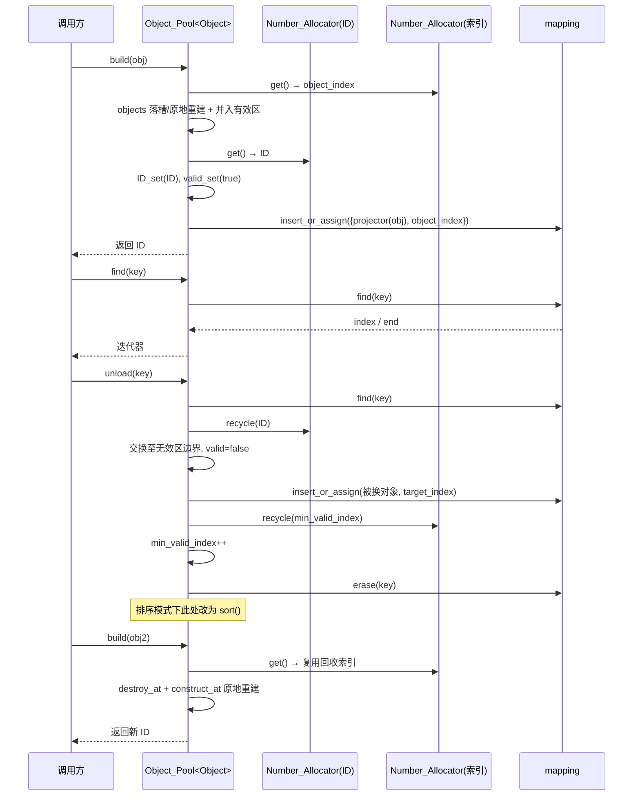

# 对象系统 · 模块架构

> 模块路径（相对源码根）：`Engine/EngineCore/src/core/object/`
> 本模块为 EngineCore 的**对象生命周期与编号管理层**，向同层/上层提供「对象基类 `Object`」与「对象池模板 `Object_Pool`」两类核心产物。
> 本文件为纯技术文档，不修改任何源码；引用的文件一律使用相对源码根的相对路径。
> 本模块近期存在两处重要语义变更，本文件在「三、模块公开接口介绍 / 六、模块设计/实现细节」中逐条记录：
> ① `Object_Pool::build` 的形参由 `const T&` 改为**按值形参 `T object = {}` + `std::move`**；
> ② 定位模式管理接口由 `order_set`/`order_reset` 合并为 **`mode_set(Object_Order, Compare)`**，新增枚举 `Object_Order`；排序模式下 `build` **不再默认重排**（改为打印日志提醒调用方手动 `sort()`），`unload` 在排序模式下**自行 `sort()` 重排有效区**，`build`/`unload` 的哈希映射写入统一改为 `insert_or_assign`。

---

## 一、文件内目录

- [二、模块功能介绍](#二模块功能介绍)
  - [2.1 模块定位](#21-模块定位)｜[2.2 职责边界](#22-职责边界)｜[2.3 解决的问题](#23-解决的问题)｜[2.4 在整体架构中的位置](#24-在整体架构中的位置)｜[2.5 文件清单](#25-文件清单)｜[2.6 与相邻模块的职责分界](#26-与相邻模块的职责分界)
- [三、模块公开接口介绍](#三模块公开接口介绍)
  - [3.1 类 `Object`](#31-类-object)｜[3.2 枚举 `Object_Order`](#32-枚举-object_order)｜[3.3 结构 `Default_Projector`](#33-结构-default_projector)｜[3.4 类模板 `Object_Pool<T,Projector,Key>`](#34-类模板-object_pooltprojectorkey)｜[3.5 编译单元 `对象池实例化.cpp`](#35-编译单元-对象池实例化cpp)｜[3.6 接口速查表](#36-接口速查表)
- [四、模块私有方法介绍](#四模块私有方法介绍)
- [五、模块内部架构介绍](#五模块内部架构介绍)
- [六、模块设计/实现细节](#六模块设计实现细节)
- [七、模块运行链路详例](#七模块运行链路详例)
- [附录、待确认条目](#附录待确认条目)

---

## 二、模块功能介绍

### 2.1 模块定位

「对象系统」是 EngineCore 内部的**对象基础设施层**，位于通用工具集（`Engine/EngineCore/src/tools/`）之上、具体子系统（事件系统、空间系统、配置系统、渲染层、系统层）之下。它把「对象」这一引擎中最普遍的概念抽象为两部分：

- **对象基类 `Object`**：承载任何受管对象都必须具备的最小状态——一个 `uint64_t` 的**对象编号（ID）** 与一个 `bool` 的**合法标记**，并提供读写二者的最小接口。它本身不含业务字段，业务对象通过继承并追加字段来扩展。
- **对象池模板 `Object_Pool<T, Projector, Key>`**：以「连续数组存实体 + 数值分配器发编号 + 定位索引表」的方式，统一管理某类对象的**创建 / 编号分配 / 查找 / 卸载 / 编号回收 / 索引回收 / 连续遍历**。它对 `T` 施加 `std::is_base_of_v<Object, T>` 约束，即**池内元素必须派生自 `Object`**。

本模块的核心设计特征是：

- **头文件即接口**：除一个用于显式实例化的编译单元外，全部实现以模板与类内定义（隐式 `inline`）书写于 `.h`，编译期展开。
- **运行为两套定位模式**：由枚举 `Object_Order` 选择「哈希定位（unordered_map）」或「排序定位（二分查找）」两种定位方式，二者互斥切换，用于在「O(1) 查找」与「按键有序遍历」之间取舍。
- **有效区/无效区前缀划分**：把 `std::vector` 的物理存储划分为「前缀无效区 + 后缀有效区」，使合法对象始终连续、可整体遍历，同时复用被卸载对象的物理槽位。
- **数值分配器复用**：直接复用工具集的 `Number_Allocator<uint64_t>` 来发放/回收两种编号——对象 ID 与数组索引，并利用其 LIFO 回收机制获得「最近卸载的槽位优先复用」的缓存局部性。
- **排序模式由调用方掌握重排时机**：`build` 在排序模式下不自动重排，仅打印日志提醒调用方手动调用 `sort()`；`unload` 在排序模式下则自行 `sort()` 以维持二分查找有效（详见 §6.13）。
- **无异常哲学**：全模块不抛异常，失败以返回 `false` / 超尾迭代器 / 警告日志表达；卸载不存在的键记录 `warn` 日志而非中止。

### 2.2 职责边界

| 归属 | 职责 |
| --- | --- |
| **属于本模块** | 对象基类定义（ID + 合法性状态）、对象池的增删查清、对象 ID 与数组索引的分配/回收、有效区/无效区维护、哈希/排序两种定位模式、对象池槽位预分配 |
| **不属于本模块** | 具体业务对象的字段与行为（由派生类提供）、对象组件的挂载（在本层之上）、对象的序列化/反序列化、跨对象引用与内存所有权的业务语义、多线程同步 |

本模块**不持有任何业务状态**，只维护对象集合的「结构性状态」（ID 分配器、索引分配器、有效区边界、定位映射）。对象池实例的状态完全由使用者持有。

### 2.3 解决的问题

1. **对象编号的唯一发放与回收**：对象需要一个在池内唯一、可回收、可复用的整数编号。本模块用 `Number_Allocator<uint64_t>` 发放 ID，并把 `ID=0` 预留给「非法/预留」语义（非法实体编号）。
2. **连续存储与稳定遍历**：把对象紧凑存于 `std::vector<T>`，通过维护 `min_valid_index` 使合法对象恒为一段连续区间，从而可用 `begin()/end()` 直接做范围遍历，避免遍历时逐个判 `valid()`。
3. **卸载后槽位复用**：卸载对象时把其物理槽位交换到无效区并回收索引，使后续创建可原位复用（`std::construct_at` 原地重建），减少内存重分配与缓存抖动。
4. **两种查找性能取舍**：默认以哈希表做 O(1) 查找；当使用者更在意「按键有序遍历」时，可切换到排序模式，用二分查找（复用工具集 `detail::binary_search`）。
5. **自定义定位键**：通过投影器（Projector）机制，使用者可让对象以任意字段（而非仅 ID）作为定位键，键类型由投影器返回类型自动推导。

### 2.4 在整体架构中的位置

```
                      ┌───────────────────────────────────────────┐
   上层/同层   配置系统  事件系统  空间系统  渲染层  系统层
                      └────────────────────┬──────────────────────┘
                                           │ 依赖（只读下行）
                      ┌────────────────────▼──────────────────────┐
   ★本次模块          │               对象系统 object               │
                      │   Object/对象.h   →  类 Object            │
                      │   Object_Pool/对象池.h                    │
                      │     → enum Object_Order                    │
                      │     → struct Default_Projector             │
                      │     → class Object_Pool<T,Projector,Key>   │
                      │   Object_Pool/core/对象池实例化.cpp        │
                      │     → template class Object_Pool<Object>   │
                      └────────────────────┬──────────────────────┘
                                           │ 依赖（复用下层原语）
                      ┌────────────────────▼──────────────────────┐
                      │             工具集 tools                    │
                      │  Number_Allocator/数值分配器.h             │
                      │  Detail/二分查找.h                         │
                      │  Logging（全局 logger，供告警输出）         │
                      └────────────────────┬──────────────────────┘
                                           │
                      ┌────────────────────▼──────────────────────┐
                      │  common/前置头文件包含.h（PCH，标准库全集） │
                      └───────────────────────────────────────────┘
```

- **下行**：本模块依赖公共预编译头 `Engine/EngineCore/common/前置头文件包含.h`；通过对象池头文件间接依赖工具集的 `Number_Allocator<uint64_t>`（含其引入的全局 `engine::logger`）与 `detail::binary_search`。
- **上行**：同层的配置/事件/空间系统与上层渲染/系统层均可包含本模块头文件，以「继承 `Object` + 实例化 `Object_Pool<T>`」方式获得对象管理能力。
- **横向**：本模块不反向调用任何同层模块；工具集是它唯一的（下层）横向依赖方向。

### 2.5 文件清单

| 相对路径 | 形态 | 对外主要产出 |
| --- | --- | --- |
| `Engine/EngineCore/src/core/object/对象系统运行包.h` | 聚合头（运行包） | 统一引入 PCH、`Object`、`Object_Pool` |
| `Engine/EngineCore/src/core/object/Object/对象.h` | 纯头文件 | 类 `engine::Object` |
| `Engine/EngineCore/src/core/object/Object_Pool/对象池.h` | 纯头文件模板 | 枚举 `engine::Object_Order`、结构 `engine::Default_Projector`、类模板 `engine::Object_Pool<T, Projector, Key>` |
| `Engine/EngineCore/src/core/object/Object_Pool/core/对象池实例化.cpp` | 编译单元 | `template class Object_Pool<Object>;` 显式实例化 |

### 2.6 与相邻模块的职责分界

- 与 **工具集（tools）**：工具集提供 **通用数值分配原语** `Number_Allocator<T>` 与 **通用二分查找原语** `detail::binary_search`；对象系统只把它们当作无业务语义的底层能力复用，不修改也不感知其内部实现。对象系统是这些原语的**消费者**。
- 与 **事件系统 / 空间系统 / 配置系统**：这些模块负责各自领域的派发/查询/解析逻辑；对象系统只提供「对象的存放与编号」，不参与事件路由、空间索引或配置解析。若这些模块需要「以对象为键」，可基于本模块的 `Object_Pool` 或 `Object` 基类扩展。
- 与 **渲染层 / 系统层**：二者处于更上层，可管理「渲染资源对象」「窗口/输入对象」，方向均为「上层继承并实例化本模块」，本模块不反向依赖上层。

---

## 三、模块公开接口介绍

> 说明：本模块除 `对象池实例化.cpp` 外均为模板/类内定义，接口以头文件为准。以下逐条列出对外可用类型与函数，签名与源码逐字一致。

### 3.1 类 `Object`

- **定义位置**：`Engine/EngineCore/src/core/object/Object/对象.h`
- **命名空间**：`engine`
- **用途**：对象基类，承载对象编号与合法性状态。

#### 3.1.1 数据成员（`protected`）

| 成员 | 类型 | 初值 | 含义 |
| --- | --- | --- | --- |
| `object_ID` | `uint64_t` | `0` | 对象编号（ID）。`0` 为保留的「非法/预留」编号（对象池 `reserve()` 与 `unload()` 均把它写入无效对象）。 |
| `is_valid` | `bool` | `false` | 合法标记。新建对象默认 `false`，由对象池在 `build()` 流程末置 `true`。 |

两者均为 `protected`，派生类可直接访问，但常规外部访问应经 `ID()` / `valid()` 读取。

#### 3.1.2 构造/赋值/析构接口

| 签名 | 参数 | 返回值 | 约束与行为 |
| --- | --- | --- | --- |
| `Object() = default` | — | — | 默认构造：`object_ID = 0`、`is_valid = false`（取自成员初值）。 |
| `explicit Object(uint64_t id, bool valid = true) noexcept` | `id`：初始编号；`valid`：初始合法性，默认 `true` | — | 带参构造。`explicit` 禁止从 `uint64_t` 隐式转换构造。`noexcept`。注意：默认 `valid=true` 与成员初值 `false` 不一致，显式传入编号时对象默认视为合法。 |
| `Object(const Object&) = default` | `other`：被拷贝对象 | — | 拷贝构造：逐成员复制（含 `object_ID`、`is_valid`）。**不重新分配 ID**，两份对象将持有相同 ID（详见 §6.7）。 |
| `Object& operator=(const Object&) = default` | `other`：被拷贝对象 | `*this` | 拷贝赋值：逐成员复制，同样不改变 ID 唯一性。 |
| `Object(Object&& other) noexcept` | `other`：被移动对象 | — | 移动构造：**转移** `object_ID` 与 `is_valid`，随后把 `other` 置为无效态（`object_ID = 0`、`is_valid = false`）。空操作即「窃取后置空」，无堆资源释放。 |
| `Object& operator=(Object&& other) noexcept` | `other`：被移动对象 | `*this` | 移动赋值：先判**自赋值**（`this != &other`），转移两字段，随后把 `other` 置为无效态；自赋值时直接返回自身。 |
| `virtual ~Object() = default` | — | — | 虚析构。使派生类可经基类指针安全析构；本类无堆成员，析构为空。 |

> **拷贝语义约定**：`Object` 的拷贝构造/赋值保持为 `default`，会连同 `object_ID` 一并复制，使两份对象持有相同 ID；这是**刻意保留的可拷贝语义**——「允许拷贝，出错不管」，唯一性由调用方自负其责（详见 §6.7）。

#### 3.1.3 读写接口

| 签名 | 参数 | 返回值 | 约束与行为 |
| --- | --- | --- | --- |
| `void ID_set(const uint64_t& ID)` | `ID`：待写入编号（按常量引用传递） | 无 | 写入 `object_ID`。**不做唯一性校验**，调用方自保证语义。 |
| `void valid_set(bool valid)` | `valid`：待写入合法性 | 无 | 写入 `is_valid`。对象池在创建末置 `true`、卸载时置 `false`。 |
| `uint64_t ID(void) const` | — | 当前 `object_ID` | 读对象编号。const 成员，可在 `const Object` / `const T` 上调用——投影器默认即依赖此 const 接口。 |
| `bool valid(void) const` | — | 当前 `is_valid` | 读合法性。const 成员。 |

> **重要约束**：`ID()` / `valid()` 为 `const` 接口，而 `ID_set()` / `valid_set()` 为非 const。因此 `Default_Projector::operator()(const T&)` 只能调用 `ID()` 这一 const 接口——自定义投影器若需读取业务字段，该字段的读取器也**必须是 const 成员**。

### 3.2 枚举 `Object_Order`

- **定义位置**：`Engine/EngineCore/src/core/object/Object_Pool/对象池.h`
- **命名空间**：`engine`

```cpp
//对象排列顺序 
enum class Object_Order
{
	Unorder,
	Sorted
};
```

| 枚举值 | 含义 |
| --- | --- |
| `Object_Order::Unorder` | 哈希定位模式（`mapping` 生效，`is_sorted == false`）。 |
| `Object_Order::Sorted` | 排序定位模式（二分查找，`is_sorted == true`）。 |

- 该枚举作为 `Object_Pool::mode_set` 的模式参数（见 §3.4.4），把原先分散在 `order_set`/`order_reset` 两函数中的「切模式」语义统一到一个入口。
- 底层类型默认为 `int`；仅作模式判别，不参与排序比较。

### 3.3 结构 `Default_Projector`

- **定义位置**：`Engine/EngineCore/src/core/object/Object_Pool/对象池.h`
- **命名空间**：`engine`

```cpp
struct Default_Projector
{
    template <typename T>
    uint64_t operator()(const T& object) const
    {
        return object.ID();
    }
};
```

| 项目 | 说明 |
| --- | --- |
| 形态 | 无状态结构体（无数据成员），可参与空基类优化（配合 `[[no_unique_address]]`） |
| 调用签名 | `template<typename T> uint64_t operator()(const T& object) const` |
| 参数 | `object`：**任意类型**的 `const` 引用（模板泛化，不限于 `Object` 派生类；仅在实际用于 `Object_Pool` 时受池的约束限定） |
| 返回值 | `object.ID()`，即对象的 `uint64_t` 编号 |
| 用途 | 作为 `Object_Pool` 的默认定位投影器：以对象 ID 作为定位键，使默认态下 `Key = uint64_t` |

### 3.4 类模板 `Object_Pool<T, Projector, Key>`

- **定义位置**：`Engine/EngineCore/src/core/object/Object_Pool/对象池.h`
- **命名空间**：`engine`

#### 3.4.1 模板参数与约束

```cpp
template <typename T, typename Projector = Default_Projector,
    typename Key = std::invoke_result_t<Projector, const T&>>
    requires std::is_base_of_v<Object, T>
class Object_Pool
```

| 模板参数 | 默认值 | 含义与约束 |
| --- | --- | --- |
| `T` | 无（必填） | 池内对象类型。**强约束** `std::is_base_of_v<Object, T>`：必须派生自 `Object`。 |
| `Projector` | `Default_Projector` | 对象定位投影器：用于把对象映射为定位键。须支持以 `const T&` 调用（即其 `operator()` 接受 `const T&`）。 |
| `Key` | `std::invoke_result_t<Projector, const T&>` | 定位键类型，**由投影器返回类型自动推导**，通常不必显式指定。默认投影器下 `Key = uint64_t`。 |

> **隐含约束（未以 `requires` 表达，但被 `std::unordered_map<Key, uint64_t>` 依赖）**：`Key` 必须可哈希、可相等比较（即可用于 `std::unordered_map`）。若自定义投影器返回不可哈希的类型，在实例化哈希模式相关代码时将编译失败。

#### 3.4.2 内部类型 `Comparator`（`private`）

对象池内部含一私有嵌套比较器类 `Comparator`（以 `std::variant<std::ranges::less, std::ranges::greater>` 承载排序方向），供排序模式使用。其完整定义与各成员函数说明见 [§四、模块私有方法介绍](#四模块私有方法介绍)；此处仅指出：`mode_set` 的 `Compare` 模板参数最终即被存入该比较器实例 `compare`（见 §3.4.4）。

#### 3.4.3 构造 / 析构

| 签名 | 参数 | 返回值 | 约束与行为 |
| --- | --- | --- | --- |
| `Object_Pool()` | — | — | 构造函数：①对 `ID_allocator` 与 `index_allocator` 均设置 `Allocate_Order::LIFO`（后进先出回收）；②对 `ID_allocator.set(min_ID)`，即 ID 从 `1` 开始分配（`0` 保留为非法编号）；③对 `index_allocator.set(0)`，即索引从 `0` 开始分配。 |
| `~Object_Pool()` | — | — | 析构函数：空体。成员 `objects`（`std::vector<T>`）由自身析构，不额外处理。 |

#### 3.4.4 定位模式管理接口 `mode_set`

```cpp
template <typename Compare = std::ranges::less>
    requires std::same_as<Compare, std::ranges::less> ||
std::same_as<Compare, std::ranges::greater>
    void mode_set(Object_Order mode, Compare cmp = {})
```

| 项目 | 说明 |
| --- | --- |
| 签名 | `void mode_set(Object_Order mode, Compare cmp = {})`；`Compare` 模板参数默认 `std::ranges::less`，受 `requires` 约束**仅接受** `std::ranges::less` 或 `std::ranges::greater` |
| 参数 | `mode`：目标模式（`Object_Order::Unorder` 哈希 / `Object_Order::Sorted` 排序）；`cmp`：排序比较器，仅在切到排序模式时使用，默认 `{}`（即 `std::ranges::less`，升序） |
| 返回值 | 无 |
| 分支一：`Unorder` 且当前为排序模式 | 置 `is_sorted = false`；遍历 `objects`，对每个 `valid()` 对象**重建** `mapping`（`mapping.insert({projector(obj), index})`）；将 `compare` 复位为 `std::ranges::less()`。 |
| 分支二：`Sorted` | 若当前非排序模式，则置 `is_sorted = true` 并 `mapping.clear()`；记录 `compare = cmp`；随后调用 `sort()` 对当前有效区重排。若已是排序模式，则等价于「改比较器并重排」。 |
| 分支三：其余（`Unorder` 且当前已是哈希模式） | `logger.warn("Object_Pool::当前已为目标模式")` 并返回，不做任何状态变更。 |

> 该接口**合并了上一版次的 `order_set(Compare)` 与 `order_reset()`**：`mode_set(Object_Order::Sorted, cmp)` 对应原 `order_set(cmp)`；`mode_set(Object_Order::Unorder)` 对应原 `order_reset()`。
> 注意：当目标为 `Sorted` 且当前已处于排序模式时，不走分支三、不发告警，而是按分支二重新记录比较器并重排。

#### 3.4.5 查找接口

| 签名 | 参数 | 返回值 | 约束与行为 |
| --- | --- | --- | --- |
| `typename std::vector<T>::iterator find(const Key& key)` | `key`：定位键（默认即对象 ID） | 指向命中对象的迭代器；未命中返回 `end()` | 非常量重载。哈希模式：查 `mapping.find(key)`，命中返回 `objects.begin() + index`，否则 `objects.end()`。排序模式：以 `detail::binary_search(begin(), end(), key, compare, projector)` 返回的下标定位，命中 `begin() + index`，否则 `end()`。 |
| `typename std::vector<T>::const_iterator find(const Key& key) const` | 同上 | `const_iterator`；未命中返回 `end()` | **常量重载（本版次新增）**：逻辑与非 const 重载一致，供在 `const Object_Pool&` 上查找；返回常量迭代器。 |

> **返回迭代器的有效范围**：哈希模式下命中 `mapping` 项时按 `it->second` 返回，因哈希模式卸载时会同步维护映射（见 §3.4.8 与 §6.11-2），正常态下不应残留指向无效槽位的陈旧项；排序模式下返回**有效区**内迭代器（相对 `begin()`）。调用方若只遍历有效对象，应结合 `begin()/end()` 使用。

#### 3.4.6 构建接口 `build`（本次重点变更）

```cpp
uint64_t build(T object = {})
```

| 项目 | 说明 |
| --- | --- |
| 签名 | `uint64_t build(T object = {})` —— 形参为**按值传递**的 `T`，带**默认实参 `{}`**（即默认构造一个 `T`） |
| 参数 | `object`：待加入池的对象。**按值拷贝/移动入场**，随后在池内以 `std::move(object)` 转移构造。调用不带实参时等价于「先默认构造一个 `T` 再入场」。 |
| 返回值 | 新对象的 `uint64_t` 编号（等于 `ID_allocator.get()` 的分配值） |
| 行为步骤 | ①`object_index = index_allocator.get()` 取索引；②若 `object_index >= objects.size()`，`objects.push_back(std::move(object))` 追加新槽；否则对旧槽 `std::destroy_at(&objects[object_index])` 后 `std::construct_at(&objects[object_index], std::move(object))` 原地重建；③若 `min_valid_index > 0`，把 `objects[object_index]` 与 `objects[--min_valid_index]` 交换，并更新 `object_index = min_valid_index`（把新对象并入有效区边界）；④`new_object.ID_set(ID_allocator.get())`、`valid_set(true)`；⑤哈希模式 `mapping.insert_or_assign(projector(new_object), object_index)`，排序模式则**打印日志** `logger.info("Object_Pool::请自行调用sort()方法重排序对象")` 提醒调用方手动重排；⑥返回新对象 ID。 |
| 语义变更（近期） | **原为 `const T&` 形参，仅支持可拷贝类型；现改为按值 `T object = {}` + `std::move`。** 动机：①支持「无参默认构造」直接建对象（`T` 只需可默认构造即可，无需调用方显式构造实参）；②对非拷贝但可移动的 `T`（如持有 `std::unique_ptr`、`std::mutex`、不可拷贝资源的对象）提供移动入场路径，把所有权移交池内；③统一「拷贝左值 / 移动右值」两种调用形态，左值走拷贝、右值走移动。 |
| 排序模式行为（本次变更） | **不再于 `build` 内调用 `sort()`**：排序模式下 `build` 完成落槽与编号分配后仅打印提醒日志，由调用方自行在合适的时机调用 `sort()` 重排（见 §6.13）。哈希模式下则用 `insert_or_assign` 写入映射（重复定位键默认覆盖，见 §6.11-3）。 |
| 对 `T` 的要求 | 至少需**可默认构造**（用于默认实参 `{}`，仅在不传参调用时才要求）；需**可移动构造/可移动赋值**（`std::move` 入场与后续 `std::swap` 重排均要求）；需**可析构**（`std::destroy_at` 要求）。 |
| 异常 | 不抛异常；内存增长由 `std::vector` 承担。 |

#### 3.4.7 排序接口

| 签名 | 参数 | 返回值 | 约束与行为 |
| --- | --- | --- | --- |
| `bool sort(void)` | — | 排序模式返回 `true`；哈希模式返回 `false` | 哈希模式（`is_sorted == false`）直接返回 `false` 不做事；排序模式调用 `std::ranges::sort(begin(), end(), compare, projector)` 对**有效区**按投影键重排，返回 `true`。 |

#### 3.4.8 卸载接口

| 签名 | 参数 | 返回值 | 约束与行为 |
| --- | --- | --- | --- |
| `void unload(const Key& key)` | `key`：待卸载对象的定位键 | 无 | **单对象重载**：构造 `std::vector<Key>{key}` 后委托多对象重载（`unload(std::vector<Key>{key})`）。 |
| `void unload(const std::vector<Key>& keys)` | `keys`：待卸载键列表 | 无 | **多对象重载（主实现）**：逐个键执行——①`find(key)` 定位；②**未命中**则 `logger.warn("Object_Pool::目标对象不存在: {}", key)` 后 `continue`（不影响其余键）；③命中则记录 `target_index = it - objects.begin()` 与 `ID = it->ID()`，`ID_allocator.recycle(ID)` 回收 ID，`it->ID_set(0)`、`it->valid_set(false)`；④若 `target_index != min_valid_index`，把 `objects[target_index]` 与 `objects[min_valid_index]` 交换，使被卸载对象落到无效区边界；**哈希模式**下同时用 `mapping.insert_or_assign(projector(objects[target_index]), target_index)` 同步被交换有效对象的映射索引；⑤`index_allocator.recycle(min_valid_index)` 回收索引，`min_valid_index++` 收缩有效区；⑥**哈希模式** `mapping.erase(key)`；**排序模式**则调用 `sort()` 重排有效区，保证后续二分 `find` 有效。 |

#### 3.4.9 清除接口

| 签名 | 参数 | 返回值 | 约束与行为 |
| --- | --- | --- | --- |
| `void clear(void)` | — | 无 | ①`objects.clear()`；②`ID_allocator.reset()` 后重设 `LIFO` 与 `set(min_ID)`；③`index_allocator.reset()` 后重设 `LIFO` 与 `set(0)`；④`min_valid_index = 0`；⑤哈希模式 `mapping.clear()`，排序模式则 `is_sorted = false` 并复位 `compare = std::ranges::less()`（即 `clear()` 会把排序模式一并复位为哈希模式）。 |

#### 3.4.10 槽位预分配接口

| 签名 | 参数 | 返回值 | 约束与行为 |
| --- | --- | --- | --- |
| `bool reserve(const uint64_t& num)` | `num`：预分配槽位数 | `true` 表示预分配成功；`false` 表示对象池非空、拒绝预分配 | **仅当 `objects.empty()` 时可用**：否则直接返回 `false`。可用时循环 `num` 次 `objects.push_back({})`（默认构造 `T`），每次把该槽 ID 设为 `min_ID - 1`（即 `0`）并 `valid_set(false)`；随后 `min_valid_index = num`，返回 `true`。结果：物理上预留 `num` 个无效槽位，有效区为空。 |

#### 3.4.11 容量查询接口

| 签名 | 参数 | 返回值 | 约束与行为 |
| --- | --- | --- | --- |
| `uint64_t capacity(void) const` | — | `objects.size()` | 池的**物理槽位数**（含无效区与预分配槽）。 |
| `uint64_t size(void) const` | — | `ID_allocator.counts()` | **当前合法对象数**（在分配的 ID 计数）。卸载会递减、创建会递增。 |

#### 3.4.12 迭代器接口

| 签名 | 参数 | 返回值 | 约束与行为 |
| --- | --- | --- | --- |
| `typename std::vector<T>::iterator begin(void)` | — | `objects.begin() + min_valid_index` | 非常量重载：指向**有效区首个对象**。 |
| `typename std::vector<T>::const_iterator begin(void) const` | — | `objects.begin() + min_valid_index` | 常量重载。 |
| `typename std::vector<T>::iterator end(void)` | — | `objects.end()` | 非常量重载：超尾迭代器。 |
| `typename std::vector<T>::const_iterator end(void) const` | — | `objects.end()` | 常量重载。 |

> 有效区遍历约定：`[begin(), end())` 恒为全部合法对象，且顺序为「有效区内物理顺序」。排序模式下该区间按键有序（`build` 后需调用方手动 `sort()` 方可恢复键序，`unload` 已自行 `sort()`，见 §6.13）。

#### 3.4.13 索引转换接口（本版次新增）

| 签名 | 参数 | 返回值 | 约束与行为 |
| --- | --- | --- | --- |
| `uint64_t index(const typename std::vector<T>::iterator& iterator)` | `iterator`：非常量迭代器 | `iterator - begin()` | 把（有效区相对）迭代器换算为**有效区相对索引**（相对 `begin()`，即已含 `min_valid_index` 偏移）。 |
| `uint64_t index(const typename std::vector<T>::const_iterator& iterator) const` | `iterator`：常量迭代器 | `iterator - begin()` | 常量重载，语义同上。 |

#### 3.4.14 元素访问接口（本版次新增）

| 签名 | 参数 | 返回值 | 约束与行为 |
| --- | --- | --- | --- |
| `T& operator[](const Key& key)` | `key`：定位键 | `T&` | 以定位键访问对象引用。内部 `find(key)` 后 `assert(it != objects.end())`，**调用方须保证目标对象存在**（不存在时断言失败）。 |
| `const T& operator[](const Key& key) const` | `key`：定位键 | `const T&` | 常量重载，语义同上，返回常量引用。 |
| `T& object_at(uint64_t offset)` | `offset`：有效区相对偏移 | `T&` | 以相对偏移访问对象引用：`assert(offset < size())` 后 `*(begin() + offset)`；**调用方须保证偏移在有效区内**。 |
| `const T& object_at(uint64_t offset) const` | `offset`：有效区相对偏移 | `const T&` | 常量重载，语义同上。 |

> 三类访问接口均以 `assert` 表达前置条件（非法入参在 Debug 下断言中止），不抛异常；`index()` 与 `object_at()` 的「索引/偏移」均以**有效区起点** `begin()` 为基准。

### 3.5 编译单元 `对象池实例化.cpp`

- **定义位置**：`Engine/EngineCore/src/core/object/Object_Pool/core/对象池实例化.cpp`
- **内容**：

```cpp
#include "src/core/object/Object_Pool/对象池.h"

namespace engine
{
	//对象池实例化
	template class Object_Pool<Object>;
}
```

| 项目 | 说明 |
| --- | --- |
| 作用 | 为 `Object_Pool<Object>`（默认投影器、`Key = uint64_t`）生成**显式实例化**，把该最常用组合的模板代码落到本编译单元，供其它编译单元链接复用。 |
| 包含关系 | 包含 **`src/core/object/Object_Pool/对象池.h`**（本层根相对路径；本版次由原 `../对象池.h` 改为层根相对写法，属「包含路径口径统一」），命名空间 `engine`。 |
| 影响 | 其它 `Object_Pool<T, ...>` 组合仍为隐式实例化（在使用处展开）；只有 `<Object, Default_Projector, uint64_t>` 这一组合被集中实例化。 |

### 3.6 接口速查表

| 类别 | 接口 | 关键点 |
| --- | --- | --- |
| 基类 | `Object()` / `explicit Object(uint64_t, bool=true)` | 后者的 `valid` 默认为 `true` |
| 基类 | `ID()` / `valid()`（const） | 供投影器与外部读取 |
| 基类 | `ID_set(const uint64_t&)` / `valid_set(bool)` | 不做校验 |
| 基类 | 拷贝构造/赋值（`default`） | **允许拷贝，ID 一并复制，出错不管** |
| 基类 | 移动构造/赋值 | **源对象被置为 ID=0/无效** |
| 枚举 | `Object_Order::Unorder` / `Object_Order::Sorted` | 模式选择入参 |
| 投影器 | `Default_Projector::operator()(const T&) const` → `ID()` | 无状态，可空基类优化 |
| 池 | `mode_set(Object_Order, Compare={})` | 换模式；`Sorted` 触发 `sort()`；`Compare` 仅限 `less`/`greater` |
| 池 | `build(T object = {})` → `uint64_t` | **按值 + `std::move`**，默认实参 `{}`；排序模式仅记日志不重排 |
| 池 | `find(const Key&)` → `iterator` / const 重载 → `const_iterator` | 哈希 O(1) / 排序 O(log n) |
| 池 | `unload(const Key&)` / `unload(const std::vector<Key>&)` | 单键委托多键；未命中记 warn；排序模式收尾 `sort()` |
| 池 | `sort()` | 哈希模式返回 `false`；排序模式全量重排有效区 |
| 池 | `clear()` / `reserve(num)` / `capacity()` / `size()` | `reserve` 仅空池可用；`clear` 复位为哈希模式 |
| 池 | `begin()` / `end()`（各 const/非 const） | 有效区范围 |
| 池 | `index(iterator)` / `operator[](Key)` / `object_at(offset)` | 新增：索引换算与元素访问，均带 `assert` 前置条件 |

---

## 四、模块私有方法介绍

本模块的对外类 `Object`、`Object_Pool` 均**无类内私有成员函数**（`Object_Pool` 的私有内容包括数据成员与一个私有嵌套类，函数体全部为 `public` 成员；`Object` 的私有内容仅为两个 `protected` 数据成员）。

本模块唯一的「私有/内部实现函数」聚集在 `Object_Pool` 的**私有嵌套比较器类 `Comparator`** 中——它不对外暴露，仅供排序模式的 `sort()`/`find()` 内部使用。

### 4.1 私有嵌套类 `Comparator`

- **定义位置**：`Engine/EngineCore/src/core/object/Object_Pool/对象池.h`（`Object_Pool` 的 `private:` 段）
- **访问性**：`private` 嵌套类型，外部不可见。

```cpp
//比较器
class Comparator
{
	std::variant<std::ranges::less, std::ranges::greater> v;
public:
	Comparator() = default;
	Comparator(std::ranges::less l) : v(l) {}
	Comparator(std::ranges::greater g) : v(g) {}

	template <typename A, typename B>
	bool operator()(A&& a, B&& b) const
	{
		return std::visit(
			[&](auto cmp) { return cmp(std::forward<A>(a), std::forward<B>(b)); },
			v);
	}
};
```

| 成员函数 | 签名 | 作用 | 关键行为 |
| --- | --- | --- | --- |
| 默认构造 | `Comparator() = default` | 构造默认比较器 | `v` 落到第一备选 `std::ranges::less`，即**升序**。 |
| 由升序比较器构造 | `Comparator(std::ranges::less l)` | 以 `less` 初始化 | 直接以 `l` 构造 `v`（备选 0）。 |
| 由降序比较器构造 | `Comparator(std::ranges::greater g)` | 以 `greater` 初始化 | 直接以 `g` 构造 `v`（备选 1）。 |
| 比较调用 | `template <typename A, typename B> bool operator()(A&& a, B&& b) const` | 对任意可比类型对 `(a, b)` 求「先于」判定 | 用 `std::visit` 展开 `v` 当前备选，转发到 `cmp(std::forward<A>(a), std::forward<B>(b))`；`const` 成员，可在 `const` 上下文中调用（`find`/`sort` 内部即以其为比较器）。 |

- `Comparator` 可由 `std::ranges::less` / `std::ranges::greater` **隐式转换构造**，从而 `mode_set` 传入的 `Compare` 可直接赋给成员 `compare`。
- 其承载的排序方向数据成员 `v` 的说明见 [§5.5](#55-私有嵌套-comparator-内部结构)。
- 因 `mode_set` 的 `requires` 仅允许 `less`/`greater`，`Comparator` 实际只会以这两种备选之一存在，**不支持自定义比较器**（见 §6.1）。

---

## 五、模块内部架构介绍

### 5.1 目录结构树

```
Engine/EngineCore/src/core/object/
│
├── 对象系统运行包.h                    # 聚合头：PCH + Object + Object_Pool
│
├── Object/
│   └── 对象.h                          # 类 engine::Object
│
└── Object_Pool/
    ├── 对象池.h                        # Object_Order + Default_Projector + Object_Pool<T,Projector,Key>
    └── core/
        └── 对象池实例化.cpp            # template class Object_Pool<Object>;
```

### 5.2 各编译单元职责

| 文件 | 职责 |
| --- | --- |
| `对象系统运行包.h` | 运行包聚合头。依次 `#pragma once`、引入公共预编译头、引入 `Object/对象.h` 与 `Object_Pool/对象池.h`。使用方只需包含本头即可获得整个对象系统。 |
| `Object/对象.h` | 定义对象基类 `Object`（两受保护字段 + 构造/拷贝/移动/析构 + 四个访问器）。 |
| `Object_Pool/对象池.h` | 定义模式枚举 `Object_Order`、定位投影器 `Default_Projector` 与对象池模板 `Object_Pool`。内含私有嵌套比较器 `Comparator` 与全部池操作。 |
| `Object_Pool/core/对象池实例化.cpp` | 对 `Object_Pool<Object>` 做显式模板实例化。 |

### 5.3 类 `Object` 内部数据结构

| 字段 | 类型 | 初值 | 作用 | 读写点 |
| --- | --- | --- | --- | --- |
| `object_ID` | `uint64_t` | `0` | 对象编号；`0` 为保留非法编号 | 由 `ID_set()` 写、`ID()` 读；池在 `build` 末写、`unload` 时写 0、`reserve` 时写 0 |
| `is_valid` | `bool` | `false` | 合法性标记 | 由 `valid_set()` 写、`valid()` 读 |

- 二者均在 `protected`，派生类可直接使用；对外应经访问器。
- 移动构造/赋值会把**源**对象的这两字段清为 `0/false`，是「移动即置空」的约定；拷贝构造/赋值则保留为 `default`，逐成员复制（含 ID），不做唯一性处理（见 §6.7）。
- 类含**虚析构**（`virtual ~Object()`），因此 `Object` 及其派生类对象带虚表指针；对象池以 `std::vector<T>` 直接存 `T`（多为派生类，按值存，非多态指针），虚析构主要为「经基类指针删除」的兼容性保留，池本身并不以基类指针存元素。

### 5.4 类模板 `Object_Pool` 内部数据结构

| 字段 | 类型 | 初值 | 类别 | 作用 |
| --- | --- | --- | --- | --- |
| `ID_allocator` | `Number_Allocator<uint64_t>` | LIFO, `next=min_ID` | 编号分配 | 发放/回收**对象 ID**；起始 `1`，`0` 保留非法 |
| `index_allocator` | `Number_Allocator<uint64_t>` | LIFO, `next=0` | 索引分配 | 发放/回收**数组索引**；起始 `0` |
| `min_ID` | `uint64_t` | `1` | 常量语义 | ID 分配起点；亦用于 `reserve` 写非法 ID（`min_ID-1`） |
| `min_valid_index` | `uint64_t` | `0` | 有效区边界 | 有效区起点下标；`[min_valid_index, objects.size())` 为合法对象 |
| `objects` | `std::vector<T>` | 空 | 物理存储 | 连续存放全部对象槽（含无效区） |
| `projector` | `Projector` | 默认构造 | 定位投影器 | `[[no_unique_address]]`；无状态时零占用 |
| `is_sorted` | `bool` | `false` | 模式标记 | `false`=哈希定位，`true`=排序定位 |
| `mapping` | `std::unordered_map<Key, uint64_t>` | 空 | 定位索引 | 哈希模式下的 `键 → 索引` 映射 |
| `compare` | `Comparator` | `std::ranges::less` | 比较器 | 排序模式下的排序方向 |

> **索引/编号含义区分**：`ID_allocator` 管「对象身份号」，会写入对象的 `object_ID`；`index_allocator` 管「数组下标」，决定对象物理落点。二者独立分配、独立回收，互不通用。`min_valid_index` 只与索引体系相关。

### 5.5 私有嵌套 `Comparator` 内部结构

| 成员 | 类型 | 说明 |
| --- | --- | --- |
| `v` | `std::variant<std::ranges::less, std::ranges::greater>` | 承载排序方向。备选 0 = `less`（升序），备选 1 = `greater`（降序）。 |

> 该类的构造函数与 `operator()` 等成员函数说明见 [§四、模块私有方法介绍](#四模块私有方法介绍)。

### 5.6 类关系图

```mermaid
classDiagram
    class Object {
        #uint64_t object_ID = 0
        #bool is_valid = false
        +Object()
        +Object(uint64_t id, bool valid=true)
        +Object(const Object&) = default
        +operator=(const Object&) = default
        +Object(Object&&) noexcept
        +operator=(Object&&) noexcept
        +virtual ~Object()
        +ID_set(const uint64_t&)
        +valid_set(bool)
        +ID() const uint64_t
        +valid() const bool
    }

    class Object_Order {
        <<enum>>
        Unorder
        Sorted
    }

    class Default_Projector {
        +operator()(const T&) const uint64_t
    }

    class Object_Pool~T, Projector, Key~ {
        -Number_Allocator~uint64_t~ ID_allocator
        -Number_Allocator~uint64_t~ index_allocator
        -uint64_t min_ID = 1
        -uint64_t min_valid_index = 0
        -vector~T~ objects
        -Projector projector
        -bool is_sorted = false
        -unordered_map~Key,uint64_t~ mapping
        -Comparator compare
        +Object_Pool()
        +mode_set(Object_Order, Compare={})
        +build(T object={}) uint64_t
        +find(const Key&) iterator
        +find(const Key&) const const_iterator
        +unload(const Key&)
        +unload(const vector~Key~&)
        +sort() bool
        +clear()
        +reserve(const uint64_t&) bool
        +capacity() const
        +size() const
        +begin() / end()
        +index(iterator) const
        +operator[](const Key&)
        +object_at(uint64_t)
    }

    class Comparator {
        -variant~less,greater~ v
        +operator()(A&&,B&&) const
    }

    class Number_Allocator~uint64_t~ {
        <<tools>>
    }

    Object <|-- T : T 派生自 Object
    Object_Pool ..> Object : 元素须派生
    Object_Pool *-- Comparator : 组合
    Object_Pool o-- Default_Projector : 默认投影器
    Object_Pool ..> Object_Order : 模式枚举
    Object_Pool ..> Number_Allocator~uint64_t~ : 复用（ID/索引分配）
```

### 5.7 `局部命名空间使用.h` 的做法说明

本模块**未提供** `局部命名空间使用.h`，也**未**采用《agent开发指南》「文件架构约束」中的标准模块架构（`core/` + `局部命名空间使用.h` + 对外头文件）形式。实际做法为：

- 各头文件/源文件直接以 `namespace engine { ... }` 包裹全部声明与定义，代码内一律**不加** `engine::` 前缀（因为在命名空间内部）。
- 对工具集类型的引用通过**完整包含路径**引入（如 `#include "Engine/EngineCore/src/tools/Number_Allocator/数值分配器.h"`），并依赖公共预编译头提供标准库。
- 由于模板类 `Object_Pool` 的成员定义均在类体内（隐式 `inline`），不存在需要单独的 `.cpp` 实现分散命名空间引入的场景。

> 依《agent开发指南》「编码约束/项目约束/文件架构约束」第 4 条：项目原始文件架构不符合标准时以项目原始架构为准。故本模块按上述实际形态记录。

---

## 六、模块设计/实现细节

### 6.1 双定位模式（哈希 vs 排序）

对象池有两种互斥的定位模式，由 `is_sorted` 区分，并由 `mode_set(Object_Order)` 统一切换：

| 模式 | `Object_Order` 入参 | `is_sorted` | 查找结构 | `find` 复杂度 | 遍历顺序 | 维护成本 |
| --- | --- | --- | --- | --- | --- | --- |
| 哈希定位（默认） | `Unorder` | `false` | `std::unordered_map<Key,uint64_t> mapping` | 平均 O(1) | 物理顺序（非键序） | 每次 `build`/`unload` 维护映射 O(1) |
| 排序定位 | `Sorted` | `true` | 无额外结构，直接二分 | O(log n) | 有效区内按键有序 | `build` 不再自动重排（仅记日志），`unload` 自行 `sort()` O(n log n) |

- **切换方向**：`mode_set(Object_Order::Sorted, cmp)` → 排序模式（清 `mapping`、按 `cmp` 重排）；`mode_set(Object_Order::Unorder)` → 哈希模式（重建 `mapping`、复位比较器为 `less`）。`clear()` 会把排序模式复位为哈希模式。
- **取舍**：哈希模式适合「频繁按键查找、顺序无关」；排序模式适合「需要按键有序遍历、查找频率不高」。
- **键序方向**：排序模式支持升序（`std::ranges::less`）与降序（`std::ranges::greater`）两种；`mode_set` 的 `requires` 把比较器限定为这两种标准函数对象，**不接受自定义比较器**——此系**刻意的限制**（项目决定：短时间内不加入自定义比较器功能，见 §6.13）。

### 6.2 有效区 / 无效区前缀与索引分配器的协作

池把 `objects` 划分为：

```
索引:  0        1        ...   min_valid_index       ...        size-1
      [----------- 无效区（前缀） ----------][------- 有效区（后缀） -------]
       槽位可能已被 destroy_at/回收，对象 invalid      全部为 valid 对象
```

- **不变式**：`[0, min_valid_index)` 内的对象 `valid()==false`；`[min_valid_index, objects.size())` 内的对象 `valid()==true`。`begin()/end()` 只暴露有效区。
- **卸载**（`unload`）：把被卸载对象交换到 `min_valid_index` 处，`index_allocator.recycle(min_valid_index)`，再 `min_valid_index++`——被卸载槽位并入无效区，有效区收缩一格；排序模式下收尾再 `sort()` 重排有效区（见 §6.13）。
- **构建**（`build`）：`index_allocator.get()` 通常返回无效区内（最近回收）的下标；在原地 `destroy_at + construct_at` 重建后，若 `min_valid_index > 0`，把新对象交换到 `--min_valid_index` 处，有效区扩张一格、无效区收缩一格。
- **效果**：合法对象始终连续，遍历无需判 `valid()`；卸载与构建都以「交换到边界」实现 O(1) 边界移动（不含 `std::swap` 的对象移动成本）。
- **与 LIFO 的配合**：`index_allocator` 为 LIFO，回收的索引按后进先出弹出，使最近卸载的槽位优先复用，改善缓存局部性。

### 6.3 `build` 的按值形参 + `std::move` 语义（重点）

```cpp
//对象添加
uint64_t build(T object = {})
{
	//分配新对象索引
	uint64_t object_index = index_allocator.get();
	//若槽位不足则直接创建新对象
	if (object_index >= objects.size())
		objects.push_back(std::move(object));
	//若获得旧槽位则销毁旧对象并原地重建新对象
	else
	{
		//析构旧对象
		std::destroy_at(&objects[object_index]);
		//在旧槽位原地构造新对象
		std::construct_at(&objects[object_index], std::move(object));
	}
	...
}
```

**语义要点**：

1. **形参按值**：调用 `build(obj)` 时，实参先**拷贝构造**到形参 `object`（左值实参）或**移动构造**到形参（右值实参）；随后形参再被 `std::move` 转移进池内槽位。因此：
   - 传左值：调用方对象保持不变（拷贝进池）；
   - 传右值 / `std::move(obj)`：调用方对象被移空，所有权移交池内。
2. **默认实参 `= {}`**：允许 `build()` 不带参调用，此时先默认构造一个 `T` 再移入池内——**无需调用方先构造实参**，适用于「先占位、后填字段」或「字段由池外流程另行设置」的场景。
3. **对旧版 `const T&` 的改进**：
   - 旧签名 `build(const T& object)` 只接受可拷贝类型，无法承载仅可移动的 `T`（如含 `std::unique_ptr`、`std::mutex` 的对象）；
   - 旧签名也没有默认实参，无法「无参创建」；
   - 新签名统一支持「默认构造 / 拷贝入场 / 移动入场」三种形态。
4. **代价**：按值形参对左值实参多一次拷贝（这正是「拷贝入场」的成本）；对右值则零额外拷贝（移动）。相比 `const T&`，语义更明确（明确获取所有权），但对大对象传左值需注意拷贝开销，必要时改用 `build(std::move(obj))`。
5. **对 `T` 的能力要求**：需可移动构造（`std::move` 入场、`std::swap` 重排）、可析构（`destroy_at`）；若使用默认实参还需可默认构造。
6. **模式相关收尾**：哈希模式写入映射用 `insert_or_assign`（重复定位键覆盖，见 §6.11-3）；排序模式仅打印提醒日志、**不再自动 `sort()`**（见 §6.13）。

### 6.4 ID 分配与 `ID=0` 保留约定

- `ID_allocator` 在构造时 `set(min_ID=1)`，故首个分配 ID 为 `1`；**`0` 不参与发放**。
- `reserve()` 把预留槽 ID 写为 `min_ID - 1 = 0`、`unload()` 把被卸载对象 ID 写为 `0`——`0` 成为「非法/已卸载」编号的哨兵值。
- `build()` 结束时 `ID_set(ID_allocator.get())` 写真实 ID；`size()` 读 `ID_allocator.counts()` 得到当前合法对象数。
- `Number_Allocator` 的 `get()` 在回收集合非空时优先复用回收号（LIFO 取末元素），否则递增 `next_number`；耗尽时回绕并告警（本池因 `min_ID=1` 且 uint64 范围极大，实际不触及）。

### 6.5 投影器与键推导

- `Key = std::invoke_result_t<Projector, const T&>`：键类型完全由投影器对 `const T&` 的调用结果决定，**无需使用者显式声明**。
- 默认投影器以 `object.ID()` 为键 → `Key = uint64_t`。此时 `mapping` 为 `unordered_map<uint64_t,uint64_t>`，`find` 的键即对象 ID。
- 自定义投影器可返回任意可哈希类型（如 `std::string_view`、`std::uint32_t` 业务标识），从而「以业务字段而非 ID 定位」。
- 投影器须能接受 `const T&` 调用，故其读取的业务字段访问器必须为 `const`。
- 约束仅以 `is_base_of_v<Object,T>` 表达；`Key` 的可哈希性未以 `requires` 表达，在实例化哈希模式代码时由 `unordered_map` 给出编译期约束。

### 6.6 空基类优化（`[[no_unique_address]]`）

- `projector` 以 `[[no_unique_address]]` 标注：当 `Projector`（如 `Default_Projector`）为无状态空类型时，该成员不占对象存储（可与其他成员共享地址），从而对象池实例不因投影器而增大。
- 若 `Projector` 有状态（自定义携带配置），则正常占位。这是「默认零开销、自定义才付费」的设计。

### 6.7 内存所有权、拷贝语义与生命周期

- **按值存储**：池以 `std::vector<T>` 直接持有 `T` 对象（值语义），非指针/句柄；对象生命周期完全由池管理。因此 `T` 不能是抽象基类；多态需在 `T` 内部另行设计（例如 `T` 派生自 `Object` 且可实例化）。
- **构建**：新槽用 `push_back`；复用槽用 `std::destroy_at` + `std::construct_at` 显式销毁/重建（而非赋值），以支持不可赋值但可构造/析构的类型，并确保旧对象资源被正确释放。
- **卸载**：`unload` 只把对象置无效并移入无效区，**不调用析构**（对象仍以无效态存在于无效区，直到槽位被 `build` 复用或 `clear` 清空）。因此卸载后对象的资源不会立即释放，注意资源释放时机。
- **清空**：`clear()` 调 `objects.clear()`，一次性析构全部对象并释放存储。
- **移动置空语义**：`Object` 的移动构造/赋值会把源置为 `ID=0`、`invalid`，配合 `std::swap`（内部 `temp=move(a); a=move(b); b=move(temp)`）与 `std::vector` 的移动（扩容搬移）均能正确工作。
- **拷贝语义（刻意保留）**：`Object` 的拷贝构造/赋值保持为 `default`，逐成员复制（**连同 `object_ID` 一并复制**），使两份对象持有相同 ID，**不重置也不禁止拷贝**。项目口径为「允许拷贝，出错不管」——拷贝后 ID 唯一性由调用方自负其责（移动则仍会把源置空）。

### 6.8 线程 / 并发约定

- 本模块**不含任何同步原语**（无 `mutex`、无 `atomic`）。`Object_Pool` 与 `Object` 均**非线程安全**。
- 同一对象池的并发 `build`/`unload`/`find`/`mode_set`/`clear`/`reserve` 均会触发数据竞争（分配器、`objects`、`mapping`、`min_valid_index` 均无保护）。
- 使用约定：由单一所有者线程持有并操作对象池；若需跨线程共享，须由调用方在池外层加锁。（源码未作此说明，属推断的默认约定。）

### 6.9 异常禁用与错误处理

- 全模块**不抛异常**：内存增长交 `std::vector`；`reserve` 失败返回 `false`；查找未命中返回 `end()`；卸载未命中记 `warn` 日志；`mode_set` 的「已为目标模式」记 `warn` 日志。
- 注释明确「进行内存分配时全面禁用异常」为项目约定；本模块未见 `new`/`std::nothrow` 直接使用（分配均由 `std::vector`/容器内部承担）。
- 新增的 `operator[]` / `object_at` 以 `assert` 表达前置条件（Debug 下断言，Release 下不检查），非异常路径。
- `build` 形参按值传入时，若 `T` 的拷贝/移动构造抛出异常，将作为调用方侧异常向外传播（模块自身不捕获）。

### 6.10 编码 / 命名 / 风格约定

- **编码**：源码文件以 UTF-8 存储；文件名使用中文（`对象.h`、`对象池.h`、`对象池实例化.cpp`、`对象系统运行包.h`），符合项目「文件名中文优先」约定。
- **命名**：类型名英文、首字母大写、单词间无分隔（`Object`、`Object_Pool`、`Object_Order`、`Default_Projector`、`Comparator`、`Number_Allocator`、`Allocate_Order`）；成员函数为「英文 + `_` 分隔 + 首字母小写」，且**动词后置**（`ID_set`、`valid_set`、`mode_set`、`min_valid_index`、`is_sorted`）。可见访问器采用「名词 + 动词」样式（`ID()`/`valid()`/`ID_set()`），与指南「动词后置」一致。新增接口 `index`/`operator[]`/`object_at` 亦沿用该风格（`object_at` 为「名词 + 动词后置」）。
- **注释**：全中文；函数头注释翻译/说明函数名（如「对象添加」「对象卸载 —— 多对象重载」「对象排列方式设置」）；函数体内变量声明、`if` 条件、函数调用处均有前置换行注释；三行以上用 `/* */`（本模块实际多为简短 `//` 注释）。
- **大括号**：K&R 风格换行，`if`/`for` 的块另起一行。
- **控制流**：单语句 `if`/`for` 不加大括号（如 `if (!is_sorted) mapping.erase(key);`）；嵌套控制流按指南处理。

### 6.11 易错点与边界行为

1. **排序模式下 `unload` 会重排有效区（已处理）**：`unload` 在排序模式下若 `target_index != min_valid_index`，会先把 `objects[target_index]` 与 `objects[min_valid_index]` 交换，这会把「原有效区首元素」搬到 `target_index`、破坏有效区键序；但该重载在排序模式收尾处**调用 `sort()` 重排有效区**（注释：`//若为排序模式则重排序，保证后续 find 的二分有效`），使后续二分 `find` 保持正确。哈希模式下无失序问题（映射同步维护后 `erase`）。
2. **哈希模式卸载同步更新被交换对象的映射**：`unload` 在哈希模式下，`target_index != min_valid_index` 时交换后会用 `mapping.insert_or_assign(projector(objects[target_index]), target_index)` 把**被换到该槽位的有效对象**的映射索引更新到位，随后再 `mapping.erase(key)` 删除被卸载对象的映射，故正常情况下 `mapping` 不残留指向无效槽位的陈旧项。
3. **重复定位键改为「覆盖（后写胜）」**：`build` 的哈希模式写入改用 `mapping.insert_or_assign(projector(new_object), object_index)`（下同，`unload`/`mode_set` 重建映射处亦为 `insert_or_assign`/`insert`）；若两个对象投影出相同键，**后写入者覆盖原有值**（不再静默保留首个）。默认投影器以 ID 为键时不会冲突，但自定义投影器以业务字段为键时，命中/卸载语义随「最后插入者」而定，调用方仍需自行保证键唯一。
4. **排序模式下 `build` 不自动重排**：`build` 在排序模式下**不再**自动 `sort()`，而是打印日志 `logger.info("Object_Pool::请自行调用sort()方法重排序对象")`，由调用方在合适的时机手动调用 `sort()`（见 §6.13）。若在排序模式下连续 `build` 而从不 `sort()`，则有效区键序偏离、二分 `find` 可能给出错误结果。
5. **`reserve` 仅空池可用**：非空时返回 `false` 且不做部分预留；预分配后 `min_valid_index = num`，有效区为空、`size()==0`、`capacity()==num`。
6. **`clear()` 会退出排序模式**：`clear()` 在排序模式下把 `is_sorted` 复位为 `false`。若期望清空后仍保持排序模式，需重新 `mode_set(Object_Order::Sorted, ...)`。
7. **`mode_set` 的对同一模式重复请求**：请求 `Unorder` 且当前已为哈希模式时会 `logger.warn("Object_Pool::当前已为目标模式")` 并返回；而请求 `Sorted` 且当前已为排序模式时**不告警**，会重新记录比较器并再次 `sort()`（即重复请求 `Sorted` 会触发全量重排，注意开销）。
8. **`min_ID` 不可配置**：`min_ID = 1` 为私有成员、无 setter，`ID=0` 恒为非法哨兵；若业务需要「ID 从其它值起编」，当前接口不支持。
9. **对象 ID 与索引的混淆风险**：`ID_allocator` 与 `index_allocator` 独立，`ID()` 返回的是 ID 而非下标；`find`/`index`/`object_at` 均以**有效区相对**为基准（`begin()` 已含 `min_valid_index` 偏移），做下标运算须谨慎。
10. **`unload` 不析构**：卸载对象仅在物理上标记无效，其资源直到槽位被复用或 `clear` 才释放，若对象持有需及时释放的资源，应关注此延迟。
11. **访问接口的前置条件由 `assert` 承担**：`operator[]` 要求键存在、`object_at` 要求 `offset < size()`；Release 构建下断言被剥离，误用将导致未定义行为，调用方须自行保证入参合法。

### 6.12 复杂度与容量

| 操作 | 哈希模式 | 排序模式 |
| --- | --- | --- |
| `build` | 均摊 O(1)（容器扩容另计） | 结构 O(1)（仅落槽/编号/记日志；**不再触发 `sort()`**，另加一次日志 I/O） |
| `find` | 平均 O(1) | O(log n) |
| `unload` | 平均 O(1)（含 `erase`、交换后映射更新） | O(log n)（二分）+ O(1) 边界交换 + **O(n log n) 收尾 `sort()`** |
| `mode_set(Sorted)` | — | O(n log n)（触发 `sort()`） |
| `mode_set(Unorder)` | — | O(n)（重建映射） |
| `clear` / `reserve` | O(n) | O(n) |
| `begin`/`end`/`capacity`/`size` | O(1) | O(1) |
| `index` / `object_at` | O(1) | O(1) |

> `capacity()` 反映物理槽位（含无效区与预留），`size()` 反映合法对象数；两者差值即无效区槽位数。
> 注意：排序模式下 `unload` 每次都会全量 `sort()`（O(n log n)），批量卸载代价较高；且 `build` 不再自动 `sort()`，键序维护完全由调用方掌握。

### 6.13 排序模式的有序性维护（本版次核心变更）

排序模式（`is_sorted == true`）的「有效区按键有序」这一不变式，本版次由**创建与卸载两条路径分别约定**：

- **`build`（排序模式）**：**不再自动重排**。落槽、并入有效区、分配 ID、置合法后，仅执行 `logger.info("Object_Pool::请自行调用sort()方法重排序对象")`，把「何时重排」交给调用方。设计意图是**避免每次插入都付出 O(n log n) 全量重排**，适合「批量构建 → 一次性 `sort()`」的用法（见 §7.3）。
- **`unload`（排序模式）**：**自行重排**。卸载命中并收缩有效区后，收尾调用 `sort()`（注释：`//若为排序模式则重排序，保证后续 find 的二分有效`），立即恢复有效区键序，保证紧随其后的二分 `find` 正确。
- **`sort()` 手动调用契约**：排序模式下，调用方在若干次 `build` 之后、或在需要进行按键二分查找之前，**必须自行调用 `pool.sort()`** 使有效区恢复键序。`sort()` 在哈希模式返回 `false`（不做事），在排序模式对有效区按 `compare`（升/降）与 `projector` 全量重排并返回 `true`。
- **比较器限制**：`mode_set` 的 `requires` 固定只接受 `std::ranges::less`/`std::ranges::greater`；项目决定**短时间内不加入自定义比较器功能**，故排序方向仅升/降两种。

---

## 七、模块运行链路详例

> 以下以「调用方 → 对象系统 → 工具集」的时序描述典型链路。默认使用 `Object_Pool<Object>`（默认投影器，`Key = uint64_t`），ID 即键。

### 7.1 链路一：构造对象池（初始化默认状态）

1. 调用方构造 `Object_Pool<Object> pool;`。
2. 进入 `Object_Pool()` 构造函数：
   1. `ID_allocator.set(Allocate_Order::LIFO)` → 设 ID 回收后进先出；
   2. `index_allocator.set(Allocate_Order::LIFO)` → 设索引回收后进先出；
   3. `ID_allocator.set(min_ID = 1)` → ID 从 1 起编；
   4. `index_allocator.set(0)` → 索引从 0 起编。
3. 成员按声明顺序默认构造：`objects`（空 vector）、`projector`（空基类优化）、`mapping`（空）、`compare`（`std::ranges::less`）。
4. 结果：`size()==0`、`capacity()==0`、`is_sorted==false`（哈希模式）、`min_valid_index==0`。

### 7.2 链路二：构建对象（哈希模式主流程）

1. 调用方：`uint64_t id = pool.build(Some_Object{...});`（或 `pool.build();` 无参默认构造）。
2. 进入 `build(T object = {})`：
   1. 实参经拷贝（左值）或移动（右值）构造形参 `object`；
   2. `object_index = index_allocator.get()`：若回收集合非空按 LIFO 弹出回收索引，否则取 `next_number++`；
   3. **分支 A（`object_index >= objects.size()`，新槽）**：`objects.push_back(std::move(object))`；
      **分支 B（旧槽复用）**：`std::destroy_at(&objects[object_index])` 析构旧对象，`std::construct_at(&objects[object_index], std::move(object))` 原地重建；
   4. **无效区归并**：若 `min_valid_index > 0`，`std::swap(objects[object_index], objects[--min_valid_index])`，并 `object_index = min_valid_index`（新对象并入有效区边界）；
   5. `auto& new_object = objects[object_index];`；
   6. `new_object.ID_set(ID_allocator.get())` 分配真实 ID（对旧对象：先回收旧 ID 再发新 ID）；
   7. `new_object.valid_set(true)` 置合法；
   8. 哈希模式：`mapping.insert_or_assign(projector(new_object), object_index)`（重复键覆盖）；
   9. `return new_object.ID();`。
3. 调用方获得新对象 ID 与池内所有权。

### 7.3 链路三：构建对象（排序模式）

1. 前提前置：调用方先 `pool.mode_set(Object_Order::Sorted, std::ranges::less{});`（切排序模式并首次重排）。
2. 调用方：`pool.build(...)`。
3. 进入 `build`：步骤 2.1–2.7 同上（新对象并入有效区、置 ID/合法）；
4. 因 `is_sorted == true`，跳过 `mapping` 写入，改为 `logger.info("Object_Pool::请自行调用sort()方法重排序对象")` —— **不再自动排序**；
5. 返回新对象 ID。**注意**：有效区此时可能已失序，需调用方在合适的时机自行调用 `pool.sort()` 恢复键序（`sort()` 对有效区按 `compare` 全量重排并返回 `true`）。

### 7.4 链路四：查找对象

1. 调用方：`auto it = pool.find(key);`（默认键为对象 ID）；在 `const Object_Pool&` 上则调用常量重载，得 `const_iterator`。
2. 进入 `find(const Key&)`：
   - **哈希模式**：
     1. `auto it = mapping.find(key);`
     2. 命中 → `return objects.begin() + it->second;`
     3. 未命中 → `return objects.end();`
   - **排序模式**：
     1. `std::optional<uint64_t> object_index = detail::binary_search(begin(), end(), key, compare, projector);`
     2. 有值 → `return begin() + object_index.value();`
     3. 无值 → `return end();`
3. 调用方据迭代器是否等于 `end()` 判断命中；命中后经 `->` 访问对象。
4. 命中后若需索引/引用，可经 `pool.index(it)` 转为有效区相对索引，或 `pool[key]` / `pool.object_at(offset)` 取引用。

### 7.5 链路五：卸载对象

1. 调用方：`pool.unload(key);`（单键重载，内部构造 `std::vector<Key>{key}` 后委托）或 `pool.unload(std::vector<uint64_t>{...});`（多键重载）。
2. 进入 `unload(const std::vector<Key>&)`，对每个 `key`：
   1. `auto it = find(key);`
   2. **未命中分支**：`logger.warn("Object_Pool::目标对象不存在: {}", key)` 后 `continue`（继续处理其余键）；
   3. **命中分支**：
      1. `uint64_t target_index = it - objects.begin();`（绝对下标）；
      2. `uint64_t ID = it->ID();`；
      3. `ID_allocator.recycle(ID);` → 回收对象 ID 供复用；
      4. `it->ID_set(0);` → 写非法哨兵 ID；
      5. `it->valid_set(false);` → 置非法；
      6. 若 `target_index != min_valid_index`：`std::swap(objects[target_index], objects[min_valid_index]);` → 把被卸载对象换到有效区首；**哈希模式**下再用 `mapping.insert_or_assign(projector(objects[target_index]), target_index)` 更新被换到该槽位的有效对象的映射；
      7. `index_allocator.recycle(min_valid_index);` → 回收该索引；
      8. `min_valid_index++;` → 有效区收缩一格；
      9. **哈希模式**：`mapping.erase(key);`；**排序模式**：`sort();` 重排有效区。

### 7.6 链路六：槽位预分配 `reserve`

1. 调用方（要求池为空）：`bool ok = pool.reserve(1024);`
2. 进入 `reserve`：
   1. `if (!objects.empty()) return false;` → 非空即拒绝；
   2. 否则循环 `num` 次：`objects.push_back({})`（默认构造槽）、`objects.back().ID_set(min_ID - 1)`（=0）、`objects.back().valid_set(false)`；
   3. `min_valid_index = num;`
   4. `return true;`
3. 结果：`capacity()==num`、`size()==0`、全部槽在无效区；后续 `build` 会复用这些槽（`index_allocator` 从 0 起发索引，落于无效区）。

### 7.7 链路七：定位模式切换与清空

**切至排序模式**：
1. `pool.mode_set(Object_Order::Sorted, std::ranges::greater{});`（例：降序）
2. `mode_set` 内：若 `!is_sorted` → `is_sorted = true` 且 `mapping.clear()`；`compare = cmp`；`sort()` 重排有效区。（若已为排序模式，则不发告警，重新记录 `compare` 后再次 `sort()`。）

**切回哈希模式**：
1. `pool.mode_set(Object_Order::Unorder);`
2. 内：若当前为排序模式，则 `is_sorted = false`；遍历 `[0, size)`，对 `valid()` 对象 `mapping.insert({projector(obj), index})`；`compare = std::ranges::less()`。若当前已是哈希模式，则 `logger.warn("Object_Pool::当前已为目标模式")` 后返回。

**清空**：
1. `pool.clear();`
2. 内：`objects.clear()`；`ID_allocator.reset()` 后重设 LIFO、`set(min_ID)`；`index_allocator.reset()` 后重设 LIFO、`set(0)`；`min_valid_index = 0`；`is_sorted==false ? mapping.clear() : (is_sorted=false, compare=less)`。
3. 结果回到「如新构造」的状态（排序模式会被一并复位）。

### 7.8 关键异常 / 边界分支汇总

| 场景 | 分支行为 |
| --- | --- |
| `build` 时 `object_index >= size` | 追加新槽（`push_back`），不触发 `destroy_at/construct_at` |
| `build` 时获得回收索引 | `destroy_at` + `construct_at` 原地重建，随后归并到有效区边界 |
| `build` 时 `min_valid_index == 0` | 不执行交换（新对象本就落在有效区边界） |
| `build` 于排序模式 | 跳过映射写入，仅打印 `logger.info` 提醒调用方手动 `sort()`（不自动重排） |
| `find` 未命中 | 返回 `end()`（哈希：`mapping` 无项；排序：二分返回 `nullopt`） |
| `unload` 未命中 | `logger.warn("Object_Pool::目标对象不存在: {}")` 后 `continue`，不改变状态 |
| `unload` 时 `target_index == min_valid_index` | 不交换，直接回收并收缩有效区（哈希/排序一致；排序仍会收尾 `sort()`） |
| `unload` 于哈希模式且发生交换 | 交换后用 `insert_or_assign` 更新被换槽位的有效对象映射，再 `erase` 被卸载键 |
| 排序模式下 `unload` 后 | 收尾 `sort()` 重排有效区，保持后续二分之一致（见 §6.11-1） |
| `sort()` 于哈希模式 | 返回 `false`，不做任何排序 |
| `mode_set(Unorder)` 于哈希模式 | `logger.warn("Object_Pool::当前已为目标模式")` 后返回，不重建映射 |
| `mode_set(Sorted)` 于排序模式 | 重新记录比较器并再次 `sort()`（不告警） |
| `reserve` 于非空池 | 返回 `false`，不产生部分预留 |
| `clear()` 于排序模式 | 复位为哈希模式 |
| `operator[]` / `object_at` 入参越界 | Debug 下 `assert` 中止；Release 下未定义行为 |

### 7.9 整链路时序图（以哈希模式「建—查—卸—复用」为例）



---

## 附录、待确认条目

本模块在上一版次的待确认项 `OBJ-01`～`OBJ-05` 均已获得答复，本版次已据答复与当前源码（EngineCore `1c02806`）改写正文并**撤除对应标记**：

| 编号 | 结论（已落入正文） | 正文位置 |
| --- | --- | --- |
| OBJ-01 | 排序模式下 `unload` 在收尾调用 `sort()` 重排有效区，保证后续二分 `find` 有效 | §3.4.8 / §6.11-1 / §6.13 / §7.5 |
| OBJ-02 | 哈希映射写入改用 `insert_or_assign`，重复定位键**默认覆盖原有值** | §3.4.6 / §3.4.8 / §6.11-3 |
| OBJ-03 | 排序模式下 `build` **不再默认排序**，改为打印日志提醒调用方手动 `sort()` | §3.4.6 / §6.11-4 / §6.13 |
| OBJ-04 | **短时间内不加入自定义比较器**：`mode_set` 的 `Compare` 仍限 `std::ranges::less/greater`（刻意限制） | §3.4.4 / §6.1 / §6.13 |
| OBJ-05 | `Object` 拷贝构造/赋值保持 `default`，**允许拷贝、出错不管**（`object_ID` 一并复制） | §3.1.2 / §6.7 |

- 相关答复原文存档于工作站：`_临时/答复_按模块/OBJ.md`。
- **本版次本模块无遗留待确认条目**（正文中不存在任何待确认标记）。
