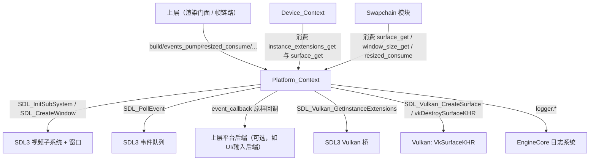

# 渲染层-平台与表面

> 源码根相对路径：`Application/Renderer/src/render/Platform/`
> 本文覆盖 `Platform/` 下的**平台上下文（`Platform_Context`）**这一单一门面类型，以及其 `core/` 下的四个编译单元：`平台上下文.cpp`、`窗口创建.cpp`、`表面创建.cpp`、`事件泵.cpp`，并说明其私有头 `局部命名空间使用.h` 的做法。
> 本模块的职责是「把操作系统窗口系统（SDL3）与图形 API 呈现目标（`VkSurfaceKHR`）接入引擎」，并在每帧以事件泵读取窗口生命周期事件；本轮起另提供一条**可选的原始事件转发出口**，供上层平台后端（如 UI/输入后端）订阅原始 SDL 事件。
> 记录依据为当前工作区源码（Renderer 版次 `b2ffe50`），不包含任何旧版次导航信息。

---

## 一、文件内目录

- [二、模块功能介绍](#二模块功能介绍)
  - 2.1 模块定位 / 2.2 职责边界 / 2.3 在整体架构中的位置 / 2.4 与相邻模块的职责分界 / 2.5 本模块刻意不做的事
- [三、模块公开接口介绍](#三模块公开接口介绍)
  - 3.1 头文件清单与可见性 / 3.2 `Platform_Context` 概览 / 3.3 生命周期 / 3.4 `build` / 3.5 `destroy` / 3.6 `valid` / 3.7 `events_pump` / 3.8 `event_forward_set`、`event_forward_clear` / 3.9 `close_requested` / 3.10 `resized_consume` / 3.11 `minimized` / 3.12 `window_size_get` / 3.13 `window_get` / 3.14 `instance_extensions_get` / 3.15 `surface_build` / 3.16 `surface_get` / 3.17 `window_size_set`
- [四、模块私有方法介绍](#四模块私有方法介绍)
  - 4.1 `window_create` / 4.2 `window_destroy`
- [五、模块内部架构介绍](#五模块内部架构介绍)
  - 5.1 目录/文件结构树 / 5.2 各编译单元的职责 / 5.3 内部数据结构字段说明 / 5.4 内部类关系与依赖图 / 5.5 `局部命名空间使用.h` 做法说明
- [六、模块设计/实现细节](#六模块设计实现细节)
  - 6.1 生命周期与创建顺序 / 6.2 SDL 子系统引用计数 / 6.3 `SDL_SetMainReady` 取舍 / 6.4 窗口创建标志 / 6.5 实例扩展查询语义 / 6.6 表面创建与实例记录 / 6.7 表面销毁方式的选择 / 6.8 事件泵「只置标志」的设计意图 / 6.9 一次性消费与粘滞标志 / 6.10 尺寸查询与 `0×0` 回退 / 6.11 内存与句柄所有权 / 6.12 线程与并发 / 6.13 编码约定落地 / 6.14 日志约定 / 6.15 易错点汇总 / 6.16 事件转发回调
- [七、模块运行链路详例](#七模块运行链路详例)
  - 7.1 程序启动 / 7.2 每帧循环 / 7.3 关闭 / 7.4 关键异常与边界分支 / 7.5 与 Device 的握手时序 / 7.6 与 Swapchain 的握手 / 7.7 事件转发链路
- [附录、待确认条目](#附录待确认条目)

---

## 二、模块功能介绍

### 2.1 模块定位

`Platform`（平台与表面）是渲染层（`Application/Renderer`）**最底层的操作系统/呈现目标适配模块**。它回答两个问题：

1. **操作系统侧的「显示容器」从哪来**：由 SDL3 建立视频子系统并创建一个带 `SDL_WINDOW_VULKAN` 标志的窗口，作为最终画面输出的宿主；
2. **Vulkan 的「呈现目标」从哪来**：在该窗口之上创建 `VkSurfaceKHR`，使 Vulkan 逻辑设备能够把交换链图像呈现到该窗口。

它同时扮演第三个角色——**窗口生命周期事件的第一手采集者**：每帧轮询 SDL 事件队列，把「用户请求退出」「窗口尺寸变化」「窗口最小化/恢复」三类与渲染正确性强相关的事件剥离成三个布尔标志，供上层（渲染门面/帧链路）读取。

本轮起它兼具第四个角色——**可选的事件外送通道**：若上层注册了转发回调，事件泵会把每个原始 `SDL_Event` 原样外送一次，供上层平台后端（如 UI 通道、输入后端）自行解释（见 §3.8、§6.16）。

因此，本模块是渲染层中**唯一直接接触 SDL3 的部分**，也是渲染层中**唯一持有原生窗口句柄与 `VkSurfaceKHR` 的部分**。

### 2.2 职责边界

| 本模块负责 | 本模块不负责 |
| --- | --- |
| 初始化/退出 SDL3 视频子系统（引用计数成对） | 初始化 SDL 其它子系统（音频、手柄、游戏设备等） |
| 创建/销毁带 Vulkan 标志的窗口（可见窗口另附加可缩放标志） | 窗口的 UI、菜单、拖拽、图标等高级属性 |
| 查询并组装 Vulkan 实例所需扩展清单（`SDL_Vulkan_GetInstanceExtensions`） | 创建 `VkInstance`（属 Device 模块 `Device_Context::build_instance`） |
| 在实例就绪后创建 `VkSurfaceKHR`（`SDL_Vulkan_CreateSurface`） | 创建物理设备/逻辑设备/队列（属 Device 模块） |
| 持有 `VkInstance` 记录（仅用于销毁表面） | 持有/管理实例本体的生命周期 |
| 轮询 SDL 事件并把窗口级事件剥离为标志位 | 把 SDL 事件语义化分发到引擎事件系统或输入系统（详见 §6.8） |
| 提供窗口客户区像素尺寸查询，以及（可选地）请求改变窗口尺寸 | 决策交换链是否需要重建（只管标志，重建由上层帧链路统一决策） |
| 可选地把原始 SDL 事件经注册回调**原样**外送 | 解释事件语义、把事件翻译为引擎事件或输入动作（转发不改写、不过滤） |
| —— | 创建/重建/销毁交换链（属 Swapchain 模块） |
| —— | 每帧的渲染执行（属 Frame/Renderer 模块） |

### 2.3 在整体架构中的位置

- 本模块处于渲染层 `src/render/Platform/`，与 `Device/`（设备上下文）、`Swapchain/`（交换链）、`Frame/`（帧）、`Memory/`、`Shader/`、`Pipeline/`、`Mesh/`、`Scene/`、`Texture/` 并列，属于**自底向上第一层的「平台适配层」**。
- **依赖方向（向下）**：
  - 依赖 SDL3（`<SDL3/SDL.h>`、`<SDL3/SDL_vulkan.h>`，版本 3.4.18，随项目就地编入 `Application/Renderer/external/SDL3/`），用于视频子系统、窗口、表面与事件；
  - 依赖 Vulkan 头（`<vulkan/vulkan.h>`）用于 `VkInstance`/`VkSurfaceKHR`/`vkDestroySurfaceKHR` 等类型与调用；
  - 依赖 `Engine/EngineCore` 的日志系统（`日志系统运行包.h` 提供的全局 `logger`）用于错误/告警/调试输出；
  - 依赖本层预编译头 `Application/Renderer/common/前置头文件包含.h`（其内部再吃下 `Engine/EngineCore/common/前置头文件包含.h`）。
- **被依赖方向（向上）**：
  - `Device_Context`（`Application/Renderer/src/render/Device/`）需要本模块提供**实例扩展清单**与**表面句柄**；
  - `Swapchain` 模块需要表面句柄与窗口像素尺寸；
  - 帧/渲染门面需要事件泵标志（退出/尺寸变化/最小化）；
  - 上层平台后端（如需处理输入，如 UI 通道）可经 `event_forward_set` 接收原始事件。
- **边界核心**：本模块**只生产「窗口 + 表面 + 标志」三样东西**，并把原始事件原样外送（可选）；把这三种句柄/状态的消费权交给上层。本模块内**不含任何 `vkCreate*` 资源创建调用**（唯一一次 Vulkan 调用是销毁时的 `vkDestroySurfaceKHR`），也不做任何交换链决策。

### 2.4 与相邻模块的职责分界（重点）

**与 Device 模块（`Device_Context`）的分界**

`Device_Context` 的公开接口（引自 `Application/Renderer/src/render/Device/设备上下文.h`）为：

```cpp
bool build_instance(const std::vector<const char*>& instance_extensions, bool enable_validation);
bool build_device(VkSurfaceKHR surface);
```

两者形成**三段握手**：

- 第一段（`build_instance`）需要「实例扩展清单」，该清单**由本模块的 `instance_extensions_get` 提供**。头注释明确指出「instance_extensions：实例所需扩展清单（自 Phase 4 起由平台模块提供表面扩展）」——即表面平台扩展（`VK_KHR_surface` 及平台相关扩展）由 SDL 告知，再由本模块转交给 Device。
- 第二段（本模块 `surface_build`）必须在实例创建成功之后调用，因为 `SDL_Vulkan_CreateSurface` 需要合法的 `VkInstance`。
- 第三段（`build_device(surface)`）需要本模块的 `surface_get()` 返回值，因为呈现队列族的判定（`vkGetPhysicalDeviceSurfaceSupportKHR`）必须以表面存在为前提。`设备上下文.h` 头注释也印证：「呈现队列族必须用 `vkGetPhysicalDeviceSurfaceSupportKHR` 查询，而该调用要求表面已存在，故实例先行、设备待表面就绪后再建」。

于是本模块与 Device 的**所有权分界**是：本模块拥有窗口与表面，Device 拥有实例/物理/逻辑设备/队列。但注意，本模块销毁表面时需要 `VkInstance`，为此本模块在 `surface_build` 中**仅记录一份实例句柄副本**（不拥有、不销毁实例），详见 §6.6、§6.11。

**与 Swapchain 模块的分界**

本模块**不创建交换链**。它只向 Swapchain 提供三样输入：

1. `surface_get()`：交换链必须在该表面上创建；
2. `window_size_get()`：交换链的 `imageExtent` 需要窗口客户区像素尺寸；
3. `resized_consume()`：一次性告知「窗口尺寸发生了变化，交换链可能已过期」。

而「何时重建交换链」的决策权被**上移到上层帧链路**（`事件泵.cpp` 头注释：交换链重建「交换链重建（K8 要求每帧最多一次）与最小化挂起由上层帧链统一决策」）。本模块的事件泵刻意**不在此处重建交换链**，也不触发任何重新创建动作。

### 2.5 本模块刻意不做的事（防止越界）

- 不接管程序入口点（不使用 SDL_main，见 §6.3）；
- 不初始化 Vulkan 加载器（依赖应用层/Device 侧的链接方式）；
- 不在事件泵中做任何 Vulkan 调用；
- 不把 SDL 事件翻译成引擎事件（见 §6.8：本层只把窗口状态折算为标志，事件的语义化分发属上层职责）；
- 不解释、不过滤、不缓存转发的事件——`event_forward_set` 注册的回调只收到**原始** `SDL_Event` 副本指针（见 §6.16）。

---

## 三、模块公开接口介绍

> 约定：
> - 除特别说明外，所有类型均位于 `namespace engine`。
> - 头文件均以 `#pragma once` 防重包含，并统一先引入预编译头。
> - 「相对路径」一律相对源码根 `d:\代码存储\代码仓库\白银纪元`。
> - 本模块对外只暴露**一个类型**：`Platform_Context`。其原生窗口句柄返回类型 `SDL_Window*` 属于「层内实现细节」，仅在层内可见（见 §3.1 的可见性说明）。
> - 本模块所有函数命名遵循 `snake_case`（单词间 `_`、首字母小写）、类型名 `PascalCase`（各单词首字母大写、无分隔）。
> - 本节收录对外公开（层内可见）的成员函数；两个 private 成员（`window_create`/`window_destroy`）另见 §四。

### 3.1 头文件清单与可见性

本模块的源码文件构成：

| 相对路径 | 角色 | 是否对外 |
| --- | --- | --- |
| `Application/Renderer/src/render/Platform/平台上下文.h` | 对外头（声明 `Platform_Context`） | 是（对渲染层内部的其它模块） |
| `Application/Renderer/src/render/Platform/局部命名空间使用.h` | 局部命名空间使用头 | 否（仅被本模块 `.cpp` 包含） |
| `Application/Renderer/src/render/Platform/core/平台上下文.cpp` | 生命周期/查询实现 | 否 |
| `Application/Renderer/src/render/Platform/core/窗口创建.cpp` | 窗口与视频子系统实现 | 否 |
| `Application/Renderer/src/render/Platform/core/表面创建.cpp` | 扩展查询与表面创建实现 | 否 |
| `Application/Renderer/src/render/Platform/core/事件泵.cpp` | 事件轮询与转发实现 | 否 |

**包含路径口径**：对外头引用本层预编译头写**项目根全路径**（`#include "Application/Renderer/common/前置头文件包含.h"`）；四个实现文件（`.cpp`）包含自身内部头写**本层根相对**（`#include "src/render/Platform/局部命名空间使用.h"`）；引用引擎日志包亦写项目根全路径（`#include "Engine/EngineCore/src/tools/Logging/日志系统运行包.h"`）。私有包含根＝项目根 ＋ 本层根（`Application/Renderer`），故上述两种写法均可解析。

**可见性关键点**：`平台上下文.h` 顶部注释明确指出：

```
SDL3 头
本头属本层「实现细节」：只被本层 .cpp 与层内模块头包含，不进公共头，
故可以合法暴露 SDL3 类型（层外仍看不到 —— 见 cmake/对外接口.cmake 的私有包含根）。
```

也就是说：`Platform_Context` 及其 `window_get()` 返回的 `SDL_Window*` 对**渲染层以外的层**（引擎层、应用层、编辑器层）是不可见的；层外通过渲染门面（`Renderer`）与本模块交互。因此 `SDL_Window*` 只用于层内调试或在层内把句柄转交给需要它的上层模块。

`平台上下文.h` 的包含结构（自顶向下，逐字引用当前头）：

```cpp
#pragma once
//预编译头
#include "Application/Renderer/common/前置头文件包含.h"
// SDL3 头（层内实现细节）
#include <SDL3/SDL.h>
// Vulkan 头
#include <vulkan/vulkan.h>
// SDL3 的 Vulkan 接口（必须排在 vulkan.h 之后）
#include <SDL3/SDL_vulkan.h>
```

其中 `<SDL3/SDL_vulkan.h>` **必须排在 `<vulkan/vulkan.h>` 之后**，原因写在头注释中：`vulkan.h` 会定义 `VULKAN_CORE_H_`，令 `SDL_vulkan.h` 跳过其自带的 Vulkan 句柄 typedef，从而避免 `VkSurfaceKHR` 被重复定义。这一点是关于 **SDL3 头与 Vulkan 头的包含顺序约束**，属于本模块的硬约束（详见 §6.6 与 §6.15）。

### 3.2 `class Platform_Context` 概览

`Platform_Context` 是本模块唯一的对外类型。它**不可拷贝、不可移动**（持有 SDL/Vulkan 句柄，句柄不应被复制），生命周期三段式：`build → 使用 → destroy`；`destroy` 幂等，析构兜底。

完整声明（逐字引用当前 `平台上下文.h`）：

```cpp
namespace engine
{
	class Platform_Context
	{
	public:
		Platform_Context(void) = default;
		~Platform_Context(void);
		Platform_Context(const Platform_Context&) = delete;
		Platform_Context& operator=(const Platform_Context&) = delete;

		bool build(uint32_t width, uint32_t height, const std::string& title, bool hidden);
		void destroy(void);
		bool valid(void) const;

		void events_pump(void);
		void event_forward_set(void (*callback)(const SDL_Event* event, void* user_data), void* user_data);
		void event_forward_clear(void);
		bool close_requested(void) const;
		bool resized_consume(void);
		bool minimized(void) const;
		void window_size_get(uint32_t& width_out, uint32_t& height_out) const;
		bool window_size_set(uint32_t width, uint32_t height);
		SDL_Window* window_get(void) const;
		bool instance_extensions_get(std::vector<const char*>& extensions_out) const;
		bool surface_build(VkInstance instance);
		VkSurfaceKHR surface_get(void) const;
	private:
		bool window_create(uint32_t width, uint32_t height, const std::string& title, bool hidden);
		void window_destroy(void);
	private:
		SDL_Window* window = nullptr;
		VkSurfaceKHR surface = VK_NULL_HANDLE;
		VkInstance instance = VK_NULL_HANDLE;
		bool video_initialized = false;
		bool close_flag = false;
		bool resize_flag = false;
		bool minimize_flag = false;
		void (*event_callback)(const SDL_Event* event, void* user_data) = nullptr;
		void* event_callback_data = nullptr;
	};
}
```

> `event_forward_set`/`event_forward_clear` 及成员 `event_callback`/`event_callback_data` 为**本轮新增**（见 §3.8、§6.16）。
> 另：`window_size_set`（声明于 `window_size_get` 与 `window_get` 之间）亦为**本轮新增**（见 §3.17）。

### 3.3 生命周期：构造 / 析构 / 删除的拷贝

| 签名 | 位置 | 参数 | 返回 | 行为与约束 |
| --- | --- | --- | --- | --- |
| `Platform_Context(void) = default;` | `平台上下文.h` | 无 | 无（构造） | **不创建任何 SDL / Vulkan 对象**。所有字段为默认值：`window=nullptr`、`surface=VK_NULL_HANDLE`、`instance=VK_NULL_HANDLE`、五个布尔全为 `false`、`event_callback=nullptr`、`event_callback_data=nullptr`。 |
| `~Platform_Context(void);` | 声明于 `平台上下文.h`，实现于 `平台上下文.cpp` | 无 | 无（析构） | 内部调用 `destroy()`，保证资源不泄漏。故即使调用方从未调用 `destroy()`，析构也会兜底回收。 |
| `Platform_Context(const Platform_Context&) = delete;` | `平台上下文.h` | 源对象 | 无 | 禁止拷贝构造。理由：持有 SDL/Vulkan 句柄，浅拷贝会导致双重销毁。 |
| `Platform_Context& operator=(const Platform_Context&) = delete;` | `平台上下文.h` | 源对象 | 无 | 禁止拷贝赋值，理由同上。 |

**关于移动**：头文件**未显式删除移动构造/移动赋值**。但由于（a）显式删除拷贝构造、（b）用户显式声明了析构函数，编译器不会隐式生成移动构造/移动赋值。因此 `Platform_Context` 实际上**既不可拷贝也不可移动**。若上层需要「移动语义」，只能改为持有 `Platform_Context` 的指针/智能指针（如 `std::unique_ptr`）。

### 3.4 `build` —— 构建平台基础设施

```cpp
bool build(uint32_t width, uint32_t height, const std::string& title, bool hidden);
```

位置：声明于 `平台上下文.h`，实现于 `core/平台上下文.cpp`。

| 参数 | 类型 | 含义 | 约束 |
| --- | --- | --- | --- |
| `width` | `uint32_t` | 窗口客户区宽度（逻辑/请求尺寸，内部转 `int` 传给 SDL） | 无显式范围校验；转 `int` 时若超过 `INT_MAX` 属实现上层应避免的用法 |
| `height` | `uint32_t` | 窗口客户区高度 | 同上 |
| `title` | `const std::string&` | 窗口标题，按 **UTF-8** 传入（SDL3 直接接收 UTF-8 字符串） | 中文标题可用（SDL3 API 全程吃 UTF-8） |
| `hidden` | `bool` | 为真则附加 `SDL_WINDOW_HIDDEN`（隐藏窗口，仍创建真实窗口与表面）；为假则附加 `SDL_WINDOW_RESIZABLE`（允许用户拖拽缩放，本轮新增，见 §6.4） | 无头用例可传 `true` |

返回值：`true` 表示窗口创建成功（平台基础设施构建完成）；`false` 表示构建失败，且函数内部已把状态回退到「未构建」。

行为细节（引自 `core/平台上下文.cpp`）：

```cpp
bool Platform_Context::build(uint32_t width, uint32_t height, const string& title, bool hidden)
{
	if (!window_create(width, height, title, hidden))
	{
		logger.error("平台上下文:: 窗口创建失败，构建中止");
		destroy();
		return false;
	}
	logger.info("平台上下文:: 平台基础设施构建完成");
	return true;
}
```

- 本函数把窗口创建**委托**给私有 `window_create`；
- 失败时不仅记录错误，还调用 `destroy()` 做**逆序兜底回收**（`window_create` 内部已自清理，这里再兜底一次，保证不留下半初始化状态）；
- 成功仅记录 info，不返回任何句柄（句柄经后续的 `window_get`/`surface_get` 取得）。

**约束与注意**：
- `build` **不创建表面**。表面创建必须等 `VkInstance` 建立后单独调用 `surface_build`（见 §3.15）。
- **重复调用 `build` 属刻意约定（非缺陷）**：源码没有「已构建则拒绝」的检查，这是**隐式约定**——本模块的构建动作由渲染门面独占调用（`Renderer::init` 只在未初始化时走一次），对唯一调用路径加这层检查没有增益，只会把「谁负责单次构建」这件事说两遍。若在未 `destroy` 的情况下重复 `build`，会再次 `SDL_InitSubSystem`（引用计数 +1）并**覆盖 `window` 指针**，前一个窗口句柄泄漏；该责任由调用方承担——调用方必须在构建前确保处于未构建状态（或先 `destroy`）。

### 3.5 `destroy` —— 销毁平台基础设施

```cpp
void destroy(void);
```

位置：声明于 `平台上下文.h`，实现于 `core/平台上下文.cpp`。

| 项 | 说明 |
| --- | --- |
| 参数 | 无 |
| 返回 | 无 |
| 幂等性 | **是**。可重复调用；全部回收动作都有 has-born 判据（`surface != VK_NULL_HANDLE`、`window != nullptr`、`video_initialized`）。 |

行为顺序（**严格按创建逆序**：表面 → 窗口 → 视频子系统）：

```cpp
void Platform_Context::destroy(void)
{
	// 1. 若表面已创建（必须先于窗口销毁）
	if (surface != VK_NULL_HANDLE)
	{
		logger.debug("平台上下文:: 销毁 Vulkan 表面");
		vkDestroySurfaceKHR(instance, surface, nullptr);   // 用创建时的实例句柄
		surface = VK_NULL_HANDLE;
	}
	// 2. 清除实例记录
	instance = VK_NULL_HANDLE;
	// 3. 销毁窗口与视频子系统
	window_destroy();
	// 4. 复位事件标志
	close_flag = false;
	resize_flag = false;
	minimize_flag = false;
}
```

**关键约束**：表面必须在窗口销毁之前销毁（Vulkan 规范要求 `VkSurfaceKHR` 在窗口存活期内销毁；`SDL_vulkan.h` 也建议「This should be called before SDL_DestroyWindow」）。本函数据此把表面销毁放在最前。

**注意**：第 2 步直接将 `instance` 置 `VK_NULL_HANDLE`，即使表面未创建（`surface == VK_NULL_HANDLE`）也会清空实例记录。这与 §3.15 中「表面创建失败时清空实例记录，避免后续误销毁」的设计一致。

**注意**：`destroy` **不复位事件转发回调**（`event_callback`/`event_callback_data` 保持原值）。若上层需要解除转发，应显式调用 `event_forward_clear()`（见 §3.8、§6.16）。

### 3.6 `valid` —— 是否已构建完成

```cpp
bool valid(void) const;
```

| 项 | 说明 |
| --- | --- |
| 参数 | 无 |
| 返回 | `true` 表示窗口已创建（`window != nullptr`）；`false` 表示尚未构建或已销毁 |
| 判据 | **仅检查窗口句柄**，不检查表面是否已创建 |

含义：`valid()` 为真**只代表平台基础设施（窗口）就绪**，不代表表面已建立。表面是否可用应另用 `surface_get() != VK_NULL_HANDLE` 判断。上层在调用 `events_pump`/`window_size_get` 前通常先判 `valid()`。

### 3.7 `events_pump` —— 轮询 SDL 事件（置标志 + 可选转发）

```cpp
void events_pump(void);
```

位置：声明于 `平台上下文.h`，实现于 `core/事件泵.cpp`。

| 项 | 说明 |
| --- | --- |
| 参数 | 无 |
| 返回 | 无（结果通过后续的 `close_requested`/`resized_consume`/`minimized` 查询） |
| 副作用 | 逐帧把 SDL 事件队列**全部取出**：先（若已注册回调）逐个把原始事件外送一次，再对五类窗口生命周期事件（退出 / 尺寸变化 / 像素尺寸变化 / 最小化 / 恢复）置/清对应布尔标志；**不做任何 Vulkan 操作** |

实现（引自当前 `core/事件泵.cpp`）：

```cpp
void Platform_Context::events_pump(void)
{
	//事件对象（循环复用）
	SDL_Event event;
	//持续取出队列中的全部事件
	while (SDL_PollEvent(&event))
	{
		//若已注册事件转发回调则逐个事件转发（供上层平台后端处理输入）
		if (event_callback != nullptr)
			event_callback(&event, event_callback_data);
		switch (event.type)
		{
		//若用户请求退出
		case SDL_EVENT_QUIT:
			close_flag = true;
			break;
		//若窗口尺寸变化或像素尺寸变化（HiDPI 跨不同 DPI 显示器；仅置标志，交换链重建推迟到帧链路）
		case SDL_EVENT_WINDOW_RESIZED:
		case SDL_EVENT_WINDOW_PIXEL_SIZE_CHANGED:
			resize_flag = true;
			break;
		//若窗口被最小化
		case SDL_EVENT_WINDOW_MINIMIZED:
			minimize_flag = true;
			break;
		//若窗口从最小化恢复
		case SDL_EVENT_WINDOW_RESTORED:
			minimize_flag = false;
			break;
		default:
			break;
		}
	}
}
```

**语义要点**：
- 使用 `while (SDL_PollEvent(...))` 直到队列空——即**一次 `events_pump` 抽取全部待处理事件**；
- **事件转发**：每个事件在 `switch` **之前**先经回调原样外送（若已注册）；回调不改变本层标志逻辑，`switch` 照常执行（见 §3.8、§6.16）；
- 只识别上述五类窗口生命周期事件，其余全部落入 `default` **静默丢弃**（包括键盘、鼠标、文本输入等，见 §6.8）；
- 标志是**累积/粘滞**的：`close_flag`、`resize_flag` 一旦置真，在本函数内不会再被清假（只有 `minimize_flag` 会被 `RESTORED` 清假），需由上层消费（`resized_consume` 清 `resize_flag`）；
- 本函数**不触发**交换链重建、不处理最小化挂起——都交给上层帧链路。

### 3.8 `event_forward_set` / `event_forward_clear` —— 事件转发回调（本轮新增）

```cpp
void event_forward_set(void (*callback)(const SDL_Event* event, void* user_data), void* user_data);
void event_forward_clear(void);
```

位置：声明于 `平台上下文.h`，实现于 `core/事件泵.cpp`。

| 函数 | 参数 | 返回 | 行为 |
| --- | --- | --- | --- |
| `event_forward_set` | `callback`：`void (*)(const SDL_Event*, void*)` 函数指针，可为 `nullptr`（等价于不转发）；`user_data`：透传给回调的裸指针，可为 `nullptr` | 无 | 记录回调与用户数据；**不校验、不调用、不打日志** |
| `event_forward_clear` | 无 | 无 | 把回调与用户数据均置 `nullptr` |

实现（引自当前 `core/事件泵.cpp`）：

```cpp
void Platform_Context::event_forward_set(void (*callback)(const SDL_Event* event, void* user_data), void* user_data)
{
	//记录回调与用户数据
	event_callback = callback;
	event_callback_data = user_data;
}

void Platform_Context::event_forward_clear(void)
{
	//置空回调与用户数据
	event_callback = nullptr;
	event_callback_data = nullptr;
}
```

**语义要点**：
- 注册后，`events_pump` 每取出一个事件都会在 `switch` 之前调用一次 `callback(&event, event_callback_data)`；**未注册（回调为 `nullptr`）时事件照旧被静默丢弃**，与既有口径一致；
- 回调收到的是**原始事件指针**（指向 `events_pump` 内复用的栈上 `SDL_Event`，**不得保存**该指针；`user_data` 为调用方自身数据，生命周期自负，见 §6.11）；
- 本函数是**唯一一条把原始 SDL 事件送出本模块的通道**；它只做「转发」，不做解释、过滤、缓存（见 §6.16）；
- `destroy()` 不清理回调；上层若不再需要转发，应在**其 `user_data` 所指对象析构之前**调用 `event_forward_clear()`（见 §6.16、易错点 E11）。

### 3.9 `close_requested` —— 是否请求退出

```cpp
bool close_requested(void) const;
```

| 项 | 说明 |
| --- | --- |
| 参数 | 无 |
| 返回 | `close_flag` 当前值；`true` 表示自上次 `destroy` 以来至少收到过一个 `SDL_EVENT_QUIT` |
| 清假时机 | 仅 `destroy()` 会复位为 `false`（事件泵本身不清） |

上层据此决定是否结束主循环。

### 3.10 `resized_consume` —— 一次性消费「待重建」标志

```cpp
bool resized_consume(void);
```

| 项 | 说明 |
| --- | --- |
| 参数 | 无 |
| 返回 | 本次调用取走的 `resize_flag` 值；随后 `resize_flag` 被清为 `false` |
| 幂等语义 | **非幂等（一次性消费）**：同一标志最多被消费一次 |

实现：

```cpp
bool Platform_Context::resized_consume(void)
{
	bool resized = resize_flag;   // 取走标志
	resize_flag = false;          // 清空（一次性消费，避免重复重建）
	return resized;
}
```

**设计意图**：把「尺寸变化」做成一次性事件，使上层每帧「取走一次」即可，天然满足「每帧最多重建一次交换链」的要求；避免同一帧内多处读取导致重复重建。

### 3.11 `minimized` —— 是否最小化（挂起）

```cpp
bool minimized(void) const;
```

| 项 | 说明 |
| --- | --- |
| 参数 | 无 |
| 返回 | `minimize_flag` 当前值；`true` 表示窗口处于最小化（挂起）状态 |
| 置/清 | `SDL_EVENT_WINDOW_MINIMIZED` 置真；`SDL_EVENT_WINDOW_RESTORED` 清假；`destroy` 复位 |

上层在最小化时应挂起渲染/重建（避免以 0 尺寸重建交换链，见 §3.12 与 §6.10）。

### 3.12 `window_size_get` —— 取窗口客户区像素尺寸

```cpp
void window_size_get(uint32_t& width_out, uint32_t& height_out) const;
```

| 参数 | 类型 | 含义 |
| --- | --- | --- |
| `width_out` | `uint32_t&`（出参） | 写入客户区像素宽度 |
| `height_out` | `uint32_t&`（出参） | 写入客户区像素高度 |

返回：无（经引用出参写回）。

实现与回退逻辑：

```cpp
int width = 0, height = 0;
if (window != nullptr && SDL_GetWindowSizeInPixels(window, &width, &height))
{
	width_out  = static_cast<uint32_t>(width);
	height_out = static_cast<uint32_t>(height);
	return;
}
// 未创建或查询失败：回退 0×0
width_out  = 0;
height_out = 0;
```

**语义要点**：
- 使用 `SDL_GetWindowSizeInPixels` 而非 `SDL_GetWindowSize`：前者返回**像素**尺寸（考虑 HiDPI/缩放），正是 Vulkan 交换链 `imageExtent` 所需的口径；后者返回逻辑（点）尺寸；
- 失败或未创建时**回退 `0×0`**（不抛异常、不报错）：上层据此判定「尺寸不可用 → 挂起」，绝不以 0 尺寸重建交换链（见 §6.10）；
- 只读 `const`，可在任意线程读取窗口状态（但窗口操作本身非线程安全，见 §6.12）。

### 3.13 `window_get` —— 取原生窗口句柄

```cpp
SDL_Window* window_get(void) const;
```

| 项 | 说明 |
| --- | --- |
| 参数 | 无 |
| 返回 | 内部 `window` 句柄；未创建时为 `nullptr` |
| 所有权 | **不转移所有权**。调用方只借用，不得 `SDL_DestroyWindow` |
| 可见性 | 返回类型 `SDL_Window*` 含 SDL 类型，属层内实现细节；层外不可见（见 §3.1） |

用途：供层内上层模块（如需原生窗口做额外的平台相关操作、调试）使用。头注释：「原生窗口句柄（供上层调试；SDL 类型属本层实现细节）」。

### 3.14 `instance_extensions_get` —— 组装实例扩展清单

```cpp
bool instance_extensions_get(std::vector<const char*>& extensions_out) const;
```

位置：声明于 `平台上下文.h`，实现于 `core/表面创建.cpp`。

| 参数 | 类型 | 含义 |
| --- | --- | --- |
| `extensions_out` | `std::vector<const char*>&`（出参） | 写入 SDL 要求为 `VkInstance` 启用的扩展名列表（保序拷贝） |

返回：`true` 表示查询成功（含「数量为 0」的告警放行情况）；`false` 表示 `SDL_Vulkan_GetInstanceExtensions` 返回空指针（查询失败）。

实现：

```cpp
bool Platform_Context::instance_extensions_get(vector<const char*>& extensions_out) const
{
	extensions_out.clear();                     // 使调用可重复
	Uint32 count = 0;
	const char* const* names = SDL_Vulkan_GetInstanceExtensions(&count);
	if (names == nullptr)                        // 查询失败
	{
		logger.error("平台上下文:: 查询实例扩展失败：{}", SDL_GetError());
		return false;
	}
	if (count == 0)                              // 异常：至少应含 VK_KHR_surface
	{
		logger.warn("平台上下文:: SDL 未返回任何实例扩展");
		return true;                             // 仍返回成功
	}
	extensions_out.reserve(count);
	for (Uint32 i = 0; i < count; ++i)
		extensions_out.push_back(names[i]);
	return true;
}
```

**语义要点**：
- SDL3 该接口不再带窗口参数、也没有 names 出参，而是**直接返回扩展名数组并回填 `count`**（源码注释标 K14）；
- **返回的数组由 SDL 拥有，不得释放**（`SDL_vulkan.h` 原文：「You should not free the returned array; it is owned by SDL.」）。本函数把 `const char*` **指针**拷贝进出参 vector（只拷贝指针、不拷贝字符串内容），因此该 vector 只在 **SDL 持有这些字符串期间**有效，应尽快交给 `build_instance` 使用；
- 出参先 `clear()`，使调用可重复；
- **`count == 0` 的告警放行分支**：日志注释指出「至少应含 `VK_KHR_surface`」，但代码**仍返回 `true`**（仅告警）。这是本模块的明确口径——「只报事实、后果交上层」：`count == 0` 属「平台不支持 Vulkan」的信号，但紧接着的 `build_instance` 会因缺少 `VK_KHR_surface` 而失败并给出更具体的日志；若此处也判失败，等于在两层各写一份同义判定，故取「告警＋放行」（口径选择，非缺陷）。上层若要更早拦截，可把此处返回值改为失败。

**调用前提**：`SDL_vulkan.h` 要求该接口应在「加载 Vulkan 库之后」或「创建带 `SDL_WINDOW_VULKAN` 的窗口之后」调用。本模块在 `build` 已创建 Vulkan 窗口，故上层在 `build` 成功后调用本接口是安全的。

### 3.15 `surface_build` —— 创建 `VkSurfaceKHR`

```cpp
bool surface_build(VkInstance instance);
```

位置：声明于 `平台上下文.h`，实现于 `core/表面创建.cpp`。

| 参数 | 类型 | 含义 | 约束 |
| --- | --- | --- | --- |
| `instance` | `VkInstance` | 已成功创建、且已启用 `instance_extensions_get` 所返回扩展的 Vulkan 实例句柄 | **必须在窗口创建之后、实例创建之后调用**；不得为 `VK_NULL_HANDLE` |

返回：`true` 表示表面已就绪（含「表面已存在、跳过重复创建」）；`false` 表示创建失败（窗口未建、或 `SDL_Vulkan_CreateSurface` 失败）。

实现：

```cpp
bool Platform_Context::surface_build(VkInstance instance)
{
	if (window == nullptr)                       // 无窗口无法建表面
	{
		logger.error("平台上下文:: 表面创建失败，窗口尚未创建");
		return false;
	}
	if (surface != VK_NULL_HANDLE)               // 表面已存在
	{
		logger.warn("平台上下文:: 表面已存在，跳过重复创建");
		return true;                             // 幂等：返回成功
	}
	this->instance = instance;                   // 记录实例句柄（销毁表面需要它）
	if (!SDL_Vulkan_CreateSurface(window, instance, nullptr, &surface))
	{
		logger.error("平台上下文:: 表面创建失败：{}", SDL_GetError());
		this->instance = VK_NULL_HANDLE;         // 失败时清空记录，避免后续误销毁
		return false;
	}
	logger.info("平台上下文:: Vulkan 表面已创建");
	return true;
}
```

**语义要点**：
- `SDL3` 的 `SDL_Vulkan_CreateSurface(window, instance, allocator, &surface)` **保留 `allocator` 参数**（源码注释标 K15）：传 `nullptr` 表示使用系统默认分配器；该参数直接透传给 Vulkan，SDL 自身不使用；
- **幂等**：若表面已存在则告警并返回 `true`，不重复创建；
- **实例记录**：本模块为了日后在 `destroy` 中执行 `vkDestroySurfaceKHR(instance, surface, nullptr)`，必须记住创建表面时所用的实例句柄，故把形参 `instance` 存到成员 `this->instance`。**本模块不拥有该实例，仅借用其句柄**；
- **失败清理**：若 `SDL_Vulkan_CreateSurface` 失败，把 `this->instance` 复位为 `VK_NULL_HANDLE`，避免 `destroy` 以无效实例去销毁空表面；
- **前置约束**：窗口必须以 `SDL_WINDOW_VULKAN` 创建（本模块已保证），且实例必须已启用 SDL 返回的扩展（`SDL_vulkan.h` 原文要求），否则该调用会失败。

### 3.16 `surface_get` —— 取表面句柄

```cpp
VkSurfaceKHR surface_get(void) const;
```

| 项 | 说明 |
| --- | --- |
| 参数 | 无 |
| 返回 | 内部 `surface`；未创建时为 `VK_NULL_HANDLE` |
| 所有权 | **不转移所有权**，调用方只借用；不得自行销毁 |

用途：交给 `Device_Context::build_device(surface)` 与 Swapchain 模块。

### 3.17 `window_size_set` —— 请求改变窗口客户区尺寸（本轮新增）

```cpp
bool window_size_set(uint32_t width, uint32_t height);
```

| 参数 | 类型 | 含义 | 约束 |
| --- | --- | --- | --- |
| `width` | `uint32_t` | 目标客户区宽度（像素） | 为 `0` 时记 warn 并返回假（K7） |
| `height` | `uint32_t` | 目标客户区高度（像素） | 同上 |

返回：`true` 表示请求已被 SDL 接受（`SDL_SetWindowSize` 成功）；`false` 表示窗口未创建 / 尺寸为零 / SDL 调用失败。

实现与行为（按源码顺序）：

```cpp
if (window == nullptr)                       // 窗口必须已创建
{
	logger.error("平台上下文:: 窗口尚未创建，无法改变尺寸");
	return false;
}
if (width == 0 || height == 0)               // 宽高不得为零
{
	logger.warn("平台上下文:: 请求尺寸为零，忽略（K7）");
	return false;
}
if (!SDL_SetWindowSize(window, (int)width, (int)height))
{
	logger.error("平台上下文:: 窗口尺寸设置失败：{}", SDL_GetError());
	return false;
}
resize_flag = true;                          // 成功即同步置「交换链待重建」标志
return true;
```

**语义要点**：

- **只请求、不重建**：本函数**只**向 SDL 请求改变窗口尺寸并置标志，**不做任何 Vulkan 操作**（与事件泵同一「只置标志」口径，见 §6.8）。交换链重建仍由上层帧链路在下一帧统一决策。
- **成功后显式置 `resize_flag`（本函数的关键取舍）**：隐藏窗口（`SDL_WINDOW_HIDDEN`）下 SDL 不一定派发 `SDL_EVENT_WINDOW_RESIZED` / `SDL_EVENT_WINDOW_PIXEL_SIZE_CHANGED`；若仅依赖事件泵置标，则「设置尺寸 → 交换链重建」在无头用例中无从触发。故本函数在 `SDL_SetWindowSize` 成功后**显式置 `resize_flag`**，使该链路在任意窗口形态下均可被上层驱动、可被用例构造（见 §6.9 与 §5.3 的 `resize_flag` 行）。上层在下一帧经 `resized_consume()` 一次性取走该标志并驱动重建。
- **与 `window_size_get` 的分工**：`window_size_get` 为只读查询、失败静默回退 `0×0`（§3.12）；`window_size_set` 为带副作用请求、失败记日志并返回假。二者不互相替代，也不会互相改写。
- **幂等性/重入**：不幂等（每次调用都会向 SDL 请求一次并置标志，可能置真）；可在任意时刻调用，但受窗口单线程约束（§6.12）。`destroy` 复位 `resize_flag`。
- **调用入口**：门面 `Renderer::window_size_set` 转交本函数（未初始化或尺寸为零时门面返回假，见《渲染层-门面》）。

---

## 四、模块私有方法介绍

本节逐条列出 `Platform_Context` 的两处**类内私有实现函数**（签名 + 作用 + 关键行为）。数据成员说明见 §5.3。

### 4.1 `window_create` —— 初始化视频子系统并创建窗口

```cpp
bool window_create(uint32_t width, uint32_t height, const std::string& title, bool hidden);
```

位置：声明于 `平台上下文.h`，实现于 `core/窗口创建.cpp`；仅被 `build` 调用。

职责：初始化 SDL 视频子系统并创建窗口；任一步失败即回退（不留半初始化状态）。

```cpp
bool Platform_Context::window_create(uint32_t width, uint32_t height, const string& title, bool hidden)
{
	// 初始化视频子系统（引用计数，须与 SDL_QuitSubSystem 成对）
	if (!SDL_InitSubSystem(SDL_INIT_VIDEO))
	{
		logger.error("平台上下文:: SDL 视频子系统初始化失败：{}", SDL_GetError());
		return false;
	}
	video_initialized = true;

	SDL_WindowFlags flags = SDL_WINDOW_VULKAN;
	// 可见窗口允许用户拖拽调整尺寸
	if (!hidden)
		flags |= SDL_WINDOW_RESIZABLE;
	if (hidden)
		flags |= SDL_WINDOW_HIDDEN;

	window = SDL_CreateWindow(title.c_str(), (int)width, (int)height, flags);
	if (window == nullptr)
	{
		logger.error("平台上下文:: 窗口创建失败：{}", SDL_GetError());
		SDL_QuitSubSystem(SDL_INIT_VIDEO);       // 逆序回收
		video_initialized = false;
		return false;
	}
	logger.info("平台上下文:: 窗口已创建（{} × {}）", width, height);
	return true;
}
```

关键行为：
- 先 `SDL_InitSubSystem(SDL_INIT_VIDEO)`；失败即 error 日志 + 返回 `false`（**不置** `video_initialized`）；
- 成功即置 `video_initialized = true`，保证与 `SDL_QuitSubSystem` 成对（见 §6.2）；
- 组装窗口标志：恒含 `SDL_WINDOW_VULKAN`；`!hidden` 附加 `SDL_WINDOW_RESIZABLE`（本轮新增）；`hidden` 附加 `SDL_WINDOW_HIDDEN`（见 §6.4）；
- 创建窗口失败时**逆序回收**：立刻 `SDL_QuitSubSystem(SDL_INIT_VIDEO)` 并复位 `video_initialized`（不留半初始化状态）；
- 成功以 info 记录，不返回句柄（句柄留存于成员 `window`）。
- 函数体顶部有一段关于 `SDL_SetMainReady` 的取舍注释（见 §6.3）。

### 4.2 `window_destroy` —— 销毁窗口与视频子系统

```cpp
void window_destroy(void);
```

位置：声明于 `平台上下文.h`，实现于 `core/窗口创建.cpp`；仅被 `destroy` 调用。

职责：销毁窗口并退出视频子系统（各自按 has-born 判据守卫）。

```cpp
void Platform_Context::window_destroy(void)
{
	if (window != nullptr)
	{
		logger.debug("平台上下文:: 销毁窗口");
		SDL_DestroyWindow(window);
		window = nullptr;
	}
	if (video_initialized)
	{
		logger.debug("平台上下文:: 退出 SDL 视频子系统");
		SDL_QuitSubSystem(SDL_INIT_VIDEO);
		video_initialized = false;
	}
}
```

关键行为：
- 两个回收动作各自以 has-born 判据（`window != nullptr`、`video_initialized`）守卫，故可安全重复调用（幂等，配 `destroy` 的幂等语义，见 §3.5）；
- 先销毁窗口、后退出视频子系统——与 `window_create` 的创建顺序（先子系统、后窗口）严格逆序（见 §6.2）。

二者共同保证「视频子系统初始化」与「窗口创建」各自成对、且失败时逐级回退。

---

## 五、模块内部架构介绍

### 5.1 目录/文件结构树

```text
Application/Renderer/src/render/Platform/
│
├── 平台上下文.h                 # 对外头：声明 class Platform_Context（含 SDL/Vulkan 头）
├── 局部命名空间使用.h            # 局部命名空间使用头（using std::string / std::vector）
└── core/
    ├── 平台上下文.cpp            # 析构、build、destroy、valid、close_requested、
    │                             #   resized_consume、minimized、window_size_get、
    │                             #   window_get、surface_get
    ├── 窗口创建.cpp              # window_create、window_destroy（SDL 视频子系统 + 窗口）
    ├── 表面创建.cpp              # instance_extensions_get、surface_build
    └── 事件泵.cpp                # events_pump、event_forward_set、event_forward_clear
```

对外头 `平台上下文.h` 与实现文件分离，实现文件全部位于 `core/` 子目录，符合「标准模块架构」中「core/ 放 .cpp、对外头在模块根」的约定；本模块没有派生出额外的内部头文件（如「局部命名空间使用.h」以外），四个 `.cpp` 直接共享「局部命名空间使用.h」。

### 5.2 各编译单元的职责

| 编译单元 | 承担接口 | 职责 |
| --- | --- | --- |
| `core/平台上下文.cpp` | `~Platform_Context`、`build`、`destroy`、`valid`、`close_requested`、`resized_consume`、`minimized`、`window_size_get`、`window_get`、`surface_get` | 生命周期编排（build/destroy 的逆序回退）、状态查询与标志消费；不含任何窗口/表面的**直接**创建细节（委托给另两个单元） |
| `core/窗口创建.cpp` | `window_create`、`window_destroy` | SDL 视频子系统初始化/退出与窗口创建/销毁；SDL 生命周期与引用计数的唯一落点 |
| `core/表面创建.cpp` | `instance_extensions_get`、`surface_build` | SDL→Vulkan 的桥接：查询实例扩展、创建 `VkSurfaceKHR`、记录实例句柄 |
| `core/事件泵.cpp` | `events_pump`、`event_forward_set`、`event_forward_clear` | 单一职责：轮询 SDL 事件队列，剥离窗口生命周期事件为标志；并把原始事件可选地经回调外送 |

**划分逻辑**：把「窗口（SDL 侧）」「表面（Vulkan 侧）」「事件（循环副作用 + 可选转发）」「状态编排（门面）」四类关注点拆到四个编译单元，使每个单元只接触一类第三方 API（窗口单元只碰 SDL 视频；表面单元同时碰 SDL_vulkan 与 Vulkan；事件单元只碰 SDL 事件）。三个需日志的 `.cpp`（`平台上下文.cpp`、`窗口创建.cpp`、`表面创建.cpp`）均以内部头打头、随后包含日志包：

```cpp
#include "src/render/Platform/局部命名空间使用.h"
//获取日志系统
#include "Engine/EngineCore/src/tools/Logging/日志系统运行包.h"
```

注意：`core/事件泵.cpp` **只**包含「局部命名空间使用.h」，未包含日志包（因为它不产生任何日志，包括本轮新增的转发函数也不打日志）——这是四者中唯一一处包含差异，说明包含粒度是按实际需求精确控制的。四个 `.cpp` 的内部头包含已由旧的相对写法 `"../局部命名空间使用.h"` 统一为本层根相对写法 `"src/render/Platform/局部命名空间使用.h"`（见 §3.1 的口径说明）。

### 5.3 内部数据结构字段说明

`Platform_Context` 的私有成员（逐字段）：

| 字段 | 类型 | 初始值 | 含义 | 置/清时机 |
| --- | --- | --- | --- | --- |
| `window` | `SDL_Window*` | `nullptr` | 原生窗口句柄；本模块拥有，负责销毁 | `window_create` 成功置；`window_destroy` 置回 `nullptr` |
| `surface` | `VkSurfaceKHR` | `VK_NULL_HANDLE` | Vulkan 呈现目标句柄；本模块拥有，负责销毁 | `surface_build` 成功置；`destroy` 置回 `VK_NULL_HANDLE` |
| `instance` | `VkInstance` | `VK_NULL_HANDLE` | **实例句柄副本（借用，不拥有）**；仅用于销毁表面时传给 `vkDestroySurfaceKHR` | `surface_build` 记录；`destroy`/`surface_build` 失败时置回 `VK_NULL_HANDLE` |
| `video_initialized` | `bool` | `false` | SDL 视频子系统是否已初始化（用于成对 `SDL_QuitSubSystem`） | `window_create` 成功置 `true`；`window_destroy`/`window_create` 失败分支置 `false` |
| `close_flag` | `bool` | `false` | 退出请求标志 | `SDL_EVENT_QUIT` 置 `true`；`destroy` 复位 |
| `resize_flag` | `bool` | `false` | 「窗口尺寸已变化，交换链待重建」标志 | `SDL_EVENT_WINDOW_RESIZED`／`SDL_EVENT_WINDOW_PIXEL_SIZE_CHANGED` 置 `true`；`window_size_set` 成功后亦显式置 `true`（本轮新增）；`resized_consume`/`destroy` 复位 |
| `minimize_flag` | `bool` | `false` | 窗口最小化（挂起）标志 | `SDL_EVENT_WINDOW_MINIMIZED` 置 `true`；`SDL_EVENT_WINDOW_RESTORED`/`destroy` 复位 |
| `event_callback` | `void (*)(const SDL_Event*, void*)` | `nullptr` | 事件转发回调（为空表示不转发）；本轮新增 | `event_forward_set` 记录；`event_forward_clear` 置 `nullptr`（`destroy` **不**复位） |
| `event_callback_data` | `void*` | `nullptr` | 事件转发回调的用户数据（借用，不拥有）；本轮新增 | `event_forward_set` 记录；`event_forward_clear` 置 `nullptr` |

**字段设计要点**：
- **三个句柄 + 三个标志 + 一个初始化位 + 一个回调 + 一个用户数据指针** 就是全部状态，无动态容器、无指针所有权（除 `window` 外），故类本身非常轻量；
- `window` 是唯一「裸指针 + 拥有」的成员（SDL 句柄为不透明指针，无法用智能指针直接接管，因为销毁需走 `SDL_DestroyWindow`）；
- `instance` 是**借用**而非拥有，这一点在字段注释与 §6.11 中反复强调，是理解本模块内存所有权约定的关键；
- `event_callback_data` 同为**借用**（上层数据），本模块只保存其地址、不释放；`event_callback` 亦不及物于本模块（见 §6.16、易错点 E11）。

### 5.4 内部类关系与依赖图

本模块只有一个类，无继承、无组合。其对外与对内的关系可表示为：



（`mermaid` 中 `PC` 即 `Platform_Context`；箭头 A → B 表示「A 调用/依赖 B」。）

### 5.5 `局部命名空间使用.h` 做法说明

`局部命名空间使用.h` 完整内容：

```cpp
#pragma once
#include "平台上下文.h"

// ---------- 基本类型别名 ----------
using std::string;
using std::vector;
```

做法与作用：

1. **只引入字符串与向量两个常用别名**：`string`→`std::string`、`vector`→`std::vector`。本模块不直接使用其它标准容器，故别名保持最小；
2. **先包含 `平台上下文.h`**：使实现文件只需包含这一个内部头，即可同时拿到 `Platform_Context` 声明与别名，减少 `.cpp` 顶部的包含数量；
3. **仅被 `.cpp` 包含**：`局部命名空间使用.h` 不进任何对外头，故别名不会泄漏到其它模块（避免污染全局命名空间）；
4. **配合本模块命名风格**：`平台上下文.h` 中对外声明用的是完整限定名 `std::vector<const char*>`/`std::string`（见 §3.2），而 `.cpp` 实现里使用 `string`/`vector` 这类短别名，从而让实现体更简洁。这与项目「对外头用完整限定名、实现体用局部别名」的总体约定一致。

---

## 六、模块设计/实现细节

### 6.1 生命周期与创建顺序（本模块最重要的一条隐式约定）

本模块把「平台基础设施」的创建拆成**两个阶段**，其原因不是本模块自身，而是 Vulkan 的依赖关系：

```text
阶段 A（build）      ：SDL 视频子系统 → 窗口
                        （此时还没有 VkInstance，无法建表面）
阶段 B（surface_build）：窗口已存在 + VkInstance 已创建 → VkSurfaceKHR
```

**完整正确顺序（跨模块）**：

```text
1. platform.build(w, h, title, hidden)          // 窗口就绪
2. platform.instance_extensions_get(exts)        // 取扩展清单
3. device.build_instance(exts, enable_validation)// 实例就绪
4. platform.surface_build(device.instance_get()) // 表面就绪
5. device.build_device(platform.surface_get())   // 逻辑设备就绪（呈现队列族依赖表面）
6. platform.events_pump() 每帧 + 渲染循环 ...
```

**销毁顺序**必须是创建的严格逆序，且其中**表面必须先于窗口销毁，而表面销毁又需要实例仍在途**。因此正确的最终拆除顺序是：

```text
1. 交换链销毁（Swapchain 模块）
2. platform.destroy()        // 销毁表面（需实例在途）与窗口、退出视频子系统
3. device.destroy()          // 释放逻辑/物理设备与实例
```

这是一条**装配层约定**：`Platform_Context::destroy` 内部会用 `vkDestroySurfaceKHR(instance, ...)`，而该调用要求实例句柄仍有效；`Device_Context::destroy` 末尾会 `vkDestroyInstance`，故必须先 `platform.destroy()`、后 `device.destroy()`。若顺序颠倒，会对已销毁的实例调用 `vkDestroySurfaceKHR`（Vulkan 未定义行为）。渲染门面 `Renderer::shutdown` 即按「先平台后设备」排序并就地加注。本模块自身对此的保护仅限于「创建失败时清空 `instance` 记录」，不做实例有效性校验——顺序正确性由装配层负责。附带说明：设计文档《渲染层架构设计》§5.4 记的拆除顺序为「Device → Platform」，与正确性冲突，该处设计文本顺序有误，应以源码为准。

### 6.2 SDL 子系统引用计数

`SDL_InitSubSystem(SDL_INIT_VIDEO)` 与 `SDL_QuitSubSystem(SDL_INIT_VIDEO)` 在 SDL3 中按**引用计数**配对（源码注释：「SDL3 子系统按引用计数，必须与 `SDL_QuitSubSystem` 成对」）。本模块：

- 每次 `window_create` 成功初始化一次（计数 +1）；
- `window_destroy` 在 `video_initialized` 为真时退出一次（计数 −1）；
- 失败分支也确保成对（窗口创建失败时立即 `QuitSubSystem` 并复位 `video_initialized`）。

**推论**：若上层创建了多个 `Platform_Context`（各自 build），则视频子系统被多次初始化，每个对象的 destroy 各自 −1；只要次数成对，不会提前退出子系统。但**若上层在未 destroy 的情况下重复 build 同一对象**，会导致窗口指针被覆盖而多计一次引用，形成泄漏（见 §3.4）。

### 6.3 `SDL_SetMainReady` 取舍（无头静态库的入口点问题）

`窗口创建.cpp` 顶部有一段重要注释，解释为何**不**调用 `SDL_SetMainReady`：

```
本层是静态库、不接管入口点（不使用 SDL_main）。SDL 仅在 SDL_MAIN_NEEDED
平台（如 GDK）下要求初始化前调用 SDL_SetMainReady；Windows 属
SDL_MAIN_AVAILABLE，SDL_MainIsReady 默认为真，故此处无需调用，也避免
引入 SDL_main.h（其会把 main 重定义为 SDL_main）。K18 由此实测确认。
```

**设计意图**：渲染层作为静态库，不应假设或篡改调用方的入口点。若包含 `SDL_main.h`，会把 `main` 宏替换为 `SDL_main`，破坏调用方（引擎/应用）的入口。故本模块刻意不引入该头、也不调用 `SDL_SetMainReady`，把入口点职责**全部留给应用层**。此为明确约定：在需要 `SDL_SetMainReady` 的平台（`SDL_MAIN_NEEDED`，如 GDK；Windows 传统 `main` 场景亦属需要补调的情形）应由可执行体的入口负责——调用方在构造 `Renderer` 之前按需调用 `SDL_SetMainReady()`，是否链接 `SDL3main` 也由可执行体决定。

### 6.4 窗口创建标志

当前 `core/窗口创建.cpp`：

```cpp
SDL_WindowFlags flags = SDL_WINDOW_VULKAN;
// 可见窗口允许用户拖拽调整尺寸
if (!hidden)
	flags |= SDL_WINDOW_RESIZABLE;
if (hidden)
	flags |= SDL_WINDOW_HIDDEN;
```

- `SDL_WINDOW_VULKAN`：**Vulkan 表面必需项**。没有它，`SDL_Vulkan_CreateSurface` 无法在该窗口上建表面，`SDL_Vulkan_GetInstanceExtensions` 也可能失败；
- **`SDL_WINDOW_RESIZABLE`（本轮新增）**：仅 `hidden == false`（可见窗口）时附加。本版次交换链重建路径已按「尺寸变化」验证（事件泵合并监听 `RESIZED`/`PIXEL_SIZE_CHANGED`，帧链路按 `resized_consume` 至多每帧重建一次，见 §6.10），故可见窗口**放开用户拖拽缩放**；隐藏（无头/离屏）窗口**不**附加该标志，避免无意义的状态扰动；
- `SDL_WINDOW_HIDDEN`：仅在 `hidden == true` 时附加。**隐藏窗口仍会创建真实窗口与表面**，只是不显示——这使「无头/离屏」用例（如测试）可以复用同一套窗口+表面逻辑；
- 无论是否可缩放，本模块都持续监听尺寸变化事件，故系统或程序导致的尺寸变化（如最大化、DPI 改变、程序化 `SDL_SetWindowSize`）仍会正确置位重建标志。

### 6.5 实例扩展查询的语义（K14）

SDL3 的 `SDL_Vulkan_GetInstanceExtensions` 语义（引自 `SDL_vulkan.h`）：

- **签名**：`char const * const * SDL_Vulkan_GetInstanceExtensions(Uint32 *count)`；
- 返回的数组**由 SDL 拥有，不得释放**；
- 建议在「`SDL_Vulkan_LoadLibrary` 之后」或「创建带 `SDL_WINDOW_VULKAN` 的窗口之后」调用；
- 返回的扩展名用于 `VkInstanceCreateInfo::ppEnabledExtensionNames`，数量用于 `enabledExtensionCount`。

本模块的处理（见 §3.14）：
- 传入 `&count` 接收数量，接收返回的 `names` 数组；
- 失败（`names == nullptr`）→ 错误日志 + 返回 `false`；
- 成功但 `count == 0` → 告警日志 + **仍返回 `true`**（空清单），这是「只报事实、后果交上层」的明确口径（见 §3.14 与 §7.4 分支 B4）；
- 保序拷贝 `const char*` 指针进出参 vector。

**生命周期隐患**：出参 vector 内是**指向 SDL 内部存储的裸指针**。SDL 文档未承诺该存储的生命周期超过「窗口/SDL 会话」。因此上层不应长期持有该 vector（尤其不应跨 `destroy` 使用）。本模块自身不持有它（纯出参）。

### 6.6 表面创建与实例记录（K15）

- `SDL_Vulkan_CreateSurface(window, instance, allocator, &surface)`：`allocator` 传 `nullptr` 即用系统默认分配器（该参数直接透传 Vulkan，SDL 自身不使用）；
- **头包含顺序约束**：`<vulkan/vulkan.h>` 必须先于 `<SDL3/SDL_vulkan.h>`。`vulkan.h` 定义 `VULKAN_CORE_H_` 后，`SDL_vulkan.h` 会走 `#ifdef VULKAN_CORE_H_` → `#define NO_SDL_VULKAN_TYPEDEFS` 分支，**跳过**其自带的 `VkInstance`/`VkSurfaceKHR` typedef，避免重复定义；若顺序颠倒，会出现 `VkSurfaceKHR` 重定义编译错误。这是本模块（乃至全层）使用 SDL+ Vulkan 的**头文件包含铁律**；
- **实例记录的用途与性质**：记录 `this->instance` 仅为了 `destroy` 时 `vkDestroySurfaceKHR` 一用。它是**借用句柄**，不承担实例生命周期；
- **幂等**：表面已存在则直接返回成功；
- **失败清理**：失败时清空 `this->instance` 与不写 `surface`（`SDL_Vulkan_CreateSurface` 失败不会写出有效表面）。

### 6.7 表面销毁方式的选择

本模块用 **`vkDestroySurfaceKHR(instance, surface, nullptr)`** 直接销毁表面，而非 SDL3 提供的 `SDL_Vulkan_DestroySurface(instance, surface, allocator)`。

- 两者在功能上等价（`SDL_Vulkan_DestroySurface` 只是对 `vkDestroySurfaceKHR` 的转发便利函数，`SDL_vulkan.h` 文档确认其行为）；
- 直接调 `vkDestroySurfaceKHR` 的**前置约束**：`instance` 必须已经启用 SDL 返回的扩展、且仍有效；`surface` 必须由 `SDL_Vulkan_CreateSurface` 成功创建；
- **风险点**：若装配层先销毁了 `VkInstance` 再调本模块 `destroy`，则此处为对已销毁实例的调用（未定义行为）——见 §6.1 的跨模块时序约束；
- **属有意取舍，语义等价**：SDL3 的 `SDL_Vulkan_DestroySurface` 内部就是 `vkDestroySurfaceKHR`，它是为「不直接链 Vulkan 的调用方」准备的薄封装。本层已引入 Vulkan 头与入口点，直接调用 Vulkan 可少一层间接，也避免在最拆除路径上再走一次 SDL 的 Vulkan 桥接；两者无正确性差异。

### 6.8 事件泵「只置标志」的设计意图（重点）

`事件泵.cpp` 头注释直陈设计意图：

```
逐个取出事件队列，只置平台标志，不做任何 Vulkan 操作：
交换链重建（K8 要求每帧最多一次）与最小化挂起由上层帧链统一决策。
```

这一取舍有三层含义：

1. **解耦**：平台层不认识交换链、不认识帧槽、不认识设备；它只报告「发生了什么」。把「因此该做什么」留给上层，避免平台层依赖上层类型（防止循环依赖、防止平台层膨胀）；
2. **每帧至多一次重建**：把尺寸变化收敛为一个可由 `resized_consume` 一次性取走的标志，天然避免一帧内多次触发重建（K8 约束）；
3. **最小化挂起**：最小化时窗口像素尺寸可能变为 0，平台层只置 `minimize_flag`，由上层决定挂起渲染（配 §6.10 的 `0×0` 回退）。

**重要事实（本模块的明确约定）**：本模块的**事件泵不解释事件语义，也不把 SDL 事件分发到引擎事件系统或输入系统**；它只识别五类窗口生命周期事件（`QUIT`／`RESIZED`／`PIXEL_SIZE_CHANGED`／`MINIMIZED`／`RESTORED`）折算为三个标志，其余类型（键盘、鼠标、文本输入、手柄等）在 `while (SDL_PollEvent(...))` 中被取出。**本轮起新增一条旁路出口**：若上层经 `event_forward_set` 注册了回调，则**每个**事件（在 `switch` 之前）都会被原样回调一次，由上层平台后端（如 UI 通道、ImGui 的 SDL3 后端）自行解释与消费；本层不改写、不过滤、不缓存该事件。若未注册回调（`event_callback == nullptr`），事件照旧被静默丢弃——与既有的「只置标志」口径一致（见 §3.8、§6.16）。语义化解释与输入映射仍属**上层职责**。

**副作用说明**：`SDL_PollEvent` 会**消费**队列中的事件，任何其它也想 `PollEvent` 的模块若与本模块共用同一 SDL 事件队列，则事件会被先到者取走。本轮新增的转发出口即为此提供标准出路：需要原始事件的模块应经 `event_forward_set` 订阅，**不要**自行 `SDL_PollEvent`（见 §6.16）。

**另一处置标志点（本轮新增）**：事件泵之外，`window_size_set` 在 `SDL_SetWindowSize` 成功后也会**显式置 `resize_flag`**（隐藏窗口下 SDL 未必派发尺寸事件），见 §3.17；二者汇入同一 `resize_flag`，由上层经 `resized_consume()` 一次性取走并驱动重建。

### 6.9 一次性消费与粘滞标志的配合

- `resize_flag` 走**一次性消费**（`resized_consume` 取走并清假）：适配「每帧最多重建一次」；
- `close_flag` 走**粘滞**（只有 `destroy` 复位）：退出请求一旦出现就持续有效，直到上层响应退出并销毁；
- `minimize_flag` 走**状态跟随**（MINIMIZED 置真、RESTORED 清假）：反映「当前是否处于最小化」这一状态量而非事件量。

三种标志对应三种不同的语义（事件量 / 请求量 / 状态量），这是本模块在标志设计上的一个细致取舍。

### 6.10 尺寸查询与 `0×0` 回退

- 使用 `SDL_GetWindowSizeInPixels` 取**像素**尺寸，与交换链 `imageExtent` 口径一致；
- 查询失败或窗口未建时回退 `0×0`，**不报错**（连 warn 都没有）。设计意图（源码注释）：「上层据此挂起，不重建 0 尺寸交换链」；
- 与最小化联动：最小化时窗口像素尺寸常为 0，上层应先判 `minimized()`，再决定是否 `window_size_get` 与重建；
- **HiDPI 已补齐（上一轮修复）**：`window_size_get` 取的是 `SDL_GetWindowSizeInPixels`（像素尺寸），而 `SDL_EVENT_WINDOW_RESIZED` 只在逻辑尺寸变化时发出；HiDPI 下跨不同 DPI 显示器拖动窗口时逻辑尺寸可不变而像素尺寸改变，交换链尺寸会滞后。本模块现已同时监听 `SDL_EVENT_WINDOW_PIXEL_SIZE_CHANGED`，与 `SDL_EVENT_WINDOW_RESIZED` 合并置 `resize_flag`（见 `core/事件泵.cpp`）；二者都只置标志，交换链重建仍推迟到帧链路。**本轮可见窗口已附加 `SDL_WINDOW_RESIZABLE`（见 §6.4），尺寸变化路径必须依赖该合并监听才不至于漏置标志。**

### 6.11 内存所有权与句柄所有权约定

| 对象 | 谁拥有 | 谁负责销毁 | 备注 |
| --- | --- | --- | --- |
| SDL 视频子系统引用 | 本模块（`video_initialized` 计数） | `window_destroy` 经 `SDL_QuitSubSystem` | 与初始化成对 |
| `SDL_Window*` | 本模块 | `window_destroy` | 经 `SDL_DestroyWindow`；不可用智能指针（销毁接口非 `free`） |
| `VkSurfaceKHR` | 本模块 | `destroy` | 经 `vkDestroySurfaceKHR`；须先于窗口销毁 |
| `VkInstance` | **Device 模块** | **Device 模块** | 本模块仅**借用句柄副本**（`instance` 字段），不得销毁 |
| SDL 扩展名数组 | **SDL** | **SDL** | 本模块只把指针拷进出参 vector，不释放、不长期持有 |
| `close/resize/minimize` 标志 | 本模块 | 自身复位 | 无所有权问题 |
| `event_callback` / `event_callback_data` | **上层**（回调函数与用户数据） | **上层**（应经 `event_forward_clear` 解除） | 本模块仅保存裸函数指针与 `void*`，不拥有、不释放；`destroy` 不复位（见 §6.16） |

**核心约定**：本模块是「窗口 + 表面」的所有者，但不是「实例」的所有者，也不是转发回调/用户数据的所有者。任何跨模块拆除都必须先让本模块销毁表面/窗口，再让 Device 销毁实例（见 §6.1）。

### 6.12 线程与并发约定

- 本模块**未使用任何互斥、原子量**，所有字段为普通类型；
- SDL 窗口/视频子系统操作、`SDL_PollEvent`、`SDL_Vulkan_CreateSurface` 均**非线程安全**（`SDL_vulkan.h` 明确 `SDL_Vulkan_*` 系列 not thread safe）；
- 因此本模块的所有接口应**在同一个线程（主线程/渲染线程）上串行调用**；
- 事件转发回调在 `events_pump` 的调用线程内**同步执行**，故回调实现也须遵守单线程约定：不得跨线程触发、不得在回调内重入本模块的 `events_pump`/`build`/`destroy`（见 §6.16）；
- 唯一的只读查询（`close_requested`/`minimized`/`window_size_get`/`window_get`/`surface_get`）虽然逻辑上可并发读，但由于写入方（`events_pump`/`build`/`destroy`）无同步，跨线程读写会有数据竞争；约定为**单线程使用**。

### 6.13 编码约定落地

- **UTF-8**：窗口标题按 UTF-8 直传 SDL3（SDL3 API 全程接收 UTF-8），中文标题可正常工作，无需路径/编码转换；本模块**不涉及文件路径**，故不存在「UTF-8 中文路径 vs `std::filesystem::path`」的问题；
- **异常禁用**：本模块不使用异常，全部失败经返回 `bool` + 日志上报；无内存分配（除 `vector` 的 `reserve`/`push_back`，由标准库处理）；事件转发回调亦无异常语义（回调自身的异常行为由上层负责，本层不捕获）；
- **命名**：类型 `Platform_Context`（PascalCase），函数 `snake_case`（`events_pump`、`event_forward_set`、`resized_consume`、`instance_extensions_get`…），字段 `snake_case`（`close_flag`、`video_initialized`、`event_callback_data`…）；文件名中文优先（`平台上下文.h`、`窗口创建.cpp`…）；
- **包含**：跨目录包含统一为「**头文件写项目根全路径、实现文件写本层根相对**」的口径——对外头以 `#include "Application/Renderer/common/前置头文件包含.h"` 引用本层预编译头，实现文件以 `#include "Engine/EngineCore/src/tools/Logging/日志系统运行包.h"` 引用引擎日志包（两者均为项目根全路径）；实现文件包含**自身内部头**写本层根相对 `#include "src/render/Platform/局部命名空间使用.h"`（本轮已由旧的 `"../局部命名空间使用.h"` 改为该写法）。私有包含根＝项目根 ＋ 本层根（`Application/Renderer`），故两种写法均可解析（见 §3.1）；
- **头包含顺序**：`vulkan/vulkan.h` 必须先于 `SDL3/SDL_vulkan.h`（见 §6.6）。

### 6.14 日志约定

本模块使用 EngineCore 的全局 `engine::logger`（`日志系统运行包.h`）。日志级别使用与场景：

| 级别 | 使用场景（本模块全部日志点） |
| --- | --- |
| `info` | 构建完成、窗口已创建、表面已创建 |
| `warn` | SDL 未返回任何扩展、表面已存在跳过重建 |
| `error` | SDL 视频子系统初始化失败、窗口创建失败、查询实例扩展失败、表面创建失败（窗口未建 / SDL 调用失败） |
| `debug` | 销毁表面、销毁窗口、退出视频子系统 |

日志正文统一使用「平台上下文:: …」前缀，并用 `{}` 占位符带上 `SDL_GetError()` 以给出失败原因。日志格式串采用 `engine::Log::Format`（编译期校验占位符与实参匹配）。

**补充**：本轮新增的 `event_forward_set`/`event_forward_clear` **不打任何日志**（其所在编译单元 `core/事件泵.cpp` 本就不包含日志包，见 §5.2）；事件转发本身亦不产生日志。

### 6.15 易错点汇总

| 编号 | 易错点 | 后果 | 规避 |
| --- | --- | --- | --- |
| E1 | 在 `VkInstance` 创建前调用 `surface_build` | `SDL_Vulkan_CreateSurface` 失败（无有效实例/扩展未启用） | 遵守 §6.1 顺序：先 `build_instance` 再 `surface_build` |
| E2 | 先销毁 `VkInstance` 再 `platform.destroy()` | 对已销毁实例调 `vkDestroySurfaceKHR`（UB） | 先 `platform.destroy()` 再 `device.destroy()`（门面 `Renderer::shutdown` 已按此换序） |
| E3 | 先销毁窗口再销毁表面 | 违反 Vulkan/SDL 要求，UB | `destroy` 内部已保证表面先销毁；不要手动 `SDL_DestroyWindow` |
| E4 | 头包含顺序颠倒（SDL_vulkan.h 在前） | `VkSurfaceKHR` 重复定义编译错误 | 保持 `vulkan.h` 先于 `SDL3/SDL_vulkan.h` |
| E5 | 未 `destroy` 直接重复 `build` | 视频子系统引用计数多计一次、窗口句柄泄漏 | 构建前确保未构建，或先 `destroy` |
| E6 | 以 `valid()` 判断表面是否可用 | `valid()` 只判窗口，表面可能未建 | 另用 `surface_get() != VK_NULL_HANDLE` |
| E7 | 期望事件泵向输入/事件系统分发事件 | 本层**只置窗口生命周期标志**，不做语义分发 | 需要原始事件应经 `event_forward_set` 订阅转发出口，语义解释仍在上层（见 §6.16） |
| E8 | 长期持有 `instance_extensions_get` 出参 vector | 内部指针可能随 SDL 会话失效 | 取到后立即用于 `build_instance` |
| E9 | 依赖 `resized_consume` 幂等 | 它对同一标志只返回一次 `true` | 每帧调用一次并据结果处理 |
| E10 | 误以为只需监听 `SDL_EVENT_WINDOW_RESIZED` | HiDPI 跨不同 DPI 显示器时逻辑尺寸可不变而像素尺寸改变，`resize_flag` 漏置、交换链尺寸滞后 | 已合并监听 `SDL_EVENT_WINDOW_PIXEL_SIZE_CHANGED`（见 §6.10），勿回退为单监听 |
| E11 | 注册 `event_forward_set` 后未 `event_forward_clear`，而 `user_data` 指向的对象已析构 | 事件泵回调时访问已释放内存（UB） | 在数据析构前调用 `event_forward_clear()`；`destroy()` 不代为清理（见 §6.16） |
| E12 | 误以为窗口不可缩放 | 本版次可见窗口已附加 `SDL_WINDOW_RESIZABLE`，用户可拖拽改变尺寸 | 依 `resized_consume`/`window_size_get` 正常处理尺寸变化（见 §6.4、§6.10） |

### 6.16 事件转发回调（本轮新增）

**动机**：上层平台后端（如 UI 通道 / ImGui 的 SDL3 后端）需要**原始** SDL 事件（键盘、鼠标、文本输入等），而本层不承担输入桥接（见 §6.8）。为兼顾「SDLC 事件队列单点 `PollEvent`」与「上层需要原始事件」两点，本轮新增回调出口，使事件仍由本模块统一取出，再原样分送上层，避免多处竞争 `PollEvent`。

**机制**：
- `event_forward_set(callback, user_data)` 记录函数指针与用户数据；`event_forward_clear()` 将两者置空（见 §3.8）；
- `events_pump` 每取出一个事件，**在 `switch` 之前**调用 `callback(&event, event_callback_data)`（见 §3.7）；
- 回调为 `nullptr` 时不转发（事件照旧静默丢弃），保持既有口径。

**契约与约束**：
1. 回调签名固定为 `void (*)(const SDL_Event*, void*)`，**不返回值**、无异常语义；
2. 回调在 `events_pump` 的**同一线程**内同步调用（§6.12），禁止在回调内重入 `events_pump`/`build`/`destroy`；
3. 回调收到的 `const SDL_Event*` 指向 `events_pump` 内复用的栈上对象，**只在本次调用内有效**，严禁保存；
4. `user_data` 的生命周期由调用方负责，本模块仅保存裸指针、不拥有、不释放（§6.11）；
5. 回调对事件的任何处理都**不影响本层标志逻辑**（`switch` 照常执行），二者互不干涉；
6. 解除转发必须在被指向数据析构**之前**调用 `event_forward_clear()`；`destroy()` 刻意不清回调（易错点 E11）。

---

## 七、模块运行链路详例

### 7.1 主流程 A：程序启动（跨模块握手）

以「引擎启动 → 渲染层初始化」为背景，本模块参与的主链路如下（分步）：

1. **调用方**（渲染门面/装配层）持有 `Platform_Context` 与 `Device_Context` 两个对象；
2. 调用方 → `Platform_Context::build(w, h, title, hidden)`；
3. `build` → 私有 `window_create`：
   1. `SDL_InitSubSystem(SDL_INIT_VIDEO)`（失败→error 日志 + 返回 `false`）；
   2. `video_initialized = true`；
   3. 组装标志 `SDL_WINDOW_VULKAN [| SDL_WINDOW_RESIZABLE（!hidden）] [| SDL_WINDOW_HIDDEN（hidden）]`；
   4. `SDL_CreateWindow(title.c_str(), w, h, flags)`（失败→`SDL_QuitSubSystem` 回收 + 返回 `false`）；
   5. 成功→info 日志；
4. 若 `window_create` 失败：`build` 记 error、调 `destroy()` 兜底、返回 `false`，握手终止；
5. 若成功：`build` 记 info「平台基础设施构建完成」，返回 `true`；
6. 调用方 → `Platform_Context::instance_extensions_get(exts)`：
   1. `extensions_out.clear()`；
   2. `SDL_Vulkan_GetInstanceExtensions(&count)`；
   3. `names == nullptr` → error + `false`；`count == 0` → warn + `true`（空清单）；
   4. 否则保序拷贝指针 → `true`；
7. 调用方 → `Device_Context::build_instance(exts, enable_validation)`（消费步骤 6 的扩展清单，**本模块之外**）；
8. 若实例建成功：调用方 → `Platform_Context::surface_build(device.instance_get())`：
   1. `window == nullptr` → error + `false`；
   2. `surface != VK_NULL_HANDLE` → warn + `true`（幂等）；
   3. 记录 `this->instance = instance`；
   4. `SDL_Vulkan_CreateSurface(window, instance, nullptr, &surface)`：失败→error + 清 `this->instance` + `false`；
   5. 成功→info「Vulkan 表面已创建」+ `true`；
9. 调用方 → `Device_Context::build_device(platform.surface_get())`（消费表面，**本模块之外**；内部据表面查询呈现队列族）；
10. 启动完成，进入每帧循环（见 §7.2）。

**异常回退分支**：任一步失败，调用方应逆序拆除已建部分：
```text
若 surface_build 失败 → device.destroy()（销毁实例）
若 build_instance 失败 → platform.destroy()（销毁窗口/视频子系统）
若 build 失败 → 无残留（window_create 已自清理）
```

### 7.2 主流程 B：每帧循环

每帧典型链路：

1. 调用方 → `Platform_Context::events_pump()`：
   - `while (SDL_PollEvent(&event))` 取空事件队列；
   - **若已注册转发回调**：先 `event_callback(&event, event_callback_data)` 把原始事件原样外送（见 §6.16）；
   - `SDL_EVENT_QUIT` → `close_flag = true`；
   - `SDL_EVENT_WINDOW_RESIZED`／`SDL_EVENT_WINDOW_PIXEL_SIZE_CHANGED` → `resize_flag = true`；
   - `SDL_EVENT_WINDOW_MINIMIZED` → `minimize_flag = true`；
   - `SDL_EVENT_WINDOW_RESTORED` → `minimize_flag = false`；
   - 其余类型丢弃；**不做 Vulkan 操作**；
2. 调用方 → `Platform_Context::close_requested()`：若为真 → 跳出主循环，进入关闭流程（见 §7.3）；
3. 调用方 → `Platform_Context::minimized()`：若为真 → **挂起本帧渲染**（可选择性跳过交换链重建）；
4. 调用方 → `Platform_Context::resized_consume()`：
   - 若返回真 → 上层帧链路决策「交换链过期」，在本帧内**至多重建一次**交换链（重建动作在 Swapchain/帧模块，**不在本模块**）；
   - 若返回假 → 无需因尺寸变化重建；
5. 调用方在需要时 → `Platform_Context::window_size_get(w, h)`：取像素尺寸供交换链创建/重建使用；若得 `0×0` 则挂起；
6. 调用方执行本帧渲染与呈现（交换链 `acquire → 录制 → submit → present`，**本模块之外**）；
7. 若呈现返回 `VK_ERROR_OUT_OF_DATE_KHR`/`VK_SUBOPTIMAL_KHR`（可接受码，参见 `Renderer/core/结果检查.h` 的 `vk_result_acceptable`），上层同样转入交换链重建逻辑（重建后本模块无需参与，除非窗口尺寸也随之变化）。

### 7.3 主流程 C：关闭

1. 用户在窗口上关闭 → SDL 产生 `SDL_EVENT_QUIT`；
2. 下一帧 `events_pump` 置 `close_flag = true`；
3. 调用方经 `close_requested()` 感知 → 退出主循环；
4. 拆除顺序（跨模块，装配层约定；门面 `Renderer::shutdown` 已按「先平台后设备」实现）：
   1. Swapchain 模块销毁交换链（依赖设备与表面，须最先拆除）；
   2. `Platform_Context::destroy()`：
      1. `surface != VK_NULL_HANDLE` → debug 日志 + `vkDestroySurfaceKHR(instance, surface, nullptr)` + 置空；
      2. `instance = VK_NULL_HANDLE`；
      3. `window_destroy()`：`SDL_DestroyWindow`（置空窗口）→ `SDL_QuitSubSystem(SDL_INIT_VIDEO)`（复位 `video_initialized`）；
      4. 复位 `close_flag`/`resize_flag`/`minimize_flag`（**不复位**事件转发回调）；
   3. `Device_Context::destroy()`（释放逻辑设备/物理设备/调试信使/实例，**本模块之外**）；
5. `Platform_Context` 析构时再次调用 `destroy()`（**幂等**，此时各 has-born 判据均为假，无副作用）。

### 7.4 关键异常 / 边界分支

| 分支 | 触发 | 本模块行为 | 上层应对 |
| --- | --- | --- | --- |
| B1 | `SDL_InitSubSystem` 失败（无视频驱动等） | error 日志（带 `SDL_GetError`）+ 返回 `false`；`video_initialized` 保持 `false` | 终止初始化 |
| B2 | `SDL_CreateWindow` 失败 | error 日志 + `SDL_QuitSubSystem` 回收 + `video_initialized=false` + `false` | 终止初始化；`build` 会再 `destroy` 兜底 |
| B3 | `SDL_Vulkan_GetInstanceExtensions` 返回空指针 | error 日志 + `false` | 终止初始化（无法建实例） |
| B4 | 扩展数量为 0（平台不支持 Vulkan 的信号） | warn 日志 + **返回 `true`（空清单）** | 可继续由 `build_instance` 以缺少 `VK_KHR_surface` 失败并给出具体日志；如需更早拦截可改为返回 `false` |
| B5 | `surface_build` 时窗口未建 | error 日志 + `false` | 检查调用顺序 |
| B6 | `surface_build` 时表面已存在 | warn 日志 + `true`（跳过） | 视作成功 |
| B7 | `SDL_Vulkan_CreateSurface` 失败 | error 日志 + 清 `instance` 记录 + `false` | 终止初始化并逆序拆除 |
| B8 | `window_size_get` 查询失败/未建 | 静默回退 `0×0` | 据 `0×0` 挂起，勿建 0 尺寸交换链 |
| B9 | 窗口最小化后恢复 | `minimize_flag` 随 MINIMIZED/RESTORED 变化 | 恢复后再重建交换链（若尺寸变过） |
| B10 | 关闭窗口 | `close_flag=true` | 退出主循环 |
| B11 | 无头/隐藏用例（`hidden=true`） | 附加 `SDL_WINDOW_HIDDEN`（不附加 `SDL_WINDOW_RESIZABLE`），窗口/表面照常创建 | 正常走渲染循环 |
| B12 | 可见窗口被用户拖拽缩放（`hidden=false`） | 附加 `SDL_WINDOW_RESIZABLE` 后，`RESIZED`/`PIXEL_SIZE_CHANGED` 置 `resize_flag` | 经 `resized_consume` 至多每帧重建一次交换链（见 §6.10） |

### 7.5 与 Device 模块的握手时序（文字时序图）

```text
装配层            Platform_Context            Device_Context
  |                     |                          |
  |--build(w,h,title)--->|                          |
  |                     |--SDL_InitSubSystem       |
  |                     |--SDL_CreateWindow(VULKAN)|
  |<----true------------|                          |
  |--instance_extensions_get(exts)->|              |
  |<----exts------------|                          |
  |---------build_instance(exts, validation)------>|
  |<--------------------instance------------------|
  |--surface_build(instance)-->|                    |
  |                     |--SDL_Vulkan_CreateSurface|
  |<----true------------|                          |
  |--surface_get()----->|                          |
  |---------build_device(surface)----------------->|
  |<--------------------true-----------------------|
```

### 7.6 与 Swapchain 模块的握手（边界说明）

本模块**不参与交换链的任何具体动作**，只提供三样输入并在边界处回送一个标志：

```text
每帧：
  Platform_Context::events_pump()        →  置 resize_flag / minimize_flag / close_flag
  Platform_Context::resized_consume()    →  上层帧链路得知「可能需重建」
  Platform_Context::window_size_get()    →  上层/交换链取 imageExtent 口径尺寸
  Platform_Context::window_size_set(w,h) →  显式请求改尺寸并置 resize_flag（可选；本轮新增，见 §3.17）
  Platform_Context::surface_get()        →  交换链创建/重建时的目标表面
  Platform_Context::minimized()          →  上层据此挂起
```

**边界结论**：交换链的「何时重建、如何重建、重建几次」完全由上层帧链路决定（K8：每帧至多一次）；本模块只保证「尺寸变化可被一次性取走」「最小化可被感知」「表面句柄稳定有效（在 destroy 之前）」。本模块销毁表面时，交换链**必须已经销毁**（否则交换链引用的表面失效，属 UB）。

### 7.7 主流程 D：事件转发（本轮新增）

以「上层平台后端（如 UI 通道）需要原始 SDL 事件」为背景：

```text
1. 上层平台后端构造其事件处理上下文 ctx（含用户数据）；
2. 上层 → platform.event_forward_set(&backend_event_handler, &ctx)   // 注册（见 §3.8）
3. 每帧：
   platform.events_pump()
     └─ while (SDL_PollEvent(&event))
          ├─ if (event_callback != nullptr)
          │    event_callback(&event, event_callback_data)   // 原样外送给后端，后端自行解释/消费
          └─ switch (event.type) …                            // 本层标志逻辑照常执行（互不干涉）
4. 上层不再需要原始事件 / `ctx` 即将析构：
   → platform.event_forward_clear()                     // 必须先于 ctx 析构，避免悬挂（见 E11）
```

**时序要点**：转发与标志剥离**并行发生**于同一次 `events_pump` 内；注册/解除均由上层掌控，本模块不主动清理；回调崩坏（如抛异常）不由本层兜底（见 §6.16）。

---

> 本文所有接口签名、字段与实现片段均取自当前工作区源码。

## 附录、待确认条目

本模块条目（`R-PLAT-01~07`）已于上一轮全部确证并撤标，**正文不含任何待确认标记**；文件体量落在 25–500 KB 弹性区间内。全量待答疑清单见同版次目录下的 `待答疑清单.md`。
