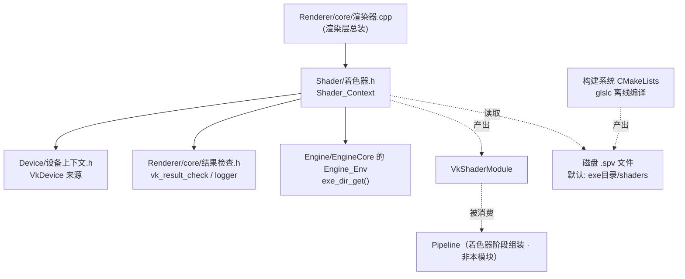
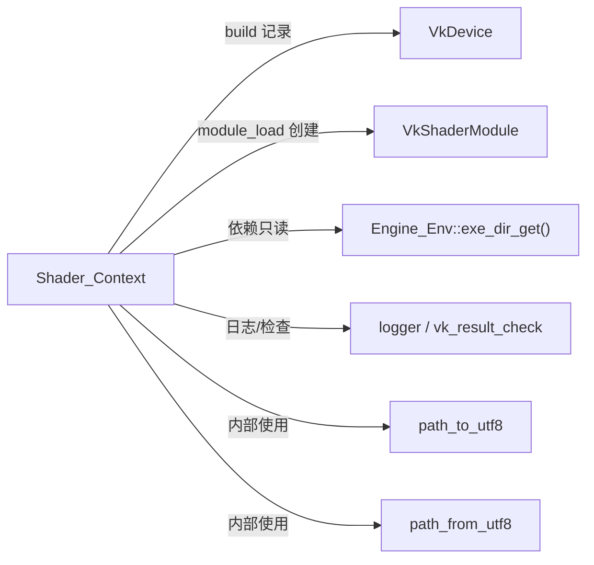
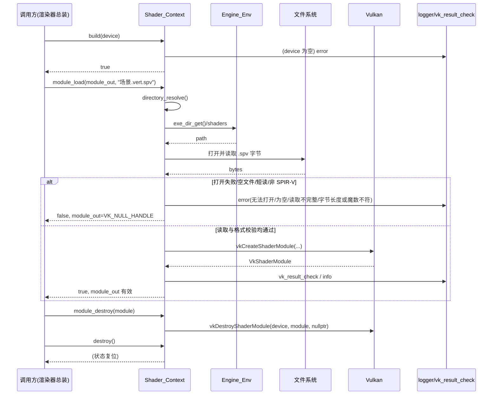
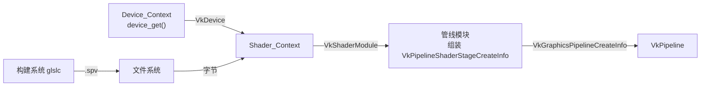

# 着色器 · 模块架构

> 本文件为「白银纪元」项目导航 · 模块架构之一。
> 记录对象：`Application/Renderer/src/render/Shader/` 目录下的着色器模块。
> 收录范围：上述运行期加载模块（`Shader_Context` 及其两个编译单元），以及 `Application/Renderer/assets/shaders/` 下的后处理预设片元着色器（第十四轮起收录，清单见 §八）。
> 文中所有路径均为相对源码根（项目根目录）的相对路径。
> 包含路径口径：头文件跨目录包含写**项目根全路径**；实现文件（`.cpp`）跨目录包含写**本层根相对**（`src/...`）；本层私有包含根 = 项目根 ＋ 本层根（`Application/Renderer`）。

---

## 一、文件内目录

- [二、模块功能介绍](#二模块功能介绍)
  - 2.1 模块定位 / 2.2 职责边界 / 2.3 模块解决的问题 / 2.4 在整体架构中的位置 / 2.5 与相邻模块的职责分界
- [三、模块公开接口介绍](#三模块公开接口介绍)
  - 3.1 类型总览 / 3.2 对外接口逐条清单 / 3.3 各接口详细说明 / 3.4 本模块依赖的外部接口
- [四、模块私有方法介绍](#四模块私有方法介绍)
- [五、模块内部架构介绍](#五模块内部架构介绍)
  - 5.1 目录 / 文件结构树 / 5.2 各编译单元职责 / 5.3 内部数据结构字段说明 / 5.4 匿名命名空间辅助函数 / 5.5 类关系 / 5.6 局部命名空间使用头做法说明 / 5.7 与构建系统的关系
- [六、模块设计/实现细节](#六模块设计实现细节)
  - 6.1 生命周期与两段式构建 / 6.2 所有权约定 / 6.3 幂等销毁 / 6.4 编码与路径处理 / 6.5 SPIR-V 加载路径与对齐 / 6.6 着色器阶段组装不在本模块 / 6.7 线程 / 并发约定 / 6.8 异常禁用与内存分配 / 6.9 易错点清单 / 6.10 设计意图层面的解释
- [七、模块运行链路详例](#七模块运行链路详例)
  - 7.1 主流程（正常路径） / 7.2 关键异常 / 边界分支 / 7.3 与其它模块的集成链路
- [八、后处理预设清单](#八后处理预设清单)
- [附录、待确认条目](#附录待确认条目)

---

## 二、模块功能介绍

### 2.1 模块定位

着色器模块（Shader）是渲染层中**唯一负责「把离线编译产物 `.spv` 字节码搬进 Vulkan、变成可被管线使用的 `VkShaderModule`」**的模块。它对外只暴露一个类 `Shader_Context`，语义上与渲染层的其它「上下文类」（`Device_Context`、`Frame_Context`、`Memory_Context` 等）保持同构：

- 都是「两段式生命周期」：先 `build` 记录外部句柄，再使用，最后 `destroy`；
- `destroy` 幂等，析构兜底；
- 都不持有任何需在 GPU 上排队的资源，只持有需要显式归还的句柄或纯 CPU 侧状态。

本模块是整个渲染层里最「薄」的一类模块：**它不参与任何图形命令的录制，也不参与管线状态的组装**，只做「文件 → 字节 → Vulkan 对象」这一条最短链路。

### 2.2 职责边界（做什么 / 不做什么）

| 分类 | 本模块**负责** | 本模块**不负责** |
| --- | --- | --- |
| 文件侧 | 解析着色器文件所在目录；以二进制方式读入整个 `.spv` 文件字节，并校验读取完整性（短读即失败） | 编译 GLSL → SPIR-V（由构建系统调 `glslc` 离线完成，见 §5.7） |
| 路径侧 | 处理「中文路径 / UTF-8 与 `std::filesystem::path` 本地编码」的互转 | 决定着色器源文件放在哪（由构建系统与资产目录约定） |
| Vulkan 侧 | 用 `VkShaderModuleCreateInfo` 创建 `VkShaderModule`；销毁 `VkShaderModule` | 组装 `VkPipelineShaderStageCreateInfo`（着色器阶段）、创建管线 |
| 状态侧 | 记录逻辑设备、记录可选的着色器目录 | 管理多着色器模块的登记册 / 引用计数 |
| 错误侧 | 返回 `bool`、经日志系统记错误、经结果检查出口判定 Vulkan 返回值；创建模块前自检 SPIR-V 字节格式（长度 4 字节倍数、首字魔数） | 向上层抛异常（本层全面禁用异常） |

### 2.3 模块解决的问题

1. **「SPIR-V 从哪来」**：渲染层运行期不携带 GLSL 编译器。设计取舍是「离线编译」——构建期由 `glslc` 把 `assets/shaders/*.vert|*.frag|*.comp` 编成 `*.spv`，运行期只读取字节。着色器模块正是这条链路的运行期终点，它把「磁盘上的 `.spv` 文件」翻译成「Vulkan 可用的 `VkShaderModule`」。
2. **「中文路径怎么办」**：项目统一采用 UTF-8 编码、且允许中文文件名（如 `场景.vert.spv`）。但 `std::filesystem::path` 在 Windows 上默认使用本地编码（GBK / UTF-16LE），直接用它构造含中文的 `std::string` 会导致乱码。着色器模块内置了一对转换函数（`path_to_utf8` / `path_from_utf8`），把「UTF-8 字符串」与「`std::filesystem::path`」在边界处互转，是项目「编码约束」在本模块的落地。
3. **「默认去哪找着色器」**：若调用方不显式指定目录，本模块以「可执行文件目录 / shaders」为默认位置。这规避了「相对当前工作目录（CWD）的路径」这一不稳定做法——CWD 会随启动方式改变，而可执行文件目录由 `Engine_Env` 锚定，稳定可预期。
4. **「错误怎么上报」**：本模块把「打不开文件 / 文件为空 / 读取不完整（短读）/ 非 SPIR-V 字节码 / Vulkan 创建失败」等失败情形统一转成 `bool` 返回值，并在失败点写日志；Vulkan 返回值经渲染层统一的 `vk_result_check` 出口判定。这样调用方只需检查布尔返回值即可，不必逐个感知 Vulkan 结果码。

### 2.4 在整体架构中的位置

本模块位于渲染层 `render/` 下的 `Shader/` 子目录，与 `Device/`、`Frame/`、`Memory/`、`Pipeline/`、`Platform/`、`Renderer/`、`Scene/`、`Swapchain/`、`Texture/`、`Mesh/` 平级。



要点：

- **上游依赖**：逻辑设备句柄来自设备上下文（`Device_Context::device_get()`，本模块只接收 `VkDevice`，不直接持有 `Device_Context`）；日志与结果检查来自渲染层的 `Renderer/core/结果检查.h`；可执行文件目录来自引擎核心的 `Engine_Env`。
- **下游产物**：`VkShaderModule`。该句柄最终由管线模块组装进 `VkPipelineShaderStageCreateInfo`。**着色器阶段的组装不在本模块**，这是本模块最需要被读者记住的边界。
- **构建侧**：`.spv` 的来源由构建系统负责（离线 `glslc`），本模块只是消费者。

### 2.5 与相邻模块的职责分界

| 相邻模块 | 分界说明 |
| --- | --- |
| 设备上下文（`Device/设备上下文.h`） | 设备上下文负责创建 / 销毁 `VkDevice`；本模块只在 `build` 时**记录**该句柄，用于后续 `vkCreateShaderModule` / `vkDestroyShaderModule`。本模块不检查设备能力，也不参与物理设备选择。 |
| 管线模块（`Pipeline/`） | 管线模块负责把 `VkShaderModule` + 入口点函数名 + 阶段标志组装成 `VkPipelineShaderStageCreateInfo`，并纳入 `VkGraphicsPipelineCreateInfo`。本模块只产出裸 `VkShaderModule`，**不产出阶段结构体**。 |
| 渲染器总装（`Renderer/core/渲染器.cpp`） | 总装方负责决定 `Shader_Context` 何时 `build`、目录如何设置、加载哪些 `.spv`、何时销毁模块与上下文。本模块不自发加载任何着色器。 |
| 引擎环境（`Engine/EngineCore` 的 `Engine_Env`） | 提供稳定的「可执行文件目录」，本模块据此拼出默认着色器目录；本模块不定义该目录的内部实现。 |
| 结果检查 / 日志（`Renderer/core/结果检查.h`） | 提供 `vk_result_check` 与全局 `logger`；本模块是使用者，不定义其实现。 |

---

## 三、模块公开接口介绍

### 3.1 类型总览

| 项 | 内容 |
| --- | --- |
| 命名空间 | `engine` |
| 对外类型 | `class Shader_Context` |
| 声明位置 | `Application/Renderer/src/render/Shader/着色器.h` |
| 实现位置 | `Application/Renderer/src/render/Shader/core/着色器.cpp`（生命周期与目录）<br/>`Application/Renderer/src/render/Shader/core/着色器模块.cpp`（文件读取与模块创建 / 销毁） |
| 拷贝语义 | 不可拷贝、不可赋值（拷贝构造与拷贝赋值均 `= delete`）；未声明移动操作 |
| 依赖的 Vulkan 类型 | `VkDevice`、`VkShaderModule`、`VkShaderModuleCreateInfo`（经 `着色器.h` 内含的 `<vulkan/vulkan.h>` 暴露） |
| 头文件可见性 | `着色器.h` 属本层「实现细节」：只被本层 `.cpp` 与层内模块头包含，不进公共头；其内含 `<vulkan/vulkan.h>`，故层外经公共包含面既拿不到 `vulkan.h`、也不会直接包含到本头 |

生命周期约定：`build` → （`directory_set`）→ `module_load` × N → `module_destroy` × N → `destroy`；`destroy` 幂等，析构函数兜底调用 `destroy`。

### 3.2 对外接口逐条清单

下表为**函数级**接口总览（签名以 `着色器.h` 为准；以下成员函数均为 `public`）。唯一的私有方法 `directory_resolve` 另见第四节。

| 序号 | 接口 | 签名 | 参数 | 返回 | 约束与行为 |
| --- | --- | --- | --- | --- | --- |
| 1 | 构造 | `Shader_Context(void) = default` | 无 | — | 不加载任何着色器；`device = VK_NULL_HANDLE`、`directory` 为空 |
| 2 | 析构 | `~Shader_Context(void)` | 无 | — | 内部调用 `destroy()`，保证状态复位（不销毁已加载的模块） |
| 3 | 拷贝构造 | `Shader_Context(const Shader_Context&) = delete` | — | — | 禁止拷贝 |
| 4 | 拷贝赋值 | `Shader_Context& operator=(const Shader_Context&) = delete` | — | — | 禁止赋值 |
| 5 | 构建 | `bool build(VkDevice device)` | `device`：逻辑设备句柄 | 成功 `true` / 失败 `false` | `device` 为 `VK_NULL_HANDLE` 时记 `error` 并返回 `false`；成功则记录该句柄。可重复调用（覆盖记录） |
| 6 | 销毁 | `void destroy(void)` | 无 | — | 幂等：把 `device` 复位为 `VK_NULL_HANDLE`、清空 `directory`。**不销毁任何 `VkShaderModule`** |
| 7 | 有效性 | `bool valid(void) const` | 无 | `device != VK_NULL_HANDLE` | 仅表示「是否已记录逻辑设备」，不保证任何着色器已加载 |
| 8 | 设置目录 | `void directory_set(const std::string& directory)` | `directory`：UTF-8 编码的着色器目录 | — | 传空字符串表示「恢复默认（exe 目录 / shaders）」；不校验目录是否存在 |
| 9 | 读取文件字节 | `bool file_bytes_read(std::vector<char>& bytes_out, const std::string& file_name) const` | `bytes_out`：输出字节缓冲（先清空）；`file_name`：如 `"场景.vert.spv"` | 成功 `true` / 失败 `false` | 二进制读取整文件；打开失败、大小 `<=0`、或实际读取字节数不足（短读）均记 `error`、清空缓冲并 `false`；成功时 `bytes_out` 为完整文件内容 |
| 10 | 加载模块 | `bool module_load(VkShaderModule& module_out, const std::string& file_name) const` | `module_out`：输出模块句柄；`file_name`：着色器文件名 | 成功 `true` / 失败 `false` | 先置 `module_out = VK_NULL_HANDLE`；未 `build`、读文件失败、字节长度非 4 字节倍数、首 4 字节魔数不匹配、或 `vkCreateShaderModule` 失败均返回 `false`；成功写日志 `info` |
| 11 | 销毁模块 | `void module_destroy(VkShaderModule module) const` | `module`：待销毁模块句柄 | — | 幂等：`module` 或 `device` 任一为 `VK_NULL_HANDLE` 时直接返回；否则 `vkDestroyShaderModule` |

### 3.3 各接口详细说明

#### 3.3.1 `Shader_Context(void) = default`（构造）

- **作用**：构造一个「未构建」的上下文，此时不含任何有效 Vulkan 句柄。
- **参数**：无。
- **返回**：不适用。
- **约束**：构造后 `valid()` 必为 `false`；此状态下调用 `module_load` 会因 `device == VK_NULL_HANDLE` 而失败（记 `error`「尚未构建」）。但 `file_bytes_read` 与 `directory_resolve` 不依赖 `device`，在未构建时**仍可正常调用**（会走默认目录）。
- **异常行为**：不抛异常。

#### 3.3.2 `~Shader_Context(void)`（析构）

- **作用**：析构兜底，内部仅调用 `destroy()`。
- **参数 / 返回**：无。
- **约束**：析构**不会**释放任何已创建的 `VkShaderModule`。设计上模块所有权归调用方，调用方须在析构前自行 `module_destroy`（见 §6.2 所有权模型）。故「先析构上下文、后销毁模块」的顺序会因 `device` 已被清空而无法销毁模块（`module_destroy` 检测到 `device == VK_NULL_HANDLE` 直接返回），造成句柄泄漏。正确顺序必须颠倒。
- **异常行为**：不抛异常。

#### 3.3.3 拷贝构造 / 拷贝赋值（`= delete`）

- **作用**：禁止拷贝与赋值。
- **理由**：类持有 `VkDevice` 与 `VkShaderModule` 相关状态，拷贝会导致同一逻辑设备被两个上下文重复记录、进而引发「谁负责销毁」的歧义。
- **约束**：未声明移动构造 / 移动赋值，故该类既不可拷贝也不可移动；只能以对象或（持有者自行决定的）指针 / `unique_ptr` 形式管理。当前源码以对象方式使用。

#### 3.3.4 `bool build(VkDevice device)`

- **作用**：第一段初始化——记录逻辑设备句柄，为后续创建 / 销毁模块提供 `device`。
- **参数**：`device`，`VkDevice`，逻辑设备句柄（通常来自 `Device_Context::device_get()`）。
- **返回**：`true` 表示记录成功；`false` 表示 `device` 为空。
- **约束与边界**：
  - 前置校验：`device == VK_NULL_HANDLE` → 记 `logger.error("着色器:: 构建时逻辑设备为空")` → `false`。
  - 成功路径：`this->device = device`，返回 `true`。
  - **不加载任何着色器**，也不校验设备能力、不读取目录。
  - 可重复调用：重复 `build` 会覆盖旧记录；若旧记录下仍有未销毁的模块，重复 `build` 不会触发清理（与析构同属「所有权归调用方」的取舍）。
- **异常行为**：不抛异常。

#### 3.3.5 `void destroy(void)`

- **作用**：第二段逆操作——复位内部状态。
- **参数 / 返回**：无。
- **约束与边界**：
  - **幂等**：无论调用多少次、当前是否已构建，行为一致（把 `device` 置 `VK_NULL_HANDLE`、`directory.clear()`）。
  - **不销毁 `VkShaderModule`**：注释明确指出「着色器模块须由调用方先行销毁」。原因见 §6.2。
  - 与 Vulkan 对象无关，故无需逆序释放，不存在「销毁顺序」问题——但**调用方**须自行保证模块先于上下文销毁。
- **异常行为**：不抛异常。

#### 3.3.6 `bool valid(void) const`

- **作用**：查询「是否已构建完成」。
- **参数 / 返回**：无参数；返回 `device != VK_NULL_HANDLE`。
- **约束**：`valid()` 为真**仅代表已记录逻辑设备**，不代表任何着色器已加载、也不代表目录有效。它是 `module_load` 的前置门槛的对应只读视图。
- **异常行为**：不抛异常（`const` 且无副作用）。

#### 3.3.7 `void directory_set(const std::string& directory)`

- **作用**：显式指定着色器文件所在目录。
- **参数**：`directory`，`std::string`，**约定为 UTF-8 编码**（与 `file_bytes_read` 中的 `path_from_utf8` 匹配）。
- **返回**：无。
- **约束与边界**：
  - 传空字符串 `""` 等价于「未指定」：后续 `directory_resolve` 会回退到默认目录（exe 目录 / shaders）。
  - **不校验目录是否存在**、不校验是否为绝对路径、不做规范化。目录正确性由调用方负责。
  - 建议在 `build` 之后、`module_load` 之前调用；但接口本身不强制顺序（不依赖 `device`）。
- **异常行为**：不抛异常。

#### 3.3.8 `bool file_bytes_read(std::vector<char>& bytes_out, const std::string& file_name) const`

- **作用**：把着色器文件读成字节缓冲。**这是「SPIR-V 来源」的运行期入口。**
- **参数**：
  - `bytes_out`：输出缓冲，`std::vector<char>&`。进入函数即被 `clear()`。
  - `file_name`：着色器文件名，**约定为 UTF-8 编码**，如 `"场景.vert.spv"`。注意编译产物名带原扩展名（`.vert.spv` / `.frag.spv`）。
- **返回**：`true` 读成功且 `bytes_out` 为完整文件内容；`false` 失败（`bytes_out` 保持被清空后的状态；短读失败时同样被清空，不留半份内容）。
- **实现要点**：
  1. `bytes_out.clear()`；
  2. 拼接路径：`path_from_utf8(directory_resolve()) / path_from_utf8(file_name)`；
  3. 以 `std::ios::ate | std::ios::binary` 打开——`ate` 让读指针初始定位到文件尾，便于一次取到文件大小；
  4. `stream.is_open()` 为假 → 记 `logger.error("着色器:: 无法打开着色器文件 {}", file_name)` → `false`；
  5. `std::streamsize size = stream.tellg()`；`size <= 0` → 记 `logger.error("着色器:: 着色器文件为空 {}", file_name)` → `false`；
  6. `bytes_out.resize(static_cast<std::size_t>(size))`；`seekg(0)`；`read(bytes_out.data(), size)`；
  7. 短读校验：`stream.gcount() != size` → 记 `logger.error("着色器:: 着色器文件读取不完整 {}", file_name)`、`bytes_out.clear()`、`stream.close()`、返回 `false`；
  8. `stream.close()`；返回 `true`。
- **约束与边界**：
  - 只读取整个文件，不做分块、不做重试。
  - 短读即失败：`read` 后以 `stream.gcount()` 与 `size` 比对，不足则记 `error`、清空缓冲、返回 `false`（见 §6.5）。
  - SPIR-V 格式校验（长度是否为 4 字节倍数、首 4 字节魔数 `0x07230203`）不在本函数，而落在 `module_load`（见 §6.5）；本函数只保证「完整读入」。
  - `const` 成员函数：只依赖 `directory` 与 `device` 之外的只读状态（实际只用 `directory`）。
- **异常行为**：**设计上不依赖异常**。`std::ifstream` 默认不抛异常（失败仅置 `badbit` / `failbit`），故打开失败、空文件、短读三条路径均为静默收敛为 `false`；本函数**不引入 `try/catch`**（保持项目「禁用异常」风格，I/O 失败在本模块内收口、不外传）。

#### 3.3.9 `bool module_load(VkShaderModule& module_out, const std::string& file_name) const`

- **作用**：本模块的**核心接口**——读取 `.spv` 字节并创建 `VkShaderModule`。
- **参数**：
  - `module_out`：输出模块句柄，`VkShaderModule&`。进入函数即被置为 `VK_NULL_HANDLE`。
  - `file_name`：着色器文件名（UTF-8），如 `"场景.vert.spv"`。
- **返回**：`true` 且 `module_out` 为有效句柄；`false` 且 `module_out == VK_NULL_HANDLE`。
- **实现要点**：
  1. `module_out = VK_NULL_HANDLE`；
  2. 前置：`device == VK_NULL_HANDLE` → 记 `logger.error("着色器:: 尚未构建，无法加载着色器模块 {}", file_name)` → `false`；
  3. 调 `file_bytes_read(bytes, file_name)`，失败直接返回 `false`（透传，不再重复记日志）；
  4. 长度校验：`bytes.size() % 4 != 0` → 记 `logger.error("着色器:: 字节码长度非 4 字节倍数 {}", file_name)` → `false`（SPIR-V 为 32 位字序列）；
  5. 魔数校验：以 `memcpy` 取首 4 字节为 `uint32_t magic`，`magic != 0x07230203u` → 记 `logger.error("着色器:: 魔数不匹配，非 SPIR-V 字节码（魔数 {}）{}", magic, file_name)` → `false`（打印实际魔数，拒绝非 SPIR-V 输入）；
  6. 组装 `VkShaderModuleCreateInfo create_info{}`：
     - `sType = VK_STRUCTURE_TYPE_SHADER_MODULE_CREATE_INFO`；
     - `codeSize = bytes.size()`；
     - `pCode = reinterpret_cast<const uint32_t*>(bytes.data())`；
  7. 调 `vk_result_check(vkCreateShaderModule(device, &create_info, nullptr, &module_out), "vkCreateShaderModule")`；返回假 → `module_out = VK_NULL_HANDLE` 并返回 `false`；
  8. 成功：`logger.info("着色器:: 着色器模块已加载（{}）", file_name)`；`true`。
- **约束与边界**：
  - **必须先 `build`**；未构建必失败。
  - 每次调用创建一个独立 `VkShaderModule`，**不做缓存 / 去重**：同名文件重复 `module_load` 会得到两个独立句柄，且**两个都需分别销毁**。
  - 失败路径保证 `module_out` 不被写成无效非空值（先置空、失败再置空）。
  - **创建前自检格式**：字节长度须为 4 字节倍数、且首 4 字节（`memcpy` 取字，避免未对齐访问）魔数须为 `0x07230203`；任一不满足即记 `error` 并返回 `false`，**不调用 Vulkan**。自检落在「构造 `VkShaderModuleCreateInfo` 之前」。
  - `pCode` 的 4 字节对齐由 `std::vector<char>` 的数据对齐性质保证；源码注释明确指出「vector 数据天然满足」。
  - 未复制字节：`create_info.pCode` 指向 `bytes` 局部向量；`vkCreateShaderModule` 在返回前已完成对字节的内部拷贝，故 `bytes` 出作用域后模块仍有效。
  - **不产出着色器阶段结构体**：调用方拿到 `VkShaderModule` 后，需自行决定阶段标志（`VK_SHADER_STAGE_*`）与入口点（通常 `"main"`）。
- **异常行为**：同 `file_bytes_read`——`std::ifstream` 默认不抛异常，I/O 失败已在 `file_bytes_read` 内收口为 `false`；本函数不做异常捕获。

#### 3.3.10 `void module_destroy(VkShaderModule module) const`

- **作用**：销毁由 `module_load` 创建的着色器模块。
- **参数**：`module`，待销毁句柄。
- **返回**：无。
- **约束与边界**：
  - **幂等**：`module == VK_NULL_HANDLE || device == VK_NULL_HANDLE` 任一成立即直接返回，不调用 Vulkan。
  - 若 `device` 已因 `destroy()` 被清空，则本函数**静默不做任何事**（不会销毁、不报错）——这是「先销毁上下文后销毁模块」会造成泄漏的根源。
  - 内部调 `vkDestroyShaderModule(device, module, nullptr)`（分配器传 `nullptr`，与创建时一致）。
  - `const` 成员函数：读 `device` 但不修改上下文状态。
- **异常行为**：不抛异常。

### 3.4 本模块依赖的外部接口

| 依赖接口 | 来源头文件（相对路径） | 本模块用法 | 语义 |
| --- | --- | --- | --- |
| `logger` | `Application/Renderer/src/render/Renderer/core/结果检查.h`（内含日志系统） | `logger.error(...)`、`logger.info(...)` | 全局日志对象；格式串使用 `{}` 占位 |
| `vk_result_check(VkResult, const char*)` | 同上 | 包装 `vkCreateShaderModule` 返回值 | 成功返回 `true`；非成功码按「可接受 / 硬错误」分流记日志后统一返回 `false` |
| `Engine_Env::exe_dir_get()` | `Engine/EngineCore/src/tools/Engine_Env/引擎环境.h` | 拼默认着色器目录 | 返回 `const std::filesystem::path&`，指向可执行文件目录 |
| Vulkan 入口点 | `<vulkan/vulkan.h>`（经 `着色器.h` 内含） | `vkCreateShaderModule`、`vkDestroyShaderModule` | 直接调用 SDK 导出符号；由 `vulkan-1.lib` 提供 |

外部 `vk_result_check` 的分流语义（摘自 `结果检查.h`，供本模块读者理解）：

- `VK_SUCCESS` → 返回 `true`；
- `VK_ERROR_OUT_OF_DATE_KHR` / `VK_SUBOPTIMAL_KHR` / `VK_TIMEOUT` → 记 `debug` 并返回 `false`（调用方自行分支）；
- 其它 → 记 `error`（含调用点描述与结果码名称）并返回 `false`。

对 `vkCreateShaderModule` 而言，正常只有 `VK_SUCCESS` 与硬错误两种，故本模块实际只会遇到「成功」或「error 日志 + false」。

---

## 四、模块私有方法介绍

`Shader_Context` 仅有一个私有成员函数 `directory_resolve`，声明于 `着色器.h`、实现于 `core/着色器.cpp`。逐条说明如下。

#### 4.1 `std::string directory_resolve(void) const`

- **作用**：把「未指定 / 已指定」的分支收敛到唯一出口，供 `file_bytes_read` 使用。
- **返回**：UTF-8 编码的目录字符串。
- **实现**：`directory` 非空则直接返回；否则返回 `path_to_utf8(Engine_Env::exe_dir_get() / "shaders")`。
- **约束与边界**：
  - 默认目录锚定「可执行文件目录」，**绝不使用相对 CWD 的路径**（源码注释标注为设计约束）。
  - 不校验目录存在性；目录不存在会在 `file_bytes_read` 打开文件时暴露为「无法打开」。
  - `private`，外部不可调用。

---

## 五、模块内部架构介绍

### 5.1 目录 / 文件结构树

```text
Application/Renderer/src/render/Shader/
├── 着色器.h                  # 对外头：Shader_Context 声明（含 <vulkan/vulkan.h>）
├── 局部命名空间使用.h         # 局部命名空间使用头：using std::string / std::vector
└── core/
    ├── 着色器.cpp            # 构造 / 析构 / build / destroy / valid / directory_set / directory_resolve
    └── 着色器模块.cpp         # file_bytes_read / module_load / module_destroy
```

构建系统侧的两处登记（相对路径）：

- `Application/Renderer/源文件列表.cmake`：把上述两个 `.cpp` 登记进 `RendererCore` 的 `target_sources`，并把两个 `.h` 登记为 IDE 索引项。
- `Application/Renderer/CMakeLists.txt` 第 4 节：`glslc` 离线编译段，负责产出 `.spv`（见 §5.7）。

### 5.2 各编译单元职责

| 文件 | 职责 | 关键内容 |
| --- | --- | --- |
| `着色器.h` | 对外接口声明 | 预编译头包含、`<vulkan/vulkan.h>` 暴露、`class Shader_Context`（含 2 个私有字段、1 个私有声明） |
| `局部命名空间使用.h` | 局部命名空间使用头 | `#include "着色器.h"` + `using std::string; using std::vector;` |
| `core/着色器.cpp` | 生命周期与目录解析 | 匿名命名空间 `path_to_utf8`；`~Shader_Context`、`build`、`destroy`、`valid`、`directory_set`、`directory_resolve` |
| `core/着色器模块.cpp` | 文件读取与模块创建 / 销毁 | 匿名命名空间 `path_from_utf8`；`file_bytes_read`、`module_load`、`module_destroy` |

两个 `.cpp` 都以 `#include "src/render/Shader/局部命名空间使用.h"` 开场（实现文件按**本层根相对**口径包含层内头），再各自包含所需依赖头：

- `着色器.cpp` 额外包含 `src/render/Renderer/core/结果检查.h`（拿 `logger`，层内跨目录按本层根相对口径）与 `Engine/EngineCore/src/tools/Engine_Env/引擎环境.h`（拿 `Engine_Env`，跨层按项目根全路径口径）。
- `着色器模块.cpp` 额外包含 `src/render/Renderer/core/结果检查.h`（拿 `logger`、`vk_result_check`）。

对照旧版：本轮随「包含路径口径统一」（见《版次内更新小记》）把上述两处包含由 `"../局部命名空间使用.h"` 与 `"Application/Renderer/src/render/Renderer/core/结果检查.h"` 分别改为 `"src/render/Shader/局部命名空间使用.h"` 与 `"src/render/Renderer/core/结果检查.h"`；`引擎环境.h` 的跨层包含写法则维持项目根全路径不变。

注意：两个 `.cpp` 分别定义了**各自**的匿名命名空间路径转换函数（一正一反），未放到公共头中共享——因为它们只在各自编译单元内使用，且实现方向相反。

### 5.3 内部数据结构字段说明

`Shader_Context` 仅有两个私有数据字段，逐项说明如下：

| 字段 | 类型 | 默认值 | 含义 | 写入者 | 读取者 |
| --- | --- | --- | --- | --- | --- |
| `device` | `VkDevice` | `VK_NULL_HANDLE` | 逻辑设备句柄。创建 / 销毁 `VkShaderModule` 的唯一 Vulkan 依赖 | `build` 写入；`destroy` 复位为 `VK_NULL_HANDLE` | `valid`、`module_load`、`module_destroy` |
| `directory` | `std::string` | 空串（未指定） | 着色器目录（UTF-8）。空表「未指定」，走默认 | `directory_set` 写入；`destroy` 清空 | `directory_resolve` |

无其它字段：**不存在模块登记表 / 容器**，这是「模块所有权归调用方」设计的直接体现（见 §6.2）。

### 5.4 匿名命名空间辅助函数

两个 `.cpp` 各自在 `namespace engine { namespace { ... } }` 中定义了一个 `static`（内部链接）函数：

| 函数 | 所在单元 | 签名 | 作用 | 实现要点 |
| --- | --- | --- | --- | --- |
| `path_to_utf8` | `着色器.cpp` | `string path_to_utf8(const std::filesystem::path& path)` | 路径 → UTF-8 字符串 | `path.u8string()` 取 `std::u8string`，再用 `reinterpret_cast<const char*>(u8.data())` + `u8.size()` 构造 `std::string` |
| `path_from_utf8` | `着色器模块.cpp` | `std::filesystem::path path_from_utf8(const string& text)` | UTF-8 字符串 → 路径 | 用 `reinterpret_cast<const char8_t*>(text.data())` + `text.size()` 构造 `std::u8string`，再 `std::filesystem::path(u8)` |

设计意图：把「UTF-8 ↔ 本地编码路径」的强制转换**收口**在这两个小函数里，业务的其余部分一律以 `std::string`（UTF-8）表达路径，避免中文路径在 Windows 上乱码。二者为编译单元内辅助函数，非类成员，故不属第四节的「私有方法」。

### 5.5 类关系

本模块只有 `Shader_Context` 一个类，无继承、无组合、无友元。其与外部的关系为「使用依赖」：



### 5.6 局部命名空间使用头做法说明

本项目采用「局部命名空间使用头」约定：模块对外头文件在展开的项目专属命名空间（此处为 `engine`）中声明类型，以减少命名空间前缀；而 `.cpp` / 内部 `.hpp` 通过一个「局部命名空间使用.h」用 `using` 声明把会用到的标准类型引入当前作用域，从而让实现代码一律不加命名空间前缀。

本模块的 `局部命名空间使用.h` 内容极简：

```cpp
#pragma once
#include "着色器.h"

// ---------- 基本类型别名 ----------
using std::string;
using std::vector;
```

- 它先包含 `着色器.h`（从而拿到 `Shader_Context` 声明与 `engine` 命名空间；二者同目录，故写短路径）；
- 再以 `using` 引入 `std::string` 与 `std::vector`；
- 于是 `着色器.cpp` / `着色器模块.cpp` 中写成 `string`、`vector<char>` 而不写 `std::` 前缀；
- 注意 `std::filesystem::path`、`std::ifstream`、`std::streamsize`、`std::size_t` **未**被 `using` 引入，故源码里仍保留 `std::` 前缀。这说明「局部命名空间使用头」按需引入、并非全量。

### 5.7 与构建系统的关系（SPIR-V 的来源）

本模块运行期只读 `.spv`，其来源由构建系统约定（`Application/Renderer/CMakeLists.txt` 第 4 节）：

```cmake
# 源着色器：assets/shaders/*.vert / *.frag / *.comp（文件名可为中文；glslc 支持 UTF-8 路径）
set(BYJY_RENDERER_SHADER_SRC_DIR "${PROJECT_ROOT_DIR}/assets/shaders")
# 产物：<构建树>/shaders/*.spv（位于 out/ 下，不入库）
set(BYJY_RENDERER_SHADER_OUT_DIR "${CMAKE_BINARY_DIR}/shaders")
# glslc 优先 <Vulkan SDK>/Bin/glslc.exe，其次 PATH；找不到只告警，不硬失败
# 逐源文件生成「源 → 同名 .spv」：产物名带原扩展名（如 场景.vert.spv）
# 命令：glslc --target-env=vulkan1.3 -o <out> <src>
```

自然人机约定链条：

1. 源 `.vert` / `.frag` / `.comp` 位于 `assets/shaders/`（**资产目录，相对项目根**）；
2. `glslc` 以 `vulkan1.3` 目标环境编译，产物落在**构建树**的 `shaders/` 子目录；
3. 产物命名 = 源文件名 + `.spv`（故 `场景.vert` → `场景.vert.spv`）；
4. Test 层按既有约定**把构建树 `shaders/` 拷到自身输出目录**，从而运行期「可执行文件目录 / shaders」正好命中（与 `directory_resolve` 的默认值吻合）；
5. `Shader_Context` 运行期只读这些 `.spv` 文件字节。

边界提醒：**本模块不参与上述编译**，也不感知产物路径；它只从「指定目录（或默认目录）」里按 `file_name` 读文件。源文件名与产物名的对应关系（带原扩展名的 `.spv`）是调用方与构建系统的约定，本模块不校验。

---

## 六、模块设计/实现细节

### 6.1 生命周期与两段式构建

本模块沿用渲染层统一的「两段式生命周期」，但比设备上下文更简单——它只有一段：

```text
（默认构造）
   │
   ├─ build(VkDevice)           记录逻辑设备；失败即前置校验不通过
   │
   ├─ directory_set(可选)        指定着色器目录；不调用则走默认 exe/shaders
   │
   ├─ module_load × N           每个 .spv 创建一个 VkShaderModule
   │
   ├─ module_destroy × N        ★ 必须在 destroy() 之前完成
   │
   └─ destroy()                 复位 device 与 directory（幂等）
        （析构兜底再调一次 destroy）
```

设计意图：把「持有长期句柄（device）」与「创建短生命周期对象（模块）」解耦——上下文只负责「能力（device + 目录）的提供」，模块生命周期交由调用方精细控制。这样可让「加载一批模块、用完集中销毁」的批处理成为可能，也便于在失败时精确回退。

### 6.2 内存 / 句柄所有权约定（关键取舍）

**所有权模型：`Shader_Context` 拥有 `device` 的使用权但不拥有其所有权；`VkShaderModule` 的所有权完全归调用方。**

理由与后果：

1. `device` 由设备上下文创建 / 销毁；本模块只记录句柄用于调用 Vulkan 入口点，不负责创建或销毁设备。
2. `VkShaderModule` 由 `module_load` 产出、经 `module_out` **移交**给调用方；`Shader_Context` **不保存**这些句柄（无登记表），故 `destroy()` 无法、也不应销毁它们。
3. 由此产生一条**硬性使用顺序**：先 `module_destroy`，后 `Shader_Context::destroy`（或先析构模块相关拥有者、后析构上下文）。若顺序颠倒，`module_destroy` 会因 `device` 已空而静默返回，模块句柄泄漏。

取舍的合理性：Vulkan 要求 `VkShaderModule` 在「使用它的管线」之后、在「`VkDevice` 销毁」之前销毁。若上下文自行销毁模块，就必须知道管线的生命周期，这会引入跨模块耦合；把所有权交给调用方（通常是渲染器总装）反而让销毁顺序可控。

### 6.3 幂等销毁

- `destroy()`：无条件复位两个字段，天然幂等，可重复调用。
- `module_destroy()`：以「句柄或设备任一为空即返回」实现幂等——对 `VK_NULL_HANDLE` 重复销毁安全。
- 析构兜底：`~Shader_Context` 调 `destroy()`，即便调用方忘记显式 `destroy`，状态也会复位（但对模块无兜底）。

注意：`build()` **不是**幂等意义上的「安全重复」——重复 `build` 会覆盖 `device`，若旧 `device` 下仍有未销毁模块，将失去销毁它们的设备句柄。故应避免在持有模块时重复 `build`。

### 6.4 编码与路径处理（本模块的「编码约束」落地）

项目统一 UTF-8、允许中文路径。Windows 下 `std::filesystem::path` 默认本地编码，故本模块做了双向转换：

| 方向 | 函数 | 转换细节 | 触发点 |
| --- | --- | --- | --- |
| path → UTF-8 | `path_to_utf8` | `path.u8string()` → `u8string` → `reinterpret_cast` 成 `std::string` | `directory_resolve` 返回默认目录时 |
| UTF-8 → path | `path_from_utf8` | `std::string` → `reinterpret_cast` 成 `u8string` → `std::filesystem::path` | `file_bytes_read` 拼接目录与文件名时 |

要点与易错点：

- 转换依赖「字符串内容确为 UTF-8」这一前提；若调用方 `directory_set` 传入 GBK 字符串，将得到乱码路径而打开失败。
- 不使用 `std::filesystem::u8path`（C++20 起被弃用）与 `std::codecvt`（已弃用）；这里采用 `u8string` + `reinterpret_cast` 的直转方式。**极端依赖实现**：要求 `char8_t` 与 `char` 等宽（8 位），这是标准保证的。
- 路径拼接在**同一编码域**内进行：目录与文件名都先转成 `std::filesystem::path`（由 `path_from_utf8`），再做 `operator/`，避免「一半 UTF-8、一半本地编码」的混拼。

### 6.5 SPIR-V 的加载路径与对齐

- **加载路径**：`module_load` → `file_bytes_read`（含短读校验）→ `directory_resolve`（默认 exe 目录 / shaders）→ 拼 `file_name` → 二进制整读 → **长度 / 魔数自检** → 组 `VkShaderModuleCreateInfo` → `vkCreateShaderModule`。
- **对齐**：Vulkan 要求 `pCode` 指向的存储按 4 字节对齐。源码注释说明「vector 数据天然满足」——`std::vector<char>` 的分配由全局分配器给出，满足 `max_align_t` 对齐，故 `reinterpret_cast<const uint32_t*>` 合法。
- **错误处理**：
  - 「未构建」在 `module_load` 中前置拦截；
  - 「打不开 / 空文件 / 读取不完整（短读）」在 `file_bytes_read` 中拦截并记 `error`；
  - 「字节长度非 4 字节倍数 / 魔数不匹配（非 SPIR-V 字节码）」在 `module_load` 的创建前自检中拦截并记 `error`（魔数一项打印实际值）；
  - 「创建失败」经 `vk_result_check` 记日志并返回 `false`；
  - 所有失败路径最终汇成 `bool`，**不抛异常**。
- **已做的格式自检**：`module_load` 在构造 `VkShaderModuleCreateInfo` **之前**做两项校验——① `bytes.size() % 4 == 0`（SPIR-V 为 32 位字序列）；② 首 4 字节魔数 `0x07230203u`（经 `memcpy` 取字，避免未对齐访问）。任一不满足即记 `error` 并返回 `false`、拒绝进入 Vulkan 调用。该自检属运行期对「文件被替换 / 截断」的防御：构建期 `glslc` 只保证产物正确，不覆盖运行期文件异常。

### 6.6 着色器阶段组装不在本模块（重要边界）

任务范畴中的「着色器阶段组装」在本模块源码中**并不存在**：`Shader_Context` 没有任何返回 `VkPipelineShaderStageCreateInfo` 的接口，也没有阶段标志 / 入口点函数名的参数。因此：

- 本模块只负责「产出 `VkShaderModule`」这一半；
- 「选定阶段（`VK_SHADER_STAGE_VERTEX_BIT` 等）、指定入口点（通常 `"main"`）、组装 `VkPipelineShaderStageCreateInfo`、纳入管线创建信息」属于**管线模块**的职责；
- 二者通过裸 `VkShaderModule` 句柄对接（不经过任何本模块的中间类型）。

这一分工是「文件 → Vulkan 对象」与「Vulkan 对象 → 管线状态」的自然切分，也保证了本模块不感知图形管线结构。

### 6.7 线程 / 并发约定

- 源码**未内置任何同步原语**（无 `mutex`、无原子量）。
- `build` / `directory_set` / `destroy` 会写状态；`valid` / `file_bytes_read` / `module_load` / `module_destroy` 为 `const` 只读（除 `module_load` 通过 `module_out` 写调用方变量）。
- 结论：**非线程安全**。约定由单一渲染 / 资源线程串行使用；若要跨线程，须由调用方自行加锁。
- `vkCreateShaderModule` / `vkDestroyShaderModule` 本身在 Vulkan 规范中受「同一 `VkDevice` 的外部同步」约束，跨线程调用需调用方保证同步。

### 6.8 异常禁用与内存分配

- 本模块**不调用 `new`**，不涉及 `std::nothrow` 的分配约束；由 `std::vector` 自行分配。
- 设计层面禁用异常：错误经 `bool` + 日志上报。
- 标准库 I/O 不构成异常来源：`std::ifstream` 默认**不抛异常**（失败仅置 `badbit` / `failbit`），打开失败、空文件、短读均已静默收敛为 `false`；本模块**不引入 `try/catch`**，与「以 `bool` + 日志上报」的风格一致（详见 §3.3.8）。

### 6.9 易错点清单

| 易错点 | 后果 | 正确做法 |
| --- | --- | --- |
| 未 `build` 就 `module_load` | 记 `error` 并返回 `false` | 先 `build(device_get())` |
| 忘记 `module_destroy` 直接 `destroy` | 模块句柄泄漏（`module_destroy` 静默返回） | 先销毁所有模块，再 `destroy` 上下文 |
| `directory_set` 传入非 UTF-8 字符串 | 路径乱码、打不开文件 | 传入 UTF-8（与项目编码一致） |
| `file_name` 不写全（漏 `.spv` 或漏原扩展名） | 打不开文件 | 用产物名，如 `场景.vert.spv` |
| 同名文件重复 `module_load` | 得到多个句柄，需逐个销毁 | 自行缓存 / 去重，或逐一销毁 |
| 期望本模块组装阶段 | 找不到对应接口 | 阶段组装应在管线模块完成 |
| 跨线程共享同一上下文 | 数据竞争 | 单线程串行，或自行加锁 |

### 6.10 设计意图层面的解释

1. **为什么把「读取文件」也放进本模块（而不是让调用方读好字节再传进来）**：把「目录解析 + 编码转换 + 读文件 + 建模块」串成一条不泄漏细节的调用链，调用方只需给文件名；同时默认目录避开了 CWD 依赖。
2. **为什么默认目录锚定 exe 目录而非项目根**：运行期最稳的锚点是可执行文件位置；exe 目录由 `Engine_Env` 统一提供，且与构建系统「Test 拷贝 shaders 到输出目录」的约定吻合。
3. **为什么公开 `file_bytes_read`**：便于调用方在需要时自行取字节（例如做自定义校验或另作他用），而不必经过 Vulkan 创建步骤；也便于测试。
4. **为什么 `module_load` 不做缓存**：着色器数量少、加载频率低（通常启动期一次）；缓存会引入「谁在何时失效」的生命周期复杂度，得不偿失。把控制权交给调用方。
5. **为什么 `destroy` 不销毁模块**：见 §6.2，避免上下文反向依赖管线的生命周期。
6. **为什么在运行期自检 SPIR-V 格式**：构建期 `glslc` 的正确性保证不覆盖运行期「`.spv` 被替换 / 截断」的情形，故在 `module_load` 内以两项廉价校验（长度 4 字节倍数、首字魔数）把「非 SPIR-V 字节码」拒绝在 `vkCreateShaderModule` 之前；校验成本极低，却能把错误定位在本模块边界内，并给出可读日志。

---

## 七、模块运行链路详例

### 7.1 主流程（正常路径）

以「渲染器总装加载一段顶点着色器」为例，调用链为 **调用方 → Shader_Context → （文件系统 / Vulkan / Engine_Env / 日志）**：

1. 调用方（渲染器总装）从设备上下文取逻辑设备：`VkDevice dev = device_context.device_get();`
2. `shader_context.build(dev);`
   - `Shader_Context` 校验 `dev != VK_NULL_HANDLE`；
   - 记录 `this->device = dev`；返回 `true`。
3. （可选）`shader_context.directory_set("...");` 指定自定义着色器目录；不调用则后续走默认。
4. `VkShaderModule vs; shader_context.module_load(vs, "场景.vert.spv");`
   - 置 `vs = VK_NULL_HANDLE`；
   - 校验 `device` 非空；
   - `file_bytes_read`：
     - `directory_resolve()`：`directory` 为空 → `Engine_Env::exe_dir_get() / "shaders"` → `path_to_utf8` → UTF-8 目录；
     - `path_from_utf8(目录) / path_from_utf8("场景.vert.spv")` → 完整路径；
     - 二进制整读 → `bytes`；短读校验（`stream.gcount() == size`）不过即记 `error` 并返回 `false`；
   - SPIR-V 自检：`bytes.size() % 4 == 0` 且首 4 字节魔数为 `0x07230203u`，否则记 `error` 并返回 `false`；
   - 组 `VkShaderModuleCreateInfo`（`codeSize`、`pCode`）；
   - `vk_result_check(vkCreateShaderModule(...), "vkCreateShaderModule")` → `true`；
   - 记 `logger.info("着色器:: 着色器模块已加载（{}）", ...)`；返回 `true`，`vs` 有效。
5. 调用方**自行**把 `vs` 组进阶段结构体（**在管线模块**）：`VkPipelineShaderStageCreateInfo`（`stage = VK_SHADER_STAGE_VERTEX_BIT`、`module = vs`、`pName = "main"`）。
6. 使用完毕后：`shader_context.module_destroy(vs);` → 内部 `vkDestroyShaderModule(device, vs, nullptr)`。
7. 收尾：`shader_context.destroy();` → `device` 与 `directory` 复位；后续析构再兜底调一次。

时序图：



### 7.2 关键异常 / 边界分支

| 分支 | 触发条件 | 模块行为 | 调用方应如何应对 |
| --- | --- | --- | --- |
| 构建失败 | `build` 收到 `VK_NULL_HANDLE` | 记 `error("构建时逻辑设备为空")`，返回 `false`，不记录设备 | 检查设备上下文是否已成功 `build_device` |
| 未构建即加载 | `module_load` 时 `device == VK_NULL_HANDLE` | 记 `error("尚未构建…")`，`module_out = VK_NULL_HANDLE`，返回 `false` | 先 `build` |
| 文件打不开 | 路径错误 / 目录不存在 / 文件名不符 | `file_bytes_read` 记 `error("无法打开着色器文件 …")`，返回 `false` | 核对目录与文件名（含 `.spv` 与原扩展名） |
| 文件为空 | `tellg() <= 0` | 记 `error("着色器文件为空 …")`，返回 `false` | 检查构建产物是否生成 |
| 文件读取不完整（短读） | 流打开成功但 `gcount() != size` | 记 `error("着色器文件读取不完整 …")`、清空缓冲、返回 `false` | 检查存储介质，重新读取或重新产出 |
| 字节长度为非 4 字节倍数 | `bytes.size() % 4 != 0` | `module_load` 记 `error("字节码长度非 4 字节倍数 …")`，返回 `false` | 确认 `.spv` 未被截断 / 替换 |
| 魔数不匹配 | 首 4 字节 ≠ `0x07230203` | `module_load` 记 `error("魔数不匹配，非 SPIR-V 字节码（魔数 …）…")`（打印实际值），返回 `false` | 确认文件确为 SPIR-V 产物 |
| 模块创建失败 | `vkCreateShaderModule` 返回非成功 | `vk_result_check` 记日志，`module_out = VK_NULL_HANDLE`，返回 `false` | 查日志中的结果码名称定位原因 |
| 重复销毁模块 | `module` 或 `device` 为空 | 静默返回（幂等） | 无需特殊处理 |
| 销毁顺序颠倒 | 先 `destroy` 后 `module_destroy` | `module_destroy` 静默返回，模块泄漏 | 严格「先模块、后上下文」 |
| 析构时仍有模块 | 调用方忘记 `module_destroy` | 仅复位状态，不销毁模块 | 由调用方保证先销毁模块 |

### 7.3 与其它模块的集成链路（职责衔接）



链路要点：

1. **设备 → 着色器**：设备上下文提供 `VkDevice`，着色器上下文记录之；
2. **着色器 → 管线**：着色器上下文提供 `VkShaderModule`，管线模块据阶段标志与入口点组装阶段并建管线；**本模块在此链路中结束**；
3. **构建 → 文件系统 → 着色器**：构建系统离线产出 `.spv`（默认落到构建树 `shaders/`，由 Test 拷贝到输出目录），运行期着色器上下文读之。

---

## 八、后处理预设清单

本节收录**第十四轮**三个、**第十五轮**四个、**第十六轮**一个、**第十八轮**一个与**第二十一轮**一个后处理片元着色器（均位于 `Application/Renderer/assets/shaders/`，顶点统一复用 `后处理.vert`）。均**不新增门面 API**：以 `pipeline_load(handle, "后处理.vert.spv", "<片元>.spv")` 登记为具名管线（沿用 `R-FACADE-11` 定案，见《渲染层-门面》§3.4.25），既可单独使用，也可经 `post_chain_set` 串联进同帧后处理链（见《渲染层-门面》§3.4.47）。

**第十五轮**四项中，`亮部提取` / `模糊` 为「多中间目标链」的泛光片元（需 ≥ 2 个目标轮转），`对比度` / `饱和度` 为常用预设；**第十六轮**补 `泛光叠加`（双源，闭环）；**第二十一轮**补 `暗角`，并把泛光参数（阈值 / 软膝 / 强度）从常量改为推送常量下发。

| 文件名 | 效果 | 关键参数 | 适用链位 |
| --- | --- | --- | --- |
| `灰度.frag` | `texelFetch` 1:1 取源后按 Rec.709 亮度加权去色，alpha 恒 1 | 亮度权重 `vec3(0.2126, 0.7152, 0.0722)`；源坐标钳到 `[0, size−1]` | 链首 / 独立；无前置语义要求 |
| `描边.frag` | 3×3 邻域亮度 Sobel 求梯度幅值，按幅值把原色压暗成深色描边 | `luma_at(coord, size, offset)` 以 `texelFetch` ＋ 偏移取样、越界 `clamp` 钳边；`gx` / `gy` 为 Sobel 梯度；`magnitude = abs(gx) + abs(gy)`；`weight = clamp(magnitude × 2.0, 0, 1)`；输出 `source.rgb × (1 − weight)` | 链中 / 链末；依赖源与宿 1:1，置于去色等全屏变换之后语义更直观 |
| `色调映射.frag` | 简化 ACES 曲线逐通道压缩高光，输出仍落在 `[0,1]`，alpha 恒 1 | 输入先钳 `[0,1]`；`aces(x) = v(2.51v + 0.03) / (v(2.43v + 0.59) + 0.14)`（`v = clamp(x, 0, 1)`）；`aces(1) ≈ 0.804`（sRGB 附件编码后约 232） | 链末（显示前最后一级） |
| `亮部提取.frag` | 按 Rec.709 亮度取亮部、暗部归零（泛光链的一级） | 阈值 / 软膝取自推送常量（`bloom_param.x/y`，默认 `0.6` / `0.1`，**第二十一轮**）；`weight = smoothstep(threshold − knee, threshold + knee, luma)`；输出 `source.rgb × weight` | 链首（泛光链）；默认参数下线性亮度 ≥ 0.7 全保留、≤ 0.5 全归零 |
| `模糊.frag` | (2N+1)×(2N+1) 三角权重近似高斯卷积，把亮部向外扩散 | **第八十一轮起**半径 N 取 `post_param.z`（四舍五入钳 [1,4]）；权重 `(N+1−|dx|)(N+1−|dy|) / (N+1)⁴`；N = 1 与旧 3×3 核（`(2−|dx|)(2−|dy|)/16`）逐项等价 | 亮部提取之后（第二级起）；需 ≥ 2 个中间目标 |
| `对比度.frag` | 围绕中灰 0.5 线性放大明暗差 | `rgb = clamp((rgb − 0.5) × 1.5 + 0.5, 0, 1)`（增益常量 1.5） | 任意链位；暗部易被压到 0 |
| `饱和度.frag` | 沿「灰轴 → 原色」方向外推，放大通道差 | `luma = dot(rgb, vec3(0.2126, 0.7152, 0.0722))`；`rgb = clamp(mix(vec3(luma), rgb, 1.5), 0, 1)` | 任意链位；纯灰（三通道相等）保持不变 |
| `泛光叠加.frag`（**第十六轮**） | **双源**：binding 0（上一级亮部层）＋ binding 1（场景目标）相加并钳制，形成「原画面 ＋ 泛光」 | `bloom *= bloom_param.z`（强度，**第二十一轮**，默认 1.0）；`out = clamp(scene + bloom, 0, 1)`；alpha 恒 1 | **只能放在链末级**，且链长 ≤ 目标数（否则场景目标被前面的级覆盖） |
| `升采样.frag`（**第十八轮**） | 把小尺寸源（如半分辨率模糊层）双线性放大到宿尺寸，减轻块状边缘 | `p = gl_FragCoord × (源/宿) − 0.5`；`base = floor(p)`、`f = p − base`；4 邻域 `texelFetch` ＋ `mix`，越界钳边 | 半 → 全尺寸的那一级（可替换点采样） |
| `暗角.frag`（**第二十一轮**） | 按到画面中心的归一化距离压暗边缘、中心保持原色 | `normalized = abs(coord / source_size × 2 − 1)`、`radius = length(normalized)`；`weight = 1 − 0.75 × smoothstep(0.55, 1.0, radius)`；输出 `source.rgb × weight` | 任意链位（单源）；四角约为原亮度的 25% |
| `锐化.frag`（**第七十四轮**） | 非锐化掩模：中心像素加重自身与 4 邻域均值的差，放大边缘对比 | `sharpened = middle + (middle − average) × 0.8`；4 次 `texelFetch` ＋ 整数偏移、越界钳边；结果钳 `[0,1]` | 任意链位（单源）；不引入新参数 |
| `色差.frag`（**第七十六轮**） | 径向横向色差：红通道沿径向外扩、蓝通道内收采样，绿通道原位；中心零偏移、边缘最大 | `radius = length((pos + 0.5)/size × 2 − 1)`；`shift = post_param.z × radius`（单位 = 半径 1 处的像素偏移，负值按 0）；三通道各自 `texelFetch` ＋ `clamp` 钳边 | 任意链位（单源）；强度经 `post_stage_param_set` 的 intensity 下发（默认取全局 1.0） |
| `色调分离.frag`（**第七十八轮**） | 逐通道按色阶数 N 量化（posterize），形成明显色带 | `levels = clamp(floor(post_param.z + 0.5), 2.0, 64.0)`；`posterized = floor(source × levels + 0.5) / levels` | 任意链位（单源）；N 经 `post_stage_param_set` 的 intensity 下发（默认 1.0 → 钳为 2，即二值化风格） |
| `色相旋转.frag`（**第八十七轮**） | HSV 色相整体旋转，饱和度 / 明度不变 | `hsv.x = fract(hsv.x + offset/360)`；offset 取 `post_param.z`（度，钳 [-360,360]）；门面要求 intensity < 100，故单次有效角 (0°,100°) | 任意链位（单源）；默认 1° 近似不变 |
| `曝光.frag`（**第八十八轮**） | 线性曝光：整体乘倍数并钳制 | `multiplier = clamp(post_param.z, 0.1, 8)`（非数按 1）；`out = clamp(source × multiplier, 0, 1)` | 任意链位（单源）；默认 1.0 原样 |
| `伽马校正.frag`（**第八十九轮**） | 逐通道幂变换（中间调提亮 / 压暗） | `gamma = clamp(post_param.z, 0.2, 5)`（非数按 1）；`out = pow(clamp(source,0,1), 1/gamma)` | 任意链位（单源）；默认 1.0 原样；端点 0/1 不变 |
| `胶片颗粒.frag`（**第七十九轮**） | 叠加屏幕空间哈希噪声（零均值），模拟胶片颗粒 | `hash12(coord)` 伪随机；`strength = clamp(post_param.z, 0, 0.5)`；`out = clamp(source + (hash − 0.5) × strength, 0, 1)` | 任意链位（单源）；同帧内稳定、不闪烁；默认 1.0 → 0.5 |
| `像素化.frag`（**第八十轮**） | 按 N×N 宿像素块取块中心源像素，形成马赛克 | `block = clamp(floor(post_param.z + 0.5), 1, 64)`；`block_center = (floor(gl_FragCoord / block) + 0.5) × block` | 任意链位（单源）；默认 1.0 → 1（原样输出） |

补充约定：

- 十个片元（`暗角.frag` 起）均以 `gl_FragCoord` 帧缓冲坐标 + **推送的「源 / 宿尺寸」** `texelFetch` 取样（1:1 时为恒等，非 1:1 时为点采样；`升采样.frag` 为手工双线性），**不依赖采样器过滤状态**；因此目标尺寸**不再要求**等于交换链范围（第十七轮），仅要求非零。
- **第十七 / 十八轮**：全部后处理片元增加 `layout(push_constant) offset 80` 的 `vec4(源宽, 源高, 宿宽, 宿高)`；`泛光叠加.frag` 的场景端另按 `textureSize(scene_image)` 计算映射；`升采样.frag` 用同一推送块做四邻域插值。
- **第二十一轮（GLSL 限制）**：`亮部提取.frag` / `泛光叠加.frag` 需要同时读「尺寸」与「泛光参数」，但 **GLSL 每阶段只允许一个 `push_constant` 块**（`glslc` 报 `Only one push_constant block is allowed per stage`），故合并为单一 `Push_Post` 块：`layout(offset = 80) vec4 size_xy;` 紧接 `vec4 bloom_param;`（隐式偏移 96）。新增读取 `96..111` 的片元须沿用同一写法。`暗角.frag` 只需尺寸，故保留单独块、块名可自定。
- `泛光叠加.frag` 是唯一声明 **binding 1** 的后处理片元；该 binding 由门面恒写目标组首项（场景目标），见《渲染层-管线》§3.3.20。
- **第十六轮改动**：`文字.frag` 由「直接输出图集色」改为「覆盖率 × 推送颜色（offset 64 的 `vec4`）」，未设色时门面推送白色，输出与旧版一致（见《渲染层-门面》§3.4.35 与《渲染层-文字》§6.5）。
- 只处理 RGB、alpha 恒置 1，可直接与既有后处理片元串联；`反色.frag` / `亮度阈值.frag` / `纯色.frag` / `后处理.frag` 为既有预设（不在本节收录范围）。
- 本节只记录**资产侧**着色器口径；运行期加载仍走 §五 / §六 / §七 的 `Shader_Context::module_load`，无新增模块接口。

---

## 附录、待确认条目

### 附 A. 本模块事实速查

| 项 | 值 |
| --- | --- |
| 命名空间 | `engine` |
| 唯一对外类 | `Shader_Context` |
| 数据字段 | `device`（VkDevice，默认空）、`directory`（std::string，默认空） |
| 主接口数 | 9（含 1 个 private 目录解析） |
| 依赖外部 | `logger`、`vk_result_check`、`Engine_Env::exe_dir_get`、Vulkan 两个入口点 |
| 默认着色器目录 | `Engine_Env::exe_dir_get() / "shaders"` |
| SPIR-V 来源 | 构建期 `glslc --target-env=vulkan1.3` 离线编译，产物名带原扩展名（`.vert.spv` 等） |
| 运行期字节自检 | 短读校验（`gcount() == size`）＋ 字节长度为 4 字节倍数 ＋ 首 4 字节魔数 `0x07230203` |
| 是否含阶段组装 | 否（在管线模块） |
| 所有权 | `device` 用而不拥有；`VkShaderModule` 归调用方 |
| 线程安全 | 否（无同步原语） |
| 异常策略 | 全面禁用异常，以 `bool` + 日志上报 |
| 幂等 | `destroy`、`module_destroy` 幂等；`build` 非「无副作用重复」 |
| 含路径口径 | 头文件跨目录写项目根全路径；实现文件跨目录写本层根相对；私有包含根 = 项目根 ＋ `Application/Renderer` |

### 附 B. 待确认条目索引

本模块条目（R-SHADER-01~02）本轮已全部确证，无遗留待确认项；全量清单见同版次目录下的 `待答疑清单.md`。

---

### 附 C. 本版次增量（第十四轮：后处理预设）

1. `Application/Renderer/assets/shaders/灰度.frag`（新增）：`texelFetch` 取源 → `luma = dot(rgb, vec3(0.2126, 0.7152, 0.0722))` → `vec4(vec3(luma), 1.0)`。
2. `Application/Renderer/assets/shaders/描边.frag`（新增）：辅助函数 `luma_at(coord, size, offset)`（`texelFetch` ＋ 偏移，越界 `clamp` 钳边）；3×3 邻域亮度 → Sobel `gx` / `gy` → `magnitude = abs(gx) + abs(gy)` → `weight = clamp(magnitude * 2.0, 0, 1)` → `out = vec4(source.rgb * (1.0 - weight), 1.0)`。
3. `Application/Renderer/assets/shaders/色调映射.frag`（新增）：辅助函数 `aces(x)`（输入钳 `[0,1]`）＝ `v*(2.51v + 0.03) / (v*(2.43v + 0.59) + 0.14)`，逐通道映射；`aces(1) ≈ 0.804`（sRGB 附件编码后约 232）。
4. 三者统一复用顶点 `后处理.vert`，**不新增门面 API**：经 `pipeline_load(handle, "后处理.vert.spv", "<片元>.spv")` 登记（沿用 `R-FACADE-11` 定案），可单独使用或经 `post_chain_set` 串联。
5. 文档落点：新增 §八「后处理预设清单」；同步文件头收录范围与 §一 文件内目录。运行期加载链路（§五 / §六 / §七）不变。

---

### 附 D. 本版次增量（第四十六轮：SSAA 降采样与逐光源衰减）

1. `Application/Renderer/assets/shaders/降采样.frag`（新增）：读偏移 80 的「源 / 宿尺寸」，`ratio = 源宽 / 宿宽`（取最近整数，钳 1..4），对每个宿像素取 `ratio × ratio` 个 `texelFetch` 求平均（越界钳边），alpha 置 1。
2. `场景.frag`：`point_spot_cone` 的 **z** 分量改作逐光源衰减模式（0 = 跟随全局、1 = 线性、2 = 平方反比）；跟随全局时把全局 0/1 映射到 1/2 后统一判断。

---

### 附 E. 本版次增量（第四十七轮：半球环境光与补光）

1. `场景.frag` 的 `Scene_Buffer` 新增三个 `vec4`：`ambient_ground`（offset **432**：rgb = 地面色、w = 混合强度）、`fill_dir_intensity`（offset **448**：xyz = 补光传播方向、w = 强度）、`fill_color`（offset **464**：rgb）；uniform 块总长 **432 → 480** 字节。
2. 半球环境光：`up_mix = clamp(normal.y * 0.5 + 0.5, 0, 1)`；`hemisphere_rgb = mix(ambient_ground.rgb, ambient_color.rgb, up_mix)`；`ambient_rgb = mix(ambient_color.rgb, hemisphere_rgb, ambient_ground.w)`；`w = 0` 时与旧画面逐字节一致。
3. 补光：`fill_dir_intensity.w > 0` 时 `radiance += fill_color.rgb * w * ndotl`，高光 `max` 合并；与主方向光的累加 / 高光互不影响。
4. 变更落点：`Application/Renderer/src/render/Pipeline/core/管线.cpp` 的 `buffer_info.range` 同步改为 **480**；门面每帧写 UBO 增加两段 `buffer_write`（offset 432 / 448 / 464）。
---

### 附 F. 本版次增量（第四十九轮：逐盏高光缩放）

1. 场景.frag：point_spot_cone.w 由保留位改为**逐盏高光缩放**（0..100）；高光项改为 pow(ndoth, shininess) × attenuation × cone × w。
2. 默认 w = 1 时与引入前逐字节一致；w = 0 时该灯完全不产生高光。
3. 场景 UBO 仍为 **480 字节**（复用保留位，不扩块）。
---

### 附 G. 本版次增量（第五十轮：方向光与补光逐光高光缩放）

1. camera_pos.w 由保留位改为**主方向光高光缩放**、ill_color.w 改为**补光高光缩放**（各 0..100，默认 1）。
2. 高光项：主光 / 补光各乘自身缩放后再与全局高光强度相乘并取 max。
3. 场景 UBO 仍 **480 字节**（两处均为保留位复用）。
---

### 附 H. 本版次增量（第五十一轮：逐盏高光光泽度）

1. Scene_Buffer 尾部新增 `float point_shininess[4]`（std140 步长 16 字节：偏移 480 / 496 / 512 / 528），块总长 **480 → 544** 字节。
2. 片元：`shininess = point_shininess[index] > 0 ? 自身值 : max(light_common.z, 1)`，高光按该指数计算。
3. 管线.cpp 描述符范围同步 **544**；门面每帧整块写入字节数同步 544。

---

### 附 I. 本版次增量（第五十二轮：方向光阴影贴图）

1. `Application/Renderer/assets/shaders/阴影.vert`（新增）：顶点属性与 `场景.vert` 同口径（位置 / 纹理坐标 / 法线 / 实例模型矩阵 4 列）；`layout(push_constant) uniform Shadow_Push { mat4 light_view_proj; }`，输出 `gl_Position = light_view_proj * model * pos` 与裁剪空间深度 `clip.z / clip.w`。
2. `Application/Renderer/assets/shaders/阴影.frag`（新增）：经典 RGBA8 打包深度 `pack_depth(clamp(in_depth, 0, 1))`（权重 1 / 255 / 65025 / 16581375），写入颜色附件（无颜色输出之外的逻辑）。
3. `场景.frag`：
   - `set 1 binding 1` 新增 `uniform sampler2D shadow_map`；
   - `Scene_Buffer` 尾部新增 `mat4 light_view_proj`（offset **544**）与 `vec4 shadow_params`（offset **608**：x 启用 / y 偏置 / z 边长 / w 保留），块总长 **544 → 624**；
   - 新增 `shadow_factor(world_pos)`：`shadow_params.x < 0.5` 直接返回 1；光源空间裁剪 w ≤ 1e-6 或 UV 出界返回 1；`texelFetch` 解包存储深度，`current = ndc.z − shadow_params.y`，`current <= stored ? 1 : 0`；
   - 主方向光的漫反射与高光乘该系数（补光 / 点光 / 聚光不受影响）。
4. 管线.cpp 描述符范围同步 **624**；门面初始化块与每帧整块写入字节数同步 624。

---

### 附 J. 本版次增量（第五十三轮：阴影柔化与强度）

1. `场景.frag` 拆出 `shadow_compare(texel, current, size)`：越界钳边 → `texelFetch` → 解包 → `current <= stored ? 1 : 0`。
2. `shadow_factor` 按 `shadow_params.w`（软度）选择比较方式：`< 0.5` 单点；否则 3×3 邻域求和 `/ 9`。
3. `Scene_Buffer` 尾部新增 `float shadow_strength`（offset **624**），块总长 **624 → 640**（std140 尾部按 16 字节圆整）；最终返回 `mix(1.0, factor, clamp(shadow_strength, 0.0, 1.0))`。
4. 管线.cpp 描述符范围同步 **640**；门面初始块 80 → 96 字节（强度默认 1）、每帧整块写入 640 字节。

---

### 附 K. 本版次增量（第五十六轮：阴影软度连续化）

1. `shadow_factor` 的邻域半径按 `shadow_params.w` 连续映射：`≤0` 单点；`≤0.25` 半径 1（3×3）；`≤0.75` 半径 2（5×5）；其余半径 3（7×7）。
2. 采样数由固定 9 改为 `(2r+1)²`（最大 49），越界仍钳边；默认软度 0 不增加任何采样。
3. 无 UBO 布局变化（仍 640 字节），门面与数据字段无需改动。

---

### 附 L. 本版次增量（第五十九轮：阴影法线偏移）

1. `shadow_factor` 签名由 `(vec3 world_pos)` 改为 `(vec3 world_pos, vec3 normal)`；主方向光调用处传片元世界法线 `normal`（平滑法线，未提供法线分支不进此路径）。
2. 新增**法线偏移**：`sample_pos = world_pos + normalize(normal) * (shadow_params.y * 59.0)`；`shadow_params.y` 即深度偏置（默认 0.003），59 为光源正交投影近 1 / 远 60 的深度跨度，使世界量级偏移与 NDC 偏置量一致。法线长度 ≤ 1e-6（未提供法线）时不偏移，保持既有网格行为。
3. 光源空间裁剪、UV 映射、纹素取样、PCF 邻域与强度插值全部沿用；当轮无 UBO 布局变化（第六十二轮起总长为 960 字节），无门面 / 数据字段新增。
4. 位移方向为片元法线方向（受光面即朝向光源一侧），用于抵消掠射角与深度量化造成的自阴影（shadow acne）。

---

### 附 M. 本版次增量（第六十二轮：光源上限 4 → 8）

1. `场景.frag` 与 `场景.vert` 的 Scene_Buffer 中 `point_pos_radius` / `point_color_intensity` / `point_spot_dir` / `point_spot_cone` / `point_shininess` 全部由 `[4]` 扩为 `[8]`；`POINT_LIGHT_MAX` 常量 4 → 8。
2. **std140 新布局（总长 960 字节 = 240 浮点）**：视图投影 0、光照块 16、点光源位置 32、点光源颜色 64、聚光方向 96、聚光锥参数 128、雾 160、环境光 168、半球 172、补光方向 176、补光颜色 180、逐盏光泽度 184（8 盏 × 4 浮点步长）、光源空间矩阵 216、阴影参数 232、阴影强度 236。
3. 片元主循环按 `POINT_LIGHT_MAX` 遍历，`light_common.w`（有效数量）不变；数量不足时循环内仍按索引读取（未用槽为零强度，不贡献）。
4. 门面 `管线.cpp` 的 `scene_bind` 描述符范围同步 **640 → 960**；初始化分段写入与每帧整块组装偏移同步后移。

---

### 附 N. 本版次增量（第六十四轮：PBR-lite GGX 镜面）

1. Scene_Buffer 尾部追加 `vec4 pbr_params`（std140 对齐 → 浮点 240 / 字节 960，前 12 字节为结构体尾部填充），总长 **960 → 976 字节**。
2. 新增 `pbr_roughness(shininess)`：`clamp(sqrt(2 / (max(shininess,1) + 2)) × pbr_params.y, 0.03, 1)`。
3. 新增 `ggx_specular(normal, to_view, to_light, roughness)`：GGX 分布（α = r²）＋ Smith-Schlick 几何（k = (r+1)²/8）＋ Schlick 菲涅尔（F0 = 0.04），返回含 `1/(4·N·L·N·V)` 的镜面值；任一侧背光返回 0。
4. 四类光源（方向光 / 补光 / 点光 / 聚光）的高光改为双分支：`pbr_params.x > 0.5` 走 GGX，否则沿用原 Blinn-Phong；阴影 / 衰减 / 锥形 / 逐盏高光缩放乘子保持。
5. 门面 `管线.cpp` 描述符范围同步 **960 → 976**；初始化新增 PBR 块（offset 960，`{0, 1, 0, 0}`）；每帧按需写入缓存扩为 244 浮点。

---

### 附 O. 本版次增量（第六十五轮：PBR 金属度）

1. `pbr_params` 的第 3 分量 `z` 解释为**金属度**（0..1）；新增 `pbr_f0(albedo) = mix(vec3(0.04), albedo, metallic)`。
2. `ggx_specular` 增加 `vec3 f0` 参数并返回 **vec3**（菲涅尔 RGB）；`specular` 由标量升级为 vec3，Blinn-Phong 分支以 `vec3(...)` 包装同值，关闭 PBR 时逐字节一致。
3. 最终颜色新增**漫反射权重**：PBR 开启时 `1 − metallic`（能量守恒），关闭时恒 1。
4. UBO 布局与管线范围**不变**（仍 976 字节）；金属度落在 `pbr_params.z`，`w` 保留。

---

### 附录 · 本版次增量（第六十八轮：逐物体材质）

1. `场景.vert` 新增 `layout(location = 7) in vec4 in_material;` 与 `layout(location = 3) flat out vec4 out_material;`（实例步进，位于步长 80 的第 64..79 字节）；整实例恒定，故用 `flat` 防插值把覆盖标志抹成半值。
2. `场景.frag` 新增 `layout(location = 3) flat in vec4 in_material;` 与两个辅助函数：`material_roughness_scale()`（覆盖时 `clamp(x, 0.05, 4)`，否则 `pbr_params.y`）、`material_metallic()`（覆盖时 `clamp(y, 0, 1)`，否则 `pbr_params.z`）。
3. 函数签名变化：`pbr_roughness(shininess)` → `pbr_roughness(shininess, scale)`；`pbr_f0(albedo)` → `pbr_f0(albedo, metallic)`；四类光源（方向光 / 补光 / 点光 / 聚光）的高光与最终漫反射权重均改取逐物体材质。
4. UBO 布局、描述符集与推送常量范围均不变（976 字节 / 112 字节）；材质不进 UBO。
5. 阴影着色器（`阴影.vert`）不声明 `location 7`，行为不变。

---

### 附录 · 本版次增量（第六十九轮：逐物体色调）

1. `场景.frag` 新增 `layout(push_constant) uniform Push_Tint { layout(offset = 64) vec4 tint; }`，最终 `albedo_color = texture(albedo, in_uv) * push_tint.tint`。
2. 该块前 64 字节为占位矩阵（尺寸与推送常量范围 112 字节不变）；门面在**非文字**路径恒推送（白 / 吸附色调），故未设置色调时画面逐字节不变。
3. `文字.frag` 的 `Push_Color`（offset 64）与本块同偏移、语义不同（文字是覆盖率着色），二者分属不同管线，互不影响。
4. 顶点着色器不声明推送常量，无变化。

---

### 附录 · 本版次增量（第七十轮：自发光）

1. 实例材质 `vec4` 的第 4 分量 `w` 由「保留」改为**自发光强度**（默认 0）：`vec3 emissive = albedo × clamp(in_material.w, 0, 8)`。
2. `final_rgb = lit + emissive`，随后再走距离雾与最终钳制；`w = 0` 时逐字节不变。
3. 不需要覆盖标志（0 即无效果），与 `z`（PBR 覆盖标志）解耦。

---

### 附录 · 本版次增量（第七十四轮：锐化级）

1. 新增 `assets/shaders/锐化.frag`：非锐化掩模 `center + 0.8 × (center − 4 邻域均值)`，结果钳到 [0,1]；`texelFetch` 越界钳边，alpha 恒 1。
2. 推送常量仍只用 `Push_Size`（offset 80 的源 / 宿尺寸），与既有后处理级同构；顶点复用 `后处理.vert`。
3. 不新增门面 API，经 `pipeline_load(handle, "后处理.vert.spv", "锐化.frag.spv")` + `post_chain_set` 使用。

---

### 附录 · 本版次增量（第七十六轮：色差级）

1. 新增 `assets/shaders/色差.frag`：径向横向色差。`from_center = (pos + 0.5) / size × 2 − 1`、`direction = from_center / radius`（半径近 0 时为零向量）、`shift = max(post_param.z, 0) × radius`；红通道取 `pos + direction × shift`、蓝通道取 `pos − direction × shift`、绿通道原位，三次 `texelFetch` 均钳边。
2. 推送常量块沿用 `Push_Post`（`layout(offset = 80) vec4 size_xy;` ＋ 隐式偏移 96 的 `vec4 post_param`）；强度取 `post_param.z`，与 `post_stage_param_set(stage, threshold, knee, intensity)` 的 intensity 同源。未专设时沿用全局泛光强度默认 1.0（半径 1 处偏移 1 像素），中心恒不偏移。
3. 不新增门面 API，经 `pipeline_load(handle, "后处理.vert.spv", "色差.frag.spv")` + `post_chain_set` 使用。
4. 资产侧 `*.frag` 由 CMake GLOB 自动纳入编译；测试层着色器为**配置期拷贝**，新增片元后须重配测试层才能拿到新 `.spv`。

---

### 附录 · 本版次增量（第七十八轮：色调分离级）

1. 新增 `assets/shaders/色调分离.frag`：单次 `texelFetch` 取源后逐通道量化 —— `levels = clamp(floor(post_param.z + 0.5), 2, 64)`、`posterized = floor(source × levels + 0.5) / levels`；alpha 恒 1。
2. 推送常量沿用 `Push_Post`（offset 80 的 `size_xy` ＋ offset 96 的 `post_param`）；色阶数取 `post_param.z`，与 `post_stage_param_set` 的 intensity 同源。未专设时全局默认 1.0 → 钳为 2。
3. 不新增门面 API，经 `pipeline_load(handle, "后处理.vert.spv", "色调分离.frag.spv")` + `post_chain_set` 使用。

---

### 附录 · 本版次增量（第八十七～八十九轮：色相 / 曝光 / 伽马）

1. 新增 `色相旋转.frag`：RGB↔HSV 互转（色扇公式），色相加 `offset/360` 后转回；offset 取 `post_param.z` 并钳 [-360,360]。
2. 新增 `曝光.frag`：`clamp(source × multiplier, 0, 1)`，multiplier 取 `post_param.z` 钳 [0.1,8]。
3. 新增 `伽马校正.frag`：`pow(clamp(source,0,1), 1/γ)`，γ 取 `post_param.z` 钳 [0.2,5]。
4. 三者默认 intensity 均为 1.0：色相 ≈1°（近似不变）、曝光 ×1、伽马 γ=1，均与原画面一致。
5. 与 `色差.frag` / `锐化.frag` 同构：单源、任意链位、只处理 RGB。

---

### 附录 · 本版次增量（第七十九 / 八十轮：胶片颗粒与像素化）

1. 新增 `胶片颗粒.frag`：`hash12` 屏幕空间哈希（只依赖 `coord`，同帧稳定）产生零均值噪声；强度 `clamp(post_param.z, 0, 0.5)`；结果钳到 [0,1]。
2. 新增 `像素化.frag`：块尺寸 `clamp(floor(post_param.z + 0.5), 1, 64)`（宿像素），按块中心映射回源像素后 `texelFetch`；块尺寸 1 时与原样输出等价。
3. 两者均不新增门面 API，经 `pipeline_load` + `post_chain_set` 使用；参数经 `post_stage_param_set` 的 intensity 下发。

---

### 附录 · 本版次增量（第八十一 / 八十二轮：模糊半径与链参数读回）

1. `模糊.frag` 由固定 3×3 改为动态半径：`radius = int(clamp(floor(post_param.z + 0.5), 1, 4))`，权重 `(N+1−|dx|)(N+1−|dy|)/(N+1)⁴`；`N = 1` 时归一化分母 16、权重与旧版逐项相同，故默认画面不变。
2. 推送块由 `Push_Size` 扩为 `Push_Post`（offset 80 尺寸 ＋ offset 96 参数），与 `亮部提取.frag` / `泛光叠加.frag` 同构。
3. 第 82 轮为门面查询接口（`post_chain_params_get`），不着色器改动。

---

### 附录 · 本版次增量（第九十七轮：SPIR-V 顶点输入解析）

1. `Shader_Context::module_load` 增可选尾部形参 `uint32_t* input_locations_out`：读取字节码后解析并写出「顶点输入位置位集」（位 i = location i）。
2. 解析实现（匿名命名空间 `input_locations_of`）：顺序扫描指令流（指令头高 16 位字数、低 16 位操作码），收集 `OpVariable`（59）且存储类为 `Input`（1）的结果 id，以及 `OpDecorate`（71）且装饰为 `Location`（30）的目标 id 与位置字面量；两者取交集得到位集。损坏字节码（字数非法）即终止，返回 0。
3. 位集供图形管线裁剪顶点属性声明；0 表示未解析出任何带位置的输入，管线按全量 0xFF 保守处理。
4. 不改变着色器模块创建流程；`module_load` 原调用点无需改动（默认空指针）。
---

### 附录 · 本版次增量（第一百二十一轮：场景级联阴影）

1. `场景.frag` 的 `Scene_Buffer` 尾部追加 `mat4 light_view_proj_far`（offset 244 浮点）与 `vec4 cascade_params`（offset 260 浮点），UBO 总长 1056 字节。
2. `cascade_params`：x = 级联数（1 / 2）、y = 切换距离、z = 近区深度跨度、w = 远区深度跨度。
3. `shadow_factor` 先按 `distance(world_pos, camera_pos.xyz) > y` 选级（x > 1.5 才启用双级），再取对应矩阵；双级时把级联局部 UV 映射到阴影图对应半片（x 按级偏移、y 恒收缩到上半）。
4. 法线偏移的深度跨度由硬编码 59 改为：双级取本片跨度、单级仍为 59，故单级画面逐字节不变。

---

### 附录 · 本版次增量（第一百二十二轮：分级调色预设）

1. 新增 `分级调色.frag`（`assets/shaders/`）：`color = color × gain ＋ lift`，再 `pow(max(color,0), 1/gamma)`，最后以 Rec.709 亮度为灰轴 `mix` 出饱和度。
2. 参数经推送常量 `post_param`（offset 96）下发：x = lift、y = gamma、z = gain、w = saturation；恒等参数 `(0, 1, 1, 1)`。
3. 参数在着色器内再次按合法域钳制（`[-1,1]` / `[0.01,10]` / `[0,10]` / `[0,4]`），与门面校验同口径，避免异常 UBO 值使 `pow` 未定义。
4. 取源方式与其余后处理片元一致（`size_xy` 映射 ＋ `texelFetch` 越界钳边），故可与任意级串联。
