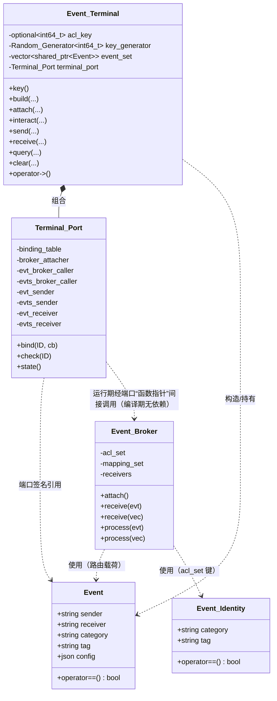
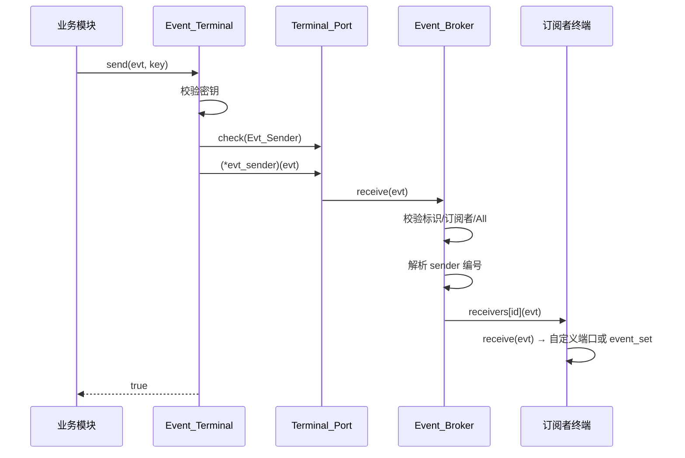
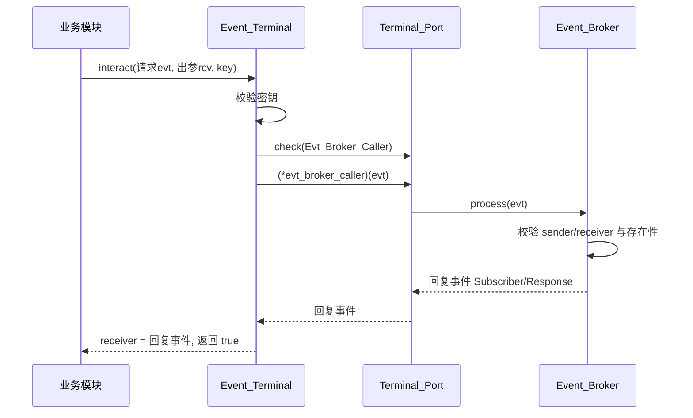

# 事件系统

> 源码根相对路径：`Engine/EngineCore/src/core/event/`
> 本文覆盖 `event/` 下的三个子部件：**事件数据结构（`Event/`）**、**事件中转器（`Event_Broker/`）**、**事件终端与终端端口（`Event_Terminal/`）**，以及聚合头文件 `事件系统运行包.h`。
> 记录依据为当前工作区源码，不含任何旧版次导航信息；本模块近期发生过一次结构性变更（事件终端**端口化**，新增 `终端端口.h`），本文以当前源码为准。

---

## 一、模块功能

### 1.1 模块定位

事件系统是 `EngineCore` `core` 层中的**模块间通信基础设施（事件总线）**。它以「发布–订阅」为基本范式，把「谁产生了事件」与「谁关心事件」在代码层面彻底解耦：事件产生方只负责把 `Event` 投递进总线，事件关心方只在启动时声明自己关心哪些「事件标识（category + tag）」，二者之间不需要互相持有头文件、指针或引用。

事件系统由三个职责单一的子部件构成，三者是**严格的分层调用关系**：

1. `Event`（`Event/事件.h`）：纯数据载体，描述「一条事件长什么样」。
2. `Event_Broker`（`Event_Broker/`）：事件中转器，即总线内核。负责订阅登记、权限表维护、事件按标识路由与广播，并内置极少量的系统级「处理契约」。
3. `Event_Terminal` + `Terminal_Port`（`Event_Terminal/`）：事件终端与终端端口。终端是「模块侧」与总线交互的**门面（Facade）**；终端端口是终端与总线之间的**函数指针契约层**，用于把终端与中转器的直接依赖反转掉（详见第 1.4 节）。

### 1.2 职责边界

| 子部件 | 负责 | 不负责 |
| --- | --- | --- |
| `Event`（结构体） | 事件字段（发起者/目标/分类/标签/配置包 JSON）的承载、等值比较、哈希支持 | 不含任何路由逻辑；不持有订阅者信息 |
| `Event_Broker` | 订阅登记（`attach`）、订阅权限表（`acl_set`）、订阅者名↔编号映射（`mapping_set`）、接收入口表（`receivers`）、事件路由/广播（`receive`）、系统级事件处理契约（`process`） | 不做权限密钥校验（密钥校验在终端）；不解释业务语义（除 `Subscriber` 契约外） |
| `Event_Terminal` | 权限密钥的生成与校验、事件对象构造、向总线接入、向总线呼叫、事件发送、事件接收、事件查阅、事件清空 | 不实现路由算法（全部经端口转调 `Event_Broker`）；不持有总线对象 |
| `Terminal_Port` | 端口（函数指针）的注册、类型分派校验、已注册端口查询 | 不实现任何业务逻辑；端口函数体由外部「接线方」注入 |

### 1.3 在整体架构中的位置

- 事件系统处于 `EngineCore/src/core/` 之下，与对象系统、空间系统、配置系统并列，属于「被多方依赖的底层横向设施」。
- **被依赖方向**：上层各系统（典型如空间系统的 `Collision_Proxy`、对象系统、渲染/应用层）通过 `Event_Terminal` 接入总线。各系统一般**不直接持有 `Event_Broker`**，而是经 `Terminal_Port` 注入的端口函数访问中转器。
- **依赖方向**：事件系统对外部依赖极少——
  - 依赖 `tools/Detail/哈希混合.h`（`engine::detail::hash_combine`，用于 `Event` 与 `Event_Identity` 的 `std::hash` 特化）；
  - 依赖 `tools/Random_Generator/随机数生成器.h`（`Random_Generator<int64_t>`，用于终端权限密钥生成）；
  - 依赖 `tools/Logging/日志系统运行包.h`（全局 `logger`，用于告警/错误输出）；
  - 依赖外部库 `nlohmann/json`（`Event::config` 的载荷类型）。
- **边界说明**：事件系统**不感知任何业务事件的具体语义**。唯一的两处「系统级语义硬编码」是：
  1. `Event_Broker::process` 识别 `category == "Subscriber"` 且 `tag ∈ {"Check","Call"}` 的查询/呼叫契约并回复 `Subscriber/Response`；
  2. `Event_Broker::receive` 保留 `tag == "All"` 作为「整类满订」通配标签，并禁止业务事件冒用该标签。
  这两处是本文第四章重点分析的「隐式约定」。

### 1.4 三者关系概述（关键）

三者的关系可以概括为「**数据结构 → 总线内核 → 门面 + 接线契约**」：

- `Event_Terminal` **不包含** `Event_Broker` 的头文件，二者在源码层面**零编译依赖**。终端与总线之间的调用全部经由 `Terminal_Port` 内 7 个函数指针端口完成。
- `Terminal_Port` 的端口是**空的（未绑定）**，需要在某处由「接线方」（通常是引擎启动/装配阶段）调用 `Terminal_Port::bind(...)` 注入具体实现。可注入的实现正是 `Event_Broker` 的成员函数（签名一一对应，见第二章 2.5 与第四章 4.7）。
- `Event_Broker` 是**无密钥的开放总线**：任何人只要拿到它的引用即可注入事件；安全边界被上移到 `Event_Terminal`（密钥校验）。因此，模块级代码只应持有 `Event_Terminal`。
- 聚合头 `事件系统运行包.h` 只引入 `Event` 与 `Event_Terminal`，**刻意不引入 `Event_Broker`**，从「头文件层面」保证业务模块拿不到总线本体。

---

## 二、模块提供接口

> 约定：
> - 除特别说明外，所有类型均位于 `namespace engine`。
> - 所有头文件均以 `#pragma once` 作为防重包含，并统一先引入预编译头 `Engine/EngineCore/common/前置头文件包含.h`。
> - 「相对路径」一律相对源码根 `d:\代码存储\代码仓库\白银纪元`。
> - 变量/函数命名为 `snake_case`（单词间 `_` 分隔、首字母小写）；类型名为 `PascalCase`（各单词首字母大写、无分隔）。

### 2.1 聚合头：`事件系统运行包.h`

相对路径：`Engine/EngineCore/src/core/event/事件系统运行包.h`

该文件是本模块的对外「打包头文件」，一次性引入事件系统对业务模块可见的全部内容：

```cpp
#pragma once
//预编译头
#include "Engine/EngineCore/common/前置头文件包含.h"
//获取事件类型
#include "Event/事件.h"
//获取事件终端类型
#include "Event_Terminal/事件终端.h"
```

| 引入项 | 是否可见 | 说明 |
| --- | --- | --- |
| `Event` | 是 | 事件数据结构 |
| `Event_Terminal` / `Terminal_Port` / `Port_ID` | 是（经 `事件终端.h` → `终端端口.h` 传递） | 终端门面与端口契约 |
| `Event_Broker` | **否**（故意） | 总线内核不暴露给业务模块 |

约束：交付给业务方时应只包含本头文件；`Event_Broker` 由装配层单独包含。

---

### 2.2 事件数据结构：`Event/事件.h`

相对路径：`Engine/EngineCore/src/core/event/Event/事件.h`

#### 2.2.1 `struct Event`

一条事件的纯粹数据载体。

字段：

| 字段 | 类型 | 默认值 | 含义 |
| --- | --- | --- | --- |
| `sender` | `std::string` | `{}`（空串） | 事件发起者名（用于「排除自身」与 `Subscriber` 契约校验） |
| `receiver` | `std::string` | `{}`（空串） | 事件目标名；非空且存在于总线时表示「定向发送」 |
| `category` | `std::string` | 无显式初始化（默认构造为空串） | 事件分类（路由主键之一） |
| `tag` | `std::string` | 无显式初始化（默认构造为空串） | 事件标签（路由主键之一） |
| `config` | `nlohmann::json` | 无显式初始化（空 JSON） | 事件配置包/载荷；任意结构化数据 |

构造函数：

| 签名 | 参数含义 | 行为 |
| --- | --- | --- |
| `Event()` | 无 | 默认构造；`sender`/`receiver` 为空串，`category`/`tag` 空串，`config` 空 JSON |
| `Event(const std::string& category, const std::string& tag)` | 仅构造「事件标识」 | 写入 `category`、`tag`；`sender`/`receiver` 保持空串 |
| `Event(const std::string& sender, const std::string& receiver, const std::string& category, const std::string& tag)` | 构造「对象标签」 | 写入 `sender`、`receiver`、`category`、`tag` |
| `Event(const std::string& sender, const std::string& receiver, const std::string& category, const std::string& tag, const nlohmann::json& config)` | 全量构造 | 写入全部五个字段 |

析构：`~Event()` 显式声明为默认体（无资源特殊处理）。

等值比较：

| 签名 | 行为 | 约束 |
| --- | --- | --- |
| `bool operator==(const Event& other) const` | 依次比较 `category`、`tag`、`receiver`、`config` 四项，全等返回 `true`，否则 `false` | **不比较 `sender`**；`config` 走 `nlohmann::json::operator==`（结构化比较） |

#### 2.2.2 `std::hash<engine::Event>` 特化

相对路径同上（在 `事件.h` 底部的 `namespace std` 中定义）。

| 签名 | 行为 | 约束 |
| --- | --- | --- |
| `size_t operator()(const engine::Event& evt) const noexcept` | 以 `std::hash<std::string>` 计算 `category`，再依次 `hash_combine` 混入 `tag`、`receiver`、以及 `config.dump()` 的字符串哈希 | 与 `operator==` 保持**一致的口径**：同样**不纳入 `sender`**；`noexcept` 标记要求内部不抛异常，但 `config.dump()` 理论上可能抛（源码注释已自陈此风险） |

> 设计要点：`operator==` 与 `hash` 均排除 `sender`，因此「两条只在 `sender` 上不同」的事件被视为同一事件。此口径在 `Event_Broker` 的容器键设计中被继承（见第四章）。

---

### 2.3 事件标识：`Event_Broker/事件中转器.h` 中的 `Event_Identity`

相对路径：`Engine/EngineCore/src/core/event/Event_Broker/事件中转器.h`

#### 2.3.1 `struct Event_Identity`

`Event` 的「路由键」投影：只保留参与订阅/路由的两个字段。

字段：

| 字段 | 类型 | 默认值 | 含义 |
| --- | --- | --- | --- |
| `category` | `std::string` | `{}` | 事件分类 |
| `tag` | `std::string` | `{}` | 事件标签 |

接口：

| 签名 | 行为 |
| --- | --- |
| `Event_Identity()` | 默认构造；两字段为空串 |
| `Event_Identity(const std::string& category, const std::string& tag)` | 带参构造 |
| `bool operator==(const Event_Identity& other) const` | 比较 `category` 与 `tag`，全等 `true` |

#### 2.3.2 `std::hash<engine::Event_Identity>` 特化

| 签名 | 行为 | 约束 |
| --- | --- | --- |
| `size_t operator()(const engine::Event_Identity& acl) const noexcept` | `hash_combine(seed, hash<string>{}(category))` 后再混入 `tag` 的哈希 | 定义位置**必须先于** `Event_Broker` 内 `unordered_map<Event_Identity,...>` 的实例化（源码注释已强调） |

---

### 2.4 事件中转器：`Event_Broker`

相对路径：`Engine/EngineCore/src/core/event/Event_Broker/事件中转器.h`（声明）、`.../core/事件中转器.cpp`（实现）

#### 2.4.1 类 `Event_Broker`

私有成员（字段说明见第三章 3.3）：

| 成员 | 类型 |
| --- | --- |
| `acl_set` | `std::unordered_map<Event_Identity, std::vector<uint64_t>>` |
| `mapping_set` | `std::unordered_map<std::string, uint64_t>` |
| `receivers` | `std::unordered_map<uint64_t, std::function<void(std::shared_ptr<Event> evt)>>` |

对外接口：

#### `void attach(const std::string& subscriber, const std::vector<Event>& needed_events, std::function<void(std::shared_ptr<Event>)> receiver)`

- **作用**：订阅者登记注册 / 重新注册 / 注销。
- 参数：

  | 参数 | 含义 |
  | --- | --- |
  | `subscriber` | 订阅者名（全局唯一键）；为空则接入失败 |
  | `needed_events` | 该订阅者关心的「事件标识」列表，元素仅取 `category` 与 `tag`（其余字段被忽略） |
  | `receiver` | 事件送达入口回调；总线在派发命中时以 `evt` 调用之 |

- 返回：`void`。
- 约束与边界行为：
  1. `subscriber` 为空 → 打印 `warn`，直接返回（**不注册**）。
  2. `subscriber` **首次**出现：若 `needed_events` 为空**且** `receiver` 为空函数 → 打印 `info`，**注册失败**（不落任何表）。
  3. `subscriber` **已存在**：若 `needed_events` 为空**且** `receiver` 为空函数 → 触发**注销**：抹除名↔编号映射、抹除接收入口、清除其在所有 `acl_set` 里的授权编号，并打印三条 `info`。否则仅**覆盖接收入口**（`receivers[id] = receiver`），随后继续登记订阅事件。
  4. 订阅事件登记时，逐条校验 `category`/`tag` 非空；不完整的条目打印 `warn` 并跳过。
  5. 同一订阅者对同一事件标识**只授权一次**（内部先查重再 `push_back`）。
- 备注：本函数**不校验密钥**（密钥校验在 `Event_Terminal`）。

#### `void receive(std::shared_ptr<Event> evt)` —— 单事件重载

- **作用**：接收并派发一条事件（广播或定向）。
- 参数：`evt` —— 待派发事件；**按值**接收 `shared_ptr`。
- 返回：`void`。
- 约束与边界行为（顺序校验）：
  1. `evt->category` 或 `evt->tag` 为空 → `warn`，丢弃。
  2. 该 `(category,tag)` 未在 `acl_set` 中注册（无任何订阅者）→ `warn`，丢弃。
  3. `evt->tag == "All"` → `warn`，丢弃（**禁止业务事件冒用保留标签**）。
  4. **定向发送分支**：若 `evt->receiver` 非空且存在于 `mapping_set` → 仅调用目标编号的 `receivers[target_ID](evt)` 后返回；**此分支不排除发起者自身**。
  5. **广播分支**：查询发起者编号（若 `sender` 存在于 `mapping_set` 则记录，否则视为「无来源」）。先向 `acl_set[{category,tag}]` 中所有编号派发，并**排除发起者自身编号**；再向 `acl_set[{category,"All"}]`（整类满订者）派发，**此满订广播不排除发起者**。
- 备注：派发前**不校验 `evt` 是否为空指针**（空指针在此重载中不做检查）。

#### `void receive(std::vector<std::shared_ptr<Event>> event_set)` —— 多事件重载

- **作用**：批量派发。
- 参数：`event_set` —— 事件列表；**按值**接收。
- 返回：`void`。
- 行为：顺序对每个元素调用单事件重载 `receive(evt)`。无额外校验。

#### `std::shared_ptr<Event> process(std::shared_ptr<Event> evt)` —— 单事件重载

- **作用**：处理「中转站交互」请求并返回回复事件（系统级契约，非纯路由）。
- 参数：`evt` —— 请求事件。
- 返回：回复事件 `shared_ptr<Event>`；无可处理内容时返回 `nullptr`。
- 约束与边界行为：
  1. `evt == nullptr` → `warn`，返回 `nullptr`。
  2. `evt->sender` 或 `evt->receiver` 为空 → `warn`，返回 `nullptr`。
  3. `evt->sender` 不在 `mapping_set` → `warn`，返回 `nullptr`。
  4. 若 `evt->category == "Subscriber"` 且 `evt->tag ∈ {"Check","Call"}`：
     - 构造回复事件 `Event("Subscriber","Response")`；
     - 注入 `config["object"] = evt->receiver`；
     - 查 `evt->receiver` 是否存在于 `mapping_set`，写入 `config["existence"]`（存在 `true` / 不存在 `false`）；
     - 若 `tag == "Call"` **且**目标存在，则把**原请求事件**转发给目标编号的接收入口 `receivers[it->second](evt)`；
     - 返回该回复事件。
  5. 其余情况（包括 `Subscriber` 的其它 tag、其它 category）→ 返回 `nullptr`。
- 注意：`process` **无中间订阅权限表参与**，它直接使用 `mapping_set`/`receivers`；`evt->config` 会被读取/写入。

#### `std::vector<std::shared_ptr<Event>> process(std::vector<std::shared_ptr<Event>> event_set)` —— 多事件重载

- **作用**：批量处理。
- 参数：`event_set` —— 请求列表；**按值**接收。
- 返回：与输入等长的回复列表（无处理结果的位置为 `nullptr`）。
- 行为：顺序对每个元素调用单事件重载 `process(evt)` 并 `push_back` 结果。

---

### 2.5 事件终端与终端端口：`Event_Terminal/`

相对路径：
- `Engine/EngineCore/src/core/event/Event_Terminal/事件终端.h`（`Event_Terminal` 声明）
- `Engine/EngineCore/src/core/event/Event_Terminal/终端端口.h`（`Port_ID` 与 `Terminal_Port` 定义）
- `Engine/EngineCore/src/core/event/Event_Terminal/core/事件终端.cpp`（`Event_Terminal` 实现）

#### 2.5.1 `enum class Port_ID`

终端端口编号，定义于 `终端端口.h`：

| 枚举值 | 含义 | 对应端口成员 | 期望回调签名（`Ret(Args...)`） |
| --- | --- | --- | --- |
| `None` | 占位/未绑定 | —— | —— |
| `Broker_Attacher` | 中转站接入 | `broker_attacher` | `void(const std::string&, const std::vector<Event>&, std::function<void(std::shared_ptr<Event>)>)` |
| `Evt_Broker_Caller` | 单事件中转站呼叫 | `evt_broker_caller` | `std::shared_ptr<Event>(std::shared_ptr<Event>)` |
| `Evts_Broker_Caller` | 多事件中转站呼叫 | `evts_broker_caller` | `std::vector<std::shared_ptr<Event>>(std::vector<std::shared_ptr<Event>>)` |
| `Evt_Sender` | 单事件发送 | `evt_sender` | `void(std::shared_ptr<Event>)` |
| `Evts_Sender` | 多事件发送 | `evts_sender` | `void(std::vector<std::shared_ptr<Event>>)` |
| `Evt_Receiver` | 单事件接收 | `evt_receiver` | `void(std::shared_ptr<Event>)` |
| `Evts_Receiver` | 多事件接收 | `evts_receiver` | `void(std::vector<std::shared_ptr<Event>>)` |

#### 2.5.2 类 `Terminal_Port`

私有类型别名：

| 别名 | 定义 |
| --- | --- |
| `Needed_Events` | `const std::vector<Event>&` |
| `template<typename T=void> Event_Handler` | `std::function<T(std::shared_ptr<Event>)>` |
| `template<typename T=void> Events_Handler` | `std::function<T(std::vector<std::shared_ptr<Event>>)>` |
| `Broker_Attacher` | `std::function<void(const std::string& name, Needed_Events events, Event_Handler<void> receiver)>` |

私有成员（字段说明见第三章 3.4）：

| 成员 | 类型 |
| --- | --- |
| `binding_table` | `std::vector<Port_ID>` |
| `broker_attacher` | `std::unique_ptr<Broker_Attacher>` |
| `evt_broker_caller` | `std::unique_ptr<Event_Handler<std::shared_ptr<Event>>>` |
| `evts_broker_caller` | `std::unique_ptr<Events_Handler<std::vector<std::shared_ptr<Event>>>>` |
| `evt_sender` | `std::unique_ptr<Event_Handler<void>>` |
| `evts_sender` | `std::unique_ptr<Events_Handler<void>>` |
| `evt_receiver` | `std::unique_ptr<Event_Handler<void>>` |
| `evts_receiver` | `std::unique_ptr<Events_Handler<void>>` |

私有辅助（`终端端口.h` 内联定义）：

| 签名 | 行为 |
| --- | --- |
| `template<typename Ret, typename... Args> bool memory_malloc(std::unique_ptr<std::function<Ret(Args...)>>& target) const` | 以 `new(std::nothrow)` 为函数包装器分配内存，返回是否成功 |
| `template<typename Ret, typename... Args> bool function_register(Port_ID ID, std::unique_ptr<std::function<Ret(Args...)>>& target, std::function<Ret(Args...)> function)` | 先 `memory_malloc`；成功则赋值函数体、把 `ID` 记入 `binding_table`，返回 `true`；失败返回 `false` |

对外开放接口：

#### `template<typename T> Terminal_Port& bind(const Port_ID& ID, T callback)`

- **作用**：把一个具体回调按「编译期类型分派」绑定到对应端口。
- 参数：

  | 参数 | 含义 |
  | --- | --- |
  | `ID` | 期望绑定的端口编号 |
  | `callback` | 任意可调用对象（lambda/函数对象/函数指针） |

- 返回：`*this`（支持链式调用 `port.bind(...).bind(...)`）。
- 分派规则（`if constexpr`，按可调用性依次判定）：
  1. 若 `callback` 可以 `(const std::string&, const std::vector<Event>&, Event_Handler<void>)` 调用且返回 `void`：要求 `ID == Broker_Attacher`，否则 `logger.error` 并驳回；通过则绑定 `broker_attacher`。
  2. 否则若可 `(std::shared_ptr<Event>)` 调用：
     - 返回 `std::shared_ptr<Event>`：要求 `ID == Evt_Broker_Caller`，否则驳回；通过则绑定 `evt_broker_caller`。
     - 返回 `void`：要求 `ID == Evt_Sender`（绑 `evt_sender`）或 `ID == Evt_Receiver`（绑 `evt_receiver`）；否则 `logger.error` 驳回。
  3. 否则若可 `(std::vector<std::shared_ptr<Event>>)` 调用：
     - 返回 `std::vector<std::shared_ptr<Event>>`：要求 `ID == Evts_Broker_Caller`，否则驳回；通过则绑 `evts_broker_caller`。
     - 返回 `void`：要求 `ID == Evts_Sender`（绑 `evts_sender`）或 `ID == Evts_Receiver`（绑 `evts_receiver`）；否则 `logger.error` 驳回。
  4. 以上皆不匹配 → **编译期断言** `static_assert(!sizeof(T), "Terminal_Port::bind: 不支持的callback类型")`。
- 约束：类型与 `ID` 必须一致，否则**运行时打印错误日志并静默驳回**（不抛异常、不中止）；不支持的 `callback` 类型在**编译期**拒绝。

#### `bool check(const Port_ID& ID) const`

- **作用**：查询某端口是否已注册。
- 参数：`ID` —— 端口编号。
- 返回：已注册 `true` / 未注册 `false`。

#### `std::vector<Port_ID> state(void) const`

- **作用**：返回已注册端口的编号列表（`binding_table` 的副本）。
- 返回：`std::vector<Port_ID>`。

#### 友元

| 声明 | 说明 |
| --- | --- |
| `friend class Event_Terminal;` | 允许 `Event_Terminal` 直接访问 `Terminal_Port` 的私有端口成员 |

#### 2.5.3 类 `Event_Terminal`

私有成员（字段说明见第三章 3.5）：

| 成员 | 类型 |
| --- | --- |
| `acl_key` | `std::optional<int64_t>` |
| `key_generator` | `Random_Generator<int64_t>` |
| `event_set` | `std::vector<std::shared_ptr<Event>>` |
| `terminal_port` | `Terminal_Port` |

构造/析构/移动：

| 签名 | 说明 |
| --- | --- |
| `Event_Terminal() = default` | 默认构造；`acl_key` 为空、端口全未绑定 |
| `~Event_Terminal() = default` | 默认析构 |
| `Event_Terminal(Event_Terminal&&) = default` | 移动构造 |
| `Event_Terminal& operator=(Event_Terminal&&) = default` | 移动赋值 |
| （拷贝被隐式删除） | 因 `Terminal_Port` 含 `unique_ptr` 成员，`Event_Terminal` 不可拷贝 |

#### `Terminal_Port* operator->(void)`

- **作用**：终端接口「快捷通道」，使 `terminal->bind(...)`、`terminal->check(...)` 直接作用于内部端口。
- 返回：指向内部 `terminal_port` 的指针。
- 约束：该重载使 `terminal->X` 转账到端口，而非终端自身成员；这是端口绑定的主要入口。

#### `std::optional<int64_t> key(void)`

- **作用**：生成并返回终端权限密钥。
- 返回：**首次**调用返回刚生成的密钥（`int64_t` 包在 `optional` 中）；**若已生成过**则返回 `nullopt`（不重复发放）。
- 约束：密钥一经生成即锁定于 `acl_key`；本类**无密钥重置/轮换接口**。

#### `std::shared_ptr<Event> build(void) const`

- **作用**：构造空事件。
- 返回：`new(std::nothrow) Event()` 包装的 `shared_ptr`（分配失败则为空 `shared_ptr`）。
- 约束：`const` 成员函数。

#### `std::shared_ptr<Event> build(const std::string& category, const std::string& tag) const`

- **作用**：构造带事件标识的事件。
- 返回：`Event(category, tag)` 的 `shared_ptr`（`nothrow`）。

#### `std::shared_ptr<Event> build(const std::string& sender, const std::string& receiver, const std::string& category, const std::string& tag) const`

- **作用**：构造带收发对象与标识的事件。
- 返回：`Event(sender, receiver, category, tag)` 的 `shared_ptr`（`nothrow`）。
- 备注：终端**不提供**「全量构造（含 config）」的 `build` 重载；`config` 需在拿到事件对象后自行填充。

#### `bool attach(const std::string& module_name, const std::vector<Event>& needed_events, const int64_t& acl_key)`

- **作用**：以 `module_name` 之名向中转站接入，声明关心的事件集。
- 参数：

  | 参数 | 含义 |
  | --- | --- |
  | `module_name` | 本终端在总线中的订阅者名（对应 `Event_Broker::attach` 的 `subscriber`） |
  | `needed_events` | 关心的事件标识列表 |
  | `acl_key` | 调用者持有的密钥，须与终端自身 `acl_key` 相等 |

- 返回：接入成功 `true` / 失败 `false`。
- 约束与边界行为：
  1. 终端自身 `acl_key` 无值（未生成密钥）→ `warn`「密钥未生成，功能已锁定」，返回 `false`。
  2. `acl_key` 与自身密钥不匹配 → 返回 `false`（**静默**，无日志）。
  3. 通过校验后：若未注册 `Evt_Receiver` 端口 → 传入一个包装 lambda（`this->receive(evt)`）给中转站；若已注册 `Evt_Receiver` → 直接传入已绑定的 `*evt_receiver`。
  4. 最终以 `(*terminal_port.broker_attacher)(module_name, needed_events, it/*或端口*/)` 转调总线。
  5. **注意**：本函数在转调前**未校验 `Broker_Attacher` 端口是否已注册**，直接解引用 `broker_attacher`（详见第四章 4.6 易错点）。

#### `bool interact(std::shared_ptr<Event> evt, std::shared_ptr<Event>& receiver, const int64_t& acl_key)`

- **作用**：向中转站发起一次「呼叫/交互」（单事件），取回回复事件。
- 参数：

  | 参数 | 含义 |
  | --- | --- |
  | `evt` | 请求事件 |
  | `receiver` | **出参（引用）**：用于接收回复事件 |
  | `acl_key` | 密钥 |

- 返回：成功 `true` / 失败 `false`。
- 约束与边界行为：
  1. 密钥未生成 → `warn`，返回 `false`。
  2. 密钥匹配时：
     - 已注册 `Evt_Broker_Caller` → `receiver = (*evt_broker_caller)(evt)`，返回 `true`；
     - 否则若已注册 `Evts_Broker_Caller` → **降级**调用多事件端口 `(*evts_broker_caller)({evt}).front()` 赋给 `receiver`，打印两条 `warn`，返回 `true`；
     - 否则 `error`，返回 `false`。
  3. 密钥不匹配 → `error`「密钥不匹配」，返回 `false`。

#### `bool interact(std::vector<std::shared_ptr<Event>> events, std::vector<std::shared_ptr<Event>> receiver, const int64_t& acl_key)`

- **作用**：批量呼叫/交互（多事件）。
- 参数：`events` 请求列表；**`receiver` 为按值传入的形参**（见下）；`acl_key` 密钥。
- 返回：成功 `true` / 失败 `false`。
- 约束与边界行为：与单事件版同构，但：
  - 已注册 `Evts_Broker_Caller` → `receiver = (*evts_broker_caller)(events)`；
  - 否则若已注册 `Evt_Broker_Caller` → 逐事件调用单事件端口并 `receiver.push_back(...)`，打印两条 `warn`，返回 `true`；
  - 否则 `error`，返回 `false`。
- **重要易错点**：`receiver` 形参是**按值拷贝**（非引用），函数内所有对 `receiver` 的写入都无法回传调用者，多事件交互的回复结果实际**丢失**（与单事件重载的 `shared_ptr<Event>&` 引用出参不一致）。详见第四章 4.6。

#### `bool send(std::shared_ptr<Event> evt, const int64_t& acl_key) const`

- **作用**：发送（投递）一条事件到总线。
- 参数：`evt` 事件；`acl_key` 密钥。
- 返回：成功 `true` / 失败 `false`。
- 约束与边界行为：
  1. 密钥未生成 → `warn`，`false`。
  2. 密钥匹配时：已注册 `Evt_Sender` → `(*evt_sender)(evt)`，`true`；否则若注册 `Evts_Sender` → 降级 `(*evts_sender)({evt})`，两条 `warn`，`true`；否则 `error`，`false`。
  3. 密钥不匹配 → `error`，`false`。

#### `bool send(std::vector<std::shared_ptr<Event>> events, const int64_t& acl_key) const`

- **作用**：批量发送。
- 参数：`events` 列表；`acl_key` 密钥。
- 返回：成功 `true` / 失败 `false`。
- 约束与边界行为：已注册 `Evts_Sender` → `(*evts_sender)(events)`，`true`；否则若注册 `Evt_Sender` → 逐事件 `(*evt_sender)(evt)`，两条 `warn`，`true`；否则 `error`，`false`；密钥未生成/不匹配同单事件版。

#### `void receive(std::shared_ptr<Event> evt)`

- **作用**：终端「原生」接收入口（亦作为接入总线时传入的送达回调）。
- 参数：`evt` 事件。
- 返回：`void`。
- 行为：
  1. 已注册 `Evt_Receiver` → `(*evt_receiver)(evt)`；
  2. 否则若注册 `Evts_Receiver` → 降级 `(*evts_receiver)({evt})`，两条 `warn`；
  3. 否则（无自定义接收端口）→ `event_set.push_back(evt)`（落入终端自有事件集合）。
- 约束：本接口**不校验密钥**（作为总线回调，由总线在授权后调用）。

#### `void receive(std::vector<std::shared_ptr<Event>> events)`

- **作用**：批量接收入口。
- 返回：`void`。
- 行为：已注册 `Evts_Receiver` → `(*evts_receiver)(events)`；否则若注册 `Evt_Receiver` → 逐事件 `(*evt_receiver)(evt)`，两条 `warn`；否则 `event_set.insert(...)` 追加。

#### `const std::vector<std::shared_ptr<Event>>* query(const int64_t& acl_key) const`

- **作用**：查阅终端自有事件集合。
- 参数：`acl_key` 密钥。
- 返回：指向内部 `event_set` 的**只读指针**；密钥未生成或密钥不匹配时返回 `nullptr`。
- 约束：返回的是**内部容器的地址**（非副本），生命周期与终端一致；`const` 成员函数。

#### `bool clear(const int64_t& acl_key)`

- **作用**：清空终端自有事件集合。
- 参数：`acl_key` 密钥。
- 返回：清空成功 `true` / 无权或密钥未生成 `false`。
- 约束：密钥未生成 → `warn` + `false`；密钥不匹配 → 静默 `false`。

---

### 2.6 局部命名空间使用头

两处 `局部命名空间使用.h`（相对路径分别为 `.../Event_Broker/局部命名空间使用.h`、`.../Event_Terminal/局部命名空间使用.h`）只做 `using` 声明，不提供任何对外接口，详见第三章 3.6。

---

## 三、模块内部架构

### 3.1 目录/文件结构树

```
Engine/EngineCore/src/core/event/
│
├── 事件系统运行包.h                      # 聚合头：引入 Event + Event_Terminal（不含 Event_Broker）
│
├── Event/
│   └── 事件.h                            # struct Event + std::hash<Event> 特化
│
├── Event_Broker/
│   ├── 事件中转器.h                      # struct Event_Identity + std::hash 特化 + class Event_Broker 声明
│   ├── 局部命名空间使用.h                # 中转器实现单元的 using 声明
│   └── core/
│       └── 事件中转器.cpp                # Event_Broker 全部成员函数实现
│
└── Event_Terminal/
    ├── 事件终端.h                        # class Event_Terminal 声明
    ├── 终端端口.h                        # enum class Port_ID + class Terminal_Port
    ├── 局部命名空间使用.h                # 终端实现单元的 using 声明
    └── core/
        └── 事件终端.cpp                  # Event_Terminal 全部成员函数实现
```

### 3.2 各编译单元职责

| 编译单元 | 职责 |
| --- | --- |
| `Event/事件.h`（纯头，无 cpp） | 定义事件数据结构 `Event`，提供 `std::hash<Event>` 以使事件可入无序容器；不产生目标代码（全部内联/模板） |
| `Event_Broker/事件中转器.h`（纯头声明 + 少量内联） | 定义路由键 `Event_Identity` 及其哈希；声明总线类 `Event_Broker` 与四个成员函数 |
| `Event_Broker/core/事件中转器.cpp` | 实现订阅登记、事件路由、系统级处理契约 |
| `Event_Terminal/终端端口.h`（纯头） | 定义端口编号 `Port_ID` 与端口容器 `Terminal_Port`（含编译期类型分派与运行期注册），全部方法内联 |
| `Event_Terminal/事件终端.h`（纯头声明） | 声明终端门面类 `Event_Terminal` 与其成员函数、成员数据 |
| `Event_Terminal/core/事件终端.cpp` | 实现密钥生成、事件构造、接入/呼叫/发送/接收/查阅/清空 |
| `事件系统运行包.h`（纯头） | 打包引入 `Event` 与 `Event_Terminal`，作为业务方唯一入口头 |

### 3.3 `Event_Broker` 内部数据结构逐字段说明

#### `acl_set`：`std::unordered_map<Event_Identity, std::vector<uint64_t>>`

「事件标识 → 授权订阅者编号列表」的权限表（Access Control List）。键是 `(category, tag)` 组合；值是所有声明关心该事件标识的订阅者编号。`receive` 派发时据此决定「广播给谁」。

- 特殊键 `(category, "All")`：表示「整分类满订」，`receive` 在广播分支额外查询该键。

#### `mapping_set`：`std::unordered_map<std::string, uint64_t>`

「订阅者名 → 订阅者编号」的反查表。用于：
- 判断某名字是否已注册；
- 把 `Event::receiver`（定向发送目标名）与 `Event::sender`（发起者名）解析成编号；
- 分配新订阅者编号。

#### `receivers`：`std::unordered_map<uint64_t, std::function<void(std::shared_ptr<Event> evt)>>`

「订阅者编号 → 事件送达回调」的入口表。总线在派发命中时调用对应回调；回调通常最终落到某终端的 `receive`。

### 3.4 `Terminal_Port` 内部数据结构逐字段说明

- `binding_table`：`std::vector<Port_ID>`，记录**已成功注册**的端口编号，供 `check`/`state` 查询。注意：同一 `Port_ID` 若重复注册会被**重复入表**（`function_register` 不查重）。
- `broker_attacher`：接入端口函数对象；由外部 `bind(Port_ID::Broker_Attacher, ...)` 注入，语义对应 `Event_Broker::attach`。
- `evt_broker_caller`：单事件呼叫端口；对应 `Event_Broker::process(shared_ptr<Event>)`，返回回复事件。
- `evts_broker_caller`：多事件呼叫端口；对应 `Event_Broker::process(vector<shared_ptr<Event>>)`。
- `evt_sender`：单事件发送端口；对应 `Event_Broker::receive(shared_ptr<Event>)`。
- `evts_sender`：多事件发送端口；对应 `Event_Broker::receive(vector<shared_ptr<Event>>)`。
- `evt_receiver` / `evts_receiver`：调用方自定义的「送达回调」端口；若不注册，则终端使用自带 `event_set` 兜底。

> 全部端口用 `std::unique_ptr` 持有：未绑定时为 `nullptr`，`check` 依赖 `binding_table` 判定，`Event_Terminal` 在解引用前一般会先 `check`（`attach` 例外，见 4.6）。

### 3.5 `Event_Terminal` 内部数据结构逐字段说明

- `acl_key`：`std::optional<int64_t>`，终端权限密钥。空表示「未生成」，此时所有需密钥的接口被锁定；一旦生成即固定，无重置接口。
- `key_generator`：`Random_Generator<int64_t>`，密钥来源。默认构造（时间/计数器混合种子）；`key()` 调用其 `operator()` 生成全范围 `int64_t`。
- `event_set`：`std::vector<std::shared_ptr<Event>>`，终端**原生接收缓冲**。当没有绑定任何 `*_Receiver` 端口时，总线送达的事件落入此集合，供 `query`/`clear` 使用。
- `terminal_port`：`Terminal_Port`，端口容器，承载与总线的全部接线。

### 3.6 `局部命名空间使用.h` 的做法

两个实现单元各有一份 `局部命名空间使用.h`，遵循「`using` 声明集中前置、实现文件正文不再写命名空间前缀」的工程约定：

`Event_Broker/局部命名空间使用.h`：

```cpp
#pragma once
#include "事件中转器.h"

// ---------- 基础类型 ----------
using std::string;

// ---------- 容器 ----------
using std::unordered_map;
using std::vector;
using std::optional;
using std::nullopt;

// ---------- 智能指针 ----------
using std::shared_ptr;
using std::nothrow;

// ---------- 函数对象 ----------
using std::function;
```

`Event_Terminal/局部命名空间使用.h`：

```cpp
#pragma once
#include "终端端口.h"
#include "事件终端.h"

// ---------- 基本类型 ---------
using std::string;
using std::optional;
using std::nullopt;

// ---------- 容器 ----------
using std::vector;

// ---------- 智能指针 ----------
using std::nothrow;
using std::unique_ptr;
using std::shared_ptr;

// ---------- 函数包装器 ----------
using std::function;
```

要点：
- 头文件内部**不做** `using` 污染（避免向包含者泄漏 `using` 声明），只在 `.cpp` 实现单元前置一次性声明；
- `事件中转器.cpp` 首行 `#include "../局部命名空间使用.h"`，因此其函数签名写成 `void Event_Broker::attach(const string&, ...)` 而非 `std::string`；
- 注意 `事件中转器.cpp` 的 `attach` 实现中形参名为 `subscriber`/`needed_events`/`receiver`，与头文件声明一致；`optional`/`nullopt` 仅在 `.cpp` 的 `receive` 内使用。
- 该约定同时服务于「函数排列风格约束」——把跨文件重复的类型前置收敛到一处。

### 3.7 类关系图



> 关键：`Terminal_Port → Event_Broker` 是**运行期间接依赖**（靠外部注入的函数指针），源码层面二者**无 `#include` 关系**。

---

## 四、模块设计/实现细节

### 4.1 分层与「依赖反转」设计意图

事件系统刻意把「总线内核」与「模块门面」拆开，并用 `Terminal_Port` 作为中间契约：

- 若 `Event_Terminal` 直接 `#include Event_Broker`，则任何业务模块只要拿到终端，就同时能拿到总线类型，安全边界（密钥）形同虚设，且头文件依赖会把总线类型扩散到全工程。
- 把「接入/呼叫/发送/接收」抽象成 7 个函数指针端口后，`Event_Terminal` 只依赖端口契约；总线实现由装配层通过 `bind` 注入。这样：
  1. 业务模块编译期**看不到** `Event_Broker`；
  2. `Terminal_Port` 可被替换/打桩（测试或多种总线实现）；
  3. `Event_Terminal` 与 `Event_Broker` 可独立编译。

### 4.2 权限密钥（`acl_key`）机制

- 每个 `Event_Terminal` 持有独立密钥，由 `key()` 生成并返回。
- `key()` 是**一次性发放语义**：首次返回密钥，二次调用返回 `nullopt`。这样密钥只在「生成它的那次调用点」被知晓，终端不再重复外泄。
- `attach`/`interact`/`send`/`query`/`clear` 全部要求传入等于 `this->acl_key` 的 `acl_key`；密钥未生成时统一锁定（`warn` + 失败），密钥不匹配时失败。
- `receive` 是**唯一不校验密钥**的接口：它本身就是「总线已授权后回呼」的入口。
- 由于没有重置接口，密钥一旦丢失（返回的 `nullopt` 被丢弃）将无法再获取；这是刻意的安全取向而非疏漏。

### 4.3 订阅者编号分配与「编号复用」风险（核心易错点）

`Event_Broker::attach` 分配新编号的方式是 `subscriber_ID = mapping_set.size()`。这在「只增不减」时安全，但注销会 `mapping_set.erase(subscriber)` 使 `size` 回退，从而引入**编号复用/碰撞**：

- 设先后以名字 `A`、`B` 注册，得编号 `0`、`1`。
- 注销 `A` 后 `mapping_set.size() == 1`。
- 再以名字 `C` 注册，将得到 `subscriber_ID = 1`，与既存的 `B` **同一编号**。
- 随后 `mapping_set.insert({C, 1})` 成功（键是名字，不冲突），但 `receivers.insert({1, receiver})` **因键 1 已存在而静默失败**——`C` 的回调被丢弃，`C` 实际会命中 `B` 的回调；同时 `C` 在 `acl_set` 中登记的授权编号也是 `1`，与 `B` 混淆。

即：**编号分配未使用「单调递增计数器」或空闲编号回收，而是用容器规模充当编号**，注销后存在编号碰撞与回调错绑的隐患。【待确认】该编号分配策略是否为预期取舍，抑或应改为独立自增计数器以彻底避免复用（详见碎片文件 EVENT-01）。

### 4.4 路由规则与「发起者排除 / 满订广播」取舍

`receive` 的广播分支中：

- 常规订阅者（`acl_set[{category,tag}]`）：派发时会**排除事件发起者自身编号**，避免模块自己发的事件回灌给自己。
- 满订订阅者（`acl_set[{category,"All"}]`）：派发时**不排除发起者**，只要关心该分类（`"All"`）就会收到，包括发起者自己。

`"All"` 作为保留通配标签的语义是「订阅某分类下的全部事件」。总线在 `receive` 中显式拒绝 `evt->tag == "All"` 的**业务事件**进入总线路由，防止与保留标签冲突。这属于**隐式协议**：业务侧必须知晓「tag 不能取 `All`」。

> 该保留字与「发起者排除规则在两类订阅上的不一致」是否为有意设计，属设计意图层面，【待确认】记入碎片 EVENT-05 的关联条目（详见 4.10）。

### 4.5 定向发送与广播的优先级

`receive` 在通过前置校验后，**优先判定定向**：只要 `evt->receiver` 非空且命中 `mapping_set`，就只发给该目标并直接返回，**不**再走广播。这意味着：

- 定向发送**不会**触发满订广播；
- 定向发送**不排除发起者**（发起者可给自己定向发送）；
- 若 `receiver` 非空但**未命中** `mapping_set`，则**回落**为广播（按常规规则发给订阅者）。

### 4.6 终端的「降级策略」与三处易错点

#### 4.6.1 单/多事件端口互为降级

终端的 `interact`/`send`/`receive` 在所需端口未注册时，会尝试用「另一粒度」的端口降级接管（如多事件接口拆成逐条单事件，或单事件接口包成单元素向量），并打印两条 `warn`。设计意图是**提高接线容错**：调用方只需绑定一对粒度中任意一个，功能即可工作。代价是性能（多次转调）与语义细微差异。

#### 4.6.2 `interact` 多事件重载的 `receiver` 按值传参（易错点）

单事件重载用 `std::shared_ptr<Event>& receiver`（引用出参）回传回复；**多事件重载却用 `std::vector<std::shared_ptr<Event>> receiver`（按值）**，函数体的 `receiver = ...` / `receiver.push_back(...)` 全部写在一个**局部副本**上，调用者拿不到任何回复结果。二者签名不一致、行为不对称，实际使多事件交互的「取回回复」能力失效。【待确认】多事件版本的 `receiver` 是否应改为引用（详见碎片 EVENT-02）。

#### 4.6.3 `attach` 未校验 `Broker_Attacher` 端口即解引用

`Event_Terminal::attach` 只校验了 `Evt_Receiver` 端口，随后直接 `(*terminal_port.broker_attacher)(...)`。若装配层**未**先 `bind(Port_ID::Broker_Attacher, ...)`，`broker_attacher` 是空 `unique_ptr`，解引用指针为空 → 未定义行为（通常崩溃）。相比之下 `interact`/`send` 都在解引用前 `check` 了对应端口。此处缺少 `check(Broker_Attacher)` 属实现疏漏。【待确认】未绑定接入端口时的预期行为是「拒绝并告警」还是「可容忍」详见碎片 EVENT-03。

### 4.7 端口与总线成员函数的签名对应（接线契约）

装配层把 `Event_Broker` 成员函数注入 `Terminal_Port` 端口时，签名一一对应：

| 端口 | 端口期望签名 | 可注入的 `Event_Broker` 成员 | 适配 |
| --- | --- | --- | --- |
| `Broker_Attacher` | `void(const std::string&, const std::vector<Event>&, std::function<void(shared_ptr<Event>)>)` | `attach(const std::string&, const std::vector<Event>&, std::function<void(shared_ptr<Event>)>)` | 直接匹配 |
| `Evt_Broker_Caller` | `shared_ptr<Event>(shared_ptr<Event>)` | `process(shared_ptr<Event>)` | 直接匹配 |
| `Evts_Broker_Caller` | `vector<shared_ptr<Event>>(vector<shared_ptr<Event>>)` | `process(vector<shared_ptr<Event>>)` | 直接匹配 |
| `Evt_Sender` | `void(shared_ptr<Event>)` | `receive(shared_ptr<Event>)` | 直接匹配 |
| `Evts_Sender` | `void(vector<shared_ptr<Event>>)` | `receive(vector<shared_ptr<Event>>)` | 直接匹配 |
| `Evt_Receiver` / `Evts_Receiver` | `void(shared_ptr<Event>)` / `void(vector<...>)` | （非总线接口；由业务方自定义送达处理） | 业务注入 |

> 即：**「事件发送」在总线上就是 `receive`，「中转站呼叫」就是 `process`，「中转站接入」就是 `attach`**。终端侧的命名（send/interact/attach）与总线侧命名（receive/process/attach）刻意不同，前者是「模块视角」，后者是「总线视角」。

### 4.8 系统级处理契约 `Subscriber/Check|Call` → `Subscriber/Response`

`Event_Broker::process` 内置一条「存在性查询/呼叫」协议，回应「某订阅者是否存在」：

- 请求：`category == "Subscriber"`，`tag ∈ {"Check","Call"}`，`sender` 必须已在总线注册。
- 回复：新建 `Event("Subscriber","Response")`，`config["object"] = 请求的 receiver`，`config["existence"] = 目标是否存在`。
- 副作用：当 `tag == "Call"` 且目标存在时，把**原请求事件**转发给目标（即「呼叫」语义）。

这是本模块唯一的业务化「硬编码字符串契约」。其风险在于：`"Subscriber"`、`"Check"`、`"Call"`、`"Response"`、`"All"`、`config["object"]`、`config["existence"]` 等字符串**散落硬编码**，未被集中常量化，修改成本高且易错。【待确认】是否应把这些保留标识集中为常量/枚举（见碎片 EVENT-06）。

### 4.9 内存所有权与异常约定

- 事件对象一律经 `shared_ptr<Event>` 传递，所有权共享；`Event_Broker::receivers` 与 `Event_Terminal::event_set` 均以 `shared_ptr` 持有。
- 所有 `new` 均使用 `new(std::nothrow)`（终端的 `build`/`interact`、端口的 `memory_malloc`、总线的 `process` 构造回复事件处）。**全面禁用异常**，分配失败以空指针/`false` 表达。
- `Event_Terminal::build` 若 `nothrow` 分配失败将返回空 `shared_ptr`，调用方需自行判空；`Event_Broker::process` 对空 `evt` 会 `warn` 并返回 `nullptr`，但 `receive` **不**判空。
- `query` 返回内部容器地址而非副本，属「零拷贝查阅」取舍，但暴露了内部存储的生命周期依赖。

### 4.10 其它一致性观察（易错点汇总）

1. **`Event` 等值与哈希均排除 `sender`**：`operator==` 比 `category/tag/receiver/config`，`std::hash` 亦不含 `sender`。二者口径一致（这是正确实现哈希的必要条件），但语义上「两条仅发起者不同的事件判为同一事件」，是否预期需确认。【待确认】记入碎片 EVENT-04。
2. **`Event::operator==` 与 `std::hash<Event>` 的一致性依赖 `config.dump()`**：`dump()` 在 `noexcept` 哈希函数中被调用，若 `config` 含无法序列化的值理论上会抛出并 `std::terminate`；源码注释已自陈该假设。
3. **`binding_table` 不去重**：重复 `bind` 同一 `Port_ID` 会重复入表，`state()` 会返回重复项（`check` 不受影响）。
4. **头文件大小写**：`Event_Broker/事件中转器.h` 用 `#include "../event/事件.h"`（小写 `event`），而实际目录名为 `Event`。Windows 文件系统大小写不敏感故可解析，但属于跨平台移植隐患（Linux/macOS 区分大小写会编译失败）。【待确认】是否需统一为 `../Event/事件.h`（见碎片 EVENT-07）。
5. **两个实现单元各含一份同名 `局部命名空间使用.h`**：因二者目录不同，不会冲突，但同名文件在 IDE 全局搜索时易混淆。

### 4.11 线程/并发约定（无锁）

整个事件系统**不含任何同步原语**（无 `mutex`/`atomic`）：
- `Event_Broker` 的三张无序表在 `receive`/`attach` 中被读写，`Event_Terminal` 的端口表与 `event_set` 亦然。
- 因此约定为：**事件系统的接入、发送、接收必须在同一线程（或由调用方自行串行化）**。跨线程共享同一终端/总线需外部加锁。这是「保持内核轻量」的取舍，源码未提供保护。

### 4.12 编码约定

- 文件编码：UTF-8（含中文文件名、中文注释）。
- 类型命名 `PascalCase`（`Event_Broker`、`Terminal_Port`、`Event_Terminal`、`Event_Identity`、`Port_ID`）；函数/变量 `snake_case`（`needed_events`、`acl_key`、`binding_table`）。
- 注释采用换行注释、及时说明条件与变量用途；函数头注释翻译函数名（如「中转站接入」「事件接收 —— 单事件重载」）。
- 大括号独占行；单语句 `if`/`for` 不加大括号（但嵌套时外层加块）——可在 `事件中转器.cpp`、`事件终端.cpp` 中见到若干单语句无块写法。

---

## 五、模块运行链路

> 变量说明：下文用 `T` 表示某业务模块持有的 `Event_Terminal`，`B` 表示 `Event_Broker`，`P` 表示 `T.terminal_port`。装配阶段已完成 `P.bind(...)` 注入（见链路 0）。

### 链路 0：装配接线（启动阶段，一次性）

1. 引擎创建全局 `Event_Broker B`（或以单例形式持有）。
2. 为每个业务模块创建 `Event_Terminal T`。
3. 调用 `T->bind(...)` 把 `B` 的成员函数注入 `P` 的端口：
   - `T->bind(Port_ID::Broker_Attacher, [&B](const std::string& n, const std::vector<Event>& e, std::function<void(std::shared_ptr<Event>)> r){ B.attach(n,e,r); })`
   - `T->bind(Port_ID::Evt_Sender, [&B](std::shared_ptr<Event> e){ B.receive(e); })`
   - `T->bind(Port_ID::Evts_Sender, [&B](std::vector<std::shared_ptr<Event>> v){ B.receive(v); })`
   - `T->bind(Port_ID::Evt_Broker_Caller, [&B](std::shared_ptr<Event> e){ return B.process(e); })`
   - `T->bind(Port_ID::Evts_Broker_Caller, [&B](std::vector<std::shared_ptr<Event>> v){ return B.process(v); })`
   - （可选）`T->bind(Port_ID::Evt_Receiver, ...)` / `Evts_Receiver` 注入业务自定义送达处理。
4. 业务模块调用 `T.key()` 取得密钥并自行保管（首次且唯一一次）。

### 链路 1（主流程）：模块接入总线

1. `T.attach("模块名", needed_events, key)`。
2. 终端校验 `T.acl_key` 是否有值：无 → `warn`「密钥未生成」并返回 `false`。
3. 校验传入 `key` 是否等于 `T.acl_key`：不等 → 返回 `false`。
4. 终端检查 `Evt_Receiver` 端口是否已注册：
   - 未注册 → 构造 lambda `it = [this](evt){ this->receive(evt); }`，作为送达回调；
   - 已注册 → 直接取 `*P.evt_receiver` 作为送达回调。
5. 终端调用接入端口：`(*P.broker_attacher)("模块名", needed_events, 回调)`。
6. **转入总线** `B.attach(...)`：
   1. 名字为空 → `warn` 返回。
   2. 首次注册：`needed_events` 与回调皆空 → `info` 失败返回；否则 `subscriber_ID = mapping_set.size()`，写 `mapping_set`、`receivers`。
   3. 已注册：皆空 → 执行**注销**（清映射、清接收入口、清全部 ACL 授权）后返回；否则覆盖 `receivers[id]`。
   4. 逐条登记 `needed_events`：`category`/`tag` 空则 `warn` 跳过；否则向 `acl_set[{category,tag}]` 追加编号（去重）。
7. 终端返回 `true`。

异常分支：密钥未生成（步骤 2）、密钥不匹配（步骤 3）、`needed_events` 与回调双空（步骤 6.2）、事件标识不完整（步骤 6.4 跳过该条）。

### 链路 2（主流程）：事件广播

1. 业务模块经 `build(...)` 构造事件，填好 `category`/`tag`（可选 `config`；`sender` 建议填模块名；广播场景 `receiver` 留空）。
2. `T.send(evt, key)`：
   1. 密钥未生成 → `warn` 返回 `false`。
   2. 密钥不匹配 → `error` 返回 `false`。
   3. 已注册 `Evt_Sender` → `(*P.evt_sender)(evt)`；否则若注册 `Evts_Sender` → 降级 `(*P.evts_sender)({evt})`（两条 `warn`）；否则 `error` 返回 `false`。
   4. 返回 `true`。
3. **转入总线** `B.receive(evt)`：
   1. `category`/`tag` 空 → `warn` 丢弃。
   2. `(category,tag)` 无任何订阅者 → `warn` 丢弃。
   3. `tag == "All"` → `warn` 丢弃。
   4. `receiver` 非空且命中 → 定向发给该目标后返回（见链路 3）。
   5. 解析 `sender` 编号。
   6. 向 `acl_set[{category,tag}]` 逐个派发，**跳过 `sender` 自身**。
   7. 向 `acl_set[{category,"All"}]` 逐个派发（含 `sender`）。
4. 每个命中订阅者的 `receivers[id](evt)` 被调用；该回调即链路 1 步骤 4 注入的送达回调。
5. **回落到接收终端** `T.receive(evt)`：
   - 注册 `Evt_Receiver` → `(*P.evt_receiver)(evt)`；
   - 否则注册 `Evts_Receiver` → 降级 `(*P.evts_receiver)({evt})`（两条 `warn`）；
   - 否则 `T.event_set.push_back(evt)`。

### 链路 3（分支）：定向发送

与链路 2 相同，直到总线 `receive` 的步骤 4 命中 `evt->receiver`：此时只调用 `receivers[target_ID](evt)` 并**直接返回**——不触发常规订阅者、也不触发 `All` 满订广播。

### 链路 4（分支）：整类满订广播（`All`）

订阅方在 `attach` 时以 `needed_events` 中包含 `(某分类, "All")` 声明满订。此后任何该分类下的事件（未被定向分支截获时）都会额外派发给满订者；满订者**不会**被排除发起者。

### 链路 5（主流程）：中转站交互/呼叫（存在性查询）

1. 业务模块构造请求：`category="Subscriber"`，`tag="Check"`（只查询）或 `"Call"`（查询并呼叫），`sender` 必须为已注册名，`receiver` 为目标名。
2. `T.interact(evt, 出参receiver, key)`：
   1. 密钥未生成 → `warn` 返回 `false`。
   2. 密钥匹配：已注册 `Evt_Broker_Caller` → `receiver = (*P.evt_broker_caller)(evt)`，`true`；否则若注册 `Evts_Broker_Caller` → 降级 `(*P.evts_broker_caller)({evt}).front()`，两条 `warn`，`true`；否则 `error` 返回 `false`。
   3. 密钥不匹配 → `error` 返回 `false`。
3. **转入总线** `B.process(evt)`：
   1. `evt` 为空 → `warn` 返回 `nullptr`。
   2. `sender`/`receiver` 空 → `warn` 返回 `nullptr`。
   3. `sender` 未注册 → `warn` 返回 `nullptr`。
   4. 命中 `Subscriber/Check|Call`：
      - 新建 `Event("Subscriber","Response")`；
      - `config["object"] = evt->receiver`；
      - 查 `receiver` 是否存在，写 `config["existence"]`；
      - 若 `Call` 且目标存在 → `receivers[target_ID](evt)`（把请求转发给目标）；
      - 返回该回复事件。
   5. 其余 → 返回 `nullptr`。
4. 调用方（单事件重载）在出参 `receiver` 中得到回复事件，读 `config["existence"]` 判定目标存在性。

> 注意：多事件重载 `interact` 的第 2 步即使走到端口调用，其结果也因 `receiver` **按值传参**而无法回传（见 4.6.2）。

### 链路 6（主流程）：事件接收与查阅

1. 业务模块未注册任何 `*_Receiver` 端口时，总线送达的事件由 `T.receive` 落入 `T.event_set`。
2. 业务模块定时 `T.query(key)` 取回 `event_set` 只读指针进行消费；密钥不符返回 `nullptr`。
3. 消费完毕调用 `T.clear(key)` 清空；密钥不符返回 `false`。

### 链路 7（主流程）：注销（下线）

1. 业务模块以**同一名字**再次调用 `T.attach(名, {}, 空函数, key)`（`needed_events` 空且回调为空）。
2. 总线 `attach` 走「已存在 + 双空」分支：`mapping_set.erase(名)`、`receivers.erase(id)`、遍历 `acl_set` 清除该编号的全部授权，打印注销日志。
3. 此后该名字不再收到任何事件；后续同名字再注册视为「首次注册」。

### 关键异常/边界分支汇总

| 触发条件 | 发生位置 | 行为 |
| --- | --- | --- |
| 订阅者名为空 | `Event_Broker::attach` | `warn`，不注册 |
| `needed_events` 与回调双空（首次） | `Event_Broker::attach` | `info`，注册失败 |
| `needed_events` 与回调双空（已存在） | `Event_Broker::attach` | 执行注销 |
| 事件标识不完整 | `attach` / `receive` | `warn`，跳过/丢弃 |
| 事件无订阅者 | `Event_Broker::receive` | `warn`，丢弃 |
| `tag == "All"` 的业务事件 | `Event_Broker::receive` | `warn`，丢弃 |
| `evt` 为空指针 | `Event_Broker::receive` | **无判空**（潜在解引用风险）；`process` 则 `warn` 返回 `nullptr` |
| 密钥未生成 | 终端各接口 | `warn` + 失败 |
| 密钥不匹配 | `attach`/`clear` 静默失败；`interact`/`send` `error` 失败 | 失败 |
| 所需端口未注册 | 终端 `interact`/`send` | `error`，返回 `false`（`receive` 则回落 `event_set`） |
| `Broker_Attacher` 端口未注册 | `Event_Terminal::attach` | **未 `check` 即解引用空 `unique_ptr`**（潜在崩溃） |
| 不支持的 `callback` 类型 | `Terminal_Port::bind` | 编译期 `static_assert` 拒绝 |
| 端口 `ID` 与 `callback` 类型不符 | `Terminal_Port::bind` | `error` 日志，静默驳回 |

### 端到端时序（广播为例）





---

## 附：本文涉及的全部源码文件清单（相对源码根）

| 相对路径 | 角色 |
| --- | --- |
| `Engine/EngineCore/src/core/event/事件系统运行包.h` | 聚合头 |
| `Engine/EngineCore/src/core/event/Event/事件.h` | 事件数据结构 + 哈希特化 |
| `Engine/EngineCore/src/core/event/Event_Broker/事件中转器.h` | 事件标识 + 总线声明 |
| `Engine/EngineCore/src/core/event/Event_Broker/局部命名空间使用.h` | 中转器 using 声明 |
| `Engine/EngineCore/src/core/event/Event_Broker/core/事件中转器.cpp` | 总线实现 |
| `Engine/EngineCore/src/core/event/Event_Terminal/事件终端.h` | 终端声明 |
| `Engine/EngineCore/src/core/event/Event_Terminal/终端端口.h` | `Port_ID` + `Terminal_Port` |
| `Engine/EngineCore/src/core/event/Event_Terminal/局部命名空间使用.h` | 终端 using 声明 |
| `Engine/EngineCore/src/core/event/Event_Terminal/core/事件终端.cpp` | 终端实现 |