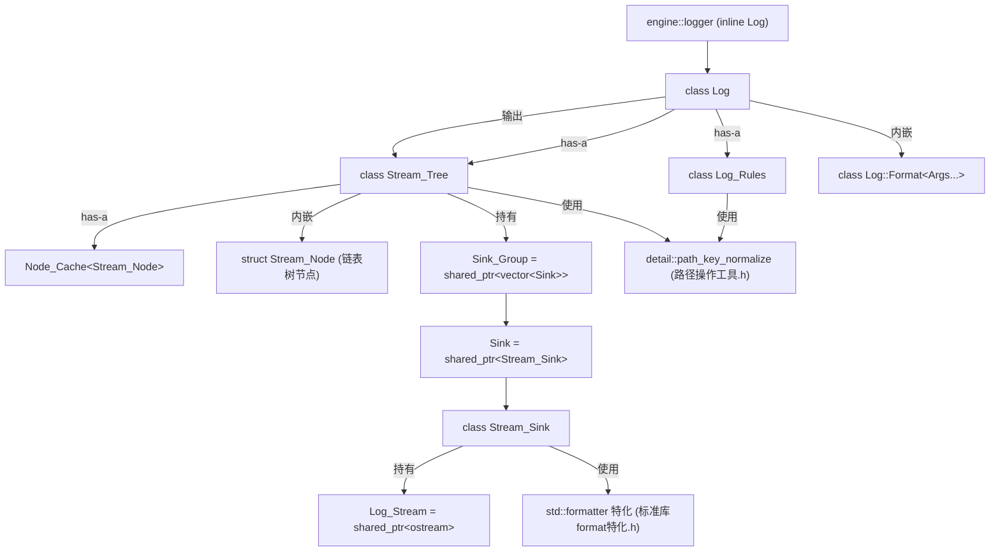
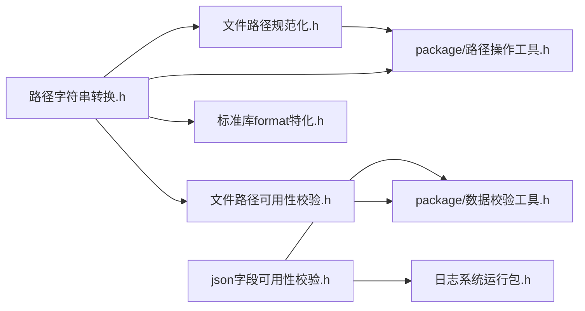

# 工具集

> 模块路径（相对源码根）：`Engine/EngineCore/src/tools/`
> 本模块为 EngineCore 的**底层通用工具集合**，向同层其它模块（core/config、core/event、core/object、core/spatial、渲染层、系统层）提供无业务属性的基础能力。
> 本文件为纯技术文档，不修改任何源码；引用的文件一律使用相对源码根的相对路径。

---

## 一、模块功能

### 1.1 模块定位

「工具集」是 EngineCore 内部的**基础设施层（infrastructure / toolkit）**。它不承载任何业务语义，而是把引擎各处反复需要的通用能力——日志输出、路径与字符串转换、路径规范化与校验、JSON 字段校验、二分查找、哈希混合、随机数、计时、数值分配、网格文件读取、可执行文件环境探测——收拢到同一目录，并对上层以「头文件即接口」的形态暴露。

其核心特征如下：

- **零业务依赖**：除 `Engine/EngineCore/common/前置头文件包含.h`（公共预编译头）外，工具集几乎不依赖同层其它模块；唯一的上行引用方向是「其它模块 → 工具集」，因此本模块位于依赖图的**最底层**，可被任意模块安全包含而不产生环形依赖。
- **头文件为主**：绝大多数能力以 `inline` 函数 / 函数模板 / 类模板形式实现于 `.h`，编译期展开，无独立编译单元；仅 `Mesh_Loader` 与 `Timer` 提供 `.cpp` 编译单元（含非模板实现）。
- **运行包（Runtime Package）形态**：日志子系统并非单一类，而是由「门面 `Log` + 全局实例 `logger` + 规则 `Log_Rules` + 流节点树 `Stream_Tree` + 输出目标 `Stream_Sink` + 节点缓存 `Node_Cache`」组成的**多类协作运行包**，由 `日志系统运行包.h` 统一对外提供 `engine::logger` 全局实例。
- **无异常哲学**：工具集在内存分配处全面禁用异常（统一使用 `std::nothrow`），失败以返回 `false` / 空值 / 回退通道表达；但 `Engine_Env` 与 `Mesh_Loader` 在**平台 API 调用与字符串数值转换**处仍保留 `try/catch`（见第四章）。

### 1.2 职责边界

| 归属 | 职责 |
| --- | --- |
| **属于本模块** | 通用算法（二分查找、哈希混合、随机数、数值分配）、通用文本/路径工具（编码转换、规范化、可用性校验、format 特化）、日志运行包、可执行环境与逻辑帧计数（`Engine_Env`）、OBJ 网格解析（`Mesh_Loader`）、计时任务（`Timer`） |
| **不属于本模块** | 具体业务的配置解析策略（在 core/config）、事件派发（core/event）、对象生命周期管理（core/object）、空间查询（core/spatial）、渲染命令与设备（渲染层）、平台窗口/输入（系统层） |

本模块对上层只提供能力、不提供状态机：除 `logger`（日志全局实例）、`Engine_Env`（进程级静态环境）与用户自建的 `Timer` / `Number_Allocator` / `Random_Generator` 实例外，工具集不持有任何跨帧业务状态。

### 1.3 解决的问题

1. **日志无处可去的痛点**：引擎输出既要落文件、又要落控制台，还要能按「调用处所在文件/目录」选择性输出。工具集用「调用处路径 → 前缀树节点 → 输出目标」的机制一并解决分区、分级、越界与兜底四件事。
2. **中文路径在 C++ 中的编码地狱**：Windows 上 `std::filesystem::path` 默认按本地编码解释，含中文相对路径会失真。工具集提供 `path_to_string` / `string_to_path` 以 UTF-8 字节在 `std::string` 与 `path` 间往返，并提供 `std::formatter<std::filesystem::path>` 使日志可直接 `{}` 打印路径。
3. **路径可比可哈希**：`path_normalize` 与 `path_key_normalize` 把任意写法的路径统一为「项目内相对路径 + 统一 `/` 分隔 + 末尾补 `/`」的**路径键**，使目录节点与文件节点共用同一套前缀比较，也是日志前缀树与规则匹配的基础。
4. **常用小算法的落地**：二分查找返回**下标**而非迭代器（便于业务侧直接索引数组），哈希混合用于把多字段合成一个哈希种子，PCG32 随机数用于可复现实验种子。
5. **跨平台可执行路径探测**：`Engine_Env` 在 Windows/Linux/macOS 三平台统一给出可执行文件路径与目录，并作为相对资源路径的解析基准。

### 1.4 在整体架构中的位置

```
                      ┌───────────────────────────────┐
   上层业务      配置系统  事件系统  对象系统  空间系统  渲染层  系统层
                      └───────────────┬───────────────┘
                                      │ 依赖（只读下行）
                      ┌───────────────▼───────────────┐
   ★本次模块           │           工具集 tools          │
                      │  Detail / Logging / Engine_Env │
                      │  Mesh_Loader / Number_Allocator│
                      │  Random_Generator / Timer      │
                      └───────────────┬───────────────┘
                                      │
                      ┌───────────────▼───────────────┐
                      │  common/前置头文件包含.h（PCH） │
                      │  external/nlohmann-json        │
                      └───────────────────────────────┘
```

- **下行**：本模块依赖公共预编译头（`Engine/EngineCore/common/前置头文件包含.h`）与外部库 `nlohmann/json`（仅 `json字段可用性校验.h` 引入）。
- **上行**：所有同层模块与上层模块均可包含本模块头文件；本模块的 `logger` 被几乎所有模块直接使用（如 `logger.warn(...)`）。
- **横向**：`Detail` 是其余子模块的公共地板——`Logging` 用到 `标准库format特化.h`、`路径操作工具.h`；`Mesh_Loader` 用到 `数据校验工具.h`、`Engine_Env`、`路径字符串转换.h`。因此 `Detail` 内部又分为「叶子头」与「package 聚合头」两层。

### 1.5 子模块清单

| 子目录/文件 | 形态 | 对外主要产出 |
| --- | --- | --- |
| `Detail/` | 纯头文件 | `engine::detail` 命名空间下的通用算法与路径/JSON 工具，以及 `std::formatter` 特化 |
| `Engine_Env/引擎环境.h` | 纯头文件 | 类 `Engine_Env`（静态门面：可执行路径 / 逻辑帧率 / 逻辑帧计数） |
| `Logging/` | 多类头文件运行包 | 全局 `engine::logger`，类 `Log`、`Log_Rules`、`Stream_Tree`、`Stream_Sink`、`Node_Cache<Node>` |
| `Mesh_Loader/` | 头 + cpp | 结构 `Mesh_Data`、类 `Mesh_Loader`（OBJ 文本网格加载） |
| `Number_Allocator/数值分配器.h` | 纯头文件模板 | 类模板 `Number_Allocator<T>`、枚举 `Allocate_Order` |
| `Random_Generator/随机数生成器.h` | 纯头文件模板 | 类模板 `Random_Generator<T>`（PCG32） |
| `Timer/` | 头 + cpp | 类 `Timer`，别名 `Clock`/`TimePoint`/`Duration` |

### 1.6 与相邻模块的职责分界

- 与 **core/config**：配置模块负责「读配置、管配置内容」；工具集只提供 `field_check<T>`（JSON 字段存在性/类型/非空校验）与 `path_check`（路径可读性校验）这类**无状态判定原语**，不做任何配置结构定义。
- 与 **core/object**：对象模块负责对象生命周期与编号管理；工具集提供 `Number_Allocator<T>` 这一**通用数值分配原语**（含回收/回绕策略），对象模块可复用但工具集不感知对象语义。
- 与 **core/event**：事件模块负责派发；工具集的二分查找/哈希混合是其可能的底层算法支撑，但工具集不含任何事件概念。
- 与 **渲染层/系统层**：渲染与系统层通过 `logger` 输出调试信息、通过 `Engine_Env::absolute_path_get` 解析资源路径，方向均为「调用工具集」，工具集不反向调用它们。

---

## 二、模块提供接口

> 说明：`Engine_Env`、`Log_Rules`、`Stream_Tree`、`Log` 等类的成员函数在源码中多以类内定义（隐式 `inline`）实现；`Mesh_Loader`、`Timer` 的部分成员在 `.cpp` 中实现。下表逐条列出对外可用类型与函数。

### 2.1 `Detail/` —— 通用算法与工具（命名空间 `engine::detail`）

#### 2.1.1 `Detail/路径字符串转换.h`

| 函数签名 | 参数 | 返回值 | 约束与行为 |
| --- | --- | --- | --- |
| `inline std::string path_to_string(const std::filesystem::path& path)` | `path`：待转换路径 | UTF-8 字节序列的 `std::string` | 取 `path.u8string()`（`std::u8string`）后按字节 `reinterpret_cast` 为 `char` 序列。**不做换行/校验**；中文不会丢失。 |
| `inline std::filesystem::path string_to_path(const std::string& path)` | `path`：**必须为 UTF-8 编码**的字符串 | `std::filesystem::path` | 按字节重建 `std::u8string` 再构造 `path`。**约束：调用方须保证传入字符串是 UTF-8**，否则构造出的路径为乱码。 |

#### 2.1.2 `Detail/文件路径规范化.h`

| 函数签名 | 参数 | 返回值 | 约束与行为 |
| --- | --- | --- | --- |
| `inline std::filesystem::path path_normalize(const std::filesystem::path& path)` | `path`：任意路径 | 规范化后的 `path` | ①`lexically_normal()` 消解 `.`/`..`；②仅取 `root_path()` 逐节重组 `relative_path()`，跳过空节，从而**统一为平台首选分隔符且消去尾部分隔符**。不访问文件系统。 |
| `inline std::string path_key_normalize(const std::string& raw, const std::string& root_anchor)` | `raw`：原始路径字符串；`root_anchor`：项目根目录名锚点（**须以 `/` 结尾**） | 路径键 `std::string` | ①经 `path_normalize` 再转回 UTF-8 文本；②`\` 统一为 `/`；③`rfind(root_anchor)` 命中则剥离锚点及其之前全部内容（把绝对路径裁剪为项目内相对路径）；④剥离开头的前导 `/` 与 `./` 片段；⑤末尾补 `/`（使目录键与文件键共用前缀比较）。 |

**`path_key_normalize` 的复用前提**：它依赖 `path_normalize` 与 `path_to_string`，因此 `路径操作工具.h`（package 聚合头）同时引入二者。

#### 2.1.3 `Detail/文件路径可用性校验.h`

| 函数签名 | 参数 | 返回值 | 约束与行为 |
| --- | --- | --- | --- |
| `inline bool path_check(const std::filesystem::path& target_path)` | `target_path`：待检查路径 | `true` 表示「存在且为普通文件」 | ①`begin()==end()`（空路径）→ 记 info 日志「路径无效」并返回 `false`；②以 `std::error_code` 重载调用 `exists` 与 `is_regular_file`，任一失败（不存在/系统错误/非普通文件）→ 记 info 并输出 `ec`，`ec.clear()` 后返回 `false`。**只接受普通文件**，目录会判失败。 |
| `inline bool path_check(const std::string& target_path)` | `target_path`：UTF-8 路径字符串 | 同上 | 经 `string_to_path` 转 `path` 后转调 path 重载。 |

#### 2.1.4 `Detail/json字段可用性校验.h`

```cpp
template<typename T>
inline bool field_check(const nlohmann::json& config, const std::string& field);
```

- **参数**：`config` 为已解析的 JSON 对象；`field` 为字段名；`T` 为**期望类型**（模板参数）。
- **返回值**：`true` 表示字段存在、类型匹配且非空。
- **逐个类型分支的判定规则**：

| `T` 条件 | 判定 | 失败日志 |
| --- | --- | --- |
| `T == bool` | 须 `is_boolean()` | info「非布尔格式」 |
| `std::is_integral_v<T>` | 须 `is_number_integer()` | info「非整数格式」 |
| `std::is_floating_point_v<T>` | 须 `is_number_float()` | info「非浮点数格式」 |
| `T == std::string` | 须 `is_string()` **且** 非空 | info「类型不匹配」/「内容为空」 |
| 其它类型 | `try { config[field].get<T>(); } catch(type_error)`；且若为 array/object 须非空 | info「类型不匹配」/「内容为空」 |

- **前置**：字段缺失时先 `contains` 判定，缺失则 warn「未包含指定字段」并返回 `false`。
- **异常约束**：仅「其它类型」分支内部使用 `try/catch` 捕获 `nlohmann::json::type_error`；其余分支不抛异常。

#### 2.1.5 `Detail/二分查找.h`

```cpp
// 单点二分查找——迭代器重载
template<typename RandomIt, typename T, typename Compare, typename Projection = std::identity>
std::optional<uint64_t> binary_search(RandomIt first, RandomIt last, const T& target,
    const Compare& comp, Projection proj = {});

// 单点二分查找——容器重载
template<typename Container, typename T, typename Compare, typename Projection = std::identity>
std::optional<uint64_t> binary_search(const Container& container, const T& target,
    const Compare& comp, Projection proj = {});

// 范围二分查找——迭代器重载
template<typename RandomIt, typename T, typename Compare, typename Projection = std::identity>
std::optional<std::pair<uint64_t, uint64_t>> range_binary_search(RandomIt first, RandomIt last,
    const T& target, const Compare& comp, Projection proj = {});

// 范围二分查找——容器重载
template<typename Container, typename T, typename Compare, typename Projection = std::identity>
std::optional<std::pair<uint64_t, uint64_t>> range_binary_search(const Container& container,
    const T& target, const Compare& comp, Projection proj = {});
```

| 函数 | 参数 | 返回值 | 约束 |
| --- | --- | --- | --- |
| `binary_search` | `first/last` 随机访问迭代器（或 `container`）；`target` 目标值；`comp(a,b)` 定义 `<` 语义；`proj` 元素投影（默认 `std::identity`） | 命中则返回**等价元素下标**（`uint64_t`，相对 `first`）；未命中 `std::nullopt` | 序列须**按 `comp` 升序有序**；若有多个等价元素，返回**任意一个**；`RandomIt` 须支持 `first + n`、`last - first`（随机访问）。 |
| `range_binary_search` | 同上 | 命中则返回**等价元素闭区间 `[left, right]` 下标**（`std::pair<uint64_t,uint64_t>`）；未命中 `std::nullopt` | 序列须有序且**等价元素连续**；以 `count`+`std::advance` 实现，故对双向迭代器亦可工作；命中判定要求 `lower` 不与 `target` 互不比较（即真正等价）。 |

- 容器重载仅转调迭代器重载（`std::begin` / `std::end`）。
- 无异常；不修改序列。

#### 2.1.6 `Detail/哈希混合.h`

```cpp
inline void hash_combine(size_t& seed, size_t val) noexcept;
```

- **参数**：`seed` 输入输出哈希种子；`val` 待混入值。
- **返回值**：无（就地改写 `seed`）。
- **行为**：`seed ^= val + 0x9e3779b9 + (seed << 6) + (seed >> 2);`（Boost 风格黄金比常数混合）。
- **约束**：`noexcept`；需调用方先对字段各自求哈希再逐个 `hash_combine`。

#### 2.1.7 `Detail/标准库format特化.h`

为下列类型补齐 `std::formatter` 特化（命名空间 `std`）：

| 特化类型 | 输出格式 | 约束 |
| --- | --- | --- |
| `std::formatter<std::error_code>` | `"[{值}] {消息}"` | 忽略格式说明符（`parse` 直接返回 `ctx.begin()`） |
| `std::formatter<std::error_condition>` | `"[{值}] {消息}"` | 同上 |
| `std::formatter<std::filesystem::path>` | UTF-8 文本路径 | 内部经 `engine::detail::path_to_string` 输出，**中文字节不丢失** |

- **依赖约束（关键）**：本头文件会被 `Logging/Log/日志系统.h` 包含，故**只允许依赖预编译头与同目录的纯工具头**（`路径字符串转换.h`）。一旦引入 `引擎环境.h` 等上层头，即形成「`日志系统.h → 本文件 → 引擎环境.h → 日志系统运行包.h → 日志系统.h`」的头文件循环，编译必然失败。
- **未补充的类型**：`std::vector<T>` / `std::optional<T>` 等需要偏特化 `std::formatter`，C++ 标准不允许；项目自定义类型的 formatter 特化应放在**其类型所在头文件**（如 `Config_Content` 的特化在 `core/config` 的配置加载器头中）。

#### 2.1.8 `Detail/package/数据校验工具.h`、`Detail/package/路径操作工具.h`

| 聚合头 | 相对路径 | 作用 |
| --- | --- | --- |
| 数据校验工具 | `Engine/EngineCore/src/tools/Detail/package/数据校验工具.h` | 仅聚合引入 `../json字段可用性校验.h` 与 `../文件路径可用性校验.h`，供调用方「一次包含」两类校验原语 |
| 路径操作工具 | `Engine/EngineCore/src/tools/Detail/package/路径操作工具.h` | 仅聚合引入 `../路径字符串转换.h` 与 `../文件路径规范化.h`，供路径键规范化等场景「一次包含」 |

> 二者**不含任何函数定义**，纯粹是包含入口；调用方按 package 头引入即可获得其成员头。日志系统的 `Log_Rules`、`Stream_Tree` 均通过 `路径操作工具.h` 使用 `detail::path_key_normalize`。

### 2.2 `Engine_Env/引擎环境.h` —— 类 `Engine_Env`

`Engine_Env` 为**全静态成员门面**（无实例语义），私有构造隐含（无公有无参构造声明，成员均为 `static`）。

| 接口签名 | 参数 | 返回值 | 约束与行为 |
| --- | --- | --- | --- |
| `static const std::filesystem::path& exe_path_get()` | 无 | 可执行文件绝对路径常量引用 | 首次调用惰性触发 `exe_path_store()`；失败则记 error 日志并**回退为 `current_path()`**（当前工作目录）。 |
| `static const std::filesystem::path& exe_dir_get()` | 无 | 可执行文件所在目录常量引用 | 同上，返回 `exe_path.parent_path()`。 |
| `static std::filesystem::path absolute_path_get(const std::filesystem::path& path)` | `path`：相对/绝对路径 | `exe_dir_get() / path` | 当 `path` 为绝对路径时，`operator/` 会以绝对路径覆盖左操作数（即原样返回），不会重复拼接。 |
| `static std::filesystem::path absolute_path_get(const std::string& path)` | `path`：**UTF-8** 路径字符串 | 同上 | 内部按字节重建 `std::u8string` 再拼接。 |
| `static void logic_frames_set(const uint64_t& frame_rate)` | `frame_rate`：目标逻辑帧率 | 无 | 加 `frame_mtx` 写 `logic_frames`。 |
| `static uint64_t logic_frames_get()` | 无 | 当前逻辑帧率 | 加 `frame_mtx` 读。 |
| `static void frame_tick()` | 无 | 无 | 加 `frame_mtx` 使 `frame_count` 自增 1；**约定每个逻辑帧由外部主循环调用一次**，计数只增不减，供各模块自行取模判定周期内作用时机。 |
| `static uint64_t frame_count_get()` | 无 | 当前逻辑帧计数 | 加 `frame_mtx` 读。 |
| `static void frame_count_set(const uint64_t& count)` | `count`：设定值 | 无 | 加 `frame_mtx` 写 `frame_count`。 |

**私有静态成员**：`exe_path`、`exe_dir`、`logic_frames`、`frame_count`、`frame_mtx`（均 `inline static`，进程内单例）。私有函数 `exe_path_store()` 按平台实现（Windows `GetModuleFileNameW` / Linux `readlink /proc/self/exe` / macOS `_NSGetExecutablePath`）。

### 2.3 `Logging/` —— 日志运行包

#### 2.3.1 `Logging/日志系统运行包.h`

```cpp
namespace engine { inline Log logger; }
```

- 提供**全局唯一日志实例** `engine::logger`（`inline` 变量，跨编译单元合并为一份）。
- 语义：`logger.` 前缀即「对全局日志门面 `Log` 的调用」；所有子模块与上层模块通过它输出日志，无需自行持有 `Log` 对象。
- 依赖：引入 `Log/日志系统.h`。

#### 2.3.2 `Logging/Log/日志系统.h` —— 类 `Log`（门面）

```cpp
class Log
{
public:
    using Stream = Log_Stream;                 // = std::shared_ptr<std::ostream>

    template<typename... Args>
    class Format
    {
    public:
        template<typename Text>
        consteval Format(const Text& text,
                         std::source_location place = std::source_location::current());
        std::format_string<Args...> pattern;   // 编译期校验占位符与实参
        std::source_location site;             // 调用处信息
    };

    template<typename... Args> void info (Format<std::type_identity_t<Args>...> fmt, Args&&... args);
    template<typename... Args> void warn (Format<std::type_identity_t<Args>...> fmt, Args&&... args);
    template<typename... Args> void error(Format<std::type_identity_t<Args>...> fmt, Args&&... args);
    template<typename... Args> void debug(Format<std::type_identity_t<Args>...> fmt, Args&&... args);

    bool        root_set(const std::string& dir);
    void        root_clear();
    std::string root_get() const;
    bool        file_rule_set (const std::string& file,  bool allowed);
    bool        dir_rule_set  (const std::string& dir,   bool allowed);
    bool        level_rule_set(const std::string& level, bool allowed);
    void        rule_clear();

    bool stream_bind(const std::string& path, const std::string& file_name);
    bool stream_bind(const std::string& path, const Stream& stream);
    bool stream_clear(const std::string& path);
    void stream_flush();
private:
    bool bind_gate();
    void output(const char* file_name, const char* type, const std::string& text);
    Log_Rules   rules{};
    Stream_Tree stream_tree{};
};
```

| 接口 | 参数 | 返回值 | 约束与行为 |
| --- | --- | --- | --- |
| `info/warn/error/debug(fmt, args...)` | `fmt` 为格式串（经 `Format` 包装，**调用点求值捕获 `source_location`**）；`args` 为占位符实参 | 无 | 以 `std::format` 编译期校验占位符与实参匹配；运行期格式化正文并合成 `"[级别]正文\n"` 消息行，再按**调用处文件路径**路由输出。级别字符串分别为 `INFO`/`WARN`/`ERROR`/`DEBUG`。 |
| `root_set(dir)` | `dir`：日志根目录作用域；**空串表示整个项目** | 恒 `true` | 登记根目录键（规范化后恒以 `/` 结尾）；未设置根目录时**禁止绑定输出流**（见 `bind_gate`）。 |
| `root_clear()` | 无 | 无 | 回到「未设置」状态，此后禁止绑定输出流。 |
| `root_get()` | 无 | 当前根目录键；未设置返回空串 | 只读。 |
| `file_rule_set(file, allowed)` | `file`：调用处文件；`allowed`：是否允许 | 恒 `true` | 登记「文件 → 许可」。 |
| `dir_rule_set(dir, allowed)` | `dir`：目录；`allowed` | 恒 `true` | 登记「目录 → 许可」，**作用于其后代调用处**。 |
| `level_rule_set(level, allowed)` | `level`：级别名（如 `"INFO"`）；`allowed` | 恒 `true` | 登记「级别 → 许可」。 |
| `rule_clear()` | 无 | 无 | 清空三张许可表（**保留**根目录设置）。 |
| `stream_bind(path, file_name)` | `path`：路径节点；`file_name`：输出文件名 | `true`/`false` | 先过 `bind_gate`；通过则转发 `stream_tree`。`file_name` 为空时（由 `Stream_Tree`）回落控制台。 |
| `stream_bind(path, stream)` | `path`：路径节点；`stream`：外部共享输出流 | `true`/`false` | 先过 `bind_gate`；通过则转发。 |
| `stream_clear(path)` | `path`：路径节点 | `true`/`false` | 清除该节点自有输出流，使该节点及其后代**回落共享父节点输出流**。 |
| `stream_flush()` | 无 | 无 | 把整棵树内所有输出目标的缓冲内容写出并刷新。 |

**`bind_gate()` 行为**：根目录已设置则放行；未设置时，若存在控制台兜底则 `warn` 一条「日志根目录未设置，输出流绑定已拒绝，日志回落控制台输出」并返回 `false`，否则 `error` 一条「…且无其他可用输出接口，输出流绑定失败」并返回 `false`。

**`output()` 行为**：`msg = std::format("[{}]{}\n", type, text)`（以 `\n` 结尾、**不做强制刷新**），交由 `stream_tree.stream_output(file_name, type, msg, rules)` 路由。

> **待确认点**：`root_set` / `file_rule_set` / `dir_rule_set` / `level_rule_set` 均无失败路径却统一返回 `bool`，其返回值预期语义见第四章与碎片 `TOOLS-04`。

#### 2.3.3 `Logging/Rule/日志规则.h` —— 类 `Log_Rules`

| 接口签名 | 参数 | 返回值 | 约束与行为 |
| --- | --- | --- | --- |
| `void root_set(const std::string& dir)` | `dir`：根目录；空串＝整个项目 | 无 | 持 `rule_mtx` 写 `root_key = key_normalize(dir)`。 |
| `void root_clear()` | 无 | 无 | 持锁 `root_key.reset()`（无值＝未设置）。 |
| `bool root_is_set() const` | 无 | 是否已设置 | 持锁读 `root_key.has_value()`。 |
| `std::string root_get() const` | 无 | 根目录键；未设置返回空串 | 持锁 `value_or("")`。 |
| `void file_allowed_set(const std::string& file, bool allowed)` | 文件、许可 | 无 | 持锁登记 `file_rules[key_normalize(file)]`。 |
| `void dir_allowed_set(const std::string& dir, bool allowed)` | 目录、许可 | 无 | 持锁登记 `dir_rules[key_normalize(dir)]`。 |
| `void level_allowed_set(const std::string& level, bool allowed)` | 级别、许可 | 无 | 持锁登记 `level_rules[level]`（级别名**不做**路径规范化）。 |
| `void clear()` | 无 | 无 | 持锁清空三张表。 |
| `bool output_pass(const std::string& key, const std::string& level) const` | `key`：调用处路径键；`level`：级别名 | 是否放行 | 见下判定顺序。 |

`output_pass` 判定顺序（**一体判定**）：
1. **作用域越界截断**：若 `root_key` 有值且非空，则 `key` 必须以根目录键为前缀，否则返回 `false`（越界）。
2. **文件精确匹配**：`file_rules` 命中则以该文件许可为准。
3. **目录最长前缀匹配**：在 `dir_rules` 中取**最长前缀**命中的目录键，以其许可为准。
4. **级别匹配**：`level_rules` 命中则以级别许可为准。
5. **全未命中**：默认允许（返回 `true`）。

私有静态 `key_normalize(raw)`：以硬编码锚点 `"白银纪元/"` 调用 `detail::path_key_normalize`。

#### 2.3.4 `Logging/Stream_Sink/输出目标.h` —— 别名与类 `Stream_Sink`

```cpp
using Log_Stream = std::shared_ptr<std::ostream>;

class Stream_Sink
{
public:
    Stream_Sink(const Log_Stream& owner, size_t flush_size, bool flush_target);
    Stream_Sink(const Stream_Sink&) = delete;
    Stream_Sink& operator=(const Stream_Sink&) = delete;
    ~Stream_Sink();
    void write(const std::string& text);
    void flush();
};
```

| 接口 | 参数 | 返回值 | 约束与行为 |
| --- | --- | --- | --- |
| 构造 | `owner`：目标输出流（共享所有权）；`flush_size`：落盘阈值（字节，**0 表示每次写出即落盘**）；`flush_target`：落盘时是否调用底层流 `flush()` | — | 禁用拷贝/赋值；`owner` 生命周期不短于本对象。 |
| `write(text)` | 待写文本 | 无 | 持 `sink_mtx` **整体追加**进内部缓冲；`buffer.size() >= flush_size` 时落盘。单次写入在锁内原子完成，避免多线程交错。 |
| `flush()` | 无 | 无 | 持锁把缓冲整段写出到目标流；无内容或流不可用则直接返回。 |
| `~Stream_Sink()` | — | — | 析构时 `flush()` 落盘残余缓冲。 |

#### 2.3.5 `Logging/Node_Cache/节点缓存.h` —— 类模板 `Node_Cache<Node>`

| 接口签名 | 参数 | 返回值 | 约束与行为 |
| --- | --- | --- | --- |
| `Node* cache_fetch(const char* file_name)` | 调用处文件指针 | 命中节点指针；未命中 `nullptr` | 持 `cache_mtx` 以**指针**（而非字符串内容）为键查 `unordered_map<const char*, Node*>`。 |
| `void cache_store(const char* file_name, Node* node)` | 文件指针、节点指针 | 无 | 持锁登记映射。 |

**键为指针的前提**：`std::source_location::file_name()` 返回的 `const char*` 指向二进制只读段中的字符串字面量，**地址稳定**，故以指针作键长期有效；节点由 `std::list` 承载、地址亦稳定（见第四章）。

#### 2.3.6 `Logging/Stream_Tree/流节点树.h` —— 类 `Stream_Tree`

| 接口签名 | 参数 | 返回值 | 约束与行为 |
| --- | --- | --- | --- |
| `bool stream_bind(const std::string& path, const std::string& file_name)` | `path`：路径节点；`file_name`：输出文件名 | 成功/失败 | 持 `tree_mtx` 定位或创建节点；`file_name` 为空 → 绑定控制台；否则以 `std::nothrow` 分配 `std::ofstream` 并构造文件 `Stream_Sink`（阈值 `file_flush_size=4096`、`flush_target=true`）。分配失败/打开失败均提示并回落控制台。 |
| `bool stream_bind(const std::string& path, const Log_Stream& stream)` | `path`：路径节点；`stream`：外部流 | 成功/失败 | `stream` 为空即失败；否则构造 `Stream_Sink(stream, 0, true)`（逐条落盘并刷新，保持外部流即时可读）。 |
| `bool stream_clear(const std::string& path)` | `path`：路径节点 | 成功/失败 | 节点不存在即失败；否则清空该节点 `own_group`/`shared_group`/`shared_epoch` 并 `epoch_bump()`。 |
| `bool console_available()` | 无 | 控制台兜底是否可用 | 判定 `sink_console()` 非空。 |
| `void stream_flush()` | 无 | 无 | 持锁递归收集整树自有输出目标 + 控制台，**解锁后**逐个 `flush()`。 |
| `void stream_output(const char* file_name, const std::string& level, const std::string& msg, const Log_Rules& rules)` | 调用处文件指针、级别、消息行、规则 | 无 | 见第五章「日志输出热路径」。 |

私有实现要点：`Stream_Node`（链表树节点）、`Node_Cache<Stream_Node>` 调用点缓存、`path_normalize`（锚点 `"白银纪元/"`）、`prefix_common`（路径段对齐公共前缀）、`node_ensure`/`node_find`/`node_locate`、`output_pass_check`、`epoch_current`/`epoch_bump`、`sink_console`/`group_console`/`group_append`/`group_resolve`/`group_collect`。

### 2.4 `Mesh_Loader/` —— 网格加载

```cpp
struct Mesh_Data
{
    std::vector<float>    vertices;   // 顶点坐标（按 x、y、z 依次平铺）
    std::vector<uint32_t> indices;    // 三角面索引（每三个一组，指向顶点数组）
};

class Mesh_Loader
{
public:
    static bool load_obj(const std::string& mesh_path, Mesh_Data& receiver);
private:
    inline static constexpr uint64_t max_file_size   = 64ull * 1024 * 1024;  // 64 MiB
    inline static constexpr size_t   max_vertex_count = 1000000;              // 顶点数量上限
    static bool face_index_parse(const std::string& token, size_t vertex_count, int64_t& receiver);
    static void face_triangulate(const std::vector<int64_t>& face, Mesh_Data& receiver);
};
```

| 接口 | 参数 | 返回值 | 约束与行为 |
| --- | --- | --- | --- |
| `load_obj(mesh_path, receiver)` | `mesh_path`：网格路径（可为相对 CWD 或可执行目录）；`receiver`：输出网格数据（**先清空**） | `true`/`false` | 详见第五章链路；任一环节失败即 `receiver` 清空并返回 `false`。 |
| `face_index_parse(token, vertex_count, receiver)` | `token`：面顶点记号（`v`、`v/vt`、`v/vt/vn`、`v//vn`）；`vertex_count`：当前顶点数；`receiver`：解析出的 0 基下标 | 成功/失败 | 截取首个 `/` 前内容转 `stoll`；负索引按 `vertex_count + index` 换算，正索引 `-1`；越界或转换异常返回 `false`。 |
| `face_triangulate(face, receiver)` | `face`：多边形顶点下标；`receiver`：追加三角面 | 无 | 以**首个顶点为扇形中心**展开为 `n-2` 个三角面写入 `indices`。 |

### 2.5 `Number_Allocator/数值分配器.h` —— 类模板 `Number_Allocator<T>`

```cpp
enum class Allocate_Order { LIFO, FIFO };

template <typename T = uint64_t>
    requires std::is_integral_v<T>
class Number_Allocator
{
public:
    void set(T min_allocate_number);          // 设置分配起点
    void set(Allocate_Order order);           // 设置分配机制
    T    get();                               // 获取可用数值
    bool recycle(T recycle_number);           // 回收数值——单数值重载
    void recycle(const std::vector<T>& numbers); // 回收数值——多数值重载
    uint64_t counts() const;                  // 数值分配计数获取
    uint64_t capacity() const;                // 数值容量获取
    void reset();                             // 重置分配器
};
```

| 接口 | 参数 | 返回值 | 约束与行为 |
| --- | --- | --- | --- |
| `set(T min_allocate_number)` | 分配起点 | 无 | 仅改写 `next_number`，不校验是否已分配过该起点。 |
| `set(Allocate_Order order)` | `LIFO`/`FIFO` | 无 | 决定回收池弹出口（`back` / `front`）。 |
| `get()` | 无 | 可用数值 `T` | 优先从 `recycle_numbers` 弹出（按 `order`）；否则取 `next_number`；若 `next_number` 到达类型最大值则 **warn「数值分配殆尽，已进行回绕分配」并把 `next_number` 重置为类型最小值**。返回前 `mapping.erase(number)`、`allocated_counts++`。 |
| `recycle(T)` | 待回收数值 | 成功/失败 | 若 `mapping` 已含该值 → warn「待回收数值已被回收!!!」返回 `false`；否则入 `recycle_numbers` 尾、`mapping.insert`、`allocated_counts--`，返回 `true`。 |
| `recycle(const std::vector<T>&)` | 数值集合 | 无 | 逐个调用单值重载（失败仅记日志，不中断）。 |
| `counts()` | 无 | 当前已分配计数 | 只读。 |
| `capacity()` | 无 | `max - min + 1` | 见第四章溢出说明。 |
| `reset()` | 无 | 无 | 恢复 `LIFO`、起点 `min`、计数 0、清空回收池与映射。 |

### 2.6 `Random_Generator/随机数生成器.h` —— 类模板 `Random_Generator<T>`

```cpp
template<typename T>
    requires std::is_integral_v<T>
class Random_Generator
{
public:
    Random_Generator();                        // 默认种子
    explicit Random_Generator(uint64_t seed_out);
    void pcg32_seed_init(uint64_t seed_out);   // 指定种子初始化
    void pcg32_seed_init();                    // 默认种子初始化
    T operator()();                            // 生成 T 全范围随机数
    T operator()(T min, T max);                // 生成 [min, max] 随机数
};
```

| 接口 | 参数 | 返回值 | 约束与行为 |
| --- | --- | --- | --- |
| `Random_Generator()` | 无 | — | 以「当前时间纳秒 ^ `std::time` ^ 静态自增计数」组种子初始化。 |
| `explicit Random_Generator(uint64_t)` | 种子 | — | 以指定种子初始化。 |
| `pcg32_seed_init(uint64_t)` | 种子 | 无 | `state=0`、`inc=(seed<<1)|1`，并**预热一次**。 |
| `pcg32_seed_init()` | 无 | 无 | 同默认构造的种子组合方式。 |
| `operator()()` | 无 | `T` 全范围随机数 | 有符号类型下界为 `min`、跨度 `max-min+1`；无符号类型下界 0、跨度 `max+1`。 |
| `operator()(min, max)` | `min`/`max`（**若 `min>max` 自动交换**） | `[min,max]` 随机数 | 以无符号位模式计算跨度后调用 `generate_in_range`。 |

### 2.7 `Timer/计时器.h` —— 类 `Timer` 与时间别名

```cpp
using Clock     = std::chrono::steady_clock;
using TimePoint = Clock::time_point;
using Duration  = Clock::duration;

class Timer
{
public:
    Timer() = default;
    ~Timer() = default;
    bool     task_build(const std::string& task_name);
    bool     task_unload(const std::string& task_name);
    Duration elapsed(const std::string& task_name, bool restart = false);
    static double    units(const Duration& duration);       // 秒
    static double    Milli_units(const Duration& duration); // 毫秒
    static double    Micro_units(const Duration& duration); // 微秒
    static long long Nano_units(const Duration& duration);  // 纳秒
private:
    std::unordered_map<std::string, TimePoint> task_origin_set;
};
```

| 接口 | 参数 | 返回值 | 约束与行为 |
| --- | --- | --- | --- |
| `task_build(task_name)` | 任务名 | 成功/失败 | 不存在则 `insert{name, Clock::now()}` 返回 `true`；已存在返回 `false`（不覆盖起点）。 |
| `task_unload(task_name)` | 任务名 | 成功/失败 | 存在则 `erase` 返回 `true`；否则 `false`。 |
| `elapsed(task_name, restart=false)` | 任务名、是否重置起点 | 时间间隔 `Duration` | 任务存在且不重置 → `now - 起点`；存在且重置 → 缓存旧起点、把起点改写为 `now`、返回 `now - 旧起点`；任务不存在 → 返回**默认构造 `Duration{}`（零）**。 |
| `units(duration)` | 时间段 | 秒（`double`） | `duration<double>(d).count()`。 |
| `Milli_units(duration)` | 时间段 | 毫秒（`double`） | `duration<double, milli>(d).count()`。 |
| `Micro_units(duration)` | 时间段 | 微秒（`double`） | `duration<double, micro>(d).count()`。 |
| `Nano_units(duration)` | 时间段 | 纳秒（`long long`） | `duration_cast<nanoseconds>(d).count()`。 |

---

## 三、模块内部架构

### 3.1 目录/文件结构树

```
Engine/EngineCore/src/tools/
│
├── Detail/                                   # 通用底层工具（纯头文件，命名空间 engine::detail）
│   ├── json字段可用性校验.h                    # field_check<T>
│   ├── 二分查找.h                             # binary_search / range_binary_search
│   ├── 哈希混合.h                             # hash_combine
│   ├── 文件路径可用性校验.h                    # path_check（path / string 重载）
│   ├── 文件路径规范化.h                        # path_normalize / path_key_normalize
│   ├── 标准库format特化.h                      # std::formatter 特化（error_code/condition/path）
│   ├── 路径字符串转换.h                        # path_to_string / string_to_path
│   └── package/
│       ├── 数据校验工具.h                      # 聚合：json字段 + 文件路径校验
│       └── 路径操作工具.h                      # 聚合：路径字符串转换 + 路径规范化
│
├── Engine_Env/
│   └── 引擎环境.h                             # class Engine_Env
│
├── Logging/                                   # 日志运行包（多类协作）
│   ├── 日志系统运行包.h                        # inline Log logger
│   ├── Log/日志系统.h                          # class Log（门面）+ 内嵌 Format
│   ├── Node_Cache/节点缓存.h                   # template<Node> class Node_Cache
│   ├── Rule/日志规则.h                         # class Log_Rules
│   ├── Stream_Sink/输出目标.h                  # Log_Stream 别名 + class Stream_Sink
│   └── Stream_Tree/流节点树.h                  # class Stream_Tree + 内嵌 struct Stream_Node
│
├── Mesh_Loader/
│   ├── 局部命名空间使用.h                      # using 声明集合
│   ├── 网格加载器.h                           # struct Mesh_Data + class Mesh_Loader
│   └── core/网格加载器.cpp                     # load_obj / face_index_parse / face_triangulate
│
├── Number_Allocator/
│   └── 数值分配器.h                           # enum Allocate_Order + template<T> class Number_Allocator
│
├── Random_Generator/
│   └── 随机数生成器.h                         # template<T> class Random_Generator（PCG32）
│
└── Timer/
    ├── 局部命名空间使用.h                      # using 声明集合
    ├── 计时器.h                               # Clock/TimePoint/Duration 别名 + class Timer
    └── core/计时器.cpp                        # Timer 成员实现 + 精度换算
```

### 3.2 各编译单元职责

| 编译单元 | 职责 |
| --- | --- |
| `Detail/*`（各叶子头） | 提供**无状态纯函数 / 函数模板**；均为 `inline`，多处包含不违反 ODR。彼此依赖极浅：`文件路径规范化.h` 依赖 `路径字符串转换.h`；`文件路径可用性校验.h` 依赖 `路径字符串转换.h`；`标准库format特化.h` 依赖 `路径字符串转换.h`；`json字段可用性校验.h` 依赖 `日志系统运行包.h`。 |
| `Engine_Env/引擎环境.h` | 进程级静态环境；平台分支获取可执行路径；逻辑帧率/帧计数带互斥保护的读写。 |
| `Logging/日志系统运行包.h` | 定义全局 `logger`；是「日志系统的对外唯一入口」。 |
| `Logging/Log/日志系统.h` | 日志门面：`Format` 捕获调用处、四个级别方法、规则设置转发、流设置转发、`bind_gate` 门禁、`output` 合成消息行。 |
| `Logging/Rule/日志规则.h` | 日志根目录作用域 + 三张许可表 + `output_pass` 一体判定；自带 `key_normalize`。 |
| `Logging/Stream_Tree/流节点树.h` | 按调用处路径公共前缀建**链表树**；节点持有输出目标容器；负责路由、容器解析与缓存、落盘收集。 |
| `Logging/Stream_Sink/输出目标.h` | 线程安全、带缓冲的输出目标封装。 |
| `Logging/Node_Cache/节点缓存.h` | 「调用处文件指针 → 节点指针」的线程安全缓存。 |
| `Mesh_Loader/网格加载器.cpp` | OBJ 文本解析：路径判定、体量/顶点上限、`v`/`f` 行处理、索引解析、多边形三角化。 |
| `Number_Allocator/数值分配器.h` | 通用数值分配/回收/回绕，模板化支持任意整数类型。 |
| `Random_Generator/随机数生成器.h` | PCG32 位发生器 + 拒绝采样区间映射。 |
| `Timer/计时器.cpp` | 计时任务的建立/卸载/取间隔与四级精度换算。 |

### 3.3 内部数据结构字段说明

#### 3.3.1 `Mesh_Data`（网格数据）

| 字段 | 类型 | 含义 |
| --- | --- | --- |
| `vertices` | `std::vector<float>` | 顶点坐标平铺：`[x0,y0,z0, x1,y1,z1, …]`，顶点数 = `vertices.size()/3`。 |
| `indices` | `std::vector<uint32_t>` | 三角面索引平铺：每 3 个一组，组内 3 个下标指向 `vertices` 的顶点。 |

#### 3.3.2 `Stream_Node`（`Stream_Tree` 内嵌结构，链表树节点）

| 字段 | 类型 | 含义 |
| --- | --- | --- |
| `key` | `std::string` | 节点路径键（**相对父节点的路径段后缀**，恒以 `/` 结尾），保证前缀比较落在路径段边界。 |
| `parent` | `Stream_Node*` | 父节点；`std::list` 的 `splice` 不搬移元素，故元素地址稳定、指针始终有效。 |
| `children` | `std::list<Stream_Node>` | 子节点链表；**用 `list` 而非 `vector` 是为在增删节点时不使既有指针失效**。 |
| `own_group` | `Sink_Group`（`shared_ptr<vector<Sink>>`） | 自有输出流容器；节点被单独设置输出流时激活。 |
| `shared_group` | `Sink_Group_Weak`（`weak_ptr<vector<Sink>>`） | 共享输出流容器；节点未设单独流时激活，弱引用最近祖先的自有容器。 |
| `shared_epoch` | `uint64_t` | 共享容器的登记版本；与当前树版本号一致时该缓存才可信。 |
| `node_mtx` | `std::mutex` | 保护本节点的容器、共享缓存与父指针。 |

其中 `Sink = shared_ptr<Stream_Sink>`，`Sink_Group = shared_ptr<vector<Sink>>`。

#### 3.3.3 `Stream_Sink` 与 `Log_Stream`

| 名称 | 类型 | 含义 |
| --- | --- | --- |
| `Log_Stream` | `std::shared_ptr<std::ostream>` | 共享输出流别名（对外绑定接口沿用共享流形态）。 |
| `owner` | `Log_Stream` | 目标输出流（共享所有权，生命周期不短于本对象）。 |
| `flush_size` | `size_t` | 落盘阈值；0 表示每次写出即落盘。 |
| `flush_target` | `bool` | 落盘时是否刷新底层流。 |
| `buffer` | `std::string` | 内部缓冲。 |
| `sink_mtx` | `std::mutex` | 保护缓冲与目标流。 |

#### 3.3.4 `Node_Cache<Node>` 字段

| 字段 | 类型 | 含义 |
| --- | --- | --- |
| `cache_map` | `unordered_map<const char*, Node*>` | 「调用处文件指针 → 节点指针」映射。 |
| `cache_mtx` | `std::mutex` | 保护缓存表。 |

#### 3.3.5 `Log_Rules` 字段

| 字段 | 类型 | 含义 |
| --- | --- | --- |
| `rule_mtx` | `mutable std::mutex` | 保护根目录键与三张许可表。 |
| `root_key` | `std::optional<std::string>` | 日志根目录键：**无值＝未设置**；**空值＝整个项目**。 |
| `file_rules` | `unordered_map<std::string,bool>` | 文件输出许可表。 |
| `dir_rules` | `unordered_map<std::string,bool>` | 目录输出许可表。 |
| `level_rules` | `unordered_map<std::string,bool>` | 级别输出许可表。 |

#### 3.3.6 `Number_Allocator<T>` 字段

| 字段 | 类型 | 含义 |
| --- | --- | --- |
| `order` | `Allocate_Order` | 分配方式（默认 `LIFO`）。 |
| `next_number` | `T` | 可分配新数值（初值类型最小值）。 |
| `allocated_counts` | `uint64_t` | 已分配数值数量。 |
| `black_list` | `unordered_set<T>` | **数值分配黑名单**（见第四章：源码中未被任何方法使用）。 |
| `recycle_numbers` | `std::deque<T>` | 回收数值集合。 |
| `mapping` | `unordered_set<T>` | 回收数值映射（用于查重）。 |

#### 3.3.7 `Random_Generator<T>` 字段

| 字段 | 类型 | 含义 |
| --- | --- | --- |
| `g_pcg32` | `Pcg32{state, inc}` | PCG32 状态与增量。 |
| `seed` | `uint64_t` | **随机数生成种子**（见第四章：源码中未被实际使用）。 |

#### 3.3.8 `Timer` 字段

| 字段 | 类型 | 含义 |
| --- | --- | --- |
| `task_origin_set` | `unordered_map<std::string, TimePoint>` | 计时任务起点集合：任务名 → 起始时间点。 |

#### 3.3.9 `Engine_Env` 字段

| 字段 | 类型 | 含义 |
| --- | --- | --- |
| `exe_path` | `inline static std::filesystem::path` | 可执行文件路径。 |
| `exe_dir` | `inline static std::filesystem::path` | 可执行文件目录。 |
| `logic_frames` | `inline static uint64_t` | 逻辑帧率。 |
| `frame_count` | `inline static uint64_t` | 逻辑帧计数（只增不减）。 |
| `frame_mtx` | `inline static std::mutex` | 逻辑帧率/帧计数互斥锁。 |

### 3.4 类关系图



`Detail` 内部依赖方向（叶子 → 聚合）：



### 3.5 `局部命名空间使用.h` 的做法

`Mesh_Loader/局部命名空间使用.h` 与 `Timer/局部命名空间使用.h` 采用的模式是：**在 `.cpp` 顶部先包含本模块对外头，再以 `using` 声明把该 `.cpp` 中用到的标准库名字引入全局作用域**，从而让 `.cpp` 正文无需书写 `std::` 前缀。这与《agent开发指南》「局部命名空间使用.h / using 声明引入」的约束一致。

- `Mesh_Loader/局部命名空间使用.h` 引入：`string`、`vector`、`ifstream`、`istringstream`、`getline`、`error_code`、`std::filesystem::path`、`file_size`、`stoll`。
- `Timer/局部命名空间使用.h` 引入：`string`、`std::chrono::duration`、`milli`、`micro`、`nanoseconds`、`duration_cast`。

**注意**：这两个 `using` 头**只被对应 `.cpp` 包含**，不被任何对外头包含，避免污染其它编译单元的名字空间。由于 `Grid Loader` 与 `Timer` 的对外头本身无需 `using`，故对外接口中一律保留 `std::` 前缀。

其余 `Detail`、`Logging`、`Engine_Env`、`Number_Allocator`、`Random_Generator` 均为纯头文件实现，不设 `局部命名空间使用.h`。

---

## 四、模块设计/实现细节

### 4.1 路径编码与转换（UTF-8 契约）

- **契约**：`std::string` 形态的路径一律约定为 **UTF-8 编码**；`path_to_string`/`string_to_path` 以**字节级 `reinterpret_cast`** 在 `std::string`（`char`）与 `std::u8string`（`char8_t`）间转换，不做任何编码探测或转换。因此调用方必须自行保证字符串是 UTF-8（例如源码文件本身为 UTF-8、`source_location` 给出的路径为 UTF-8）。
- **动机**：Windows 上 `std::filesystem::path` 的原生 `std::string` 构造按本地 ANSI 代码页（中文环境为 GBK）解释，而 `C++20` 的 `u8string`/`u8path` 在外部库中兼容性差。以 `char8_t` 中转为桥梁，可在不依赖 `u8path`（已弃用）的前提下把 UTF-8 字节直接作为原生编码送入 `path`。
- **`std::formatter<std::filesystem::path>`** 正是这条契约的消费方：日志中以 `{}` 打印 `path` 时，先经 `path_to_string` 转 UTF-8，保证中文路径不丢失。

### 4.2 `path_normalize` / `path_key_normalize` 的算法与取舍

`path_normalize`：
1. `lexically_normal()` 在**不访问文件系统**的前提下消解 `.`/`..` 与多余分隔符。
2. 以 `root_path()` 起头，逐节拼接 `relative_path()` 的每个非空分量（`operator/=` 自动使用平台首选分隔符）。
3. 由于跳过空节，**尾部分隔符被自然消除**，得到「无尾分隔符」的规范形。

`path_key_normalize(raw, root_anchor)` 在 `path_normalize` 之上进一步做「键化」：
1. 转回 UTF-8 文本并把 `\` 统一为 `/`（**跨平台键一致**）。
2. `rfind(root_anchor)` 命中则从锚点之后截断，把绝对路径裁剪为**项目内相对路径**；未命中则保留原样（后续步骤仍会剥离前导 `/`）。
3. 剥离开头连续的 `/` 与 `./` 片段。
4. **末尾补 `/`**：这是关键设计——使「目录节点」与「文件节点」都以 `/` 结束，从而 `prefix_common` 的前缀比较始终落在路径段边界，避免「`Engine/EngineCore`」误配「`Engine/EngineCoreX`」。

**取舍说明**：使用 `rfind`（最后一次出现）而非 `find`，是为了在路径中多次出现项目名时取最靠近文件的一段；锚点带尾 `/` 以避免「白银纪元」被「白银纪元备份」这类目录误命中。

### 4.3 日志系统：拆分多类的运行包结构

日志子系统刻意**不写成单一巨类**，而是拆成职责单一的五个类 + 一个全局实例，原因与关系如下：

| 角色 | 类/实体 | 职责 |
| --- | --- | --- |
| 对外门面 | `Log` | 汇总四个级别方法、规则设置、流设置；不亲自做分流与存储 |
| 全局入口 | `engine::logger` | 全局唯一实例，供各处直接 `logger.xxx(...)` |
| 规则 | `Log_Rules` | 根目录作用域 + 文件/目录/级别许可 + `output_pass` 一体判定 |
| 分流与存储 | `Stream_Tree` | 按调用处路径前缀建链表树、解析输出目标、缓存、落盘收集 |
| 输出目标 | `Stream_Sink` | 线程安全带缓冲的实际写出单元 |
| 缓存 | `Node_Cache<Stream_Node>` | 调用处文件指针 → 节点的快速命中 |

**`Log` 与 `Stream_Tree`/`Log_Rules` 为 has-a 组合**：`Log` 持有 `Log_Rules rules{}` 与 `Stream_Tree stream_tree{}`。门面方法大多**只做参数转发**（如 `file_rule_set` → `rules.file_allowed_set`），从而让「调用者看到的接口」与「内部设施的实现」解耦。

**`logger.` 实例语义**：
- `logger` 是 `inline` 全局变量（C++17 起 `inline` 变量保证跨 TU 唯一）。因此**整个进程共享同一份规则与同一棵流树**；任何模块调用 `logger.root_set(...)`、`logger.stream_bind(...)` 都会影响全局。
- 由于 `Log` 无静态成员、仅 `logger` 一个实例，等价于「单例门面」；`logger.warn(...)` 中的 `warn` 是**成员模板**，实例化时按实参推导 `Args`。

### 4.4 `std::source_location` 的调用处捕获机制

日志核心创新点在 `Log::Format<Args...>`：

```cpp
template<typename Text>
consteval Format(const Text& text,
                 std::source_location place = std::source_location::current())
    : pattern(text), site(place) {}
```

- `std::source_location::current()` 作为**默认实参**出现：C++ 规定，当默认实参被使用时，`current()` 返回**调用该函数处**的位置（即用户写 `logger.info("...")` 的那一行所在的文件），而非 `Format` 构造函数定义处。
- 构造函数为 **`consteval`**：`Format` 的构造必须在编译期完成，配合 `pattern` 类型 `std::format_string<Args...>`，实现**编译期检查格式串占位符与实参是否匹配**（占位符数量/类型不符即编译失败）。
- `Text` 由格式串字面量推导；`Args` 由 `Log::info` 的第二个形参包 `Args&&... args` 推导，再填入 `Format<std::type_identity_t<Args>...>`（`type_identity_t` 用于阻断非推导上下文并避免引用折叠问题）。
- `output()` 只取 `fmt.site.file_name()`（**不含行号**），因此**日志路由/规则的粒度到「文件」一级**。规范化时以 `"白银纪元/"` 为锚点，把 `source_location` 给出的绝对路径裁剪成项目内相对路径。

### 4.5 前缀链表树与按公共前缀分流

`Stream_Tree` 的树是**路径压缩前缀树（radix tree / Patricia trie）**，键以「路径段」为单位切分：

- **根节点** `node_root` 键为空串 `""`。
- `node_ensure(key)` 自根向下：
  1. 在当前子链表中找**与剩余键存在公共前缀**的子节点；
  2. `prefix_common(a,b)` 求原始公共前缀长度后**回退到最近的 `/` 边界**，保证公共部分以完整路径段为单位；
  3. 若某子节点键**完整包含于剩余键**（`length == child.key.size()`）→ 下降；
  4. 若公共前缀**短于**子节点键 → **拆出中间节点**承载公共前缀，并把原子节点 `splice` 进中间节点的子链表（`std::list::splice` 不搬移元素，**既有指针与缓存保持有效**，仅原子节点键被截短、父指针被改写）；
  5. 无匹配则就地 `emplace_back` 新建节点。
- 因为所有键末尾都补了 `/`、且切分对齐到 `/`，树中每个节点的键都是一串**完整路径段**，节点键沿父子链拼接即完整路径键。

**分流语义**：把输出流绑定到某个目录节点后，任何**以该目录为路径前缀**的调用处节点都会沿父链向上找到该目录节点的 `own_group`，从而实现「目录绑定、后代共享」。这正是「按公共前缀分流」——**公共前缀越长（路径越深），越靠近调用处节点的绑定越优先**。

### 4.6 输出目标容器解析与 epoch 缓存

`group_resolve(node)` 解析「该节点实际生效的输出目标容器」，优先级：

1. **自有容器 `own_group`**（节点自身被绑定了流）；
2. **未过期的共享缓存 `shared_group`**（`shared_epoch == 当前树版本号` 且弱引用可锁）；
3. **沿父链向上逐级查找**（每级只持一个节点锁，取到即放，**不嵌套持锁**）；
4. 全祖先皆无 → **回落控制台容器 `group_console()`**。

解析结果会以**开始时的树版本号**登记到起点节点的共享缓存；若期间树结构/流设置发生变更（`epoch_bump` 使版本号递增），登记即自动失效，下次重新解析。`epoch` 机制避免了「父链遍历结果过期却仍被复用」的问题。

### 4.7 缓冲与落盘策略

| 目标类型 | `flush_size` | `flush_target` | 效果 |
| --- | --- | --- | --- |
| 文件流（`stream_bind(path,file_name)`） | 4096 | true | 累积 4 KiB 才落盘，减少系统调用；落盘时 `flush()` 保证外部能即时读到 |
| 外部流（`stream_bind(path,stream)`） | 0 | true | 每次写出即落盘并刷新，**保持外部流即时可读语义** |
| 控制台（内部静态） | 0 | false | 每次写出即写 `std::cout`；不强制 `cout.flush()` |

- 控制台目标用**非拥有 `shared_ptr`**（自定义空删除器）包装 `&std::cout`，避免误释放标准输出。
- `write` 内「整体入缓冲 + 达阈值落盘」在**同一把 `sink_mtx`** 内完成，保证多线程下单条消息不交错。
- `~Stream_Sink()` 析构时落盘残余缓冲。

### 4.8 内存所有权与异常禁用

- 工具集在**所有运行期内存分配**处统一使用 `std::nothrow`：`new(std::nothrow) std::ofstream(...)`、`new(std::nothrow) Stream_Sink(...)`、`new(std::nothrow) std::vector<Sink>()`；失败以 `if (!ptr)` 判定并返回失败/回退。这贯彻了《agent开发指南》「全面禁用异常，转用 `std::nothrow`」的约束。
- **例外**：`Engine_Env::exe_path_store()` 在平台 API 失败时 `throw std::runtime_error`，由 `exe_path_get`/`exe_dir_get` 的 `try/catch` 接住并回退到 `current_path()`；`Mesh_Loader::face_index_parse` 用 `try/catch` 接住 `stoll` 抛出的异常。这两处是「不引入中止进程风险」的受控异常使用。
- **共享所有权**：`Log_Stream`/`Sink`/`Sink_Group` 均为 `shared_ptr`，通过共享保证流与容器的生命周期不短于使用方；`shared_group` 用 `weak_ptr` 避免「子节点经缓存反向延长祖先容器生命周期」的循环引用。
- `Node_Cache` 的键是**裸指针**（只读字符串字面量地址），不做所有权；值是裸节点指针（节点由 `std::list` 持有）。

### 4.9 线程与并发约定

- **树结构锁 `tree_mtx`**：保护建节点、设流、清流、落盘收集等**结构性操作**；**日志输出热路径不持此锁**（避免高竞争）。
- **节点锁 `node_mtx`**：保护单节点的容器/缓存/父指针；`group_resolve` 逐级**即取即放**，不嵌套，避免锁序死锁。
- **锁序一致性**：结构性路径统一为 `tree_mtx → node_mtx`（如 `node_ensure` 拆分时持 tree 锁再持被搬移节点的锁；`group_append`、`group_collect` 亦同）；规则判定为 `node_mtx → rule_mtx`（`output_pass_check` 持节点锁后调用 `rules.output_pass`），而 `Log::bind_gate` 在取 `rule_mtx` 后即释放再走输出路径。各锁均为**短临界区**，热路径最终只由各 `Stream_Sink` 自锁串行化。
- **规则锁 `rule_mtx`**：`mutable`，允许 `const` 的 `output_pass`/`root_get` 持锁。
- **缓存锁 `cache_mtx`**：`Node_Cache` 内部，独立于树锁。
- `Engine_Env` 的逻辑帧率/计数读写统一经 `frame_mtx`。

### 4.10 `Mesh_Loader` 解析细节与易错点

- **路径双候选**：优先按原样路径（相对当前工作目录）判定，其次按可执行目录拼接路径判定；两者皆无效则失败。这样兼顾「从工程根运行」与「从产物目录运行」两种部署。
- **输入上限**：文件体量 > 64 MiB 直接拒绝；顶点数达 1,000,000 拒绝。用于防止恶意/异常大文件耗尽内存。
- **仅处理 `v` 与 `f` 行**，`vn`/`vt`/`#`/`o`/`g` 等一律跳过；顶点仅取前三个分量（OBJ 齐次分量被忽略）。
- **索引语义**：OBJ 正索引自 1 起算（解析后 `-1`），负索引自末尾起算（`vertex_count + index`）；越界或非整数即失败。
- **多边形三角化**：以首个顶点为扇形中心展开；因此**只适用于凸多边形**（凹多边形会得到错误三角面），这是常见的 OBJ 加载简化取舍。
- **失败即清空**：任一失败分支都会 `receiver.vertices.clear()` / `receiver.indices.clear()`（部分分支只清 vertices），保证调用方拿到的是「全空」而非「半成品」。末尾还要求至少解析出一个三角面。

### 4.11 `Number_Allocator` 设计细节

- **两级来源**：优先复用回收池（`recycle_numbers`），耗尽后分配新值（`next_number++`）。
- **回收查重**：`mapping` 记录已回收值，重复回收会告警并拒绝（返回 `false`）。
- **回绕**：`next_number` 到达类型最大值时，告警并回绕到最小值重新开始——注意**回绕可能产生与仍在使用的编号冲突**，调用方需自行避免长期占用超容量。
- **计数语义**：`allocated_counts` 在 `get` 时 `++`、`recycle` 时 `--`。
- **`black_list` 未使用**：源码中该成员被声明为「数值分配黑名单」，但**类内无任何读写点**（`get`/`recycle`/`reset` 均未触及）。
- **`capacity()` 溢出**：返回 `(max - min) + 1`；当 `T = uint64_t` 时 `max - min + 1 = 2^64`，在 `uint64_t` 中溢出为 `0`。

> 上述两点列为待确认（见 `TOOLS-01`、`TOOLS-03`）。

### 4.12 `Random_Generator` 设计细节

- **PCG32 核心**：`pcg32_random_raw` 按 `state = state * 6364136223846793005 + inc` 推进状态，并以异或移位 + 旋转输出 32 位；`generate_raw_64` 拼接两次 32 位结果。
- **拒绝采样**：`generate_in_range` 用 `limit = u_max - u_max % span` 并循环重采样，保证**均匀无偏**（`span==0` 视为 2^64 全范围，`span==1` 直接返回下界）。
- **种子初始化**：指定种子仅设 `state=0`、`inc=(seed<<1)|1` 并预热；默认种子由时间纳秒、`std::time`、静态自增计数三者异或组合，降低同刻多实例种子重复概率。
- **类型覆盖**：模板约束为整数；对有符号类型以无符号位模式计算下界与跨度，从而正确覆盖 `T` 的整个取值域（含负数）。
- **`seed` 成员未使用**：类中声明了 `uint64_t seed = 0;`，但 `pcg32_seed_init` 内部使用**同名局部变量** `seed`，成员 `seed` 从未被写入或读取。

> 列为待确认（见 `TOOLS-02`）。

### 4.13 `Timer` 设计细节

- **单调时钟**：使用 `std::chrono::steady_clock`，不受系统时间调整影响，适合测量时长。
- **重启语义**：`elapsed(name, true)` 在一次调用中同时「返回自上次起点到现在的间隔」并「把起点改写为现在」，等价于 lap 计时。
- **缺失任务**：`elapsed` 对不存在的任务返回**零时长**而非报错，调用方需自行甄别。
- **精度换算**：秒/毫秒/微秒返回 `double`，纳秒返回 `long long`（避免浮点大数精度损失）。

### 4.14 头文件包含顺序与循环规避

- `标准库format特化.h` 被 `日志系统.h` 包含，故其**只依赖预编译头与 `路径字符串转换.h`**，绝不能引入 `引擎环境.h`（否则形成 `日志系统.h → 标准库format特化.h → 引擎环境.h → 日志系统运行包.h → 日志系统.h` 环）。
- `路径字符串转换.h` 是所有路径相关头的公共叶子，仅依赖预编译头。
- `json字段可用性校验.h` 依赖 `日志系统运行包.h`（用 `logger` 记录失败），因此 `Detail` 内的 JSON 工具**不是**「可脱离日志系统单独使用」的叶子。

---

## 五、模块运行链路

### 5.1 日志输出热路径（主流程）

调用方书写 `logger.info("text {}", value);` 起：

1. **编译期**：`Log::Format` 以 `consteval` 构造，`pattern`（`std::format_string<Args...>`）校验占位符与实参匹配；默认实参 `source_location::current()` 记录**调用处文件**；失败则编译不通过。
2. **`Log::info`**：以 `fmt.site.file_name()` 得到调用处文件路径；`std::format(fmt.pattern, ...)` 格式化正文。
3. **`Log::output`**：合成 `msg = "[INFO]" + 正文 + "\n"`。
4. **`Stream_Tree::stream_output(file_name, "INFO", msg, rules)`**：
   1. `node_locate(file_name)`：先 `node_cache.cache_fetch(file_name)`（指针命中则**不做任何路径规范化**）；未命中则持 `tree_mtx`、`path_normalize(file_name)`（以 `"白银纪元/"` 为锚点键化）、`node_ensure(key)` 建节点、`epoch_bump()`、`cache_store`。
   2. `output_pass_check(*node, "INFO", rules)`：持节点锁读取 `node.key`，交由 `rules.output_pass(key, level)` 做「越界截断 + 文件/目录/级别」一体判定；**未放行则整条丢弃**。
   3. `group_resolve(*node)`：自有容器 → 未过期共享缓存 → 沿父链向上 → 控制台兜底；结果回写共享缓存。
   4. 逐个 `sink->write(msg)`（此时不持任何树锁，仅各 `Stream_Sink` 自锁；达阈值即落盘）。
5. **`Stream_Sink::write`**：锁内整体入缓冲；达 `flush_size` 时把整段写出到 `ostream`，必要时 `flush()`。

### 5.2 配置日志规则链路

1. `logger.root_set("Engine/EngineCore/src/tools/")` → `Log_Rules::root_set` → `key_normalize` → `path_key_normalize`（补尾 `/`）→ 写 `root_key`。
2. `logger.dir_rule_set("Engine/EngineCore/src/tools/Timer/", false)` → 登记目录许可。
3. 此后 `Engine/EngineCore/src/tools/Timer/` 下文件的日志：`output_pass` 先做根目录前缀检查（通过），目录最长前缀命中 → 以该目录许可（`false`）为准 → **丢弃**。
4. 若再 `logger.file_rule_set("Engine/EngineCore/src/tools/Timer/测试.cpp", true)`，则该文件因**文件精确匹配优先于目录**而被放行。

### 5.3 输出流绑定链路（含门禁与回落）

**绑定文件流** `logger.stream_bind("Engine/EngineCore/src/tools/Logging/", "log.txt")`：

1. `Log::stream_bind` → `bind_gate()`：
   - 若 `rules.root_is_set()` 为假：存在控制台兜底则 `warn`（此 warn 自身会走一遍输出路径并兜底到控制台），返回 `false`；否则 `error` 后返回 `false`。**绑定被拒**。
   - 已设置根目录则放行。
2. `Stream_Tree::stream_bind`：持 `tree_mtx` → `node_ensure(path_normalize(path))`。
3. `file_name` 为空 → `sink_console()->write("[FATAL]文件名为空\n已切换至控制台输出\n")` 并绑定控制台。
4. 非空 → `new(std::nothrow) std::ofstream(file_name)`；**分配失败** → 提示「内存不足」并回落控制台、返回 `false`；**打开失败** → 提示「文件打开失败」并回落控制台、返回 `false`。
5. 成功 → 构造 `Stream_Sink(stream, 4096, true)`（分配失败返回 `false`）→ `group_append(node, sink)`（首次创建 `own_group` 时 `epoch_bump`）。

**绑定外部流** `logger.stream_bind(path, stream)`：`stream` 为空即失败；否则构造 `Stream_Sink(stream, 0, true)` 并 `group_append`。

**清空流** `logger.stream_clear(path)`：`node_find`（不新建）命中则清 `own_group`/`shared_group`/`shared_epoch` 并 `epoch_bump`，使该节点及后代回落到**共享父节点输出流**。

**落盘** `logger.stream_flush()`：持 `tree_mtx` → `group_collect` 递归收集整树自有容器 + 并入控制台 → **解锁后**逐个 `sink->flush()`（避免在树锁内做 I/O）。

### 5.4 边界/异常分支汇总

| 场景 | 分支表现 |
| --- | --- |
| 根目录未设置即绑定流 | 绑定被拒，告警或将错误写入兜底通道；返回 `false` |
| 绑定文件名为空 | 提示并绑定控制台 |
| 文件流内存分配失败 | 提示「内存不足」并回落控制台，返回 `false` |
| 文件打开失败 | 提示「文件打开失败」并回落控制台，返回 `false` |
| 调用处节点无任何可用容器 | `group_resolve` 回落控制台容器；若容器为空则直写控制台 |
| 祖先链上无任何绑定 | 回落控制台容器 |
| 规则越界/目录/级别拒绝 | 整条日志丢弃（在 `output_pass_check` 处提前返回，不解析容器） |
| `path_key_normalize` 未命中锚点 | 保留原（多为绝对）键，通常导致根目录前缀检查失败即被截断 |

### 5.5 `Mesh_Loader::load_obj` 链路

1. 清空 `receiver`。
2. 路径为空 → warn「网格路径为空」返回 `false`。
3. 计算 `absolute_path = Engine_Env::absolute_path_get(mesh_path)`。
4. 选择实际读取路径：原样路径 `path_check` 通过则用之；否则可执行目录路径通过则用之；皆失败 → warn 返回 `false`。
5. `file_size(read_path, ec)`；`ec` 有值 → warn 返回 `false`；`body_size > 64 MiB` → warn 返回 `false`。
6. `ifstream` 打开；失败 → warn 返回 `false`。
7. 逐行 `getline`：
   - `v` 行：读三个 `double`，失败 → warn + 清空返回 `false`；顶点数超限 → warn + 清空返回 `false`；否则 push 三个 `float`。
   - `f` 行：逐个 `token` 经 `face_index_parse` 解析（失败 → 清空返回 `false`）；顶点不足 3 → warn + 清空返回 `false`；否则 `face_triangulate`。
   - 其它行跳过。
8. 若 `indices` 为空 → warn「网格未包含有效三角面」+ 清空 `vertices` 返回 `false`。
9. 返回 `true`。

### 5.6 `Timer` 链路

1. `task_build("frame")` → 记录起点 `Clock::now()`（已存在则返回 `false`）。
2. 每帧 `elapsed("frame", true)` → 返回自上次起点到现在的时长并把起点推进到现在。
3. `Timer::units(d)` 等静态换算为秒/毫秒/微秒/纳秒供业务使用。
4. `task_unload("frame")` → 移除任务。

### 5.7 `Number_Allocator` / `Random_Generator` 链路

- **分配**：`get()` → 回收池非空则按 `order` 弹出，否则取 `next_number`（耗尽则告警回绕）→ 清 `mapping` 中对应项 → `counts++`。
- **回收**：`recycle(n)` → 查重 → 入池 + 建映射 → `counts--`。
- **随机**：`Random_Generator<T> rng(seed)` → `rng()` 取全范围，或 `rng(min,max)` 取区间；内部 `generate_raw_64` + 拒绝采样。

### 5.8 `Engine_Env` 链路

1. 首次 `exe_path_get()`/`exe_dir_get()` → 触发 `exe_path_store()`。
2. 按平台 API 获可执行文件路径；**失败抛异常**被 `try/catch` 接住 → `error` 日志两条 → 回退 `current_path()`。
3. `absolute_path_get(rel)` → `exe_dir_get() / rel`，作为资源相对路径解析基准。
4. 主循环每逻辑帧调用 `frame_tick()`；各模块用 `frame_count_get()` 取模判定周期时机；帧率由 `logic_frames_set/get` 维护。

---

## 附：本模块待确认条目

正文以 `【待确认】` 就地标注的条目已同步登记至碎片文件 `_临时_待答疑碎片/TOOLS.md`（本节仅索引，便于主流程核对）：

| 编号 | 位置 | 一句话问题 |
| --- | --- | --- |
| TOOLS-01 | 4.11 `Number_Allocator` | `black_list` 黑名单成员无任何读写点，其预期用途不明 |
| TOOLS-02 | 4.12 `Random_Generator` | `seed` 成员被局部同名变量遮蔽且未被使用，预期用途不明 |
| TOOLS-03 | 4.11 `Number_Allocator` | `capacity()` 对 `uint64_t` 溢出为 0，边界预期是否如此 |
| TOOLS-04 | 2.3.2 `Log` | 各 `*_set` 恒返回 `true`，返回值的预期语义（是否预留失败路径） |
| TOOLS-05 | 4.2/4.4 | 项目根锚点 `"白银纪元/"` 硬编码，是否应可配置/多项目兼容 |