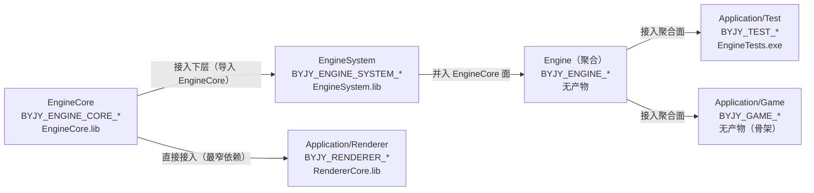

# 构建系统与层间契约

> 本文覆盖「白银纪元」的构建期基础设施：顶层总览文件、各层 `CMakeLists.txt`、各层 `cmake/` 下的公共脚本、各层「源文件列表」清单、各层 `common/` 前置头、各层 `external/` 外部库布局，以及贯穿全工程的**层间契约**。
>
> 本模块不产出任何运行时 C++ 目标；它是「把各层编译成静态库、把静态库按拓扑顺序逐层接起来」的规则集合。引用一律使用相对源码根（`d:\代码存储\代码仓库\白银纪元`）的相对路径。

---

## 一、模块功能

### 1.1 模块定位

「构建系统与层间契约」是本工程**唯一的、跨层的非运行时基础设施**。它回答四个问题：

1. **每层如何被编译**：一个层目录就是一个独立的 CMake 工程（`project(...)`），用 Ninja 生成器配置成 Debug / Release 两种构建树，产出该层自己的静态库与头快照。
2. **层与层之间如何交接**：上层**只链接下层已经构建好的 `.lib`**，绝不把下层源码拉进本层构建树重复编译。交接由两份 CMake 脚本描述：`cmake/对外接口.cmake`（下层自描述「我能给你什么」）与 `cmake/接入下层.cmake`（上层「我如何接入你」）。
3. **上层如何拿到「与下层库同版次」的头**：每个产出层在构建时把本层自有头镜像到自己的构建目录 `include/`，形成**头快照**；消费层把下层快照根作为自己的包含目录并排在项目根之前，从而杜绝「头已改、库未重建」的新头配旧库。
4. **工程如何在 IDE（Visual Studio）里保持同步**：目录登记 `CMAKE_CONFIGURE_DEPENDS` ＋ 生成显式「源文件列表」，使新增/删除/改名文件后直接构建即可自动重配并刷新 IDE 的目录视图与文件视图。

### 1.2 职责边界

| 属于本模块 | 不属于本模块 |
| --- | --- |
| 各层 `CMakeLists.txt`、`cmake/*.cmake`、`源文件列表*.cmake` | 各层 `src/` 下的业务源码（其余模块导览覆盖） |
| 层间契约变量（六变量）的定义与消费 | 各层公共头文件里的类型/函数签名 |
| 头快照导出脚本与消费规则 | 头快照内被镜像的头文件内容本身 |
| 外部库在源码树里的**放置位置与引入方式** | 外部库自身的实现 |
| 源文件收集（GLOB）、目录登记、清单同步机制 | 被收集的源文件语义 |
| 归档 BOM 包装、构建类型双树、Vulkan SDK 探测、着色器编译编排 | 着色器 GLSL 语义 |

### 1.3 解决的问题

- **分层构建 vs 一体化构建**：早期曾有一个顶层 `CMakeLists.txt` 把各层用 `add_subdirectory` 拉进同一构建树。这与「各层是独立 git 仓库、独立推送分支」的组织方式冲突，且让「上层只链接下层已构建静态库」这条硬约定失效。现已删除，改为**逐层独立配置与构建**（见 `README.md` 第四节第 4 条）。
- **路径归属不明**：早期源码用 `#include "src/..."` 这类相对包含，重名文件互相遮蔽。现统一为**项目根相对全路径**（`Engine/EngineCore/...`、`Engine/EngineSystem/...`、`Application/...`），包含根首项固定是**项目根**。
- **头库版本漂移**：源码树里的项目根同时能解析到下层**源码副本**。当「下层头已改、下层库未重建」时，上层会新头配旧库。头快照机制把「上层能看到的头」与「下层已构建的库」绑定到同一棵构建树。
- **IDE 与磁盘不一致**：`file(GLOB_RECURSE ... CONFIGURE_DEPENDS)` 只能让构建系统感知增删，无法让 VS 的**文件视图改名/迁移**改写引用。显式「源文件列表」提供可改写引用，并因被 `include` 而成为配置依赖，改写即触发重配。
- **中文对象名归档乱码**：Ninja 归档响应文件（`*.rsp`）无 BOM，MSVC 的 `lib.exe` 按 ANSI 代码页解读会把中文对象名解成乱码并报 `LNK1181`。归档 BOM 包装器在归档前补 BOM 解决。
- **本机编码/临时目录**：`/showIncludes` 前缀编码不一致导致依赖记录为 0；含非 ASCII 的 `TMP/TEMP` 使 `cl.exe` 请求调试信息时报 `D8050`。这些以「本机构建前提」的形式写入文档。

### 1.4 在整体架构中的位置

```
                         ┌──────────────────────────────┐
                         │  构建系统与层间契约（本模块） │
                         │  cmake/ · CMakeLists.txt ·   │
                         │  源文件列表*.cmake · common/ │
                         │  external/                   │
                         └──────────────┬───────────────┘
                                        │ 定义并传递契约变量、库定位、头快照
                                        ▼
   EngineCore ──▶ EngineSystem ──▶ Engine（聚合） ──▶ Application/Game
   EngineCore.lib  EngineSystem.lib  （无产物）          GameCore.lib（条件产出）
                                     └────────────▶ Application/Test
                                                       EngineTests.exe
                                     └────────────▶ Application/Renderer
                                                       RendererCore.lib
```

- 依赖方向**单向**，拓扑顺序固定为 `EngineCore → EngineSystem → Engine（聚合） → Application/*`。
- 每个箭头代表「上层在配置期定位下层**已构建**的静态库，并建立 `IMPORTED STATIC GLOBAL` 目标」。
- `Application/Renderer` 走的是**直接接 `EngineCore`** 的最窄依赖（不接 Engine 聚合面），因为它与实体/属性/效应无关（见 `Application/Renderer/cmake/对外接口.cmake` 的注释）。

### 1.5 与相邻模块的职责分界

- 与 **EngineCore / EngineSystem / Renderer 业务模块**：本模块只负责「把它们的源码编译成库、把库与头交付给上层」；不定义也不解释库里的类型语义。
- 与 **测试层（Application/Test）**：本模块提供「如何在 Test 层接入 `Engine` 聚合面」的规则；Test 层的用例组织不属本模块。需注意：本轮导航只对 Test/Game 的 `cmake/接入下层.cmake` **存在性**做对照，不细读其构建脚本。
- 与 **工作站文档**：本模块是「工作站 `下层库快照/`」的消费前提——该快照按本模块的产物布局（`x64-<配置>/lib` ＋ `x64-<配置>/include`）组织。

---

## 二、模块提供接口

本模块的「接口」不是 C++ 类型，而是**CMake 变量契约、CMake 函数、脚本参数与构建命令**。凡要在新层里接入下层、或新建一个层，都必须严格按本节调用。

### 2.1 层间契约变量（六变量）

每层各自维护一份 `<层>/cmake/对外接口.cmake`，按固定约定导出以 `<前缀>_` 打头的变量。所有层共用同一套六变量名，仅前缀不同：

| 序号 | 变量名 | 必需性 | 类型 | 含义 |
| --- | --- | --- | --- | --- |
| 1 | `<前缀>_OUT_LIB` | **必需** | 分号分隔字符串列表 | 本层对外传递的静态库名列表；不产出库时留空字符串 |
| 2 | `<前缀>_OUT_LIBDIR` | 可选（扩展项） | 分号分隔字符串列表 | 与 `OUT_LIB` **一一对应**的「该库所在层目录」，供上层自动探测 `.lib`；省略或少于库数时，缺项按「本层目录」补齐 |
| 3 | `<前缀>_OUT_INC` | **必需** | 分号分隔路径列表 | 使用本层公共头文件所需的包含目录 |
| 4 | `<前缀>_OUT_DEF` | **必需** | 分号分隔宏列表 | 使用本层公共头文件所需的编译定义 |
| 5 | `<前缀>_OUT_LINK` | **必需** | 分号分隔文件路径列表 | 本层对外传递的第三方库（`.lib` 文件路径） |
| 6 | `<前缀>_OUT_SYS` | **必需** | 分号分隔库名列表 | 本层对外传递的系统库（如 `opengl32`、`user32`） |

**必需性由源码确证**：`Engine/EngineSystem/cmake/接入下层.cmake` 中，`byjy_jieru_xiaceng()` 对 `_OUT_LIB / _OUT_INC / _OUT_DEF / _OUT_LINK / _OUT_SYS` 五项逐一 `if(NOT DEFINED ...)` 校验并在缺失时 `FATAL_ERROR`；`_OUT_LIBDIR` 单独注释为「可选扩展项，其余五项是契约必需项」。

### 2.2 各层对外面逐条清单（以源码为准）

#### （1）EngineCore —— 前缀 `BYJY_ENGINE_CORE_`

来源：`Engine/EngineCore/cmake/对外接口.cmake`

| 变量 | 值（以源码为准） |
| --- | --- |
| `BYJY_ENGINE_CORE_OUT_LIB` | `EngineCore` |
| `BYJY_ENGINE_CORE_OUT_LIBDIR` | `${BYJY_ENGINE_CORE_ROOT}`（即 `Engine/EngineCore`） |
| `BYJY_ENGINE_CORE_OUT_INC` | ①项目根（`Engine/EngineCore` 上溯两级）②`Engine/EngineCore/external/Json` ③`Engine/EngineCore/external/glfw` ④`Engine/EngineCore/external` ⑤`Engine/EngineCore/external/bullet3/src` |
| `BYJY_ENGINE_CORE_OUT_DEF` | `GLFW_STATIC` |
| `BYJY_ENGINE_CORE_OUT_LINK` | `Engine/EngineCore/external/glfw/glfw3.lib` |
| `BYJY_ENGINE_CORE_OUT_SYS` | `opengl32`、`user32`、`gdi32`、`shell32` |

补充说明（源码注释）：
- `OUT_INC` 首项是**项目根**而非本层根，因为工程内部一律写「项目根相对全路径」（`Engine/EngineCore/...`）。
- `external/Json`、`external/glfw`、`external/bullet3/src` 必须随对外面传递：`common/前置头文件包含.h` 引用 JSON/GLFW 头，本层公共头（碰撞相关）引用 bullet3 头。**【待确认】该注释称预编译头 include 了 `<nlohmann/json.hpp>` 与 `<GLFW/glfw3.h>`，但该文件实际只含标准库与 `windows.h`（注释与源码内容不一致）。**
- **原 glm 条目已移除**（源码注释明示：`external/glm` 目录已不存在且无引用）。

#### （2）EngineSystem —— 前缀 `BYJY_ENGINE_SYSTEM_`

来源：`Engine/EngineSystem/cmake/对外接口.cmake`；本文件**先 `include` EngineCore 的对外接口**，再引用其变量。

| 变量 | 值（以源码为准） |
| --- | --- |
| `BYJY_ENGINE_SYSTEM_OUT_LIB` | `EngineSystem` |
| `BYJY_ENGINE_SYSTEM_OUT_LIBDIR` | `${BYJY_ENGINE_SYSTEM_ROOT}`（即 `Engine/EngineSystem`） |
| `BYJY_ENGINE_SYSTEM_OUT_INC` | ①`Engine/EngineSystem/external/Sol2/include` ②`Engine/EngineSystem/external/Lua` ③`${BYJY_ENGINE_CORE_OUT_INC}`（整体承接 EngineCore 的五项） |
| `BYJY_ENGINE_SYSTEM_OUT_DEF` | 承接 `${BYJY_ENGINE_CORE_OUT_DEF}`（`GLFW_STATIC`） |
| `BYJY_ENGINE_SYSTEM_OUT_LINK` | 承接 `${BYJY_ENGINE_CORE_OUT_LINK}`（`.../glfw/glfw3.lib`） |
| `BYJY_ENGINE_SYSTEM_OUT_SYS` | 承接 `${BYJY_ENGINE_CORE_OUT_SYS}` |

补充说明（源码注释）：本层**不再声明自身层根/src 两个条目**——`Engine/EngineSystem/src/...` 由 EngineCore 对外面首项「项目根」统一解析。`EngineSystem/external/` 下的 `Dear_ImGui`、`glad`、`glfw`、`glm`、`stb` 目前**不被本层静态库源码直接引用**（唯一引用 `stb_image.h` 的 `src/gui/Config_Editor/` 含独立 `main()`，已被 CMake 排除）；将来接入配置编辑器时需一并补上其包含路径。

#### （3）Engine（聚合）—— 前缀 `BYJY_ENGINE_`

来源：`Engine/cmake/对外接口.cmake`；先 `include` EngineSystem 的对外接口（后者又 include EngineCore 的），再把两层摊平。

| 变量 | 值（以源码为准） |
| --- | --- |
| `BYJY_ENGINE_OUT_LIB` | `${BYJY_ENGINE_SYSTEM_OUT_LIB};${BYJY_ENGINE_CORE_OUT_LIB}` = `EngineSystem;EngineCore` |
| `BYJY_ENGINE_OUT_LIBDIR` | `${BYJY_ENGINE_SYSTEM_ROOT};${BYJY_ENGINE_CORE_ROOT}` |
| `BYJY_ENGINE_OUT_INC` | `${BYJY_ENGINE_SYSTEM_OUT_INC}` |
| `BYJY_ENGINE_OUT_DEF` | `${BYJY_ENGINE_SYSTEM_OUT_DEF}` |
| `BYJY_ENGINE_OUT_LINK` | `${BYJY_ENGINE_SYSTEM_OUT_LINK}` |
| `BYJY_ENGINE_OUT_SYS` | `${BYJY_ENGINE_SYSTEM_OUT_SYS}` |

补充说明（源码注释）：聚合层本体**不产出静态库**，故 `BYJY_ENGINE_ROOT` 不进入包含目录列表；`Engine/` 下只有 `EngineCore/`、`EngineSystem/` 两个子层与 `cmake/` 目录。`Engine/CMakeLists.txt` 亦明示：**本层不导出头快照**——两个子层各自导出自己的头快照，Application 各层分别改指。

#### （4）Application/Renderer —— 前缀 `BYJY_RENDERER_`

来源：`Application/Renderer/cmake/对外接口.cmake`；**直接 `include` EngineCore 的对外接口**（不走 Engine 聚合面），并 `include` 同目录的 `VulkanSDK探测.cmake`。

| 变量 | 值（以源码为准） |
| --- | --- |
| `BYJY_RENDERER_OUT_LIB` | `RendererCore` |
| `BYJY_RENDERER_OUT_LIBDIR` | `${BYJY_RENDERER_ROOT}`（即 `Application/Renderer`） |
| `BYJY_RENDERER_OUT_INC` | `${BYJY_ENGINE_CORE_OUT_INC}`（整体承接 EngineCore 的五项） |
| `BYJY_RENDERER_OUT_DEF` | `${BYJY_ENGINE_CORE_OUT_DEF}` |
| `BYJY_RENDERER_OUT_LINK` | `${BYJY_ENGINE_CORE_OUT_LINK}` ＋ `${BYJY_VULKAN_LIB}`（`<SDK根>/Lib/vulkan-1.lib`） |
| `BYJY_RENDERER_OUT_SYS` | `${BYJY_ENGINE_CORE_OUT_SYS}` ＋ `setupapi`、`winmm`、`imm32`、`version`、`ole32`、`oleaut32`、`advapi32`、`uuid` |

补充说明（源码注释）：`OUT_SYS` 比 EngineCore 面多出的系统库口径取自 SDL3 官方 `VisualC/SDL/SDL.vcxproj` 的 `AdditionalDependencies`（SDL3 在 Windows 上的额外依赖）；`vulkan-1.lib` 是本层直接调用 Vulkan 入口点的必需库。SDL3 / VMA / Vulkan 的包含路径都是本层**实现细节**，不出现在对外面上。

#### （5）Application/Test —— 前缀 `BYJY_TEST_`（仅对照）

来源：`Application/Test/cmake/对外接口.cmake`；`include` `Engine/cmake/对外接口.cmake`（聚合面）。

| 变量 | 值 |
| --- | --- |
| `BYJY_TEST_OUT_LIB` | `TestCore` |
| `BYJY_TEST_OUT_LIBDIR` | `${BYJY_TEST_ROOT}` |
| `BYJY_TEST_OUT_INC` | `${BYJY_ENGINE_OUT_INC}` |
| `BYJY_TEST_OUT_DEF` / `_LINK` / `_SYS` | 分别承接 `${BYJY_ENGINE_OUT_DEF}` / `_LINK` / `_SYS` |

备注（源码注释）：`TestCore` 只在 `src/` 下有源文件时才产出；`EngineTests.exe` 不写进对外面——它是运行产物，不是供上层链接的东西。

#### （6）Application/Game —— 前缀 `BYJY_GAME_`（仅对照）

来源：`Application/Game/cmake/对外接口.cmake`；`include` `Engine/cmake/对外接口.cmake`。

| 变量 | 值 |
| --- | --- |
| `BYJY_GAME_OUT_LIB` | `GameCore`（当前 `src/` 为空，尚未产出库） |
| `BYJY_GAME_OUT_LIBDIR` | `${BYJY_GAME_ROOT}` |
| `BYJY_GAME_OUT_INC` | `${BYJY_ENGINE_OUT_INC}` |
| `BYJY_GAME_OUT_DEF` / `_LINK` / `_SYS` | 分别承接 `${BYJY_ENGINE_OUT_DEF}` / `_LINK` / `_SYS` |

### 2.3 通用接入函数 `byjy_jieru_xiaceng()`

**定义位置**：`<层>/cmake/接入下层.cmake`（五份副本，逐字节相同，见 §2.7）。

**签名**：

```cmake
byjy_jieru_xiaceng(<interface_file> <prefix> <override_var>)
```

| 参数 | 含义 |
| --- | --- |
| `<interface_file>` | 下层对外接口文件的**绝对路径**（形如 `<下层>/cmake/对外接口.cmake`）；不存在即 `FATAL_ERROR` |
| `<prefix>` | 下层对外接口的变量前缀，如 `BYJY_ENGINE_CORE` |
| `<override_var>` | 本层用于**显式覆盖库路径**的缓存变量名，如 `BYJY_ENGINE_CORE_LIB_PATH` |

**行为（逐条）**：

1. `include(<interface_file>)` 读入下层对外面——**含其自身已并入的更下层对外面**（纯数据赋值，重复 include 无副作用）。
2. 用 `<prefix>_OUT_LIB / _OUT_LIBDIR / _OUT_INC / _OUT_DEF / _OUT_LINK / _OUT_SYS` 六个变量名逐项取值；对除 `_OUT_LIBDIR` 外的五项做 `DEFINED` 校验，缺失即 `FATAL_ERROR`。
3. 由 `<interface_file>/../..` 反推**下层目录**与其名字（`get_filename_component`），仅用于日志与默认目录。
4. 若 `<prefix>_OUT_LIB` 为空字符串 → 打印 `STATUS "……不产出静态库，跳过库定位"` 并 `return()`（**聚合层的自检场景**即命中此分支以外的路径，因聚合层 `OUT_LIB` 非空）。
5. **`OUT_LIBDIR` 逐项补齐**：对 `OUT_LIB` 每个元素按下标取 `OUT_LIBDIR` 的对应项；下标越界时取「本层目录」。
6. **覆盖变量展开与长度校验**：若 `<override_var>` 非空且元素个数 ≠ `OUT_LIB` 元素个数 → `FATAL_ERROR`（「一旦非空就不再自动探测」）。
7. **逐库定位**（三级策略，见 §4.4），定位失败即 `FATAL_ERROR`，**任何情况下都不回退编译下层源码**。
8. 对每个库名：若目标尚不存在则 `add_library(<库名> STATIC IMPORTED GLOBAL)`；设置 `IMPORTED_LOCATION` 为定位到的 `.lib`；把 `INTERFACE_INCLUDE_DIRECTORIES / INTERFACE_COMPILE_DEFINITIONS / INTERFACE_LINK_LIBRARIES` 设为下层对外面的包含目录/编译定义/（第三方库＋系统库），供本层向上继续传递。
9. 打印 `STATUS "接入下层：<层名> → <库名> ... 库文件：<路径>"`。

**返回值**：无（CMake 函数副作用：建立导入目标、打印日志、失败即终止配置）。

**约束与异常行为**：
- 下层库必须**已构建**，本函数不会代为构建，也不会用 `add_subdirectory` 回退。
- 覆盖变量一旦非空即完全接管，不再自动探测；给出错误项会硬失败而非静默降级。

### 2.4 头快照根解析函数 `byjy_tou_kuaizhao_gen()`

**定义位置**：同 `接入下层.cmake`。

**签名**：

```cmake
byjy_tou_kuaizhao_gen(<out_var> <imported_target>)
```

| 参数 | 含义 |
| --- | --- |
| `<out_var>` | 输出变量名，函数会把解析到的快照根通过 `PARENT_SCOPE` 写回 |
| `<imported_target>` | 已由 `byjy_jieru_xiaceng()` 建立的导入目标名（如 `EngineCore`） |

**行为**：
1. 校验导入目标存在，否则 `FATAL_ERROR`。
2. 取 `IMPORTED_LOCATION`（形如 `<下层构建目录>/lib/<库名>.lib`），上溯**两级**得构建目录，拼接 `/include` 即位头快照根。
3. 若该目录不是目录 → `FATAL_ERROR`（提示先构建产出该快照的下层），**不静默退回源码树**。
4. 写回 `<out_var>` 并打印 `STATUS "头快照解析：<目标> → <快照根>"`。

**为什么消费层要把快照根显式列进自己的包含目录，而不是改导入目标的对外面**（源码注释原文要点）：对外接口里的「项目根」是 `Engine/...` 的前缀解析根，但它同时也能解析到引擎源码树里的同名头。若把它交给**导入目标**传递，CMake 会把它排进 `/external:I` 组；而目标自身的包含目录（`-I`）恒在该组之前——所以只要把快照根作为**自身包含目录**列出，它就一定先于「项目根」命中。反过来，若改成「把导入目标里的项目根换成快照根」，项目根就只剩自身包含目录这一个来源、反而排到了快照之前，快照会被旁路。

### 2.5 头快照导出脚本

**文件**：`Engine/EngineCore/cmake/导出头快照.cmake`，以 `cmake -P` 脚本方式运行（`SCRIPT_MODE`）。

**调用方式**（各产出层的 `add_custom_target(<层>IncludeSnapshot ALL)`）：

```cmake
cmake
  -DSRC_ROOT=<项目根>
  -DDST_ROOT=<构建目录>/include
  -DMIRROR_DIRS=<本层对外包含目录相对的子路径列表，分号分隔>
  -P "<脚本路径>"
```

| 参数 | 含义 |
| --- | --- |
| `SRC_ROOT` | 本层源码根＝**项目根**（镜像目录相对它保留完整层级） |
| `DST_ROOT` | 快照根（通常为 `<构建目录>/include`） |
| `MIRROR_DIRS` | 需镜像的、相对项目根的目录列表（与本层对外包含目录一一对应的子路径） |

**行为**：
1. 三参数缺一即 `FATAL_ERROR`。
2. 先 `file(MAKE_DIRECTORY "${DST_ROOT}")` 保证快照根存在。
3. 对每个 `MIRROR_DIRS` 项按扩展名 `.h` / `.hpp` / `.inl` 递归 GLOB，折算为相对 `SRC_ROOT` 的路径，去重排序。
4. **只复制内容有变化的头**：目标缺失或源更新时才 `file(COPY_FILE ... ONLY_IF_DIFFERENT)`；未变头保持原 mtime，**不会引起上层无谓重编**。
5. **清理失效头**：递归 GLOB 快照，凡不在本轮源侧集合中的快照头一律 `file(REMOVE)`，避免已删头残留在快照里被包含到。
6. 打印 `STATUS "导出头快照：头文件 N 个 / 清理失效 M 个 → <快照根>"`。

**各层镜像范围（以源码为准）**：

| 层 | 目标名 | `MIRROR_DIRS` | 脚本来源 |
| --- | --- | --- | --- |
| EngineCore | `EngineCoreIncludeSnapshot` | `Engine/EngineCore/common;Engine/EngineCore/src` | 本层 `cmake/导出头快照.cmake` |
| EngineSystem | `EngineSystemIncludeSnapshot` | `Engine/EngineSystem/common;Engine/EngineSystem/src` | 复用 `Engine/EngineCore/cmake/导出头快照.cmake` |
| Renderer | `RendererIncludeSnapshot` | `Application/Renderer/common;Application/Renderer/src` | 复用 `Engine/EngineCore/cmake/导出头快照.cmake` |
| Engine（聚合） | 无 | —— | 聚合层不导出头快照 |

> 镜像范围只覆盖本层自有头（`common`、`src`）。第三方目录（如 `external/Json`、`external/glfw`、`external/bullet3/src`、`external/Sol2/include`、`external/Lua`）在外对面上是**独立的绝对路径条目**，不经过快照解析，故不必镜像——少复制上千个第三方头，构建更快。

### 2.6 源文件清单同步脚本

**文件**：`Engine/EngineCore/cmake/生成源文件列表.cmake`（**五层共享的构建工具，非层间契约**；EngineSystem / Renderer 按相对路径 `include` 同一份）。

**对外接口**：

```cmake
byjy_source_list_sync(<清单绝对路径> <本层根> <target 名>
                      <源列表变量名> <头列表变量名> <层显示名>)
```

| 参数 | 含义 |
| --- | --- |
| `<清单绝对路径>` | `<层根>/源文件列表.cmake` 的绝对路径 |
| `<本层根>` | 用于把绝对路径折算为「相对本层根、正斜杠」路径 |
| `<target 名>` | `target_sources` 的目标（如 `EngineCore`） |
| `<源列表变量名>` / `<头列表变量名>` | **取自调用方作用域**（函数可直接读取调用方的变量），即 GLOB 结果变量名 |
| `<层显示名>` | 形如 `Engine/EngineSystem`，用于清单头部说明与本层根提示 |

**行为**：
1. 把两个列表变量折算成相对本层根、正斜杠路径。
2. 组装清单全文：固定说明头 ＋ `target_sources(<target> PRIVATE ...)`（源）＋ 注释 ＋ `target_sources(<target> PRIVATE ...)`（头）。
3. 读入清单现有内容，用内部函数 `byjy_list_extract_paths()` 提取其**全部引号字符串**并归一化排序，得到旧集合；对本轮文本做同样处理得到新集合。
4. **仅当路径集合有差异时才 `file(WRITE)` 整体写回**——按路径集合（而非逐字节）判定，以免 VS 改写后的排版与脚本产出略有出入时来回写盘；清单时间戳稳定则不会触发无谓重配。
5. 写回时打印 `STATUS "源文件清单已刷新：<路径>"`。

**各层清单文件（以源码为准）**：

| 清单文件 | 目标 | 大小（约） |
| --- | --- | --- |
| `Engine/EngineCore/源文件列表.cmake` | `EngineCore` | 16.2 KB |
| `Engine/EngineSystem/源文件列表.cmake` | `EngineSystem` | 2.7 KB |
| `Application/Renderer/源文件列表.cmake` | `RendererCore` | 4.6 KB |
| `Application/Test/源文件列表_EngineTests.cmake`、`源文件列表_EngineTestObjects.cmake`、`源文件列表_TestLauncher.cmake` | Test 层各目标（本轮不细读） | —— |

### 2.7 层间契约脚本副本分布（逐字节相同）

`cmake/接入下层.cmake` 在多层各有一份副本，**必须逐字节相同**。实测（MD5）：

```
42572FE988080ECE519DD860681517C7  Engine/cmake/接入下层.cmake
42572FE988080ECE519DD860681517C7  Engine/EngineSystem/cmake/接入下层.cmake
42572FE988080ECE519DD860681517C7  Application/Renderer/cmake/接入下层.cmake
42572FE988080ECE519DD860681517C7  Application/Test/cmake/接入下层.cmake
42572FE988080ECE519DD860681517C7  Application/Game/cmake/接入下层.cmake
```

- **实际存在 5 份**（含 `Application/Renderer`）。**`Engine/EngineCore` 不含该文件**——它没有下层可接。
- **【待确认】脚本头注释写「EngineSystem / Engine / Test / Game 四份逐字节相同」，`README.md` 第四节同样写「四份」，而实测为五份（含 Renderer），疑为 Renderer 接入后文档未同步。**

### 2.8 各层覆盖变量（缓存变量）

| 层 | 覆盖变量 | 类型 | 留空时的行为 |
| --- | --- | --- | --- |
| EngineSystem | `BYJY_ENGINE_CORE_LIB_PATH` | `CACHE FILEPATH` | 自动探测：优先 `<EngineCore>/out/build/x64-Debug/lib/EngineCore.lib`，其次 `out/build/*/lib` 取时间戳最新 |
| Engine（聚合） | `BYJY_ENGINE_LIB_PATH` | `CACHE STRING` | 自动探测（顺序同 `EngineSystem;EngineCore`，各库优先 `x64-Debug/lib`） |
| Renderer | `BYJY_ENGINE_CORE_LIB_PATH` | `CACHE FILEPATH` | **按本层 `CMAKE_BUILD_TYPE` 显式映射**到 `x64-Debug` 或 `x64-Release`（不改共享函数） |
| Renderer（着色器） | `BYJY_GLSLC_EXECUTABLE` | `CACHE FILEPATH` | 自动探测 `<SDK根>/Bin/glslc.exe`，其次 `PATH`；找不到**只告警**，库仍可构建 |

### 2.9 构建命令接口

每层都是独立 CMake 工程，命令在**已激活的 VS 开发人员环境**中执行：

```
# EngineCore（无下层依赖，先构建）
cmake -S Engine/EngineCore -B Engine/EngineCore/out/build/x64-Debug -G Ninja -DCMAKE_BUILD_TYPE=Debug
cmake --build Engine/EngineCore/out/build/x64-Debug

# EngineSystem（定位 EngineCore.lib）
cmake -S Engine/EngineSystem -B Engine/EngineSystem/out/build/x64-Debug -G Ninja -DCMAKE_BUILD_TYPE=Debug
cmake --build Engine/EngineSystem/out/build/x64-Debug

# Engine 聚合层（自检两个子层库齐备）
cmake -S Engine -B Engine/out/build/x64-Debug -G Ninja -DCMAKE_BUILD_TYPE=Debug
cmake --build Engine/out/build/x64-Debug

# Application/Renderer（定位 EngineCore.lib，按同型构建树映射）
cmake -S Application/Renderer -B Application/Renderer/out/build/x64-Debug -G Ninja -DCMAKE_BUILD_TYPE=Debug
cmake --build Application/Renderer/out/build/x64-Debug

# Application/Test（定位 Engine 聚合面下两个库）
cmake -S Application/Test -B Application/Test/out/build/x64-Debug -G Ninja -DCMAKE_BUILD_TYPE=Debug
cmake --build Application/Test/out/build/x64-Debug
```

各层产物（相对各层目录）：`out/build/<配置>/lib/<库名>.lib` 与 `out/build/<配置>/include/`（头快照）。

显式指定库路径（跳过自动探测）：

```
-DBYJY_ENGINE_CORE_LIB_PATH=<EngineCore.lib 路径>
-DBYJY_ENGINE_LIB_PATH=<EngineSystem.lib;EngineCore.lib 路径列表>   # 聚合层，顺序须与 OUT_LIB 一致
```

---

## 三、模块内部架构

### 3.1 目录/文件结构树

```
白银纪元/
├── README.md                        # 顶层总览：分层、契约、构建、本机注意事项
├── LICENSE                          # MIT，Copyright 2026 雨行雨中
├── .gitignore                       # 忽略 out/、编译产物；白名单放行 glfw3.lib
│
├── Engine/                          # 引擎聚合层（无嵌套 .git，随顶层入库）
│   ├── CMakeLists.txt               # 聚合层构建脚本：自检子层库齐备，不编源码
│   ├── cmake/
│   │   ├── 接入下层.cmake            # 通用接入函数（副本①）
│   │   └── 对外接口.cmake            # 聚合面自描述（前缀 BYJY_ENGINE）
│   ├── EngineCore/                  # 独立 git 仓库
│   │   ├── CMakeLists.txt
│   │   ├── 源文件列表.cmake          # 生成物
│   │   ├── common/
│   │   │   ├── 前置头文件包含.h       # 预编译头（标准库 ＋ windows.h）
│   │   │   └── 引擎.h               # 引擎总包含头（聚合包含运行包与对象系统）
│   │   ├── cmake/
│   │   │   ├── 对外接口.cmake        # 前缀 BYJY_ENGINE_CORE
│   │   │   ├── 导出头快照.cmake       # 头快照导出（cmake -P 脚本）
│   │   │   ├── 生成源文件列表.cmake    # 五层共享的清单同步工具
│   │   │   └── ar_rsp_bom.ps1        # 归档响应文件 BOM 包装器
│   │   └── external/                # bullet3 / glfw / Json
│   └── EngineSystem/                # 独立 git 仓库
│       ├── CMakeLists.txt
│       ├── 源文件列表.cmake
│       ├── common/
│       │   ├── 前置头文件包含.h       # 吃下 EngineCore 那份 ＋ Sol2
│       │   └── external/Sol2/
│       │       ├── sol类型别名.h
│       │       └── sol类型注册.h
│       ├── cmake/
│       │   ├── 接入下层.cmake         # 副本②
│       │   └── 对外接口.cmake         # 前缀 BYJY_ENGINE_SYSTEM
│       └── external/                # Dear_ImGui / glad / glfw / glm / Lua / Sol2 / stb
│
└── Application/
    ├── Renderer/                    # （本轮收录）
    │   ├── CMakeLists.txt
    │   ├── 源文件列表.cmake
    │   ├── common/前置头文件包含.h
    │   ├── cmake/
    │   │   ├── 接入下层.cmake         # 副本③
    │   │   ├── 对外接口.cmake         # 前缀 BYJY_RENDERER
    │   │   ├── VulkanSDK探测.cmake
    │   │   └── SDL3源文件列表.cmake
    │   └── external/                # glm / SDL3 / VulkanMemoryAllocator
    ├── Test/                        # （本轮不收录，仅对照）
    │   └── cmake/接入下层.cmake       # 副本④
    └── Game/                        # （本轮不收录，仅对照）
        └── cmake/接入下层.cmake       # 副本⑤
```

### 3.2 每个编译单元（构建脚本）的职责

| 文件 | 职责 |
| --- | --- |
| `README.md` | 工程总览：分支组织、分层依赖、层间契约、包含路径写法、头快照、构建命令、本机三条硬性注意事项、中文文件名与 IDE 同步 |
| `Engine/CMakeLists.txt` | 聚合层：`project(Engine)`, C++20；`include` 接入下层；定义 `BYJY_ENGINE_LIB_PATH`；调 `byjy_jieru_xiaceng(Engine/cmake/对外接口.cmake, BYJY_ENGINE, BYJY_ENGINE_LIB_PATH)` 做**配置期自检**；`add_custom_target(EngineAggregateCheck ALL)` 输出就绪标记 |
| `Engine/EngineCore/CMakeLists.txt` | 引擎核心层：构建类型校验、归档 BOM 包装、源文件 GLOB、目录登记、清单同步、建 `EngineCore` 静态库、私有包含根＝项目根、第三方包含、头快照导出、链接 GLFW+OpenGL、平台选项、输出目录、安装规则 |
| `Engine/EngineCore/cmake/对外接口.cmake` | EngineCore 对外面自描述（前缀 `BYJY_ENGINE_CORE`） |
| `Engine/EngineCore/cmake/导出头快照.cmake` | 通用头快照导出脚本（`cmake -P`） |
| `Engine/EngineCore/cmake/生成源文件列表.cmake` | 通用清单同步工具（含 `byjy_list_extract_paths` 与 `byjy_source_list_sync`），五层共享 |
| `Engine/EngineCore/cmake/ar_rsp_bom.ps1` | 归档响应文件 BOM 包装器（PowerShell） |
| `Engine/EngineSystem/CMakeLists.txt` | 系统层：构建类型校验、接入 EngineCore、源文件 GLOB（entity/prop/effect）、目录登记、清单同步、建 `EngineSystem` 静态库、头快照接入（EngineCore 快照在前）与导出、链接 EngineCore＋第三方、平台选项 |
| `Engine/EngineSystem/cmake/接入下层.cmake` | 通用接入函数副本② |
| `Engine/EngineSystem/cmake/对外接口.cmake` | EngineSystem 对外面（并入 EngineCore） |
| `Engine/cmake/接入下层.cmake` | 通用接入函数副本①（其余四份与之逐字节相同） |
| `Engine/cmake/对外接口.cmake` | 聚合面自描述（摊平 `EngineSystem;EngineCore`） |
| `Application/Renderer/CMakeLists.txt` | 渲染层：构建类型校验、归档 BOM 包装、Vulkan SDK 探测、接入 EngineCore（同型映射）、头快照接入与导出、源文件 GLOB、SDL3 显式清单、清单同步、建 `RendererCore` 静态库、着色器离线编译 |
| `Application/Renderer/cmake/VulkanSDK探测.cmake` | Vulkan SDK 定位，单点收口（供构建脚本与对外接口共用） |
| `Application/Renderer/cmake/SDL3源文件列表.cmake` | SDL3 编译集合显式清单（手写、非 GLOB） |
| `Application/Renderer/cmake/对外接口.cmake` | Renderer 对外面（并入 EngineCore，追加 Vulkan 与 SDL3 系统库） |
| `<各层>/源文件列表*.cmake` | GLOB 扫描结果落成的**显式清单**（生成物），以 `target_sources` 提供源与头，是这些文件「唯一」的加入点 |
| `<各层>/common/前置头文件包含.h` | 各层预编译头：EngineCore 版含标准库；EngineSystem 版先吃 EngineCore 版再补 Sol2；Renderer 版先吃 EngineCore 版，无额外条目 |

### 3.3 契约变量逐字段说明

六变量在语义上是「一条从下层指向上层的信息带」：

```
┌────────────────────────  <前缀>_  ────────────────────────┐
│  OUT_LIB     [库名, ...]         ← 上层据此逐库建导入目标    │
│  OUT_LIBDIR  [层目录, ...]        ← 与 OUT_LIB 按下标一一对应 │
│  OUT_INC     [包含目录, ...]      ← 挂 INTERFACE_INCLUDE     │
│  OUT_DEF     [宏, ...]           ← 挂 INTERFACE_DEFINITIONS  │
│  OUT_LINK    [.lib 路径, ...]     ← 挂 INTERFACE_LINK_LIBS    │
│  OUT_SYS     [系统库名, ...]      ← 挂 INTERFACE_LINK_LIBS    │
└─────────────────────────────────────────────────────────────┘
```

- `OUT_LIB` 为空是**合法状态**（代表本层不产出库，如聚合层本体的自描述在摊平后仍非空，而真正不产出库的层会命中 `byjy_jieru_xiaceng` 的「跳过库定位」分支）。
- `OUT_LIBDIR` 的**下标语义**是契约的核心：它把「第 i 个库」与「第 i 个层目录」绑定，使同一层的多个库可以分布在不同子层目录（聚合层正是用它把 `EngineSystem;EngineCore` 指向两个子层目录）。
- `OUT_LINK` 与 `OUT_SYS` 在 `byjy_jieru_xiaceng` 里被合并挂到 `INTERFACE_LINK_LIBRARIES`（`"${_link_libs};${_system_libs}"`）。

### 3.4 层关系图



- 实线方向 = 依赖方向（上层依赖下层）。
- 聚合层 `Engine` 只把两层的能力摊平成一面，不产出 `Engine.lib`。
- `Renderer` 与 `Test/Game` 的**唯一区别**是接的面：`Renderer` 接 `EngineCore` 单层，`Test/Game` 接 `Engine` 聚合面。

### 3.5 `common/` 前置头与「局部命名空间使用.h」的做法

本模块不含 `局部命名空间使用.h`（那是各业务模块内部的用法）。与构建相关的是各层 `common/`：

| 文件 | 内容与作用 |
| --- | --- |
| `Engine/EngineCore/common/前置头文件包含.h` | 预编译头：C 标准库、C++ 标准库（含 C++20 的 `<format>`/`<numbers>`/`<bit>`/`<barrier>`/`<ranges>`/`<source_location>`）、以及 `_WIN32` 下的 `<windows.h>` |
| `Engine/EngineCore/common/引擎.h` | 引擎总包含头，聚合包含事件系统运行包与对象系统等常用入口 |
| `Engine/EngineSystem/common/前置头文件包含.h` | 先 `#include "Engine/EngineCore/common/前置头文件包含.h"`（单一真源），再补 `<sol/sol.hpp>`（本层 `common/external/Sol2/` 的包装头直接使用 `sol::` 类型） |
| `Engine/EngineSystem/common/external/Sol2/sol类型别名.h` | 在 `namespace engine` 内定义 `LuaTable = sol::table`、`LuaScript = sol::function`、`LuaState = sol::state` |
| `Engine/EngineSystem/common/external/Sol2/sol类型注册.h` | Sol2 类型注册包装头 |
| `Application/Renderer/common/前置头文件包含.h` | 先吃下 EngineCore 那份；**无额外条目**——SDL3 / Vulkan / VMA 都属本层实现细节，只进 `.cpp`、不进公共头 |

> `EngineSystem` 与 `Renderer` 的预编译头「先吃下 EngineCore 那份、再补本层额外项」是刻意的：保持**单一真源**，避免两份清单各自漂移。

---

## 四、模块设计/实现细节

### 4.1 六变量契约的设计意图

- **为什么用变量而不是 `add_subdirectory` 导出目标**：各层是**独立 git 仓库**，无法在同一个构建树里 `add_subdirectory`（会破坏「独立推送分支」的组织方式，也让「只链接已构建静态库」失效）。用「纯数据变量」描述对外面，可以脱离构建树、被任意层的脚本 `include`，且**重复 include 无副作用**（纯赋值）。
- **为什么并入下层是「一句 include」**：`<前缀>_OUT_*` 的赋值天然可组合——本层先 `include` 下层接口（把下层变量读进来），再在自己的列表里引用其变量。这样「本层对外面 = 本层自有面 ＋ 下层对外面」成立，且上层只需读一个前缀。
- **为什么用分号列表而非逐个变量**：`OUT_LIB` 支持列表是为了**聚合层**——聚合层不产出自己的库，而是把 `EngineSystem;EngineCore` 转出去；`OUT_LIBDIR` 逐项对应，告诉上层这两个库分别在哪个子层目录里。

### 4.2 副本逐字节相同的设计意图

`接入下层.cmake` 的五个副本必须逐字节一致，是为了**消除「同一函数在不同层行为漂移」**。它包含两个通用函数（`byjy_jieru_xiaceng`、`byjy_tou_kuaizhao_gen`），任何一层若要接入下层都应复用同一份逻辑。代价是修改该脚本时要同时改五份（MD5 已实测一致）。
- 与之相对，`生成源文件列表.cmake`、`导出头快照.cmake` 是**构建工具、非层间契约**，因此**共享同一份**（EngineSystem / Renderer 按相对路径 `include` `Engine/EngineCore/cmake/` 下的脚本），避免多份副本漂移。（源码注释：`接入下层.cmake` 是层间契约需多份，工具脚本共享一份。）
- **【待确认】头注释列出三个通用函数（`byjy_jieru_xiaceng` / `byjy_kuaizhao_lujing` / `byjy_qiehuan_tou_kuaizhao`），而实现只有两个（`byjy_jieru_xiaceng` / `byjy_tou_kuaizhao_gen`），疑为函数合并后注释未同步。**
- 副本份数描述与实际不符（见 §2.7），同属**注释滞后于实现**，不影响运行。

### 4.3 聚合层「不编源码、不产出库」的设计

`Engine/CMakeLists.txt` 的实际编排（**以源码为准，无 `add_subdirectory`**）：

1. `cmake_minimum_required(VERSION 3.20)`；MSVC 下 `add_compile_options(/WX-)`。
2. `project(Engine LANGUAGES C CXX)`；强制 C++20。
3. `get_filename_component(PROJECT_ROOT_DIR "${CMAKE_CURRENT_SOURCE_DIR}" ABSOLUTE)`（本层根）。
4. `include("${CMAKE_CURRENT_SOURCE_DIR}/cmake/接入下层.cmake")`。
5. `set(BYJY_ENGINE_LIB_PATH "" CACHE STRING "...")`（聚合层静态库路径，分号列表，顺序同 `EngineSystem;EngineCore`）。
6. `byjy_jieru_xiaceng("${PROJECT_ROOT_DIR}/cmake/对外接口.cmake" "BYJY_ENGINE" "BYJY_ENGINE_LIB_PATH")` —— 本层没有源码要编译，接入动作的作用是**自检**：读本层对外接口（它已并入两层对外面），按 `OUT_LIB` 逐库定位并建立导入目标；任一库缺失即 `FATAL_ERROR`，从而在**配置期**暴露「子层没建好」。
7. `add_custom_target(EngineAggregateCheck ALL COMMAND ... -E echo "Engine 聚合面就绪：EngineSystem.lib + EngineCore.lib")` —— 让本层构建有一个可见产物，便于确认聚合面可用。

> **重要澄清**：任务背景里提到的「聚合层用 `add_subdirectory` 编排子层」在本项目**并不存在**。`Engine/CMakeLists.txt` 全程无 `add_subdirectory`，`Application/*` 各层同样不使用它。这与 `README.md` 第四节「顶层没有构建脚本」「上层只链接下层已构建的 `.lib`，绝不通过 `add_subdirectory` 把下层源码拉进本层构建树」完全一致。

### 4.4 库定位三级策略

由 `byjy_jieru_xiaceng()` 统一实现（**任何情况下都不回退编译下层源码**）：

| 优先级 | 条件 | 行为 | 失败处理 |
| --- | --- | --- | --- |
| ① | 覆盖变量非空 | 按元素下标与 `OUT_LIB` 逐项对应；元素个数必须与 `OUT_LIB` 等长 | 长度不等 / 指向文件不存在 → `FATAL_ERROR`，**不静默降级** |
| ② | 覆盖变量为空 | 先看 `<该库所在层目录>/out/build/x64-Debug/lib/<库名>.lib`；没有则 `file(GLOB)` 扫 `out/build/*/lib/<库名>.lib`，取 `file(TIMESTAMP ...)` 最新的一份 | 仍无 → 进入 ③ |
| ③ | ①②都失败 | —— | `FATAL_ERROR` 并给出构建产出该库的下层命令与显式指定库路径的示例 |

**「× 固定优先 Debug」的原因**（源码注释）：两棵构建树并存后若只按时间戳取最新，结果会在 Debug / Release 之间摇摆，而 Debug(`/MDd`) 与 Release(`/MD`) 的运行库不一致，**混链会出 LNK4098 甚至堆损坏**。需要 Release 版库时请显式指定覆盖变量。

**Renderer 的特殊处理**：`Renderer/CMakeLists.txt` **不由下层函数猜**，而是在本层按 `CMAKE_BUILD_TYPE` 显式映射（不改共享的 `byjy_jieru_xiaceng()`，映射逻辑只属于本层）：
- `Debug` → `Engine/EngineCore/out/build/x64-Debug/lib/EngineCore.lib`
- `Release`（含 `RelWithDebInfo`/`MinSizeRel`）→ 同名 `x64-Release` 目录

这样才能让「本层 Release 树」拿到「Release 版下层库」，避免 `/MD` 库配 `/MDd` 下层库的运行库不一致问题。仍可用 `-DBYJY_ENGINE_CORE_LIB_PATH=...` 手工覆盖。

### 4.5 头快照链路（同版次编译）

**导出侧**：每个产出层在构建时用 `add_custom_target(<层>IncludeSnapshot ALL)` 调 `导出头快照.cmake`，把本层自有头（`common`、`src`）镜像到 `<构建目录>/include/`。镜像目录**相对项目根保留完整层级**（`快照根/Engine/EngineCore/...`），使上层把对外面里的「项目根」条目换成该快照根即可无缝解析同一个前缀。

**消费侧**：`byjy_tou_kuaizhao_gen(<目标> EngineCore)` 由导入目标的 `IMPORTED_LOCATION` 反推构建目录、拼 `/include` 得快照根。然后：

| 消费层 | 包含根设置（源码） |
| --- | --- |
| EngineSystem | `set(BYJY_ENGINE_SYSTEM_INC "${BYJY_ENGINE_CORE_SNAPSHOT}" "${BYJY_PROJECT_ROOT}")`，再 `target_include_directories(EngineSystem PUBLIC ${BYJY_ENGINE_SYSTEM_INC} ${BYJY_ENGINE_SYSTEM_OUT_INC})` |
| Renderer | `set(BYJY_RENDERER_INC "${BYJY_ENGINE_CORE_SNAPSHOT}" "${BYJY_PROJECT_ROOT}")`，再 `target_include_directories(RendererCore PUBLIC ${BYJY_RENDERER_INC} ${BYJY_RENDERER_OUT_INC})` |

**关键次序（源码注释原文要点）**：快照根必须作为**消费层自身的包含目录**列出，并**排在项目根之前**。原因是 MSVC 下目标自身的包含目录（`-I`）**恒在**导入目标传递来的 `/external:I` 之前——快照根作为自身包含目录，就必然先于「项目根」命中，无需改动导入目标。若反过来去改写导入目标的对外面（把项目根换成快照根），项目根就只剩自身包含目录这一个来源、反而排到了快照之前，**快照会被旁路**。可用 `compile_commands.json` 复核次序：应为 **子层快照根 → 项目根 → 第三方**。

**EngineSystem 的快照覆盖范围细致说明**（源码注释）：对外包含目录里的「项目根」同时承载两类路径——`Engine/EngineCore/...` 来自 EngineCore，必须命中 EngineCore 构建目录内的头快照；`Engine/EngineSystem/...` 是本层自身，仍读源码树。把 EngineCore 的快照根排在本层包含根之前，即可让两者各得其所。

**快照与构建类型的联动**：快照根路径里带着 `x64-<构建类型>`，因此「头与库同版次」在**双构建树**下一并成立。

### 4.6 目录级 `CMAKE_CONFIGURE_DEPENDS`

**问题**：仅靠 `file(GLOB_RECURSE ... CONFIGURE_DEPENDS)` 不足以让 VS 感知增删文件——`GLOB_RECURSE` 覆盖子目录，但 `CMAKE_CONFIGURE_DEPENDS` 需要**逐个目录登记**（**被 GLOB 的源根目录**）。

**落地位置（以源码为准）**：

| 层 | 登记的目录 |
| --- | --- |
| EngineCore | `<本层>/src`、`<本层>/common`、`<本层>/external` |
| EngineSystem | `<本层>/src`、`<本层>/src/entity`、`<本层>/src/prop`、`<本层>/src/effect`（连同其共同父目录 `src/` 一并登记） |
| Renderer | `<本层>/src`、`<本层>/common`；另在着色器目录存在时登记 `<本层>/assets/shaders` |

**EngineSystem 的额外约定**（源码注释）：本层 GLOB 只覆盖 `entity / prop / effect` 三个模块目录，连同其共同父目录 `src/` 一并登记——新建 `src/新模块/` 或直接在 `src/` 下放文件时，父目录 mtime 变化即触发重配。⚠ **新增模块目录时，须同时把该目录补进上方 GLOB 模式与本登记列表，二者缺一不可。**

**效果**：新增/删除文件后直接构建即可——Ninja 先输出 `Re-checking globbed directories...`，CMake 自动重跑配置并重扫 GLOB，IDE/VS 的目录视图随之更新，不需要手动「重新生成缓存」。

### 4.7 源文件清单机制（IDE 同步）

**动机**（源码注释）：用 GLOB 收集源文件时，构建脚本里没有任何「具体文件名」。Visual Studio 的文件视图改名/迁移操作，靠 File API codemodel 的 backtrace 找「可改写的引用」；而 backtrace 只落在「把源文件直接加入 target 的那条命令」上。源文件若经变量传入 `add_library`，那一行没有字面文件名，VS 便报「引用了文件……但无法修改引用」，既不重配也不刷新模型。

**做法**：`源文件列表.cmake` 用 `target_sources` 直接列出文件名字面量。实测结论：把字面文件名交给 `target_sources`，且该调用位于被 `include` 的 `.cmake` 中时，backtrace 落在该 `.cmake` 的对应行上——VS 能改写清单，而清单是配置依赖，改写即触发重新配置。

**三条关键约束**（源码注释）：
1. 清单只在「路径集合有差异」时写回（按路径集合而非逐字节判定）。
2. 清单是这些文件「唯一」的加入点——同一条文件若既出现在 `add_library` 参数里又出现在清单里，backtrace 归先加入者（`add_library`），VS 仍会报错。因此各层 `add_library` **不传这些源文件**（`add_library(EngineCore STATIC)` 后紧接 `include(".../源文件列表.cmake")`）。
3. 清单必须放在「本层根目录」（与调用它的 `CMakeLists.txt` 同级），路径一律写成「相对本层根、正斜杠」。原因：CMake 解析 `target_sources` 的相对路径，基准是「被 include 的 `CMakeLists` 所在目录」＝本层根；而 VS 改写引用时的基准是「被编辑的 `.cmake` 文件自身所在目录」。两者只有清单位于本层根时才重合——若清单留在 `cmake/` 子目录，VS 会写出 `../src/…` 这类 CMake 解析不到的路径，配置直接失败。

**例外**：Renderer 的 `SDL3源文件列表.cmake` 是**手写清单（非 GLOB）**，以变量 `BYJY_SDL3_SOURCES` 形式在 `add_library(RendererCore STATIC ${SDL3_SOURCES})` 传入，**不参与**清单同步机制。

### 4.8 归档响应文件 BOM 包装器

**问题**：Ninja 写出的归档响应文件（`*.rsp`）是 UTF-8 **无 BOM**，MSVC 的 `lib.exe` 在没有 BOM 时按系统 ANSI 代码页解读其内容，中文对象名（如 `VMA实现.cpp.obj`）会被解成乱码，归档阶段报 `LNK1181`。

**做法**：把归档命令换成「先给响应文件补 BOM，再调用真实归档器」的包装脚本 `Engine/EngineCore/cmake/ar_rsp_bom.ps1`。

**替换点（源码）**：

```cmake
if(MSVC AND CMAKE_GENERATOR MATCHES "Ninja")
    set(BYJY_AR_WRAPPER "${CMAKE_CURRENT_SOURCE_DIR}/cmake/ar_rsp_bom.ps1")   # 或 Renderer 用 relative ../../Engine/EngineCore/cmake/ar_rsp_bom.ps1
    find_program(BYJY_POWERSHELL_EXECUTABLE NAMES powershell powershell.exe)
    if(EXISTS "${BYJY_AR_WRAPPER}" AND BYJY_POWERSHELL_EXECUTABLE)
        set(CMAKE_CXX_CREATE_STATIC_LIBRARY
            "${BYJY_POWERSHELL_EXECUTABLE} -NoProfile -ExecutionPolicy Bypass -File ${BYJY_AR_WRAPPER} <CMAKE_AR> /nologo <LINK_FLAGS> /out:<TARGET> <OBJECTS> ")
    endif()
endif()
```

**脚本行为**：第一个参数是真实归档器，其余原样转交；对以 `@` 开头的响应文件参数，若其「已有 UTF-8 BOM」或「内容全是 ASCII」则不改动，否则在文件开头补 `EF BB BF`，其余字节原样保留；最后调用真实归档器并原样透传退出码。诊断开关 `BYJY_AR_WRAPPER_DISABLE_BOM=1` 可跳过补 BOM（仅故障对照）。

**两条硬性约束**（源码注释）：
- `CMAKE_CXX_CREATE_STATIC_LIBRARY` **必须在 `project()` 之后设置**，否则会被 `Platform/Windows-MSVC.cmake` 的默认值覆盖回去。
- **只对 Ninja 生成器生效**，避免影响 Visual Studio 生成器（其归档由 MSBuild 的 `Lib` 任务完成）。

> 包装器脚本由 EngineCore 与 Renderer **共用同一份**（构建工具，非层间契约）。

### 4.9 构建类型双树（Debug / Release）

- 各层用 **Ninja（单配置生成器）**，一次配置只产一种构建类型；Debug 与 Release 靠**两棵独立构建树**并存：`out/build/x64-Debug`（默认）与 `out/build/x64-Release`（需显式 `-DCMAKE_BUILD_TYPE=Release`）。
- 单配置生成器下校验 `CMAKE_BUILD_TYPE`：缺省取 `Debug` 并打印提示；取值非法直接 `FATAL_ERROR`。合法取值（区分大小写）：`Debug / Release / RelWithDebInfo / MinSizeRel`。
- **为什么不能落入裸配置**（源码注释）：否则会落入「既非 Debug 也非 Release」的裸配置（MSVC 在构建类型为空时按 `/MD` 编译，但不开优化、也不定义 `NDEBUG`）。
- 多配置生成器（Visual Studio）由 `CMAKE_CONFIGURATION_TYPES` 管理，**本脚本不介入**，避免与 IDE 的配置下拉互相覆盖。

### 4.10 本机构建前提（工程经验，写入文档）

这三条是本机（MSVC / x64 / Windows）实际踩到的坑，必须遵守：

1. **配置期必须处于 UTF-8 代码页**（先执行 `chcp 65001`，且**必须在进入 VS 开发人员环境之后**执行）。
   原因：MSVC 的 `/showIncludes` 前缀在「CMake 编译器探测」与「工程编译」两侧编码不同——探测时不带 `/utf-8`，按系统本地码页输出；工程编译带 `/utf-8`，输出 UTF-8 字节。两者逐字节不等时，Ninja 匹配不到 `msvc_deps_prefix`，后果是**一条头文件依赖都不记录**（`ninja -t deps <obj>` 显示 `#deps 0`），改头文件永不触发重编。
2. **`TMP` / `TEMP` 必须指向纯 ASCII 路径**。
   本机默认临时目录位于含非 ASCII 用户名的路径下（`C:\Users\<非ASCII>\AppData\Local\Temp`），会导致 `cl.exe` 只要请求调试信息（`/Zi` 或 `/Z7`）就报 `D8050 :无法执行 c1.dll: 未能将命令行放入调试记录中`，编译器探测阶段直接失败。
3. **`chcp` 与 VS 开发环境的先后顺序**：先 `Enter-VsDevShell` / 开发人员命令行，**再** `chcp 65001`；反过来会让 `cl.exe` 报同样的 `D8050`。

**`file(GLOB_RECURSE ... CONFIGURE_DEPENDS)` 的局限**：它能让构建系统感知增删（配合目录登记），但**无法**让 VS 文件视图的改名/迁移改写引用（见 §4.7），也无法表达「某些 `.c` 是被 `#include` 引入的实现体、不能单独编译」（见 §4.12 SDL3）。

### 4.11 外部库引入方式

**约定**（沿用《agent开发指南》「外部库引入约束」）：外部库放在各层 `external/` 目录，与 `src/` 平级；不使用投影/符号链接绑定本地其余位置，而是把外部库**拷贝至项目内部**；用基于项目根的相对路径引入（CMake 中一律通过 `${PROJECT_ROOT_DIR}/...` 或 `${BYJY_PROJECT_ROOT}/...` 拼接，无绝对路径）。

| 层 | `external/` 内容 | 引入方式 |
| --- | --- | --- |
| EngineCore | `bullet3`（碰撞）、`glfw`（含预编译 `glfw3.lib`，白名单入库）、`Json`（nlohmann） | bullet3 源码经 GLOB 编入本层；glfw 传 `include`＋链接 `glfw3.lib`；Json 仅头 |
| EngineSystem | `Dear_ImGui`、`glad`、`glfw`、`glm`、`Lua`、`Sol2`、`stb` | 当前仅 `Sol2/include`＋`Lua` 随对外面传递；其余暂不被静态库源码引用 |
| Renderer | `glm`（1.1.0）、`SDL3`（3.4.18）、`VulkanMemoryAllocator`（3.4.0） | SDL3 与 VMA **就地编入** `RendererCore`（无独立 `SDL3.lib`/`VMA.lib`）；glm 仅头（包含根 `external/`，代码写 `#include <glm/glm.hpp>`） |

- `.gitignore` 放行 `!Engine/EngineCore/external/glfw/glfw3.lib`（例外于全局 `*.lib` 忽略规则），因其是链接必需依赖。
- EngineCore 对外面的注释指出「原 glm 条目已移除」——EngineCore 已无 `external/glm`；`glm` 仅存在于 EngineSystem 与 Renderer 的 `external/` 下。

### 4.12 SDL3 就地裁剪与编译集合

**产物**：`Application/Renderer/external/SDL3`（版本 3.4.18，见 `external/SDL3/include/SDL3/SDL_version.h`）。

**为什么不用 GLOB**（源码注释）：`external/SDL3/src/` 下**并非每个 `.c` 都是独立编译单元**。SDL3 把一部分实现体当作「被 `#include` 的头」使用，最典型的是：
- `src/hidapi/SDL_hidapi_windows.h` → `#include "windows/hid.c"`
- `src/hidapi/SDL_hidapi_windows.h` → `#include "windows/hidapi_descriptor_reconstruct.c"`

这类文件必须留在源码树里（否则编译期 C1083），但绝不能单独参与编译（否则符号重复定义）。GLOB 无法表达这种差别，所以编译集合显式列在 `Application/Renderer/cmake/SDL3源文件列表.cmake`（变量 `BYJY_SDL3_SOURCES`，261 行条目）。

**编译集合来源**：官方 `VisualC/SDL/SDL.vcxproj` 的 `ClCompile` / `ResourceCompile` 条目；清单路径相对本层根（`Application/Renderer`），构建时补成绝对路径。生成脚本在工作站 `临时/SDL3_trim_v2.ps1`（不在源码树内）。

**Renderer 的 SDL3 包含路径注意点**（源码注释）：
- **不**把 `external/SDL3/src/video/khronos` 加进包含路径——SDL3 源码内部以相对路径 `"./khronos/vulkan/vulkan.h"` 引用自带 Khronos 头；若加入包含路径会**遮蔽** Vulkan SDK 的 `<vulkan/vulkan.hpp>`，本层与上层都将拿到 SDL 那份精简头。
- `include/build_config` **必须**进包含路径：`src/SDL_internal.h` 写的是 `#include "SDL_build_config.h"`，而该头位于 `include/build_config/` 下（源码树自带的平台派发头，按 `SDL_PLATFORM_*` 再派发到 `SDL_build_config_windows.h`）。SDL 官方构建也是把该目录加进包含路径，并非 CMake 现场生成——因此不需要（也不应）定义 `USING_GENERATED_CONFIG_H`。

### 4.13 Vulkan SDK 探测（渲染层单点收口）

**文件**：`Application/Renderer/cmake/VulkanSDK探测.cmake`，供两处共用同一口径（避免「构建脚本」与「对外接口」各写一套探测逻辑而悄悄漂移）：`Application/Renderer/CMakeLists.txt`（编译本层时用）与 `Application/Renderer/cmake/对外接口.cmake`（向上层传递 `vulkan-1.lib` 时用）。

**探测顺序（不猜路径、不静默降级）**：
1. 环境变量 `VULKAN_SDK` 非空，且 `<该目录>/Include/vulkan/vulkan.h` 存在 → 采用。
2. 否则枚举 `C:/VulkanSDK/*`，`list(SORT ... COMPARE NATURAL ORDER DESCENDING)` 自然序倒排后取第一个「同时具备 `Include/vulkan/vulkan.h` 与 `Lib/vulkan-1.lib`」的目录。
3. 都不满足 → `FATAL_ERROR`，打印排查提示。

**产物变量**：`BYJY_VULKAN_SDK_ROOT`（SDK 根，正斜杠形式）、`BYJY_VULKAN_INCLUDE_DIR`（`<根>/Include`）、`BYJY_VULKAN_LIB`（`<根>/Lib/vulkan-1.lib`）。本文件被对外接口间接 `include`（会被多个上层读入），故以「产物变量是否已定义」作为**重复进入的短路条件**，重复 include 无副作用。

### 4.14 着色器离线编译编排（渲染层）

- 源着色器：`Application/Renderer/assets/shaders/*.vert / *.frag / *.comp`（文件名可为中文；`glslc` 已实测支持 UTF-8 路径）。
- 产物：`<构建树>/shaders/*.spv`——位于 `out/` 下，随 `.gitignore` 天然不入库。
- `glslc` 定位：优先 `<Vulkan SDK>/Bin/glslc.exe`，其次 `PATH`；**找不到只告警**，本层静态库仍可构建（与设计「找不到 glslc 不硬失败」口径一致）。
- 逐源文件生成「源 → 同名 `.spv`」的 `add_custom_command`，产物名带原扩展名（如 `场景.vert.spv`）；`add_custom_target(RendererShaders ALL DEPENDS ${BYJY_SHADER_OUTPUTS})` 并 `add_dependencies(RendererCore RendererShaders)`。
- 时空背景：本层不产出可执行文件，着色器不属库产物；此处编译意在让「构建本层」这一步就能验证着色器语法，并让 Test 层按既有「已知构建树相对路径」口径取用。

### 4.15 各层编译选项与输出目录（共性）

| 项 | EngineCore | EngineSystem | Renderer |
| --- | --- | --- | --- |
| `/WX-`（MSVC 顶层） | 是 | 是 | 是 |
| C++20 强制 | 是 | 是 | 是 |
| MSVC 私有选项 | `/MP /utf-8` | `/MP /utf-8` | `/MP /utf-8` |
| MSVC 私有宏 | `_CRT_SECURE_NO_WARNINGS` | `_CRT_SECURE_NO_WARNINGS` | `_CRT_SECURE_NO_WARNINGS` ＋ `GLM_FORCE_DEPTH_ZERO_TO_ONE`、`GLM_FORCE_RADIANS` |
| GCC/Clang 选项 | `-Wall -Wextra -pedantic`＋`_GNU_SOURCE` | 同左 | 同左 |
| 归档输出目录 | `${CMAKE_BINARY_DIR}/lib` | `${CMAKE_BINARY_DIR}/lib`（另设 `LIBRARY_OUTPUT_DIRECTORY`） | `${CMAKE_BINARY_DIR}/lib`（另设 `LIBRARY_OUTPUT_DIRECTORY`） |
| 编译数据库 | `CMAKE_EXPORT_COMPILE_COMMANDS ON` | 是 | 是 |
| 安装规则 | `install(DIRECTORY ... PATTERN "Private" EXCLUDE)`＋`install(TARGETS ...)` | 无 | 无 |

- `glm` 适配宏（Renderer 私有，绝不进公共头）：`GLM_FORCE_DEPTH_ZERO_TO_ONE`（Vulkan 深度范围 `[0,1]`）、`GLM_FORCE_RADIANS`（角度一律用弧度）。
- Renderer 的包含根**分两级**：`PUBLIC` 为上层使用本层公共头所需的路径（下层快照＋项目根＋对外面声明）；`PRIVATE` 为本层实现细节（SDL3、VMA、Vulkan SDK、`external/`）——三者都不出现在公共头里，不能被上层看到，否则会污染上层的包含路径与宏环境。

### 4.16 易错点汇总

1. 新增层内模块目录时，**必须同时**改 GLOB 模式与 `CMAKE_CONFIGURE_DEPENDS` 登记列表（EngineSystem 注释的 ⚠）。
2. 源文件清单是唯一加入点：**不要在 `add_library` 里再传这些源文件**，否则 VS 改名失效。
3. 覆盖变量一旦非空即接管，长度必须与 `OUT_LIB` 等长，否则硬失败。
4. 删改 `接入下层.cmake` 要**五份同改**，否则各层行为漂移。
5. 头快照根**必须排在项目根之前**且作为**目标自身**包含目录；改导入目标对外面会导致快照被旁路。
6. `ar_rsp_bom.ps1` 的替换必须在 `project()` 之后；只对 Ninja 生效。
7. `chcp 65001` 必须在进入 VS 开发环境之后；`TMP/TEMP` 必须纯 ASCII。
8. 不要把 `external/SDL3/src/video/khronos` 加进包含路径。

---

## 五、模块运行链路

### 5.1 配置期链路（以 EngineSystem 为例）

```
调用方：开发者在 VS 开发人员环境执行 cmake -S Engine/EngineSystem -B .../x64-Debug -G Ninja
  │
  ├─ 1. CMake 读 Engine/EngineSystem/CMakeLists.txt
  │      → cmake_minimum_required / project(EngineSystem) / 强制 C++20
  │
  ├─ 2. 构建类型校验
  │      → CMAKE_BUILD_TYPE 缺省取 Debug；非法取值 FATAL_ERROR
  │
  ├─ 3. include cmake/接入下层.cmake（引入 byjy_jieru_xiaceng / byjy_tou_kuaizhao_gen）
  │
  ├─ 4. byjy_jieru_xiaceng("Engine/EngineCore/cmake/对外接口.cmake", "BYJY_ENGINE_CORE", "BYJY_ENGINE_CORE_LIB_PATH")
  │      ├─ include EngineCore 对外接口 → BYJY_ENGINE_CORE_OUT_* 就位
  │      ├─ 校验五项必需变量是否存在（缺失 → FATAL_ERROR）
  │      ├─ OUT_LIB = "EngineCore"，非空 → 继续
  │      ├─ OUT_LIBDIR 逐项补齐 → <EngineCore 目录>
  │      ├─ 覆盖变量空 → ① 探测 Engine/EngineCore/out/build/x64-Debug/lib/EngineCore.lib
  │      │                   ② 否则扫 out/build/*/lib 取时间戳最新
  │      │                   ③ 都没有 → FATAL_ERROR（给出构建命令）
  │      └─ add_library(EngineCore STATIC IMPORTED GLOBAL) ＋ 挂 INTERFACE_INC/DEF/LINK
  │
  ├─ 5. 源文件 GLOB_RECURSE（entity/prop/effect 下的 .cpp/.c 与 .h/.hpp）
  │      → set_property(DIRECTORY APPEND PROPERTY CMAKE_CONFIGURE_DEPENDS src, src/entity, src/prop, src/effect)
  │
  ├─ 6. include Engine/EngineCore/cmake/生成源文件列表.cmake
  │      → byjy_source_list_sync(Engine/EngineSystem/源文件列表.cmake, ...)
  │        └─ 路径集合有差异才 file(WRITE) 回写清单
  │
  ├─ 7. include cmake/对外接口.cmake → BYJY_ENGINE_SYSTEM_OUT_*（并入 EngineCore 面）
  │
  ├─ 8. byjy_tou_kuaizhao_gen(BYJY_ENGINE_CORE_SNAPSHOT EngineCore)
  │      → 由 IMPORTED_LOCATION 上溯两级 ＋ /include；目录不存在 → FATAL_ERROR
  │
  ├─ 9. add_library(EngineSystem STATIC) ＋ include 源文件列表.cmake（target_sources）
  │      → target_include_directories PUBLIC (快照根; 项目根; 对外面 INC)
  │      → target_compile_definitions PUBLIC 对外面 DEF
  │      → target_link_libraries PUBLIC EngineCore; 对外面 LINK; 对外面 SYS
  │      → MSVC 私有 /MP /utf-8 与 _CRT_SECURE_NO_WARNINGS
  │      → ARCHIVE/LIBRARY_OUTPUT_DIRECTORY = <构建树>/lib
  │
  └─ 10. add_custom_target(EngineSystemIncludeSnapshot ALL ... 导出头快照)
        → 生成的构建系统含：库目标、快照目标、着色器目标（Renderer）
```

### 5.2 构建期链路

```
调用方：cmake --build Engine/EngineSystem/out/build/x64-Debug
  │
  ├─ 1. Ninja 检查目录 mtime → 若 GLOB 目录有增删，先自动重跑 cmake 配置（Re-checking globbed directories...）
  │
  ├─ 2. 编译各 TU（含 /utf-8；依赖记录依赖正确的 msvc_deps_prefix）
  │
  ├─ 3. 归档：调用 CMAKE_CXX_CREATE_STATIC_LIBRARY（已换成 ar_rsp_bom.ps1 包装）
  │      → 包装器检测 @rsp 内含非 ASCII → 补 UTF-8 BOM → lib.exe 正常归档
  │      → 产物 <构建树>/lib/EngineSystem.lib
  │
  └─ 4. EngineSystemIncludeSnapshot 目标运行（cmake -P 导出头快照）
        → 仅复制变化的头；清理源侧已删头 → <构建树>/include/Engine/EngineSystem/**
```

### 5.3 头快照导出/消费时序（跨层）

```
【先】构建 EngineCore
  → EngineCoreIncludeSnapshot 产出 Engine/EngineCore/out/build/x64-Debug/include/Engine/EngineCore/**
  → 同时产出 Engine/EngineCore/out/build/x64-Debug/lib/EngineCore.lib

【后】配置 EngineSystem
  → byjy_jieru_xiaceng 定位 EngineCore.lib（IMPORTED_LOCATION 指向 x64-Debug/lib）
  → byjy_tou_kuaizhao_gen 由该 lib 上溯两级得 x64-Debug，拼 /include → EngineCore 快照根
  → EngineSystem 的 PUBLIC 包含根 = [EngineCore 快照根, 项目根, 对外面 INC]

【后】编译 EngineSystem
  → 源码写 #include "Engine/EngineCore/xxx.h" 时：
       -I 快照根（自身包含目录）先命中 x64-Debug/include/Engine/EngineCore/xxx.h（与 lib 同版次）
       -I 项目根（自身包含目录，排后）
       /external:I 项目根（导入目标传递）——排在最后，仅兜底
     次序复核：compile_commands.json 应为 子层快照根 → 项目根 → 第三方
```

### 5.4 聚合层自检链路

```
调用方：cmake -S Engine -B Engine/out/build/x64-Debug -G Ninja
  │
  ├─ include cmake/接入下层.cmake
  ├─ set(BYJY_ENGINE_LIB_PATH "" CACHE STRING ...)
  ├─ byjy_jieru_xiaceng("Engine/cmake/对外接口.cmake", "BYJY_ENGINE", "BYJY_ENGINE_LIB_PATH")
  │      ├─ include Engine/cmake/对外接口.cmake
  │      │     └─ include EngineSystem 对外接口
  │      │           └─ include EngineCore 对外接口
  │      │     → 摊平：OUT_LIB = "EngineSystem;EngineCore"
  │      │             OUT_LIBDIR = "<EngineSystem 目录>;<EngineCore 目录>"
  │      ├─ 逐库定位：先从各自 LIBDIR 的 x64-Debug/lib 探测，再回退 * 取最新
  │      └─ 建两个 IMPORTED 目标；任一库缺失 → FATAL_ERROR（配置期暴露「子层没建好」）
  └─ add_custom_target(EngineAggregateCheck ALL ... echo "Engine 聚合面就绪：EngineSystem.lib + EngineCore.lib")
```

### 5.5 关键异常/边界分支

| 分支 | 触发 | 结果 |
| --- | --- | --- |
| 下层对外接口文件不存在 | `byjy_jieru_xiaceng` 步骤 1 | `FATAL_ERROR`（打印期望位置） |
| 五项必需变量缺一 | `byjy_jieru_xiaceng` 步骤 2 | `FATAL_ERROR`（列出契约要求） |
| `OUT_LIB` 为空 | `byjy_jieru_xiaceng` 步骤 4 | `STATUS` 提示并 `return()`（跳过库定位） |
| 覆盖变量长度 ≠ `OUT_LIB` 长度 | `byjy_jieru_xiaceng` 步骤 6 | `FATAL_ERROR`（列出两侧取值） |
| 覆盖变量指向文件不存在 | `byjy_jieru_xiaceng` 步骤 7① | `FATAL_ERROR`（不静默降级、不回退编源码） |
| 三级探测都失败 | `byjy_jieru_xiaceng` 步骤 7③ | `FATAL_ERROR`（给出构建下层命令与显式指定示例） |
| 头快照目录不存在 | `byjy_tou_kuaizhao_gen` 步骤 3 | `FATAL_ERROR`（提示先构建产出快照的下层） |
| GLOB 后无任何源文件 | 各层 `CMakeLists.txt` 的 `if(NOT <SOURCES>)` | `FATAL_ERROR`（提示检查目录结构） |
| SDL3 编译清单为空 | `Renderer` 的 `if(NOT SDL3_SOURCES)` | `FATAL_ERROR`（提示检查清单与 external/SDL3） |
| 未找到 glslc | Renderer 着色器编排 | `WARNING`，跳过着色器编译，**库仍可构建** |
| 未找到归档包装器/PowerShell | Renderer/EngineCore 归档编排 | `WARNING`（中文对象名归档可能报 LNK1181） |
| `CMAKE_BUILD_TYPE` 非法 | 各层构建类型校验 | `FATAL_ERROR`（列出合法取值） |
| 未找到 Vulkan SDK | `VulkanSDK探测.cmake` ③ | `FATAL_ERROR`（不猜路径、不静默降级） |

### 5.6 双构建树下的下层库选择（Renderer 特例链路）

```
调用方：cmake -S Application/Renderer -B .../x64-Release -G Ninja -DCMAKE_BUILD_TYPE=Release
  │
  ├─ 构建类型校验通过（Release）
  ├─ include VulkanSDK探测.cmake → BYJY_VULKAN_SDK_ROOT / _INCLUDE_DIR / _LIB
  ├─ include cmake/接入下层.cmake
  ├─ set(BYJY_ENGINE_CORE_LIB_PATH "" CACHE FILEPATH ...)
  ├─ 覆盖变量为空 → 本层按 CMAKE_BUILD_TYPE 映射：
  │      Release → BYJY_XIA_CENG_TREE = x64-Release
  │      → BYJY_ENGINE_CORE_LIB_PATH = <项目根>/Engine/EngineCore/out/build/x64-Release/lib/EngineCore.lib
  ├─ byjy_jieru_xiaceng(".../EngineCore/cmake/对外接口.cmake", "BYJY_ENGINE_CORE", "BYJY_ENGINE_CORE_LIB_PATH")
  │      → 覆盖变量非空 → 直接采用（文件不存在即 FATAL_ERROR）
  └─ byjy_tou_kuaizhao_gen(...) → 快照根落在 x64-Release/include（头/库同版次一致）
```

---

## 六、待确认条目

以下条目为源码中**无法确证**之处，正文相应位置已就地标注 `【待确认】`，并登记到碎片文件 `_临时_待答疑碎片/BUILD.md`（不直接改 `待答疑清单.md`）。

- **BUILD-01**：`cmake/接入下层.cmake` 文件头注释列出**三个**通用函数（`byjy_jieru_xiaceng` / `byjy_kuaizhao_lujing` / `byjy_qiehuan_tou_kuaizhao`），但文件实际只实现**两个**（`byjy_jieru_xiaceng` / `byjy_tou_kuaizhao_gen`），且名称与注释不符。疑为设计演进（把「源码树→快照」换算与「改指导入目标」两个函数合并为单个 `byjy_tou_kuaizhao_gen`）后注释未同步。当前推断：注释滞后，以实现的 `byjy_tou_kuaizhao_gen` 为准。
- **BUILD-02**：`接入下层.cmake` 头注释与 `README.md` 均称该脚本副本为「四份」（EngineSystem / Engine / Test / Game），但实测**存在五份**（另含 `Application/Renderer`，MD5 全部一致）。当前推断：Renderer 加入后文档未同步，以实测五份为准。
- **BUILD-03**：`Engine/EngineCore/cmake/对外接口.cmake` 注释称 `common/前置头文件包含.h` 内部 `include` 了 `<nlohmann/json.hpp>` 与 `<GLFW/glfw3.h>`，但该文件实际只含标准库与 `_WIN32` 下的 `<windows.h>`，未见 json/glfw 包含。当前推断：注释描述的是「应由预编译头兜住」的意图，或曾经有过而后被移除，以文件实际内容为准。

## 七、附：本模块产出的构建期文件清单（相对源码根）

| 文件 | 类别 |
| --- | --- |
| `README.md` / `LICENSE` / `.gitignore` | 顶层总览与治理 |
| `Engine/CMakeLists.txt` | 聚合层构建脚本 |
| `Engine/cmake/接入下层.cmake`、`Engine/cmake/对外接口.cmake` | 聚合层契约脚本 |
| `Engine/EngineCore/CMakeLists.txt`、`Engine/EngineCore/源文件列表.cmake` | 核心层构建 |
| `Engine/EngineCore/cmake/对外接口.cmake`、`导出头快照.cmake`、`生成源文件列表.cmake`、`ar_rsp_bom.ps1` | 核心层契约与通用工具 |
| `Engine/EngineCore/common/前置头文件包含.h`、`common/引擎.h` | 核心层前置头 |
| `Engine/EngineCore/external/{bullet3,glfw,Json}` | 核心层外部库 |
| `Engine/EngineSystem/CMakeLists.txt`、`源文件列表.cmake` | 系统层构建 |
| `Engine/EngineSystem/cmake/接入下层.cmake`、`对外接口.cmake` | 系统层契约脚本 |
| `Engine/EngineSystem/common/前置头文件包含.h`、`common/external/Sol2/*` | 系统层前置头 |
| `Engine/EngineSystem/external/{Dear_ImGui,glad,glfw,glm,Lua,Sol2,stb}` | 系统层外部库 |
| `Application/Renderer/CMakeLists.txt`、`源文件列表.cmake` | 渲染层构建 |
| `Application/Renderer/cmake/接入下层.cmake`、`对外接口.cmake`、`VulkanSDK探测.cmake`、`SDL3源文件列表.cmake` | 渲染层契约脚本 |
| `Application/Renderer/common/前置头文件包含.h` | 渲染层前置头 |
| `Application/Renderer/external/{glm,SDL3,VulkanMemoryAllocator}` | 渲染层外部库 |
| `Application/Test/cmake/接入下层.cmake`、`Application/Game/cmake/接入下层.cmake` | 契约副本（本轮仅对照存在性） |