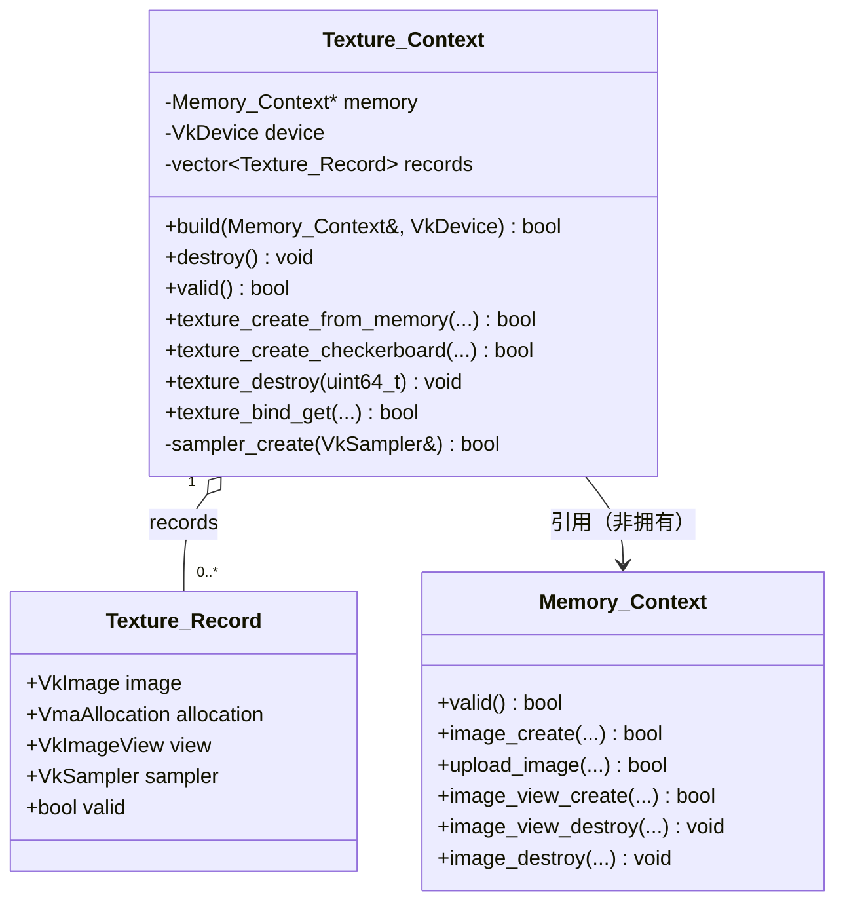

# 渲染层-纹理

## 一、模块功能

### 1.1 模块定位

「渲染层-纹理」是 `Application/Renderer` 渲染层中负责**纹理（Texture）资源生命周期与采样器（Sampler）配置**的模块，位于渲染层的资源服务层。它对外暴露一个句柄式资源容器 `Texture_Context`，对内把「图像创建 / 像素上传 / 图像视图创建 / 采样器创建 / 资源销毁」这一整条 Vulkan 资源操作链封装起来，向渲染器、管线等上层模块提供「拿到一个视图句柄 + 一个采样器句柄，直接写描述符」的极简接口。

在渲染层的分层中，它处于这样的位置：

```
Renderer（渲染器，总装配与帧驱动）
   │ 持有并使用
   ├── Texture（本模块：纹理记录集合 + 采样器）
   │        │ 依赖
   │        ▼
   ├── Memory（内存上下文：图像 / 视图 / 上传的底层实现）
   │        │ 依赖
   │        ▼
   ├── Device（设备上下文：逻辑设备句柄的来源）
   │
   └── Pipeline（管线：set1 采样器描述符集由本模块的 view+sampler 填充）
```

本模块**不自建 Vulkan 对象以外的底层机制**：图像与内存分配、上传命令池、布局转换全部由「内存上下文」模块完成，本模块只是它们的**编排者与持有者**；采样器则由本模块直接用逻辑设备创建，因为采样器不属于内存资源、无法由 VMA 管理，故落在本模块内。

### 1.2 职责边界

本模块**负责**：

1. **纹理记录集合的持有与索引**：以 `std::vector<Texture_Record>` 存储全部纹理记录，用「句柄 = 下标 + 1」的方式对外发放稳定句柄。
2. **纹理创建编排**：把「内存模块图像创建 → 像素上传 → 图像视图创建 → 采样器创建 → 记录登记」串成一条带失败回退的链路。
3. **程序化纹理生成**：提供棋盘格（checkerboard）纹理的内存生成，用于在没有外部图片资源的情况下验证采样链路。
4. **采样器创建**：以固定参数（线性过滤、REPEAT 寻址、mipmap 关闭、各向异性关闭）创建采样器。
5. **绑定信息导出**：向描述符写入方提供 `(VkImageView, VkSampler)` 组合。
6. **资源销毁与幂等兜底**：`destroy` 幂等，析构自动兜底，保证不泄漏采样器与图像。

本模块**不负责**：

1. **图像内存分配与像素上传的底层实现**：VMA 分配器、暂存缓冲、命令池、队列提交、图像布局转换均在「内存上下文」内完成。
2. **逻辑设备 / 物理设备的创建与选择**：来自「设备上下文」模块，本模块只接收其 `VkDevice`。
3. **描述符集布局、描述符池、描述符集分配与写入**：属于「管线」模块；本模块只提供要写入的值。
4. **图像文件解码**：本层当前不存在图像解码库，`texture_create_from_memory` 仅接受已解码的 RGBA8 紧排像素（头文件注释称其为「预留的文件加载入口」）。
5. **mipmap 链生成**：本模块创建的图像视图固定单 mip、采样器 `maxLod = 0`，不生成、不采样 mip 链。
6. **纹素格式转换 / 通道重排**：调用方必须提供 `RGBA8` 且逐行紧排（`row_pixels = 0`）的像素数据，本模块不做任何 CPU 侧重排。

### 1.3 解决的问题

1. **句柄化与生命周期收敛**：直接裸用 `VkImage`、`VkImageView`、`VkSampler` 三个句柄容易漏销毁、漏记录；本模块用一个句柄 `uint64_t` 把三者绑定为一条记录，销毁只需一个句柄，且析构兜底。
2. **多次分工模块调用的一致性**：创建一条纹理需要先后调用内存模块三次（建图、上传、建视图）再加一次采样器创建，任一环节出错都要回退已建部分；本模块把回退链写死在一处，避免调用方各自实现、各自遗漏。
3. **采样器参数集中**：将「线性过滤 + REPEAT」这一渲染层约定固化，防止不同调用点采样行为不一致。
4. **set1 描述符的稳定填充**：渲染器可以先把「默认白纹理」一次写满所有帧槽的 set1，保证描述符集数量为 2 时不存在未写入的 set1，避免校验层报错。

### 1.4 与相邻模块的职责分界

| 相邻模块 | 本模块向其索取 | 本模块向其提供 |
| --- | --- | --- |
| 内存上下文（Memory） | `image_create` / `upload_image` / `image_view_create` / `image_view_destroy` / `image_destroy` / `valid` | 无（单向依赖） |
| 设备上下文（Device） | 逻辑设备 `VkDevice` 句柄 | 无 |
| 结果检查（Renderer/core） | `vk_result_check` 与全局 `logger` | 无 |
| 管线（Pipeline） | 无 | `(VkImageView, VkSampler)` 经 `texture_bind_get` 导出，由渲染器转交 `pipeline.texture_bind(slot, sampler, view)` |
| 渲染器（Renderer） | 无 | 纹理创建 / 销毁 / 绑定信息导出，以及内置默认白纹理的持有 |

关键分界一句话：**「内存模块管字节与显存，纹理模块管语义与句柄，管线模块管描述符落位」**。三者之间没有互相反向调用。

---

## 二、模块提供接口

本章是「可凭此文件直接调用」的关键章。所有路径均相对于源码根。

### 2.1 头文件与命名空间

| 项 | 值 |
| --- | --- |
| 对外头文件 | `Application/Renderer/src/render/Texture/纹理.h` |
| 命名空间 | `engine` |
| 前置依赖头 | `Application/Renderer/common/前置头文件包含.h`（预编译头） |
| 直接包含 | `<vulkan/vulkan.h>`、`<vk_mem_alloc.h>` |

`纹理.h` 属本层「实现细节」头：只被本层 `.cpp` 与层内模块头包含，不进公共头，因此可以合法暴露 Vulkan 与 VMA 类型（层外仍看不到 —— 见 `cmake/对外接口.cmake` 的私有包含根）。这意味着**调用方必须与本模块同处渲染层内部**，否则无法包含本头。

### 2.2 对外类型一：`Texture_Record`（纹理记录）

```cpp
struct Texture_Record
{
    VkImage       image      = VK_NULL_HANDLE;
    VmaAllocation allocation = VK_NULL_HANDLE;
    VkImageView   view       = VK_NULL_HANDLE;
    VkSampler     sampler    = VK_NULL_HANDLE;
    bool          valid      = false;
};
```

逐字段说明：

| 字段 | 类型 | 含义 | 约束 / 备注 |
| --- | --- | --- | --- |
| `image` | `VkImage` | 由内存模块创建、布局固定为 `VK_IMAGE_TILING_OPTIMAL` 的二维图像 | 销毁必须回到 `memory->image_destroy`，不可自行 `vkDestroyImage` |
| `allocation` | `VmaAllocation` | 该图像对应的 VMA 分配句柄 | 与 `image` 成对，一并交回内存模块销毁 |
| `view` | `VkImageView` | 图像视图，二维、单层、单 mip、色彩纵横比 | 供描述符写入；销毁回到 `memory->image_view_destroy` |
| `sampler` | `VkSampler` | 采样器 | 由本模块 `vkCreateSampler` 创建，由本模块 `vkDestroySampler` 销毁 |
| `valid` | `bool` | 记录是否有效 | `destroy` / `texture_destroy` 后复位为 `false`；`texture_bind_get` 与 `texture_destroy` 均以此为幂等判据 |

说明：`Texture_Record` 是**纯数据聚合体**，无成员函数、无构造逻辑（仅聚合初始化 `= default` 式的零值默认）。它对本层内部公开，是因为渲染器需要查看/持有记录语义，但实际取用一律经 `Texture_Context::texture_bind_get`，不建议外部直接改字段。

### 2.3 对外类型二：`Texture_Context`（纹理上下文）

```cpp
class Texture_Context
{
public:
    Texture_Context(void) = default;
    ~Texture_Context(void);
    Texture_Context(const Texture_Context&) = delete;
    Texture_Context& operator=(const Texture_Context&) = delete;

    bool build(Memory_Context& memory, VkDevice device);
    void destroy(void);
    bool valid(void) const;

    bool texture_create_from_memory(uint64_t& handle_out, const uint8_t* pixels,
                                    uint32_t width, uint32_t height);
    bool texture_create_checkerboard(uint64_t& handle_out, uint32_t width,
                                     uint32_t height, uint32_t cell_size);
    void texture_destroy(uint64_t handle);
    bool texture_bind_get(uint64_t handle, VkImageView& view_out,
                          VkSampler& sampler_out) const;
private:
    bool sampler_create(VkSampler& sampler_out);

    Memory_Context*           memory = nullptr;
    VkDevice                  device = VK_NULL_HANDLE;
    std::vector<Texture_Record> records;
};
```

类级约定（来自头文件注释与实现）：

- **生命周期**：`build → 使用 → destroy`；`destroy` 幂等；析构兜底调用 `destroy`。
- **句柄规则**：句柄自 1 起（0 表示无效），下标 = 句柄 − 1。
- **所有权**：持有 `VMA 句柄` 与设备句柄，故不可拷贝、不可移动（拷贝构造与拷贝赋值均 `= delete`；移动语义因声明了析构与删除的拷贝操作而**不被隐式生成**）。

### 2.4 接口逐条清单

#### （1）`Texture_Context(void) = default`

- **签名**：`Texture_Context(void) = default;`
- **参数**：无。
- **返回**：无。
- **行为**：仅将成员初始化为默认值（`memory = nullptr`、`device = VK_NULL_HANDLE`、`records` 为空）。
- **约束**：**不创建任何纹理**；构造后 `valid()` 为假，任何创建接口都会因前置检查失败而返回假。
- **异常行为**：不抛异常（全程不启用异常）。

#### （2）`~Texture_Context(void)`

- **签名**：`~Texture_Context(void);`（实现在 `core/纹理创建.cpp`）
- **参数**：无。
- **返回**：无。
- **行为**：内部调用 `destroy()`，释放全部纹理（采样器 + 视图 + 图像 + 分配）。
- **约束**：析构兜底的目的是「保证纹理不泄漏」；若用户已显式 `destroy()`，析构再次调用因幂等而无副作用。
- **易错点**：析构**不负责**销毁 `Memory_Context` 与 `VkDevice` —— 本类只持引用/裸句柄，销毁须由各自的所有者完成，且**必须在设备与内存模块仍然存活时**完成（否则 `destroy` 内对 `vkDestroySampler` 与内存模块的调用会在已销毁对象上进行）。销毁顺序应为：先 `Texture_Context::destroy`，再 `Memory_Context::destroy`，最后设备销毁。

#### （3）`bool build(Memory_Context& memory, VkDevice device)`

- **签名**：`bool build(Memory_Context& memory, VkDevice device);`
- **参数**：
  - `memory`：内存上下文引用。仅记录其地址（`Memory_Context*`），**不拷贝、不持有所有权**；调用方须保证该对象在本上下文整个使用期内存活。
  - `device`：逻辑设备句柄，来自设备模块，用于创建采样器。
- **返回**：`true` 表示记录成功；`false` 表示前置条件不满足。
- **前置条件（三条，失败即返回假并记 `error` 日志）**：
  1. `memory.valid()` 必须为真 —— 「内存上下文尚未构建，无法建立纹理上下文」；
  2. `device != VK_NULL_HANDLE` —— 「构建时逻辑设备为空」；
  3. 二者皆满足则写入成员并返回真。
- **约束**：
  - `build` **不创建任何纹理**，也不验证设备与内存模块属于同一物理设备（信任调用方）。
  - 重复 `build` 会覆盖成员（旧 `records` **不**被清理），故重复构建前应先 `destroy`。**【待确认】build 未对「已有非空 records」做防护，是否预期允许重建？**
- **异常行为**：不抛异常。

#### （4）`void destroy(void)`

- **签名**：`void destroy(void);`
- **参数**：无。
- **返回**：无。
- **行为**（按实现顺序）：
  1. 遍历 `records`，对每条记录：设备就绪且采样器非空则 `vkDestroySampler`；内存模块非空则依次 `image_view_destroy(view)`、`image_destroy(image, allocation)`；随后 `record = Texture_Record{}` 复位。
  2. `records.clear()`；
  3. `memory = nullptr`、`device = VK_NULL_HANDLE`。
- **幂等性**：清空后 `records` 为空、`memory` 为空，再调用进入空遍历，无副作用。
- **约束/易错点**：
  - 实现注释写「逆序销毁全部纹理」，但代码为**正序遍历**（`for (auto& record : records)`）。由于记录之间相互独立且销毁彼此无依赖，顺序不影响正确性；此注释与实现不一致。**【待确认】该不一致是否仅为注释笔误？**
  - 销毁后 `memory` 与 `device` 被清空，需重新 `build` 才能再次使用。
  - 该函数只销毁「本上下文创建的采样器」；不销毁 `Memory_Context` 与 `VkDevice`。

#### （5）`bool valid(void) const`

- **签名**：`bool valid(void) const;`
- **参数**：无。
- **返回**：`memory != nullptr && device != VK_NULL_HANDLE`。
- **约束**：仅表示「已记录内存模块与逻辑设备」，**不**表示内存模块自身仍有效（不调用 `memory->valid()`）。若内存模块在其后被销毁，本函数仍可能返回真，此时创建接口的前置检查（含 `memory->valid()`）才会兜住。

#### （6）`bool texture_create_from_memory(uint64_t& handle_out, const uint8_t* pixels, uint32_t width, uint32_t height)`

- **签名**：`bool texture_create_from_memory(uint64_t& handle_out, const uint8_t* pixels, uint32_t width, uint32_t height);`
- **参数**：
  - `handle_out`：出参，成功时写入新句柄（自 1 起），失败时被置 0。
  - `pixels`：指向**已解码的 RGBA8 逐行紧排**像素数据的指针。
  - `width` / `height`：纹素宽高，均须非零。
- **返回**：`true` 成功；`false` 失败（`handle_out` 必为 0）。
- **内部流程**：
  1. `handle_out = 0`；
  2. 前置：`memory == nullptr || !memory->valid() || device == VK_NULL_HANDLE` → 记错返回假；
  3. 前置：`pixels == nullptr || width == 0 || height == 0` → 记错返回假；
  4. `memory->image_create(image, allocation, width, height, VK_FORMAT_R8G8B8A8_SRGB, VK_IMAGE_USAGE_SAMPLED_BIT | VK_IMAGE_USAGE_TRANSFER_DST_BIT)`；
  5. `memory->upload_image(image, pixels, data_size, width, height, 0)`，其中 `data_size = width * height * 4`（`VkDeviceSize`）；
  6. `memory->image_view_create(view, image, VK_FORMAT_R8G8B8A8_SRGB, VK_IMAGE_ASPECT_COLOR_BIT)`；
  7. `sampler_create(sampler)`；
  8. 登记 `Texture_Record{image, allocation, view, sampler, true}` 并 `records.push_back`；
  9. `handle_out = records.size()`；记 `info` 日志「纹理已建立（句柄 N，WxH）」。
- **失败回退链（关键）**：
  - 第 5 步失败 → `image_destroy(image, allocation)`；
  - 第 6 步失败 → `image_destroy(image, allocation)`；
  - 第 7 步失败 → `image_view_destroy(view)` + `image_destroy(image, allocation)`；
  - 上述任一失败均返回假，不留下任何半成品记录。
- **约束**：
  - 格式固定 `VK_FORMAT_R8G8B8A8_SRGB`（sRGB 色彩空间），调用方无法指定；像素必须已是 4 字节/像素。
  - usage 固定「采样 + 传输目标」；`transfer_dst` 是 `upload_image` 能写入的**必要条件**（见内存模块约定）。
  - 行跨距固定紧排：`row_pixels` 传 `0` 表示「按 `width` 紧排」，故不可传入带 padding 的数据。
  - 上传终态布局由内存模块固定为 `VK_IMAGE_LAYOUT_SHADER_READ_ONLY_OPTIMAL`（采样用途），本模块不参与布局转换。
  - **不生成 mipmap**；视图单 mip。
  - 句柄**单调递增且不复用**：`handle_out = records.size()`，即使中间句柄被 `texture_destroy` 置无效，也不会回收该编号（详见 4.5）。
- **异常行为**：不抛异常；`vector::push_back` 的分配失败按本工程约定不转异常（见 4.8 说明）。

#### （7）`bool texture_create_checkerboard(uint64_t& handle_out, uint32_t width, uint32_t height, uint32_t cell_size)`

- **签名**：`bool texture_create_checkerboard(uint64_t& handle_out, uint32_t width, uint32_t height, uint32_t cell_size);`
- **参数**：
  - `handle_out`：出参句柄，失败置 0（由内部 `texture_create_from_memory` 置 0）。
  - `width` / `height`：生成纹理的纹素宽高。
  - `cell_size`：单个棋盘格子的边长（纹素），须非零。
- **返回**：`true` 成功；`false` 失败。
- **内部流程**：
  1. `handle_out = 0`；
  2. 前置：`width == 0 || height == 0 || cell_size == 0` → 记错返回假；
  3. 分配 `vector<uint8_t> pixels(width * height * 4)`（全零初始化）；
  4. 双层循环逐像素填充：`odd = ((x / cell_size) + (y / cell_size)) % 2 == 1`；`value = odd ? 0x40 : 0xC0`（深 / 浅灰）；写入 `pixels[index+0..2] = value`，`pixels[index+3] = 0xFF`（不透明）；
  5. 转交 `texture_create_from_memory(handle_out, pixels.data(), width, height)`。
- **约束**：
  - 生成的是**灰度内容**（RGB 三通道同值）的 RGBA8 纹理，仍走 sRGB 格式。
  - 格子边界对齐由整数除法决定：每 `cell_size` 个纹素翻转一次颜色；`width`/`height` 非 `cell_size` 整数倍时右侧/底部格子被截断。
  - 该接口**未先做上下文有效性前置检查**，而是依赖被委派的 `texture_create_from_memory` 兜住（该函数会检查 `memory` 与 `device`）；因此上下文未构建时本接口也会返回假，但日志来自 `texture_create_from_memory` 而非本接口。
  - 生成像素在栈/堆上临时存在，创建完成后即释放（数据已上传显存）。
- **异常行为**：不抛异常。

#### （8）`void texture_destroy(uint64_t handle)`

- **签名**：`void Texture_Context::texture_destroy(uint64_t handle);`
- **参数**：`handle` 目标纹理句柄。
- **返回**：无。
- **行为**：
  1. 若 `handle == 0 || handle > records.size()` → 直接返回（幂等）；
  2. 取 `records[handle - 1]`；
  3. 若 `!record.valid` → 直接返回（幂等）；
  4. 设备就绪且采样器非空 → `vkDestroySampler`；
  5. 内存模块非空 → `image_view_destroy(view)`、`image_destroy(image, allocation)`；
  6. `record = Texture_Record{}`（`valid = false`）。
- **约束/易错点**：
  - **不**从 `records` 中移除元素，仅置无效；句柄编号因此**永不复用**，`records.size()` 会随创建次数增长，销毁不收缩。
  - 越界句柄被静默忽略（不记日志、不报错）。
  - 重复销毁同一句柄安全（第二次因 `!valid` 直接返回）。
  - 与 `destroy()` 不同，本函数**不清空** `memory` / `device`，上下文仍可继续创建新纹理。

#### （9）`bool texture_bind_get(uint64_t handle, VkImageView& view_out, VkSampler& sampler_out) const`

- **签名**：`bool texture_bind_get(uint64_t handle, VkImageView& view_out, VkSampler& sampler_out) const;`
- **参数**：
  - `handle`：目标纹理句柄。
  - `view_out`：出参，图像视图；失败置 `VK_NULL_HANDLE`。
  - `sampler_out`：出参，采样器；失败置 `VK_NULL_HANDLE`。
- **返回**：`true` 表示两个句柄有效；`false` 表示句柄非法 / 越界 / 记录无效，出参均为空。
- **行为**：先置空两出参；`handle == 0 || handle > records.size()` 返回假；记录无效返回假；否则写出 `record.view` 与 `record.sampler` 并返回真。
- **约束**：
  - `const` 成员函数，不改动内部状态。
  - 返回的 `view` / `sampler` **所有权仍归本上下文**，调用方只读使用，不得自行销毁。
  - 典型用法：渲染器取 `(view, sampler)` 后转交 `pipeline.texture_bind(slot, sampler, view)` 写入各帧槽 set1。

### 2.5 私有接口（不对外，仅供理解实现）

#### `bool sampler_create(VkSampler& sampler_out)`（`core/采样器创建.cpp`）

- **签名**：`bool Texture_Context::sampler_create(VkSampler& sampler_out);`
- **参数**：`sampler_out` 出参采样器。
- **返回**：`true` 成功；`false` 失败（`sampler_out` 置 `VK_NULL_HANDLE`）。
- **行为**：`device == VK_NULL_HANDLE` → 记错返回假；否则填写 `VkSamplerCreateInfo`（见 4.4）并 `vk_result_check(vkCreateSampler(...), "纹理创建:: 创建采样器")`；失败时置空并返回假。
- **可见性**：`private`，仅本模块内部调用，不作为对外接口。

### 2.6 本模块依赖的对外接口（被调方，供调用链理解）

来自 `Application/Renderer/src/render/Memory/内存上下文.h`：

| 签名 | 本模块用途 |
| --- | --- |
| `bool valid(void) const` | 前置检查（`build` 与创建接口） |
| `bool image_create(VkImage&, VmaAllocation&, uint32_t w, uint32_t h, VkFormat, VkImageUsageFlags)` | 创建纹理图像 |
| `bool upload_image(VkImage, const void*, VkDeviceSize, uint32_t w, uint32_t h, uint32_t row_pixels)` | 上传像素，终态布局 `SHADER_READ_ONLY_OPTIMAL` |
| `bool image_view_create(VkImageView&, VkImage, VkFormat, VkImageAspectFlags)` | 创建二维/单层/单 mip 视图 |
| `void image_view_destroy(VkImageView)` | 归还视图 |
| `void image_destroy(VkImage, VmaAllocation)` | 归还图像与内存 |

来自 `Application/Renderer/src/render/Renderer/core/结果检查.h`：

| 签名 | 本模块用途 |
| --- | --- |
| `bool vk_result_check(VkResult, const char* operation)` | 包裹 `vkCreateSampler`，统一成败判定与日志 |
| 全局 `logger`（`logger.error` / `logger.info`） | 记录错误与创建信息 |

### 2.7 与 set1 采样器描述符的对应关系

- 着色器侧：`Application/Renderer/assets/shaders/场景.frag` 声明 `layout(set = 1, binding = 0) uniform sampler2D albedo;`，注释明确「线性过滤 ＋ 重复寻址」——与本模块采样器参数**逐项一致**。
- 管线侧：`管线.h` 中 `set1 = 采样器`，提供 `bool texture_bind(uint32_t slot, VkSampler sampler, VkImageView view)` 与 `VkDescriptorSet sampler_set_get(uint32_t slot)`。
- 渲染器侧：装配阶段用 `texture_bind_get` 取得默认白纹理的 `(view, sampler)`，调用 `pipeline.texture_bind(slot, default_sampler, default_view)` 写满所有帧槽 set1，保证 `descriptor_set_count = 2` 时不出现未写入的描述符集；运行期绘制时同样以 `texture_bind_get` 取目标纹理并写入本帧槽 set1。
- 本模块只**提供值**，不接触描述符集布局、池、分配与写入。

---

## 三、模块内部架构

### 3.1 目录与文件结构树

```
Application/Renderer/src/render/Texture/
├── 纹理.h                    # 对外头文件：Texture_Record 与 Texture_Context 声明
├── 局部命名空间使用.h         # 局部命名空间使用头：using 声明（供 .cpp 包含）
└── core/
    ├── 纹理创建.cpp           # build / destroy / valid / 创建 / 销毁 / 绑定获取
    └── 采样器创建.cpp         # sampler_create
```

该结构符合本工程「标准模块架构」：对外头文件在模块根，实现在 `core/`，另有一份 `局部命名空间使用.h` 供 `.cpp` 与层内头包含。

### 3.2 各编译单元职责

| 编译单元 | 职责 | 包含 |
| --- | --- | --- |
| `纹理.h` | 声明 `Texture_Record`、`Texture_Context`；前置声明 `Memory_Context` | 预编译头、`<vulkan/vulkan.h>`、`<vk_mem_alloc.h>` |
| `局部命名空间使用.h` | 集中 `using` 声明，使 `.cpp` 内代码免写命名空间前缀 | 包含 `纹理.h`；`using std::vector;` |
| `core/纹理创建.cpp` | 实现除采样器创建外的全部成员：构造/析构（析构）、`build`、`destroy`、`valid`、`texture_create_from_memory`、`texture_create_checkerboard`、`texture_destroy`、`texture_bind_get` | `../局部命名空间使用.h`、`结果检查.h`、`内存上下文.h` |
| `core/采样器创建.cpp` | 实现 `sampler_create` | `../局部命名空间使用.h`、`结果检查.h` |

设计意图：把「资源生命周期（图像 / 视图 / 上传 / 销毁）」与「采样器参数配置」拆成两个编译单元，各自只需包含必需的头 —— `采样器创建.cpp` **不**包含 `内存上下文.h`，因为创建采样器只需 `VkDevice` 与结果检查。

### 3.3 `局部命名空间使用.h` 的做法说明

规范要求：`.cpp/.hpp` 内使用的变量类型应经「局部命名空间使用头」以 `using` 声明引入，随后实现代码一律不加命名空间前缀。本模块的该文件极简，仅有两行有效内容：

```cpp
#pragma once
#include "纹理.h"

// ---------- 基本类型别名 ----------
using std::vector;
```

- 它**先包含对外头** `纹理.h`，从而把 `Texture_Record`、`Texture_Context` 带入；已在 `engine` 命名空间内声明的类型无需 `using`（同命名空间直接可见）。
- 唯一需要引入的标准库名字是 `std::vector`，因为 `texture_create_checkerboard` 中使用了 `vector<uint8_t>` 而未写 `std::` 前缀。
- 效果：`纹理创建.cpp` 内 `vector<uint8_t> pixels(...)` 可直接书写；而 `VkImage`、`VkSampler` 等 Vulkan 类型是全局 `VK_DEFINE` 的非句柄类型，天然无需前缀。

### 3.4 内部数据结构

`Texture_Context` 的私有字段：

| 字段 | 类型 | 含义 | 约束 |
| --- | --- | --- | --- |
| `memory` | `Memory_Context*` | 内存模块地址（非拥有） | `build` 后非空；`destroy` 后置空；有效期内必须由外部维持其存活 |
| `device` | `VkDevice` | 逻辑设备句柄（非拥有） | `build` 后非空；`destroy` 后置空 |
| `records` | `std::vector<Texture_Record>` | 纹理记录集合 | 下标 = 句柄 − 1；销毁只置无效、不删元素，故长度只增不减 |

`records` 的语义约定：

- **索引映射**：句柄 `h` 对应 `records[h - 1]`；合法句柄范围 `[1, records.size()]`。
- **稀疏性**：被 `texture_destroy` 的槽位保留在向量中但 `valid = false`，形成「有效记录稀疏分布」的向量。任何取用都必须先查 `valid`。
- **不复用**：新纹理一律 `push_back` 到尾部并取 `size()` 作句柄，历史无效编号不会被回收。

### 3.5 内部类关系图



依赖方向单向：`Texture_Context → Memory_Context`；`Texture_Record` 是纯数据，被 `Texture_Context` 组合持有。

### 3.6 数据流总览

```
调用方（渲染器 / 门面）
   │ texture_create_checkerboard(...) 或 texture_create_from_memory(...)
   ▼
Texture_Context
   │ ① memory->image_create          （建 VkImage + VmaAllocation）
   │ ② memory->upload_image          （暂存→显存，终态 SHADER_READ_ONLY_OPTIMAL）
   │ ③ memory->image_view_create     （二维/单层/单 mip 视图）
   │ ④ sampler_create                （vkCreateSampler）
   │ ⑤ records.push_back             （登记；句柄 = size()）
   ▼
调用方
   │ texture_bind_get(handle, view, sampler)
   ▼
管线（pipeline.texture_bind(slot, sampler, view)）→ set1 描述符集
```

---

## 四、模块设计/实现细节

### 4.1 关键设计取舍

#### 4.1.1 句柄式容器而非返回裸句柄

创建接口不直接返回 `VkImageView` / `VkSampler`，而是返回一个 `uint64_t` 句柄，再由 `texture_bind_get` 取句柄对应的视图与采样器。取舍理由：

1. **三者强绑定**：图像、视图、采样器必须同生共死，用一条记录绑定后，销毁只需一个句柄。
2. **调用方无需知道 Vulkan 细节**：上层只用整数句柄，降低耦合。
3. **可校验**：句柄越界/无效可被 `texture_bind_get` 与 `texture_destroy` 检出。

代价：句柄编号随创建次数单调增长，销毁不回收（见 4.5），长时间反复创建会令 `records` 持续增长。

#### 4.1.2 内存操作全部委托内存模块

本模块**不直接**调用 `vkCreateImage`、`vkAllocateMemory`、`vkCmdPipelineBarrier`、`vkCmdCopyBufferToImage` 等，全部经 `Memory_Context`。理由：

1. 「创建与销毁同属一个模块」——内存模块的文档约定要求资源销毁一律回到该模块；
2. 上传所需的临时命令池/命令缓冲、队列等待、布局转换是通用机制，集中在内存模块可避免各处重复实现；
3. 本模块只负责「把内存模块的原子操作编排成一条纹理语义」。

#### 4.1.3 采样器在本模块创建

采样器不是内存资源，VMA 无法管理，因此不可能放进内存模块；而它又是纹理语义的一部分（过滤/寻址/mipmap 模式即纹理采样行为的定义），故落在本模块。当前实现为**每条纹理各建一个采样器**，不共享、不缓存。**【待确认】纹理间未共享采样器，是否仅为简化实现（后续是否引入采样器缓存）？**

### 4.2 关键算法：棋盘格生成

`texture_create_checkerboard` 的核心是逐像素的奇偶判定：

```text
odd(x, y) = ((x / cell_size) + (y / cell_size)) % 2 == 1
value     = odd ? 0x40 : 0xC0      // 深灰 / 浅灰
pixel     = {value, value, value, 0xFF}   // 灰阶 + 全不透明
```

要点：

- 整数除法把连续纹素划分为 `cell_size × cell_size` 的格子；横纵格子索引之和为奇者取深色，形成标准棋盘。
- 输出恒为不透明（`alpha = 0xFF`）；配合 REPEAT 寻址与线性过滤可在超大面片上平铺出连续棋盘。
- 复杂度 `O(width × height)`，纯 CPU 生成，无外部依赖，适合作为「采样链路冒烟纹理」。
- 灰度值 `0x40` / `0xC0` 是松散区间内的对比明显的两档，非严格几何级数。**【待确认】灰度取值 0x40/0xC0 是否有特定对比度依据，或仅为任意可辨识取值？**

### 4.3 图像格式与用途选择

`texture_create_from_memory` 固定使用：

| 项 | 值 | 理由 |
| --- | --- | --- |
| 格式 | `VK_FORMAT_R8G8B8A8_SRGB` | 4 字节/像素，通道顺序与大多数解码器默认输出一致；sRGB 使采样时自动做线性化，符合「贴图颜色」的常见预期 |
| 用途 | `SAMPLED_BIT \| TRANSFER_DST_BIT` | `sampled` 供着色器采样；`transfer_dst` 是 `upload_image` 写入的**必要条件**（内存模块约定：usage 须含 `TRANSFER_DST` 才能经 `upload_image` 写入） |
| 布局 | 由内存模块固定 `VK_IMAGE_LAYOUT_SHADER_READ_ONLY_OPTIMAL` | 采样用途的终态布局，本模块无需再转 |
| 视图 | 二维、单层、单 mip、`VK_IMAGE_ASPECT_COLOR_BIT` | 与二维纹理语义一致 |

固定格式带来的约束：调用方无法请求非 sRGB、非 RGBA8、非二维（如数组/立方体）纹理；像素必须 4 字节/像素且逐行紧排。

### 4.4 采样器参数逐字段解释

`core/采样器创建.cpp` 填写的 `VkSamplerCreateInfo` 逐字段：

| 字段 | 取值 | 含义与意图 |
| --- | --- | --- |
| `sType` | `VK_STRUCTURE_TYPE_SAMPLER_CREATE_INFO` | 结构类型标识 |
| `pNext` | 隐含 `nullptr` | 无扩展链 |
| `flags` | 隐含 0 | 无特殊标志 |
| `magFilter` | `VK_FILTER_LINEAR` | 放大时线性插值 |
| `minFilter` | `VK_FILTER_LINEAR` | 缩小时线性插值 |
| `mipmapMode` | `VK_SAMPLER_MIPMAP_MODE_NEAREST` | mip 级间最近（因 `maxLod = 0`，实际不切换 mip） |
| `addressModeU/V/W` | `VK_SAMPLER_ADDRESS_MODE_REPEAT` | 三轴均重复寻址（平铺） |
| `mipLodBias` | `0.0f` | 无 LOD 偏置 |
| `anisotropyEnable` | `VK_FALSE` | 关闭各向异性（硬件/扩展支持不确定性，简化实现） |
| `maxAnisotropy` | `1.0f` | 关闭时按规范须为 1.0 |
| `compareEnable` | `VK_FALSE` | 不做比较采样（非阴影采样器） |
| `compareOp` | `VK_COMPARE_OP_ALWAYS` | 未启用比较时的占位取值 |
| `minLod` | `0.0f` | 最小 LOD |
| `maxLod` | `0.0f` | **最大 LOD 为 0 → 只采样第 0 级**，即 mipmap 关闭 |
| `borderColor` | `VK_BORDER_COLOR_INT_OPAQUE_BLACK` | 未使用边界色（寻址为 REPEAT 时无边界），取不透明黑占位 |
| `unnormalizedCoordinates` | `VK_FALSE` | 使用归一化 `[0,1]` 纹理坐标 |

与着色器 `场景.frag` 注释「线性过滤 ＋ 重复寻址」完全对应；与 `maxLod = 0` 对应「不生成 mip」。`pNext`/`flags` 未显式赋值，由 `VkSamplerCreateInfo info{};` 的零初始化保证为 `nullptr` / 0。

### 4.5 句柄分配与「不复用」语义

- 分配：`handle_out = static_cast<uint64_t>(records.size())`，仅在 `push_back` 之后取值，故最小值 1（0 保留为无效）。
- 释放：`texture_destroy` 只把记录置 `valid = false`，**不**删除元素、**不**回收到空闲表。
- 结论：句柄编号与「创建次序」一一对应，单调 +1；越界判据 `handle > records.size()` 恒成立，不因销毁而缩小。
- 影响：`records` 的内存占用随历史创建总数增长；本模块无上限、无回收。对短生命周期纹理（频繁创建/销毁）会累积无效记录。**【待确认】是否为已知取舍（当前渲染器主要持有少量长命纹理，故未做回收）？**

### 4.6 内存所有权与销毁约定

| 资源 | 创建方 | 销毁方 | 依据 |
| --- | --- | --- | --- |
| `VkImage` + `VmaAllocation` | 内存模块 | 内存模块（本模块发起 `image_destroy`） | 内存模块「创建与销毁同属一个模块」约定 |
| `VkImageView` | 内存模块 | 内存模块（本模块发起 `image_view_destroy`） | 同上 |
| `VkSampler` | 本模块 | 本模块（`vkDestroySampler`） | 采样器非内存资源 |
| `Memory_Context*` | 外部 | 外部 | 本模块仅持引用 |
| `VkDevice` | 设备模块 | 设备模块 | 本模块仅持句柄 |

销毁顺序硬约束：**必须先销毁纹理记录，再销毁内存模块与逻辑设备**。否则 `destroy` 内的 `vkDestroySampler`（需设备存活）与 `memory->image_*_destroy`（需内存模块存活）将作用于已销毁对象。本模块通过「`device`/`memory` 为空即跳过」做了**部分**防护（`destroy` 中判空），但若外部先销毁了设备却未通知本模块（`device` 句柄仍非空），则无法防护。

### 4.7 线程 / 并发约定

- 本模块**无线程安全机制**：`records` 的读写、`memory`/`device` 的记录均无锁、无原子。
- 约定：所有接口应在**同一线程（渲染/主线程）**调用；上传已经在内存模块内部同步完成（提交后等待完成再销毁命令池），故创建接口返回时像素已在显存、纹理可立即采样。
- 并发创建与 `texture_bind_get` 并发读取是不安全的（`vector` 可能因 `push_back` 重分配，令引用失效）。

### 4.8 编码约定落点

| 约定 | 本模块落点 |
| --- | --- |
| 异常禁用 | 全模块无 `try/catch`、无 `throw`；`vector` 分配失败按工程约定不转为异常（本文件不作额外处理） |
| 注释语言 | 中文 |
| 注释风格 | 单行用 `//`；`纹理.h` 中长段落用 `/* */` |
| 大括号换行 | 控制语句与函数体左括号独立成行 |
| 单控制流不加块 | `for (auto& record : records)`、`if (...) return;` 等均无多余代码块 |
| 类型命名 | `Texture_Record`、`Texture_Context`、`Memory_Context` 均英文、各词首字母大写、无分隔 |
| 函数命名 | `texture_create_from_memory`、`texture_bind_get` 等英文、`_` 分隔、首字母小写；动词后置（`sampler_create`、`image_view_destroy`） |
| 变量命名 | `handle_out`、`cell_size`、`pixels` 等英文、`_` 分隔、小写 |
| 文件命名 | 中文文件名（`纹理.h`、`纹理创建.cpp`、`采样器创建.cpp`、`局部命名空间使用.h`） |

### 4.9 易错点清单

1. **销毁顺序**：`Texture_Context::destroy` → `Memory_Context::destroy` → 设备销毁；顺序颠倒会用到已销毁对象。
2. **`build` 前调用创建**：会因前置检查返回假；`valid()` 亦为假。
3. **句柄 0 是无效值**：任何接口都应把 0 视为无效；不可把 `records.size()` 当 0 基下标使用。
4. **越界句柄静默忽略**：`texture_destroy` / `texture_bind_get` 对越界句柄不报错、不记日志，排查问题时需自行确认句柄来源。
5. **像素布局**：必须是 RGBA8 逐行紧排；带行 padding 的数据会错位（`row_pixels = 0` 强制按 `width` 紧排）。
6. **格式不可选**：输入若为 BGRA 或非 sRGB，需调用方自行转换（本模块不做）。
7. **无 mipmap**：放大缩小都会做线性过滤，但不会切换 mip 级；远处缩小时可能出现闪烁/摩尔纹。**【待确认】是否有引入 mipmap 生成的计划？**
8. **`destroy()` 注释与实现顺序不一致**：注释称「逆序」，代码为正向（见 4.1.2 的对应待确认项）。
9. **重复 `build` 不清旧记录**：会遗留旧 `records`（其采样器在下次 `destroy` 才被释放），且 `memory`/`device` 被覆盖。
10. **`texture_create_checkerboard` 的前置检查缺失**：上下文未构建时错误日志来自被委派的 `texture_create_from_memory`，日志文本与本接口不完全对应。

### 4.10 设计意图层面的解释

- **为什么把「默认白纹理」的创建交给本模块而非管线？** 采样器只能由本模块创建（管线不持有设备之外采样器语义），而写 set1 需要「视图 + 采样器」成对；把默认纹理放进本模块，渲染器即可在装配阶段一次写满所有帧槽 set1，保证 `descriptor_set_count = 2` 时无未写入描述符集（见渲染器装配注释第 ⑭ 步）。
- **为什么 `texture_create_from_memory` 是「预留入口」？** 当前渲染层不引入图像解码库（`external/` 中无 `stb_image` 等），故真实图片解码尚未接入；棋盘格接口用作占位与验证。文件→像素的解码落点（本模块内 or 上层解码后调用本接口）尚未确定。**【待确认】文件解码库的引入位置与调用方。**
- **为什么采样器参数写死？** 统一本层采样行为、减少调用方分支；代价是丧失灵活性（无法按纹理指定 NEAREST / CLAMP 等）。
- **为什么句柄不复用？** 简化实现、避免空闲表与代际（generation）校验；以少量内存增长换取实现简单与「句柄恒有效直到显式销毁」的可预期性。

---

## 五、模块运行链路

本章以「调用方 → 模块 → 被调方」时序描述典型链路。所有链路均按当前源码逐步列出，并覆盖关键异常/边界分支。

### 5.1 链路一：构建纹理上下文

```
调用方（渲染器装配）
  → Texture_Context::build(memory, device)
      → Memory_Context::valid()            // 前置①
      → 日志 logger.error(...)             // 前置①失败则返回 false
      → 判 device == VK_NULL_HANDLE        // 前置②
      → 日志 logger.error(...)             // 前置②失败则返回 false
      → 记录 memory / device
      → 返回 true
```

分步：

1. 调用方持有已构建的 `Memory_Context` 与 `VkDevice`；
2. `build` 检查 `memory.valid()`——内存模块未构建则记 error「纹理上下文:: 内存上下文尚未构建，无法建立纹理上下文」，返回假；
3. 检查 `device != VK_NULL_HANDLE`——为空则记 error「纹理上下文:: 构建时逻辑设备为空」，返回假；
4. 均通过则写入 `this->memory = &memory; this->device = device;` 返回真；
5. 此时 `valid()` 为真，可以创建纹理。

边界：`build` 不创建任何纹理，故构建成功不产生 GPU 资源；重复构建会覆盖成员且不清 `records`。

### 5.2 链路二：程序生成棋盘格纹理（主流程）

```
调用方
  → texture_create_checkerboard(handle_out, w, h, cell)
      → 判 w/h/cell 非零                     // 失败：logger.error，返回 false
      → 分配 vector<uint8_t> pixels(w*h*4)
      → 双层循环填充棋盘（0x40 / 0xC0，alpha=0xFF）
      → texture_create_from_memory(handle_out, pixels.data(), w, h)
          → handle_out = 0
          → 判 memory/device 就绪             // 失败：logger.error，返回 false
          → 判 pixels/尺寸有效                // 失败：logger.error，返回 false
          → Memory_Context::image_create(..., R8G8B8A8_SRGB, SAMPLED|TRANSFER_DST)
          → Memory_Context::upload_image(..., data_size = w*h*4, w, h, 0)
          → Memory_Context::image_view_create(..., R8G8B8A8_SRGB, COLOR)
          → sampler_create(sampler)
              → 判 device 非空                // 失败：logger.error，返回 false
              → 填 VkSamplerCreateInfo（线性/REPEAT/无 mip）
              → vk_result_check(vkCreateSampler(...), "纹理创建:: 创建采样器")
          → records.push_back(record)
          → handle_out = records.size()
          → logger.info("纹理创建:: 纹理已建立（句柄 {}，{}x{}）")
          → 返回 true
```

异常/边界分支：

- `w`/`h`/`cell` 任一为 0 → 第一步即失败，`handle_out` 保持 0，不分配像素。
- 上下文未构建 → 由被委派的 `texture_create_from_memory` 记错返回假（注意日志文本为「纹理创建:: 纹理上下文尚未构建，无法创建纹理」）。
- `sampler_create` 失败 → `image_view_destroy(view)` + `image_destroy(image, allocation)`，返回假，`records` 无新增。

### 5.3 链路三：从内存像素创建纹理（含失败回退链）

以「由上层解码后交付 RGBA8 像素」为例，逐步：

1. 调用方确保 `pixels` 为 `width * height * 4` 字节、逐行紧排；
2. 进入 `texture_create_from_memory`，`handle_out` 先置 0；
3. **前置 A**：`memory == nullptr || !memory->valid() || device == VK_NULL_HANDLE` → 记 error「纹理创建:: 纹理上下文尚未构建，无法创建纹理」，返回假；
4. **前置 B**：`pixels == nullptr || width == 0 || height == 0` → 记 error「纹理创建:: 像素指针为空或尺寸为零，无法创建纹理」，返回假；
5. `image_create(image, allocation, width, height, VK_FORMAT_R8G8B8A8_SRGB, SAMPLED|TRANSFER_DST)`；
   - 失败 → 直接返回假（此时无任何已建资源，无需回退）；
6. `upload_image(image, pixels, data_size, width, height, 0)`（终态布局 `SHADER_READ_ONLY_OPTIMAL`）；
   - 失败 → `image_destroy(image, allocation)` 后返回假；
7. `image_view_create(view, image, VK_FORMAT_R8G8B8A8_SRGB, VK_IMAGE_ASPECT_COLOR_BIT)`；
   - 失败 → `image_destroy(image, allocation)` 后返回假；
8. `sampler_create(sampler)`；
   - 失败 → `image_view_destroy(view)` + `image_destroy(image, allocation)` 后返回假；
9. 组装 `Texture_Record`（`valid = true`）并 `push_back`；
10. `handle_out = records.size()`；记 info 日志；返回真。

设计要点：**自上而下逐级获得资源、自下而上逐级回退**，任一环节失败都不留半成品。回退只针对「已经成功获得」的资源，避免了对空句柄的多余销毁调用。

### 5.4 链路四：查询绑定信息（供描述符写入）

```
调用方（渲染器）
  → texture_bind_get(handle, view_out, sampler_out)
      → view_out = sampler_out = VK_NULL_HANDLE
      → 判 handle == 0 || handle > records.size()     // 非法：返回 false
      → 取 const Texture_Record& record = records[handle-1]
      → 判 !record.valid                              // 无效：返回 false
      → view_out = record.view; sampler_out = record.sampler
      → 返回 true
  → pipeline.texture_bind(slot, sampler_out, view_out)   // 写入该帧槽 set1
  → Frame：sampler_set = pipeline.sampler_set_get(slot)  // 命令录制时绑定
```

要点：`const` 查询不改变状态；返回句柄所有权仍属本上下文，调用方仅用于描述符写入。

### 5.5 链路五：单条纹理销毁

```
调用方
  → texture_destroy(handle)
      → 判 handle == 0 || handle > records.size()   // 直接返回（幂等）
      → 取 Texture_Record& record = records[handle-1]
      → 判 !record.valid                            // 直接返回（幂等）
      → if (device != VK_NULL_HANDLE && record.sampler != VK_NULL_HANDLE)
             vkDestroySampler(device, record.sampler, nullptr)
      → if (memory != nullptr)
             memory->image_view_destroy(record.view)
             memory->image_destroy(record.image, record.allocation)
      → record = Texture_Record{}                   // valid 复位为 false
```

边界：句柄越界/为 0/记录已无效均安全返回；记录不从向量移除，句柄编号不复用。

### 5.6 链路六：整体销毁（含析构兜底）

```
调用方
  → Texture_Context::destroy()
      → for (auto& record : records)：
            设备就绪且采样器非空 → vkDestroySampler
            内存模块非空 → image_view_destroy(view)；image_destroy(image, allocation)
            record = Texture_Record{}
      → records.clear()
      → memory = nullptr; device = VK_NULL_HANDLE
  → （之后）Memory_Context::destroy()
  → （之后）设备模块 destroy()
```

析构兜底：`~Texture_Context` 调用 `destroy()`；若调用方已显式销毁，二次调用因 `records` 为空而无副作用。

关键异常/边界：

- 若调用方在销毁纹理前先销毁了设备（`device` 句柄本模块仍记着、但设备对象已无效），`vkDestroySampler` 会作用于失效设备 —— 本模块无法防护，属使用约定。
- 若 `memory` 已被销毁但本模块 `memory` 指针仍非空，`image_view_destroy` / `image_destroy` 会作用于失效内存模块 —— 同样属使用约定。

### 5.7 链路七：与渲染器 / 管线对接（set1 填充）

```
渲染器装配（渲染器.cpp 第 ⑭ 步）
  → texture.build(memory, device)
  → texture.texture_create_checkerboard(default_texture, 2, 2, 1)      // 内置默认白纹理
  → texture.texture_bind_get(default_texture, default_view, default_sampler)
  → for 每个帧槽 slot：
         pipeline.texture_bind(slot, default_sampler, default_view)    // 写满全部 set1
运行期绘制
  → texture.texture_bind_get(目标纹理, view, sampler)
      （失败时回退到默认纹理再次 texture_bind_get）
  → for 每个帧槽 slot：pipeline.texture_bind(slot, sampler, view)
  → Frame 命令录制：VkDescriptorSet sets[2] = { item.scene_set, item.sampler_set }; vkCmdBindDescriptorSets(...)
  → 着色器：texture(albedo, in_uv)   // set=1, binding=0 uniform sampler2D
```

要点：

- set0 = 场景 UBO，set1 = 采样器，顺序固定（管线布局按 `{ scene_set_layout, sampler_set_layout }` 排列）；命令录制把 `scene_set` 放前、`sampler_set` 放后。
- 默认白纹理的作用：在 `descriptor_set_count = 2`（需要 set1）时，保证所有帧槽 set1 均有有效值，避免「未写入描述符集」的校验错误。
- 本模块在此链路中只提供 `(view, sampler)`，不参与描述符集布局/池/分配/写入。

### 5.8 链路八：布局转换与上传（由内存模块承接，本模块不干涉）

本模块创建纹理时，像素上传与布局转换完全发生在 `Memory_Context::upload_image` 内部：

```
texture_create_from_memory
  → Memory_Context::upload_image(image, pixels, size, w, h, 0)
      → 创建主机可见暂存缓冲并写入 pixels
      → 临时命令池 / 命令缓冲
      → 提交前把图像布局转 TRANSFER_DST_OPTIMAL
      → vkCmdCopyBufferToImage
      → 提交后把图像布局转 SHADER_READ_ONLY_OPTIMAL（终态）
      → 等待队列完成，销毁暂存缓冲与命令对象
```

本模块的贡献仅是：请求了 `TRANSFER_DST` 用途、传入紧排像素与尺寸；终态布局固定为 `SHADER_READ_ONLY_OPTIMAL`，故创建返回后纹理**立即可被采样**。本模块**不生成 mipmap 链**，故不存在多级 mip 的布局转换。

### 5.9 链路九：采样器创建（独立链路）

```
sampler_create(sampler_out)
  → sampler_out = VK_NULL_HANDLE
  → 判 device == VK_NULL_HANDLE                 // 失败：logger.error，返回 false
  → VkSamplerCreateInfo info{}（零初始化）
  → 填 mag/minFilter=LINEAR，mipmapMode=NEAREST
       addressModeU/V/W=REPEAT，maxLod=0，anisotropy=FALSE ...
  → vk_result_check(vkCreateSampler(device, &info, nullptr, &sampler_out), "纹理创建:: 创建采样器")
       成功 → 返回 true
       失败 → sampler_out = VK_NULL_HANDLE；返回 false（调用方执行回退）
```

失败分流：`vk_result_check` 对非成功码区分「可接受」（`VK_ERROR_OUT_OF_DATE_KHR`/`VK_SUBOPTIMAL_KHR`/`VK_TIMEOUT`，记 debug）与「硬错误」（记 error 并带结果码名称）；两种情况均返回假，本模块据此回退。

---

（本文件仅为技术文档，不含任何源码修改；引用路径均为相对于源码根的相对路径。）