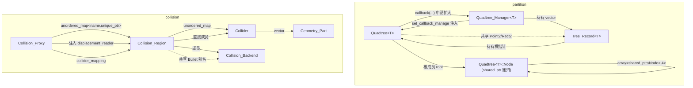

# 空间系统

> 源码根相对路径：`Engine/EngineCore/src/core/spatial/`
> 本文覆盖 `spatial/` 下的两组能力：**空间划分族（partition 四叉树 + 四叉树管理器）** 与 **碰撞检测族（碰撞体 / 碰撞空间 / 碰撞代理器）**，以及二者共享的 `common/` 公共设施。
> 记录依据为当前工作区源码，不含任何旧版次导航信息。

---

## 一、模块功能

### 1.1 模块定位

空间系统位于 `EngineCore` 的 `core` 层最底层之一，向引擎上层提供两类互相独立、但同处一片「二维/三维空间语义」的底层能力：

1. **空间划分（partition）**：把无限平面按「固定区块单元」递归四等分，形成一棵以「区块」为原子的四叉树；对外提供以「区块坐标 ↔ 区块数据」为语义的构建/查找/获取/卸载接口。它本身不处理碰撞，只做「坐标 → 数据槽位」的归档与检索。
2. **碰撞检测（collision）**：以 Bullet 物理库的**碰撞检测部分**（不含动力学刚体求解）为后端，提供「碰撞体几何装配 → 碰撞空间（一片独立碰撞世界）→ 碰撞检测执行 → 碰撞事件与碰撞响应」的完整通路。

二者通过 `common/` 共享两件事：**自定义二维坐标类型（整数/双精度两套）** 与 **Bullet 库的类型别名与内存封装**。

### 1.2 职责边界

| 子模块 | 负责 | 不负责 |
| --- | --- | --- |
| `common/core/坐标类型.h` | 提供 `Point2` / `Rect2` 模板与精度转换；浮点相等采用 ULP 容差 | 不持有任何状态，不做空间划分 |
| `common/core/依赖库封装.h` | Bullet 类型别名、静态标记、`Collision_Backend` 后端生命周期封装 | 不做几何装配与业务逻辑 |
| `common/碰撞系统运行包.h` | 碰撞族的「打包头文件」：一次引入前置头、Bullet 封装、碰撞体、碰撞空间 | 不含实现 |
| `partition/Quadtree` | 单棵四叉树的全部行为（增删查改、扩大、范围推导、节点内存管理） | 不管理多棵树的布局/合并 |
| `partition/Quadtree_Manager` | 管理一组四叉树：智能建树、相邻树筛选、扩大仲裁、合并、卸载、高速缓存、序列查询 | 不直接操作树内节点 |
| `collision/Collider` | 碰撞体的**纯数据结构**（几何部件、位移、检测方式、豁免、几何配置） | 不含任何成员函数式业务逻辑（仅装配/反查辅助） |
| `collision/Collision_Region` | 一片碰撞世界：边界构建、碰撞体登记、几何装配、检测执行、跨越判定 | 不认识「多空间」概念，不发布事件 |
| `collision/Collision_Proxy` | 多空间门面 + 事件桥：空间/碰撞体全生命周期 API、位移事件、碰撞响应协议、事件发布 | 不实现检测算法，全部转调 `Collision_Region` |

### 1.3 在整体架构中的位置

- 上游使用者有两种接入方式：
  - **直接调用**：需要精确控制时，上层系统直接持有 `Quadtree<T>` / `Quadtree_Manager<T>` / `Collision_Proxy` 对象；
  - **事件驱动**：`Collision_Proxy` 通过 `Event_Terminal` 接入事件中转站，外部只需发送事件即可驱动全部碰撞流程（详见第四章事件协议）。
- 下游依赖：`partition` 族仅依赖 `tools/Detail/二分查找.h`（范围二分查找）与日志系统；`collision` 族依赖 `tools/Mesh_Loader`（网格加载）、`tools/Number_Allocator`（编号分配）、`tools/Engine_Env`（逻辑帧计数/帧率）、`tools/Detail/package/数据校验工具.h`（JSON 字段校验）、`tools/Detail/路径字符串转换.h`（路径编解码）、日志系统，以及外部库 **Bullet** 与 **nlohmann/json**。
- 边界说明：**partition 与 collision 之间没有代码级依赖**。四叉树不用于碰撞宽阶段；碰撞宽阶段由 Bullet 自带的 `btDbvtBroadphase`（BVH）承担。二者仅在概念上共享「空间坐标」语义（且 `partition` 使用自定义 `Point2l`，`collision` 使用 Bullet 的 `btVector3`，两套坐标系完全不互通）。

---

## 二、模块提供接口

> 约定：`T` 为四叉树挂载的数据类型，当前实例化为 `int`（见 `core/四叉树实例化.cpp`、`core/四叉树管理器实例化.cpp`）。
> 除特别说明外，所有类型与函数均位于 `engine` 命名空间。

### 2.1 公共坐标类型（`common/core/坐标类型.h`）

#### `template <typename T> struct Point2`

二维点。字段：

| 字段 | 类型 | 含义 |
| --- | --- | --- |
| `X` | `T` | 横坐标，默认 `T{}` |
| `Y` | `T` | 纵坐标，默认 `T{}` |

接口：

| 签名 | 说明 |
| --- | --- |
| `Point2() = default` | 默认构造，坐标为零值 |
| `Point2(T x, T y)` | 带参构造 |
| `bool operator==(const Point2&) const noexcept` | 浮点型走 **ULP 容差比较**（允许 4 个 ULP；NaN 恒不等；无穷走精确比较）；整数型走精确比较 |
| `bool operator!=(const Point2&) const noexcept` | `==` 取反 |
| `friend ostream& operator<<` | 格式化输出 |

别名：`Point2i = Point2<int32_t>`、`Point2l = Point2<int64_t>`、`Point2d = Point2<double>`。

#### `template <typename T> struct Rect2`

二维矩形（**注意**：字段语义是四条边界，而非「左上角 + 宽高」）。字段：`left`、`right`、`up`、`down`（`up` 为较大的 Y，`down` 为较小的 Y）。接口：默认构造、`Rect2(T l, T r, T u, T d)`、`operator==`（**精确比较，无 ULP 容差**）、`operator!=`、`operator<<`。别名：`Rect2i` / `Rect2l` / `Rect2d`。

#### 精度转换（自由函数）

| 签名 | 返回 | 约束 |
| --- | --- | --- |
| `Point2i point_to_int(const Point2d&)` | 就近取整（`std::lround`） | `noexcept` |
| `Point2d point_to_double(const Point2i&)` | 精确提升 | `noexcept` |
| `Point2l point_to_l(const Point2d&)` | 就近取整（`std::llround`） | `noexcept` |
| `Point2d point_to_double(const Point2l&)` | 精确提升 | `noexcept` |
| `uint64_t detail::ulp_distance(double,double)` | 两浮点的 ULP 距离 | 符号不同返回 `UINT64_MAX` |

### 2.2 Bullet 依赖封装（`common/core/依赖库封装.h`）

对外提供一组 `using` 别名（全部在 `engine` 命名空间下），命名一律为「语义化中文式英文名」：

| 别名 | 对应 Bullet 类型 |
| --- | --- |
| `Collision_Config` | `btDefaultCollisionConfiguration` |
| `Collision_Dispatcher` | `btCollisionDispatcher` |
| `Collision_Interface` | `btBroadphaseInterface` |
| `Bvh_Tree` | `btDbvtBroadphase`（宽阶段 BVH，实际采用） |
| `SAP` | `btAxisSweep3`（宽阶段扫描线，备选） |
| `Collision_World` | `btCollisionWorld` |
| `Collision_Object` | `btCollisionObject` |
| `Bvh_Triangle_Mesh` | `btBvhTriangleMeshShape` |
| `Triangle_Mesh` | `btTriangleMesh` |
| `Collision_Shape` / `Convex_Shape` / `Box_Shape` / `Sphere_Shape` / `Capsule_Shape` / `Cylinder_Shape` / `Cone_Shape` / `Compound_Shape` | 各形状基类/具体形状 |
| `Vector3` / `Transform` / `Quaternion` / `Scalar` | `btVector3` / `btTransform` / `btQuaternion` / `btScalar` |
| `Persistent_Manifold` | `btPersistentManifold` |
| `Swept_Callback` / `Swept_Result` | `Collision_World::ConvexResultCallback` / `LocalConvexResult` |
| `AllHits_Ray_Callback` | `Collision_World::AllHitsRayResultCallback` |
| `Static_Object_Flag` | `btCollisionObject::CF_STATIC_OBJECT` 常量 |

#### `struct Collision_Backend`

一片碰撞世界的**四件套持有者**，承担后端对象的生命周期。

字段：

| 字段 | 类型 | 含义 |
| --- | --- | --- |
| `config` | `std::shared_ptr<Collision_Config>` | 碰撞配置（可跨后端共享） |
| `dispatcher` | `std::unique_ptr<Collision_Dispatcher>` | 窄阶段调度器 |
| `broadphase` | `std::unique_ptr<Collision_Interface>` | 宽阶段接口（实际实例为 `Bvh_Tree`） |
| `world` | `std::unique_ptr<Collision_World>` | 碰撞世界 |

接口与约束：

| 签名 | 说明 |
| --- | --- |
| `explicit Collision_Backend(std::shared_ptr<Collision_Config>)` | 以共享配置构造；四件套全部用 `new(nothrow)` 分配，任一失败则全部 `reset` 置空 |
| `Collision_Backend()` | 默认构造，等价于以新建配置构造 |
| `~Collision_Backend() = default` | 默认析构 |
| 拷贝构造/赋值 | **已 delete**（含 `unique_ptr`） |
| 移动构造/赋值 | 默认 |
| `bool valid() const` | 四指针全部非空才为真 |

> 约束：`Collision_Backend` 是**值语义容器**，但其内部 `world` 记录的是碰撞对象的地址，因此**一旦向 world 挂入直接成员（如空间边界），就不能再按值搬移持有者**（详见 `Collision_Region` 的移动语义告警）。

### 2.3 四叉树（`partition/Quadtree`）

对外头文件：`partition/Quadtree/四叉树.h`（它仅聚合 `函数预声明.h` 与四个 `core/*.hpp`）。

#### `struct Tree_State`（`partition/Quadtree/数据结构.h`）

| 字段 | 类型 | 默认 | 含义 |
| --- | --- | --- | --- |
| `root` | `Point2d` | `{0.5,0.5}` | 树根中心坐标（浮点，避免根节点中心偏移） |
| `size` | `uint64_t` | `0` | 四叉树当前边长 |
| `max_size` | `uint64_t` | `2^63` | 边长上限 |
| `block_size` | `uint64_t` | `0` | 最小区块单元边长 |

#### `template <typename T> struct Tree_Chunk_Data`

区块查询/获取的结果载体。

| 字段/接口 | 说明 |
| --- | --- |
| `Point2d node` | 区块中心坐标（由 `Rect2l` 范围求中点后落 `float` 再提升） |
| `std::shared_ptr<T> data` | 该区块挂载的数据（与叶子节点共享所有权） |
| `Tree_Chunk_Data()` | 默认构造 |
| `Tree_Chunk_Data(float x, float y, std::shared_ptr<T> ptr)` | 列表构造（注：形参为 `float`，但 `node` 为 `Point2d`，属隐式提升） |

#### `template <typename T> class Quadtree`

构造与生命周期：

| 签名 | 参数 | 返回 | 约束 |
| --- | --- | --- | --- |
| `Quadtree(const uint64_t& size = 256, const Point2d& root = {0.5,0.5})` | 初始边长、根中心 | — | 仅写入 `state`，不预先分配节点 |
| `~Quadtree(void)` | — | — | 空实现；节点由 `shared_ptr` 递归 RAII 回收 |

设置类接口：

| 签名 | 参数 | 返回 | 约束 |
| --- | --- | --- | --- |
| `bool set_block_size(const uint64_t& size)` | 最小区块单元边长 | 成功与否 | **必须 `size < state.size`**，否则返回 `false` 且不改动（禁止退化树） |
| `bool set_max_size(const uint64_t& size)` | 边长上限 | 成功与否 | **必须 `size > state.size`**，否则返回 `false` |
| `void set_callback_manage(const std::function<bool(Point2d root, Point2l target)>& cb)` | 扩大申请回调 | — | 回调返回 `true` 表示允许扩大；由 `Quadtree_Manager` 注入 |

区块操作接口（四个动作 × 两个重载）：

| 签名 | 语义 | 只读性 | 约束 |
| --- | --- | --- | --- |
| `void build(const Point2l& target, const std::shared_ptr<T>& data = nullptr)` | 单点构建 | 写 | 目标点所在区块不存在则创建叶子；`data` 形参**见第四章易错点 E1** |
| `void build(const Rect2l& target_range)` | 范围构建 | 写 | 范围内默认对齐区块逐个创建 |
| `void seek(const Point2l& target, std::shared_ptr<Tree_Chunk_Data<T>>& receiver)` | 单点查找 | 只读 | 不做任何创建；未命中时 `receiver` 为空 |
| `void seek(const Rect2l& target_range, std::vector<std::shared_ptr<Tree_Chunk_Data<T>>>& receiver)` | 范围查找 | 只读 | 追加结果至 `receiver` |
| `void get(const Point2l& target, std::shared_ptr<Tree_Chunk_Data<T>>& receiver)` | 单点获取 | 写（缺失即建） | 缺失区块会被创建 |
| `void get(const Rect2l& target_range, std::vector<std::shared_ptr<Tree_Chunk_Data<T>>>& receiver)` | 范围获取 | 写 | 缺失区块会被创建 |
| `void unload(const Point2l& target)` | 单点卸载 | 写 | 仅摘除对应叶子节点本身 |
| `void unload(const Rect2l& target_range)` | 范围卸载 | 写 | 摘除范围内全部叶子节点 |

> 语义区分：`seek` 为纯只读（不建节点、不扩大）；`get` 为「读并补齐」（缺失即创建，必要时申请扩大）；`build` 为纯建（不返回结果）；`unload` 为删。

状态与树级操作：

| 签名 | 返回 | 说明 |
| --- | --- | --- |
| `const Tree_State& tree_state_get(void) const` | 状态引用 | 只读查看 |
| `bool tree_expand(void)` | 成功与否 | 原地扩大：在原四叉树之上加一层中间节点，四棵旧子树按反方向挂入；`size *= 2`；分配失败返回 `false` |

底层计算工具（**这些函数位于 `public:` 区，属对外可用**，`Quadtree_Manager` 正是复用它们）：

| 签名 | 参数含义 | 返回/输出 | 说明 |
| --- | --- | --- | --- |
| `void inclusion_range_calcu(Rect2l& receiver, const Point2l& target)` | 目标点 | 输出该点所属区块的范围 | 由 `block_size` 与根中心迭代对齐至包含目标点 |
| `void child_node_range_calcu(const int& recur_direct, Rect2l& child_range, const Rect2l& parent_range) const` | 方向（`NW/NE/SW/SE`）、父范围 | 输出子范围 | 分割点按 `left + (right-left)/2` 计算以规避负数截断 |
| `void manage_range_calcu(Rect2l& receiver, const Point2d& root, const uint64_t tree_size) const` | 根中心、边长 | 输出管理范围 | 抵消 `0.5` 偏移后按半跨度展开 |
| `void target_range_format(Rect2l& target_range, const Point2d& root, const uint64_t block_size) const` | 待查询范围、根中心、区块单元 | 就地格式化 | 向四个方向对齐到区块边界；`block_size == 0` 直接返回（防除零） |
| `Point2d seekable_range_calcu(const Rect2l& target_range, Rect2l& seekable_range) const` | 目标范围、树管理范围 | 就地裁剪 `seekable_range` 并返回「申请扩大标记」 | 标记非根中心即表示目标越界需扩大 |

其余函数（`recur_level_calcu`、`range_relation_get`、`child_node_recur`、`leaf_recur`、`chunk_operate`、`seekable_analyse`）均为 `private`，属内部实现（详见第三章）。

#### 私有枚举（组成部分，供理解）

- `enum Node_Type { MIDDLE, LEAF }`：节点类型；
- `enum class Operate_Mode { Build, Seek, Get, Unload }`：区块操作模式；
- `enum Range_Relation { PART_IN, NONE_IN }`：范围关系（当前逻辑只用其布尔含义）；
- `enum Recur_Direct { NW, NE, SW, SE }`：子节点方向。

### 2.4 四叉树管理器（`partition/Quadtree_Manager`）

对外头文件：`partition/Quadtree_Manager/四叉树管理器.h`。

#### `struct Tree_Record<T>`

单棵四叉树的档案。

| 字段/说明 | 类型 | 含义 |
| --- | --- | --- |
| `tree`（**private**） | `Quadtree<T>*` | 裸指针，实际持有者为 `Quadtree_Manager`；设为私有并 `friend Quadtree_Manager<T>`，外部只能观察不能越权 |
| `root`（public） | `Point2d` | 树根中心坐标 |
| `size`（public） | `uint64_t` | 树边长，默认 `256` |

#### `struct Tree_Manager_Settings`

| 字段 | 默认 | 含义 |
| --- | --- | --- |
| `block_size` | `16` | 最小区块单元 |
| `max_tree_size` | `65536` | 边长上限 |
| `min_tree_size` | `256` | 边长下限 |
| `is_cache_enabled` | `true` | 高速缓存开关 |
| `cache_active_threshold` | `32` | 树数量达到该值才启用缓存 |
| `max_cache_records` | `16` | 缓存条目上限 |

#### `template <typename T> class Quadtree_Manager`

| 签名 | 参数 | 返回 | 约束/说明 |
| --- | --- | --- | --- |
| `Quadtree_Manager()` | — | — | 空 |
| `~Quadtree_Manager()` | — | — | 调用 `clear()` 释放全部树 |
| `bool set_block_size(const uint64_t&)` | 区块单元 | 成功与否 | `block_size <= 0` 或 `>= min_tree_size` 失败；成功则**下发到已存在的每棵树** |
| `bool set_max_size(const uint64_t&)` | 边长上限 | 成功与否 | `max_size <= 0` 或 `<= min_tree_size` 失败；成功下发已存在树 |
| `bool set_min_size(const uint64_t&)` | 边长下限 | 成功与否 | `min_size <= 0` 或 `<= block_size` 失败；**仅记录，不下发、不重建** |
| `void set_cache_state(bool enabled)` | 开关 | — | — |
| `void set_cache_active_threshold(const uint64_t&)` | 阈值 | — | — |
| `void set_max_cache_records(const uint64_t)` | 条目上限 | — | — |
| `void quadtree_build_smart(const std::vector<Point2l>& coord_set)` | 参考坐标点集 | — | 空集直接返回；空管理器执行「包围矩形 → 最大区块网格 → 递归细分」；非空管理器对未覆盖点走扩大仲裁 |
| `void seek(const Point2l& target, std::shared_ptr<Tree_Chunk_Data<T>>& receiver)` | 单点 | 输出结果 | 只读；无基准树直接返回；把点格式化为区块范围后复用范围重载 |
| `void seek(const Rect2l& target_range, std::vector<std::shared_ptr<Tree_Chunk_Data<T>>>& receiver)` | 范围 | 追加结果 | 只读 |
| `void get(const Point2l& target, std::shared_ptr<Tree_Chunk_Data<T>>& receiver)` | 单点 | 输出结果 | 缺失即智能建树 |
| `void get(const Rect2l& target_range, std::vector<std::shared_ptr<Tree_Chunk_Data<T>>>& receiver)` | 范围 | 追加结果 | 缺失即智能建树 |
| `const Tree_Manager_Settings& settings_get(void) const` | — | 设置引用 | — |
| `const std::vector<Tree_Record<T>*>& records_get(void) const` | — | 序列引用 | 返回按根 X 降序的序列 |
| `const uint64_t& largest_size_get(void) const` | — | 最大边长引用 | — |
| `void quadtree_merge(void)` | — | — | 合并总函数：收集候选 → 精确筛选 → 建新树 → 迁移数据 → 卸载旧树；期间临时关闭缓存 |
| `void cache_clear(void)` | — | — | 清空缓存记录与范围 |
| `void clear(void)` | — | — | 卸载全部树（索引倒序） |
| `void quadtree_unload(const std::vector<Point2d>& root_set)` | 根中心集合 | — | 按根坐标查找并卸载；同时清理缓存、重算最大边长 |

> 管理器**没有**对外暴露单点/范围 `unload`（只有按根中心批量卸载与整体清空）。

### 2.5 碰撞体（`collision/Collider/碰撞体.h`）

#### `struct Detection_Mode`

| 字段 | 类型 | 默认 | 含义 |
| --- | --- | --- | --- |
| `is_swept_volume` | `bool` | `false` | 是否启用扫掠检测 |
| `step_length` | `uint32_t` | `0` | 离散检测分段步长；`0` 视作不分段（一段） |

#### `struct Geometry_Part`

碰撞体内的一个几何部件（带相对变换）。

| 字段 | 类型 | 含义 |
| --- | --- | --- |
| `mesh` | `std::unique_ptr<Triangle_Mesh>` | 网格数据源（仅网格形状需要） |
| `shape` | `std::unique_ptr<Collision_Shape>` | 几何形状 |
| `local_transform` | `Transform` | 该部件在碰撞体内的相对变换（默认单位） |

> 声明顺序即析构逆序的安全性保障：`mesh` 先声明、`shape` 后声明，于是析构时 `shape` 先释放、`mesh` 后释放，满足「`btBvhTriangleMeshShape` 不接管网格所有权，网格必须比形状活得更久」。

#### `struct Collider`

| 字段 | 类型 | 默认 | 含义 |
| --- | --- | --- | --- |
| `ID` | `uint64_t` | `0` | 碰撞体编号 |
| `object` | `Collision_Object` | — | Bullet 碰撞对象（挂载形状、世界变换、自指针） |
| `parts` | `std::vector<Geometry_Part>` | 空 | 几何部件集合 |
| `compound` | `std::unique_ptr<Collision_Shape>` | 空 | 复合形状（仅多部件时持有） |
| `displacement_vector` | `Vector3` | 零 | 位移向量（一个逻辑帧周期的总位移） |
| `displacement_invalid` | `bool` | `false` | 位移作废标记 |
| `displacement_frequency` | `uint64_t` | `0` | 位移作用频率（逻辑帧率的因数；`0` 表示每次检测都施加全量位移） |
| `displacement_frame` | `uint64_t` | `0` | 位移上次生效的逻辑帧序号 |
| `displacement_step` | `Vector3` | 零 | 本帧实际施加的位移 |
| `detection_mode` | `Detection_Mode` | — | 检测方式 |
| `exemption_flag` | `uint64_t` | `0` | 豁免标记（非零且相等的一对碰撞体互不产生碰撞对） |
| `geometry` | `nlohmann::json` | 空 | 几何配置留档（供空间间镜像/转移复用） |

接口：

| 签名 | 说明 |
| --- | --- |
| `Collider()` | 构造后立即 `object.setUserPointer(this)` |
| `~Collider() = default` | — |
| 拷贝构造/赋值 | **已 delete**（object 入 world 后不可搬移） |
| `Collider(Collider&&) noexcept` | 逐成员搬移后**重挂自指针**并清空源对象自指针 |
| `Collider& operator=(Collider&&) noexcept` | 同上（含自赋值判断） |
| `Collision_Shape* mounted_shape(void) const` | 多部件返回 `compound.get()`；单部件返回首部件形状；无部件返回 `nullptr` |
| `static Collider* recover(const Collision_Object* obj)` | 由碰撞对象反查封装结构（`getUserPointer`） |

### 2.6 碰撞空间（`collision/Collision_Region/碰撞空间.h`）

#### `struct Collision_Result`

碰撞对：`collider_A`（较小编号）、`collider_B`（较大编号），均为 `uint64_t`。

#### `enum class Cross_State { inside, crossing, outside }`

碰撞体相对空间边界的跨越状态。

#### `struct Cross_Notice`

| 字段 | 类型 | 含义 |
| --- | --- | --- |
| `collider_ID` | `uint64_t` | 碰撞体编号 |
| `kind` | `std::string` | `"cross"`（首次部分跨越）/`"return"`（完全回归）/`"exit"`（完全超出跨越） |

#### `struct Collision_Region`

私有成员（理解内部状态用）：`name`、`is_active`、`ID_allocator`（`Number_Allocator<uint64_t>`）、`region_boundary`（`Collider`，静态空间边界）、`backend`（`Collision_Backend`）、`mapping`（`unordered_map<uint64_t,Collider>`）、`displacement_reader`（位移事件读取回调）、`cross_states`（跨越状态记录）、`cross_notices`（本帧跨越通知缓冲）。

对外接口：

| 签名 | 参数 | 返回 | 约束/说明 |
| --- | --- | --- | --- |
| `Collision_Region()` | — | — | 委托到含参构造（空名） |
| `explicit Collision_Region(const std::string& region_name)` | 空间名 | — | 构造时把编号 `0` 预留给空间边界 |
| 拷贝构造/赋值 | — | — | **已 delete** |
| `Collision_Region(Collision_Region&&) = default` | — | — | **见第四章告警**：按值搬移会使 world 内边界指针悬空 |
| `~Collision_Region()` | — | — | 先把边界与全部碰撞体移出 world，避免 world 解引用已释放对象 |
| `bool valid(void) const` | — | 后端是否可用 | — |
| `void state_set(bool active)` | 活跃性 | — | — |
| `bool state_check() const` | — | 活跃性 | — |
| `bool boundary_build(const std::string& mesh_path)` | 网格路径 | 成功与否 | 后端不可用、网格构建失败返回 `false`；已存在则先 `boundary_unload`；边界恒为静态对象、置于原点 |
| `void boundary_unload()` | — | — | 未构建则直接返回 |
| `uint64_t collider_build(void)` | — | 新编号 | 跳过已被接管占用的编号 |
| `bool collider_unload(uint64_t collider_ID)` | 编号 | 成功与否 | 已挂载则摘出 world 并卸载形状；回收编号并抹除跨越记录 |
| `bool collider_set(const uint64_t, const Detection_Mode&)` | 编号、检测方式 | 成功与否 | 编号不存在返回 `false` |
| `bool collider_set(const uint64_t, const uint64_t&)` | 编号、豁免标记 | 成功与否 | 同上 |
| `bool collider_set(nlohmann::json geometry_config)` | 几何配置（须含 `collider_ID`） | 成功与否 | 装配部件与复合形状、写世界变换、入 world；已挂载则先摘除 |
| `bool collider_find(uint64_t collider_id) const` | 编号 | 是否登记 | — |
| `std::vector<uint64_t> colliders(void) const` | — | 全部编号 | — |
| `bool collider_adopt(uint64_t collider_ID)` | 编号 | 成功与否 | 编号已占用返回 `false`（供空间间转移） |
| `nlohmann::json collider_geometry(uint64_t) const` | 编号 | 几何配置副本 | 不存在返回空 json |
| `void displacement_reader_set(std::function<bool(uint64_t,Vector3&)>)` | 回调 | — | 由代理器注入 |
| `bool collider_displacement_void(uint64_t)` | 编号 | 成功与否 | 置位移作废 |
| `bool collider_displacement_replace(uint64_t, const Vector3&)` | 编号、新位移 | 成功与否 | 写位移并解除作废 |
| `bool collider_frequency_set(uint64_t, uint64_t)` | 编号、频率 | 成功与否 | 写频率、重起算生效计时、清零本帧位移 |
| `std::optional<std::vector<Collision_Result>> detect(void)` | — | 检测结果；未激活/后端不可用返回 `std::nullopt` | 主检测入口 |
| `bool contains(uint64_t collider_ID) const` | 编号 | 是否已在 world 中 | 按 world 数组线性比对 |
| `std::vector<Cross_Notice> cross_notices_take(void)` | — | 本帧通知并清空 | 取走式 |

### 2.7 碰撞代理器（`collision/Collision_Proxy/碰撞代理器.h`）

私有成员：`module_name`（固定 `"Collision_Proxy"`）、`regions`（空间名 → `unique_ptr<Collision_Region>`）、`collider_mapping`（编号 → 空间名，`unordered_multimap`）、`displacement_events`（编号 → 位移事件 json）、`collision_responses`（编号 → 响应信箱）、`event_terminal`（public）、`acl_key`（事件发送密钥）。

对外接口：

| 签名 | 参数 | 返回 | 说明 |
| --- | --- | --- | --- |
| `Collision_Proxy()` | — | — | 生成事件发送密钥 |
| `~Collision_Proxy() = default` | — | — | — |
| `bool region_build(const std::string& region)` | 空间名 | 成功与否 | 已存在返回 `false`；成功后注入位移读取回调 |
| `bool region_unload(const std::string& region)` | 空间名 | 成功与否 | 注销该空间全部编号登记后删除空间 |
| `bool region_detect(const std::string& region)` | 空间名 | 成功与否 | 执行检测 → 碰撞响应协议 → 发布跨越通知 → 发布检测结果 |
| `bool region_boundary_set(const std::string& path)` | 边界配置文件路径 | 是否全部成功 | 逐个空间构建边界 |
| `bool region_state_set(const std::string& region, bool active)` | 空间名、活跃性 | 成功与否 | — |
| `std::optional<uint64_t> collider_build(const std::string& region)` | 空间名 | 新编号或 `nullopt` | 登记编号归属 |
| `bool collider_unload(const uint64_t collider_ID, const std::string& region)` | 编号、空间名 | 成功与否 | 注销编号归属 |
| `bool collider_transfer(const uint64_t collider_ID, const std::string& region)` | 编号、目标空间 | 成功与否 | 按原编号在目标空间接管 + 迁移几何配置；先接管后卸载，失败即回滚 |
| `bool collider_mirror(const uint64_t collider_ID, const std::string& region)` | 编号、目标空间 | 成功与否 | 在目标空间构建**全新编号**并复制几何配置 |
| `bool collider_set(const uint64_t, const Detection_Mode&)` | 编号、检测方式 | 成功与否 | 对所有持有该编号的空间生效 |
| `bool collider_set(const uint64_t, const uint64_t&)` | 编号、豁免标记 | 成功与否 | 同上 |
| `void attach(void)` | — | — | 接入事件中转站并订阅事件清单 |

事件发布标签（由本模块发出）：`ColliderBuildResult`、`Collision/DetectResult`、`Collision/RegionCrossNotice`、`Collision/ColliderCollision`。

事件接收标签（本模块订阅，`Collision` 分类）：`RegionBuild`、`RegionUnload`、`RegionState`、`RegionBoundary`、`RegionDetect`、`ColliderBuild`、`ColliderUnload`、`ColliderTransfer`、`ColliderMirror`、`ColliderSet`、`ColliderDisplacement`、`ColliderCollisionResponse`，以及 `Config/Load` 路由指令。

### 2.8 局部命名空间使用

- `partition` 族**不使用** `局部命名空间使用.h`，其 `.hpp` 与 `.cpp` 中一律书写完整的 `std::` 前缀（如 `std::shared_ptr`、`std::vector`）。
- `collision` 族使用 `局部命名空间使用.h`：`Collision_Region/局部命名空间使用.h` 引入 `string/vector/set/pair/unique_ptr/optional/nothrow/json`；`Collision_Proxy/局部命名空间使用.h` 额外引入 `unordered_map/shared_ptr/nullopt`。`.cpp` 中实现代码一律不加 `std::`/`nlohmann::` 前缀。

---

## 三、模块内部架构

### 3.1 目录结构树

```text
Engine/EngineCore/src/core/spatial/
├── common/
│   ├── 碰撞系统运行包.h                 # 碰撞族打包头
│   └── core/
│       ├── 坐标类型.h                   # Point2/Rect2 模板 + 精度转换 + ULP 比较
│       └── 依赖库封装.h                 # Bullet 别名 + Collision_Backend
├── partition/
│   ├── Quadtree/
│   │   ├── 四叉树.h                     # 对外聚合头
│   │   ├── 函数预声明.h                 # Quadtree<T> 类定义（模板）
│   │   ├── 数据结构.h                   # Tree_State、Tree_Chunk_Data
│   │   └── core/
│   │       ├── 设置与交互.hpp           # 构造/析构/设置/状态
│   │       ├── 导航与范围计算.hpp       # 级数/范围/格式/关系/可查询范围
│   │       ├── 节点创建与树扩大.hpp     # 子节点递归（含所有权推进）+ tree_expand
│   │       ├── 区块信息检索.hpp         # build/seek/get/unload + leaf_recur + chunk_operate
│   │       └── 四叉树实例化.cpp         # template class Quadtree<int>;
│   └── Quadtree_Manager/
│       ├── 四叉树管理器.h               # 对外聚合头
│       ├── 函数预声明.h                 # Quadtree_Manager<T> 类定义
│       ├── 数据结构.h                   # Tree_Record、Tree_Manager_Settings
│       └── core/
│           ├── 设置与交互.hpp           # 构造/析构/设置/读取/缓存/清空
│           ├── 基础操作.hpp             # 直属查找/索引查找/建树/卸载
│           ├── 区块信息检索.hpp         # chunk_query 及范围/单点 seek/get
│           ├── 四叉树合并.hpp           # 收集候选/精确筛选/合并总函数
│           ├── 四叉树扩大回调管理.hpp   # 回调树查找/新树范围计算/扩大仲裁
│           ├── 四叉树智能创建.hpp       # 参数准备/单区块递归划分/智能创建主函数
│           ├── 相邻四叉树查找.hpp       # 矩形筛选/分类/验证/候选/总查找
│           └── 四叉树管理器实例化.cpp   # template class Quadtree_Manager<int>;
└── collision/
    ├── Collider/碰撞体.h                # Detection_Mode/Geometry_Part/Collider
    ├── Collision_Region/
    │   ├── 碰撞空间.h                   # Collision_Result/Cross_State/Cross_Notice/Collision_Region
    │   ├── 局部命名空间使用.h
    │   └── core/
    │       ├── 形状构建.cpp             # 字段读取 + 形状/几何体装配
    │       ├── 碰撞体管理.cpp           # 编号分配/登记/设置/查询/位移操作
    │       ├── 空间与边界.cpp           # 构造/析构/状态/边界构建卸载/位移回调注入
    │       ├── 检测执行.cpp             # detect() 主检测
    │       └── 跨越通知.cpp             # 边界包含性 + 跨越状态更新 + 通知取走
    └── Collision_Proxy/
        ├── 碰撞代理器.h                 # Collision_Proxy 类定义
        ├── 局部命名空间使用.h
        └── core/
            ├── 空间管理.cpp             # 构造/空间增删/检测入口/编号登记
            ├── 碰撞体管理.cpp           # 构建/卸载/转移/镜像/设置分发
            ├── 碰撞体配置.cpp           # 配置分发与几何/检测/豁免字段应用
            ├── 空间边界与配置.cpp       # 边界批量设置 + Config/Load 应用 + 配置文件读取
            ├── 事件交互.cpp             # attach/event_process/event_publish
            ├── 位移管理.cpp             # 位移登记/查询/回调注入
            └── 碰撞响应.cpp             # 响应登记/取件/施加 + 响应协议
```

### 3.2 编译单元职责

#### Quadtree

- `core/设置与交互.hpp`：构造只记录 `size` 与 `root`；`set_block_size` / `set_max_size` 做上下界守卫；`set_callback_manage` 注册回调；`tree_state_get` 返回内部状态常量引用。
- `core/导航与范围计算.hpp`：纯几何/算术层。
  - `recur_level_calcu`：`for (tree_size = size; (tree_size /= 2) >= block_size;) address_series++;` 计算从根到最小区块的递归层数。
  - `inclusion_range_calcu`：从根中心的「单区块范围」出发，按 `block_size` 逐次向对应方向平移直至包含目标点。
  - `child_node_range_calcu`：把父范围四等分，**分割点使用 `left + (right - left)/2` 与 `down + (up - down)/2`**（避免负数向零截断），并把中间点分别以 `±1` 归入两侧闭区间。
  - `manage_range_calcu`：由根中心与边长求管理范围（半跨度 `tree_size/2 - 1`）。
  - `target_range_format`：把待查询范围对齐到区块边界；用自定义安全取模处理负数；`block_size == 0` 提前返回。
  - `range_relation_get`：AABB 相交判定。
  - `seekable_range_calcu`：把树管理范围与目标范围求并集，同时返回「目标越出原范围的坐标」作为扩大标记。
- `core/节点创建与树扩大.hpp`：
  - `child_node_recur`：**所有权推进的关键点**。若当前节点持有数据（`data.index()==1`）先就地转换为中间节点；子槽为空且非只读时用 `new(nothrow)` 创建并由 `shared_ptr` 持有；随后 `this_node` 被改写为「子槽的裸观察指针」。
  - `tree_expand`：新建四个中间节点（`shared_ptr` 持有），把原根的子槽按反方向挂入新中间节点（`NW↔SE`、`NE↔SW`），再挂回根槽，`size *= 2`。
- `core/区块信息检索.hpp`：对外四个动作的落地。
  - `build/seek/get/unload` 各两个重载 → 统一转调 `chunk_operate`。
  - `leaf_recur`：递归收集/创建/卸载叶子。到最大层时逐个方向判定相交，`Unload` 直接 `子槽.reset()`；其余模式递归到叶子后，`Seek/Get` 生成 `Tree_Chunk_Data` 结果（与叶子数据共享所有权），`Build` 仅创建叶子。
  - `chunk_operate(Rect2l,...)`：格式化范围 → `seekable_analyse` 申请扩大 → 计算级数 → 从根递归。
  - `chunk_operate(Point2l,...)`：求目标点区块范围后转调范围重载。

#### Quadtree_Manager

- `core/设置与交互.hpp`：设置项的记录与下发；`clear()` 以倒序索引调用卸载；缓存的清空。
- `core/基础操作.hpp`：
  - `quadtree_inclusion_seek`：先查高速缓存（命中即前移提升），再顺序扫描 `X_sequence`（按根 X 降序），命中后按阈值决定是否写入缓存。
  - `quadtree_index_seek`：用 `detail::range_binary_search`（比较器 `std::ranges::greater`，投影取 `root.X`）定位同 X 的区间，再在该区间内以 `Point2d::operator==`（ULP 容差）匹配完整坐标。
  - `quadtree_build`：分配 `Tree_Record` 与 `Quadtree`，维护 `largest_tree_size`，下发上限/区块单元，注入扩大回调（`tree_expand_approve`），插入后按根 X 降序排序。
  - `quadtree_unload`（索引重载 + 根坐标重载）：清理缓存条目、释放树与档案、从序列移除、重算 `largest_tree_size`。
- `core/区块信息检索.hpp`：
  - `chunk_query`：核心范围查询。空序列时只读直接返回、非只读兜底 `quadtree_build_smart`；以基准树格式化范围，按区块网格遍历，每格找直属树并在只读/非只读分支调用 `seek`/`get`，用布尔表 `excel` 标记已覆盖区块以跳过。
  - `target_range_amend` / `excel_element_to_coord`：区块网格与一维下标的互转。
  - `seek`/`get` 重载：范围重载转 `chunk_query`；单点重载用基准树的 `inclusion_range_calcu` 把点变成区块范围后复用范围重载。
- `core/相邻四叉树查找.hpp`：四级筛选。矩形筛选（按根坐标框选）→ 分类筛选（按边长和的一半判定 X/Y 命中）→ 验证确认（管理范围相交）→ 候选筛选（综合前三级）→ `next_tree_seek` 总函数。
- `core/四叉树扩大回调管理.hpp`：
  - `callback_tree_seek`：按根坐标找回调树。
  - `new_tree_range_calcu`：由基准树根与最小树尺寸推算一个包含目标的新树范围。
  - `tree_expand_approve`：扩大仲裁。若目标已被其它树覆盖直接拒绝；若当前树未达上限则检查「扩大后的管理范围」内是否已有其它树根（`rectangle_filter`）与是否存在重叠树（`next_tree_seek` + 重叠筛选 lambda）；可行时在内部调用模式下执行 `tree_expand()`；不可行则退化为**新建一棵最小尺寸四叉树**并返回 `false`。
- `core/四叉树智能创建.hpp`：
  - `prepare_smart_create_params`：求点集包围矩形，按 `max_tree_size` 补齐边长，计算最大区块总网格数（带溢出拦截）。
  - `divide_single_father_block`：对单个最大区块递归细分；到 256 直接建树；否则判断点集是否「中心聚集」（偏移 <= 0.375×边长），聚集且全部落入同一子区块则继续细分，否则在当前区块建树。
  - `quadtree_build_smart`：空管理器走「包围矩形 → 网格计点 → 逐区块划分 → 统一建树」；非空管理器对每个未覆盖点调用 `tree_expand_approve`（内部模式）。
- `core/四叉树合并.hpp`：
  - `quadtree_merge_collect`：按「可扩大级数」分组，组内数量 >= 4 的进入候选；对每棵中心树求相邻树（`next_tree_seek`，限定在候选组内），相邻数 >= 3 即记录为一个候选组合。
  - `quadtree_merge_filter`：穷举 4 棵树的中心均值为新树可能根坐标，命中即以**指针去重集合**记录组合。
  - `quadtree_merge`：临时关闭缓存 → 收集 → 筛选 → 对每个组合建新树（边长 ×2）、范围查询迁移区块数据（`build(point_to_l(node), data)`）、卸载旧树 → 恢复缓存。

#### Collision_Region

- `core/空间与边界.cpp`：构造（预留编号 0 给边界）、析构（先把边界与全部碰撞体移出 world）、`valid/state_*`、`displacement_reader_set`、`boundary_build`/`boundary_unload`。
- `core/形状构建.cpp`：文件内匿名命名空间提供 `memory_malloc`（把 Bullet 的抛异常分配包装为失败返回）；`scalar_read`/`vector_read`/`quaternion_read` 字段读取；`mesh_shape_build`（经 `Mesh_Loader::load_obj` 装配 `Triangle_Mesh` 与 `Bvh_Triangle_Mesh`）；`shape_build`（按 `type` 分派 box/sphere/capsule/cylinder/cone/mesh，校验尺寸，下发 margin）；`geometry_build`（集合形式逐个部件 + 复合形状装配，单几何体形式视作单部件集合）。
- `core/碰撞体管理.cpp`：`collider_build`（分配并跳过已占用编号）、`collider_adopt`、`collider_unload`、三个 `collider_set`、`collider_find`、`colliders`、`collider_geometry`、`contains`、`collider_seek`、位移三操作（void/replace/frequency）。
- `core/检测执行.cpp`：`detect()` 主流程，见第五章。
- `core/跨越通知.cpp`：`cross_notices_take`、`boundary_point_inside`（射线奇偶）、`cross_state_update`。

#### Collision_Proxy

- `core/空间管理.cpp`：构造（取密钥）、`region_build/unload/detect/state_set`、`region_seek`、编号登记/注销。
- `core/碰撞体管理.cpp`：`collider_build/unload/transfer/mirror`、两个 `collider_set` 分发。
- `core/碰撞体配置.cpp`：`collider_set_dispatch`（对全部持有空间施加）、`collider_config_apply`（几何/检测方式/豁免标记字段）。
- `core/空间边界与配置.cpp`：`region_boundary_set`、`config_apply`（`Config/Load` 批量构建）、`boundary_config_read`。
- `core/事件交互.cpp`：`attach`、`event_process`（路由分派）、`event_publish`。
- `core/位移管理.cpp`：`displacement_register`（含频率合法性检查）、`displacement_seek`、`region_displacement_link`。
- `core/碰撞响应.cpp`：`collision_response_register/take/apply`、`collision_protocol`。

### 3.3 内部数据结构字段逐项说明

#### `Quadtree<T>::Node`（私有，`函数预声明.h`）

| 成员 | 类型 | 含义 |
| --- | --- | --- |
| `data` | `std::variant<std::array<std::shared_ptr<Node>,4>, std::shared_ptr<T>>` | 分支 0 = 中间节点（四个子槽，固定数组）；分支 1 = 叶子节点（区块数据） |

构造 `explicit Node(Node_Type mode = MIDDLE, std::shared_ptr<T> external_data = nullptr)`：

- `MIDDLE`：`data.emplace<0>({ nullptr,nullptr,nullptr,nullptr })`；
- `LEAF` 且外部传入数据：`data.emplace<1>(external_data)`；
- `LEAF` 且无外部数据：`data.emplace<1>(std::shared_ptr<T>(new(nothrow) T()))`。

> **所有权模型要点**：四叉树只有一个根成员 `Node root;`，根本身是值成员；其下所有子节点全部由 `std::shared_ptr<Node>` 递归持有。递归过程中使用的 `Node*` 一律是**非持有观察者**（由 `child_node_recur` 把父节点的 `shared_ptr` `.get()` 后传出）。因此整棵树的释放只需根节点析构即可级联完成，`~Quadtree` 无需手写释放。

#### `Tree_Record<T>` 的 `tree` 私有化

`tree` 为 `Quadtree<T>*`（裸指针，由管理器负责 `delete`），private + 友元，确保外部只能经 `records_get()` 观察记录而不能释放。`root` / `size` 为 public 只读语义字段（无封装）。

#### `Collision_Region` 内部状态

- `region_boundary`：直接成员的 `Collider`，编号固定为 0，恒为静态对象、世界变换为单位。
- `cross_states`：`unordered_map<uint64_t, Cross_State>`，记录每个碰撞体上一次判定结果，首次判定只建立基准不产生通知。
- `cross_notices`：本帧收集，检测结束由 `cross_notices_take()` 一次性交给代理器发布。
- `displacement_reader`：`std::function<bool(uint64_t,Vector3&)>`，由代理器注入（`region_displacement_link`），使碰撞空间在更新位置时能重读代理器中保存的**最新**位移事件。

#### `Collision_Proxy` 内部状态

- `collider_mapping`：`unordered_multimap<uint64_t,std::string>`，允许同一编号被多个空间持有（编号由各空间自行分配，空间之间不共享命名空间）；设置类操作对所有持有者生效。
- `displacement_events` / `collision_responses`：均为「编号 → json」，新事件覆盖旧事件。
- `acl_key`：从 `event_terminal.key()` 取得的事件发送权限密钥。

### 3.4 内部类关系图



---

## 四、模块设计/实现细节

### 4.1 空间划分族

#### D1. 节点所有权：`shared_ptr` 递归 RAII

- 子节点槽固定为 `std::array<std::shared_ptr<Node>, 4>`，方向索引即 `Recur_Direct`（`NW=0,NE=1,SW=2,SE=3`）。
- 递归推进时 `child_node_recur` 把 `this_node` 改写为 `child_list[direct].get()`，即**非持有观察者**。所有权始终在父节点的 `shared_ptr` 槽里。
- 好处：`tree_expand` 只需搬移四个 `shared_ptr`；`unload` 只需 `reset()` 一个槽；`~Quadtree` 为空实现，靠根节点析构级联回收整棵树，**不会泄漏**。分配一律 `new(std::nothrow) Node(...)`，失败时 `shared_ptr` 为空，递归函数返回 `false` 并由调用方跳过该方向。

#### D2. 原地扩大与世界坐标不变

`tree_expand` 在原四叉树之上插入一层，使 `size` 翻倍，但**区块的世界位置不变**：旧的 `NW` 子树挂到新中间节点的 `SE` 槽，`NE→SW`、`SW→NE`、`SE→NW`（方向取反）。扩大后根中心 `root` 不变，`state.size *= 2`，从而所有既有区块的坐标语义保持一致。

#### D3. `unload` 直接卸载叶子本身

当前实现中，`Unload` 模式在递归到最大层后执行：

```cpp
//若为区块卸载模式
if (mode == Operate_Mode::Unload)
{
    //卸载叶子节点本身(子节点槽置空即删除该叶子)
    std::get<0>(parent_node->data)[recur_direct].reset();
    continue;
}
```

即**把父节点对应方向的子槽置空**，`shared_ptr` 归零使该叶子节点连同其数据一并析构。**不再有「卸载即挂载空数据」的旧行为**。注意：仅叶子被摘除，中间节点仍保留（除非整棵子树被后续操作回收），因此卸载后树结构存在空槽是正常状态。

#### D4. 内部函数改名：`node_operate` → `chunk_operate`，`leaf_collect` → `leaf_recur`

当前源码已全面采用新名：

- `chunk_operate(const Point2l&, Operate_Mode, receiver, data)` 与 `chunk_operate(const Rect2l&, Operate_Mode, receiver)`；
- `leaf_recur(const Rect2l& target_range, const Rect2l& parent_range, Operate_Mode, int now_level, const int& max_level, Node* parent_node, receiver)`。

命名改动使语义更贴合「区块（chunk）」与「递归（recur）」，调用点（`build/seek/get/unload` 及 `chunk_operate` 内部）已全部同步。

#### D5. 管理器对外 API 与四叉树风格同步

`Quadtree_Manager<T>` 保留了与 `Quadtree<T>` 一致的 `build/seek/get` 动词族与 `set_*` 设置族命名风格；差别在于管理器**不直接暴露 `build(Rect2l)`**，而是用 `quadtree_build_smart`（智能建树）、`quadtree_merge`（合并）、`quadtree_unload`（卸载）统一管理树的生命周期。

#### D6. 单点查询复用范围查询

管理器单点 `seek(Point2l)` / `get(Point2l)` 的实现是：

```cpp
//借用基准四叉树把点坐标格式化为区块范围
Rect2l target_range{};
tree_group.front()->tree->inclusion_range_calcu(target_range, target);
//转调范围重载
seek(target_range, buffer);
```

即**先借用基准四叉树（序列首元素）的 `inclusion_range_calcu` 把点格式化为「一个区块的坐标范围」，再复用范围查询重载**，最后取 `buffer.front()` 作为单点结果。四叉树自身的单点 `chunk_operate` 也是同样的「点 → 范围 → 范围重载」策略（`D6` 统一）。

#### D7. 禁止退化树

- `Quadtree::set_block_size` 要求 `block_size < size`；`set_max_size` 要求 `max_size > size`；
- `Quadtree_Manager::set_block_size` 要求新区块单元 `< min_tree_size`；`set_min_size` 要求 `> block_size`；`set_max_size` 要求 `> min_tree_size`；
- 当区块单元等于树边长时即退化（无递归空间），固被守卫拦截。

#### D8. 高速缓存（LRU 近似）

`tree_cache` 记录「编号 → 管理范围」对；命中时将命中项与其前一项交换（向前进位），实现近似 LRU；插入时若已达 `max_cache_records` 则弹出尾部。`is_cache_enabled` 为假、树数量未达 `cache_active_threshold`、或 `max_cache_records == 0` 时不写缓存。合并期间临时关闭缓存，避免合并过程引用被释放的树。

#### D9. 相邻树四级筛选与合并判据

相邻判定分四级，逐级收紧：

1. **矩形筛选**：以主体树根为原点、半径 `(size + largest_tree_size)/2` 框选根坐标，剔除自身；
2. **分类筛选**：对候选计算根坐标差的绝对值，与 `(两树边长之和)/2` 严格相等者计一次命中；命中 2 次判为对角相邻直接收录，命中 1 次进入下一级；
3. **验证确认**：以管理范围 AABB 是否相交判定（比较函数由调用方以 lambda 传入，不同用途用不同 `way`）；
4. **候选筛选总函数**：串联 2、3。

合并判据为「四棵等大树根坐标的均值为一个新树可能根坐标之一」，并用指针去重集合保证同一棵树不被重复并入组合；合并后新树边长为原树 ×2。

### 4.2 碰撞族

#### D10. Bullet 内存分配统一走「失败返回」

Bullet 的许多类通过 `BT_DECLARE_ALIGNED_ALLOCATOR` 只声明抛异常形式的内存分配算子，无法 `new(nothrow)`。因此 `形状构建.cpp` 的文件内匿名命名空间用 `memory_malloc<Object_Type>(receiver, args...)` 内 `try/catch` 包裹 `new`，把异常转为「记日志 + 返回 `false`」。这既遵循「禁用异常」的项目约定，又绕开了外部库限制。

#### D11. `Collider` 的自指针与移动语义

`Collider::object` 通过 `setUserPointer(this)` 反向绑定封装结构，`Collider::recover(obj)` 据此把 Bullet 回调里拿到的 `btCollisionObject*` 还原为 `Collider*`。因此：

- 禁止拷贝（对象一旦入 world 不能搬移）；
- 移动构造/赋值**必须显式实现**：先逐成员搬移，再 `object.setUserPointer(this)` 重挂自指针，并 `other.object.setUserPointer(nullptr)` 清空源对象，否则反查会命中已搬空的源对象。

#### D12. `Collision_Region` 的析构顺序与移动告警

- 碰撞世界（`btCollisionWorld`）内部记录的是碰撞对象**地址**；而 `region_boundary` 与 `mapping` 中的 `Collider` 直接持有碰撞对象。
- 因此析构函数必须**先把边界与全部碰撞体移出 world**，再让成员析构，否则 world 析构时会解引用已释放对象。头文件中对 `Collision_Region(Collision_Region&&) = default` 明确告警：**按值搬移本结构体会使 world 内的边界指针悬空，按 `unique_ptr` 搬移不受影响**。

#### D13. 位移按逻辑帧节流

`detect()` 开头的「位移生效门控」按逻辑帧决定本帧施加多少位移：

- `displacement_frequency == 0` 或 `frame_rate == 0`：按旧行为，每次检测都重读最新位移事件并**施加全量位移**（`displacement_step = displacement_vector`）；
- 否则 `interval = frame_rate / frequency`，若 `frame_now - displacement_frame < interval`，本帧位移置零且**不重读外界更新**；达间隔时更新 `displacement_frame`，重读最新位移事件，并令 `displacement_step = displacement_vector / frequency`。
- `frequency` 必须是 `frame_rate` 的因数：`Collision_Proxy::displacement_register` 中若 `frame_rate % frequency != 0` 或 `frame_rate == 0`，会记警告并**把频率降级为 0**（改按每帧全量位移）。
- 频率与生效计时随碰撞体保存在**碰撞空间**内；`collider_frequency_set` 会重起算 `displacement_frame = Engine_Env::frame_count_get()` 并清零本帧位移，即「新配置须等一个完整帧间隔后才生效」。

#### D14. 碰撞检测按 `step_length` 分段推进

- 分段段数由 `step_count_get` 给出：`step_length == 0` 视作 1 段。
- **扫掠检测**（仅启用 `is_swept_volume` 的碰撞体）：对每个**凸包部件**，按 `segment = displacement_step / step_count` 逐段执行 `convexSweepTest`，`Swept_Collector` 固定返回 `1.0f` 以收集全部命中而非最近命中；跳过发起者自身、空间边界、同豁免组。
- **离散检测**：先求所有参与推进碰撞体的最大段数 `max_step_count`，再逐段就地平移（`step >= step_count` 的碰撞体该段不动），每段调 `performDiscreteCollisionDetection()`，遍历 `dispatcher` 全部流形，跳过无接触点者、反查失败者、空间边界接触者与同豁免组，其余记为碰撞对。
- **去重**：所有碰撞对先 `pair_normalize`（小编号在前），再 `pair_unique` 去重。

#### D15. 空间边界的包含性判定：射线奇偶

`boundary_point_inside` 用固定探针方向 `Vector3(1,0.37,0.19).normalized()`（三轴非零以避免与边界面片共面/平行漏检），从点向包围盒对角线两倍长度方向发出 `AllHitsRayResultCallback` 射线，统计与空间边界的交点数；**奇数即在内部**。该判定与射线方向无关，只取决于奇偶性。

#### D16. 跨越状态机

每个碰撞体每帧求一个 `Cross_State`：

- 与边界有接触（流形登记到 `boundary_contacts`）→ `crossing`；
- 无接触 → 取碰撞体包围盒中心为探针点，`boundary_point_inside` 为真则 `inside`，否则 `outside`。

与上次记录比较：首次记录只建立基准；状态转移才生成通知，`crossing→"cross"`、`inside→"return"`、`outside→"exit"`。检测末尾清理已不属本空间的编号记录，避免编号回收后被误继承。

#### D17. 豁免组

`exemption_flag` 非零且两侧相等时，该碰撞对不参与检测结果（扫掠与离散两条路径都判）。

#### D18. 碰撞响应协议（异步、两轮）

`collision_protocol` 的过程：

1. 把碰撞对按碰撞体编号归组，分别登记到两侧；
2. **第一轮**：对每个碰撞体发布 `ColliderCollision` 事件，随后**立即**回查回复信箱；有回复即施加，无回复进入 `pending`；
3. **第二轮**：对 `pending` 再查一次；仍无则**重发** `ColliderCollision` 后再次回查；仍未收到则记错误日志并「搁置处理」。

响应类型：`stop` → `collider_displacement_void`；`keep` → 无操作；`change` → 读取 `displacement`，同步更新代理器保存的位移事件并 `collider_displacement_replace`。

> 该协议为**同步内联**实现：事件发布与回复回查在 `region_detect` 一次调用内完成，回复由订阅方以 `Collision/ColliderCollisionResponse` 事件回送并存于 `collision_responses`。若回复主体在同一检测调用栈内无法产生回复（例如跨模块异步），则将走到重发与搁置分支。

#### D19. 编号体系与空间间转移/镜像

- 每个 `Collision_Region` 自带 `Number_Allocator<uint64_t>`，编号 `0` 预留边界；`collider_build` 分配时会跳过被接管占用的编号。
- 代理器用多重映射登记编号归属，因此**同一编号可同时存在于多个空间**（镜像会产生新编号，转移保留原编号）。
- `collider_transfer`：先 `target->collider_adopt`（失败即中止，源空间未改动），再 `source->collider_unload`（失败则回滚目标空间的接管），然后更新归属并按 `geometry` 在目标空间重建几何体。
- `collider_mirror`：在目标空间构建全新编号，再按源几何配置写入。

#### D20. 配置与事件协议

- `Config/Load` 配置结构：顶层 `regions` 数组；每项含 `region`、可选 `active`、可选 `boundary`（网格路径）、可选 `colliders` 数组。每个碰撞体项经 `collider_config_apply` 处理 `geometry`（对象或数组形式）、`detection_mode`（`is_swept_volume` + `step_length`）、`exemption_flag`。
- 位移事件 `Collision/ColliderDisplacement`：`collider_ID` + `displacement`（三元数组）+ 可选 `frequency`。
- 碰撞响应 `Collision/ColliderCollisionResponse`：`collider_ID` + `response`（`stop`/`keep`/`change`，`change` 需 `displacement`）。
- 边界配置 `region_boundary_set`：读取一个「空间数组」文件，每项 `region` + `mesh_path`。
- 路径处理：`boundary_config_read` 用 `detail::path_check` 校验、`detail::string_to_path` 做字符串→`std::filesystem::path` 的 UTF-8 转换（对应项目「中文路径编码」约定），再用 `std::ifstream` 解析 JSON。

### 4.3 易错点与待确认

- **E1（重要）**：`Quadtree::build(const Point2l& target, const std::shared_ptr<T>& data)` 的 `data` 形参在实现中**未被使用**——单点重载转调范围重载时只传了 `target_range/mode/buffer`，`data` 被丢弃；而 `leaf_recur` 在 `Build` 模式下调用 `child_node_recur(..., LEAF, read_only=false)` 时也未接收外部数据，叶子数据一律为 `new T()`。因此「区块构建 —— 单区块重载(可直接挂载数据)」的注释语义与实现不一致。**唯一使用该形参的地方**是 `Quadtree_Manager::quadtree_merge` 的数据迁移 `new_tree->tree->build(point_to_l(node), data)`——若 `data` 确实被忽略，则合并时区块数据不可迁移。此处存疑。`【待确认】Quadtree::build 单点重载的 data 形参未被下传，是否应挂载到叶子上（直接影响到四叉树合并的数据迁移正确性）。`
- **E2**：`inclusion_range_calcu` 的水平平移分支中，Y 轴上下边界的比较与平移误用了 `target.X`（`receiver.up < target.X`、`receiver.up += ...`、`receiver.down > target.X`、`receiver.down -= ...`），与函数意图（对齐到包含 `target` 的区块）不符，疑为 `target.Y` 笔误。`【待确认】inclusion_range_calcu 中 Y 轴分支与 target.X 比较（疑为 target.Y 笔误）。`
- **E3**：`chunk_operate(Point2l, ...)` 结尾 `receiver = buffer.front();` 未判空。当格式化范围落在树管理范围外且为只读模式（如 `seek` 且未扩大）时，`buffer` 可能为空，`front()` 属未定义行为。`【待确认】chunk_operate 单点重载 receiver = buffer.front() 未判空，是否存在越界风险。`
- **E4**：相邻分类筛选用「根坐标差强转 `int64_t` 后与边长和的一半**严格相等**」作为相邻判据，依赖根坐标恰为整数/半数、树边长为偶数等对齐前提；浮点树的根坐标若存在 ULP 级偏差可能漏判。`【待确认】next_tree_classify 以强制取整差严格相等判相邻，对非对齐根坐标是否稳健。`
- **E5**：`Quadtree_Manager::set_min_size` 仅记录下限，既不下发已存在树，也不校验与 `max_tree_size` 的关系；`set_max_size`/`set_block_size` 下发已存在树但不会重建/搬移既有区块。`【待确认】管理器设置项对已存在树是否应触发重建或重分布。`
- **E6**：`Tree_Chunk_Data(float x, float y, ...)` 形参为 `float` 而字段为 `Point2d`；构造时隐式提升。属历史遗留的类型标注，无功能影响。
- **E7**：`Collision_Region` 提供了默认移动构造/赋值，但头注释已声明按值搬移会导致 world 边界指针悬空。调用方须以 `unique_ptr` 持有（代理器正是如此）。

---

## 五、模块运行链路

### 5.1 四叉树：单点构建/查找（`build` / `seek`）

```text
调用方
  └─ Quadtree<T>::build(Point2l target) / seek(Point2l target, receiver)
       └─ chunk_operate(Point2l, mode, receiver)                    [区块信息检索.hpp]
            ├─ inclusion_range_calcu(target_range, target)          [导航与范围计算.hpp]
            └─ chunk_operate(Rect2l, mode, buffer)                  [区块信息检索.hpp]
                 ├─ target_range_format(...)                        [导航与范围计算.hpp]
                 ├─ seekable_analyse(format_range, seekable, read_only)
                 │    └─ 循环: manage_range_calcu → seekable_range_calcu
                 │          ├─ 需扩大且存在回调 → callback(root, point_to_l(标记))
                 │          │     └─（见 5.2 管理器仲裁）
                 │          └─ tree_expand()                        [节点创建与树扩大.hpp]
                 ├─ recur_level_calcu(max_level)
                 ├─ manage_range_calcu(parent_range, root, size)
                 └─ leaf_recur(seekable, parent_range, mode, 1, max_level, &root, buffer)
                      ├─ 非末级: child_node_recur(观察指针推进, MIDDLE, read_only)
                      └─ 末级  : 方向循环
                           ├─ child_node_range_calcu / range_relation_get
                           ├─ Unload : 子槽.reset()（删除叶子本身）
                           └─ Seek/Get: child_node_recur(..., LEAF) → 生成 Tree_Chunk_Data
       └─ receiver = buffer.front()（单点重载）
```

- **只读分支**：`seek` 全程 `read_only == true`，`child_node_recur` 不会创建节点，`seekable_analyse` 不会扩大；未覆盖区块自然无结果。
- **写分支**：`get`/`build` 会按需创建中间节点与叶子；`build` 不产生结果载体。
- **边界分支**：`block_size == 0`（未配置）时 `target_range_format` 直接返回，级数为 0，递归只在根层进行。

### 5.2 管理器：单点获取与扩大仲裁

```text
调用方
  └─ Quadtree_Manager<T>::get(Point2l target, receiver)
       ├─ 空序列 → quadtree_build_smart({target})                    [四叉树智能创建.hpp]
       │    └─ 空管理器: prepare_smart_create_params → 网格计点
       │                 → divide_single_father_block(每块) → quadtree_build(逐棵)
       ├─ 基准树 inclusion_range_calcu(点 → 区块范围)
       └─ get(Rect2l, buffer) → chunk_query(range, receiver, read_only=false)   [区块信息检索.hpp]
            ├─ 空序列兜底建树
            ├─ 基准树 target_range_format(可查询范围)
            ├─ 计算 want_col/want_row/total_num，建立布尔覆盖表
            └─ 逐格:
                 ├─ excel_element_to_coord(下标 → 点)
                 ├─ quadtree_inclusion_seek(point)              [基础操作.hpp]
                 │    ├─ 高速缓存命中(前进提升) → 返回
                 │    └─ 顺序扫描 X_sequence(根 X 降序) → 命中按阈值写缓存
                 ├─ 未命中且非只读 → quadtree_build_smart({point}) 再查
                 ├─ tree->seek/get(可查询范围, buffer)（分别走只读/写分支）
                 ├─ receiver 追加 buffer
                 └─ target_range_amend 更新覆盖表

扩大仲裁（四叉树回调触发）:
Quadtree::seekable_analyse → callback(root, target)
  └─ Quadtree_Manager<T>::tree_expand_approve(root, target, internal)  [四叉树扩大回调管理.hpp]
       ├─ callback_tree_seek(root)（找不到则拒绝）
       ├─ quadtree_inclusion_seek(target) 已覆盖 → 拒绝
       ├─ 树未达上限: 计算扩大后管理范围
       │    ├─ rectangle_filter 查范围内其它树根
       │    └─ 无其它根 → 临时 size*=2 后 next_tree_seek + 重叠筛选
       │         ├─ 无重叠 → internal 时 tree_expand()，更新缓存与 largest_tree_size，返回 true
       │         └─ 有重叠 → 拒绝 → 走新建
       └─ 兜底: new_tree_range_calcu → 新建最小尺寸四叉树（返回 false）
```

### 5.3 管理器：合并与清空

```text
quadtree_merge()
  ├─ 临时关闭缓存
  ├─ quadtree_merge_collect(classified)         [四叉树合并.hpp]
  │    ├─ 按「可扩大级数」分组, 组内 >= 4 进入候选
  │    └─ 对每棵中心树 next_tree_seek(限定候选组) → 相邻 >= 3 记录组合
  ├─ quadtree_merge_filter(classified, verified)
  │    └─ 穷举 4 树中心均值 == 可能新根坐标 → 指针去重后记录
  └─ 逐个组合:
       ├─ quadtree_build(new_root, size*2)
       ├─ 对每棵旧树: manage_range_calcu → tree->seek(range, buffer) → 新树 build(point_to_l(node), data)
       └─ quadtree_unload(indexs)（清缓存/释放/重算最大边长）
  └─ 恢复缓存

clear() → 倒序索引 → quadtree_unload(index_set)
```

### 5.4 碰撞：配置驱动建空间与建碰撞体

```text
外部发事件 Config/Load (receiver == "Collision_Proxy")
  └─ Collision_Proxy::event_process → config_apply(config)          [空间边界与配置.cpp]
       └─ 遍历 config["regions"]:
            ├─ region_build(region)                                  [空间管理.cpp]
            │    ├─ regions[region] = new(nothrow) Collision_Region(region)
            │    └─ region_displacement_link(*region)（注入位移读取回调→displacement_seek）
            ├─ region_state_set(region, active)（可选）
            ├─ boundary_build(mesh_path)（可选）                     [空间与边界.cpp]
            │    ├─ mesh_shape_build → Mesh_Loader::load_obj → Triangle_Mesh + Bvh_Triangle_Mesh
            │    └─ boundary_unload（若已有）→ 挂形状 → 静态标记 → 单位变换 → world->addCollisionObject
            └─ 遍历 colliders:
                 ├─ collider_build(region)                          [碰撞体管理.cpp]
                 │    └─ region->collider_build() → ID 分配 → collider_mapping_link
                 └─ collider_config_apply(region, ID, config)       [碰撞体配置.cpp]
                      ├─ geometry → region->collider_set(json)      [形状构建.cpp + 碰撞体管理.cpp]
                      ├─ detection_mode → collider_set(ID, mode)
                      └─ exemption_flag → collider_set(ID, flag)
```

### 5.5 碰撞：位移事件与检测执行主链

```text
外部发事件 Collision/ColliderDisplacement
  └─ displacement_register(config)                                  [位移管理.cpp]
       ├─ 读取 collider_ID / displacement
       ├─ 读取 frequency → 校验整除逻辑帧率（否则降级为 0）
       ├─ displacement_events[ID] = config
       ├─ collider_set_dispatch → region->collider_frequency_set(ID, frequency)
       └─ collider_set_dispatch → region->collider_displacement_replace(ID, displacement)（解除作废）

外部发事件 Collision/RegionDetect
  └─ region_detect(region)                                          [空间管理.cpp]
       ├─ target->detect()                                          [检测执行.cpp]
       │    ├─ valid() && is_active 校验（否则 nullopt）
       │    ├─ world->updateAabbs()
       │    ├─ 位移门控: per collider → 频率判定 / 重读 displacement_reader / 计算 displacement_step
       │    ├─ 扫掠检测: per 凸包部件 → 逐段 convexSweepTest → Swept_Collector → 记录/跳过
       │    ├─ 离散检测: 求 max_step_count → 逐段平移 + performDiscreteCollisionDetection
       │    │              → 遍历流形 → 边界接触登记 boundary_contacts / 记录碰撞对
       │    ├─ pair_unique(pairs)
       │    └─ cross_state_update(boundary_contacts)                [跨越通知.cpp]
       ├─ collision_protocol(region, *detected)                     [碰撞响应.cpp]
       │    ├─ 碰撞对按编号归组
       │    ├─ 第一轮: event_publish("ColliderCollision") → collision_response_take/apply
       │    ├─ 第二轮: 对 pending 回查 → 重发 → 仍无则 error 日志搁置
       ├─ cross_notices_take() → event_publish("RegionCrossNotice")
       └─ event_publish("DetectResult", payload)
```

### 5.6 碰撞：空间间转移

```text
外部发事件 Collision/ColliderTransfer
  └─ collider_transfer(ID, region)                                  [碰撞体管理.cpp]
       ├─ region_seek(region)（目标不存在 → 失败）
       ├─ collider_owner_seek(ID)（无归属 → 失败；归属即目标 → 失败）
       ├─ source = region_seek(owner)
       ├─ geometry = source->collider_geometry(ID)
       ├─ target->collider_adopt(ID)（编号冲突 → 中止，源未改动）
       ├─ source->collider_unload(ID)（失败 → 回滚 target 接管）
       ├─ collider_mapping_unlink(ID, owner) + link(ID, region)
       └─ 有几何配置 → geometry["collider_ID"]=ID → target->collider_set(geometry)
```

### 5.7 关键异常/边界分支汇总

| 场景 | 行为 |
| --- | --- |
| 四叉树 `size` 下推区块单元不满足守卫 | 设置失败返回 `false`，不改动 |
| `block_size == 0` | `target_range_format` 提前返回（防除零） |
| 树扩大分配失败 | `tree_expand` 返回 `false`，`seekable_analyse` 跳出 |
| 回调拒绝扩大且未达上限 | 管理器退化为新建最小尺寸树 |
| 管理器查询空序列且只读 | 直接返回空结果 |
| 碰撞空间未激活/后端不可用 | `detect()` 返回 `nullopt`，代理器记警告并返回 `false` |
| JSON 字段缺失/类型非法 | 各自字段读取函数返回 `false`，记警告并跳过该设置 |
| Bullet 形状分配抛异常 | `memory_malloc` 捕获转 `false`（禁用异常约定） |
| 碰撞响应缺失 | 重发一次，仍未响应则 error 日志「搁置处理」 |
| 位移频率不整除逻辑帧率 | 降级为 0（每帧全量位移） |
| 编号转移冲突 | 目标接管失败即中止，保证源空间不变 |
| 跨越状态首次判定 | 只建立基准，不产生通知 |