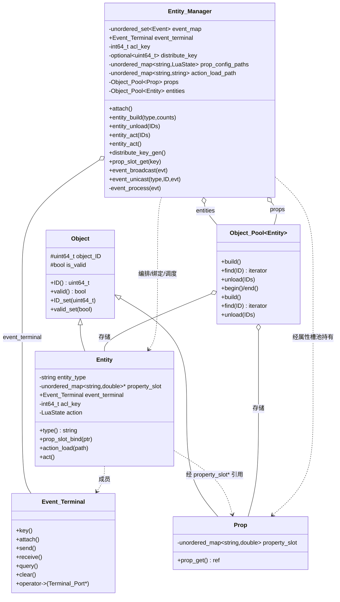
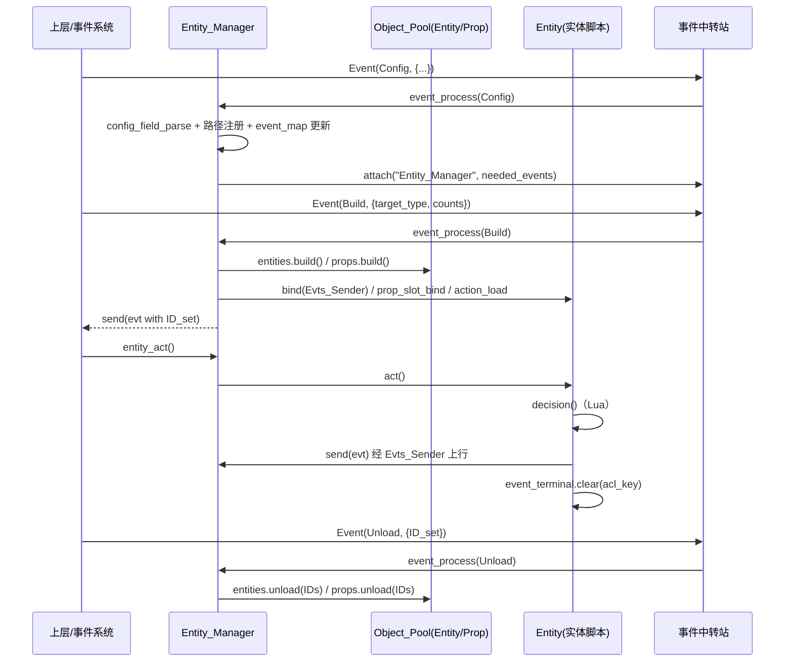

# 系统层-实体

> 模块路径（相对源码根）：`Engine/EngineSystem/src/entity/`
> 本模块是 EngineSystem 的**动态实体（Entity）运行与编排层**，向上层（游戏/应用）提供「可脚本驱动、可收发事件的实体对象」，并统一承担实体的**创建 / 卸载 / 行动调度 / 事件收发 / 属性槽分发**。
> 本文件为纯技术文档，不修改任何源码；引用的文件一律使用相对源码根的相对路径。
> 本模块近期为适配 EngineCore 新 API 做过改造，本文件在相关章节逐条记录：**事件终端端口化**（`Event_Terminal::operator->` + `Terminal_Port::bind(Port_ID, cb)`）、**对象池迭代器化**（`Object_Pool::begin()/end()` 范围遍历，`find` 返回迭代器）、**`Object_Pool::build` 改按值形参 + `std::move`**、**事件字段改名**（`sender`/`receiver`/`category`/`tag`/`config`）。
> 本模块由两个强耦合子模块构成：**实体（Entity）** 与 **实体管理器（Entity_Manager）**。二者合为一份文档书写，因为 `Entity_Manager` 直接实例化并编排 `Entity`，且 `Entity` 的对外行为几乎全部由 `Entity_Manager` 触达（注入属性槽、绑定事件出口、加载决策树、调度行动、收发事件）。本文件统一以「系统层-实体」命名该模块。

---

## 一、模块功能

### 1.1 模块定位

「系统层-实体」位于 EngineSystem 的**系统层**，是引擎把「游戏世界中的一个个可独立行动的个体」封装为对象的最小单元。它处在通用基础设施（EngineCore 的对象系统、事件系统、工具集）与业务子系统（EngineSystem 的效应系统、属性槽分发系统、配置系统）之间，承担三类职责：

- **实体对象 `Entity`**：派生自 EngineCore 的 `Object`，为一个「拥有类型标签、属性槽引用、事件终端、行为脚本、行为决策入口」的动态对象。它本身不做世界管理，只封装「单个实体怎么行动、怎么发事件」。
- **实体管理器 `Entity_Manager`**：作为实体的**总装配与调度中枢**。它持有实体对象池 `Object_Pool<Entity>` 与属性槽对象池 `Object_Pool<Prop>`，负责按类型批量创建实体、按集合卸载、按集合或全量驱动行动，并以**事件驱动**方式接入引擎事件中转站，处理「配置注入、实体创建、实体卸载、事件定向投递」等外部请求。
- **属性槽与事件通道的所有权分发**：`Entity_Manager` 通过权限密钥（`distribute_key`）把属性槽集合的所有权**以指针形式**对外分发（给属性槽分发器 `Prop_Distributor`），并通过事件终端把密钥以事件形式广播；同时把「实体发出的事件」经由绑定的发送端口转发回自身事件终端，从而形成「实体 → 管理器 → 外部」的事件上行链路。

模块的设计重心是**脚本驱动**：每个实体持有一份 Lua 行为脚本（`LuaState action`），脚本中约定一个名为 `decision` 的函数作为「决策树入口」，`Entity::act` 即调用它；脚本可通过被注入的 `pros`（属性槽表）、`event_set`（事件集合引用）、`send`（事件发送函数）与 C++ 侧交互。

### 1.2 职责边界

| 归属 | 职责 |
| --- | --- |
| **属于本模块** | `Entity` 对象定义（类型标签、属性槽指针、事件终端、Lua 状态机、行为加载/决策）；`Entity_Manager` 的实体/属性槽对象池持有与生命周期编排；实体的批量创建与卸载；实体行动调度；实体事件广播与定向投递；行为脚本路径与属性槽配置路径的注册；属性槽分发密钥的生成与分发；接入事件中转站并处理配置/创建/卸载/投递事件 |
| **不属于本模块** | 对象 ID/索引分配与对象池实现（属 EngineCore 对象系统）；事件终端、事件中转站、终端端口的实现（属 EngineCore 事件系统）；属性槽容器 `Prop` 的定义（属 EngineSystem 属性层 `src/prop/`）；属性槽分发器 `Prop_Distributor` 的业务实现（属 EngineSystem 属性层）；配置文件的读取落地与 JSON 字段校验工具（属 EngineCore 工具集）；Lua 脚本的具体决策逻辑（由外部脚本提供）；世界/地图/渲染等上层语义（不属本层） |

本模块**不自行发明实体存储结构**，而是完全复用 `Object_Pool<Entity>` / `Object_Pool<Prop>`；也**不自行实现事件总线**，而是复用 `Event_Terminal` 与引擎事件中转器。本模块的「状态」分为两类：`Entity` 的个体运行态（脚本、属性槽、事件终端、密钥）与 `Entity_Manager` 的全局编排态（对象池、路径表、订阅表、分发密钥）。

### 1.3 解决的问题

1. **批量实体的统一编号与存储**：借助 `Object_Pool` 为每类实体分配唯一 ID、紧凑存储、连续遍历，避免管理器自行维护数组与编号回收。
2. **脚本驱动的可扩展行为**：实体行为不写死在 C++ 中，而是由 Lua 脚本的 `decision` 函数提供，使策划/上层可在不改引擎的前提下定义实体行为；C++ 只负责注入数据（属性槽）与通道（事件集合、发送函数）。
3. **属性槽的集中管理与分发**：实体的通用状态（`std::unordered_map<std::string,double>`）集中存放于 `Object_Pool<Prop>`，实体本身仅持有一个**指向自身属性槽的裸指针**；外部（属性槽分发器）需要读取属性槽时，必须凭 `Entity_Manager` 生成的随机密钥经 `prop_slot_get` 取得对象池指针，形成访问控制。
4. **事件驱动的松耦合编排**：外部不直接调用 `entity_build/entity_unload`，而是向事件终端投递「配置 / 创建 / 卸载 / 行动 / 定向」事件，由 `event_process` 分派，避免上层与实体管理器在构造期强耦合，实现运行期动态接入。
5. **实体事件的集中上行**：实体内部脚本发出的事件先进入实体自己的事件终端 `event_set`，`Entity::act` 结束前 `clear` 清空；同时实体的 `Evts_Sender` 端口被绑定为「转发到管理器事件终端」，使实体能主动向外发送事件。

### 1.4 在整体架构中的位置

```
                      ┌──────────────────────────────────────────────┐
     上层/应用层       游戏 / 编辑器 / 测试（本轮不收录，仅占位）
                      └──────────────────────┬───────────────────────┘
                                             │ 依赖（只读下行）
                      ┌──────────────────────▼───────────────────────┐
   ★本次模块          │         系统层-实体  src/entity/             │
                      │  Entity/实体.h        → class Entity         │
                      │     : public Object                          │
                      │     ├─ entity_type / property_slot*          │
                      │     ├─ Event_Terminal event_terminal(公有)   │
                      │     ├─ acl_key / LuaState action             │
                      │     └─ type/prop_slot_bind/action_load/act   │
                      │  Entity_Manager/实体管理器.h → class          │
                      │     Entity_Manager                            │
                      │     ├─ Object_Pool<Entity> entities           │
                      │     ├─ Object_Pool<Prop>   props              │
                      │     ├─ 路径表 / 订阅表 / distribute_key       │
                      │     └─ 构建/卸载/调度/事件/分发接口           │
                      └───────┬───────────────┬──────────────┬────────┘
                              │               │              │
            依赖（复用下层原语）│               │              │ 依赖（同层协作）
        ┌─────────────────────▼──┐   ┌────────▼───────────┐  │
        │ EngineCore 对象系统     │   │ EngineCore 事件系统 │  │
        │  Object_Pool/对象池.h   │   │  Event_Terminal     │  │
        │  Object/对象.h          │   │  Terminal_Port/端口 │  │
        │  数值分配器 / 二分查找  │   │  Event / Event_Broker│ │
        └─────────────────────────┘   └─────────────────────┘  │
        ┌─────────────────────────┐   ┌─────────────────────┐  │
        │ EngineCore 工具集        │   │ EngineSystem 属性层 │◄─┘
        │  Engine_Env / 校验工具   │   │  Prop/属性.h         │
        │  路径字符串转换 / 日志   │   │  Prop_Distributor    │
        └─────────────────────────┘   └─────────────────────┘
                      ┌──────────────────────▼───────────────────────┐
                      │  common/前置头文件包含.h（PCH：标准库+Sol2）  │
                      └──────────────────────────────────────────────┘
```

**与相邻模块的职责分界**：

- 与**对象系统**：对象系统提供 `Object` 基类与 `Object_Pool`；本模块只做「把 `Entity`、`Prop` 塞进池子并按 ID 编排」，不实现池内算法。
- 与**事件系统**：事件系统提供 `Event_Terminal`、`Terminal_Port`、`Event_Broker`；本模块只做「把回调绑定到命名端口」「订阅事件」「收发/查询/清空事件」，不实现中转逻辑。
- 与**属性层（`src/prop/`）**：属性层提供 `Prop`（属性槽容器）与 `Prop_Distributor`（分发器，负责对外暴露只读属性槽）；本模块**持有**属性槽对象池并**分发指针**给分发器，分发器再去读单个槽位。
- 与**配置系统（EngineCore）**：配置事件携带 JSON；本模块只做字段校验（`detail::field_check`）、路径拼接（`Engine_Env::absolute_path_get`）与加载，不做 JSON 解析器实现。

---

## 二、模块提供接口

本章逐条列出「系统层-实体」对外可用的类型与函数。引用一律使用相对源码根路径。除特别说明外，所有类型与函数均位于 `namespace engine`。

### 2.1 类型 `Entity`（动态实体）

- 定义位置：`Engine/EngineSystem/src/entity/Entity/实体.h`
- 声明：`class Entity : public Object`（公有继承 EngineCore 的 `Object`）

#### 2.1.1 继承自 `Object` 的可用接口（约束前提）

`Entity` 通过继承获得下列受保护数据与公有接口（定义于 `Engine/EngineCore/src/core/object/Object/对象.h`），本模块内部大量依赖：

| 成员 | 签名 | 含义 |
| --- | --- | --- |
| 数据 `object_ID` | `uint64_t object_ID = 0;`（protected） | 对象编号，默认 0 |
| 数据 `is_valid` | `bool is_valid = false;`（protected） | 合法性标记，默认非法 |
| 构造 | `Object() = default;` | 默认构造 |
| 构造 | `explicit Object(uint64_t id, bool valid = true) noexcept;` | 显式带参构造 |
| 移动构造/赋值 | `Object(Object&&) noexcept;` / `Object& operator=(Object&&) noexcept;` | 移动后把源置为 `ID=0/非法` |
| 析构 | `virtual ~Object() = default;` | 虚析构 |
| `ID_set` | `void ID_set(const uint64_t& ID);` | 写对象 ID |
| `valid_set` | `void valid_set(bool valid);` | 写合法性 |
| `ID` | `uint64_t ID(void) const;` | 读对象 ID |
| `valid` | `bool valid(void) const;` | 读合法性 |

**约束**：`Entity` 覆写的是 `act`，但**未覆写** `type`（`type` 是 `Entity` 自己新增的成员函数，非虚函数，见下）。`Object` 的析构为虚，`Entity` 析构可安全经基类指针调用。

#### 2.1.2 `Entity` 私有数据成员（逐字段说明）

| 字段 | 类型 | 默认初值 | 说明 |
| --- | --- | --- | --- |
| `entity_type` | `std::string` | `{}`（空串） | 「实体类型标签」，预期用于标识该实体属于哪一类（如 `"Player"`）。**在本模块源码内无任何赋值点**（见 4.11 易错点）。 |
| `property_slot` | `std::unordered_map<std::string, double>*` | 未初始化（裸指针，见易错点） | 「通用属性槽」的**外部指针**。实体自身不持有属性槽容器，仅指向由 `Entity_Manager` 维护的 `Object_Pool<Prop>` 中对应槽位，通过 `prop_slot_bind` 注入。 |

#### 2.1.3 `Entity` 公有数据成员

| 字段 | 类型 | 说明 |
| --- | --- | --- |
| `event_terminal` | `Event_Terminal` | 实体的事件终端（**公有**）。承载实体的权限密钥、事件集合、终端端口；外部（`Entity_Manager`、事件系统）经此收发/查询/清空事件与绑定端口。 |

#### 2.1.4 `Entity` 私有数据成员（续）

| 字段 | 类型 | 默认初值 | 说明 |
| --- | --- | --- | --- |
| `acl_key` | `int64_t` | `0` | 事件发送权限密钥。由构造函数从 `event_terminal.key()` 一次性取得，用于 `send`/`query`/`clear` 的权限校验。 |
| `action` | `LuaState`（即 `sol::state`） | 默认构造 | 行为脚本状态机。承载该实体加载的 Lua 脚本与其运行环境。 |

#### 2.1.5 `Entity` 构造函数

| 编号 | 签名 | 参数 | 行为 | 约束与异常 |
| --- | --- | --- | --- | --- |
| E1 | `Entity(void);` | 无 | 默认构造。执行 `this->acl_key = event_terminal.key().value_or(0);`，即向事件终端申请一次性权限密钥，失败（返回 `std::nullopt`）则回退为 `0`。 | 不抛异常。对象 ID/合法性沿用 `Object` 默认（`ID=0`、非法）。 |
| E2 | `Entity(const int64_t& ID);` | `ID`：实体编号 | 委托 `Entity()` 后 `this->object_ID = ID;`，即为实体显式指定编号。 | 不抛异常。注意本构造**不校验** `ID` 是否与池分配一致；池内创建的实体实际由 `Object_Pool::build` 覆写 ID。 |
| E3 | `Entity(const int64_t& ID, const std::string& load_path);` | `ID`：编号；`load_path`：行为脚本路径 | 委托 `Entity(ID)` 后调用 `action_load(load_path)` 加载决策树。 | 内部会触发 Lua 加载，`load_file` 失败语义取决于 sol2（详见 4.7）。 |

**拷贝/移动约束**：

| 成员 | 签名 | 说明 |
| --- | --- | --- |
| 拷贝构造 | `Entity(const Entity&) = delete;` | **禁用拷贝**。 |
| 拷贝赋值 | `Entity& operator=(const Entity&) = delete;` | **禁用拷贝赋值**。 |
| 移动构造 | `Entity(Entity&&) = default;` | 默认移动（`Event_Terminal`、`LuaState` 等随之移动）。 |
| 移动赋值 | `Entity& operator=(Entity&&) = default;` | 默认移动赋值。 |
| 析构 | `~Entity();` | 空实现（`{}`），不做资源释放（由成员析构负责）。 |

**约束解读**：`Entity` 被设计为**不可拷贝、可移动**。这正好契合 `Object_Pool::build` 的「按值形参 + `std::move`」新语义：池在创建槽位时传入（并移动）一个 `Entity` 值，池外不允许拷贝实体。用户若需在池外持有实体，只能移动或经 `Object_Pool::find` 取迭代器访问。

#### 2.1.6 `Entity` 成员函数

| 编号 | 签名 | 参数 | 返回值 | 约束与行为 |
| --- | --- | --- | --- | --- |
| E4 | `std::string type(void) const;` | 无 | `entity_type` 的副本 | 读实体类型标签。`const` 成员函数，不修改状态。**当前实现恒返回空串**，因 `entity_type` 无赋值点（见 4.11）。 |
| E5 | `void prop_slot_bind(std::unordered_map<std::string, double>* ptr);` | `ptr`：指向属性槽容器的指针 | 无 | 绑定属性槽指针。仅做 `property_slot = ptr;`，**不接管所有权**（属性槽生命周期由 `Object_Pool<Prop>` 负责）。传入 `nullptr` 会被原样接受（后续 Lua 注入将使用空指针，风险见 4.11）。 |
| E6 | `void action_load(const std::string& load_path);` | `load_path`：行为脚本路径（UTF-8 字符串） | 无 | 加载并注册行为脚本。步骤：(1) `action.open_libraries()` 打开全部 Lua 标准库；(2) `action.load_file(load_path)` 加载脚本文件；(3) 向脚本注册 `pros` = `sol::as_table(property_slot)`；(4) 向事件终端查询事件集合指针，有效时以引用注册 `event_set`；(5) 注册 C++ 函数 `send`（接收 `shared_ptr<Event>`，调用 `event_terminal.send({evt}, acl_key)`）。详见 4.5。 |
| E7 | `virtual void act(void);` | 无 | 无 | 行为决策（虚函数）。执行 `action["decision"]();` 调用脚本中约定的 `decision` 函数，随后 `event_terminal.clear(acl_key);` 清空实体事件集合。**要求脚本必须存在名为 `decision` 的可调用对象**，否则 sol2 调用会触发 Lua 侧错误（详见 4.6）。 |

### 2.2 类型 `Entity_Manager`（实体管理器）

- 定义位置：`Engine/EngineSystem/src/entity/Entity_Manager/实体管理器.h`
- 声明：`class Entity_Manager`

#### 2.2.1 私有数据成员（逐字段说明）

| 字段 | 类型 | 默认初值 | 说明 |
| --- | --- | --- | --- |
| `event_map` | `std::unordered_set<Event>` | `{}` | 「订阅事件集合」。存放本管理器向事件中转站订阅的事件样本（用于生成 `needed_events`）。依赖 `Event` 的 `std::hash` 特化（定义于 `Engine/EngineCore/src/core/event/Event/事件.h`）与 `operator==`。 |
| `distribute_key` | `std::optional<uint64_t>` | `std::nullopt` | 属性槽分发权限密钥。未生成时为空；生成后为随机 `uint64_t`。 |
| `prop_config_paths` | `std::unordered_map<std::string, LuaState>` | `{}` | 实体类型 → 该类型**属性槽配置脚本**的 Lua 状态机。以类型名为键，保存已加载的属性槽配置脚本（`LuaState` 即 `sol::state`）。 |
| `action_load_path` | `std::unordered_map<std::string, std::string>` | `{}` | 实体类型 → 该类型**行为脚本**（决策树）的加载路径（字符串）。 |
| `props` | `Object_Pool<Prop>` | 默认构造 | 属性槽对象池。定位键默认为对象 ID（`Default_Projector`）。 |
| `entities` | `Object_Pool<Entity>` | 默认构造 | 实体对象池。定位键默认为对象 ID。 |

#### 2.2.2 公有数据成员

| 字段 | 类型 | 说明 |
| --- | --- | --- |
| `event_terminal` | `Event_Terminal` | 管理器的事件终端（**公有**）。用于接入事件中转站、订阅/收发事件、生成权限密钥，以及作为实体事件的上行汇聚点。 |

#### 2.2.3 私有数据成员（续）

| 字段 | 类型 | 默认初值 | 说明 |
| --- | --- | --- | --- |
| `acl_key` | `int64_t` | `0` | 管理器的事件发送权限密钥，由构造函数从 `event_terminal.key()` 取得（失败回退 `0`）。 |

#### 2.2.4 构造函数 / 析构

| 编号 | 签名 | 参数 | 返回值 | 约束与行为 |
| --- | --- | --- | --- | --- |
| M1 | `Entity_Manager();` | 无 | — | 默认构造并执行 `acl_key = event_terminal.key().value_or(0);`。**默认构造仅生成密钥，不接入中转站**（接入须显式调用 `attach`）。 |
| M2 | `~Entity_Manager() = default;` | — | — | 默认析构（对象池、事件终端等成员各自析构）。 |

#### 2.2.5 事件中转站接入

| 编号 | 签名 | 参数 | 返回值 | 约束与行为 |
| --- | --- | --- | --- | --- |
| M3 | `void attach(void);` | 无 | 无 | 接入事件中转站。步骤：(1) 把 `event_map` 转为 `std::vector<Event> needed_events`；(2) 构造事件接收入口 lambda `[this](shared_ptr<Event> evt){ this->event_process(evt); }`；(3) 绑定端口 `event_terminal->bind(Port_ID::Evt_Receiver, entry)`；(4) `event_terminal.attach("Entity_Manager", needed_events, acl_key)`。**应在配置事件处理后（事件集合更新后）重新调用以刷新订阅**（`event_process` 内部会调用）。返回值被丢弃（`attach` 为 `bool`，此处未使用其结果）。 |

#### 2.2.6 私有辅助：配置校验与路径注册

| 编号 | 签名 | 参数 | 返回值 | 约束与行为 |
| --- | --- | --- | --- | --- |
| M4 | `bool config_field_parse(const nlohmann::json& config) const;` | `config`：配置事件载荷 | 校验通过返回 `true`，否则 `false` | 逐字段调用 `detail::field_check<T>` 校验四个必需字段：`type`（`string`）、`prop_load_path`（`string`）、`action_load_path`（`string`）、`needed_events`（`vector<pair<string,string>>`）。任一无效即返回 `false` 并打日志。`const` 成员。 |
| M5 | `void action_load_path_register(const std::string& entity_type, const nlohmann::json& config);` | `entity_type`：实体类型名；`config`：配置载荷 | 无 | 读取 `config["decision_load_path"]`（字符串），经 `Engine_Env::absolute_path_get` 拼为绝对路径，`detail::path_to_string` 转 UTF-8 字符串，记入 `action_load_path[entity_type]`。**注意：字段名 `decision_load_path` 未在 `config_field_parse` 的校验列表中**（见 4.11）。 |
| M6 | `void prop_load_path_register(const std::string& entity_type, const nlohmann::json& config);` | 同上 | 无 | 读取 `config["prop_load_path"]`（字符串），拼绝对路径并转字符串后，`prop_config_paths[entity_type].load_file(...)` 加载属性槽配置脚本。属性槽 Lua 状态机以类型名为键随注册创建。 |

#### 2.2.7 实体生命周期接口（公有）

| 编号 | 签名 | 参数 | 返回值 | 约束与行为 |
| --- | --- | --- | --- | --- |
| M7 | `std::vector<uint64_t> entity_build(const std::string& type, const int& counts);` | `type`：实体类型名；`counts`：创建数量 | 新实体 ID 集合（`std::vector<uint64_t>`） | 批量创建实体。前置：`action_load_path` 与 `prop_config_paths` 中都必须存在 `type`，否则打 `warn` 并返回空 `{}`。流程：对 `counts` 次 `entities.build()` 与 `props.build()` 成对创建，然后对新实体逐一注入事件发送端口、绑定属性槽指针、加载决策树。**当前实现的返回值/循环结构存在缺陷**（`return IDs;` 位于初始化循环体内，且空集合路径无返回值，见 4.11）。 |
| M8 | `void entity_unload(std::vector<uint64_t>& ID);` | `ID`：待卸载实体 ID 集合（**非 const 引用**） | 无 | 卸载。依次调用 `entities.unload(ID)` 与 `props.unload(ID)`，同时销毁实体与对应属性槽。传空集合为空操作。 |
| M9 | `void entity_act(std::vector<uint64_t>& IDs);` | `IDs`：待驱动实体 ID 集合（**非 const 引用**） | 无 | 指定实体行动。对 `IDs` 中每个 ID 调用 `entities.find(ID)->act()`。**不校验 ID 合法性**：若 ID 不存在，`find` 返回 `end()`，解引用为未定义行为（见 4.11）。 |
| M10 | `void entity_act(void);` | 无 | 无 | 全量行动。用范围 `for (auto& entity_record : entities)` 遍历所有**有效**实体并逐个 `act()`（依赖 `Object_Pool::begin()/end()` 的有效区语义）。 |

#### 2.2.8 属性槽分发接口（公有）

| 编号 | 签名 | 参数 | 返回值 | 约束与行为 |
| --- | --- | --- | --- | --- |
| M11 | `bool distribute_key_gen(void);` | 无 | 成功返回 `true`，失败返回 `false` | 生成属性槽分发密钥。若 `distribute_key` 已有值（`has_value()`）则打 `warn` 并返回 `false`；否则用 `std::random_device` + `std::mt19937` + `uniform_int_distribution<uint64_t>(0, UINT64_MAX)` 生成随机密钥存入 `distribute_key`，随后构造一枚「密钥传送事件」（`sender="Entity_Manager"`、`receiver="Prop_Distributor"`、`category="Key"`、`tag="Distribute"`、`config["key"]=distribute_key`）并经 `event_terminal.receive(evt)` 投递给中转站。**当前函数声明为 `bool` 但成功路径无 `return` 语句**（见 4.11）。另有一段被 `/*/ ... /**/` 注释掉的「中转站交互前置校验」。 |
| M12 | `Object_Pool<Prop>* prop_slot_get(const uint64_t& distribute_key);` | `distribute_key`：调用方持有的分发密钥 | 匹配成功返回 `&props`；失败返回 `nullptr` | 属性槽对象池指针获取。三种分支：(1) 管理器尚未生成密钥（`distribute_key` 为空）→ `warn` 并返回 `nullptr`；(2) 密钥不匹配（`this->distribute_key != distribute_key`，`optional` 与 `uint64_t` 比较）→ `warn` 并返回 `nullptr`；(3) 匹配 → 返回 `&props`。**返回的是对象池裸指针，调用方须保证不越权/不悬垂**。 |

#### 2.2.9 事件接口（公有）

| 编号 | 签名 | 参数 | 返回值 | 约束与行为 |
| --- | --- | --- | --- | --- |
| M13 | `void event_broadcast(std::shared_ptr<Event> evt);` | `evt`：待广播事件（共享指针） | 无 | 事件广播。用范围 `for (auto& entity_record : entities)` 遍历所有有效实体，逐个 `entity_record.event_terminal.receive(evt)`，即把同一事件写入**每个实体**的事件集合。 |
| M14 | `bool event_unicast(const std::string& type, const uint64_t& ID, std::shared_ptr<Event> evt);` | `type`：目标实体类型；`ID`：目标实体编号；`evt`：待投递事件 | 投递成功返回 `true`，否则 `false` | 事件定向发送。`entities.find(ID)` 取迭代器，**当迭代器有效且 `it->type() == type`** 时调用 `it->event_terminal.receive(evt)` 并返回 `true`；否则返回 `false`。**注意 `type()` 恒为空串**，故仅当 `type` 传入空串时才可能通过类型校验（见 4.11）。 |

#### 2.2.10 私有事件处理（`event_process`）

| 编号 | 签名 | 参数 | 返回值 | 约束与行为 |
| --- | --- | --- | --- | --- |
| M15 | `void event_process(std::shared_ptr<Event> evt);` | `evt`：中转站分发来的事件 | 无 | 事件总入口（经 `Evt_Receiver` 端口绑定）。按 `category`/`tag` 分派：`category=="Config"` 走配置处理；否则按 `tag` 走 `Build`/`Unload`/`Act`/其它（定向）分支。详见 4.8 与第五章。 |

### 2.3 内部工具头 `局部命名空间使用.h`

本模块遵循《agent开发指南》「局部命名空间使用.h」约定，在模块内 `.cpp` 顶部引入类型别名，使实现代码**一律不加 `std::` 前缀**。两份文件内容如下。

**`Engine/EngineSystem/src/entity/Entity/局部命名空间使用.h`**（`#include "实体.h"` 后）：

| 分类 | 引入名称 |
| --- | --- |
| 基本类型别名 | `pair`、`string` |
| 容器 | `unordered_map`、`vector` |
| 智能指针 | `shared_ptr`、`unique_ptr`、`weak_ptr` |
| 函数对象与算法 | `function`、`ranges::greater`、`ranges::sort` |
| I/O 与内存分配 | `cout`、`nothrow` |

**`Engine/EngineSystem/src/entity/Entity_Manager/局部命名空间使用.h`**（`#include "实体管理器.h"` 后）：

| 分类 | 引入名称 |
| --- | --- |
| 基本类型别名 | `pair`、`string` |
| 容器 | `unordered_map`、`unordered_set`、`vector`、`optional`、`nullopt` |
| 智能指针 | `shared_ptr` |
| 函数对象与算法 | `function`、`ranges::greater`、`ranges::less`、`ranges::sort`、`numeric_limits` |
| 文件系统 | `filesystem::path` |
| 内存分配 | `nothrow` |
| nlohmann | `json` |

**做法说明**：`局部命名空间使用.h` 只包含对应的对外头文件（已含预编译头、`Object`、`Event`、`Event_Terminal`、`Prop`、`Object_Pool`、`Engine_Env`、校验/路径工具等），再用 `using` 声明把 `.cpp` 用到的全限定名引入全局命名空间。`core/*.cpp` 首行均 `#include "../局部命名空间使用.h"`，随后直接以无前缀名书写（如 `vector<uint64_t>`、`shared_ptr<Event>`、`json::object()`）。注意在**对外头文件**中不依赖这些别名，全部使用 `std::`/`engine::` 全限定名（`Entity`、`Entity_Manager` 头文件即如此）。

### 2.4 关键依赖接口摘要（本模块直接调用）

为便于「凭本文档直接调用」，下列为模块依赖的 EngineCore 侧接口摘要（签名取自被依赖头文件）。

**对象池 `Object_Pool<T, Projector=Default_Projector, Key=invoke_result_t<Projector,const T&>>`**（`Engine/EngineCore/src/core/object/Object_Pool/对象池.h`，约束 `T` 派生自 `Object`）：

| 成员 | 签名 | 本模块用法 |
| --- | --- | --- |
| `build` | `uint64_t build(T object = {});` | `entities.build();` / `props.build();`——**按值形参 `T object = {}` + 内部 `std::move`**：无实参时默认构造一个值再移动入槽。 |
| `find` | `typename std::vector<T>::iterator find(const Key& key);` | `entities.find(ID)`——**返回迭代器**（非引用/指针），失败返回 `end()`。 |
| `unload` | `void unload(const Key& key);` / `void unload(const std::vector<Key>& keys);` | `entity_unload` 用向量重载。 |
| 区间 | `iterator begin(); iterator end();`（含 const 重载） | 全量遍历有效实体。 |
| `size` | `uint64_t size(void) const;` | 有效实体数量。 |

**事件终端 `Event_Terminal`**（`Engine/EngineCore/src/core/event/Event_Terminal/事件终端.h`）：

| 成员 | 签名 | 本模块用法 |
| --- | --- | --- |
| `operator->` | `Terminal_Port* operator->(void);` | `event_terminal->bind(Port_ID, cb)`。 |
| `key` | `std::optional<int64_t> key(void);` | 构造时取 `acl_key`。 |
| `attach` | `bool attach(const std::string& module_name, const std::vector<Event>& needed_events, const int64_t& acl_key);` | `attach()` 内接入中转站。 |
| `send` | `bool send(std::shared_ptr<Event> evt, const int64_t& acl_key) const;`（含向量重载） | `Entity` 脚本 `send` 回调。 |
| `receive` | `void receive(std::shared_ptr<Event> evt);`（含向量重载） | 广播/定向/密钥传送。 |
| `query` | `const std::vector<std::shared_ptr<Event>>* query(const int64_t& acl_key) const;` | `action_load` 取事件集合指针。 |
| `clear` | `bool clear(const int64_t& acl_key);` | `act` 末尾清空。 |

**终端端口 `Terminal_Port` / 端口枚举 `Port_ID`**（`Engine/EngineCore/src/core/event/Event_Terminal/终端端口.h`）：本模块绑定 `Port_ID::Evts_Sender`（多事件发送，`Events_Handler<void>`）与 `Port_ID::Evt_Receiver`（单事件接收，`Event_Handler<void>`）。绑定经模板 `bind(Port_ID, callback)`，**函数签名必须与端口类型匹配**，否则编译期 `static_assert` 拦截或运行期打印 ID 匹配失败。

**`Event`**（`Engine/EngineCore/src/core/event/Event/事件.h`）：字段 `sender`/`receiver`/`category`/`tag`/`config`（`nlohmann::json`）；`operator==` 比较 `category`/`tag`/`receiver`/`config`（**不含 `sender`**）；提供 `std::hash<engine::Event>` 特化。本模块用 `Event(category,tag)`、`Event(sender,receiver,category,tag,config)` 两种构造。

**`Prop`**（`Engine/EngineSystem/src/prop/Prop/属性.h`）：`class Prop : public Object`，提供 `std::unordered_map<std::string,double>& prop_get(void);`。

**工具**：`detail::field_check<T>(const nlohmann::json&, const std::string&)`（`Engine/EngineCore/src/tools/Detail/json字段可用性校验.h`）；`detail::path_to_string(const std::filesystem::path&)`（`Engine/EngineCore/src/tools/Detail/路径字符串转换.h`）；`Engine_Env::absolute_path_get(const std::string&)`（`Engine/EngineCore/src/tools/Engine_Env/引擎环境.h`）。

---

## 三、模块内部架构

### 3.1 目录 / 文件结构树

```
Engine/EngineSystem/src/entity/
│
├── Entity/                               # 子模块：动态实体
│   ├── 实体.h                            # 对外头文件：class Entity
│   ├── 局部命名空间使用.h                # 类型别名引入（供 .cpp 去前缀）
│   └── core/
│       └── 实体.cpp                      # 编译单元：Entity 的构造/析构/type/绑定/加载/决策
│
└── Entity_Manager/                       # 子模块：实体管理器
    ├── 实体管理器.h                      # 对外头文件：class Entity_Manager
    ├── 局部命名空间使用.h                # 类型别名引入（含 json / path / optional）
    └── core/
        ├── 事件处理.cpp                  # event_broadcast / event_unicast / event_process
        ├── 实体处理.cpp                  # entity_build / entity_unload / entity_act(×2)
        ├── 属性槽处理.cpp                # distribute_key_gen / prop_slot_get
        └── 配置处理.cpp                  # 构造 / attach / config_field_parse / 两个路径注册
```

本模块在 `Engine/EngineSystem/源文件列表.cmake` 中登记的编译单元为：

```cmake
target_sources(EngineSystem PRIVATE
    "src/entity/Entity/core/实体.cpp"
    "src/entity/Entity_Manager/core/事件处理.cpp"
    "src/entity/Entity_Manager/core/实体处理.cpp"
    "src/entity/Entity_Manager/core/属性槽处理.cpp"
    "src/entity/Entity_Manager/core/配置处理.cpp"
)
```

以及头文件登记（供 IDE 索引）：

```cmake
target_sources(EngineSystem PRIVATE
    "src/entity/Entity/实体.h"
    "src/entity/Entity/局部命名空间使用.h"
    "src/entity/Entity_Manager/实体管理器.h"
    "src/entity/Entity_Manager/局部命名空间使用.h"
)
```

### 3.2 各编译单元职责

| 文件 | 职责 | 对外暴露的符号 |
| --- | --- | --- |
| `Entity/core/实体.cpp` | 实现 `Entity` 的三个构造函数、析构、`type`、`prop_slot_bind`、`action_load`、`act`。包含 `../局部命名空间使用.h` 与日志运行包。 | `Entity::Entity(void)`、`Entity::Entity(const int64_t&)`、`Entity::Entity(const int64_t&, const std::string&)`、`Entity::~Entity()`、`Entity::type`、`Entity::prop_slot_bind`、`Entity::action_load`、`Entity::act` |
| `Entity_Manager/core/配置处理.cpp` | 实现管理器构造、`attach`（中转站接入）、`config_field_parse`（配置字段校验）、`action_load_path_register`、`prop_load_path_register`。 | `Entity_Manager::Entity_Manager`、`attach`、`config_field_parse`、`action_load_path_register`、`prop_load_path_register` |
| `Entity_Manager/core/实体处理.cpp` | 实现实体创建/卸载/行动的四个接口。 | `entity_build`、`entity_unload`、`entity_act(IDs)`、`entity_act(void)` |
| `Entity_Manager/core/属性槽处理.cpp` | 实现属性槽分发密钥生成与属性槽对象池指针获取。 | `distribute_key_gen`、`prop_slot_get` |
| `Entity_Manager/core/事件处理.cpp` | 实现事件广播、定向发送、事件总入口分派。 | `event_broadcast`、`event_unicast`、`event_process` |

### 3.3 内部类之间的关系



关系要点：

- `Entity`、`Prop` 均继承 `Object`，因此都可放入 `Object_Pool`。
- `Entity_Manager` **组合**两个对象池与一个事件终端；通过**裸指针 + 分发密钥**把 `props` 暴露给外部（`Prop_Distributor`）。
- `Entity` 通过 `property_slot` **弱引用**（裸指针，非拥有）指向 `props` 中自己的槽位，形成「实体 → 属性槽」的关联；该关联在 `entity_build` 时用 `prop_slot_bind` 建立，在 `entity_unload` 时随两者同时卸载而失效。

### 3.4 关键内部数据结构说明

1. **属性槽（`std::unordered_map<std::string,double>`）**：实体的通用状态容器（键为属性名，值为 `double`）。存放于 `Prop::property_slot`，由 `Object_Pool<Prop>` 按 ID 管理。`Entity` 只持指针。`entity_build` 时对新槽位 `clear()` 以避免复用旧数据。
2. **类型路径表（`action_load_path`）**：`string → string`，把「实体类型名」映射到「行为脚本绝对路径」。`entity_build` 按类型取用。
3. **属性槽配置表（`prop_config_paths`）**：`string → LuaState`，把「实体类型名」映射到「已加载属性槽配置脚本的 Lua 状态机」。注册时即 `load_file`，运行期保留状态机。
4. **订阅事件集合（`event_map`，`unordered_set<Event>`）**：去重存放需向中转站订阅的事件样本。`event_process` 处理配置事件时，把 `needed_events` 中的 `(tag.first → category, tag.second → tag)` 逐条构造成 `Event("Entity_Manager","", first, second, json::object())` 并插入（若不存在）。`attach` 时转成向量交给中转站。
5. **分发密钥（`optional<uint64_t>`）**：一次性随机量，`nullopt` 表示未生成。用于 `prop_slot_get` 的访问控制。

### 3.5 「`局部命名空间使用.h`」的做法说明（本模块视角）

- 两份局部别名头分别绑定到各自子模块，`core/*.cpp` 只包含**同子模块**的别名头（`Entity/core/实体.cpp` 用 `Entity/局部命名空间使用.h`；`Entity_Manager/core/*.cpp` 用 `Entity_Manager/局部命名空间使用.h`）。
- 别名头内只写 `#include "<对外头>"` 与 `using` 声明，不含任何逻辑；对外头文件则只写全限定名，保证外部使用者不受别名污染。
- 效果：`.cpp` 内出现 `shared_ptr<Event>`、`vector<uint64_t>`、`json::object()`、`numeric_limits<uint64_t>::max()` 等无前缀写法；同时 `using std::nothrow` 使内存分配满足《编码约束》「禁用异常、改用 `std::nothrow`」。

---

## 四、模块设计/实现细节

### 4.1 总体设计意图

本模块把「实体」拆成**数据面**与**编排面**：

- **数据面（`Entity`）** 只关心「我是谁（标签）、我的状态在哪（属性槽指针）、我怎么行动（Lua 决策）、我怎么发事件（事件终端 + send 回调）」。它不关心池、不关心其它实体、不关心世界。
- **编排面（`Entity_Manager`）** 只关心「有哪些类型、每种类型的脚本与属性配置在哪、创建/卸载/调度谁、事件如何分发、属性槽如何授信」。它不关心单个实体的行为内容。

两面的粘合点是「三处注入」：`entity_build` 把 (1) 事件发送端口 `Evts_Sender`、(2) 属性槽指针、(3) 决策树路径，注入到每个新建实体。这样实体在建好后即「自洽可运行」。

### 4.2 分层协作与依赖方向

- 依赖**只向下**：实体模块依赖 EngineCore 的对象系统、事件系统、工具集，以及 EngineSystem 属性层的 `Prop`；从不让下层反向依赖本模块。
- **同层协作**：与 `Prop_Distributor` 通过「密钥 + 事件 + 指针」三方握手（见 4.9），而非直接包含关系——`Entity_Manager` 不包含 `Prop_Distributor`，`Prop_Distributor` 也不包含 `Entity_Manager`，二者仅通过事件与一个 `std::function` 绑定入口联系。
- **无回环**：`Entity` 不引用 `Entity_Manager` 类型；实体向外发事件靠事件终端的端口转发（回调由管理器在创建时注入），因此不存在 C++ 层类型依赖回环。

### 4.3 适配 EngineCore 新 API 的改造点（近期变更）

本模块近期为适配 EngineCore 新 API 做过以下改造，**以当前源码为准**记录：

1. **事件终端端口化**：事件终端不再是「直接设置 sender/receiver 回调」，而是通过 `event_terminal->bind(Port_ID::XXX, cb)` 把回调注册到具名端口（`Terminal_Port`）。本模块用到两处：
   - `Entity_Manager::attach`：`event_terminal->bind(Port_ID::Evt_Receiver, event_receive_entry)`（单事件接收端口，回调 `void(shared_ptr<Event>)`）。
   - `Entity::entity_build` 初始化：`new_entity->event_terminal->bind(Port_ID::Evts_Sender, event_entry)`（多事件发送端口，回调 `void(vector<shared_ptr<Event>>)`）。
   端口回调的签名必须与 `Port_ID` 匹配，`Terminal_Port::bind` 以 `if constexpr` 判可调用性并校验返回类型；不匹配会走 `static_assert` 或运行期 `error` 日志。
2. **对象池迭代器化**：`Object_Pool::find` 返回**迭代器**（`std::vector<T>::iterator`），`Object_Pool` 提供 `begin()/end()` 直接遍历有效区。本模块相应改造：
   - `event_broadcast` / `entity_act(void)` 由「按 ID 逐个 find」改为「范围 `for` 遍历」。
   - `entity_unicast` / `entity_build`（初始化）/ `entity_act(IDs)` 使用 `entities.find(ID)` 返回的迭代器，经 `it->member` 访问实体。
3. **`Object_Pool::build` 改按值形参 + `std::move`**：`uint64_t build(T object = {});`。因此：
   - `Entity` 必须**可移动**（默认移动构造/赋值）且**不必可拷贝**（本模块恰好 `delete` 了拷贝）——与池语义一致。
   - 本模块以 `entities.build()`（无实参）创建默认 `Entity` 后，再经迭代器逐一配置，而非在 `build` 时传入已配置对象。
4. **事件字段改名**：`Event` 字段统一为 `sender` / `receiver` / `category` / `tag` / `config`。本模块所有事件构造与读取均按新名：
   - 密钥事件：`evt->sender="Entity_Manager"`、`evt->receiver="Prop_Distributor"`、`evt->category="Key"`、`evt->tag="Distribute"`、`evt->config["key"]=...`。
   - 配置事件判定：`evt->category == "Config"`；`evt->config["target_type"]`、`evt->config["needed_events"]`。
   - 分派标签：`evt->tag == "Build"/"Unload"/"Act"`。

### 4.4 权限密钥（`acl_key`）语义

- 两个类都在构造时执行 `acl_key = event_terminal.key().value_or(0);`。`Event_Terminal::key()` 的设计是「**一次性生成**，重复调用返回 `std::nullopt`」，故 `value_or(0)` 是兜底：正常首次调用取得随机 `int64_t` 密钥，若非首次则退化为 `0`。
- `acl_key` 用于 `Event_Terminal::send/query/clear` 的权限校验：只有携带正确密钥的调用才被受理（`query` 在密钥非法时返回 `nullptr`，`Entity::action_load` 据此决定是否注册 `event_set`）。
- **设计意图**：把「谁能代表该实体/管理器收发事件」绑定到一个构造期生成的秘密值，避免任意代码凭对象引用即可发事件。

### 4.5 `Entity::action_load` 的脚本注入细节

`action_load(load_path)` 的完整动作（源码顺序）：

1. `action.open_libraries();`：打开 sol2 全部标准库，使脚本可用 `math`、`string`、`table` 等。
2. `action.load_file(load_path);`：加载脚本文件；失败处理取决于 sol2（默认在 err handler 中处理）。
3. `action.set("pros", sol::as_table(property_slot));`：把**属性槽**注册为脚本全局 `pros`。**此处把裸指针 `property_slot` 交给 `sol::as_table`**（见 4.11 待确认点）。
4. **事件注册段（已停用）**：源码保留 `//TODO: register_event ...` 与注释掉的 `//register_event(action);`，说明原先的「事件类型注册」已从 `Engine/EngineSystem/common/external/Sol2/sol类型注册.h` 移除，**当前事件注册功能缺失**，待补回。
5. `const vector<shared_ptr<Event>>* event_set_ptr = event_terminal.query(acl_key);`：以权限密钥查询事件集合指针。
6. `if (event_set_ptr) action.set("event_set", ref(*event_set_ptr));`：若集合可用，用**引用**方式把事件集合注册为脚本全局 `event_set`，使脚本能读/改该集合（`ref(...)` 的标识符来源见 4.11 待确认点）。注意条件不加花括号（单语句，符合项目编码风格）。
7. `action.set_function("send", [this](shared_ptr<Event> evt)->void { this->event_terminal.send({ evt }, acl_key); });`：注册脚本全局函数 `send`，脚本调用 `send(evt)` 时以单元素向量形式经实体事件终端发送事件（多事件 `send` 重载）。

**编码约定**：`load_path` 为 UTF-8 字符串（由管理器经 `detail::path_to_string` 从 `std::filesystem::path` 转换而来），契合《文件编码约束》。

### 4.6 `Entity::act` 的运行语义

- `action["decision"]();`：调用脚本全局函数 `decision`。**这是脚本与引擎之间的唯一约定**：脚本必须提供 `decision`，实体每「行动」一帧即执行一次。
- `event_terminal.clear(acl_key);`：行动结束即清空事件集合，避免事件跨帧累积。**清空用的是实体自身密钥**。
- `act` 为 `virtual`，为上层扩展（子类实体覆写行为）预留。

### 4.7 `Entity_Manager::entity_build` 的装配流程（含注入）

```text
entity_build(type, counts):
    action_it = action_load_path.find(type)      // 行为路径必须已注册
    若无效 → warn("未定义目标实体类型行为加载路径") → return {}
    prop_it   = prop_config_paths.find(type)     // 属性槽配置必须已注册
    若无效 → warn("未定义目标实体类型属性槽配置加载路径") → return {}
    IDs = []
    for (counts 次):
        IDs.push_back(entities.build())          // 池按值+move 创建默认 Entity
        props.build()                            // 池成对创建默认 Prop
    for (const auto& ID : IDs):                  // —— 初始化循环 ——
        new_entity   = entities.find(ID)         // 迭代器
        new_prop_slot= props.find(ID)->prop_get()
        new_prop_slot.clear()                    // 清残留
        event_entry  = [this](vector<shared_ptr<Event>> events){ event_terminal.receive(events); }
        new_entity->event_terminal->bind(Port_ID::Evts_Sender, event_entry)  // 事件出口
        new_entity->prop_slot_bind(&new_prop_slot)                           // 属性槽指针
        new_entity->action_load(action_it->second)                           // 决策树
        return IDs;                              // —— 见 4.11 缺陷标注 ——
```

**要点**：

- **成对创建**：实体与属性槽按相同 `build()` 次数创建，隐含假设两者的 ID 分配序列一致（都用池内 ID 分配器，LIFO 复用），从而 `props.find(ID)` 能命中对应槽位。**这依赖于两池 ID 分配严格同步**（同增同减、同序回收）。
- **事件出口注入**：把实体的 `Evts_Sender` 端口绑定为「转发到管理器事件终端」的回调，使实体脚本发事件最终到达管理器，再经管理器 `event_terminal`（已接入中转站）上行。
- **属性槽注入**：`prop_slot_bind` 传入 `props.find(ID)->prop_get()` 返回的引用地址（`&new_prop_slot`）。
- **决策树注入**：`action_load(action_it->second)` 用注册时保存的绝对路径。

### 4.8 `event_process` 分派逻辑详解

`event_process(evt)` 是管理器的事件总入口，分派树如下：

```text
event_process(evt):
  if evt->category == "Config":                       // —— 配置注入分支 ——
      config = evt->config
      if config_field_parse(config):                  // 校验 type/prop_load_path/action_load_path/needed_events
          target_type = config["target_type"]         // 注意：取的是 target_type
          action_load_path_register(target_type, config)
          prop_load_path_register(target_type, config)
          buffer = config["needed_events"]            // vector<pair<string,string>>
          for each (first,second) in buffer:
              needed = Event("Entity_Manager","",first,second, json::object())
              if !event_map.count(needed): event_map.insert(needed)
          attach()                                    // 刷新订阅
  else:                                               // —— 运行分支 ——
      tag = evt->tag ; config = evt->config
      if !field_check<string>(config,"target_type"): return
      target_type = config["target_type"]
      if tag == "Build":
          ID_set = entity_build(target_type, config.value<int>("counts",0))
          if !ID_set.empty(): warn(...); return        // —— 见 4.11：条件疑似取反 ——
          else:
              config.erase("counts")
              config.emplace("ID_set", ID_set)
              event_terminal.send(evt, acl_key)         // 向外发布修饰后事件
      elif tag == "Unload":
          if !field_check<vector<int64_t>>(config,"ID_set"): return
          ID_set = config["ID_set"]                     // 取出待卸载 ID（元素为 int64_t 容器）
          entity_unload(ID_set)
      elif tag == "Act":
          if !field_check<vector<int64_t>>(config,"ID_set"): return   // 仅校验，未执行
      else:
          if !field_check<string>(config,"target_ID"): return
          target_ID = config["target_ID"]
          event_unicast(target_type, target_ID, evt)
```

**设计意图**：

- **配置事件先于运行事件**：上层先投递 `category=="Config"` 事件完成「类型 → 脚本/属性路径/订阅事件」的注册，之后才有 `Build/Unload/Act/定向` 等运行事件可被受理。
- **创建结果回填**：`Build` 分支把 `entity_build` 返回的 ID 集合以 `ID_set` 字段回填并 `send` 出去，使发起方得知新建实体编号。
- **字段类型约定**：`ID_set` 校验类型为 `vector<int64_t>`，随后赋给 `vector<uint64_t>`（同宽整型，nlohmann 可隐式转换）。
- **未知标签落入定向分支**：任何非 `Config/Build/Unload/Act` 的标签都视为「定向投递到某实体」的事件。

### 4.9 属性槽分发握手（与 `Prop_Distributor` 的协作）

```text
（管理器侧）
distribute_key_gen():
    若 distribute_key 已有值 → warn → return false
    distribute_key = random_uint64()
    构造密钥事件 evt(sender=Entity_Manager, receiver=Prop_Distributor,
                     category=Key, tag=Distribute, config["key"]=distribute_key)
    event_terminal.receive(evt)                // 经中转站（或本地集合）上行

（分发器侧，接口在 src/prop/Prop_Distributor/属性槽分发器.h）
prop_slots_bind(bind_entry)                    // bind_entry 由上层设为 &Entity_Manager::prop_slot_get 的绑定
prop_slot_get(ID) → 经绑定入口返回 Object_Pool<Prop>* 后取单槽
```

**设计意图**：管理器生成随机密钥并以事件形式通知分发器；分发器后续调用 `Entity_Manager::prop_slot_get(key)` 换取 `Object_Pool<Prop>*`，从而读取任意实体的属性槽。密钥形成一道**弱访问控制**（非安全边界，仅为约定）。

**注意**：`distribute_key_gen` 中被注释的代码原本会先 `event_terminal.interact("Prop_Distributor")` 校验分发器是否已接入中转站；当前该前置校验被停用（`/*/ ... /**/` 注释），因此**即使分发器尚未接入，密钥也会照常生成并投递**（见 4.11）。

### 4.10 内存所有权与生命周期约定

| 资源 | 拥有者 | 生命周期 | 说明 |
| --- | --- | --- | --- |
| 实体对象 | `Entity_Manager::entities`（`Object_Pool<Entity>`） | 随管理器生存；`entity_unload` 可回收；`unload` 后槽位标记非法 | 实体不可拷贝、可移动；池内以 `std::vector<Entity>` 存储 |
| 属性槽容器 | `Entity_Manager::props`（`Object_Pool<Prop>`） | 同上 | `Entity::property_slot` 仅**裸指针**指向池内槽位，不拥有 |
| Lua 行为状态机 | `Entity::action`（值成员） | 随实体生存/移动 | 每实体一份 |
| Lua 属性配置状态机 | `Entity_Manager::prop_config_paths`（`LuaState` 值，按类型一份） | 随管理器生存 | 注册时加载，跨实体共用同一份配置状态机 |
| 事件 | `std::shared_ptr<Event>` | 引用计数 | 广播/定向/发送均以共享指针传递 |
| 事件终端 | `Entity::event_terminal` / `Entity_Manager::event_terminal`（值成员） | 随宿主生存 | 值语义、可移动 |
| 属性槽对象池指针（对外） | 由 `prop_slot_get` 借出 | 不转移所有权 | 调用方不得释放；管理器析构后失效 |

### 4.11 易错点、边界行为与待确认点

> 下列条目中，标注「【待确认】」者为源码无法确证设计意图/取舍的项，已同步登记至碎片文件 `_临时_待答疑碎片/SYS-ENT.md`；其余为可据源码确证的实现事实或疑似缺陷。

1. **`entity_build` 的返回值与循环结构（疑似缺陷）**：初始化循环
   ```cpp
   for (const auto& ID : IDs)
   {
       ...
       new_entity->action_load(action_it->second);
       //返回实体ID集合
       return IDs;
   }
   ```
   `return IDs;` **位于 `for` 循环体内部**：只要 `IDs` 非空，函数在**第一次迭代后即返回**，导致后续实体**未完成注入（事件端口/属性槽/决策树）**；若 `IDs` 为空（`counts<=0`），`for` 不执行，函数**落到末尾却无 `return`**，对 `std::vector` 返回值为**未定义行为**。【待确认】(SYS-ENT-02)
2. **`Build` 分支条件疑似取反（疑似缺陷）**：`config.value<int>("counts",0)` 得到的创建结果 `ID_set` 若**非空**（即创建成功），代码却执行 `logger.warn("未定义实体创建数量\n实体创建事件已驳回")` 并 `return`，**丢弃创建结果**；反之 `ID_set` 为空时才走「回填并发事件」。逻辑与命名相反，疑为条件取反。【待确认】(SYS-ENT-03)
3. **`distribute_key_gen` 声明为 `bool` 却无成功 `return`（疑似缺陷）**：函数签名 `bool`，失败分支均 `return false`，**成功路径末尾无 `return`**，属未定义行为（调用方无法可靠得知成功）。【待确认】(SYS-ENT-05)
4. **`entity_type` 恒为空（疑似缺陷）**：`Entity::entity_type` 在本模块内**无任何赋值点**，且为 `private` 且无 setter、无 friend，外部亦无法写入，故 `Entity::type()` **恒返回空串**。这直接影响 `event_unicast` 的类型校验：`it->type() == type` 仅当传入 `type` 为空串时才可通过。推断 `entity_type` 的写入被遗漏（例如应在 `Entity_Manager` 创建实体时按 `type` 写入）。【待确认】(SYS-ENT-04)
5. **`Act` 分支未执行动作**：`event_process` 的 `tag == "Act"` 分支**只做 `field_check` 校验后即结束**，未调用 `entity_act(...)`，因此经事件驱动的「行动」请求实际不会驱动任何实体。推断为未完成实现（或行动由外部直接调用 `entity_act`）。【待确认】(SYS-ENT-06)
6. **`entity_act(IDs)` 缺少存在性校验**：`entities.find(ID)->act();` 未判断 `find` 是否返回 `end()`，对不存在的 ID 解引用超尾迭代器为未定义行为。
7. **`config_field_parse` 与路径字段不一致**：`config_field_parse` 校验 `type`/`prop_load_path`/`action_load_path`/`needed_events`，但 `event_process` 用的是 `config["target_type"]`、`action_load_path_register` 用的是 `config["decision_load_path"]`——**校验字段与实际读取字段并不同名**（`type` vs `target_type`、`action_load_path` vs `decision_load_path`），存在字段名错配风险。
8. **`Entity::property_slot` 初始为未初始化的裸指针**：成员声明 `std::unordered_map<std::string, double>* property_slot;` **无初值**。若在 `prop_slot_bind` 之前调用 `action_load`（例如经 E3 构造直接 `action_load`）或脚本访问 `pros`，将读取**悬垂/未初始化指针**。
9. **`sol::as_table(property_slot)` 传入指针**：`property_slot` 是**指针**而非容器本体，源码把指针交给 `sol::as_table`。【待确认】(SYS-ENT-07)
10. **`ref(*event_set_ptr)` 未限定标识符 `ref`**：`Entity/局部命名空间使用.h` 未引入 `ref`，EngineSystem/EngineCore 亦未发现 `using std::ref`，Sol2 中亦未发现自由函数 `ref`；该标识符来源需确证（推断意图为 `std::ref`）。【待确认】(SYS-ENT-01)
11. **事件注册功能缺失**：`action_load` 中 `register_event` 相关代码被注释并标注 TODO，事件类型注册当前不可用。
12. **`event_map` 与 `Event::operator==`**：订阅集合以 `Event` 为键，`operator==` **不含 `sender`**、`hash` 亦不含 `sender`，而构造订阅样本时 `sender="Entity_Manager"`、`receiver=""`；去重仅按 `category/tag/receiver/config` 生效。此为可确证的实现事实，其匹配语义是否符合中转站订阅预期需结合事件系统理解。
13. **两池 ID 同步假设**：`entity_build` 中 `props.find(ID)` 依赖「实体池与属性槽池的 ID 分配序列完全一致」。若两池在别处被独立增删（非成对），该假设破坏，`props.find(ID)` 可能落空并解引用 `end()`。
14. **`attach` 返回值被忽略**：`event_terminal.attach(...)` 返回 `bool`（接入是否成功），`attach()` 未使用其结果，接入失败不告警。

### 4.12 编码约定（本模块遵循）

- **命名**：类型名英文、首字母大写、无分隔（`Entity`、`Entity_Manager`）；成员/函数名英文、`_` 分隔、首字母小写（`prop_slot_bind`、`action_load`、`distribute_key_gen`）；文件名中文优先（`实体.cpp`、`实体管理器.h`），英文文件按 `_` 分隔（此处中文优先）。
- **注释**：中文，单行 `//`，换行注释（注释在语句上一行），单行注释前不加空格（`//获取权限密钥...`）。
- **内存分配**：经 `using std::nothrow`，事件以 `new(nothrow) Event()` 构造（`属性槽处理.cpp`），符合「禁用异常」约束。
- **编码**：路径统一 UTF-8（经 `detail::path_to_string`）。
- **控制流**：`if`/`for` 单语句不加花括号（如 `if (event_set_ptr) action.set(...)`；`for (const auto& ID : IDs) entities.find(ID)->act();`）。

---

## 五、模块运行链路

本章以「调用方 → 模块 → 被调方」的时序描述典型链路。调用方多为上层应用/事件系统；被调方为 EngineCore 的对象池、事件终端与 Lua。

### 5.1 主流程 A：启动期配置注入（`Config` 事件）

```text
外部（配置/上层）
  → 向事件中转站投递 Event(category="Config", config={type, target_type, prop_load_path,
                                                       action_load_path, decision_load_path,
                                                       needed_events=[(cat,tag),...]})
  → 中转站按订阅将事件投递到 Entity_Manager 的 Evt_Receiver 端口
  → Entity_Manager::event_process(evt)
      ├─ category=="Config" 成立
      ├─ config_field_parse(config)   // detail::field_check 校验 type/prop_load_path/action_load_path/needed_events
      │     ├─ 任一无效 → 返回（不注册、不订阅）
      │     └─ 全部有效 → 继续
      ├─ target_type = config["target_type"]
      ├─ action_load_path_register(target_type, config)
      │     → Engine_Env::absolute_path_get(config["decision_load_path"])
      │     → detail::path_to_string(...) → action_load_path[type] = 路径
      ├─ prop_load_path_register(target_type, config)
      │     → Engine_Env::absolute_path_get(config["prop_load_path"])
      │     → prop_config_paths[type].load_file(路径)   // 加载属性槽配置脚本
      ├─ 遍历 config["needed_events"]：构造 Event 样本 → event_map.insert（去重）
      └─ attach()
            → event_terminal->bind(Port_ID::Evt_Receiver, event_process 包装)
            → event_terminal.attach("Entity_Manager", needed_events, acl_key)   // 接入中转站
```

**结果**：管理器完成「类型 → 行为脚本 / 属性槽脚本 / 订阅事件」注册，并向中转站登记订阅。此后运行事件可被受理。

**关键边界**：`config_field_parse` 未校验 `target_type` 与 `decision_load_path`，而后续却读取它们（见 4.11-7）；若配置缺这两个字段，`config["..."]` 会因 nlohmann 隐式产生 `null`，路径拼接/类型转换可能异常。

### 5.2 主流程 B：实体创建（`Build` 事件）

```text
外部
  → 投递 Event(tag="Build", config={target_type, counts})
  → 中转站 → 管理器 Evt_Receiver → event_process(evt)
      ├─ 非 Config 分支
      ├─ field_check<string>(config,"target_type") 通过
      ├─ tag=="Build"
      ├─ ID_set = entity_build(target_type, config.value<int>("counts",0))
      │     ├─ action_load_path.find(type) 无 → warn → {}
      │     ├─ prop_config_paths.find(type) 无 → warn → {}
      │     ├─ for counts 次：entities.build() / props.build()   // 池按值+move
      │     └─ 逐个初始化：绑定 Evts_Sender / prop_slot_bind / action_load  ←（见 4.11-1 缺陷）
      ├─ （预期）erase "counts"、emplace "ID_set"、event_terminal.send(evt, acl_key)
      └─ 事件经管理器终端上行，外部得知新建实体 ID 集合
```

**关键边界**：`counts<=0` 时 `entity_build` 返回空 → 按当前实现 `ID_set` 空却走「回填发送」；`counts>0` 时 `ID_set` 非空却走「warn+驳回」（条件取反，见 4.11-2）。二者与实际语义均相反。

### 5.3 主流程 C：实体行动（全量 / 指定）

```text
（方式一：直接调用）
外部 → Entity_Manager::entity_act()
  → for (auto& entity_record : entities)       // 遍历有效区
        → entity_record.act()
              → action["decision"]()             // 执行 Lua 决策
              → event_terminal.clear(acl_key)    // 清空实体事件集合

（方式二：指定集合）
外部 → Entity_Manager::entity_act(IDs)
  → for (ID in IDs) entities.find(ID)->act()   // 无存在性校验（见 4.11-6）

（方式三：事件驱动，当前未接通）
外部 → 投递 Event(tag="Act", config={ID_set}) → event_process 仅字段校验后结束（见 4.11-5）
```

### 5.4 主流程 D：实体卸载（`Unload` 事件）

```text
外部 → 投递 Event(tag="Unload", config={ID_set:[...]})
  → event_process(evt)
      ├─ field_check<vector<int64_t>>(config,"ID_set") 通过
      ├─ ID_set = config["ID_set"]（转 uint64_t 容器）
      └─ entity_unload(ID_set)
            ├─ entities.unload(ID_set)   // 逐个：回收 ID/索引、标非法、必要时交换到无效区
            └─ props.unload(ID_set)      // 同步销毁属性槽
```

**关键边界**：卸载不存在的 ID 时，池内 `unload` 会 `warn("Object_Pool::目标对象不存在")` 并返回，不中止；成对卸载保证实体与属性槽 ID 同步回收。

### 5.5 主流程 E：实体事件的上行（脚本发事件）

```text
Lua 脚本（实体）
  → send(evt)                                  // action_load 注册的函数
  → Entity::event_terminal.send({evt}, acl_key)
  → 触发实体 Evts_Sender 端口回调（entity_build 注入）
        [this](vector<shared_ptr<Event>> events){ event_terminal.receive(events); }
  → Entity_Manager::event_terminal.receive(events)   // 事件进入管理器终端
  → 管理器终端（已 attach 中转站）向上行/分发给其它订阅者
```

**说明**：实体自身的事件集合（`event_set`）与上行通道（`send`）是两条路径：`event_set` 存放**外部推给该实体**的事件（由 `event_broadcast`/`event_unicast` 写入，`act` 末尾清空）；`send` 则是实体**主动发出**事件。

### 5.6 主流程 F：事件广播与定向投递

```text
（广播）
外部/管理器 → Entity_Manager::event_broadcast(evt)
  → for (auto& e : entities) e.event_terminal.receive(evt)   // 每实体写入自身事件集合

（定向）
外部 → Entity_Manager::event_unicast(type, ID, evt)
  → it = entities.find(ID)
  → 若 it!=end() 且 it->type()==type → it->event_terminal.receive(evt) → true
  → 否则 false
（注：type() 恒空，见 4.11-4；仅当 type=="" 时能命中）
```

### 5.7 主流程 G：属性槽分发握手

```text
（阶段一：生成并投递密钥）
外部 → Entity_Manager::distribute_key_gen()
  → 若 distribute_key 已有 → warn → false
  → 生成随机 uint64 密钥
  → 构造密钥事件（sender=Entity_Manager, receiver=Prop_Distributor,
                 category=Key, tag=Distribute, config.key=密钥）
  → event_terminal.receive(evt)         // 投递给中转站/分发器
  （无成功 return，见 4.11-3）

（阶段二：分发器换取属性槽池）
Prop_Distributor（持有密钥） → Entity_Manager::prop_slot_get(key)
  ├─ 未生成密钥 → warn → nullptr
  ├─ 密钥不匹配 → warn → nullptr
  └─ 匹配 → &props（Object_Pool<Prop>*）
        → 分发器据此取单个实体属性槽 → prop_get() → 只读/读写 map
```

### 5.8 关键异常 / 边界分支汇总

| 场景 | 触发点 | 模块行为 | 备注 |
| --- | --- | --- | --- |
| 配置字段缺失/类型错 | `config_field_parse` | 返回 `false`，`event_process` 不注册、不订阅 | 仅打 info/warn 日志，不抛异常 |
| 类型未注册行为路径 | `entity_build` | warn + 返回 `{}` | 不创建任何实体 |
| 类型未注册属性配置 | `entity_build` | warn + 返回 `{}` | 不创建任何实体 |
| 创建数量为 0 | `entity_build` / `Build` 分支 | 空 ID 集合；分支条件与语义相反（见 4.11-2） | 疑似缺陷 |
| 卸载不存在 ID | `Object_Pool::unload` | warn，跳过该 ID | 不影响其余 ID |
| 行动不存在 ID | `entity_act(IDs)` | 解引用 `end()`（UB） | 见 4.11-6 |
| 定向类型不匹配 | `event_unicast` | 返回 `false`，不投递 | 因 `type()` 恒空，实际仅空串可命中 |
| 密钥未生成/不匹配 | `prop_slot_get` | warn + 返回 `nullptr` | 分发器应据此判空 |
| 脚本访问 `pros` 早于绑定 | `action_load` 早于 `prop_slot_bind` | 使用未初始化指针（UB） | 见 4.11-8 |
| 脚本缺少 `decision` | `Entity::act` | sol2 调用产生 Lua 错误（默认报错） | 脚本约定 |

### 5.9 时序图（配置 → 创建 → 行动 → 卸载 全周期）



---

## 附：本模块文件清单（相对源码根）

| 相对路径 | 类型 | 概要 |
| --- | --- | --- |
| `Engine/EngineSystem/src/entity/Entity/实体.h` | 头（对外） | `class Entity : public Object` 声明 |
| `Engine/EngineSystem/src/entity/Entity/局部命名空间使用.h` | 头（内部） | Entity 子模块类型别名 |
| `Engine/EngineSystem/src/entity/Entity/core/实体.cpp` | 源 | Entity 实现 |
| `Engine/EngineSystem/src/entity/Entity_Manager/实体管理器.h` | 头（对外） | `class Entity_Manager` 声明 |
| `Engine/EngineSystem/src/entity/Entity_Manager/局部命名空间使用.h` | 头（内部） | Entity_Manager 子模块类型别名 |
| `Engine/EngineSystem/src/entity/Entity_Manager/core/配置处理.cpp` | 源 | 构造 / attach / 配置校验 / 路径注册 |
| `Engine/EngineSystem/src/entity/Entity_Manager/core/实体处理.cpp` | 源 | 创建 / 卸载 / 行动 |
| `Engine/EngineSystem/src/entity/Entity_Manager/core/属性槽处理.cpp` | 源 | 分发密钥生成 / 属性槽池获取 |
| `Engine/EngineSystem/src/entity/Entity_Manager/core/事件处理.cpp` | 源 | 广播 / 定向 / 事件分派 |

**编译归属**：上述 5 个 `.cpp` 均编入 `EngineSystem` 库（见 `Engine/EngineSystem/源文件列表.cmake`）。

**直接依赖（摘要）**：
- `Engine/EngineCore/src/core/object/Object/对象.h`、`.../Object_Pool/对象池.h`
- `Engine/EngineCore/src/core/event/Event/事件.h`、`.../Event_Terminal/事件终端.h`、`.../Event_Terminal/终端端口.h`
- `Engine/EngineCore/src/tools/Engine_Env/引擎环境.h`、`.../Detail/json字段可用性校验.h`、`.../Detail/路径字符串转换.h`、`.../Detail/package/数据校验工具.h`、`.../Detail/二分查找.h`
- `Engine/EngineSystem/src/prop/Prop/属性.h`
- `Engine/EngineSystem/common/前置头文件包含.h`、`Engine/EngineSystem/common/external/Sol2/sol类型别名.h`、`.../sol类型注册.h`

（全文完）