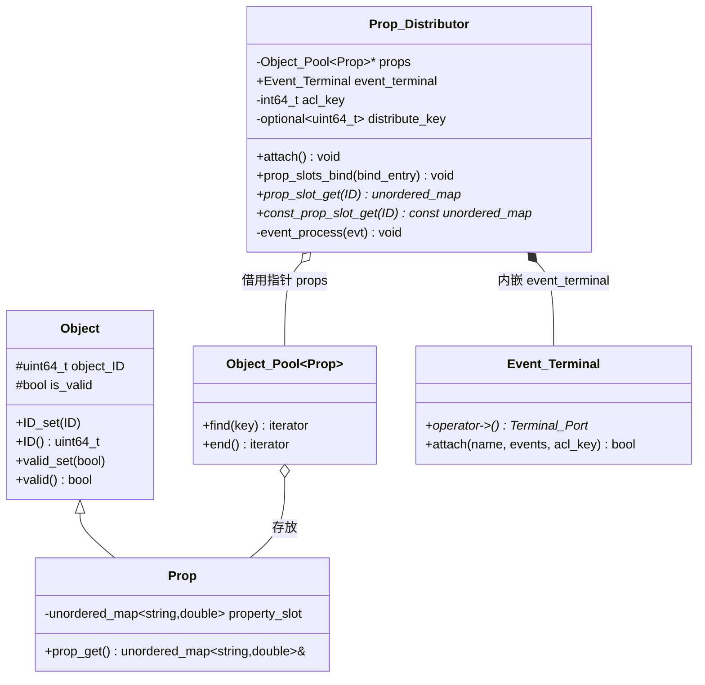
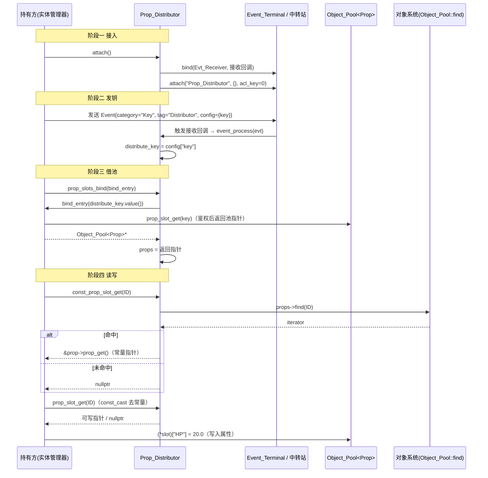

# 系统层-属性

> 模块路径（相对源码根）：`Engine/EngineSystem/src/prop/`
> 本模块为 EngineSystem（系统层）内的**实体属性数据承载与受控分发**模块，向同层「实体管理器」提供两类核心产物：一是属性载体类型 `Prop`，二是属性槽的受控访问闸门 `Prop_Distributor`。
> 本文件为纯技术文档，不修改任何源码；引用的文件一律使用相对源码根的相对路径。
> 本模块近期经过「适配 EngineCore 新对象池 API」的改造，且源码体量偏小（仅 3 个有效文件），本文件据此逐字段、逐接口、逐链路充分展开，**一切以当前源码为准**。

---

## 一、模块功能

### 1.1 模块定位

「系统层-属性」是 EngineSystem 内 `src/prop/` 目录下的一个内聚模块，处在 EngineCore 的**对象系统**（`Object` / `Object_Pool`）与**事件系统**（`Event` / `Event_Terminal`）之上，并作为同层「系统层-实体」（`Entity_Manager`）的**数据底座**与**受控访问入口**。

它把「一个实体所拥有的数值属性」抽象成两部分：

- **属性载体 `Prop`**：一个派生自 `Object` 的极简记录类型，内部仅持有一个「字符串键 → `double` 值」的哈希表（属性槽 `property_slot`）。它不含任何业务逻辑，只负责**存放**某实体的全部具名数值属性。属性槽的存在、编号、生命周期由上层用对象池统一管理。
- **属性槽分发器 `Prop_Distributor`**：一个**受权限密钥保护的访问闸门**。它自身**不拥有**属性槽集合，而是持有一个指向属性槽对象池的裸指针 `props`；该指针只有在**先通过事件通道收到合法「分发权限密钥」**之后，才被允许通过回调绑定。对外它提供「按实体 ID 取可写属性槽 / 取只读属性槽」两类接口。

模块的核心设计特征是：

- **属性槽集中托管、分发器只借指针**：属性槽对象池（`Object_Pool<Prop>`）的所有权在持有方（`Entity_Manager`），`Prop_Distributor` 仅持有裸指针并**不负责创建/销毁**，形成「托管方持有、分发器借用」的分离结构。
- **以事件通道完成密钥握手**：分发器并非直接接受外部传入的密钥，而是**先接入事件中转站**，在运行时通过一条分类为 `Key`、标签为 `Distributor` 的事件接收密钥，再以该密钥作为凭据向持有方索要属性槽集合指针。密钥是「能力令牌（capability token）」的形态。
- **Key → double 的扁平属性模型**：所有属性被统一表达为 `std::string` 键与 `double` 值，是一张**无固定模式（schema-less）** 的扁平表，天然对应 Lua 侧对实体属性的读写。
- **只读/可写双接口**：同时提供返回可变指针的 `prop_slot_get` 与返回常量指针的 `const_prop_slot_get`，在接口层面表达「读」与「读写」两种使用意图。

### 1.2 职责边界

| 归属 | 职责 |
| --- | --- |
| **属于本模块** | 属性记录的字段布局（`string → double` 槽）、属性槽的单次取出（按 ID）、只读/可写两种访问口径、分发权限密钥的接收与保存、属性槽集合指针的绑定、事件中转站接入 |
| **不属于本模块** | 属性槽对象池的实际持有与生命周期、属性槽的创建/卸载与 ID 分配、属性配置文件（Lua 脚本）的加载与解析、实体的创建/卸载/行动、密钥的生成、事件中转站的实现与跨模块路由 |
| **交由对象系统** | `Object` 基类（对象编号与合法标记）、`Object_Pool<T>`（对象池的增删查清、ID/索引发放与回收、两种定位模式） |
| **交由事件系统** | `Event` 结构、`Event_Terminal` 终端的接入/收发/交互、`Terminal_Port` 端口绑定与 `Port_ID` 枚举校验 |

一句话概括边界：**「属性的内容与访问闸门」属于本模块，「属性的存放容器」与「通信管道」分别属于对象系统与事件系统，「属性的产生/解析/使用」属于实体管理器。**

### 1.3 解决的问题

1. **实体的具名数值属性需要一个统一载体**：实体（`Entity`）需要持有任意多个、名字由脚本/配置决定的数值属性（如生命值、攻击力、防御力等）。本模块用 `Prop` 把这一组属性收敛为一张 `std::string → double` 的哈希表，使「属性名」成为运行期动态确定的键，无需在编译期为每种实体定义字段。
2. **属性槽必须与实体一样可被统一编号与批量托管**：`Prop` 派生自 `Object`，于是能被 `Object_Pool<Prop>` 接纳（对象池对元素施加 `std::is_base_of_v<Object, T>` 约束），从而属性槽与实体共享同一套「ID 分配 / 合法性标记 / 连续遍历 / 槽位复用」机制。**这是本模块选择 `Prop : public Object` 而非普通结构体的根本原因**。
3. **属性访问需要一道受控闸门**：属性的读写在引擎运行期是高频操作，但并非任何模块都应无条件拿到属性槽的可写指针。本模块把访问收敛到 `Prop_Distributor` 一处，并以「分发权限密钥」作为准入凭据，使「谁能拿到属性槽集合」「拿到的是可写还是只读」都被显式化。
4. **访问闸门的接入时机与密钥到达时机解耦**：分发器的接入（`attach`）与密钥到达（事件处理 `event_process`）在时间上先后不定；本模块用 `std::optional<uint64_t> distribute_key` 表达「密钥可能尚未到达」的状态，使 `prop_slots_bind` 能在密钥缺席时安全拒绝绑定而不崩溃。
5. **为上层脚本系统提供稳定的属性读写口径**：`prop_slot_get` / `const_prop_slot_get` 返回的是底层 `std::unordered_map<std::string, double>` 的指针，上层（含 Lua 绑定层）可据此直接完成「按键取值 / 赋值」而无需为本模块再封装一层 API。

### 1.4 在整体架构中的位置

```
                           ┌──────────────────────────────────────────────┐
   系统层（同层）           │               系统层-实体 Entity_Manager        │
                           │  持有 Object_Pool<Prop> props（属性槽集合）      │
                           │  prop_slot_get(distribute_key) → 池指针        │
                           │  distribute_key_gen()（生成分发密钥）           │
                           └───────┬───────────────────────┬──────────────┘
                                   │ 绑定回调（借出池指针）    │ 投递密钥事件
                                   │ 函数对象                  │ Key/Distributor
                           ┌───────▼───────────────────────▼──────────────┐
   ★本次模块                │               系统层-属性 prop                  │
                           │   Prop/属性.h        → class Prop              │
                           │     └─ property_slot : unordered_map<string,double>
                           │   Prop_Distributor/属性槽分发器.h              │
                           │     ├─ props : Object_Pool<Prop>*（借用）      │
                           │     ├─ event_terminal : Event_Terminal（内嵌）  │
                           │     ├─ acl_key : int64_t（发送权限密钥）        │
                           │     └─ distribute_key : optional<uint64_t>（分发权限密钥）
                           │   Prop_Distributor/core/属性槽分发器.cpp       │
                           └───────┬───────────────────────┬──────────────┘
                                   │ 依赖（只读下行）         │ 依赖（只读下行）
                           ┌───────▼───────────┐   ┌───────▼────────────────┐
                           │   对象系统 object  │   │   事件系统 event        │
                           │  Object /对象.h    │   │  Event /事件.h          │
                           │  Object_Pool/对象池.h│  │  Event_Terminal/事件终端.h
                           └───────┬───────────┘   │  Event_Terminal/终端端口.h│
                                   │               └───────┬────────────────┘
                           ┌───────▼───────────────────────▼──────────────┐
                           │      通用工具集 tools（logger / 数值分配器…）    │
                           └───────────────────────┬──────────────────────┘
                                                   │
                           ┌───────────────────────▼──────────────────────┐
                           │   common/前置头文件包含.h（EngineSystem PCH）   │
                           │        ↳ 转发 EngineCore PCH ＋ Sol2            │
                           └──────────────────────────────────────────────┘
```

- **下行（本模块依赖）**：本模块依赖 EngineSystem 公共预编译头 `Engine/EngineSystem/common/前置头文件包含.h`（其转发 EngineCore PCH 并追加 Sol2）；通过头文件依赖对象系统的 `Object` / `Object_Pool`、事件系统的 `Event` / `Event_Terminal` / `Port_ID`；通过 `属性槽分发器.cpp` 依赖工具集的全局 `logger`。
- **上行（依赖本模块者）**：同层「系统层-实体」的 `Entity_Manager` 直接包含本模块的 `属性.h` 与 `属性槽分发器.h`，既持有 `Object_Pool<Prop>`，又向 `Prop_Distributor` 借出池指针；上层（Lua 绑定 / 脚本层 / 渲染层读取实体属性时）也经由实体管理器间接使用本模块。
- **横向**：本模块**不**反向调用实体管理器；它只通过「回调函数对象」把对属性池的索求交回持有方，从而在编译期不产生对 `Entity_Manager` 的直接依赖，避免了循环依赖。

### 1.5 文件清单

| 相对路径 | 形态 | 参与编译 | 对外主要产出 |
| --- | --- | --- | --- |
| `Engine/EngineSystem/src/prop/Prop/属性.h` | 纯头文件（类内定义，隐式 `inline`） | 否（仅头） | 类 `engine::Prop` |
| `Engine/EngineSystem/src/prop/Prop_Distributor/属性槽分发器.h` | 纯头文件（声明） | 否（仅头） | 类 `engine::Prop_Distributor` |
| `Engine/EngineSystem/src/prop/Prop_Distributor/局部命名空间使用.h` | 内部 using 头 | 否（仅头，被 .cpp 包含） | 无对外符号（仅 `using std::string` / `unordered_map` / `shared_ptr`） |
| `Engine/EngineSystem/src/prop/Prop_Distributor/core/属性槽分发器.cpp` | 编译单元 | **是** | `Prop_Distributor` 成员函数的实现 |

> 编译归属佐证：`Engine/EngineSystem/源文件列表.cmake` 的 `target_sources(EngineSystem PRIVATE ...)` 中，`src/prop/` 下**只有** `"src/prop/Prop_Distributor/core/属性槽分发器.cpp"` 被列入编译源；`"src/prop/Prop/属性.h"`、`"src/prop/Prop_Distributor/属性槽分发器.h"`、`"src/prop/Prop_Distributor/局部命名空间使用.h"` 被列入**头文件**清单（仅供 IDE 建索引，不参与编译）。

### 1.6 与相邻模块的职责分界

- 与 **对象系统（object）**：对象系统提供**对象基类与对象池**两类无业务语义的底层设施。本模块只做两件事——`Prop : public Object`（以满足对象池的元素约束）与在实现中调用 `Object_Pool<Prop>::find/end`（以按键取到目标属性槽）。属性槽的**增（`build`）/删（`unload`）/编号**一律不由本模块负责，由持有方（实体管理器）代为调用。
- 与 **事件系统（event）**：事件系统提供 `Event` 数据包、`Event_Terminal` 终端对象、`Terminal_Port` 端口与 `Port_ID` 枚举。本模块是事件系统的**消费者**：把 `Event_Terminal` 作为成员内嵌，向 `Evt_Receiver` 端口注册接收入口，并通过 `attach` 接入中转站；本模块不实现任何路由逻辑，也不产生向外发送的事件（它是**纯接收方**）。
- 与 **系统层-实体（Entity_Manager）**：实体管理器是属性槽对象池的**所有者**与分发密钥的**生成者**，同时是分发器的**使用方**：它既是 `prop_slots_bind` 回调的提供者（借出池指针），又是属性槽的创建/卸载者。本模块与实体管理器构成「**持有方 ↔ 借用方**」的关系，属性数据的完整生命周期由实体管理器主导，本模块只提供访问口径。
- 与 **上层脚本/渲染层**：上层通过实体管理器持有的分发器按实体 ID 取属性槽；本模块不感知脚本语言与渲染细节，只以 `string → double` 的扁平表对外。

---

## 二、模块提供接口

> 说明：本模块的对外类型为 `Prop` 与 `Prop_Distributor`。二者均以头文件形式暴露，`Prop` 的方法为类内定义，`Prop_Distributor` 的方法声明于头、实现于 `core/属性槽分发器.cpp`。以下逐条列出签名、参数、返回值与约束，签名与当前源码逐字一致。

### 2.1 类 `Prop`

- **定义位置**：`Engine/EngineSystem/src/prop/Prop/属性.h`
- **命名空间**：`engine`
- **声明**：`class Prop : public Object`
- **用途**：属性载体，承载单个实体（或任意受管对象）的全部具名数值属性。

#### 2.1.1 继承关系与基类约束

`Prop` 公有继承自 `engine::Object`。基类 `Object`（`Engine/EngineCore/src/core/object/Object/对象.h`）提供两个 `protected` 成员与一组读写接口：

| 基类成员/接口 | 签名 | 对本类型的作用 |
| --- | --- | --- |
| `object_ID` | `uint64_t`（`protected`，初值 `0`） | 属性槽的对象编号。由对象池在 `build` 时经 `ID_set` 写入、在 `unload` 时置 `0`。 |
| `is_valid` | `bool`（`protected`，初值 `false`） | 属性槽合法标记。由对象池在 `build` 末置 `true`、`unload` 时置 `false`。 |
| `ID_set` | `void ID_set(const uint64_t& ID)` | 设置编号。 |
| `ID` | `uint64_t ID(void) const` | 读取编号。对象池默认投影器 `Default_Projector` 即调用它作为定位键。 |
| `valid_set` | `void valid_set(bool valid)` | 设置合法标记。 |
| `valid` | `bool valid(void) const` | 读取合法标记。 |

**约束含义**：正因为 `Prop` 派生自 `Object`，它才能满足对象池模板 `Object_Pool<T>` 的 `requires std::is_base_of_v<Object, T>` 约束，从而被 `Object_Pool<Prop>` 直接存放与编号。这也是「属性槽」具备独立 ID、可被单独卸载与复用的前提。

#### 2.1.2 数据成员

| 成员 | 访问级别 | 类型 | 初值 | 含义 |
| --- | --- | --- | --- | --- |
| `property_slot` | `private` | `std::unordered_map<std::string, double>` | 默认构造（空表） | **通用属性槽**。键为属性名（运行期由配置/脚本决定），值为属性数值。是全模块唯一的数据字段。 |

**设计说明**：

- 采用 `std::unordered_map` 而非有序 `std::map`：属性访问是典型的「按键随机读写」，平均 O(1) 的哈希查找优先于有序遍历；且属性名集合在运行期动态增删，哈希表更自然。
- 值类型固定为 `double`：把一切数值属性统一到双精度浮点，既覆盖整数型（生命值、数量）与浮点型（速度、倍率）属性，又与 Lua 的 `number` 语义天然对齐，便于上层直接读写。
- 仅一个字段、无业务方法：`Prop` **刻意保持为数据记录（record）**，任何属性语义（上限、依赖、派生）都不在此层表达，从而避免把业务规则沉入底层数据结构。

#### 2.1.3 成员函数

| 签名 | 参数 | 返回值 | 约束与行为 |
| --- | --- | --- | --- |
| `std::unordered_map<std::string, double>& prop_get(void)` | 无 | 返回 `property_slot` 的**可写引用** | 直接以引用暴露内部哈希表；调用方可据此增/删/改/查任意属性键。**非 `const` 成员**，故对 `const Prop` 对象不可调用。不做任何存在性检查或加锁。 |

> `prop_get` 是本模块**唯一**由 `Prop` 提供的方法；它不是「按名取值」，而是「取出整张属性表」。按名取值由调用方在返回的 `unordered_map` 上以 `operator[]` / `at` / `find` 完成。属性槽分发器的 `const_prop_slot_get` 正是通过 `&prop_slot->prop_get()` 取得该表地址。

#### 2.1.4 类 `Prop` 的隐式接口

`Prop` 未自定义构造/赋值/析构，故编译期隐式生成：默认构造、拷贝构造、拷贝赋值、移动构造、移动赋值、析构（基类析构为 `virtual`）。这些隐式接口均基于两个子对象——基类 `Object` 与成员 `property_slot`——逐成员进行。**注意**：`Object` 的拷贝会连同 `object_ID` 一并复制（见对象系统文档），因此拷贝一个 `Prop` 会得到编号相同的副本；在对象池语境下不应拷贝池内对象，以免破坏 ID 唯一性。对象池 `build` 采用**按值形参 + `std::move`** 的传参方式，实际依赖的是 `Prop` 的移动语义。

### 2.2 类 `Prop_Distributor`

- **定义位置**：`Engine/EngineSystem/src/prop/Prop_Distributor/属性槽分发器.h`（声明）；`Engine/EngineSystem/src/prop/Prop_Distributor/core/属性槽分发器.cpp`（实现）
- **命名空间**：`engine`
- **声明**：`class Prop_Distributor`
- **用途**：属性槽集合的受控访问闸门，按实体 ID 取属性槽，并经事件通道完成密钥握手与集合绑定。

#### 2.2.1 数据成员

| 成员 | 访问级别 | 类型 | 初值 | 含义 |
| --- | --- | --- | --- | --- |
| `props` | `private` | `Object_Pool<Prop>*` | `nullptr` | **借用的**属性槽记录集合指针。指向持有方（实体管理器）所拥有的 `Object_Pool<Prop>`；在 `prop_slots_bind` 成功前保持 `nullptr`。 |
| `event_terminal` | `public` | `Event_Terminal` | 默认构造 | **事件终端**。本分发器与事件中转站交互的内嵌终端对象，公开给持有方以完成接入/收发；`attach`/绑定均经由它。 |
| `acl_key` | `private` | `int64_t` | `0` | **事件发送权限密钥**。在 `attach` 时随 `event_terminal.attach("Prop_Distributor", {}, acl_key)` 一并上报给中转站，作为本终端自身的身份/权限凭据。 |
| `distribute_key` | `private` | `std::optional<uint64_t>` | `std::nullopt` | **属性槽分发权限密钥**。运行期经 `event_process` 由 `Key/Distributor` 事件写入；`nullopt` 表示密钥尚未到达。 |

> 【待确认】`acl_key` 声明时初值为 `0`，且本模块源码内**未见**任何对其赋值的语句；`attach` 把 `0` 原样上报给事件中转站。该常量 `0` 在事件系统中是否代表「默认/免校验」的接入身份，抑或应由持有方在接入前另行设置，尚无法仅凭本模块源码确证。

#### 2.2.2 构造与析构

| 签名 | 参数 | 返回值 | 约束与行为 |
| --- | --- | --- | --- |
| `Prop_Distributor()` | 无 | — | 构造函数。当前实现为**空体**：不做任何初始化动作；`props` 由成员初值保持 `nullptr`，`acl_key` 为 `0`，`distribute_key` 为 `nullopt`，`event_terminal` 默认构造。 |
| `~Prop_Distributor()` | 无 | — | 析构函数。当前实现为**空体**：不释放 `props`（因其为借用指针、非拥有），不对事件终端做解绑动作。 |

> **所有权含义**：析构空体再次确认了「分发器不拥有属性槽集合」的约定——`props` 指向的对象由其持有方（`Entity_Manager`）负责销毁，`Prop_Distributor` 不得也不需要在析构中释放它。

#### 2.2.3 事件中转站接入

```cpp
void attach(void);
```

| 项 | 说明 |
| --- | --- |
| **参数** | 无。 |
| **返回值** | `void`。 |
| **行为** | ①构造一个捕获 `this` 的 `std::function<void(std::shared_ptr<Event>)>` 作为事件接收入口，入口内部调用私有成员 `event_process(evt)`；②调用 `event_terminal->bind(Port_ID::Evt_Receiver, event_receive_entry)`，把该入口注册到终端的**单事件接收端口**；③调用 `event_terminal.attach("Prop_Distributor", {}, acl_key)`，以模块名 `"Prop_Distributor"`、**空订阅列表**、当前 `acl_key` 接入事件中转站。 |
| **约束** | 应在使用分发器前调用一次。重复调用会导致 `Evt_Receiver` 端口被再次注册（`Terminal_Port::bind` 采用 `push_back` 记录端口 ID，`function_register` 会重新分配并覆盖回调），接入信息也会被重复上报。 |
| **异常/失败** | 本函数不抛异常；`bind`/`attach` 的失败（如内存分配失败、ID 不匹配）由事件系统内部记录 `logger` 日志，本函数不检查其返回值。 |

**关于空订阅列表 `{}`**：`Event_Terminal::attach` 的形参为 `const std::vector<Event>& needed_events`。本模块传入空列表，表示**不静态声明所需事件类型**，而是以「接收到即处理」的方式处理全部流入的事件，具体识别交给 `event_process` 按 `category`/`tag` 判定。

#### 2.2.4 属性槽集合绑定

```cpp
void prop_slots_bind(std::function<Object_Pool<Prop>*(const uint64_t& distribute_key)> bind_entry);
```

| 项 | 说明 |
| --- | --- |
| **参数** | `bind_entry`：一个回调函数对象，接收 `const uint64_t&` 形态的**分发权限密钥**，返回 `Object_Pool<Prop>*`（属性槽集合指针）。典型由持有方（实体管理器）提供，例如绑定到 `Entity_Manager::prop_slot_get(const uint64_t&)`。 |
| **返回值** | `void`。绑定结果不通过返回值表达。 |
| **行为** | ①若 `distribute_key` **无值**（`!distribute_key.has_value()`）：调用 `logger.warn("Prop_Distributor::尚未获取分发权限密钥\n无法绑定属性槽集合")` 并**直接返回**，不调用 `bind_entry`、不改动 `props`；②若 `distribute_key` **有值**：调用 `props = bind_entry(distribute_key.value())`，以密钥为凭据向持有方索要并记录集合指针。 |
| **约束** | 必须在密钥经事件到达之后调用，否则绑定被拒。回调 `bind_entry` 返回的指针将**原样保存**，本函数不校验其非空。密钥在成功绑定后仍保留于 `distribute_key`，可被多次绑定复用。 |
| **异常/失败** | 本函数不抛异常；密钥缺席时以 `warn` 日志表达失败，`props` 保持原值。 |

> **语义要点**：`prop_slots_bind` 把「绑定」与「鉴权」合二为一——不是无条件接受一个池指针，而是**把密钥回传给持有方，由持有方验钥后决定是否借出**。这样即便某个持有方误调绑定，也无法在未持钥时拿到未授权的集合。

#### 2.2.5 可写属性槽获取

```cpp
std::unordered_map<std::string, double>* prop_slot_get(const uint64_t& ID) const;
```

| 项 | 说明 |
| --- | --- |
| **参数** | `ID`：目标属性槽的对象编号（`uint64_t`）。 |
| **返回值** | 指向该属性槽 `property_slot` 的**可写指针**；目标不存在时返回 `nullptr`。 |
| **行为** | 直接 `return const_cast<std::unordered_map<std::string, double>*>(const_prop_slot_get(ID));`——复用只读版本取指针，再以 `const_cast` 去除常量性后返回。 |
| **约束** | 为 `const` 成员函数（即可由 `const Prop_Distributor` 调用），但返回**可写**指针，语义上是「以 const 身份提供可变访问」。调用方必须对 `ID` 有效性负责；返回 `nullptr` 表示该 ID 无对应属性槽。 |
| **异常/失败** | 不抛异常。若 `props` 仍为 `nullptr`（未绑定），`const_prop_slot_get` 会解引用空指针（见 4.10 易错点）。 |

#### 2.2.6 只读属性槽获取

```cpp
const std::unordered_map<std::string, double>* const_prop_slot_get(const uint64_t& ID) const;
```

| 项 | 说明 |
| --- | --- |
| **参数** | `ID`：目标属性槽的对象编号。 |
| **返回值** | 指向该属性槽 `property_slot` 的**常量指针**；目标不存在时返回 `nullptr`。 |
| **行为** | ①`auto prop_slot = props->find(ID);` 在属性池中查找该 ID 的记录迭代器；②若 `prop_slot != props->end()`（目标属性槽存在），`return &prop_slot->prop_get();`（取该 `Prop` 的属性表地址）；③否则 `return nullptr;`。 |
| **约束** | 为 `const` 成员函数，返回常量指针，表达只读意图。**内部仍以非 const 方式调用 `props->find`**（因 `props` 是「指向非 const 的常量指针」——`const` 成员使 `props` 本身不可改，但被指对象非 const，故可调用非 const 的 `find`），说明「只读」是在接口层保证、而非数据类型层的强保证。 |
| **异常/失败** | 不抛异常。目标不存在返回 `nullptr`。 |

#### 2.2.7 事件处理（私有）

```cpp
private:
void event_process(std::shared_ptr<Event> evt);
```

| 项 | 说明 |
| --- | --- |
| **参数** | `evt`：流入的事件智能指针。 |
| **返回值** | `void`。 |
| **行为** | 若 `evt->category == "Key" && evt->tag == "Distributor"`（即该事件是「密钥传送事件」），则 `this->distribute_key = evt->config["key"].get<uint64_t>();`——从事件的 `config` 包中按键 `"key"` 取 `uint64_t` 写入分发权限密钥。其余事件一律**静默忽略**。 |
| **约束** | 私有成员，仅由 `attach` 注册的接收入口回调调用。要求匹配事件携带合法 `config["key"]` 且其值为 `uint64_t`；若键缺失或类型不符，`nlohmann::json::get<uint64_t>` 的行为将影响后续（见 4.3 与 4.10）。 |
| **重复到达** | 每次匹配事件都会**覆盖写入** `distribute_key`；多次密钥事件以**最后一次为准**。 |

### 2.3 本模块依赖的下层接口（调用本模块前须掌握）

本模块的对外行为建立在下层若干接口之上，调用方阅读本模块文档时需一并了解其语义（以下接口分别属于对象系统与事件系统，非本模块提供）。

#### 2.3.1 对象池 `Object_Pool<T, Projector, Key>` 中被本模块使用的接口

| 接口 | 签名 | 本模块用途 |
| --- | --- | --- |
| `find` | `typename std::vector<T>::iterator find(const Key& key)` | 在 `const_prop_slot_get` 中按 `ID` 定位属性槽记录。`Key` 由默认投影器 `Default_Projector` 推导为 `uint64_t`（投影器返回 `object.ID()`）。返回指向元素的可解引用迭代器，未命中返回 `end()`。 |
| `end` | `typename std::vector<T>::iterator end(void)` | 与 `find` 的返回值比较，判断是否命中。 |

> 本模块**未使用**对象池的 `build` / `unload` / `begin` / `size` 等接口——属性槽的创建、卸载、遍历均不经过分发器。因此**对象系统近期把 `build` 形参由 `const T&` 改为按值 `T object = {}` + `std::move` 的 API 变更，对本模块透明、无需本模块配合改动**；该变更只影响持有方（实体管理器）创建 `Prop` 的调用方式。

#### 2.3.2 事件结构 `Event`

| 字段 | 类型 | 本模块用途 |
| --- | --- | --- |
| `sender` | `std::string` | 事件发起者（本模块不读取）。 |
| `receiver` | `std::string` | 事件目标（本模块不读取）。 |
| `category` | `std::string` | 事件分类。本模块判定 `== "Key"`。 |
| `tag` | `std::string` | 类内标签。本模块判定 `== "Distributor"`。 |
| `config` | `nlohmann::json` | 配置包。本模块读取 `config["key"]` 并 `.get<uint64_t>()`。 |

匹配事件形如：`Event{ sender=…, receiver="Prop_Distributor", category="Key", tag="Distributor", config = { {"key", <uint64>} } }`。

#### 2.3.3 事件终端 `Event_Terminal` 与端口 `Terminal_Port` / `Port_ID`

| 接口 | 签名 | 本模块用途 |
| --- | --- | --- |
| `operator->` | `Terminal_Port* operator->(void)` | 取得内嵌端口对象，进而调用 `bind`。 |
| `Terminal_Port::bind` | `template <typename T> Terminal_Port& bind(const Port_ID& ID, T callback)` | 在 `attach` 中把单事件接收回调绑定到 `Port_ID::Evt_Receiver`。回调须满足 `std::is_invocable_v<T, std::shared_ptr<Event>>` 且返回 `void`。ID 不匹配时记录 `logger.error` 并驳回。 |
| `Event_Terminal::attach` | `bool attach(const std::string& module_name, const std::vector<Event>& needed_events, const int64_t& acl_key)` | 以模块名 `"Prop_Distributor"`、空订阅列表、`acl_key` 接入中转站。 |

`Port_ID` 中与本模块相关者为 `Evt_Receiver`（单事件接收端口）；`Terminal_Port::bind` 会在编译期校验回调类型与运行期校验端口 ID 是否匹配。

#### 2.3.4 日志 `logger`

| 接口 | 位置 | 本模块用途 |
| --- | --- | --- |
| `logger.warn(...)` | `Engine/EngineCore/src/tools/Logging/日志系统运行包.h` 导出的全局 `engine::logger` | 在 `prop_slots_bind` 密钥缺席时输出告警。 |

---

## 三、模块内部架构

### 3.1 目录 / 文件结构树

```
Engine/EngineSystem/src/prop/
│
├── Prop/                              # 属性载体模块
│   └── 属性.h                          # class engine::Prop : public Object
│
└── Prop_Distributor/                  # 属性槽分发器模块
    ├── 属性槽分发器.h                   # class engine::Prop_Distributor（声明）
    ├── 局部命名空间使用.h               # 内部 using 头（被 core/*.cpp 引入）
    └── core/                          # 实现目录
        └── 属性槽分发器.cpp            # Prop_Distributor 成员函数实现（唯一编译单元）
```

目录结构符合项目「标准模块架构」的形态：对外头文件（`属性槽分发器.h`）位于模块根，`局部命名空间使用.h` 紧随其后，实现集中置于 `core/` 子目录。`Prop/属性.h` 因是纯数据类型、无 `.cpp`，单独成目录。

### 3.2 各编译单元职责

| 编译单元 | 角色 | 职责 |
| --- | --- | --- |
| `Prop/属性.h` | 对外数据类型头 | 声明并**内联定义** `Prop` 的数据成员与 `prop_get`；不含任何编译单元。 |
| `Prop_Distributor/属性槽分发器.h` | 对外接口头 | 声明 `Prop_Distributor` 的全部成员（数据与函数），并集中引入所需的下层头文件（对象池、事件、事件终端、数据校验工具、Sol2 包装头、引擎环境、路径字符串转换、二分查找）。 |
| `Prop_Distributor/局部命名空间使用.h` | 内部使用头 | 引入本模块 `.cpp` 中使用的标准库类型别名（`std::string`、`std::unordered_map`、`std::shared_ptr`），使 `.cpp` 中无需书写 `std::` 前缀。 |
| `Prop_Distributor/core/属性槽分发器.cpp` | 实现单元 | 实现 `Prop_Distributor` 的构造函数、析构函数、`attach`、`prop_slots_bind`、`prop_slot_get`、`const_prop_slot_get`、`event_process`。 |

### 3.3 内部数据结构逐字段说明

#### 3.3.1 `Prop::property_slot`

- **类型**：`std::unordered_map<std::string, double>`
- **可见性**：`private`（仅经 `prop_get` 以引用暴露）
- **生命周期**：随 `Prop` 对象本身——在对象池 `build` 构造 `Prop` 时默认构造为空表；在对象池 `unload` 时随对象析构/原地重建而释放。
- **键**：属性名，`std::string`，运行期动态确定，无固定集合。
- **值**：属性数值，`double`。
- **语义**：该表**不区分属性种类**，所有数值属性同表存放；表的规模（键数量）不固定，随配置/脚本写入而增长。**无稀疏化、无默认值**：未写入的键即不存在，取值方须自行处理「键缺失」。

#### 3.3.2 `Prop_Distributor::props`

- **类型**：`Object_Pool<Prop>*`（裸指针）
- **可见性**：`private`
- **初值**：`nullptr`
- **语义**：**借用的**属性槽集合。指向实体管理器所拥有的 `Object_Pool<Prop>`；本类不拥有其生命周期（析构空体为证）。
- **非空条件**：仅在 `prop_slots_bind` 经密钥鉴权成功后由回调返回值写入。
- **失效风险**：若持有方在本分发器存活期间销毁了属性池，`props` 将成为悬垂指针；该约束由持有方保证（见 4.5）。

#### 3.3.3 `Prop_Distributor::event_terminal`

- **类型**：`Event_Terminal`（值成员）
- **可见性**：`public`
- **语义**：本分发器的事件终端，承载「接入中转站」与「接收事件」的能力。公开是为了让持有方/上层在接入、收发时可直接操作终端（例如主动查询、注入事件）。`Event_Terminal` 内部持有 `Terminal_Port`、事件集合与密钥生成器，并带移动语义（默认移动构造/移动赋值），故 `Prop_Distributor` 具备被移动的可能（尽管未见相关用途）。

#### 3.3.4 `Prop_Distributor::acl_key`

- **类型**：`int64_t`
- **可见性**：`private`
- **初值**：`0`
- **语义**：**事件发送权限密钥**，用于向事件中转站标识本终端。在 `attach` 时原样传给 `event_terminal.attach("Prop_Distributor", {}, acl_key)`。
- **注意**：本模块源码内无赋值点，恒为 `0`。【待确认】其 `0` 值的含义（默认身份 / 免校验 / 待外部设置）。

#### 3.3.5 `Prop_Distributor::distribute_key`

- **类型**：`std::optional<uint64_t>`
- **可见性**：`private`
- **初值**：`std::nullopt`
- **语义**：**属性槽分发权限密钥**，能力令牌。仅在 `event_process` 命中 `Key/Distributor` 事件时由 `config["key"]` 写入；在 `prop_slots_bind` 时被读取并回传给持有方。
- **状态机**：`nullopt`（未持钥）→ `有值`（持钥，可绑定）→ 仍可被后续密钥事件覆盖（仍为 `有值`）。

### 3.4 内部类之间的关系



关系解读：

- **继承**：`Prop` 继承 `Object`，以获得对象池所需的编号/合法性基类。
- **聚合（弱拥有）**：`Object_Pool<Prop>` 存放若干 `Prop`（对象池是属性槽的容器）；`Prop_Distributor` 以裸指针 `props` **指向**该对象池但不拥有它。
- **组合（强拥有）**：`Prop_Distributor` 以内嵌值成员持有 `Event_Terminal`，终端随分发器共存亡。
- **回调纽带**：`Prop_Distributor` 与集合持有方之间以 `std::function<Object_Pool<Prop>*(const uint64_t&)>` 回调相连，此回调在类图上不显式，但它是二者唯一的连接方式（编译期无直接依赖）。

### 3.5 `局部命名空间使用.h` 的做法说明

`Engine/EngineSystem/src/prop/Prop_Distributor/局部命名空间使用.h` 的内容为：

```cpp
#pragma once
#include "属性槽分发器.h"

// ---------- 基本类型别名 ----------
using std::string;

// ---------- 容器 ----------
using std::unordered_map;

// ---------- 智能指针 ----------
using std::shared_ptr;
```

做法要点：

1. 先包含本模块对外头 `属性槽分发器.h`（该头又包含 PCH，因此 `std::string` / `std::unordered_map` / `std::shared_ptr` 的声明已可见，`using` 声明方能成立）。
2. 以 `using` 声明把 `.cpp` 中会用到的标准库类型引入当前作用域（全局作用域），使 `core/属性槽分发器.cpp` 中**一律不书写 `std::` 前缀**（如 `unordered_map<string, double>`、`shared_ptr<Event>`）。
3. **该头只被 `core/属性槽分发器.cpp` 包含，不被对外头包含**，以保证「命名空间污染」不外溢到包含本模块头的其它编译单元。
4. 这正是项目「局部命名空间使用.h」约定的落地：对外头中类型仍写全 `std::` 前缀（见 `属性槽分发器.h` 中的 `std::unordered_map`、`std::optional`），实现文件则靠本头去前缀。

### 3.6 头文件包含依赖清单

`属性槽分发器.h` 的包含项及其作用：

| 被包含头（相对源码根） | 作用 | 本类实际是否使用其符号 |
| --- | --- | --- |
| `Engine/EngineSystem/common/前置头文件包含.h` | EngineSystem PCH，提供标准库与 Sol2 | 使用（全部标准库类型） |
| `Engine/EngineCore/src/core/event/Event/事件.h` | `engine::Event` | 使用（`event_process` 形参、字段访问） |
| `Engine/EngineCore/src/core/event/Event_Terminal/事件终端.h` | `engine::Event_Terminal`、`Port_ID` | 使用（`event_terminal` 成员、`attach`、`bind`） |
| `Engine/EngineCore/src/tools/Detail/package/数据校验工具.h` | JSON/路径字段校验工具 | **未使用**（见 4.10） |
| `Engine/EngineSystem/common/external/Sol2/sol类型注册.h` | C++ 类型 Lua 端注册方法 | **未使用**（见 4.10） |
| `Engine/EngineSystem/common/external/Sol2/sol类型别名.h` | `LuaTable` / `LuaScript` / `LuaState` 别名 | **未使用**（见 4.10） |
| `Engine/EngineCore/src/core/object/Object/对象.h` | `engine::Object` | 间接使用（`Prop` 的基类） |
| `Engine/EngineSystem/src/prop/Prop/属性.h` | `engine::Prop` | 使用（`Object_Pool<Prop>`） |
| `Engine/EngineCore/src/core/object/Object_Pool/对象池.h` | `engine::Object_Pool<T>` | 使用（`props` 类型与 `find/end`） |
| `Engine/EngineCore/src/tools/Engine_Env/引擎环境.h` | 可执行路径 / 帧率环境 | **未使用**（见 4.10） |
| `Engine/EngineCore/src/tools/Detail/路径字符串转换.h` | 路径字符串编码转换 | **未使用**（见 4.10） |
| `Engine/EngineCore/src/tools/Detail/二分查找.h` | `detail::binary_search` | **未直接使用**（对象池内部已自行包含） |

`core/属性槽分发器.cpp` 的包含项：

| 被包含头 | 作用 |
| --- | --- |
| `../局部命名空间使用.h` | 引入标准库类型别名，去 `std::` 前缀 |
| `Engine/EngineCore/src/tools/Logging/日志系统运行包.h` | 提供全局 `engine::logger`（供 `prop_slots_bind` 打告警） |

---

## 四、模块设计 / 实现细节

### 4.1 属性槽的数据模型

属性槽 `property_slot` 是 `std::unordered_map<std::string, double>`，构成了本模块的**唯一数据模型**。围绕它有一条隐含约定链：

1. **键（属性名）由上层决定**：属性名可以是 `"HP"`、`"ATK"`、`"move_speed"` 等任意字符串，其集合来自实体属性配置（Lua 脚本）的解析结果。本模块不定义、不校验、不枚举任何属性名。
2. **值（属性数值）统一为 `double`**：整数型属性以 `double` 承载（如 `100.0`），上层如需整型自行转换。此选择把「属性类型」的复杂度挡在本模块之外，代价是失去类型信息（上层无法从底层得知某属性本应为整数还是浮点）。【待确认】是否有意将全部属性统一为浮点以简化 Lua 互操作，以及未来若出现非数值属性（字符串、向量、引用）如何扩展。
3. **无默认值、无范围约束**：属性槽只是键值对集合，取值方对缺失键须自行兜底（可先 `find` 再取，或用 `operator[]` 隐式插入默认 `0.0`）。本模块不提供默认值或范围钳制。
4. **增删改查均经整表引用完成**：`prop_get` 与 `prop_slot_get` 返回的都是**整张表的引用/指针**，而非单个值。取值是 `(*slot)["HP"]` 形式，写值是 `(*slot)["HP"] = 20.0` 形式。这一「整表出借」的设计减少了 API 数量，但把「按名操作」的语法负担交给了调用方。

### 4.2 分级权限密钥机制

本模块存在**两个不同层的密钥**，切勿混淆：

| 密钥 | 成员 | 类型 | 来源 | 用途 | 层级 |
| --- | --- | --- | --- | --- | --- |
| **事件发送权限密钥** | `acl_key` | `int64_t` | 成员初值 `0`（本模块无赋值点） | `attach` 时上报给事件中转站，标识终端身份 | 对接**事件系统** |
| **属性槽分发权限密钥** | `distribute_key` | `std::optional<uint64_t>` | 运行期经 `Key/Distributor` 事件的 `config["key"]` 写入 | `prop_slots_bind` 时回传持有方，换取属性槽集合指针 | 对接**对象系统/持有方** |

二者形成两级准入：

- **第一级（事件层）**：`acl_key` 决定本终端是否有权参与事件收发。由于它恒为 `0`，实际准入细节落在事件系统中。【待确认】
- **第二级（数据层）**：`distribute_key` 决定本分发器是否有权拿到属性槽集合。它由持有方在运行期生成并经事件送达，是「能力令牌」——只有收到令牌的一方才携带令牌向持有方索要数据。这保证了属性槽集合的借出**既需要持有方的配合（提供回调），也需要正确的令牌（事件送达）**，二者缺一不可。

**为何用事件通道传递令牌而非直接 setter**：以事件通道传递意味着令牌的发放时机与分发器的构造时机解耦，且令牌的流动可被事件系统统一审计/路由。若改为公开的 `set_distribute_key(...)`，任何持有分发器引用的代码都能持钥，令牌的「准入」意义将被削弱。

### 4.3 事件接入与事件处理

**接入（`attach`）**：把「接收回调」绑定到 `Evt_Receiver` 端口，再向中转站登记模块名 `"Prop_Distributor"` 与空订阅列表。

- `event_terminal->bind(...)` 走 `Terminal_Port::bind` 模板：编译期依回调可调用性选择分支（本回调可接受 `std::shared_ptr<Event>`、返回 `void`），运行期仅允许 `Port_ID::Evt_Receiver`；若 ID 不符，`Terminal_Port` 会记 `logger.error` 并驳回。
- `event_terminal.attach("Prop_Distributor", {}, acl_key)` 完成中转站接入，模块名用于路由定位。

**接收（`event_process`）**：采用「**白名单式单条件判定**」——只有同时满足 `category == "Key"` 且 `tag == "Distributor"` 的事件才被处理，其余事件（无论来自谁、携带什么）**一律静默忽略**。

**事件字段逐项读取**：`config["key"].get<uint64_t>()`。

- 若 `config` 中不存在 `"key"`，`nlohmann::json` 的 `operator[]`（非 const 版本）会**插入一个 `null`** 并返回它，随后 `.get<uint64_t>()` 会对 `null` 抛出自定义异常——而本模块声明「不抛异常、异常禁用」的编码约定，此处构成一个潜在冲突点（见 4.7、4.10）。
- 若 `"key"` 存在但类型不是整数（如字符串），`.get<uint64_t>()` 同样会抛异常。
- 若 `"key"` 为合法整数，则正常写入 `distribute_key`。

**密钥覆盖语义**：每次匹配事件都覆盖 `distribute_key`。因此若持有方在绑定后再发一次密钥事件，`distribute_key` 会被更新，但**已绑定的 `props` 不会自动重新绑定**——需再次调用 `prop_slots_bind` 才会以新钥重新借出。

### 4.4 双获取接口与 `const_cast` 语义

两个获取接口构成一对：

- `const_prop_slot_get(ID)`：**只读**口径。实现为 `find` + `&prop_slot->prop_get()`，返回 `const` 指针；未命中返回 `nullptr`。
- `prop_slot_get(ID)`：**可写**口径。实现为 `return const_cast<...>(const_prop_slot_get(ID));`，即「先按只读口径取到常量指针，再 `const_cast` 去掉常量」。

设计意图与取舍：

1. **接口层面表达读写意图**：调用方按需选用只读或可写接口，使「谁在写属性」在代码上可被检索。
2. **只读保障是「软」的**：`const_prop_slot_get` 返回的常量指针虽阻止经该指针写入，但底层表本身并非 `const`（`props` 指向的 `Prop` 非 const，`find` 返回可解引用迭代器）。任何拿到常量指针者若愿意，仍可用 `const_cast` 写回。因此**只读接口是约定与文档层面的保证，而非编译期不可绕过的强制**。
3. **`prop_slot_get` 的 `const` 成员属性**：两个接口都是 `const` 成员函数，意味着 `const Prop_Distributor` 也能取到可写指针。这在语义上略反直觉（`const` 对象却提供写权限），属于「以 `const` 表示不修改分发器自身状态、不代表不修改所指数据」的常见取舍。
4. **`const_cast` 的安全性**：由于底层对象本就非 `const`（其真实存储是 `Object_Pool<Prop>` 中可变的 `Prop`），此处的 `const_cast` **不构成未定义行为**——它只去掉了本接口自己添加的常量视图。

### 4.5 内存所有权与生命周期

本模块的所有权关系需明确：

| 对象 | 所有者 | 借用者 | 生命周期约束 |
| --- | --- | --- | --- |
| `Object_Pool<Prop>`（属性槽集合） | 持有方（`Entity_Manager` 值成员 `props`） | `Prop_Distributor::props`（裸指针） | 属性池必须**先于**分发器构造、**后于**分发器销毁；否则 `props` 悬垂 |
| `Prop_Distributor` | 其声明方（例如嵌套在实体管理器或测试宿主中） | — | 分发器存活期内应保证属性池有效；若不使用，应避免调用取槽接口 |
| `Event_Terminal` | `Prop_Distributor`（值成员） | — | 随分发器共存亡 |
| 回调 `bind_entry` | 调用 `prop_slots_bind` 的一方 | — | 回调应为无捕获或生命周期覆盖调用期的可调用对象 |

关键点：

- **不拥有、不释放**：`~Prop_Distributor` 为空体，`props` 是裸指针，说明本模块**完全不负责**属性池的释放。属性池的销毁由 `Entity_Manager` 的析构（值成员自动析构）完成。
- **绑定即借出**：`prop_slots_bind` 是把池指针「借入」本分发器并保存，而非复制或接管。调用方须自行保证「借出」期间池的存活。
- **未绑定时 `props == nullptr`**：此时任何取槽调用都会解引用空指针（`props->find(ID)`），属调用方时序错误，本模块未做防御（见 4.10）。

### 4.6 线程 / 并发约定

本模块**不含任何同步原语**（无互斥量、无原子量）：

- `property_slot`（`unordered_map`）的并发读写未加保护；`distribute_key`（`optional`）的写入（`event_process`）与读取（`prop_slots_bind`）未加保护；`props` 指针的写入（`prop_slots_bind`）与读取（取槽接口）未加保护。
- 与对象系统一致，`Object_Pool::find` 本身也无锁。因此本模块的**全部操作都不是线程安全**的。

**隐含约定**：属性相关的接入、握手、取值应发生在**同一逻辑线程**（引擎主逻辑线程）内，并在逻辑帧内串行推进——即事件送达（`event_process`）、密钥绑定（`prop_slots_bind`）与属性读写在时序上不并发。若需跨线程使用，须由调用方在外层加锁，本模块不提供该保证。

### 4.7 异常禁用与内存分配

- 本模块自身**不主动 `throw`**，也未使用 `try/catch`；`attach` / `prop_slots_bind` / 取槽接口均以返回值或日志表达失败。
- 但实现中存在一个**外部异常入口**：`event_process` 的 `evt->config["key"].get<uint64_t>()` 在键缺失或类型不符时，会由 `nlohmann::json` 抛出异常。这构成「本模块声称无异常」与「依赖库可能抛异常」之间的张力。若令牌事件由可信的持有方（实体管理器）按约定构造，则实际不会触发异常；否则该异常会沿 `event_process` → 接收入口回调 → 事件派发路径向上传播。【待确认】是否有意依赖「令牌事件格式由内部保证」来规避此异常，还是应改为 `contains` + `is_number_unsigned` 校验。
- 本模块**无动态内存分配**（未使用 `new` / 智能指针创建），故不涉及「`std::nothrow`」约定的落地；`std::shared_ptr<Event>` 的生命周期由事件系统管理。

### 4.8 编码 / 路径约定

- 模块全部源码为 **UTF-8 编码**（含中文注释、中文文件名），与项目默认编码约定一致；编译层面 EngineSystem 在 MSVC 下强制 `/utf-8`（见其 `CMakeLists.txt`）。
- 注释语言为**中文**，采用换行注释而非行尾注释，符合《agent开发指南》注释风格。
- 本模块**不进行任何路径转换或文件读写**（不含 `std::filesystem` 使用），因此 `路径字符串转换.h` 与 `引擎环境.h` 的包含在当前实现下并无消费点（见 4.10）。

### 4.9 与 EngineCore 新 API 的适配

EngineSystem 近期为适配 EngineCore 的 API 变更做过改造，就本模块而言可明确如下：

1. **对象池 `build` 形参按值化**：对象池 `Object_Pool::build` 的形参已由 `const T&` 改为**按值形参 `T object = {}` + `std::move`**。此项变更**影响的是属性槽的创建方**（实体管理器），而非本模块——`Prop_Distributor` 只调用 `find`/`end`，不调用 `build`。本模块因此**无需因该变更而改动**，但要求 `Prop` 具备可用的移动语义（隐式生成即可满足）。
2. **对 `Prop` 本身的要求**：为使 `Object_Pool<Prop>` 的 `build(Prop object = {})` 可用，`Prop` 必须是可默认构造、可移动的 `Object` 派生类型。`Prop` 仅有一个 `unordered_map` 成员，天然满足。
3. **本模块使用的对象池接口稳定**：`find(const Key&)` 与 `end()` 的签名未变，`Key` 仍由默认投影器推导为 `uint64_t`。故本模块的取槽实现不受对象池定位模式改造的影响。

### 4.10 易错点与边界行为

1. **未绑定时取槽会解引用空指针**：`const_prop_slot_get` 直接 `props->find(ID)`；若从未成功 `prop_slots_bind`（密钥未到或未调用），`props` 为 `nullptr`，此处为未定义行为（通常崩溃）。调用方**必须先确认绑定成功**再取槽。本模块未提供「是否已绑定」的查询接口。
2. **密钥缺席时绑定被静默拒绝**：`prop_slots_bind` 在 `distribute_key` 为 `nullopt` 时只记一条 `warn` 日志并返回，**不抛异常、不报错、不改变 `props`**。调用方若忽略日志，会误以为已绑定，进而在后续取槽时触发第 1 条问题。
3. **`bind_entry` 返回值未校验非空**：`props = bind_entry(...)` 直接接受返回值。若持有方在鉴权失败时返回 `nullptr`，本分发器的 `props` 也会变为 `nullptr`，同样落入第 1 条风险。
4. **`prop_slot_get` 通过 `const_cast` 去常量**：返回的是可写指针，调用方可直接改属性；若误用只读接口的期望去调用它，可能造成非预期写入。
5. **`prop_slots_bind` 可重复调用**：每次都会以当前 `distribute_key` 重新索要并覆盖 `props`。正常情况下重复绑定无碍（结果相同），但若持有方对同一密钥返回不同池，则以最后一次为准。
6. **`attach` 可重复调用导致端口重复注册**：`Terminal_Port::bind` 以 `push_back` 记录端口 ID，重复 `attach` 会重复注册 `Evt_Receiver` 并覆盖回调、重复上报接入信息。应确保只接入一次。
7. **事件判定过宽/过窄**：仅凭 `category == "Key" && tag == "Distributor"` 判定，任何满足该 classify 的事件（含伪造/其它模块误发）都会覆盖密钥。若事件系统允许跨模块广播到本终端，则密钥可被第三方改写——是否构成风险取决于事件系统的路由隔离。【待确认】
8. **`config["key"]` 异常**：键缺失/类型不符时 `.get<uint64_t>()` 抛异常（见 4.7）。
9. **只读接口并非强制只读**：`const_prop_slot_get` 返回的常量指针可通过 `const_cast` 绕开（见 4.4）。
10. **悬垂的 `props`**：若持有方先于分发器销毁属性池，`props` 悬垂，任何取槽即未定义行为。生命周期顺序须严格保证。
11. **未消费的头文件包含**：`属性槽分发器.h` 引入了 `数据校验工具.h`、`Sol2/sol类型注册.h`、`Sol2/sol类型别名.h`、`引擎环境.h`、`路径字符串转换.h`、`二分查找.h`，而 `.cpp` 实现中并无对这些符号的直接使用。这可能是历史遗留包含、或为后续「属性槽的 Lua 绑定 / 配置文件加载 / 数值校验」预留。【待确认】
12. **`Prop` 可拷贝但不应在池内拷贝**：`Prop` 的隐式拷贝会连同对象编号一并复制，破坏池内 ID 唯一性；跨池传递属性槽应改用 `prop_get` 返回的表的拷贝，而非 `Prop` 对象拷贝。

---

## 五、模块运行链路

> 以下链路以「调用方 → 本模块 → 被调方」的时序描述；「调用方」多为其持有方（实体管理器或其宿主），「被调方」为对象系统/事件系统。本模块自身的四个公开入口（`attach`、`prop_slots_bind`、`prop_slot_get`、`const_prop_slot_get`）分别对应下列链路。

### 5.1 链路一：事件中转站接入（`attach`）

**目的**：让分发器具备接收事件的能力，并登记到中转站。

分步时序：

1. **调用方**：持有 `Prop_Distributor` 的一方（例如实体管理器初始化流程）在其接入阶段调用 `distributor.attach()`。
2. **本模块**：构造事件接收入口闭包 `event_receive_entry = [this](shared_ptr<Event> evt){ this->event_process(evt); }`（绑定 `this`）。
3. **本模块 → 事件系统**：`event_terminal->bind(Port_ID::Evt_Receiver, event_receive_entry)`。
   - `Terminal_Port::bind` 编译期判定该回调「可接受 `std::shared_ptr<Event>` 且返回 `void`」，运行期校验端口 ID 为 `Evt_Receiver`；
   - 为回调分配 `std::function` 存储（`memory_malloc`），写入 `evt_receiver`，并把 `Evt_Receiver` 记入 `binding_table`。
4. **本模块 → 事件系统**：`event_terminal.attach("Prop_Distributor", {}, acl_key)`。
   - 以模块名 `"Prop_Distributor"`、空订阅列表、`acl_key`（当前 `0`）接入中转站；事件系统据此登记该终端为可接收方。
5. **返回**：`attach` 返回 `void`。至此分发器处于「已接入、等待密钥」状态（`props` 仍为 `nullptr`，`distribute_key` 仍为 `nullopt`）。

**边界分支**：

- 若 `bind` 时端口 ID 不匹配（此处不会发生，ID 已写死为 `Evt_Receiver`），事件系统记 `logger.error` 并驳回该端口绑定，但 `attach` 仍继续执行接入登记。
- 重复调用 `attach`：`Evt_Receiver` 被重复登记，回调被覆盖，接入信息重复上报（不建议）。

### 5.2 链路二：分发密钥握手与属性槽集合绑定

**目的**：在运行期由持有方经事件通道发放「分发权限密钥」，分发器持钥向持有方借出属性槽集合。

整个握手分「发钥」与「借池」两段，可能跨多个逻辑帧。

#### 5.2.1 发钥段（事件路径）

1. **调用方（持有方/实体管理器）**：调用自身密钥生成逻辑（`Entity_Manager::distribute_key_gen()` 之类）产生一个 `uint64_t` 密钥。**【待确认】**密钥的具体生成与投递方式属实体管理器职责，此处仅从分发器侧可见其「投递一条 `Key/Distributor` 事件」的结果。
2. **调用方 → 事件系统**：构造并发送事件 `Event{ …, receiver="Prop_Distributor", category="Key", tag="Distributor", config={{"key", 密钥}} }`（通常在接入完成后、绑定前发送；接收方可按模块名 `"Prop_Distributor"` 定向）。
3. **事件系统 → 本模块**：事件经中转站路由到 `Prop_Distributor` 终端，触发第 5.1 步注册的接收入口，进而调用 `event_process(evt)`。
4. **本模块**：`event_process` 判定 `evt->category == "Key"` 且 `evt->tag == "Distributor"` 成立，执行 `distribute_key = evt->config["key"].get<uint64_t>()`。此时 `distribute_key` 由 `nullopt` 变为「有值」，分发器**已持钥**。
   - 若事件不匹配：`event_process` 直接返回，`distribute_key` 不变。

#### 5.2.2 借池段（回调路径）

5. **调用方（持有方）**：在确认密钥已发放后，向分发器提供回调并触发绑定——调用 `distributor.prop_slots_bind(bind_entry)`，其中 `bind_entry` 例如为 `[this](const uint64_t& key){ return this->prop_slot_get(key); }`（绑定到 `Entity_Manager::prop_slot_get(const uint64_t&)`）。
6. **本模块**：`prop_slots_bind` 检查 `distribute_key.has_value()`：
   - **若有值**：`props = bind_entry(distribute_key.value())`——把密钥回传给持有方。
   - **若无值**：记 `logger.warn("Prop_Distributor::尚未获取分发权限密钥\n无法绑定属性槽集合")` 并返回，不借池。
7. **本模块 → 持有方**：持有方的回调以传入的密钥做鉴权（比对密钥是否为其所发），通过则返回其 `Object_Pool<Prop>*`（通常是 `&props`），否则可返回 `nullptr`。**【待确认】**持有方回调内部的鉴权细节属实体管理器职责。
8. **本模块**：保存返回值到 `props`。至此分发器处于「已持钥、已绑定」状态，可对外提供属性槽。

**时序约束**：第 5.2.1 段的第 4 步（`distribute_key` 写入）必须不晚于第 5.2.2 段第 6 步（`prop_slots_bind` 读取），否则绑定被拒。

**边界分支**：

- 未接入中转站即无法收到密钥事件，`distribute_key` 恒为 `nullopt`，绑定必被拒。
- 密钥事件早于 `attach` 到达则分发器收不到（未注册接收），同样导致绑定被拒。

### 5.3 链路三：属性槽读写访问（`prop_slot_get` / `const_prop_slot_get`）

**前置条件**：分发器已 `attach` 且已成功 `prop_slots_bind`（`props != nullptr`）。

#### 5.3.1 只读访问

1. **调用方**：持有目标实体 ID，调用 `const_prop_slot_get(ID)`。
2. **本模块**：`props->find(ID)`——经默认投影器以对象 ID 为键在属性池中定位 `Prop` 记录迭代器 `prop_slot`。
3. **本模块 → 对象系统**：与 `props->end()` 比较：
   - **命中**：`return &prop_slot->prop_get();`——解引用迭代器取出该 `Prop`，调用其 `prop_get()` 得到 `property_slot` 表的引用，取地址后以常量指针返回。
   - **未命中**：`return nullptr;`。
4. **调用方**：在返回的（常量）表上按键读取，如 `auto it = slot->find("HP");`。

#### 5.3.2 可写访问

1. **调用方**：调用 `prop_slot_get(ID)`。
2. **本模块**：`return const_cast<unordered_map<string,double>*>(const_prop_slot_get(ID));`——复用只读路径取出常量指针后去掉常量性。
3. **本模块**：返回可写指针（或 `nullptr`）。
4. **调用方**：在返回的表上按键写入，如 `(*slot)["HP"] = 20.0;` 或 `slot->insert_or_assign("ATK", 5.0);`。

**边界分支**：

- **ID 不存在**：返回 `nullptr`，调用方须判空。
- **`props == nullptr`（未绑定）**：第 2 步 `props->find(ID)` 解引用空指针，未定义行为——这是本链路最严重的时序错误。
- **`Prop` 存在但属性表为空**：返回的是合法的空表指针，按键读取时须处理键缺失。

### 5.4 链路四：边界与异常分支汇总

| 场景 | 触发点 | 本模块行为 | 后果 / 调用方须知 |
| --- | --- | --- | --- |
| 密钥事件先于接入 | 事件系统路由 | 无接收者，`distribute_key` 不变 | 后续绑定被拒，须先接入再发钥 |
| 绑定先于密钥到达 | `prop_slots_bind` | 记 `warn`，不绑定，`props` 保持 `nullptr` | 取槽将解引用空指针 |
| 密钥事件 `config` 无 `"key"` | `event_process` | `.get<uint64_t>()` 抛异常 | 异常沿事件派发上传（见 4.7） |
| 密钥事件 `"key"` 类型不符 | `event_process` | 同上抛异常 | 同上 |
| 密钥事件重复到达 | `event_process` | 覆盖 `distribute_key` | 已绑定 `props` 不自动更新 |
| 持有方回调返回 `nullptr` | `prop_slots_bind` | `props = nullptr` | 取槽解引用空指针 |
| 未绑定即取槽 | `const_prop_slot_get` | 解引用空指针 | 未定义行为（崩溃） |
| 取不存在的 ID | `const_prop_slot_get` | 返回 `nullptr` | 调用方须判空 |
| 属性池先于分发器销毁 | 任意取槽 | 悬垂指针 | 未定义行为，须保证生命周期顺序 |
| `attach` 重复调用 | `attach` | 端口重复登记、覆盖回调 | 不建议 |

### 5.5 链路总览（时序图）



---

## 附：模块接口速查表

| 类型 | 接口 | 签名摘要 | 返回 | 语义 |
| --- | --- | --- | --- | --- |
| `Prop` | `prop_get` | `std::unordered_map<std::string, double>& prop_get(void)` | 属性表引用 | 取出整张属性槽（可写） |
| `Prop_Distributor` | 构造 | `Prop_Distributor()` | — | 空构造，`props=nullptr` |
| `Prop_Distributor` | 析构 | `~Prop_Distributor()` | — | 空析构，不释放 `props` |
| `Prop_Distributor` | 接入 | `void attach(void)` | `void` | 绑定 `Evt_Receiver` 并接入中转站 |
| `Prop_Distributor` | 绑定 | `void prop_slots_bind(std::function<Object_Pool<Prop>*(const uint64_t&)>)` | `void` | 持钥向持有方索要并保存池指针 |
| `Prop_Distributor` | 取可写槽 | `std::unordered_map<std::string, double>* prop_slot_get(const uint64_t&) const` | 可写指针/`nullptr` | 按 ID 取属性槽（可写） |
| `Prop_Distributor` | 取只读槽 | `const std::unordered_map<std::string, double>* const_prop_slot_get(const uint64_t&) const` | 常量指针/`nullptr` | 按 ID 取属性槽（只读） |
| `Prop_Distributor` | 事件处理 | `void event_process(std::shared_ptr<Event>)`（私有） | `void` | 命中 `Key/Distributor` 时写入分发密钥 |