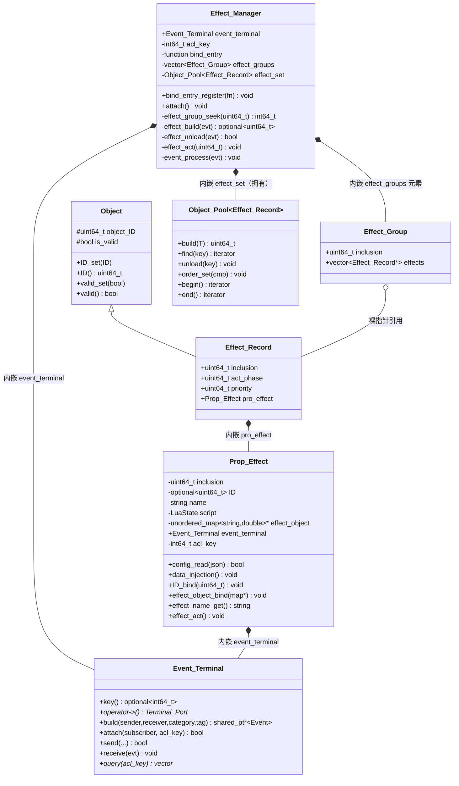
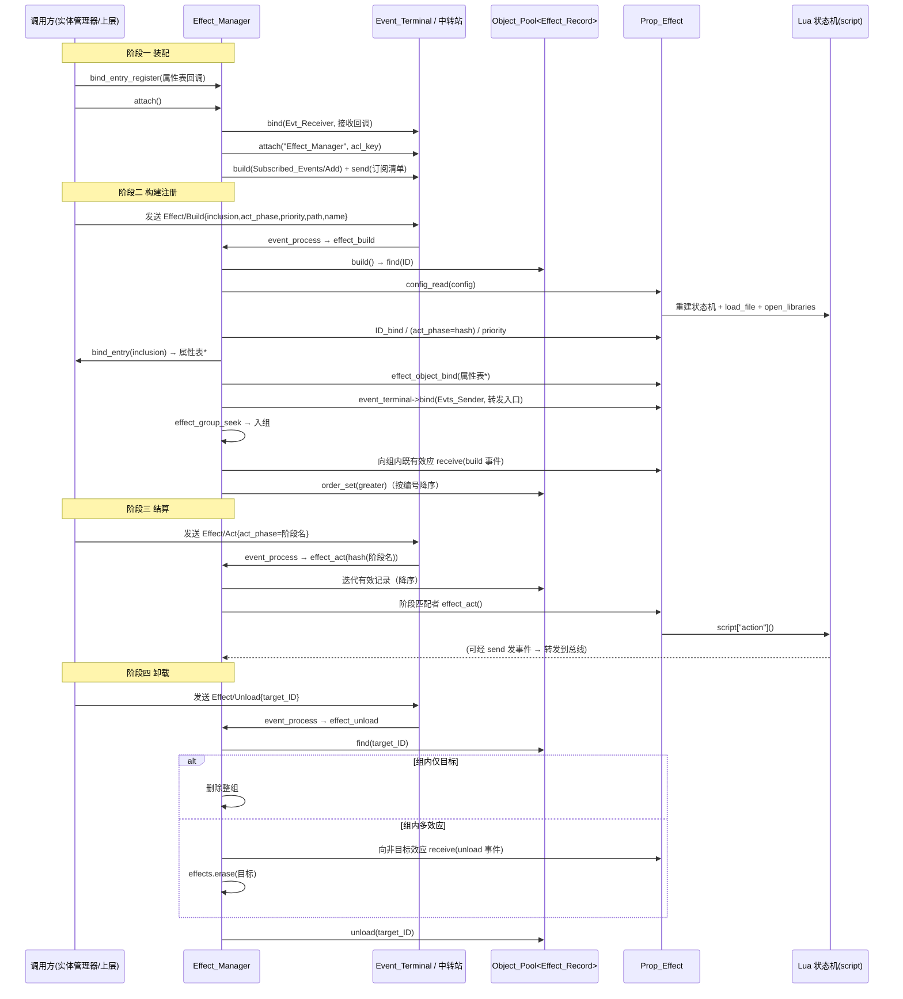

# 效果 · 模块架构

> 模块路径（相对源码根）：`Engine/EngineSystem/src/effect/`
> 本模块为 EngineSystem（系统层）内的**脚本化效果（Effect）承载与调度**模块，向同层及上层提供两类核心产物：一是单个效应的脚本载体类型 `Prop_Effect`，二是效应的注册、挂载、分组、结算与卸载的调度中枢 `Effect_Manager`。
> 本文件为纯技术文档，不修改任何源码；引用的文件一律使用相对源码根的相对路径。
> 记录依据为当前工作区源码（EngineSystem 版次 `c6ecca9`）。本模块此前为适配 EngineCore 新 API 做过改造：**事件终端端口化**（`Event_Terminal::operator->` + `Terminal_Port::bind(Port_ID, cb)`）、**对象池迭代器化**（`Object_Pool::begin()/end()` 范围遍历，`find` 返回迭代器）、**`Object_Pool::build` 改按值形参 + `std::move`**、**事件字段改名**（`sender`/`receiver`/`category`/`tag`/`config`）。本轮 `c6ecca9` 再改动两点：**包含路径口径统一**（实现文件跨目录 / 同目录包含改按本层根相对路径书写，头文件跨目录包含写项目根全路径）与**事件中转站接入 / 订阅登记协议变更**（`attach` 仅登记订阅者名与权限密钥，订阅清单改由 `Subscribed_Events/Add` 事件在运行期登记）。
> 本模块源码体量偏小（仅 6 个文件、2 个编译单元），本文件据此逐字段、逐接口、逐链路充分展开；正文中标注 `【待确认：编号】` 者为源码无法确证的设计意图 / 取舍，其详情集中登记于文末「附录、待确认条目」A，正文只保留标记。

---

## 一、文件内目录

- [二、模块功能介绍](#二模块功能介绍)
- [三、模块公开接口介绍](#三模块公开接口介绍)
- [四、模块私有方法介绍](#四模块私有方法介绍)
- [五、模块内部架构介绍](#五模块内部架构介绍)
- [六、模块设计/实现细节](#六模块设计实现细节)
- [七、模块运行链路详例](#七模块运行链路详例)
- [附录、待确认条目](#附录待确认条目)

---

## 二、模块功能介绍

### 2.1 模块定位

「系统层-效果」是 EngineSystem 内 `src/effect/` 目录下的一个内聚模块，处在 EngineCore 的**对象系统**（`Object` / `Object_Pool`）、**事件系统**（`Event` / `Event_Terminal` / `Terminal_Port`）与 EngineSystem 的**脚本能力**（Sol2 的 `sol::state`）之上，并作为同层「系统层-实体」的业务子系统，被实体管理器驱动的**效果结算流程**调用。

它把「一个由脚本定义、在特定阶段生效、可作用于某个对象属性表的效果」抽象成两部分：

- **效应载体 `Prop_Effect`**：一个**非 Object 派生**的普通类（与同层 `Prop` 不同，它**不**进入对象池），内部持有：效应归属 `inclusion`、效应编号 `ID`、效应名称 `name`、一个 **Sol2 的 Lua 状态机 `script`（`sol::state`）**、一个指向「作用对象属性表」的裸指针 `effect_object`，以及一个**内嵌的事件终端 `event_terminal`**。它负责把配置文件（Lua 脚本路径 + 归属 + 名称）读入自己的状态机，并把归属/编号/名称/作用对象/事件集合/发送函数注册进 Lua 环境，最后对外提供一次「触发（`effect_act`）」——即调用脚本中的 `action` 函数。
- **效应管理器 `Effect_Manager`**：一个**事件驱动的调度中枢**。它以对象池 `Object_Pool<Effect_Record>` 集中托管全部 `Prop_Effect`（`Effect_Record` 派生自 `Object`），以 `Effect_Group` 按「归属」把效应分组，对外提供「按事件注册/卸载/结算效应」的入口，对内完成分组二分查找、优先级/阶段记录、事件转发与 Lua 数据注入。

模块的核心设计特征是：

- **事件即 API**：`Effect_Manager` 几乎不提供「直接调用式」的业务方法（对外仅有 `bind_entry_register` 与 `attach` 两个装配入口）。效应的**构建（Build）/卸载（Unload）/结算（Act）** 全部通过事件送达并触发；`Effect_Manager` 在 `attach` 时向事件中转站订阅 `Effect/Build`、`Effect/Unload`、`Effect/Act` 及 `Config/Load` 四类事件（订阅清单经 `Subscribed_Events/Add` 事件登记，见 §3.2.3、§7.1）。
- **归属（inclusion）分组**：每个效应携带一个 `uint64_t` 的归属编号，`Effect_Manager` 据此把效应分入 `Effect_Group`。同一归属的效应共享一个分组，且**组内互相可见**——新效应加入时会向组内既有效应广播「有新效应加入」，卸载时会向组内其余效应广播「有效应销毁」。
- **阶段（act_phase）哈希化结算**：效应的执行阶段以**字符串**表达（如 `"turn_start"`），在记录时被 `std::hash<std::string>` 压成 `uint64_t`；结算事件同样以字符串阶段触发，经同一哈希后**只触发阶段值相等的效应**。这使「阶段」成为一种廉价可比的整数键。
- **优先级（priority）显式记录**：效应携带一个 `uint64_t` 优先级字段（数值越大越先执行），支持 `"max"` 字符串形式表达最高优先级。
- **效应自带事件终端**：每个 `Prop_Effect` 内嵌一个 `Event_Terminal`，效应脚本可经 `send` 函数把自定义事件经效应终端 → 管理器终端**转发**给其它模块，形成「效应脚本 ↔ 引擎总线」的通道。
- **脚本能力集中在效应内部**：Lua 状态机的创建、脚本加载、标准库打开、变量/函数注入，全部封装在 `Prop_Effect` 内；`Effect_Manager` 只负责「何时创建/触发/销毁」，不触碰 Lua 细节。

### 2.2 职责边界

| 归属 | 职责 |
| --- | --- |
| **属于本模块** | 效应的脚本载体字段布局、Lua 状态机加载与数据注入、效应归属/编号/名称的绑定、效应作用对象指针的绑定、效应的单次触发（调用脚本 `action`）、效应的注册（构建）/卸载/分组/阶段结算、效应组内广播、效应自事件的转发、效应的事件终端装配 |
| **不属于本模块** | 实体属性的实际存储（属系统层-属性 `Prop` / 实体管理器）、属性槽对象池的持有、效应配置 JSON 的产生与投递、事件总线（中转站）的实现与路由、`Effect/Build` 等事件由谁发出、Lua 脚本文件的内容与语义、`bind_entry` 回调指向的属性槽获取逻辑 |
| **交由对象系统** | `Object` 基类（编号与合法标记）、`Object_Pool<T>`（增删查清、ID/索引发放回收、哈希/排序两种定位模式、迭代器化遍历） |
| **交由事件系统** | `Event` 结构、`Event_Terminal` 终端的接入/收发/查阅、`Terminal_Port` 端口绑定与 `Port_ID` 枚举校验、事件中转站的跨模块路由 |
| **交由工具集** | `logger` 全局日志、`detail::field_check` 字段校验、`detail::path_check` 路径校验、`detail::binary_search` 二分查找、`Engine_Env::absolute_path_get` 可执行目录相对路径解析、`detail::path_to_string` 路径转字符串 |
| **交由 Sol2/脚本层** | Lua 状态机本体、`sol::state::load_file`、`open_libraries`、`sol::as_table`、`sol::ref`、`script.set` / `set_function` 的绑定语义 |

一句话概括边界：**「效应怎么装、什么时候触发、归谁管、组内如何互相知会」属于本模块；「效应写什么、作用于哪个属性、由谁在何时发出事件」分别属于脚本层、系统层-属性与调用方（实体管理器/上层）。**

### 2.3 解决的问题

1. **需要让「游戏逻辑」以脚本形式热插拔**：游戏中的增益、减益、被动、持续效果等，其行为高度多样且需要频繁调整。本模块用「一个效应 = 一份 Lua 脚本」，把行为的定义权下沉到脚本，引擎侧只保留「加载—注入—触发」的固定骨架。
2. **需要把效应统一编号、批量托管并回收**：效应数量随运行期动态增删。本模块让承载效应的 `Effect_Record` 派生自 `Object`，从而被 `Object_Pool<Effect_Record>` 接纳，复用对象池的「ID 分配 / 合法性标记 / 连续遍历 / 槽位复用」机制。**这是 `Effect_Record` 选择 `: public Object` 的根本原因**（注意：`Prop_Effect` 本身不派生 `Object`，只有承载它的 `Effect_Record` 派生）。
3. **需要按「归属」聚合效应**：一个效果往往挂载在某个对象（实体/物品）上，且同一对象上会有多个效应，它们之间需要互相感知（例如「免疫」效应需知道同对象上新增了「中毒」效应）。本模块以 `inclusion` 为键把效应分组，并在组内进行加入/销毁广播，为「效应间交互」提供最小机制。
4. **需要按「阶段」批量结算**：战斗等场景下，效果在固定时机（回合开始、回合结束、受击时…）触发。本模块把阶段名哈希为整数，结算事件只需给出阶段名，引擎即触发所有同阶段效应，避免逐效应点名调用。
5. **需要给效应脚本一条「向引擎说话」的通道**：效应脚本往往需要发起引擎侧动作（造成伤害、播放特效…）。本模块为每个效应提供内嵌事件终端与 `send` 函数，脚本经其发出的自定义事件会被管理器终端转发到事件总线。
6. **需要一条受控的「对象属性」入口**：效应的作用对象是一张 `std::unordered_map<std::string, double>` 属性表。本模块不持有该表，而是经 `bind_entry` 回调向持有方（实体管理器/属性分发器）**索要**指向属性表的指针，再注入脚本。这样效应脚本对属性的读写既便捷（直接操作注入的表/对象），又保持了属性所有权在属性系统一侧。

### 2.4 在整体架构中的位置

```
                           ┌──────────────────────────────────────────────────────┐
   上层/同层调用方          │   系统层-实体 Entity_Manager（业务驱动方）                │
                           │   发出 Effect/Build、Effect/Unload、Effect/Act 事件      │
                           │   提供 bind_entry：unordered_map<string,double>*         │
                           │      bind_entry(const uint64_t& 对象ID) → 属性槽        │
                           └───────┬───────────────────────────────┬──────────────────┘
                                   │ 事件（Category="Effect"）       │ 注册绑定回调
                                   │ 与 Config/Load                 │ bind_entry_register
                           ┌───────▼───────────────────────────────▼──────────────────┐
   ★本次模块                │                系统层-效果 effect                          │
                           │   Effect/效应.h        → class Prop_Effect（脚本载体）     │
                           │     ├─ script : LuaState（sol::state，内嵌 Lua 状态机）    │
                           │     ├─ effect_object : unordered_map<string,double>*（借用）│
                           │     ├─ event_terminal : Event_Terminal（内嵌）             │
                           │     └─ inclusion / ID / name / acl_key                    │
                           │   Effect_Manager/效应管理器.h                            │
                           │     ├─ Effect_Record : public Object（承载 Prop_Effect）   │
                           │     ├─ Effect_Group（按 inclusion 分组，持 Effect_Record*）│
                           │     ├─ effect_set : Object_Pool<Effect_Record>（托管）     │
                           │     ├─ effect_groups : vector<Effect_Group>（分组索引）    │
                           │     ├─ bind_entry : function<...属性槽...>（借用入口）     │
                           │     └─ event_terminal : Event_Terminal（内嵌）             │
                           └───────┬───────────────────┬──────────────────┬───────────┘
                                   │ 依赖（只读下行）    │ 依赖（只读下行）   │ 依赖（只读下行）
                           ┌───────▼─────────┐ ┌───────▼──────────┐ ┌─────▼──────────────┐
                           │   对象系统        │ │   事件系统          │ │   工具集 / 脚本桥    │
                           │ Object /对象.h    │ │ Event /事件.h       │ │ logger / field_check │
                           │ Object_Pool/       │ │ Event_Terminal/     │ │ path_check / binary_ │
                           │   对象池.h         │ │   事件终端.h         │ │   search / Engine_Env │
                           │ （元素须派生Object）│ │ 终端端口.h(Port_ID) │ │ Sol2 / sol类型别名.h  │
                           └───────┬─────────┘ └───────┬──────────┘ └─────┬──────────────┘
                                   └──────────────┬──────┴──────────────────┘
                                                  │
                           ┌──────────────────────▼──────────────────────┐
                           │   common/前置头文件包含.h（EngineSystem PCH） │
                           │        ↳ 转发 EngineCore PCH ＋ Sol2          │
                           └─────────────────────────────────────────────┘
```

- **下行（本模块依赖）**：本模块依赖 EngineSystem 公共预编译头 `Engine/EngineSystem/common/前置头文件包含.h`（转发 EngineCore PCH 并追加 `<sol/sol.hpp>`）；通过头文件依赖对象系统的 `Object` / `Object_Pool`、事件系统的 `Event` / `Event_Terminal` / `Port_ID`；通过两个 `.cpp` 依赖工具集的全局 `logger`；`Prop_Effect` 还依赖 `Engine_Env`（可执行目录相对路径解析）、`路径字符串转换.h`（路径↔字符串）、`数据校验工具.h`（字段/路径校验）与 Sol2 包装头。
- **上行（依赖本模块者）**：同层「系统层-实体」的实体管理器是效应的**业务驱动方**——它向事件总线发出 `Effect/Build`、`Effect/Unload`、`Effect/Act` 事件来注册、卸载、结算效应，并向 `Effect_Manager` 注册 `bind_entry` 回调以提供「对象 ID → 属性表指针」。`Engine/EngineSystem/cmake/对外接口.cmake` 明确把 `src/effect/Effect/效应.h` 列为**本层对外公共头**，说明 `Prop_Effect` 的类型定义需要被上层（含 Lua 绑定/渲染层）看到。
- **横向**：本模块**不**反向包含实体管理器的头文件；它对属性表的依赖通过 `std::function` 回调在运行期注入，从而在编译期不产生对实体管理器/属性系统的直接依赖，避免了循环依赖。

### 2.5 文件清单

| 相对路径 | 形态 | 参与编译 | 对外主要产出 |
| --- | --- | --- | --- |
| `Engine/EngineSystem/src/effect/Effect/效应.h` | 纯头文件（类声明） | 否（仅头） | 类 `engine::Prop_Effect`（本层**对外公共头**） |
| `Engine/EngineSystem/src/effect/Effect/局部命名空间使用.h` | 内部 using 头 | 否（仅头，被 .cpp 包含） | 无对外符号（仅 using 别名） |
| `Engine/EngineSystem/src/effect/Effect/core/效应.cpp` | 编译单元 | **是** | `Prop_Effect` 成员函数实现 |
| `Engine/EngineSystem/src/effect/Effect_Manager/效应管理器.h` | 纯头文件（类声明） | 否（仅头） | 类 `engine::Effect_Manager` |
| `Engine/EngineSystem/src/effect/Effect_Manager/局部命名空间使用.h` | 内部 using 头 | 否（仅头，被 .cpp 包含） | 无对外符号（仅 using 别名） |
| `Engine/EngineSystem/src/effect/Effect_Manager/core/效应管理器.cpp` | 编译单元 | **是** | `Effect_Manager` 成员函数实现 |

> 编译归属佐证：`Engine/EngineSystem/源文件列表.cmake` 的 `target_sources(EngineSystem PRIVATE ...)` 中，`src/effect/` 下**只有** `"src/effect/Effect/core/效应.cpp"` 与 `"src/effect/Effect_Manager/core/效应管理器.cpp"` 被列入编译源；四个头文件（`效应.h`、`效应管理器.h` 及两个 `局部命名空间使用.h`）被列入**头文件**清单（仅供 IDE 建索引，不参与编译）。
> 包含路径口径（本轮 `c6ecca9` 统一）：两个 `.cpp` 以**本层根相对路径**包含各自的 `局部命名空间使用.h`（`"src/effect/Effect/局部命名空间使用.h"` / `"src/effect/Effect_Manager/局部命名空间使用.h"`），其余跨目录包含（PCH、`日志系统运行包.h`、头文件内的 `Engine/EngineCore/...`）均以**项目根全路径**书写。

### 2.6 与相邻模块的职责分界

- 与 **对象系统（object）**：对象系统提供对象基类与对象池两类无业务语义的底层设施。本模块做两件事——让 `Effect_Record : public Object`（以满足对象池的元素约束）、在实现中调用 `Object_Pool<Effect_Record>` 的 `build` / `find` / `unload` / `order_set` / `begin` / `end`。效应记录的生命周期（ID 分配、非法区收缩、排序）完全委托给对象池。
- 与 **事件系统（event）**：本模块是事件系统的**消费者兼转发者**。`Effect_Manager` 把 `Event_Terminal` 作为成员内嵌，向 `Evt_Receiver` 端口注册接收回调并 `attach` 接入中转站（本轮改为两步：`attach` 只登记订阅者名与密钥，订阅清单经 `Subscribed_Events/Add` 事件登记）；同时把每个效应的终端在 `Evts_Sender` 端口上装配一个「转发到本管理器终端」的回调。本模块不实现总线路由逻辑（那属事件系统）。
- 与 **系统层-属性 / 实体管理器**：实体管理器既是效应事件的**发出方**，又是效应作用对象的**提供方**（经 `bind_entry` 返回属性表指针）。本模块只保存该指针并注入脚本，**完全不拥有、不释放**属性表，二者构成「持有方 ↔ 借用方」关系。
- 与 **脚本层（Sol2）**：本模块在 `Prop_Effect` 内聚 Lua 状态机的全部操作，但不定义脚本内容与语义；脚本需自行提供名为 `action` 的全局函数（`effect_act` 调用 `script["action"]()`）。
- 与 **配置系统**：本模块只从事件 `config` 中读取效应配置 JSON 的字段（`path` / `inclusion` / `name` 等），**不负责**配置文件的发现、解析与投递——那属配置系统与调用方。

---

## 三、模块公开接口介绍

> 说明：本模块的对外类型为 `Prop_Effect` 与 `Effect_Manager`（后者的内部嵌套类型 `Effect_Record` / `Effect_Group` 为私有，不对外）。二者均以头文件形式暴露，方法声明于头、实现于 `core/*.cpp`。本章逐条列出**对外面 / 层内可见的公开接口**（签名与当前源码逐字一致）；`Effect_Manager` 的**私有成员函数**另归 §四，**类内数据成员与嵌套类型**的逐字段说明集中在 §5.3。

### 3.1 类 `Prop_Effect`（效应）

- **定义位置**：`Engine/EngineSystem/src/effect/Effect/效应.h`
- **命名空间**：`engine`
- **声明**：`class Prop_Effect`
- **用途**：单个效应的脚本载体，承载 Lua 状态机、归属/编号/名称、作用对象指针与事件终端，并提供单次触发入口。
- **注意**：`Prop_Effect` **不派生** `Object`，它本身不具备对象编号/合法标记，不能直接进入对象池；只有包住它的 `Effect_Record`（`Effect_Manager` 私有嵌套类型）派生 `Object` 并进入 `Object_Pool<Effect_Record>`。
- **数据成员**：`inclusion` / `ID` / `name` / `script` / `effect_object`（`private`）与 `event_terminal`（`public`）、`acl_key`（`private`）的逐字段说明见 §5.3.1。

#### 3.1.1 构造与析构、移动

| 签名 | 参数 | 返回值 | 约束与行为 |
| --- | --- | --- | --- |
| `Prop_Effect()` | 无 | — | 构造函数。**唯一动作**：`acl_key = event_terminal.key().value_or(0);`——向内嵌终端的密钥生成器索取一次性权限密钥（`key()` 重复调用返回空 `optional`，故以 `0` 兜底）。其余成员按类内初值初始化。 |
| `~Prop_Effect()` | 无 | — | 析构函数。当前实现为**空体**：不释放 `effect_object`（因它是借用指针、非拥有），不做终端解绑。Lua 状态机 `script` 随对象析构自动释放。 |
| `Prop_Effect(Prop_Effect&&) = default;` | — | — | **默认移动构造**（显式声明）。 |
| `Prop_Effect& operator=(Prop_Effect&&) = default;` | — | — | **默认移动赋值**（显式声明）。 |

> **移动/拷贝语义**：`Prop_Effect` 显式声明了移动构造与移动赋值，且**未声明**拷贝构造/拷贝赋值。由于内嵌成员 `Event_Terminal` 只提供移动语义（其内含 `std::unique_ptr`，拷贝被删除），`Prop_Effect` 的隐式拷贝构造/赋值本就会被删除；再加上显式移动声明，`Prop_Effect` 是**只可移动、不可拷贝**的类型。这既是对象池 `build` 采用「按值 + `std::move`」的前提，也使 `Effect_Record` 同样只可移动。

#### 3.1.2 配置读取

```cpp
bool config_read(const nlohmann::json& config);
```

| 项 | 说明 |
| --- | --- |
| **参数** | `config`：效应配置 JSON 对象（`const` 引用）。需包含 `"path"`（脚本文件相对路径，字符串）、`"inclusion"`（归属，无符号整数）、`"name"`（效应名称，字符串）三个字段。 |
| **返回值** | `bool`：三个字段均合法、路径校验通过且脚本成功加载则返回 `true`；任一环节失败返回 `false`。 |
| **行为** | ①依次用 `detail::field_check<string>(config,"path")`、`field_check<uint64_t>(config,"inclusion")`、`field_check<string>(config,"name")` 校验三字段，任一失败**立即返回 false**；②`path config_path = Engine_Env::absolute_path_get(config["path"].get<string>());`——以可执行文件目录为基准，把配置中的相对路径解析为绝对路径；③`detail::path_check(config_path)` 校验路径是否为存在的常规文件，失败返回 `false`；④成功则 `script = LuaState{}`（**重置**状态机，丢弃旧脚本），`script.load_file(detail::path_to_string(config_path))`（以 UTF-8 字符串路径加载脚本），`script.open_libraries(sol::lib::base, sol::lib::math, sol::lib::string, sol::lib::table)`（仅打开 base/math/string/table 四个标准库）；⑤`inclusion = config["inclusion"].get<uint64_t>();`、`name = config["name"].get<string>();`；⑥返回 `true`。 |
| **约束** | 需在效应被 `build` 之后、`data_injection` / `effect_act` 之前调用（由 `Effect_Manager::effect_build` 调用）。重复调用会**重置并重新加载**脚本，`inclusion` / `name` 被覆盖。`"path"` 需为**相对可执行文件目录**的可读脚本路径。 |
| **异常/失败** | 本函数自身不 `throw`；失败以返回值 `false` 表达。但 `script.load_file(...)` 在脚本存在语法错误/运行时错误时可能由 Sol2 抛出异常，本函数**未加 try/catch**（见 §6.11）。`detail::field_check` / `detail::path_check` 内部经 `logger` 输出 info/warn 日志。 |

#### 3.1.3 数据注入

```cpp
void data_injection(void);
```

| 项 | 说明 |
| --- | --- |
| **参数** | 无。 |
| **返回值** | `void`。 |
| **行为** | ①若 `!ID.has_value()`（效应编号未绑定）：`logger.error("Effect::效应ID未绑定\n无法完成数据注入")` 并**直接返回**；②依次向 Lua 环境注册变量：`script.set("inclusion", inclusion)`、`script.set("ID", ID.value())`、`script.set("name", name)`、`script.set("effect_object", sol::as_table(*effect_object))`；③调用 `event_terminal.query(acl_key)` 取事件集合的**只读指针** `event_set_ptr`（密钥不合法时为空指针），若非空则 `script.set("event_set", ref(*event_set_ptr))` 注册事件集合引用（`ref` 保持引用而非拷贝）；④`script.set_function("send", [this](shared_ptr<Event> evt){ this->event_terminal.send(evt, acl_key); });` 注册事件发送函数。 |
| **约束** | 需在 `ID_bind` 与 `effect_object_bind` **之后**调用：未绑定 ID 会提前返回（不注入）；`effect_object` 未绑定则 `sol::as_table(*effect_object)` 解引用不确定指针。多次调用会重复 `set` 覆盖注入。 |
| **异常/失败** | 本函数自身不 `throw`；ID 缺席以 `logger.error` 表达并提前返回。`sol::as_table` / `script.set` / `set_function` 由 Sol2 内部处理，可能因 Lua 栈/类型问题产生 Sol2 异常，未加 try/catch（见 §6.11）。 |

> **关于 `register_event` 被停用**：源码 `data_injection` 中留有一段 `TODO` 注释，说明 `register_event` 已从 `Engine/EngineSystem/common/external/Sol2/sol类型注册.h` 移除，原「注册事件基类信息 / 配置事件信息」的两处调用被注释停用，待确认原事件注册内容后再补回。经核对，`sol类型注册.h` 当前只提供 `json_to_table` / `table_to_json` 两个转换函数，**确无** `register_event`。【待确认：SYS-EFF-01】

#### 3.1.4 编号绑定

```cpp
void ID_bind(const uint64_t& ID);
```

| 项 | 说明 |
| --- | --- |
| **参数** | `ID`：要绑定的效应编号（`const uint64_t&`）。 |
| **返回值** | `void`。 |
| **行为** | 若 `!this->ID.has_value()`（尚未绑定）则 `this->ID = ID;`；**若已绑定则不做任何事**（一次性绑定，先到先得，后续调用被静默忽略）。 |
| **约束** | 由 `Effect_Manager::effect_build` 在对象池分配 ID 后调用，传入 `new_record->ID()`（即 `Effect_Record` 的对象编号）。因此**效应编号与承载它的对象池记录编号一致**。 |
| **异常/失败** | 不抛异常、不报错；重复绑定静默忽略。 |

#### 3.1.5 作用对象绑定

```cpp
void effect_object_bind(std::unordered_map<std::string, double>* object);
```

| 项 | 说明 |
| --- | --- |
| **参数** | `object`：指向效应作用对象的属性表裸指针。 |
| **返回值** | `void`。 |
| **行为** | `effect_object = object;`——**原样保存**该指针，不做非空校验、不做所有权接管。 |
| **约束** | 由 `Effect_Manager::effect_build` 调用，传入 `bind_entry(new_record->inclusion)` 的返回值。由于传入的是 `inclusion`（归属编号）而非实体 ID，**回调被调用时以「归属」为参数取属性表**——这意味着「归属编号」在调用方的约定中同时充当了「作用对象的定位键」。【待确认：SYS-EFF-06】 |
| **异常/失败** | 不抛异常。若回调返回 `nullptr`，本函数同样保存 `nullptr`，后续 `data_injection` 将解引用不确定/空指针。 |

#### 3.1.6 效应名称获取

```cpp
const std::string& effect_name_get(void) const;
```

| 项 | 说明 |
| --- | --- |
| **参数** | 无。 |
| **返回值** | `const std::string&`：`name` 成员的常量引用（`const` 成员函数）。 |
| **行为** | `return name;`——直接返回内部名称字符串的引用，不拷贝。 |
| **约束** | 由 `Effect_Manager::effect_unload` 在卸载广播前读取，写入卸载事件的 `config["name"]`。调用方不应在效应销毁后继续持有该引用。 |

#### 3.1.7 效应触发

```cpp
void effect_act(void);
```

| 项 | 说明 |
| --- | --- |
| **参数** | 无。 |
| **返回值** | `void`。 |
| **行为** | `script["action"]();`——从 Lua 全局表中取出名为 `action` 的值并作为函数调用，即触发该效应的脚本行为。 |
| **约束** | 需在 `config_read`（脚本已加载）之后调用。**要求脚本定义全局函数 `action`**；若脚本未定义，`script["action"]` 取到 `nil`，对其调用会由 Sol2/Lua 报错（通常抛异常或记录 Lua 错误）。除 `action` 外，脚本可访问注入的 `inclusion` / `ID` / `name` / `effect_object` / `event_set` 与 `send` 函数。 |
| **异常/失败** | 本函数不自行 `throw`；Lua 侧错误处理由 Sol2 决定（见 §6.11）。 |

### 3.2 类 `Effect_Manager`（效应管理器）

- **定义位置**：`Engine/EngineSystem/src/effect/Effect_Manager/效应管理器.h`（声明）；`Engine/EngineSystem/src/effect/Effect_Manager/core/效应管理器.cpp`（实现）
- **命名空间**：`engine`
- **声明**：`class Effect_Manager`
- **用途**：效应的注册、挂载、分组、阶段结算与卸载的调度中枢，事件驱动。
- **内部嵌套类型**（`Effect_Record : public Object` / `Effect_Group`）与**数据成员**的逐字段说明见 §5.3.2、§5.3.3；**私有成员函数**（`effect_group_seek` / `effect_build` / `effect_unload` / `effect_act` / `event_process`）见 §四。

#### 3.2.1 构造与析构

| 签名 | 参数 | 返回值 | 约束与行为 |
| --- | --- | --- | --- |
| `Effect_Manager()` | 无 | — | 构造函数。**唯一动作**：`acl_key = event_terminal.key().value_or(0);`。其余成员按默认初始化（`bind_entry` 为空函数对象、`effect_groups` 为空、`effect_set` 为空池）。 |
| `~Effect_Manager() = default;` | 无 | — | **默认析构**。不额外释放资源：`effect_set` 随成员自动析构；`bind_entry` 无拥有关系。 |

#### 3.2.2 注册属性槽绑定通道

```cpp
void bind_entry_register(std::function<std::unordered_map<std::string, double>*
    (const uint64_t& ID)> bind_entry);
```

| 项 | 说明 |
| --- | --- |
| **参数** | `bind_entry`：回调函数对象，接收 `const uint64_t&`，返回 `std::unordered_map<std::string, double>*`（属性表指针）。典型由实体管理器/属性系统提供。 |
| **返回值** | `void`。 |
| **行为** | `this->bind_entry = bind_entry;`——保存回调（**覆盖**式赋值，后注册的取代先注册的）。 |
| **约束** | 应在任何 `Effect/Build` 事件到达前调用，否则 `effect_build` 中对空 `std::function` 的调用会抛 `std::bad_function_call`（见 §6.11-4）。【待确认：SYS-EFF-06】 |
| **异常/失败** | 本函数不抛异常。 |

#### 3.2.3 事件中转站接入（本轮协议变更）

```cpp
void attach(void);
```

| 项 | 说明 |
| --- | --- |
| **参数** | 无。 |
| **返回值** | `void`。 |
| **行为（分步）** | ①构造订阅事件集合 `vector<Event> needed_events`，依次 `emplace_back`：`("", "Effect_Manager", "Config", "Load", json::object())`、`("", "", "Effect", "Build", json::object())`、`("", "", "Effect", "Unload", json::object())`、`("", "", "Effect", "Act", json::object())`（参数序为 sender、receiver、category、tag、config）；②构造捕获 `this` 的接收入口 `receive_entry = [this](shared_ptr<Event> evt){ this->event_process(evt); }`；③`event_terminal->bind(Port_ID::Evt_Receiver, receive_entry)` 把接收回调注册到**单事件接收端口**；④`event_terminal.attach("Effect_Manager", acl_key)`——**仅登记订阅者名与权限密钥**（不再携带订阅清单），失败则 `logger.error("Effect_Manager::事件中转站接入失败")` 并 `return`；⑤由 `needed_events` 逐条抽取 `category` / `tag`，构造订阅清单 JSON 数组 `subscribed_events`（每条 `{"category":…, "tag":…}`）；⑥`auto attach_evt = event_terminal.build("", "", "Subscribed_Events", "Add")` 构造订阅事件，若返回 `nullptr` 则 `logger.error("Effect_Manager::订阅事件构造失败")` 并 `return`；⑦向该事件写入 `config["object"] = "Effect_Manager"`、`config["acl_key"] = static_cast<uint64_t>(acl_key)`、`config["subscribed_events"] = subscribed_events`；⑧`event_terminal.send(attach_evt, acl_key)` 发送订阅事件（登记订阅清单），失败则 `logger.error("Effect_Manager::订阅事件发送失败")`。 |
| **约束** | 应在使用管理器前调用一次。重复调用会导致 `Evt_Receiver` 端口被重复登记、回调被覆盖、接入信息与订阅清单重复上报。 |
| **异常/失败** | 本函数不抛异常；`bind` / `attach` / `build` / `send` 的失败由 `logger` 记录，不再继续后续步骤。 |

> **订阅事件协议的两点观察**：
> - 接入分两步：**第一步** `attach(subscriber, acl_key)` 只登记订阅者名与权限密钥；**第二步** 以事件 `Subscribed_Events/Add`（载荷 `object` / `acl_key` / `subscribed_events`）提交订阅清单。因此 `needed_events` 中携带的 `sender` / `receiver` 字段仅用于本模块内部构造该列表，**不再上报中转站**（清单只含 `category` / `tag`）。
> - 订阅清单含 `(Config, Load)` 与三条 `(Effect, Build/Unload/Act)`；而 `event_process` 当前**只处理** `category == "Effect"` 的事件，对 `Config/Load` 并无处理分支。因此 `Config/Load` 虽被订阅却未被消费。【待确认：SYS-EFF-07】

### 3.3 本模块依赖的下层接口（调用本模块前须掌握）

本模块的对外行为建立在下层若干接口之上，调用方阅读本模块文档时需一并了解其语义（以下接口分别属于事件系统、对象系统、工具集与 Sol2，非本模块提供）。

#### 3.3.1 事件结构 `Event`

| 字段 | 类型 | 本模块用途 |
| --- | --- | --- |
| `sender` | `std::string` | 事件发起者。本模块构造订阅事件时置空或置模块名；处理时**不读取**。 |
| `receiver` | `std::string` | 事件目标。本模块构造订阅事件时使用（`"Effect_Manager"` 或空串）；处理时**不读取**。 |
| `category` | `std::string` | 事件分类。本模块判定 `== "Effect"`。 |
| `tag` | `std::string` | 类内标签。本模块判定 `"Build"` / `"Unload"` / `"Act"` / 其它。 |
| `config` | `nlohmann::json` | 配置包。本模块读写 `path` / `inclusion` / `name` / `act_phase` / `priority` / `target_ID` / `ID`，并在 `attach` 中读写 `object` / `acl_key` / `subscribed_events`。 |

本模块识别的事件形如：
- 构建：`Event{ sender="", receiver="", category="Effect", tag="Build", config={{"inclusion",<uint>},{"act_phase",<…>},{"priority",<"max"|uint>}, {"path",<string>},{"name",<string>}} }`
- 卸载：`Event{ …, category="Effect", tag="Unload", config={{"target_ID",<uint>}} }`
- 结算：`Event{ …, category="Effect", tag="Act", config={{"act_phase",<string>}} }`
- 效应专属：`Event{ …, category="Effect", tag=<任意非上述>, config={{"target_ID",<uint>}} }`
- 订阅登记：`Event{ sender="", receiver="", category="Subscribed_Events", tag="Add", config={{"object",<string>},{"acl_key",<uint>},{"subscribed_events",<array>}} }`（由本模块 `attach` 发出）

#### 3.3.2 事件终端 `Event_Terminal` 与端口 `Terminal_Port` / `Port_ID`

| 接口 | 签名 | 本模块用途 |
| --- | --- | --- |
| `key` | `std::optional<int64_t> key(void)` | 构造时取一次性权限密钥（重复调用返回空）。 |
| `operator->` | `Terminal_Port* operator->(void)` | 取得内嵌端口对象，调用 `bind`。 |
| `Terminal_Port::bind` | `template <typename T> Terminal_Port& bind(const Port_ID& ID, T callback)` | 管理器绑 `Evt_Receiver`（单事件接收）；效应绑 `Evts_Sender`（多事件发送）。 |
| `build` | `std::shared_ptr<Event> build(sender, receiver, category, tag)` | `attach` 中构造 `Subscribed_Events/Add` 订阅事件。 |
| `attach` | `bool attach(const std::string& subscriber, const int64_t& acl_key)` | 管理器以 `"Effect_Manager"`、`acl_key` 接入中转站（**仅登记订阅者名与密钥**，订阅清单另经事件登记）。 |
| `send` | `bool send(std::shared_ptr<Event>, const int64_t&) const` / `bool send(std::vector<std::shared_ptr<Event>>, const int64_t&) const` | 效应 `send` 函数（单事件）、管理器转发（多事件）与订阅事件发送（单事件）使用。 |
| `receive` | `void receive(std::shared_ptr<Event>)` | 向效应投递「加入/销毁/专属」事件。 |
| `query` | `const std::vector<std::shared_ptr<Event>>* query(const int64_t& acl_key) const` | `data_injection` 中取事件集合只读指针以注入脚本。 |

`Port_ID` 枚举中与本模块相关者为 `Evt_Receiver`（管理器接收）与 `Evts_Sender`（效应多事件发送）。`Terminal_Port::bind` 在编译期校验回调类型、运行期校验端口 ID 是否匹配（不匹配记 `logger.error` 并驳回）。

#### 3.3.3 对象池 `Object_Pool<T, Projector, Key>` 中被本模块使用的接口

| 接口 | 签名 | 本模块用途 |
| --- | --- | --- |
| `build` | `uint64_t build(T object = {})` | 构建新效应记录，返回其对象 ID。**按值形参 + `std::move`**（新 API）。 |
| `find` | `typename std::vector<T>::iterator find(const Key& key)` | 按效应编号定位记录；未命中返回 `end()`。 |
| `end` | `typename std::vector<T>::iterator end(void)` | 与 `find` 返回值比较。 |
| `unload` | `void unload(const Key& key)` | 卸载指定效应记录。 |
| `order_set` | `template<typename Compare> void order_set(Compare cmp)` | 切至排序定位模式并按 `std::ranges::greater` 降序排列（排序键为对象 ID）。 |
| `begin` / `end`（遍历） | `iterator begin(void)` / `iterator end(void)` | 结算时迭代有效记录（迭代器化遍历）。 |

#### 3.3.4 对象基类 `Object`

| 接口 | 签名 | 本模块用途 |
| --- | --- | --- |
| `ID` | `uint64_t ID(void) const` | 取效应编号（当绑定到 `Prop_Effect` 与分组广播时）。 |
| `valid` | `bool valid(void) const` | 结算前判记录有效性。 |

#### 3.3.5 工具集

| 接口 | 位置 | 本模块用途 |
| --- | --- | --- |
| `detail::field_check<T>` | `Engine/EngineCore/src/tools/Detail/json字段可用性校验.h`（经 `package/数据校验工具.h`） | 校验事件 `config` 各字段存在性与类型。 |
| `detail::path_check` | `Engine/EngineCore/src/tools/Detail/文件路径可用性校验.h`（经同上） | 校验脚本路径是否为存在的常规文件。 |
| `Engine_Env::absolute_path_get` | `Engine/EngineCore/src/tools/Engine_Env/引擎环境.h` | 把脚本相对路径解析为「可执行目录/路径」的绝对路径。 |
| `detail::path_to_string` | `Engine/EngineCore/src/tools/Detail/路径字符串转换.h` | 把 `std::filesystem::path` 转 UTF-8 `std::string` 供 `load_file` 使用。 |
| `detail::binary_search` | `Engine/EngineCore/src/tools/Detail/二分查找.h` | 按 `inclusion` 在 `effect_groups` 上二分查找分组下标。 |
| `logger` | `Engine/EngineCore/src/tools/Logging/日志系统运行包.h` | 全局日志（`warn` / `error`）。 |

#### 3.3.6 Sol2 / 脚本桥

| 接口 | 位置 | 本模块用途 |
| --- | --- | --- |
| `LuaState`（=`sol::state`） | `Engine/EngineSystem/common/external/Sol2/sol类型别名.h` | 效应脚本状态机类型。 |
| `LuaTable` / `LuaScript` | 同上 | 别名（当前实现未直接使用）。 |
| `json_to_table` / `table_to_json` | `Engine/EngineSystem/common/external/Sol2/sol类型注册.h` | JSON↔Lua 表转换（当前实现未直接调用）。 |
| `sol::as_table` / `sol::ref` | Sol2 库 | 把容器转 Lua 表、把对象以引用注册进 Lua。 |

---

## 四、模块私有方法介绍

本节逐条列出模块内**类私有 / 内部实现函数**。经核对当前源码：`Prop_Effect` **无任何私有函数**（其构造、析构、移动、`config_read` / `data_injection` / `ID_bind` / `effect_object_bind` / `effect_name_get` / `effect_act` 均为公有，见 §3.1；其私有数据成员见 §5.3.1）。私有函数全部位于 `Effect_Manager`，共 5 个，分列如下。

#### M1 `int64_t effect_group_seek(const uint64_t& inclusion) const`

- **作用**：按归属编号在分组列表中定位 `Effect_Group` 下标。
- 参数：`inclusion` —— 目标归属编号。
- 返回：命中则返回该分组在 `effect_groups` 中的下标；未命中返回 `-1`。
- 关键行为：`optional<uint64_t> index = detail::binary_search(effect_groups, inclusion, less(), &Effect_Group::inclusion);`——以 `std::ranges::less` 为比较、以 `Effect_Group::inclusion` 为投影，在分组列表上二分查找；若 `index == nullopt` 返回 `-1`，否则返回 `static_cast<int64_t>(index.value())`。
- 约束：**二分查找要求 `effect_groups` 按 `inclusion` 升序排列**。但源码中分组在 `effect_build` 里仅以 `push_back` 追加、**从未排序**，故该前提实际依赖「归属编号按非递减顺序首次出现」这一隐式约定，本模块未强制保证。【待确认：SYS-EFF-02】

#### M2 `std::optional<uint64_t> effect_build(std::shared_ptr<Event> evt)`

- **作用**：处理 `Effect/Build` 事件——在对象池构建新效应记录、加载脚本、写入归属/阶段/优先级、绑定作用对象、装配事件通道并入组。
- 参数：`evt` —— `Effect/Build` 事件智能指针；其 `config` 需含 `inclusion`（无符号整数）、`act_phase`（见 §6.14-1）、`priority`（字符串 `"max"` 或无符号整数）。
- 返回：`std::optional<uint64_t>`——成功返回**新效应的编号**（即对象池分配的 ID）；任一步失败返回 `std::nullopt`。
- 关键行为（分步）：
  ①`auto& config = evt->config;` 简化路径；
  ②依次校验 `inclusion`（`field_check<uint64_t>`）、`act_phase`（`field_check<uint64_t>`）、`priority`（`field_check<string>` **或** `field_check<uint64_t>`），任一不合规即 `logger.warn` 并返回 `nullopt`；
  ③`uint64_t ID = effect_set.build();` 在对象池中构建一条新记录（默认空 `Effect_Record`，含默认构造的 `Prop_Effect`），`auto new_record_it = effect_set.find(ID); auto* new_record = &(*new_record_it);` 取记录指针，`auto& new_effect = new_record->pro_effect;`；
  ④若 `!new_effect.config_read(config)`（配置解析失败）：`effect_set.unload(ID)` 卸载并返回 `nullopt`；
  ⑤成功分支：`new_record->inclusion = config["inclusion"].get<uint64_t>()`、`new_record->pro_effect.ID_bind(new_record->ID())`（绑定效应编号）、`new_record->act_phase = hash<string>{}(config["act_phase"].get<string>())`（阶段名哈希）、按 `priority` 类型写入优先级（字符串 `"max"` → `numeric_limits<uint64_t>::max()`，其余字符串 → `logger.warn` + 卸载 + 返回 `nullopt`；整数 → 直接写入）、`new_record->pro_effect.effect_object_bind(bind_entry(new_record->inclusion))`（经绑定通道取属性表指针）；
  ⑥取 `new_effect.event_terminal`，构造多事件发送入口 `event_send_entry = [this](vector<shared_ptr<Event>> events){ this->event_terminal.send(events, acl_key); }`，并在效应终端上 `terminal->bind(Port_ID::Evts_Sender, event_send_entry)`（把效应发来的多事件**转发**到管理器终端）；
  ⑦`int64_t group_index = effect_group_seek(new_record->inclusion)`，若 `< 0` 则 `effect_groups.push_back({ new_record->inclusion, {} })` 新建分组并取其下标；
  ⑧`auto& group = effect_groups[group_index];`、`evt->config["ID"] = new_record->ID();`（把新效应编号回填到事件 config），随后 `for (auto& effect : group.effects) effect->pro_effect.event_terminal.receive(evt);`（向该分组**既有**效应投递本事件，作为「有新效应加入」的通知），再 `group.effects.push_back(new_record)` 把新记录加入分组；
  ⑨`effect_set.order_set(std::ranges::greater{})` 把对象池切到**降序排序定位模式**（排序键为对象 ID）；
  ⑩返回 `new_record->ID()`。
- 约束：`Effect/Build` 事件必须携带合法字段；`bind_entry` 必须已注册；`act_phase` 字段的类型须与第 ⑤ 步的 `.get<string>()` 相容（见 §6.14-1 的类型矛盾）。【待确认：SYS-EFF-03】
- 异常：本函数自身不 `throw`；校验失败以 `logger.warn` + `nullopt` 表达。但第 ⑤ 步 `config["act_phase"].get<string>()` 在类型不符时可能抛 `nlohmann::json::type_error`；`bind_entry(...)` 在空函数对象时抛 `std::bad_function_call`（见 §6.11、§6.14-1）。【待确认：SYS-EFF-03】【待确认：SYS-EFF-06】

#### M3 `bool effect_unload(std::shared_ptr<Event> evt)`

- **作用**：处理 `Effect/Unload` 事件——从分组与对象池中移除指定效应记录，并向同组其余效应广播。
- 参数：`evt` —— `Effect/Unload` 事件智能指针；其 `config` 需含 `target_ID`（无符号整数，目标效应编号）。
- 返回：`bool`——卸载成功返回 `true`；`target_ID` 字段无效返回 `false`。
- 关键行为（分步）：
  ①`auto& config = evt->config;`；
  ②若 `!detail::field_check<uint64_t>(config,"target_ID")`：`logger.warn("Effect_Manager::效应ID未定义\n效应卸载事件已驳回")` 并返回 `false`；
  ③`uint64_t target_ID = config["target_ID"].get<uint64_t>();`、`auto target_record_it = effect_set.find(target_ID); auto* target_record = &(*target_record_it);` 取目标记录指针、`group_index = effect_group_seek(target_record->inclusion)`、`auto& group = effect_groups[group_index]`、`auto& effects = group.effects`；
  ④**若组内仅有目标效应**（`effects.size() == 1`）：`effect_groups.erase(effect_groups.begin() + group_index)` 移除整个分组（不发销毁广播，因组内无其它效应）；
  ⑤**否则**：先把 `evt->config["inclusion"]` 与 `evt->config["name"]` 置为目标效应的归属与名称，然后遍历组内效应——对**非目标**效应调用 `effect->pro_effect.event_terminal.receive(evt)`（作为「同组有效应销毁」的通知），并记录目标效应在组内的下标 `target_index`；随后 `effects.erase(effects.begin() + target_index)` 从分组移除目标；
  ⑥`effect_set.unload(target_ID)` 从对象池卸载目标记录；
  ⑦返回 `true`。
- 约束：`target_ID` 必须是**对象池中真实存在**的效应编号；源码未在取 `target_record` 前判 `find(...) == end()`（见 §6.14-5）。【待确认：SYS-EFF-08】`target_index` 若因未匹配到目标而保持 `-1`，`effects.erase(begin()-1)` 会造成未定义行为（正常情况下必然匹配）。
- 异常：本函数自身不 `throw`；字段缺失以 `logger.warn` + `false` 表达。

#### M4 `void effect_act(uint64_t phase)`

- **作用**：遍历对象池有效记录，触发阶段匹配的效应。
- 参数：`phase` —— 已哈希的执行阶段值（`uint64_t`）。
- 返回：`void`。
- 关键行为：`for (auto& effect_record : effect_set)` 遍历对象池中**有效**记录（迭代器化遍历，`begin()` 指向首个有效槽、`end()` 为超尾）；对每条记录：若 `effect_record.valid()` 为真，取 `auto& effect = effect_record.pro_effect;`，若 `effect_record.act_phase == phase`（阶段匹配）则 `effect.effect_act();`（触发脚本 `action`）。
- 约束：遍历顺序即对象池当前排列顺序（在 `order_set(greater)` 后为**按效应编号降序**）。源码显式再判一次 `valid()`，与对象池迭代器化区域叠加形成双重有效过滤。
- 异常：本函数自身不 `throw`；`effect_act()` 中 Lua 侧错误由 Sol2 处理。

#### M5 `void event_process(std::shared_ptr<Event> evt)`

- **作用**：管理器的事件总入口（经 `Port_ID::Evt_Receiver` 端口绑定，回调即转发至此）。
- 参数：`evt` —— 流入的事件智能指针。
- 返回：`void`。
- 关键行为：
  ①若 `evt->category == "Effect"` 才进入处理，否则**静默忽略**；
  ②取 `auto& tag = evt->tag; auto& config = evt->config;`；
  ③按 `tag` 分派：`"Build"` → `effect_build(evt)`（返回值被丢弃）；`"Unload"` → `effect_unload(evt)`；`"Act"` → 先 `field_check<string>(config,"act_phase")`（缺失则 `logger.warn` 并返回），再 `hash<string>{}(config["act_phase"].get<string>())` 得到阶段值并 `effect_act(阶段值)`；
  ④**其余 tag**（视为「面向具体效应的事件」）：先 `field_check<uint64_t>(config,"target_ID")`（缺失则 `logger.warn` 并返回），再 `effect_set.find(target_ID)`——若等于 `end()` 则 `logger.warn("目标效应ID不存在")` 并返回；否则取目标记录并 `effect->pro_effect.event_terminal.receive(evt)` 把事件**转发给对应效应**。
- 约束：私有成员，仅由 `attach` 注册的接收入口回调调用。要求事件字段类型符合各分支校验。
- 异常：本函数自身不 `throw`；字段缺失以 `logger.warn` 表达。`config["act_phase"].get<string>()` 在 field_check 通过（string）后类型必相容，异常风险低；`config["target_ID"].get<uint64_t>()` 同理。

---

## 五、模块内部架构介绍

### 5.1 目录 / 文件结构树

```
Engine/EngineSystem/src/effect/
│
├── Effect/                            # 效应载体模块
│   ├── 效应.h                          # class engine::Prop_Effect（声明；本层对外公共头）
│   ├── 局部命名空间使用.h               # 内部 using 头（被 core/*.cpp 引入）
│   └── core/
│       └── 效应.cpp                    # Prop_Effect 成员函数实现（编译单元）
│
└── Effect_Manager/                    # 效应管理器模块
    ├── 效应管理器.h                     # class engine::Effect_Manager（声明；含私有嵌套 Effect_Record / Effect_Group）
    ├── 局部命名空间使用.h               # 内部 using 头（被 core/*.cpp 引入）
    └── core/
        └── 效应管理器.cpp               # Effect_Manager 成员函数实现（编译单元）
```

目录结构符合项目「标准模块架构」的形态：对外头文件位于模块根（`效应.h` / `效应管理器.h`），`局部命名空间使用.h` 紧随其后，实现集中置于 `core/` 子目录。`src/effect/` 下并列两个子模块（`Effect` 与 `Effect_Manager`），二者构成「载体 ↔ 管理器」的配对关系。

### 5.2 各编译单元职责

| 编译单元 | 角色 | 职责 |
| --- | --- | --- |
| `Effect/效应.h` | 对外数据类型头 | 声明 `Prop_Effect` 的全部成员（数据与函数），并集中引入 PCH、事件、事件终端、Sol2 注册/别名、数据校验、引擎环境、路径字符串转换等头文件。 |
| `Effect/局部命名空间使用.h` | 内部使用头 | 引入 `Effect/core/效应.cpp` 中使用的标准库类型别名（`string` / `vector` / `shared_ptr` / `path` / `optional` / `nullopt` / `json`）。 |
| `Effect/core/效应.cpp` | 实现单元 | 实现 `Prop_Effect` 的构造、析构、`config_read`、`data_injection`、`ID_bind`、`effect_object_bind`、`effect_name_get`、`effect_act`；首行以本层根相对路径包含 `"src/effect/Effect/局部命名空间使用.h"`。 |
| `Effect_Manager/效应管理器.h` | 对外接口头 | 声明 `Effect_Manager` 及其私有嵌套类型 `Effect_Record` / `Effect_Group`，引入 PCH、事件、事件终端、`效应.h`、对象、对象池、数据校验、二分查找等头文件。 |
| `Effect_Manager/局部命名空间使用.h` | 内部使用头 | 引入 `Effect_Manager/core/效应管理器.cpp` 中使用的标准库类型别名（`string` / `hash` / `unordered_map` / `vector` / `shared_ptr` / `unique_ptr` / `optional` / `nullopt` / `move` / `swap` / `greater` / `less` / `sort` / `find` / `numeric_limits` / `nothrow` / `json`）。 |
| `Effect_Manager/core/效应管理器.cpp` | 实现单元 | 实现 `Effect_Manager` 的构造、`bind_entry_register`、`attach`、`effect_group_seek`、`effect_build`、`effect_unload`、`effect_act`、`event_process`；首行以本层根相对路径包含 `"src/effect/Effect_Manager/局部命名空间使用.h"`。 |

### 5.3 类内数据成员与嵌套类型逐字段说明

#### 5.3.1 `Prop_Effect` 数据成员

| 成员 | 访问级别 | 类型 | 初值 | 含义 |
| --- | --- | --- | --- | --- |
| `inclusion` | `private` | `uint64_t` | `{}`（即 `0`） | **效应归属**。用于把效应分入同一 `Effect_Group`，也注入到 Lua（键 `"inclusion"`）。 |
| `ID` | `private` | `std::optional<uint64_t>` | 默认（`nullopt`） | **效应编号**。由 `ID_bind` 首次写入后不再改；未绑定时为 `nullopt`。 |
| `name` | `private` | `std::string` | `{}`（空串） | **效应名称**。由 `config_read` 从配置中读入，也注入到 Lua（键 `"name"`）。 |
| `script` | `private` | `LuaState`（即 `sol::state`） | 默认构造 | **Lua 脚本实例**。承载该效应的脚本状态机；`config_read` 会重置并重新加载脚本。 |
| `effect_object` | `private` | `std::unordered_map<std::string, double>*` | **无初值（未初始化）** | **效应作用对象**。指向该效应对之生效的属性表；由 `effect_object_bind` 写入，`data_injection` 读取并注入脚本。 |
| `event_terminal` | `public` | `Event_Terminal` | 默认构造 | **事件终端**。效应与事件中转站交互的内嵌终端对象；公开以便 `Effect_Manager` 在构建时装配其发送端口，并在运行期向效应投递事件。 |
| `acl_key` | `private` | `int64_t` | `0` | **事件发送权限密钥**。在构造函数中由 `event_terminal.key().value_or(0)` 取得，用于随效应终端的 `send` 调用标识身份。 |

> 【待确认：SYS-EFF-05】`effect_object` 声明时**未给初值**（`std::unordered_map<std::string, double>* effect_object;`），即默认初始化为不确定值。若在 `effect_object_bind` 之前调用 `data_injection`，将对不确定指针解引用（`*effect_object`）。是否要求调用方严格保证「先绑定作用对象、再数据注入」的时序，见 §6.14-7。

#### 5.3.2 `Effect_Manager` 嵌套类型（私有）

**`Effect_Record : public Object`**——效应记录，对象池 `Object_Pool<Effect_Record>` 的元素类型。

| 成员 | 类型 | 初值 | 含义 |
| --- | --- | --- | --- |
| `inclusion` | `uint64_t` | **无初值（未初始化）** | 效应归属。由 `effect_build` 在建成后写入。 |
| `act_phase` | `uint64_t` | `0` | 效应执行阶段（阶段名的 `std::hash<std::string>` 值）。 |
| `priority` | `uint64_t` | `0` | 效应执行优先级（数值越大越先执行）。 |
| `pro_effect` | `Prop_Effect` | 默认构造 | 承载的实际效应对象（脚本载体）。 |

> 继承自 `Object` 的 `object_ID`（对象编号，即效应编号）与 `is_valid`（合法标记）由对象池在 `build` / `unload` 时管理。`Effect_Record` 因内嵌只可移动的 `Prop_Effect`，**同样只可移动**，恰好满足对象池 `build(T object = {})` + `std::move` 的按值传参需求。

**`Effect_Group`**——效应组，按归属聚合。

| 成员 | 类型 | 初值 | 含义 |
| --- | --- | --- | --- |
| `inclusion` | `uint64_t` | — | 该组的归属编号（分组键）。 |
| `effects` | `std::vector<Effect_Record*>` | `{}` | 组内效应记录的**裸指针**列表，指向对象池中对应记录。 |

> 组内保存的是**指向对象池元素的裸指针**，而非拷贝或拥有。对象池元素地址的稳定性由对象池保证（`std::vector<T>` 中元素在池存活期内有效），但若对象池扩容搬迁，旧指针将失效——本模块通过在 `effect_build` 中「分组查找优先、构建时后取指针」来规避（见 §6.9）。【待确认：SYS-EFF-09】

#### 5.3.3 `Effect_Manager` 数据成员

| 成员 | 访问级别 | 类型 | 初值 | 含义 |
| --- | --- | --- | --- | --- |
| `event_terminal` | `public` | `Event_Terminal` | 默认构造 | **事件终端**。管理器与事件中转站交互的内嵌终端；公开给调用方以完成接入。 |
| `acl_key` | `private` | `int64_t` | `0` | **事件发送密钥**。构造函数中由 `event_terminal.key().value_or(0)` 取得，用于 `attach` 与效应事件转发时的身份标识。 |
| `bind_entry` | `private` | `std::function<std::unordered_map<std::string, double>*(const uint64_t& ID)>` | 默认（空函数对象） | **属性槽绑定通道**。由 `bind_entry_register` 注入；`effect_build` 时以归属编号调用它，取回属性表指针并绑定到新效应。 |
| `effect_groups` | `private` | `std::vector<Effect_Group>` | `{}` | **分组效应集合**。按归属聚合的效应组列表，`effect_group_seek` 对其按 `inclusion` 做二分查找。 |
| `effect_set` | `private` | `Object_Pool<Effect_Record>` | 默认构造 | **效应总集合**。集中托管全部效应记录；默认投影器以对象 ID（即效应编号）为定位键。 |

#### 5.3.4 关键字段的语义与生命周期

##### 5.3.4.1 `Prop_Effect::script`（`LuaState` = `sol::state`）

- **类型**：`sol::state`（Sol2 的完整 Lua 状态机）。
- **可见性**：`private`。
- **生命周期**：随 `Prop_Effect` 对象。`config_read` 中先 `script = LuaState{}`（销毁旧状态机、构造新状态机）再 `load_file` / `open_libraries`，故**同一效应每次配置读取都会重建整个 Lua 环境**。
- **语义**：该状态机是该效应的**私有运行沙箱**——脚本定义的全局变量、函数（含 `action`）都活在此状态机内，不同效应的脚本互不共享状态。打开的标准库仅 base/math/string/table 四类（不含 io/os/debug 等），属**最小权限**取向。

##### 5.3.4.2 `Prop_Effect::effect_object`

- **类型**：`std::unordered_map<std::string, double>*`（裸指针）。
- **可见性**：`private`。
- **初值**：**无**（未初始化）。
- **语义**：**借用的**作用对象属性表。指向属性系统所持有的某实体的属性槽；本类不拥有其生命周期（析构空体为证）。
- **非空条件**：由 `effect_object_bind` 经 `bind_entry` 回调写入。
- **注入方式**：`data_injection` 中以 `sol::as_table(*effect_object)` 转成 Lua 表注入。**注意**：这里对指针解引用后以 `as_table` 转换（见 §6.14-8 关于拷贝/引用语义的讨论）。【待确认：SYS-EFF-05】

##### 5.3.4.3 `Prop_Effect::event_terminal`

- **类型**：`Event_Terminal`（值成员）。
- **可见性**：`public`。
- **语义**：效应的事件终端。公开是为了让 `Effect_Manager::effect_build` 能装配其 `Evts_Sender` 端口，并让运行期能向其 `receive` 投递事件。终端自带移动语义，故 `Prop_Effect` 具移动能力。

##### 5.3.4.4 `Prop_Effect::ID` / `inclusion` / `name` / `acl_key`

- `ID`（`std::optional<uint64_t>`）：效应编号，一次性绑定（`ID_bind`）。用 `optional` 表达「未绑定」状态，供 `data_injection` 提前返回与 `ID_bind` 幂等判断。
- `inclusion`（`uint64_t`）：效应归属，用于分组与注入 Lua。
- `name`（`std::string`）：效应名称，用于注入 Lua 与卸载广播。
- `acl_key`（`int64_t`）：事件发送密钥，构造时取一次。

##### 5.3.4.5 `Effect_Manager::Effect_Record`

见 §5.3.2。要点：作为 `Object_Pool<Effect_Record>` 的元素，它由对象池管理 `object_ID` / `is_valid`；其 `inclusion` **未给初值**，必须由 `effect_build` 在 `config_read` 成功后立即写入，否则将携带不确定值参与分组与广播。

##### 5.3.4.6 `Effect_Manager::Effect_Group`

见 §5.3.2。要点：`effects` 存的是**指向对象池元素的裸指针**。分组不拥有效应，效应记录的销毁由 `effect_set.unload` 完成，分组只维护「哪些记录属于本组」的索引视图。

#### 5.3.5 `Effect_Manager::effect_set` 与 `effect_groups` 的关系

- `effect_set`（`Object_Pool<Effect_Record>`）是**唯一的所有者**——所有效应记录都活在这里，唯一编号也由它发放。
- `effect_groups`（`std::vector<Effect_Group>`）是**按归属建立的索引**——每个分组用 `inclusion` 标识，并用裸指针指向 `effect_set` 中属于该组的记录。
- 二者必须**同步维护**：`effect_build` 时先建记录、再入组；`effect_unload` 时先从组内剔除、再从池内卸载。若只操作其一，将出现「组内有悬垂指针」或「池内有孤儿效应」的不一致。

### 5.4 内部类之间的关系



关系解读：

- **继承**：`Effect_Record` 继承 `Object`，以获得对象池所需的编号/合法性基类。
- **组合（强拥有）**：`Effect_Manager` 以内嵌值成员持有 `Object_Pool<Effect_Record>`（效应唯一所有者）、`std::vector<Effect_Group>`（分组索引）、`Event_Terminal`；`Effect_Record` 以内嵌值成员持有 `Prop_Effect`；`Prop_Effect` 以内嵌值成员持有 `Event_Terminal`。
- **聚合（弱拥有）**：`Effect_Group::effects` 以裸指针指向对象池元素（不拥有）。
- **回调纽带**：`Effect_Manager` 与属性表持有方之间以 `std::function<unordered_map<string,double>*(const uint64_t&)>` 回调相连，编译期无直接依赖。
- **事件纽带**：`Effect_Manager` 与每个 `Prop_Effect` 之间通过各自内嵌的 `Event_Terminal`（`receive` / `send`）通信；效应的发送端口被装配为「转发到管理器终端」。

### 5.5 `局部命名空间使用.h` 的做法说明

#### 5.5.1 `Effect/局部命名空间使用.h`

内容为：

```cpp
#pragma once
#include "效应.h"

// ---------- 基础类型 ----------
using std::string;

// ---------- 容器 ----------
using std::vector;

// ---------- 智能指针 ----------
using std::shared_ptr;

// ---------- 文件系统（C++20） ----------
using std::filesystem::path;

// ---------- 可选值 ----------
using std::nullopt;
using std::optional;

// ---------- nlohmann json ----------
using nlohmann::json;
```

要点：

1. 先包含本模块对外头 `效应.h`（其又包含 PCH），使 `using` 声明的类型名已可见。
2. 以 `using` 把 `Effect/core/效应.cpp` 会用到的类型引入全局作用域，使实现文件**一律不写 `std::` 前缀**（如 `shared_ptr<Event>`、`path`、`optional`）。
3. **只被 `Effect/core/效应.cpp` 包含，不被对外头包含**，避免命名空间污染外溢。
4. 注意 `using std::filesystem::path;` 是**命名空间限定**的 using，引入的是 `std::filesystem::path` 这一具体类型名 `path`。

#### 5.5.2 `Effect_Manager/局部命名空间使用.h`

内容为：

```cpp
#pragma once
#include "效应管理器.h"

// ---------- 基础类型 ----------
using std::string;
using std::hash;

// ---------- 容器 ----------
using std::unordered_map;
using std::vector;

// ---------- 智能指针 ----------
using std::shared_ptr;
using std::unique_ptr;

// ---------- 可选值 ----------
using std::nullopt;
using std::optional;

// ---------- 算法与比较 ----------
using std::move;
using std::swap;
using std::ranges::greater;
using std::ranges::less;
using std::ranges::sort;
using std::ranges::find;

// ----------- 数学 --------------
using std::numeric_limits;

// ---------- 内存分配 ------------
using std::nothrow;

// ---------- nlohmann json ----------
using nlohmann::json;
```

要点：

1. 同样先包含对外头 `效应管理器.h`，再引入实现所需类型名（含 `hash` 供 `hash<string>{}` 使用、`greater` / `less` 供排序与二分查找、`numeric_limits` 供 `"max"` 优先级）。
2. `.cpp` 因此可直接书写 `hash<string>{}(...)`、`greater{}`、`less()`、`numeric_limits<uint64_t>::max()` 等，无需前缀。
3. 仍只被对应 `.cpp` 包含，不外溢。

### 5.6 头文件包含依赖清单

`Effect/效应.h` 的包含项及作用：

| 被包含头（相对源码根） | 作用 | 本类实际是否使用其符号 |
| --- | --- | --- |
| `Engine/EngineSystem/common/前置头文件包含.h` | EngineSystem PCH（标准库 + Sol2） | 使用（全部标准库与 `sol::` 类型） |
| `Engine/EngineCore/src/core/event/Event/事件.h` | `engine::Event` | 使用（`send` lambda 形参、`query` 返回元素类型） |
| `Engine/EngineCore/src/core/event/Event_Terminal/事件终端.h` | `engine::Event_Terminal` | 使用（`event_terminal` 成员） |
| `Engine/EngineSystem/common/external/Sol2/sol类型注册.h` | `json_to_table` / `table_to_json` | **未直接使用**（原 `register_event` 已移除，见 §6.14-9）【待确认：SYS-EFF-01】 |
| `Engine/EngineSystem/common/external/Sol2/sol类型别名.h` | `LuaState` 等别名 | 使用（`script` 成员类型） |
| `Engine/EngineCore/src/tools/Detail/package/数据校验工具.h` | `field_check` / `path_check` | 使用（`config_read`） |
| `Engine/EngineCore/src/tools/Engine_Env/引擎环境.h` | `absolute_path_get` | 使用（`config_read`） |
| `Engine/EngineCore/src/tools/Detail/路径字符串转换.h` | `path_to_string` | 使用（`config_read`） |

`Effect_Manager/效应管理器.h` 的包含项及作用：

| 被包含头 | 作用 | 本类实际是否使用其符号 |
| --- | --- | --- |
| `Engine/EngineSystem/common/前置头文件包含.h` | EngineSystem PCH | 使用 |
| `Engine/EngineCore/src/core/event/Event/事件.h` | `engine::Event` | 使用（订阅列表、事件处理） |
| `Engine/EngineCore/src/core/event/Event_Terminal/事件终端.h` | `Event_Terminal` / `Port_ID` | 使用（成员、`bind`、`build`、`attach`、`send`、`receive`） |
| `Engine/EngineSystem/src/effect/Effect/效应.h` | `Prop_Effect` / `LuaState` | 使用（`Effect_Record::pro_effect`） |
| `Engine/EngineSystem/common/external/Sol2/sol类型别名.h` | Sol2 别名 | 间接（经 `效应.h`） |
| `Engine/EngineCore/src/core/object/Object/对象.h` | `engine::Object` | 使用（`Effect_Record` 基类） |
| `Engine/EngineCore/src/core/object/Object_Pool/对象池.h` | `Object_Pool<T>` | 使用（`effect_set`） |
| `Engine/EngineCore/src/tools/Detail/package/数据校验工具.h` | `field_check` | 使用（`effect_build` / `effect_unload` / `event_process`） |
| `Engine/EngineCore/src/tools/Detail/二分查找.h` | `detail::binary_search` | 使用（`effect_group_seek`） |

两个 `core/*.cpp` 均以**本层根相对路径**包含各自的 `局部命名空间使用.h`（`"src/effect/Effect/局部命名空间使用.h"` / `"src/effect/Effect_Manager/局部命名空间使用.h"`，本轮 `c6ecca9` 由原 `"../局部命名空间使用.h"` 统一口径改写），并以**项目根全路径**包含 `"Engine/EngineCore/src/tools/Logging/日志系统运行包.h"`（提供全局 `engine::logger`）。

---

## 六、模块设计/实现细节

### 6.1 效应与效应管理器的关系与三段语义

本模块的核心可概括为「**一个载体 + 一个中枢**」，其关系与语义如下：

- **载体 `Prop_Effect`** 是「一个效应」的完整定义：脚本在哪里（`config_read` 加载）、归属/编号/名称是谁、作用于哪张属性表（`effect_object_bind`）、如何被触发（`effect_act` 调 `action`）。它是**被动的**——自身不主动注册、不主动找归属、不主动触发；一切由管理器驱动。
- **中枢 `Effect_Manager`** 是「一大批效应」的调度者：它以事件为输入（Build/Unload/Act），以对象池 + 分组为状态，完成效应的**注册（Build）**、**挂载（归属分组 + 属性对象绑定 + 事件通道装配）**、**结算（Act）**与**卸载（Unload）**。

三段语义：

| 语义 | 触发 | 管理器动作 | 载体动作 |
| --- | --- | --- | --- |
| **注册** | `Effect/Build` 事件 | 校验字段 → 对象池 `build` → `config_read` → 写归属/优先级 → `ID_bind` → `effect_object_bind` → 装配效应终端发送端口 → 入组 → 组内广播 → 池排序 | `config_read`（加载脚本）、`ID_bind`、`effect_object_bind` |
| **挂载** | 注册过程内联完成 | 归属目录入组、属性表指针经回调绑定、事件通道双向接好 | 保存归属/作用对象、持有终端 |
| **结算** | `Effect/Act` 事件 | 阶段名哈希 → 遍历池 → 阶段匹配者触发 | `effect_act`（调 `action`） |

**注册与挂载为何合一**：源码中并不存在独立的「挂载」接口——**加入分组、绑定属性对象、装配事件通道**全部发生在 `effect_build` 内。这样「一个效应一旦被注册即已完成挂载」，避免了「注册而未挂载」的中间态。注册失败时（`config_read` 返回 false 或优先级异常）会 `effect_set.unload(ID)` 回滚，池中不留半成品。

**结算为何按阶段**：`Act` 事件只携带阶段名（字符串），管理器将其哈希后与各效应的 `act_phase` 比较，匹配者执行 `action`。这使「谁在什么时候触发」由**阶段名**集中表达，调用方无需知道具体效应 ID。

### 6.2 事件协议（字段逐项）

| 事件 | category | tag | config 字段 | 说明 |
| --- | --- | --- | --- | --- |
| 配置加载（订阅） | `Config` | `Load` | — | 被订阅但 `event_process` 不处理。【待确认：SYS-EFF-07】 |
| 效应构建 | `Effect` | `Build` | `inclusion`(uint), `act_phase`(见 §6.14-1), `priority`(`"max"`/uint), `path`(string), `name`(string) | 注册新效应 |
| 效应卸载 | `Effect` | `Unload` | `target_ID`(uint) | 卸载指定效应 |
| 效应结算 | `Effect` | `Act` | `act_phase`(string) | 触发同阶段效应 |
| 效应专属 | `Effect` | 其它 tag | `target_ID`(uint) | 定向转发给某效应 |
| 订阅登记（本模块发出） | `Subscribed_Events` | `Add` | `object`(string), `acl_key`(uint), `subscribed_events`(array) | `attach` 中登记本模块订阅清单 |

管理者在 `effect_build` 成功后会把 `"ID"`（新效应编号）写回事件 `config`，随后连同 `inclusion` / `name` 一并作为广播内容发给同组效应。因此「组内通知事件」的 config 实际上携带 `inclusion` / `act_phase` / `priority` / `path` / `name` / `ID` 等字段，效应脚本可据此感知事件。

### 6.3 分组机制与二分查找的排序前提

`effect_groups` 是以 `inclusion` 为键的分组列表，`effect_group_seek` 用 `detail::binary_search`（要求容器**升序**）查找。但源码中分组只在 `effect_build` 里 `push_back` 追加、**从未对 `effect_groups` 排序**。因此：

- 若各次的 `inclusion` **按非递减顺序首次出现**，则追加恰好维持升序，二分查找成立；
- 若 `inclusion` **乱序首次出现**（如先建归属 5、再建归属 3），列表将不再升序，二分查找可能**漏找**已存在的分组：此时会给同一归属**重复新建分组**，导致同归属效应被拆到多个组，组内广播失效。

这是本模块最需要注意的隐式约定。【待确认：SYS-EFF-02】该「归属按序加入」是否由调用方（实体管理器按实体创建顺序分配归属）保证，见 §6.14-2。

### 6.4 阶段（act_phase）哈希化

- **记录侧（`effect_build`）**：`new_record->act_phase = hash<string>{}(config["act_phase"].get<string>())`——把阶段名字符串压成 `uint64_t`。
- **结算侧（`event_process` 的 Act 分支）**：先 `field_check<string>(config,"act_phase")`，再 `hash<string>{}(config["act_phase"].get<string>())`，随后 `effect_act(阶段值)` 逐效应比较 `act_phase == phase`。

两侧使用**同一 `std::hash<std::string>`**，因此只要阶段名字符串相同，哈希值即相同（同一进程内 `std::hash` 结果稳定）。这带来：

1. **廉价比较**：整数相等比较替代字符串比较，结算时对每条记录都是 O(1)。
2. **弱类型**：阶段以字符串定义、以整数存储，调用方只需记住阶段名，无需枚举。代价是**无阶段枚举约束**（拼写错误会静默匹配不到任何效应）。
3. **哈希碰撞风险**：理论上不同阶段名可能哈希碰撞，导致一次 Act 触发额外阶段的效应。工程上 `uint64_t` 空间的碰撞概率极低，本模块未做二次字符串校验。【待确认：SYS-EFF-03】

### 6.5 执行优先级（priority）

`Effect_Record::priority` 记录 `uint64_t` 优先级，支持两种来源：整数直接写入；字符串仅 `"max"` 合法（写 `numeric_limits<uint64_t>::max()`），其余字符串视为异常并回滚。设计意图是「数值越大越先执行」。

**但源码中 `priority` 在写入后从未被读取**：`effect_act` 的遍历顺序由对象池 `order_set(std::ranges::greater{})` 决定，而该排序的**排序键是对象池的定位投影字段（即对象 ID / 效应编号）**，**不是 `priority`**。因此当前实现下效应的实际执行顺序是「**按效应编号降序**」，而非「按优先级降序」。【待确认：SYS-EFF-04】

### 6.6 对象池排序模式的切换

`effect_build` 每次成功后调用 `effect_set.order_set(std::ranges::greater{})`：

- `order_set` 首次调用会**从哈希定位模式切到排序定位模式**（清空 `mapping`、`is_sorted = true`），此后对象池的 `find` 走二分查找、`build` 会在插入后自动 `sort()`。
- 本池的投影器是默认投影器 `Default_Projector`，键为 `object.ID()`，故排序键即效应编号，`greater` 意为**降序**。
- 切到排序模式后，`find` 依赖容器有序，而 `build` 与 `unload` 都会维护有序性（`build` 末尾 `sort()`；`unload` 的无效区交换后不破坏有效区序）——`effect_act` 的迭代遍历因此按「效应编号降序」进行。

**性能取向**：效应数量通常有限，且结算需高频按阶段触发，故以「一次性排序 + 有序定位」替代「哈希映射」，是对象池两种模式取舍在本模块的应用。

### 6.7 Lua 注册与数据注入

`data_injection` 完成「把 C++ 侧上下文灌进效应脚本」，注入项如下：

| 注入名 | 值 | 语义 |
| --- | --- | --- |
| `inclusion` | `inclusion`（uint64） | 效应归属 |
| `ID` | `ID.value()`（uint64） | 效应编号 |
| `name` | `name`（string） | 效应名称 |
| `effect_object` | `sol::as_table(*effect_object)` | 作用对象属性表 |
| `event_set` | `ref(*event_set_ptr)`（仅当集合可用） | 事件集合引用 |
| `send` | 闭包函数 | 向管理器终端发送单事件 |

要点与疑点：

1. **注入时机**：由调用方在「ID 已绑定、作用对象已绑定」后调用；ID 未绑定会提前返回（此后脚本中无 `ID`）。
2. **`effect_object` 为 `as_table` 转换**：`sol::as_table(container)` 会把容器元素**复制**为一个 Lua 表（对 `unordered_map<string,double>` 即逐键值展开为表项）。因此脚本对 `effect_object` 的**写入是否回写 C++ 侧属性表**，取决于 `as_table` 的拷贝语义——若为拷贝，脚本改的是 Lua 侧副本，C++ 属性表不被影响。【待确认：SYS-EFF-05】
3. **`event_set` 用 `ref`**：`sol::ref` 使 Lua 侧持引用而非拷贝，且仅在 `query(acl_key)` 返回非空时才注入；密钥不合法时脚本中无 `event_set`。
4. **`send` 走效应终端**：闭包捕获 `this`，调用 `event_terminal.send(evt, acl_key)`，即经效应自身终端发送；而效应终端在 `effect_build` 中被装配了 `Evts_Sender` → 转发到管理器终端。故脚本 `send` 的最终出口是管理器终端 → 事件总线。
5. **`register_event` 停用**：源码 TODO 表明原「注册事件基类/配置事件信息」的调用已被注释，因 `register_event` 已从 `sol类型注册.h` 移除。当前脚本**无法**直接以 C++ 事件类型构造事件，只能通过 `send`（需自行构造 `Event` 智能指针）或读取 `event_set`。【待确认：SYS-EFF-01】

### 6.8 事件终端端口化的适配

EngineCore 的新事件终端已从「直接方法」改为「**端口化**」：`Event_Terminal` 内嵌 `Terminal_Port`，通过 `operator->` 访问，端口以 `Port_ID` 枚举标识，`bind` 时按回调可调用性在编译期选分支、运行期校验 ID；此外终端新增 `build`（构造事件）与两步式 `attach(subscriber, acl_key)`。本模块的适配体现为：

1. **管理器接收**：`event_terminal->bind(Port_ID::Evt_Receiver, receive_entry)`——回调 `(shared_ptr<Event>) → void`，匹配单事件接收端口。
2. **效应发送**：`terminal->bind(Port_ID::Evts_Sender, event_send_entry)`——回调 `(vector<shared_ptr<Event>>) → void`，匹配多事件发送端口。
3. **转发实现**：效应发送入口内 `this->event_terminal.send(events, acl_key)`，用的是 `Event_Terminal::send` 的**多事件重载**。
4. **订阅登记**：`attach("Effect_Manager", acl_key)` 只登记订阅者名与密钥，随后 `build("", "", "Subscribed_Events", "Add")` + `send` 提交订阅清单（本轮协议，见 §3.2.3、§7.1）。
5. **密钥**：`acl_key` 由 `event_terminal.key().value_or(0)` 在构造时取得，`attach` 与 `send` / `receive` 路径复用。

这与同层「系统层-实体」的接入形态一致（同为新 API）。

### 6.9 内存所有权与生命周期

| 对象 | 所有者 | 借用者 | 生命周期约束 |
| --- | --- | --- | --- |
| `Object_Pool<Effect_Record>`（效应集合） | `Effect_Manager`（值成员 `effect_set`） | `Effect_Group::effects`（裸指针） | 分组裸指针仅在池元素地址稳定期内有效；池扩容搬迁会使旧指针失效 |
| `Effect_Record` / `Prop_Effect` | 对象池 | 分组（裸指针）、调用方（值/指针） | 由 `build` 构造、`unload` 销毁 |
| `effect_object`（属性表） | 属性系统/实体管理器 | `Prop_Effect`（裸指针） | 属性表须先于效应构造、后于效应销毁 |
| `Event_Terminal` | 各持有者（值成员） | — | 随持有者共存亡 |
| `bind_entry` 回调 | 调用方 | `Effect_Manager`（值成员） | 回调须为生命周期覆盖管理器的可调用对象 |

要点：

- **分组裸指针的稳定性**：`Effect_Group::effects` 保存 `Effect_Record*`。`Object_Pool` 内部以 `std::vector<T>` 存储元素，**元素地址在 `push_back` 引发扩容时会变化**。源码在 `effect_build` 中的顺序是「先 `effect_set.build()`（可能触发扩容）→ 再 `find` 取指针 → 再 `group.effects.push_back(指针)`」，且在**同一次** build 中不再创建新元素，故本组内既有指针不会在同一步被改写；但**跨多次 build**（后续 build 又触发扩容）会使**先前**存入分组的裸指针失效——这是一个潜在风险点。【待确认：SYS-EFF-09】
- **不拥有、不释放**：`~Effect_Manager` 与 `~Prop_Effect` 均为空/默认，说明二者均不释放借用资源（属性表、分组裸指针）。
- **回滚一致性**：`effect_build` 在 `config_read` 失败或优先级异常时 `effect_set.unload(ID)`，避免池中残留半成品记录（但注意此时尚未入组）。

### 6.10 线程 / 并发约定

本模块**不含任何同步原语**（无互斥量、无原子量、无锁保护）：

- `effect_groups`、`effect_set`、`event_terminal` 的读写未加保护；`bind_entry` 的写入（`bind_entry_register`）与读取（`effect_build`）未加保护；Lua 状态机 `script` 的访问未加保护。
- 与对象系统、事件系统一致，本模块**全部操作都不是线程安全**的。

**隐含约定**：效应的接入、事件处理（构建/卸载/结算）、脚本注入与触发应发生在**同一逻辑线程**（引擎主逻辑线程）内，并在逻辑帧内串行推进。若需跨线程使用，须由调用方在外层加锁，本模块不提供该保证。

### 6.11 异常禁用与内存分配

- 本模块自身**不主动 `throw`**，未使用 try/catch；`config_read` / `effect_build` / `effect_unload` 等以返回值或 `logger` 表达失败。
- 存在若干**外部异常入口**：
  1. `config_read` 的 `script.load_file(...)`：脚本语法/运行错误可能由 Sol2 抛出。
  2. `data_injection` / `effect_act` 的 `sol::as_table` / `script.set` / `script["action"]()`：Sol2/Lua 错误可能抛出。
  3. `effect_build` 的 `config["act_phase"].get<string>()`：类型不符抛 `nlohmann::json::type_error`（见 §6.14-1）。
  4. `effect_build` 的 `evt->config["priority"].get<uint64_t>()`：类型不符抛异常（但前置 `field_check` 已保证为整数或字符串）。
  5. `effect_build` 的 `bind_entry(...)`：若回调为空函数对象，抛 `std::bad_function_call`。
- 本模块**无动态内存分配**（未使用 `new` / 智能指针创建）；`std::shared_ptr<Event>` 与 Sol2 内部资源的生命周期由对应库管理，故不涉及「`std::nothrow`」约定的落地。`局部命名空间使用.h` 虽 `using std::nothrow;`，但 `.cpp` 中并无 `new` 调用点。

### 6.12 编码 / 路径约定

- 模块全部源码为 **UTF-8 编码**（含中文注释、中文文件名），与项目默认编码约定一致；`config_read` 中特别用 `detail::path_to_string` 把 `std::filesystem::path` 转为 UTF-8 `std::string` 再交给 `load_file`，以规避 Windows 本地编码与 UTF-8 中文路径冲突。
- 脚本路径解析：`Engine_Env::absolute_path_get(config["path"].get<string>())` 把配置中的**相对路径**拼到「可执行文件目录」上，因此脚本路径是**相对可执行文件目录**的，而非相对源码或工作目录。
- **包含路径口径（本轮 `c6ecca9` 统一）**：头文件跨目录包含写**项目根全路径**（如 `"Engine/EngineCore/src/..."`）；实现文件（`.cpp`）的同目录/跨目录包含写**本层根相对路径**（如 `"src/effect/Effect/局部命名空间使用.h"`）。各层 `CMakeLists.txt` 私有包含根相应改为「项目根 ＋ 本层根」。本模块两个 `.cpp` 已按此口径改写首行包含（见 §5.6）。
- 注释语言为**中文**，采用换行注释而非行尾注释，符合《agent开发指南》注释风格。

### 6.13 与 EngineCore 新 API 的适配（改造汇总）

EngineSystem 近期为适配 EngineCore 的 API 变更做过改造，就本模块可明确如下（以当前源码为准）：

1. **对象池 `build` 形参按值化**：`Object_Pool::build` 由 `const T&` 改为**按值形参 `T object = {}` + `std::move`**。本模块的调用是 `effect_set.build()`（不传实参，使用默认空对象），随后就地填写 `Effect_Record` 各字段。该调用形式与按值 API 兼容；同时也要求 `Effect_Record` 可移动（其内嵌 `Prop_Effect` 只可移动，恰好满足）。
2. **对象池迭代器化**：`effect_act` 用 `for (auto& effect_record : effect_set)` 遍历，依赖对象池新提供的 `begin()` / `end()`（指向有效区首、超尾）。这取代了旧的「按索引或映射遍历」，并叠加 `valid()` 判断。
3. **事件终端端口化与 `find` 返回迭代器**：见 §6.8。
4. **事件字段改名**：本模块读取的事件字段为 `category` / `tag` / `config` / `sender` / `receiver`，均为当前 `Event` 结构的字段名；本模块的字段读取（`inclusion` / `act_phase` / `priority` / `target_ID` / `ID`）为 config 内的业务键，属本模块自定义协议。
5. **效应编号即对象编号**：`ID_bind(new_record->ID())` 把对象池发放的对象编号作为效应编号，说明「效应编号」与「对象池 ID」在当前设计下统一。
6. **包含路径口径统一（本轮 `c6ecca9`）**：见 §6.12。
7. **事件中转站接入 / 订阅登记协议变更（本轮 `c6ecca9`）**：`attach` 由「携带订阅清单的三参重载」改为「仅登记订阅者名与权限密钥的两参 `attach` + 以 `Subscribed_Events/Add` 事件登记订阅清单」，见 §3.2.3、§6.8、§7.1。

### 6.14 易错点与边界行为

1. **`act_phase` 字段的类型矛盾（Build 路径）**：`effect_build` 先用 `field_check<uint64_t>(config,"act_phase")` 校验（要求 `act_phase` 为**整数**），随后却用 `config["act_phase"].get<string>()` 取值（要求 `act_phase` 为**字符串**）。二者不能同时成立：若 `act_phase` 为字符串，`field_check<uint64_t>` 失败 → 构建被驳回；若为整数，`get<string>()` 抛 `type_error`。这使 **Build 路径在当前源码下无法成功处理 act_phase**。而 `event_process` 的 Act 分支用的是 `field_check<string>` + `.get<string>()`，与 Build 路径不一致。【待确认：SYS-EFF-03】
2. **`effect_groups` 未排序却用二分查找**：见 §6.3。归属乱序加入会使分组查找漏找、重复建组。【待确认：SYS-EFF-02】
3. **`priority` 记录但排序按编号**：见 §6.5。执行顺序实为效应编号降序，与「按优先级」语义不符。【待确认：SYS-EFF-04】
4. **`bind_entry` 未注册即构建**：`effect_build` 直接调用 `bind_entry(new_record->inclusion)`；若从未调用 `bind_entry_register`，`bind_entry` 为空函数对象，调用抛 `std::bad_function_call`，与「异常禁用」约定冲突。【待确认：SYS-EFF-06】
5. **`effect_set.find` 未判 `end()`**：`effect_build`（刚 build，必命中，安全）与 `effect_unload` / `event_process` 的专属分支中，`effect_unload` **未判** `find(target_ID) == end()` 即解引用 `&(*it)`；对不存在的 `target_ID` 构成未定义行为（`event_process` 的专属分支则有 `end()` 判断）。【待确认：SYS-EFF-08】
6. **`effect_unload` 的 `target_index`**：遍历组内匹配目标时若因故未匹配，`target_index` 保持 `-1`，`effects.erase(begin()-1)` 未定义行为。正常情况必匹配。
7. **`effect_object` 未初始化**：`Prop_Effect::effect_object` 无类内初值；在 `effect_object_bind` 前调用 `data_injection` 会解引用不确定指针。【待确认：SYS-EFF-05】
8. **`sol::as_table(*effect_object)` 的拷贝/引用语义**：见 §6.7。脚本对 `effect_object` 的写入是否回写 C++ 属性表不确定。【待确认：SYS-EFF-05】
9. **`register_event` 停用**：脚本无法直接构造 C++ 事件类型，`data_injection` 中相关注入缺失（见 §6.7）。【待确认：SYS-EFF-01】
10. **`event_process` 丢弃 `effect_build` / `effect_unload` 的返回值**：`Build` 分支 `optional<uint64_t> effect_ID = effect_build(evt);` 后变量未用；`Unload` 分支亦不检查 `bool`。失败仅体现为日志，调用方无从得知（可改为回发结果事件）。
11. **`Config/Load` 被订阅但未处理**：`attach` 订阅了 `(Config, Load)`，但 `event_process` 只处理 `category == "Effect"`，该订阅当前无消费点。【待确认：SYS-EFF-07】
12. **重复 `attach` / 重复 `bind_entry_register`**：前者重复登记 `Evt_Receiver` 端口并覆盖回调、重复上报接入与订阅清单；后者以后注册的回调覆盖先注册的。
13. **`Effect_Record::inclusion` 无初值**：构造后到 `effect_build` 写入之间携带不确定值；若中途跨组广播（本模块不会，但若他人复用需注意）。
14. **分组裸指针与对象池扩容**：见 §6.9，跨多次 build 触发的扩容可能使旧分组裸指针失效。【待确认：SYS-EFF-09】
15. **阶段名拼写/哈希碰撞**：见 §6.4，拼错的阶段静默不匹配；理论上存在哈希碰撞。【待确认：SYS-EFF-03】
16. **未消费/冗余的包含与 using**：`效应.h` 引入 `sol类型注册.h`（`register_event` 已移除后无直接消费）；`Effect_Manager/局部命名空间使用.h` 中 `using std::unique_ptr;` / `using std::nothrow;` 等在 `.cpp` 中无直接使用点。【待确认：SYS-EFF-01】

---

## 七、模块运行链路详例

> 以下链路以「调用方 → 本模块 → 被调方」的时序描述；「调用方」多为实体管理器/上层，「被调方」为对象系统/事件系统/属性系统/Sol2。本模块的对外装配入口为 `Effect_Manager::attach` 与 `bind_entry_register`，业务入口（Build/Unload/Act）经事件触发。

### 7.1 链路一：事件中转站接入与订阅登记（`attach`）

**目的**：让管理器具备接收事件的能力，并向中转站登记订阅清单。

分步时序：

1. **调用方**：持有 `Effect_Manager` 的一方在其初始化阶段调用 `manager.attach()`。
2. **本模块**：构造订阅事件集合 `needed_events`，依次 `emplace_back` 四条事件（`Config/Load`、`Effect/Build`、`Effect/Unload`、`Effect/Act`，config 均为空对象）。
3. **本模块**：构造接收入口闭包 `receive_entry = [this](shared_ptr<Event> evt){ this->event_process(evt); }`（绑定 `this`）。
4. **本模块 → 事件系统**：`event_terminal->bind(Port_ID::Evt_Receiver, receive_entry)`。
   - `Terminal_Port::bind` 编译期判定该回调「可接受 `shared_ptr<Event>` 且返回 `void`」，运行期校验端口 ID 为 `Evt_Receiver`；为回调分配 `std::function` 存储并写入 `evt_receiver`、把 `Evt_Receiver` 记入 `binding_table`。
5. **本模块 → 事件系统**：`event_terminal.attach("Effect_Manager", acl_key)`——**只登记订阅者名与权限密钥**；失败则 `logger.error` 并 `return`。
6. **本模块（构造订阅清单）**：遍历 `needed_events`，逐条抽取 `category` / `tag`，`push_back` 进 JSON 数组 `subscribed_events`。
7. **本模块（构造订阅事件）**：`event_terminal.build("", "", "Subscribed_Events", "Add")` 得到 `attach_evt`；若为 `nullptr` 则 `logger.error` 并 `return`。随后写入 `config["object"]="Effect_Manager"`、`config["acl_key"]=acl_key`（转 `uint64_t`）、`config["subscribed_events"]=subscribed_events`。
8. **本模块 → 事件系统**：`event_terminal.send(attach_evt, acl_key)` 发送订阅事件（失败记 `logger.error`）。
9. **返回**：`attach` 返回 `void`。至此管理器处于「已接入、已登记订阅、等待事件」状态（`effect_set` 空、`effect_groups` 空、`bind_entry` 仍为空）。

**边界分支**：

- 若 `bind` 端口 ID 不匹配（此处不会，ID 已写死），事件系统记 `logger.error` 并驳回该端口绑定，但 `attach` 仍继续接入登记。
- 重复 `attach`：`Evt_Receiver` 重复登记、回调被覆盖、接入信息与订阅清单重复上报（不建议）。

### 7.2 链路二：效应构建（`Effect/Build`）

**目的**：把一份配置 JSON 变成一个可触发的效应，并挂载到归属分组与作用对象。

1. **调用方（实体管理器/上层）**：向事件总线发出构建事件，`config` 携带 `inclusion` / `act_phase` / `priority` / `path` / `name`。
2. **事件系统 → 本模块**：事件经中转站路由到管理器终端，触发接收入口 → `event_process(evt)`；判定 `category == "Effect"` 且 `tag == "Build"` → 调用 `effect_build(evt)`。
3. **本模块**：字段校验（`inclusion`、`act_phase`、`priority`）。任一失败 → `logger.warn` + 返回 `nullopt`，链路终止。
4. **本模块 → 对象系统**：`effect_set.build()` 构建空 `Effect_Record`（默认构造的 `Prop_Effect` 在此获取一次性密钥），`find(ID)` 取记录指针。
5. **本模块（载体）**：`new_effect.config_read(config)`：
   - 校验 `path` / `inclusion` / `name`；
   - `Engine_Env::absolute_path_get` + `path_check` 解析校验脚本路径；
   - `script = LuaState{}` 重建状态机 → `load_file` → `open_libraries(base,math,string,table)`。
   - 失败 → `effect_set.unload(ID)` 回滚 + 返回 `nullopt`。
6. **本模块**：写入 `inclusion`；`pro_effect.ID_bind(new_record->ID())` 绑定编号；`act_phase = hash<string>(阶段名)`；按 `priority` 写入优先级（字符串仅 `"max"` 合法，否则回滚）。
7. **本模块 → 调用方（回调）**：`pro_effect.effect_object_bind(bind_entry(new_record->inclusion))`——经绑定通道以归属编号取属性表指针并保存。
8. **本模块 → 事件系统**：取新效应终端，`terminal->bind(Port_ID::Evts_Sender, event_send_entry)`，其中 `event_send_entry` 把多事件转发到 `this->event_terminal.send(events, acl_key)`。
9. **本模块**：`effect_group_seek(inclusion)` 查组；未命中则 `effect_groups.push_back({inclusion,{}})` 新建组；取组引用。
10. **本模块 → 组内既有效应**：`evt->config["ID"] = new_record->ID();` 后，对组内每个既有效应 `effect->pro_effect.event_terminal.receive(evt)`（「有新效应加入」通知）；再把新记录 `group.effects.push_back(new_record)`。
11. **本模块 → 对象系统**：`effect_set.order_set(std::ranges::greater{})` 切/维持降序排序模式。
12. **本模块**：返回 `new_record->ID()`（但 `event_process` 中该返回值被丢弃）。

**边界分支**：

- 字段缺失/类型不符：`logger.warn` + `nullopt`（含 act_phase 的类型矛盾，见 §6.14-1）。
- 路径不存在/非常规文件：`path_check` 失败 → 回滚。
- 脚本加载异常：Sol2 抛出（未捕获）。
- `bind_entry` 未注册：`std::bad_function_call`。
- 归属乱序新组：见 §6.3，可能重复建组。

### 7.3 链路三：效应结算（`Effect/Act`）

**目的**：在指定阶段触发所有同阶段效应。

1. **调用方**：发出 `Effect/Act` 事件，`config = {"act_phase", 阶段名}`。
2. **事件系统 → 本模块**：`event_process` 判定 `category == "Effect"`、`tag == "Act"`。
3. **本模块**：`field_check<string>(config,"act_phase")` 校验；缺失 → `logger.warn` + 返回。
4. **本模块**：`act_phase = hash<string>(阶段名)`。
5. **本模块**：`effect_act(act_phase)` 遍历 `effect_set`（对象池有效区，按效应编号降序）：
   - 对每条有效记录，若 `act_phase == 事件阶段值` → `effect.effect_act()`。
6. **本模块（载体）→ 脚本**：`script["action"]()` 调用效应脚本的 `action` 函数；脚本可读写注入的 `effect_object`、读取 `event_set`、经 `send` 发事件。

**边界分支**：

- 阶段名缺失：`logger.warn` + 无效应触发。
- 阶段名拼写错误：静默匹配不到任何效应（无报错）。
- 脚本未定义 `action`：Sol2/Lua 报错。
- 无匹配效应：遍历完成、无动作。

### 7.4 链路四：效应卸载（`Effect/Unload`）

**目的**：从池与分组中移除指定效应，并向同组其余效应广播。

1. **调用方**：发出 `Effect/Unload` 事件，`config = {"target_ID", 效应编号}`。
2. **事件系统 → 本模块**：`event_process` 判定 `tag == "Unload"` → `effect_unload(evt)`。
3. **本模块**：`field_check<uint64_t>(config,"target_ID")`；缺失 → `logger.warn` + 返回 `false`。
4. **本模块 → 对象系统**：`effect_set.find(target_ID)` 取目标记录指针（**未判 `end()`**）；`effect_group_seek(target_record->inclusion)` 取组下标；取组引用与 `effects`。
5. **本模块**：
   - **组内仅此一效应**：`effect_groups.erase(begin()+group_index)` 移除整组；
   - **否则**：把 `evt->config` 的 `inclusion` / `name` 置为目标信息，遍历组内效应——对非目标效应 `receive(evt)`（「同组有效应销毁」通知），记录目标下标，随后 `effects.erase(begin()+target_index)`。
6. **本模块 → 对象系统**：`effect_set.unload(target_ID)` 卸载记录（回收 ID、置非法、收缩有效区）。
7. **返回**：`bool`（`true`，`event_process` 未使用）。

**边界分支**：

- `target_ID` 不存在：`effect_unload` 内解引用 `end()` → 未定义行为（专属分支则有判断，二者不一致）。
- 目标效应不在其组内（数据不一致）：`target_index` 保持 `-1` → `erase(begin()-1)` 未定义行为。
- 组内仅目标：整组删除，不致广播。

### 7.5 链路五：效应专属事件转发与效应自发事件

**（A）发给具体效应的事件（`category="Effect"`、其它 `tag`）**

1. **调用方**：发出带 `target_ID` 的事件。
2. **本模块**：`field_check<uint64_t>(config,"target_ID")` → 缺失则 `logger.warn` + 返回；`effect_set.find(target_ID)` 若 `end()` → `logger.warn("目标效应ID不存在")` + 返回；否则 `effect->pro_effect.event_terminal.receive(evt)` 把事件投给该效应。

**（B）效应脚本自发事件**

1. **脚本**：调用注入的 `send(evt)`。
2. **载体**：闭包执行 `event_terminal.send(evt, acl_key)`——经效应终端的发送路径。
3. **事件系统/本模块**：效应终端在 `effect_build` 中已把 `Evts_Sender` 端口装配为「转发到管理器终端」；多事件版本即 `this->event_terminal.send(events, acl_key)`。
4. **管理器终端 → 事件总线**：事件被送入总线，路由给其它模块。

### 7.6 边界与异常分支汇总

| 场景 | 触发点 | 本模块行为 | 后果 / 调用方须知 |
| --- | --- | --- | --- |
| `act_phase` 值为字符串 | `effect_build` | `field_check<uint64_t>` 失败 → `nullopt` | Build 被驳回（类型矛盾） |
| `act_phase` 值为整数 | `effect_build` | `get<string>()` 抛 `type_error` | 异常沿事件派发上传 |
| `priority` 为非法字符串 | `effect_build` | `warn` + `unload` + `nullopt` | 构建回滚 |
| 脚本路径不存在 | `config_read` | `path_check` 失败返回 false | 构建回滚 |
| 脚本语法错误 | `config_read` | Sol2 抛异常 | 异常上传 |
| `bind_entry` 未注册 | `effect_build` | 空 `std::function` 调用抛异常 | 异常上传 |
| 归属乱序首次出现 | `effect_group_seek` | 二分查找漏找 → 重复建组 | 同归属效应被拆组 |
| `target_ID` 不存在 | `effect_unload` | 解引用 `end()` | 未定义行为 |
| 脚本未定义 `action` | `effect_act` | Lua/Sol2 报错 | 该效应触发失败 |
| 阶段名拼写错误 | `effect_act` | 无匹配、无报错 | 静默不触发 |
| 脚本写 `effect_object` | `data_injection` 后 | 视 `as_table` 语义 | 可能不回写 C++ 属性表 |
| `event_process` 收到非 Effect 事件 | `event_process` | 静默忽略 | `Config/Load` 订阅未消费 |
| `attach` 失败 | `attach` | `logger.error` + `return` | 未接入、未登记订阅 |
| 重复 `attach` | `attach` | 端口重复登记、回调覆盖 | 不建议 |
| 对象池扩容搬迁 | 多次 `effect_build` | 分组裸指针可能失效 | 潜在未定义行为 |

### 7.7 链路总览（时序图）



---

## 附录、待确认条目

### A. 未答复待确认条目（正文标记保留）

本模块待确认条目 `SYS-EFF-01` ~ `SYS-EFF-09` **九条仍未答复**，正文对应处按规范仅保留 `【待确认：编号】` 标记，详情集中登记于此；回答后据实修订正文并撤标。

| 编号 | 所在节 | 问题摘要 | 当前推断 | 状态 |
| --- | --- | --- | --- | --- |
| `SYS-EFF-01` | §3.1.3、§5.6、§6.7-5、§6.14-9、§6.14-16 | `register_event` 已从 `sol类型注册.h` 移除，原「事件基类信息/配置事件信息」注册被注释停用 | 推断为改造遗留，待补回旧事件注册内容 | 未答复（标记保留） |
| `SYS-EFF-02` | §4-M1、§6.3、§6.14-2 | `effect_groups` 仅 `push_back` 追加、从未排序，却用 `detail::binary_search`（要求升序）查找 | 推断由调用方按序分配归属，保证列表升序 | 未答复（标记保留） |
| `SYS-EFF-03` | §4-M2、§6.4、§6.14-1、§6.14-15 | Build 侧先 `field_check<uint64_t>` 校验整数、后用 `.get<string>()` 取字符串，二者不能同时成立 | 推断应统一为字符串，Build 侧校验为笔误 | 未答复（标记保留） |
| `SYS-EFF-04` | §6.5、§6.14-3 | `Effect_Record::priority` 记录后从未被读取，`order_set(greater)` 排序键为对象 ID | 推断为设计未落地，当前执行顺序实为效应编号降序 | 未答复（标记保留） |
| `SYS-EFF-05` | §5.3.1、§5.3.4.2、§6.7-2、§6.14-7、§6.14-8 | `sol::as_table(*effect_object)` 对 `unordered_map` 是拷贝还是引用、脚本写入是否回写；且 `effect_object` 无初值 | 推断 `as_table` 为拷贝，脚本写入不回写 C++ 侧；绑定由调用方时序保证 | 未答复（标记保留） |
| `SYS-EFF-06` | §3.1.5、§3.2.2、§4-M2、§6.14-4 | 直接调用 `bind_entry(...)`，若未先 `bind_entry_register` 则为空 `std::function`，抛 `std::bad_function_call`；`bind_entry` 参数语义（归属 / 对象 ID）亦无法确证 | 推断由调用方时序保证，本模块不防御 | 未答复（标记保留） |
| `SYS-EFF-07` | §3.2.3、§6.2、§6.14-11 | 订阅 `(Config, Load)`，但 `event_process` 只处理 `category=="Effect"`，该订阅无消费点 | 推断为预留或历史遗留，`Config/Load` 当前无消费点 | 未答复（标记保留） |
| `SYS-EFF-08` | §4-M3、§6.14-5 | `effect_unload` 中 `effect_set.find(target_ID)` 后未判 `end()` 即取 `&(*it)`；`event_process` 专属分支则有判断，二者不一致 | 推断由调用方保证 ID 有效，本模块未防御 | 未答复（标记保留） |
| `SYS-EFF-09` | §5.3.2、§6.9、§6.14-14 | `Effect_Group::effects` 存 `Effect_Record*`，而 `Object_Pool` 以 `std::vector` 存储，跨多次 `effect_build` 的扩容可能使旧分组裸指针失效 | 推断依赖对象池元素地址在池存活期内稳定，或由预留容量规避 | 未答复（标记保留） |

### B. 本文涉及的全部源码文件清单（相对源码根）

| 相对路径 | 类型 | 概要 |
| --- | --- | --- |
| `Engine/EngineSystem/src/effect/Effect/效应.h` | 头（对外） | `class Prop_Effect` 声明 |
| `Engine/EngineSystem/src/effect/Effect/局部命名空间使用.h` | 头（内部） | Effect 子模块类型别名 |
| `Engine/EngineSystem/src/effect/Effect/core/效应.cpp` | 源 | Prop_Effect 实现（首行含 `"src/effect/Effect/局部命名空间使用.h"`） |
| `Engine/EngineSystem/src/effect/Effect_Manager/效应管理器.h` | 头（对外） | `class Effect_Manager` 声明（含私有嵌套 `Effect_Record` / `Effect_Group`） |
| `Engine/EngineSystem/src/effect/Effect_Manager/局部命名空间使用.h` | 头（内部） | Effect_Manager 子模块类型别名 |
| `Engine/EngineSystem/src/effect/Effect_Manager/core/效应管理器.cpp` | 源 | 构造 / `bind_entry_register` / `attach`（接入 + 订阅登记） / 分组查找 / 构建 / 卸载 / 结算 / 事件处理（首行含 `"src/effect/Effect_Manager/局部命名空间使用.h"`） |

**编译归属**：上述 2 个 `.cpp` 均编入 `EngineSystem` 库（见 `Engine/EngineSystem/源文件列表.cmake`，四个头文件仅登记供 IDE 索引）。

**直接依赖（摘要）**：
- `Engine/EngineSystem/common/前置头文件包含.h`、`Engine/EngineSystem/common/external/Sol2/sol类型别名.h`、`.../sol类型注册.h`
- `Engine/EngineCore/src/core/event/Event/事件.h`、`.../Event_Terminal/事件终端.h`、`.../Event_Terminal/终端端口.h`
- `Engine/EngineCore/src/core/object/Object/对象.h`、`.../Object_Pool/对象池.h`
- `Engine/EngineCore/src/tools/Detail/package/数据校验工具.h`、`.../Detail/二分查找.h`、`.../Detail/路径字符串转换.h`、`.../Engine_Env/引擎环境.h`、`.../Logging/日志系统运行包.h`

### C. 模块接口速查表

| 类型 | 接口 | 签名摘要 | 返回 | 语义 |
| --- | --- | --- | --- | --- |
| `Prop_Effect` | 构造 | `Prop_Effect()` | — | 取一次性密钥（`acl_key`） |
| `Prop_Effect` | 析构 | `~Prop_Effect()` | — | 空体，不释放借用指针 |
| `Prop_Effect` | 移动 | `Prop_Effect(Prop_Effect&&) = default` / `operator=(Prop_Effect&&) = default` | — | 只可移动 |
| `Prop_Effect` | 配置读取 | `bool config_read(const nlohmann::json&)` | `bool` | 校验字段、解析路径、加载 Lua 脚本 |
| `Prop_Effect` | 数据注入 | `void data_injection(void)` | `void` | 向脚本注入归属/编号/名称/对象/集合/发送函数 |
| `Prop_Effect` | 编号绑定 | `void ID_bind(const uint64_t&)` | `void` | 一次性绑定效应编号 |
| `Prop_Effect` | 对象绑定 | `void effect_object_bind(std::unordered_map<std::string, double>*)` | `void` | 保存作用对象属性表指针 |
| `Prop_Effect` | 名称获取 | `const std::string& effect_name_get(void) const` | 名称引用 | 返回效应名称 |
| `Prop_Effect` | 触发 | `void effect_act(void)` | `void` | 调用脚本 `action` |
| `Effect_Manager` | 构造 | `Effect_Manager()` | — | 取一次性密钥 |
| `Effect_Manager` | 析构 | `~Effect_Manager() = default` | — | 默认析构 |
| `Effect_Manager` | 注册绑定 | `void bind_entry_register(std::function<std::unordered_map<std::string, double>*(const uint64_t&)>)` | `void` | 保存属性表获取回调 |
| `Effect_Manager` | 接入 | `void attach(void)` | `void` | 绑 `Evt_Receiver`、接入中转站、经 `Subscribed_Events/Add` 登记订阅清单 |
| `Effect_Manager` | 分组查找 | `int64_t effect_group_seek(const uint64_t&) const`（私有） | 下标/`-1` | 按归属二分查找分组 |
| `Effect_Manager` | 构建 | `std::optional<uint64_t> effect_build(std::shared_ptr<Event>)`（私有） | 编号/`nullopt` | 注册并挂载新效应 |
| `Effect_Manager` | 卸载 | `bool effect_unload(std::shared_ptr<Event>)`（私有） | `bool` | 卸载指定效应并向组内广播 |
| `Effect_Manager` | 结算 | `void effect_act(uint64_t)`（私有） | `void` | 触发同阶段效应 |
| `Effect_Manager` | 事件处理 | `void event_process(std::shared_ptr<Event>)`（私有） | `void` | 按 `category`/`tag` 分派 |

（全文完）
