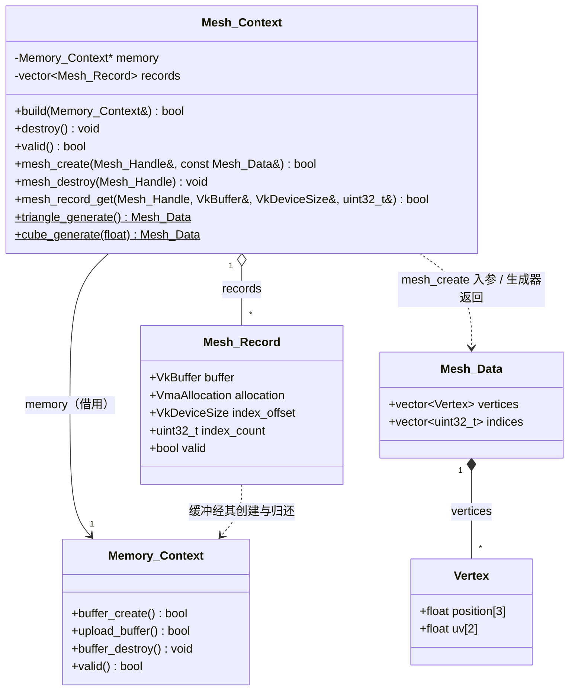

# 网格 · 模块架构

> 收录范围：`Application/Renderer/src/render/Mesh/` 目录下的全部源码——对外头 `网格.h`、共用数据类型头 `网格数据.h`、内部头 `局部命名空间使用.h`，以及 `core/` 下两个编译单元 `网格加载器.cpp`（过程式网格生成）与 `网格缓冲.cpp`（网格上下文实现）。
> 本文为「白银纪元」渲染层（`Application/Renderer`）中「网格」模块的导航文档，描述其功能定位、对外接口、私有方法、内部架构、设计细节与运行链路。
> 文中所有路径均为相对源码根（`工作区`）的相对路径，不出现绝对路径。
> 本模块的调试 / 日志通道 `engine::logger`（声明于 `Engine/EngineCore/src/tools/Logging/日志系统运行包.h`）物理上归属引擎核心层「工具集」模块，但其日志口径贯穿本模块全部错误分支，故本文在需要处一并说明并标注其归属。
> 本模块不直接使用 Vulkan 与 VMA，仅 `网格.h` 因 `Mesh_Record` 需承载 `VkBuffer` / `VmaAllocation` 字段而在本层实现细节头内暴露这两类句柄；`网格数据.h` 保持 Vulkan-free（不含任何 Vulkan 类型），以便顶层共享顶点 / 网格数据类型。
> 本模块源码体量偏小（2 个编译单元、3 个头文件），本文在「接口逐条、字段逐项、链路分步」上充分展开，以达成「凭本文即可直接调用与复现」的目标。
> **本版次要点（相对上一版次）**：顶点与索引由「两条独立缓冲」改为「**一条顶点 / 索引共用缓冲**」——`Mesh_Record` 以 `buffer` / `allocation` / `index_offset` 描述，`mesh_create` 单次分配、单次上传（`index_offset = 顶点区字节数`），`mesh_record_get` 随之改为回写「共用缓冲 + 索引区偏移 + 索引数」。

---

## 一、文件内目录

- [二、模块功能介绍](#二模块功能介绍)
- [三、模块公开接口介绍](#三模块公开接口介绍)
- [四、模块私有方法介绍](#四模块私有方法介绍)
- [五、模块内部架构介绍](#五模块内部架构介绍)
- [六、模块设计/实现细节](#六模块设计实现细节)
- [七、模块运行链路详例](#七模块运行链路详例)
- [附录、待确认条目](#附录待确认条目)

---

## 二、模块功能介绍

### 2.1 模块定位

「网格」模块位于渲染层源码目录 `Application/Renderer/src/render/Mesh/`，与内存与资源模块（`render/Memory/`）、纹理模块（`render/Texture/`）、交换链模块（`render/Swapchain/`）、管线模块（`render/Pipeline/`）、着色器模块（`render/Shader/`）等并列为渲染层的资源类模块。它把 Vulkan 中「**几何数据（顶点 + 索引）如何组织成一段可被图形管线绑定的 GPU 缓冲**」这一段工作，收敛进一个门面类 `engine::Mesh_Context`，并额外提供两个**过程式几何生成器**（三角形、轴对齐立方体），用于在尚无网格文件加载链路时快速产出可渲染的几何体。

模块对外只暴露「构建 → 创建网格 → 取用缓冲 → 销毁」四段式接口，外加两个静态生成函数；底层缓冲的创建、上传、销毁则全部委托给内存与资源模块（`engine::Memory_Context`），本模块自身**不直接调用任何 Vulkan / VMA 函数**。

模块内部只把职责拆成两个编译单元，全部放在 `core/` 下：

- `core/网格加载器.cpp`：两个**过程式生成器**的落地——`triangle_generate`（单三角形）与 `cube_generate`（轴对齐立方体）。文件名虽为「加载器」，但本编译单元**不含任何文件读取 / 解析逻辑**（见 §6.8）。
- `core/网格缓冲.cpp`：`Mesh_Context` 的析构、`build`、`destroy`、`valid`、`mesh_create`、`mesh_destroy`、`mesh_record_get` 的落地，即顶点 / 索引共用缓冲的创建、上传、登记、查询与销毁全部在此完成。

一句话概括：**本模块是渲染层「把一段 CPU 端几何数据变成一段可回传、可绑定的 GPU 顶点 / 索引共用缓冲，并以稳定句柄管理其生命周期」的唯一入口，是渲染器门面和帧 / 录制链路渲染几何体时的前置依赖。**

### 2.2 职责边界与解决的问题

`Mesh_Context` 解决的问题可归纳为六点：

1. **把「几何数据」与「GPU 缓冲」解耦为两个清晰的数据层**。`网格数据.h` 中的 `engine::Vertex` 与 `engine::Mesh_Data` 是**纯 CPU 端、Vulkan-free** 的数据描述，负责承载顶点位置 / 纹理坐标 / 法线与索引；`Mesh_Record`（`网格.h`）与实际的 `VkBuffer` / `VmaAllocation` 才是 GPU 端资源。生成器只产出 `Mesh_Data`，创建动作才把它翻译为 GPU 缓冲。这样上层可以在完全不接触 Vulkan 的前提下构造与生成几何数据。

2. **把顶点 / 索引数据的创建与上传打包为一次 `mesh_create`**。Vulkan 中创建缓冲并上传数据，需要「建缓冲 → 建暂存 → 提交拷贝 → 销毁暂存」的冗长流程。本模块把它收敛为一次 `mesh_create(handle_out, data)`：内部经内存模块的 `buffer_create` 建出**一条设备本地、同时具备顶点读取 / 索引读取 / 传输目标用途的共用缓冲**（size = 顶点区 + 索引区），主机侧将顶点与索引拼成一段连续内存，再经 `upload_buffer` **一次**同步上传，成功后登记记录并回写句柄（索引区相对缓冲起始的偏移记入 `index_offset`）。

3. **用「句柄 + 记录数组」把 GPU 句柄的管理外化为稳定整数**。调用方不直接持有 `VkBuffer` / `VmaAllocation`，而是持有一个 `Mesh_Handle`（`uint64_t`）。句柄自 1 起、0 表无效，记录下标 = 句柄 − 1（经典「1-based 句柄 + 0-based 数组」约定）。这样上层业务只需存一个整数即可引用网格，避免了 Vulkan 句柄在业务层的渗透。

4. **在创建阶段做完整的前置校验与失败清理**。`mesh_create` 在真正创建缓冲前依次校验：内存模块是否就绪、顶点与索引是否均非空、全部索引是否落在顶点数范围内；任何一步失败都返回假并保持「无副作用」（不会留下半初始化资源）。创建过程中若上传失败，会**先行归还已经建立的共用缓冲**，保证失败不留泄漏。

5. **提供两个开箱即用的几何生成器**。在还没有网格文件加载链路的阶段，`triangle_generate`（单三角形，位于 XY 平面、逆时针绕序、UV 覆盖整块贴图）与 `cube_generate`（边长 `2*half_extent` 的轴对齐立方体，24 顶点 / 36 索引、逐面独立顶点以保证 UV）可直接产出一份可渲染的 `Mesh_Data`，省去手写顶点数组。

6. **把销毁口径统一回内存模块**。缓冲句柄由本模块记录持有，但销毁动作一律回到内存模块的 `buffer_destroy`（`mesh_destroy` 与 `destroy` 两条路径都如此，且**只一次调用即归还顶点 + 索引共用缓冲**），保证「用 VMA 创建、用 VMA 销毁」的单一口径，不出现资源生命周期管理的错配。

7. **提供「摘出而不销毁」的 `mesh_detach`（本轮新增）**。运行期卸载网格时，其共用缓冲可能仍被在途帧的命令缓冲引用，不能立即归还；`mesh_detach` 把记录**整体摘出**（写出到出参、原记录复位）而**不**归还缓冲，归还责任移交调用方——门面据此把缓冲组装进帧模块的延迟销毁条目，由帧模块在「在途帧数 + 1」帧后经内存模块归还（见 §3.13 / §6.11）。

### 2.3 在整体架构中的位置

网格模块处于渲染层资源链的**中下层**：它**依赖**内存与资源模块（提供缓冲创建 / 上传 / 销毁），并依赖引擎核心层的日志系统（错误报告）；它**不依赖**任何 Vulkan / VMA 头，也不依赖渲染层的交换链、帧、管线、着色器等模块。

```
                ┌───────────────────────────────────────────────┐
                │              Renderer（渲染器门面）             │
                │   持有 Mesh_Context 成员，按依赖顺序编排        │
                └───────────────┬───────────────────────────────┘
                                │ mesh.build(memory)
                                ▼
        ┌───────────────────────────────────────────────────────────────┐
        │                    Mesh_Context（网格上下文）                  │
        │  Memory_Context* memory  /  std::vector<Mesh_Record> records  │
        └───┬──────────────────────────┬────────────────────┬──────────┘
     依赖│                     依赖    │              提供   │
            ▼                          ▼                    ▼
   ┌───────────────┐        ┌──────────────┐   ┌──────────────────────────┐
   │ 内存与资源模块  │        │ 日志系统     │   │ 顶点 / 索引共用缓冲句柄、  │
   │ Memory_Context │        │ logger 全局  │   │ 索引区偏移与索引数（mesh_ │
   │ buffer_create  │        │ 全局实例     │   │ record_get 直出，供录制链  │
   │ upload_buffer  │        └──────────────┘   │ 路绑定）                  │
   │ buffer_destroy │                            └──────────────────────────┘
   └────────────────┘
                                │
                                ▼ 提供 GPU 顶点 / 索引共用缓冲
        渲染器门面 / 帧与命令录制链路（绑定 VK_VERTEX_INPUT_BINDING /
        vkCmdBindVertexBuffers（偏移 0）/ vkCmdBindIndexBuffer（偏移 index_offset））
```

- **向上**：调用方是渲染器门面（`render/Renderer/`）。门面在自身实现中**以成员方式持有** `Mesh_Context`（与 `Memory_Context memory;` 同处渲染器实现头），在内存模块就绪后调用 `mesh.build(memory)`，并用 `mesh_create` / `mesh_record_get` / `mesh_destroy` 管理网格。
- **向下**：依赖内存与资源模块（`buffer_create` / `upload_buffer` / `buffer_destroy`）、引擎核心层日志系统（`engine::logger`）。本模块**不**直接依赖 Vulkan / VMA，`Mesh_Context` 的 .cpp 通过包含 `Memory/内存上下文.h` 间接获得这些类型。
- **横向**：本模块不依赖任何同级资源模块；反之帧 / 命令录制链路通过 `mesh_record_get` 拿到共用缓冲句柄、索引区偏移与索引数，用于绑定与绘制。

### 2.4 与相邻模块的职责分界

| 相邻模块 | 分界 |
| --- | --- |
| 内存与资源模块（`render/Memory/`） | 内存模块负责 VMA 分配器的建立、缓冲的创建 / 销毁、以及一次性同步上传。本模块以 `build(Memory_Context& memory)` 接收其**引用**（非拥有），借 `buffer_create` / `upload_buffer` 建出**顶点 + 索引共用缓冲**，并把 `Memory_Context*` 指针记为成员以便后续归还。缓冲句柄归本模块记录所有，销毁动作回到内存模块。 |
| 渲染器门面（`render/Renderer/`） | 门面负责**拥有** `Mesh_Context` 实例、编排 `build → mesh_create → 使用 → destroy` 的顺序，并在销毁时**先**让所有网格销毁、**再**销毁内存模块。本模块自身只保证「`destroy` 幂等、析构兜底、失败不留半初始化」。门面 `Renderer::mesh_draw` 按句柄登记网格，现已支持**同帧多次调用**（多条待绘制项累积，各网格独立模型矩阵另存于 `pending_transforms`，由 `frame_render` 统一消费后清空）；该累积 / 消费逻辑完全落在门面侧，网格侧接口与数据结构不参与。 |
| 帧 / 命令录制链路（同层，经门面间接） | 录制链路通过 `mesh_record_get` 取到**共用** `VkBuffer buffer` / `VkDeviceSize index_offset` / `uint32_t index_count`：顶点区在缓冲偏移 0 处，索引区在缓冲偏移 `index_offset` 处。故绑定顶点缓冲用 `vkCmdBindVertexBuffers`（缓冲 = `buffer`、绑定偏移 0），绑定索引缓冲用 `vkCmdBindIndexBuffer`（缓冲 = `buffer`、偏移 = `index_offset`、类型 = `VK_INDEX_TYPE_UINT32`）。本模块只提供缓冲、偏移与索引数，不参与命令录制。 |
| 管线 / 着色器模块（`render/Pipeline/`、`render/Shader/`） | 顶点布局（stride 32 字节、location 0 为 `vec3`、location 1 为 `vec2`、location 2 为法线 `vec3`）是本模块与管线 / 着色器的**契约**：本模块保证 `Vertex` 的内存布局，管线模块在 `Pipeline/core/图形管线.cpp` 以四条 `static_assert`（`sizeof(Vertex) == 32`、`offsetof(Vertex, position) == 0`、`offsetof(Vertex, uv) == 12`、`offsetof(Vertex, normal) == 20`）把该布局钉死，故改动 `Vertex` 须同步管线侧按字面量书写的步长与偏移；具体的 `VkVertexInputBindingDescription` / `VkVertexInputAttributeDescription` 由管线模块声明、由着色器消费；本模块不生成管线状态。生成器的绕序（逆时针）与管线 `frontFace = COUNTER_CLOCKWISE` / `cullMode = BACK` 自洽，但该管线约定由管线模块落实。 |
| 引擎核心层网格加载工具（`Engine/EngineCore/src/tools/Mesh_Loader/`） | 该工具提供 `Mesh_Loader::load_obj`（OBJ 文件解析）。**本模块当前未引用它**：本模块的「加载器」编译单元只做过程式生成，且全渲染层源码中除 `源文件列表.cmake` 的字面量外无任何对 `Mesh_Loader` 的引用。二者虽然都提供「网格数据」，但**同名不同定义**（详见 §3.3、§6.9）。 |
| 日志系统（`Engine/EngineCore/src/tools/Logging/`） | 本模块只把 `logger` 当作输出通道使用（`logger.error` / `logger.info`），不配置日志规则、不绑定输出流。 |

### 2.5 生命周期与所有权总览

`Mesh_Context` 的完整生命周期为：

```
构造（default，不创建任何网格）
   → build(Memory_Context& memory)
        └─ 校验 memory.valid() → 记录 memory 指针（不创建任何网格）
   → [使用：三角 / 立方体生成 → mesh_create（创建并上传缓冲）→ mesh_record_get（取用）→ mesh_destroy（可选，逐网格销毁）]
   → destroy()（幂等；归还全部网格缓冲 → 清空 records → memory = nullptr）
   → 析构（兜底再调用一次 destroy，保证网格缓冲不泄漏）
```

所有权约定（关键约定，务必按此理解）：

1. **内存模块引用归本模块记录，但所有权归门面**：`Mesh_Context::memory` 是一个 `Memory_Context*` 裸指针，指向门面持有的内存上下文；本模块只借用，不拥有、不销毁它。
2. **缓冲句柄归本模块记录所有**：`records` 中每条 `Mesh_Record` 保存一条 `(VkBuffer, VmaAllocation)` **共用缓冲**及其索引区偏移 `index_offset`；调用方只持有 `Mesh_Handle`，不直接持有缓冲句柄。
3. **销毁动作一律回到内存模块**：`mesh_destroy` 与 `destroy` 都通过 `memory->buffer_destroy` 归还缓冲（各只一次调用归还共用缓冲），本模块不手写 `vkDestroyBuffer`。
4. **内存模块须比本模块长寿**：由于本模块保存的是裸指针，`Mesh_Context::destroy`（或析构）必须在 `Memory_Context` 被销毁**之前**完成；否则 `destroy` 将解引用悬空指针。此约定由门面的编排顺序保证。
5. **网格数据（`Mesh_Data`）为值语义、按值传入**：`mesh_create` 接收 `const Mesh_Data&`，内部只读取其内容并拷贝进 GPU 缓冲，不保存该对象的引用；调用方可随即丢弃 `Mesh_Data`。

---

## 三、模块公开接口介绍

本章列出网格模块**对外可见的类型与成员**。需要区分两层可见性：

- **对外层（渲染层其它模块可见）**：`engine::Vertex`、`engine::Mesh_Data`、`engine::Mesh_Handle`（声明于 `网格数据.h`，Vulkan-free，可被层内其它模块广泛包含）；`engine::Mesh_Record`、`engine::Mesh_Context`（声明于 `网格.h`，因含 Vulkan 句柄字段，属本层「实现细节」头，只被本层 .cpp 与层内模块头包含，不进公共头）。头注释所称「私有包含根」（落点即 `cmake/对外接口.cmake` 的「私有包含根」一节）落实在构建脚本：由 `Application/Renderer/CMakeLists.txt` 的 `target_include_directories(RendererCore PRIVATE ...)` 段声明 `SDL3/include`、`include/build_config`、`SDL3/src`、`external/VulkanMemoryAllocator/include`、`${BYJY_VULKAN_INCLUDE_DIR}`、`external/`；PRIVATE 不进导入目标的接口，故层外拿到本层头快照后仍拿不到 SDL3 与 Vulkan / VMA 类型（R-DEV-02 已确证）。
- **模块内部层（仅本模块编译单元可见）**：本模块**无私有成员函数**，也未在匿名命名空间或私有作用域内定义额外自由函数；模块仅有私有数据成员 `memory` 与 `records`，其说明归 §五.4。为便于「凭本文直接理解与复现」，第五节仍逐条列出这两个数据成员。

### 3.1 对外类型一览表

| 类型 | 声明位置 | 语义 | 是否 Vulkan-free |
| --- | --- | --- | --- |
| `engine::Vertex` | `Application/Renderer/src/render/Mesh/网格数据.h` | 单顶点（位置 `vec3` + 纹理坐标 `vec2` + 法线 `vec3`） | 是 |
| `engine::Mesh_Data` | `Application/Renderer/src/render/Mesh/网格数据.h` | 网格创建入参（顶点集合 + 索引集合） | 是 |
| `engine::Mesh_Handle` | `Application/Renderer/src/render/Mesh/网格数据.h` | 网格句柄别名 `uint64_t`（0 表无效） | 是 |
| `engine::Mesh_Record` | `Application/Renderer/src/render/Mesh/网格.h` | 单条网格记录（顶点 / 索引共用缓冲 + 索引区偏移 + 索引数） | 否（含 `VkBuffer` / `VmaAllocation`） |
| `engine::Mesh_Context` | `Application/Renderer/src/render/Mesh/网格.h` | 网格上下文门面类 | 否（成员 `records` 含 Vulkan 句柄） |

### 3.2 `engine::Vertex`（单顶点）

**声明位置**：`Application/Renderer/src/render/Mesh/网格数据.h`

```cpp
//顶点（位置 vec3 + 纹理坐标 vec2 + 法线 vec3；步长 32 字节，与着色器顶点输入一致）
struct Vertex
{
    //位置（三维）
    float position[3];
    //纹理坐标（二维）
    float uv[2];
    //法线（三维；零向量 = 未提供）
    float normal[3] = { 0.0f, 0.0f, 0.0f };
};
```

| 字段 | 类型 | 含义 | 约束 |
| --- | --- | --- | --- |
| `position` | `float[3]` | 顶点位置（x, y, z） | 无单位约定；生成器使用范围为 `[-half_extent, +half_extent]` 或 `[-0.5, 0.5]` |
| `uv` | `float[2]` | 纹理坐标（u, v） | 生成器使用 `[0, 1]`；无越界校验 |
| `normal` | `float[3]` | 顶点法线（**第二十九轮新增**） | 缺省零向量 = 未提供，着色器按「朝向相机」满照处理；提供时由场景片元做 Lambert |

- **内存布局**：八个 `float` 连续排列，`sizeof(Vertex) == 32` 字节，无填充（`position` @0 / `uv` @12 / `normal` @20）。该步长被 `mesh_create` 用作顶点区字节数的计算基数（`sizeof(Vertex) * vertices.size()`），并与着色器顶点输入（location 0 `vec3`、location 1 `vec2`、location 2 `vec3`）约定一致。
- **兼容口径**：旧代码只写前两项（`{ {x,y,z}, {u,v} }`）仍合法，法线由默认成员初始化补零 → 光照满照，画面不变。
- **返回值 / 约束**：纯 POD 结构体，无成员函数、无构造析构；可被 `std::vector` 容纳与按值传递。
- **异常行为**：无。

### 3.3 `engine::Mesh_Data`（网格创建入参）

**声明位置**：`Application/Renderer/src/render/Mesh/网格数据.h`

```cpp
//网格数据（创建入参）
struct Mesh_Data
{
    //顶点集合
    std::vector<Vertex> vertices;
    //索引集合
    std::vector<uint32_t> indices;
};
```

| 字段 | 类型 | 含义 | 约束 |
| --- | --- | --- | --- |
| `vertices` | `std::vector<Vertex>` | 顶点集合（数组结构 AoS，与步长 20 一致） | `mesh_create` 要求非空 |
| `indices` | `std::vector<uint32_t>` | 索引集合（每 3 个构成一个三角面，指向 `vertices`） | `mesh_create` 要求非空；每个元素必须 `< vertices.size()` |

- **语义**：本结构体是**纯 CPU 端描述**，既不含 Vulkan 类型也不含句柄；它是「生成器 / 未来的文件加载」与「GPU 缓冲创建」之间的中立数据层。
- **按值传入约定**：`mesh_create` 以 `const Mesh_Data&` 接收，内部只读并拷贝进缓冲，不保存引用；调用方可在 `mesh_create` 返回后立即丢弃该对象。
- **索引宽度**：索引固定为 `uint32_t`（32 位），因此绑定索引缓冲时须使用 `VK_INDEX_TYPE_UINT32`（由录制链路落实）。
- **同名类型冲突（遗留，宜消解）**：引擎核心层工具 `Engine/EngineCore/src/tools/Mesh_Loader/网格加载器.h` 亦定义了**同名**的 `engine::Mesh_Data`，但其字段为 `std::vector<float> vertices`（按 x、y、z 依次平铺）＋ `std::vector<uint32_t> indices`，与本模块的 `std::vector<Vertex> vertices` **定义不同**。二者若同处一个翻译单元（TU）被包含将构成 ODR 冲突（同一命名空间内同名类型两处定义）；当前本模块不包含该工具头，故未触发冲突。该同名已确认为**遗留冲突而非有意隔离**：两类型同处 `engine` 顶层命名空间、字段与用途均不同，一旦本层引入下层网格加载头即产生类型重定义，宜消解。建议二选一——① 渲染层类型移入子命名空间（如 `engine::render`）、② 改名（如 `Render_Mesh_Data`）；因 `Mesh_Data` 属公共头（经 `渲染器.h` 间接暴露），改名波及公共面，故本轮仅确证、未改动，留待后续统一定夺（见 §6.9）。

### 3.4 `engine::Mesh_Handle`（网格句柄）

**声明位置**：`Application/Renderer/src/render/Mesh/网格数据.h`

```cpp
//网格句柄（0 表示无效）
using Mesh_Handle = uint64_t;
```

| 项 | 说明 |
| --- | --- |
| 类型 | `uint64_t` |
| 取值 | `0` = 无效句柄；`>= 1` = 有效句柄，其对应记录下标 = `句柄 − 1` |
| 约束 | 由 `mesh_create` 出参回写；上层只应保存与回传，不应自行构造或做算术 |
| 编号特征 | 单调递增（每成功创建一条网格加一），已销毁的句柄槽**不复用**（见 §6.3） |

- **返回值 / 约束**：`mesh_create` 失败时把出参置 `0`；`mesh_record_get` / `mesh_destroy` 对 `0` 与越界句柄一律视为无效。

### 3.5 `engine::Mesh_Record`（网格记录）

**声明位置**：`Application/Renderer/src/render/Mesh/网格.h`

```cpp
/*
网格记录
顶点与索引共用一个设备本地缓冲：顶点区自 0 起，索引区自 index_offset 起（= 顶点区字节数）；
如此一次分配、一次上传即可同时落位顶点与索引，减少 VMA 分配与 GPU 同步次数。
*/
struct Mesh_Record
{
    //顶点 / 索引共用缓冲
    VkBuffer buffer = VK_NULL_HANDLE;
    //缓冲内存
    VmaAllocation allocation = VK_NULL_HANDLE;
    //索引区在缓冲内的字节偏移（= 顶点区字节数；对齐满足 uint32 索引要求）
    VkDeviceSize index_offset = 0;
    //索引数
    uint32_t index_count = 0;
    /*
    局部包围盒（创建时按顶点位置一次算出；第二十二轮新增）
    供门面做实例级视锥剔除；空网格（不应出现）时取全零，等价于「保守保留」。
    */
    float bounds_min[3] = { 0.0f, 0.0f, 0.0f };
    float bounds_max[3] = { 0.0f, 0.0f, 0.0f };
    //记录是否有效
    bool valid = false;
};
```

| 字段 | 类型 | 初值 | 含义 | 置无效时的复位值 |
| --- | --- | --- | --- | --- |
| `buffer` | `VkBuffer` | `VK_NULL_HANDLE` | 顶点 / 索引**共用**缓冲句柄（设备本地） | `VK_NULL_HANDLE` |
| `allocation` | `VmaAllocation` | `VK_NULL_HANDLE` | 共用缓冲的 VMA 分配（与 `buffer` 成对） | `VK_NULL_HANDLE` |
| `index_offset` | `VkDeviceSize` | `0` | 索引区在缓冲内的字节偏移（= 顶点区字节数 = `sizeof(Vertex) * vertices.size()`） | `0` |
| `index_count` | `uint32_t` | `0` | 索引数量（= 创建时 `data.indices.size()`） | `0` |
| `bounds_min[3]` / `bounds_max[3]` | `float` | 全 `0` | 局部 AABB（创建时按顶点位置逐轴取极值；**第二十二轮**） | 全 `0` |
| `valid` | `bool` | `false` | 记录是否有效（已成功创建且尚未销毁） | `false` |

- **`VK_NULL_HANDLE` 用于 `VmaAllocation` 的说明**：`VmaAllocation` 实为指针类型，`#define VK_NULL_HANDLE 0` 可隐式转换为空指针，故用 `VK_NULL_HANDLE` 作初值为空，语义上等价于 `nullptr`。
- **共用缓冲的两种用法**：顶点数据位于缓冲 `[0, index_offset)` 区间，索引数据位于缓冲 `[index_offset, index_offset + index_count*4)` 区间；绑定顶点缓冲时偏移取 0，绑定索引缓冲时偏移取 `index_offset`（见 §2.4 帧 / 命令录制链路一行）。
- **可见性**：本类型声明于对外头 `网格.h`（因为 `Mesh_Context` 需以 `std::vector<Mesh_Record>` 作成员，成员声明要求类型完整），但它**并非**给上层读写的数据契约——上层应通过 `mesh_record_get` 读取而非直接触碰记录数组。

### 3.6 `engine::Mesh_Context` 类总览

**声明位置**：`Application/Renderer/src/render/Mesh/网格.h`
**实现位置**：
- `core/网格缓冲.cpp`（析构、`build`、`destroy`、`valid`、`mesh_create`、`mesh_destroy`、`mesh_record_get`）
- `core/网格加载器.cpp`（两个静态生成器 `triangle_generate` / `cube_generate`）

本节只列**公开成员**；私有数据成员见 §5.4。

| 成员 | 类别 | 归属实现文件 | 一句话语义 |
| --- | --- | --- | --- |
| `Mesh_Context()` | 构造 | 头内 `= default` | 不创建任何网格 |
| `~Mesh_Context()` | 析构 | `core/网格缓冲.cpp` | 内部调用 `destroy`，兜底释放 |
| `Mesh_Context(const Mesh_Context&)` | 拷贝构造 | `= delete` | 禁止拷贝 |
| `operator=(const Mesh_Context&)` | 拷贝赋值 | `= delete` | 禁止拷贝赋值 |
| `bool build(Memory_Context& memory)` | 构建 | `core/网格缓冲.cpp` | 记录内存模块（不创建网格） |
| `void destroy(void)` | 销毁 | `core/网格缓冲.cpp` | 幂等，销毁全部网格缓冲 |
| `bool valid(void) const` | 状态查询 | `core/网格缓冲.cpp` | 是否已记录内存模块 |
| `bool mesh_create(Mesh_Handle&, const Mesh_Data&)` | 资源创建 | `core/网格缓冲.cpp` | 创建并上传一条共用缓冲，回写句柄 |
| `void mesh_destroy(Mesh_Handle)` | 资源销毁 | `core/网格缓冲.cpp` | 幂等，销毁单个网格 |
| `bool mesh_detach(Mesh_Handle, Mesh_Record&)` | 资源摘出 | `core/网格缓冲.cpp` | 摘出单个网格记录（写出并复位，**不销毁**），归还责任移交调用方；**本轮新增** |
| `bool mesh_record_get(Mesh_Handle, VkBuffer&, VkDeviceSize&, uint32_t&) const` | 资源查询 | `core/网格缓冲.cpp` | 取共用缓冲、索引区偏移与索引数 |
| `static Mesh_Data triangle_generate(void)` | 静态生成 | `core/网格加载器.cpp` | 生成单三角形数据 |
| `static Mesh_Data cube_generate(float half_extent)` | 静态生成 | `core/网格加载器.cpp` | 生成轴对齐立方体数据 |

### 3.7 构造 / 析构 / 拷贝禁用

```cpp
//构造（不创建任何网格）
Mesh_Context(void) = default;
//析构（内部调用 destroy，保证网格不泄漏）
~Mesh_Context(void);
//不可拷贝、不可移动（持有 VMA 句柄）
Mesh_Context(const Mesh_Context&) = delete;
Mesh_Context& operator=(const Mesh_Context&) = delete;
```

- **构造**：默认构造，`memory = nullptr`、`records` 为空；**不创建任何网格、不要求内存模块就绪**（内存模块在 `build` 时才记录）。
- **析构**：定义在 `core/网格缓冲.cpp`，函数体仅一句 `destroy();`——即使调用方忘记显式 `destroy`，析构也会兜底归还全部缓冲。
- **拷贝禁用**：拷贝构造与拷贝赋值均 `= delete`；由于用户声明了拷贝构造函数（删除形式），编译器**不再隐式生成移动构造 / 移动赋值**，故本类客观上也「不可移动」，与头注释「不可拷贝、不可移动」一致。
- **约束**：因持有 `Memory_Context*` 与缓冲句柄，拷贝会带来双重释放风险，故必须禁用。
- **异常行为**：构造与析构均不抛异常。

### 3.8 `bool build(Memory_Context& memory)`

**签名**：`bool Mesh_Context::build(Memory_Context& memory)`
**实现位置**：`core/网格缓冲.cpp`

```cpp
//构建
bool Mesh_Context::build(Memory_Context& memory)
{
    //前置：内存上下文必须已构建
    if (!memory.valid())
    {
        logger.error("网格上下文:: 内存上下文尚未构建，无法建立网格上下文");
        return false;
    }

    //记录内存模块
    this->memory = &memory;
    return true;
}
```

| 项 | 说明 |
| --- | --- |
| 参数 `memory` | 内存与资源模块的 `Memory_Context` 引用（非拥有）；通常由门面持有并以引用传入 |
| 前置条件 | `memory.valid()` 必须为真（内存模块已成功 `build`）；否则记 `error` 日志并返回假 |
| 返回值 | 真 = 已记录内存模块（此时 `valid()` 转为真）；假 = 内存模块未就绪，`memory` 成员保持原值（未改动） |
| 副作用 | 仅写入 `this->memory`；**不创建任何网格**、不触碰 `records` |
| 约束 | 应在 `mesh_create` 之前调用；应在内存模块 `destroy` 之前调用本模块的 `destroy` |
| 幂等性 | **非幂等**：若对同一 `Mesh_Context` 重复 `build` 并传入不同的内存模块，`records` 中已有的网格记录将**不再有正确的归还目标**（旧 `memory` 指针被覆盖，旧记录不会被释放）。此为**隐式约定而非缺陷**：`build` 只应调用一次，且与 `destroy` 成对（先 `build` 后 `destroy`）；当前实现不做重入 / 二次 `build` 保护，依赖调用方遵守该约定，与其余模块一致（见 §6.5）。 |
| 异常行为 | 不抛异常；失败以返回值 + 日志表达 |

### 3.9 `void destroy(void)`

**签名**：`void Mesh_Context::destroy(void)`
**实现位置**：`core/网格缓冲.cpp`

```cpp
//销毁
void Mesh_Context::destroy(void)
{
    //若内存模块已记录
    if (memory != nullptr)
        //释放全部网格缓冲
        for (auto& record : records)
        {
            //归还顶点 / 索引共用缓冲
            memory->buffer_destroy(record.buffer, record.allocation);
            //复位记录
            record.buffer = VK_NULL_HANDLE;
            record.allocation = VK_NULL_HANDLE;
            record.index_offset = 0;
            record.index_count = 0;
            record.valid = false;
        }

    //清空记录并复位
    records.clear();
    memory = nullptr;
}
```

| 项 | 说明 |
| --- | --- |
| 参数 | 无 |
| 返回值 | 无 |
| 行为 | 遍历全部记录，逐条把顶点 / 索引共用缓冲归还给内存模块（`buffer_destroy`，只一次调用），复位各字段；随后清空 `records`、把 `memory` 复位为 `nullptr` |
| 幂等性 | **幂等**：第二次调用时 `records` 已空、`memory` 为 `nullptr`，空转即返回 |
| 前置条件 | 应在内存模块 `destroy` **之前**调用（否则解引用悬空指针） |
| 边界 | 若 `memory == nullptr`（尚未 `build` 或已 `destroy`），跳过释放循环，但仍执行 `records.clear()` 与 `memory = nullptr` |
| 异常行为 | 不抛异常 |

### 3.10 `bool valid(void) const`

**签名**：`bool Mesh_Context::valid(void) const`
**实现位置**：`core/网格缓冲.cpp`

```cpp
//是否已构建完成
bool Mesh_Context::valid(void) const
{
    return memory != nullptr;
}
```

| 项 | 说明 |
| --- | --- |
| 参数 | 无 |
| 返回值 | 真 = `memory` 非空（`build` 成功且尚未 `destroy`）；假 = 尚未 `build` 或已 `destroy` |
| 语义边界 | 只反映「本模块是否记录了内存模块」，**不**回查 `memory->valid()`。若外部的 `Memory_Context` 被销毁而本模块未随之 `destroy`，本函数仍会返回真——这是一个「信任上层编排顺序」的轻量判定 |
| 异常行为 | 不抛异常；`const`，不修改对象 |

### 3.11 `bool mesh_create(Mesh_Handle& handle_out, const Mesh_Data& data)`

**签名**：`bool Mesh_Context::mesh_create(Mesh_Handle& handle_out, const Mesh_Data& data)`
**实现位置**：`core/网格缓冲.cpp`

这是本模块**最核心**的接口，完整实现如下：

```cpp
//创建网格
bool Mesh_Context::mesh_create(Mesh_Handle& handle_out, const Mesh_Data& data)
{
    //默认无有效句柄
    handle_out = 0;
    //前置：内存模块必须就绪
    if (memory == nullptr || !memory->valid())
    {
        logger.error("网格缓冲:: 内存上下文尚未构建，无法创建网格");
        return false;
    }
    //前置：顶点与索引均不得为空
    if (data.vertices.empty() || data.indices.empty())
    {
        logger.error("网格缓冲:: 顶点或索引为空，无法创建网格");
        return false;
    }
    //校验索引不越界
    for (uint32_t index : data.indices)
        //若索引越界
        if (index >= data.vertices.size())
        {
            logger.error("网格缓冲:: 索引 {} 越界（顶点数 {}）", index, static_cast<uint32_t>(data.vertices.size()));
            return false;
        }

    //顶点区字节数
    VkDeviceSize vertex_bytes = sizeof(Vertex) * data.vertices.size();
    //索引区字节数
    VkDeviceSize index_bytes = sizeof(uint32_t) * data.indices.size();
    //顶点 / 索引共用缓冲的总字节数
    VkDeviceSize total_bytes = vertex_bytes + index_bytes;

    //创建顶点 / 索引共用缓冲（设备本地；同时具备顶点 / 索引 / 传输目标用途）
    VkBuffer buffer = VK_NULL_HANDLE;
    VmaAllocation allocation = VK_NULL_HANDLE;
    if (!memory->buffer_create(buffer, allocation, total_bytes,
        VK_BUFFER_USAGE_VERTEX_BUFFER_BIT | VK_BUFFER_USAGE_INDEX_BUFFER_BIT | VK_BUFFER_USAGE_TRANSFER_DST_BIT, false))
        return false;

    /*
    按「顶点区 + 索引区」紧排组织主机侧连续数据
    两段合并为一次 upload_buffer 提交，故须先拼成一段连续主机内存；
    索引区偏移 = 顶点区字节数（20 字节步长的整数倍，天然满足 uint32 索引对齐）。
    */
    std::vector<uint8_t> combined(static_cast<std::size_t>(total_bytes));
    std::memcpy(combined.data(), data.vertices.data(), static_cast<std::size_t>(vertex_bytes));
    std::memcpy(combined.data() + vertex_bytes, data.indices.data(), static_cast<std::size_t>(index_bytes));

    //一次性上传（顶点与索引合并在同一缓冲、同一提交内落位）
    if (!memory->upload_buffer(buffer, combined.data(), total_bytes, 0))
    {
        memory->buffer_destroy(buffer, allocation);
        return false;
    }

    //登记网格记录
    Mesh_Record record;
    record.buffer = buffer;
    record.allocation = allocation;
    record.index_offset = vertex_bytes;
    record.index_count = static_cast<uint32_t>(data.indices.size());
    record.valid = true;
    records.push_back(record);

    //句柄自 1 起
    handle_out = static_cast<Mesh_Handle>(records.size());
    logger.info("网格缓冲:: 网格已建立（句柄 {}，顶点 {}，索引 {}）",
        handle_out, static_cast<uint32_t>(data.vertices.size()), record.index_count);
    return true;
}
```

| 项 | 说明 |
| --- | --- |
| 参数 `handle_out` | 出参，回写新网格句柄；**进入时先被置 0**，任何失败路径都保持 0 |
| 参数 `data` | 网格数据（顶点 + 索引），按 `const` 引用只读 |
| 返回值 | 真 = 创建并上传成功，`handle_out >= 1`；假 = 前置校验或创建 / 上传失败 |
| 前置校验① | `memory != nullptr && memory->valid()`，否则记 `error` 返回假 |
| 前置校验② | `data.vertices` 与 `data.indices` 均非空，否则记 `error` 返回假 |
| 前置校验③ | 逐个索引校验 `index < vertices.size()`，越界即记 `error`（含越界索引值与顶点数）并返回假 |
| 缓冲规格（共用） | usage = `VK_BUFFER_USAGE_VERTEX_BUFFER_BIT | VK_BUFFER_USAGE_INDEX_BUFFER_BIT | VK_BUFFER_USAGE_TRANSFER_DST_BIT`；`host_visible = false`（设备本地，需上传）；size = `vertex_bytes + index_bytes` |
| 主机侧拼装 | 在 `std::vector<uint8_t> combined` 内按「顶点区 + 索引区」紧排：先 `std::memcpy` 顶点（长度 `vertex_bytes`），再 `std::memcpy` 索引（起点 `combined.data() + vertex_bytes`） |
| 上传 | 只经 `memory->upload_buffer(buffer, combined.data(), total_bytes, offset = 0)` 做**一次**同步上传；返回时数据已就位 |
| 索引区偏移 | `index_offset = vertex_bytes`（顶点区字节数）；因 `Vertex` 步长 20 字节、索引 4 字节，天然为 4 的整数倍，满足 `uint32` 索引对齐 |
| 句柄分配 | `handle_out = records.size()`，即新记录下标 + 1（1-based） |
| 失败清理 | 共用缓冲创建失败 → 无已建资源；上传失败 → 归还共用缓冲（`buffer_destroy`）。任一失败路径都**不留半初始化资源**，`records` 不被修改 |
| 日志 | 成功记 `info`（句柄 / 顶点数 / 索引数）；各失败分支记 `error` |
| 异常行为 | 不抛异常（内存分配由 `std::vector` / VMA 内部承担；本函数不显式 `new`） |

### 3.12 `void mesh_destroy(Mesh_Handle handle)`

**签名**：`void Mesh_Context::mesh_destroy(Mesh_Handle handle)`
**实现位置**：`core/网格缓冲.cpp`

```cpp
//销毁网格
void Mesh_Context::mesh_destroy(Mesh_Handle handle)
{
    //句柄为零或越界即视为无需销毁（销毁幂等）
    if (handle == 0 || handle > records.size())
        return;
    //获取目标记录
    Mesh_Record& record = records[handle - 1];
    //若记录已无效
    if (!record.valid)
        return;
    //内存模块就绪时归还顶点 / 索引共用缓冲
    if (memory != nullptr)
        //归还共用缓冲
        memory->buffer_destroy(record.buffer, record.allocation);
    //复位记录
    record.buffer = VK_NULL_HANDLE;
    record.allocation = VK_NULL_HANDLE;
    record.index_offset = 0;
    record.index_count = 0;
    record.valid = false;
}
```

| 项 | 说明 |
| --- | --- |
| 参数 `handle` | 待销毁网格句柄 |
| 返回值 | 无 |
| 无效句柄 | `handle == 0` 或 `handle > records.size()` 直接返回（幂等） |
| 已销毁记录 | 记录 `valid == false` 时直接返回（重复销毁幂等） |
| 归还动作 | 经 `memory->buffer_destroy` 归还共用缓冲（仅当 `memory != nullptr`；只一次调用即归还顶点 + 索引） |
| 复位 | 五个字段全部复位；`valid = false` |
| 槽位 | 记录**保留在数组中**（不 `erase`），仅置无效；相应句柄**不复用** |
| 异常行为 | 不抛异常 |

### 3.13 `bool mesh_detach(Mesh_Handle handle, Mesh_Record& record_out)`

**签名**：`bool Mesh_Context::mesh_detach(Mesh_Handle handle, Mesh_Record& record_out)`
**实现位置**：`core/网格缓冲.cpp`（**本轮新增**）

- **功能**：把目标网格记录**整体摘出**（写出到 `record_out` 并把原记录复位为无效），**但不销毁**其共用缓冲——归还责任移交调用方。供门面在运行期卸载时组装帧模块的延迟销毁条目。
- **参数**：
  - `handle`：待摘出的网格句柄。
  - `record_out`：出参，成功时写出被摘出的记录（含 `buffer` / `allocation` / `index_offset` / `index_count`）。
- **返回值**：`bool`——句柄有效且记录非空返回 `true` 并写出记录；`handle == 0` / 越界 / 记录已无效返回 `false`（**不写出任何资源**，`record_out` 保持入参状态）。
- **行为（源码顺序）**：① 判句柄（0 / 越界）→ 返回假；② 取 `records[handle - 1]`，`valid == false` → 返回假；③ `record_out = record`（整体写出）；④ 原记录复位（`buffer` / `allocation` / `index_offset` / `index_count` 归零、`valid = false`）——槽位保留、句柄**不复用**。
- **与 `mesh_destroy` 的分界**：`mesh_destroy` 直接经内存模块归还缓冲；`mesh_detach` 只摘出不归还（供门面走延迟销毁，见 §6.11）。二者对无效 / 已空句柄的幂等语义一致，但 `mesh_detach` 以**返回值**表达成败。
- **异常行为**：不抛异常。

### 3.14 `bool mesh_record_get(Mesh_Handle handle, VkBuffer& buffer_out, VkDeviceSize& index_offset_out, uint32_t& index_count_out) const`

**签名**：`bool Mesh_Context::mesh_record_get(Mesh_Handle handle, VkBuffer& buffer_out, VkDeviceSize& index_offset_out, uint32_t& index_count_out) const`
**实现位置**：`core/网格缓冲.cpp`

```cpp
//取网格缓冲、索引区偏移与索引数
bool Mesh_Context::mesh_record_get(Mesh_Handle handle, VkBuffer& buffer_out, VkDeviceSize& index_offset_out, uint32_t& index_count_out) const
{
    //默认输出为空
    buffer_out = VK_NULL_HANDLE;
    index_offset_out = 0;
    index_count_out = 0;
    //若句柄为零或越界
    if (handle == 0 || handle > records.size())
        return false;
    //获取目标记录
    const Mesh_Record& record = records[handle - 1];
    //若记录无效
    if (!record.valid)
        return false;
    //写出缓冲、索引区偏移与索引数
    buffer_out = record.buffer;
    index_offset_out = record.index_offset;
    index_count_out = record.index_count;
    return true;
}
```

| 项 | 说明 |
| --- | --- |
| 参数 `handle` | 待查询网格句柄 |
| 出参 `buffer_out` | 顶点 / 索引**共用**缓冲句柄；进入时先置 `VK_NULL_HANDLE` |
| 出参 `index_offset_out` | 索引区在缓冲内的字节偏移；进入时先置 0 |
| 出参 `index_count_out` | 索引数；进入时先置 0 |
| 返回值 | 真 = 句柄有效且记录有效，三个出参已写出；假 = 句柄为 0 / 越界 / 记录无效（三出参保持重置后的空值） |
| 约束 | 本函数**不回写内存分配**（`VmaAllocation` 不出），上层仅需缓冲句柄与偏移用于绑定 |
| 绑定口径 | 顶点区在缓冲偏移 0 处，索引区在缓冲偏移 `index_offset_out` 处；绑定顶点缓冲偏移取 0、绑定索引缓冲偏移取 `index_offset_out`，索引类型为 `VK_INDEX_TYPE_UINT32` |
| 异常行为 | 不抛异常；`const`，不修改对象 |

### 3.14A `bool mesh_bounds_get(Mesh_Handle handle, float min_out[3], float max_out[3]) const`（第二十二轮新增）

**签名**：`bool Mesh_Context::mesh_bounds_get(Mesh_Handle handle, float min_out[3], float max_out[3]) const`
**实现位置**：`core/网格缓冲.cpp`

- **功能**：取该网格的**局部包围盒**（AABB），供门面做实例级视锥剔除。
- **参数**：`handle` 网格句柄；`min_out` / `max_out` 各 3 个 `float` 出参（**可为空**，为空则不写该侧）。
- **返回值**：真 = 句柄与记录均有效并已写出；假 = 句柄为 0 / 越界 / 记录无效（出参不改写）。
- **口径**：包围盒在 `mesh_create` 时按顶点 `position` 逐轴取极值，**只算一次**；网格顶点数据不可变，故句柄有效期间恒定。
- **使用方**：仅渲染器门面的 `mesh_draw` / `mesh_draw_instanced`；本模块自身不做剔除。

### 3.15 `static Mesh_Data triangle_generate(void)`

**签名**：`static Mesh_Data Mesh_Context::triangle_generate(void)`
**实现位置**：`core/网格加载器.cpp`

```cpp
/*
生成三角形
单个等腰三角形，位于 XY 平面（z = 0），逆时针绕序（从 +Z 方向观察）。
纹理坐标覆盖整块贴图；法线恒为 +Z（第二十九轮起参与方向光）。
*/
Mesh_Data Mesh_Context::triangle_generate(void)
{
    Mesh_Data data;
    //顶点（左上 / 右上 / 下方中点），法线朝 +Z
    data.vertices = {
        { { -0.5f, -0.5f, 0.0f }, { 0.0f, 0.0f }, { 0.0f, 0.0f, 1.0f } },
        { { 0.5f, -0.5f, 0.0f }, { 1.0f, 0.0f }, { 0.0f, 0.0f, 1.0f } },
        { { 0.0f, 0.5f, 0.0f }, { 0.5f, 1.0f }, { 0.0f, 0.0f, 1.0f } },
    };
    //索引（逆时针）
    data.indices = { 0, 1, 2 };
    return data;
}
```

| 项 | 说明 |
| --- | --- |
| 参数 | 无 |
| 返回值 | 一份 `Mesh_Data`：3 顶点 / 3 索引，法线恒 `(0,0,1)` |
| 几何 | 等腰三角形，位于 XY 平面（z = 0），三顶点为左上 `(-0.5,-0.5,0)`、右上 `(0.5,-0.5,0)`、下方中点 `(0,0.5,0)` |
| 绕序 | 索引 `{0,1,2}`，从 +Z 方向观察为逆时针（CCW） |
| UV | `(0,0)`、`(1,0)`、`(0.5,1)`，覆盖整块贴图 |
| 约束 | 静态成员，无需实例；返回值为值语义 |

### 3.16 `static Mesh_Data cube_generate(float half_extent)`

**签名**：`static Mesh_Data Mesh_Context::cube_generate(float half_extent)`
**实现位置**：`core/网格加载器.cpp`

```cpp
/*
生成轴对齐立方体
边长 2*half_extent，24 顶点 / 36 索引；每面 4 顶点，顶点按「从外部看逆时针」排列，
与管线 frontFace = COUNTER_CLOCKWISE / cullMode = BACK 自洽。
*/
Mesh_Data Mesh_Context::cube_generate(float half_extent)
{
    //半边长
    const float h = half_extent;
    Mesh_Data data;
    //24 顶点：逐面给出 4 个角点（位置 + 纹理坐标）
    data.vertices = {
        // +X 面
        { { +h, -h, -h }, { 0.0f, 0.0f } },
        { { +h, +h, -h }, { 0.0f, 1.0f } },
        { { +h, +h, +h }, { 1.0f, 1.0f } },
        { { +h, -h, +h }, { 1.0f, 0.0f } },
        // -X 面
        { { -h, -h, +h }, { 0.0f, 0.0f } },
        { { -h, +h, +h }, { 0.0f, 1.0f } },
        { { -h, +h, -h }, { 1.0f, 1.0f } },
        { { -h, -h, -h }, { 1.0f, 0.0f } },
        // +Y 面
        { { -h, +h, +h }, { 0.0f, 0.0f } },
        { { +h, +h, +h }, { 0.0f, 1.0f } },
        { { +h, +h, -h }, { 1.0f, 1.0f } },
        { { -h, +h, -h }, { 1.0f, 0.0f } },
        // -Y 面
        { { -h, -h, -h }, { 0.0f, 0.0f } },
        { { +h, -h, -h }, { 0.0f, 1.0f } },
        { { +h, -h, +h }, { 1.0f, 1.0f } },
        { { -h, -h, +h }, { 1.0f, 0.0f } },
        // +Z 面
        { { -h, -h, +h }, { 0.0f, 0.0f } },
        { { +h, -h, +h }, { 0.0f, 1.0f } },
        { { +h, +h, +h }, { 1.0f, 1.0f } },
        { { -h, +h, +h }, { 1.0f, 0.0f } },
        // -Z 面
        { { +h, -h, -h }, { 0.0f, 0.0f } },
        { { -h, -h, -h }, { 0.0f, 1.0f } },
        { { -h, +h, -h }, { 1.0f, 1.0f } },
        { { +h, +h, -h }, { 1.0f, 0.0f } },
    };
    //36 索引：每面两个三角形（0,1,2 与 2,3,0），逐面偏移 4
    data.indices = {
        0, 1, 2, 2, 3, 0,
        4, 5, 6, 6, 7, 4,
        8, 9, 10, 10, 11, 8,
        12, 13, 14, 14, 15, 12,
        16, 17, 18, 18, 19, 16,
        20, 21, 22, 22, 23, 20,
    };
    return data;
}
```

| 项 | 说明 |
| --- | --- |
| 参数 `half_extent` | 半边长；立方体边长 = `2 * half_extent`，各顶点坐标为 `±half_extent` |
| 返回值 | 一份 `Mesh_Data`：24 顶点 / 36 索引（每个顶点含位置 ＋ 纹理坐标 ＋ **该面朝外法线**） |
| 顶点组织 | 逐面 4 顶点（共 6 面 ×4 = 24）；**同一空间位置在不同面上重复出现**，以便每面拥有独立 UV |
| UV | 每面 `(0,0)`、`(0,1)`、`(1,1)`、`(1,0)` 四角 |
| 索引 | 每面 6 个索引（`0,1,2` 与 `2,3,0` 两个三角形），逐面偏移 4；共 6 面 ×6 = 36 |
| 法线（**第二十九 / 三十轮**） | 每面 4 顶点共用该面**朝外单位法线**（`+X / -X / +Y / -Y / +Z / -Z`）；棱边不共享平滑，故立方体在方向光下呈**硬转折**。上方代码块为省略法线字段的早期形态，现行实现逐顶点写入 `{ nx, ny, nz }` |
| 绕序 | 每面顶点按「从外部看逆时针」排列，与 `frontFace = COUNTER_CLOCKWISE` / `cullMode = BACK` 自洽 |
| 参数约束 | 源码未对 `half_extent` 做正负 / 零值校验；传 0 或负值由调用方自行负责（不属本模块校验范围） |
| 异常行为 | 不抛异常；静态成员，无需实例 |

---

## 四、模块私有方法介绍

本模块类内**无私有成员函数**：`Mesh_Context` 的全部成员函数（构造 / 析构 / `build` / `destroy` / `valid` / `mesh_create` / `mesh_destroy` / `mesh_record_get`）与两个静态生成器均为对外可见的公开接口，详见 §三；模块也未在匿名命名空间或私有作用域内定义额外自由函数。

因此本节无「逐条私有函数」可列；模块的两个**私有数据成员** `memory`、`records` 非函数，其说明归 §5.4。与「私有方法」直接相关的内部实现对调用方不可见，例如 `mesh_create` 内的主机侧 `combined` 拼装与失败清理顺序、`destroy` / `mesh_destroy` 的纪录复位动作，其细节见 §6。

---

## 五、模块内部架构介绍

### 5.1 目录 / 文件结构树

```
Application/Renderer/src/render/Mesh/
├── 网格.h                        # 对外头：Mesh_Record / Mesh_Context 声明（含 Vulkan 句柄字段）
├── 网格数据.h                    # 共用数据类型头：Vertex / Mesh_Data / Mesh_Handle（Vulkan-free）
├── 局部命名空间使用.h            # 内部头：using 声明，供本模块 .cpp 使用
└── core/
    ├── 网格加载器.cpp            # 过程式生成器：triangle_generate / cube_generate
    └── 网格缓冲.cpp              # Mesh_Context 生命周期 + 网格创建 / 销毁 / 查询
```

本模块目录形态与《agent开发指南》「标准模块架构」一致：`core/` 下放编译单元，根目录放对外头与内部头；**无**额外模块私有头（除 `局部命名空间使用.h`）。

编译归属（依据 `Application/Renderer/源文件列表.cmake`）：上述两个 `.cpp` 均为渲染层静态库 `RendererCore` 的私有源文件（`target_sources(RendererCore PRIVATE ...)`），三个 `.h` 均以 `target_sources(RendererCore PRIVATE ...)` 列出（仅为 IDE 索引，不参与编译）。

### 5.2 各编译单元职责

| 编译单元 | 职责 | 依赖的头 |
| --- | --- | --- |
| `core/网格缓冲.cpp` | `Mesh_Context` 的析构、`build`、`destroy`、`valid`、`mesh_create`、`mesh_destroy`、**`mesh_detach`（摘出而不销毁；本轮新增）**、`mesh_record_get` 全部落地；顶点 / 索引**共用缓冲**的创建、上传、登记、查询、摘出与归还 | `src/render/Mesh/局部命名空间使用.h`（间接含 `网格.h`）、`src/render/Renderer/core/结果检查.h`（取日志出口）、`src/render/Memory/内存上下文.h`（内存模块完整定义）、`<cstring>`（`std::memcpy`） |
| `core/网格加载器.cpp` | 两个静态生成器 `triangle_generate` / `cube_generate` 的落地；只做纯 CPU 端的顶点 / 索引数组构造，不触碰 GPU 资源 | `src/render/Mesh/局部命名空间使用.h` |

两个 `.cpp` 均以 `#include "src/render/Mesh/局部命名空间使用.h"` 开头——即**实现文件跨目录包含用本层根相对路径**（口径见 §6.10）。`网格缓冲.cpp` 另经 `src/render/Renderer/core/结果检查.h` 间接获得 `engine::logger`（该头又包含 `Engine/EngineCore/src/tools/Logging/日志系统运行包.h`）；本模块虽不直接检查 `VkResult`（无直接 Vulkan 调用），但借该头获得日志通道，口径与渲染层其它模块一致。`网格加载器.cpp` 仅包含内部头，不触碰 GPU / 日志。

### 5.3 内部数据结构字段说明

本模块的数据结构分「CPU 端描述」与「GPU 端记录」两层：

**CPU 端（`网格数据.h`，Vulkan-free）**

- `Vertex`：`position[3]`（位置）+ `uv[2]`（纹理坐标）；详见 §3.2。
- `Mesh_Data`：`vertices`（`vector<Vertex>`）+ `indices`（`vector<uint32_t>`）；详见 §3.3。
- `Mesh_Handle = uint64_t`：1-based 句柄；详见 §3.4。

**GPU 端记录（`网格.h`，含 Vulkan 句柄）**

- `Mesh_Record`：`buffer` / `allocation` / `index_offset` / `index_count` / `valid` 五字段；详见 §3.5。语义为「一条已成功创建且尚未销毁的网格：一条（缓冲 + 分配）共用缓冲 ＋ 索引区偏移 ＋ 索引数 ＋ 有效标志」。

### 5.4 类数据成员（`Mesh_Context` 私有成员）

**声明位置**：`Application/Renderer/src/render/Mesh/网格.h`（`private:` 段）

```cpp
private:
    //内存模块（缓冲创建与上传在此完成）
    Memory_Context* memory = nullptr;
    //网格记录集合（下标 = 句柄 - 1）
    std::vector<Mesh_Record> records;
```

| 成员 | 类型 | 初值 | 作用 | 所有权 |
| --- | --- | --- | --- | --- |
| `memory` | `Memory_Context*` | `nullptr` | 指向门面持有的内存上下文，供缓冲创建 / 上传 / 销毁 | 非拥有（借用） |
| `records` | `std::vector<Mesh_Record>` | 空 | 网格记录集合；下标 = 句柄 − 1；只追加不删除 | 拥有（记录内共用缓冲句柄归本模块所有） |

- **下标映射**：`records` 下标 = 句柄 − 1。数组只追加（`push_back`）、**永不删除元素**，销毁只把元素置 `valid = false`（策略见 §6.3）。
- **本类无其它私有数据成员**；`records` 元素的具体字段见 §3.5。

### 5.5 内部类关系图



关系要点：

1. `Mesh_Context` **组合**（拥有）`records`；`records` 元素类型 `Mesh_Record` 由 `网格.h` 定义。
2. `Mesh_Context` 对 `Memory_Context` 是**借用**（`-->`），非拥有；所有缓冲操作经它完成。
3. `Mesh_Data` 是**一次性数据流**：作为 `mesh_create` 的入参与生成器的返回值，不被 `Mesh_Context` 长期持有。
4. `Mesh_Record` 内的**单个共用缓冲**句柄「创建时来自 `Memory_Context`、销毁时归还 `Memory_Context`」，且其内索引区以 `index_offset` 定位，是两条生命周期的交接点。

### 5.6 `局部命名空间使用.h` 的做法说明

**文件**：`Application/Renderer/src/render/Mesh/局部命名空间使用.h`

```cpp
#pragma once
#include "网格.h"

// ---------- 基本类型别名 ----------
using std::string;
using std::vector;
```

- **做法**：该内部头先包含本模块对外头 `网格.h`，再用 `using` 声明把本模块 .cpp 会频繁使用的基本类型引入全局作用域，使 `.cpp` 中可直接写 `vector<...>` / `string` 而不带 `std::` 前缀。
- **设计意图**：遵循项目「局部命名空间使用.h 应使用 using 声明引入 .cpp/.hpp 文件中使用的所有变量类型，而后 .cpp 代码一律不加命名空间前缀」的文件架构约束。本模块 `.cpp` 的实际实现中并未直接使用 `string`，但为与其它模块保持统一口径仍保留该别名。
- **注意**：`网格缓冲.cpp` 与 `网格加载器.cpp` 的**函数名仍带 `Mesh_Context::` 限定**（因为成员函数定义必须限定所属类），`using` 只消除了 `std::` 前缀，不改变类成员限定。
- **`engine` 命名空间**：两个 `.cpp` 的实现整体包裹在 `namespace engine { ... }` 中，故 `网格.h` 中声明的 `engine::Mesh_Context` 成员得以在 `engine` 内直接定义（写作 `Mesh_Context::~Mesh_Context`、`Mesh_Context::build`、`Mesh_Data Mesh_Context::triangle_generate` 等）。

---

## 六、模块设计/实现细节

### 6.1 顶点布局与步长契约

- `Vertex` 为 `float[3] + float[2]` 连续排列，`sizeof(Vertex) == 20` 字节、无填充。`mesh_create` 以 `sizeof(Vertex) * vertices.size()` 计算顶点区字节数，因此**任何对 `Vertex` 字段的增删都会改变缓冲步长**，必须同步通知管线 / 着色器模块（顶点输入布局）。
- 该 20 字节步长与着色器顶点输入约定（location 0 `vec3`、location 1 `vec2`）一致；本模块仅在 `网格数据.h` 的 `Vertex` 注释中以「步长 20 字节，与着色器顶点输入一致」记录，实际的 `VkVertexInputBindingDescription` / `VkVertexInputAttributeDescription` 由管线模块给出。
- **顶点布局已被管线侧静态断言钉住（交叉约束，双向）**：管线模块 `Application/Renderer/src/render/Pipeline/core/图形管线.cpp` 在 `engine` 命名空间内以三条 `static_assert` 锚定本模块 `Vertex` 的实际布局——`sizeof(Vertex) == 20`、`offsetof(Vertex, position) == 0`、`offsetof(Vertex, uv) == 12`；该处 binding 步长（20）与属性偏移（位置 0、纹理坐标 12）按字面量书写，靠这三条断言与实际布局对齐，避免两侧各自漂移而静默错配。故**改动 `Vertex` 的字段或顺序，必须同步修改管线侧按其字面量书写的步长与偏移**，任一侧漂移都会在编译期被断言拦下——顶点布局契约由此前的「注释约定」升级为「编译期显式约束」。
- `Mesh_Data` 的顶点以 `vector<Vertex>`（AoS）存储，天然保证连续内存，可被 `upload_buffer` 按字节直接拷贝；`mesh_create` 在主机侧另建 `combined` 连续内存，把顶点区与索引区拼成同一段再上传（见 §6.2）。

### 6.2 设备本地缓冲 + 一次性上传策略

- 本模块创建的**顶点 / 索引共用缓冲**为 `host_visible = false`（设备本地、专用内存），usage 同时含 `VERTEX_BUFFER` / `INDEX_BUFFER` / `TRANSFER_DST`，因此**必须**经 `memory->upload_buffer` 上传。这样 GPU 读取顶点与索引均走设备本地内存，避免主机可见内存的性能损耗。
- 顶点区与索引区**紧排在同一缓冲内**：顶点区自偏移 0 起、索引区自 `index_offset = vertex_bytes`（= `sizeof(Vertex) * vertices.size()`）起；总长 `total_bytes = vertex_bytes + index_bytes`。因 `Vertex` 步长为 20 字节、索引为 32 位（4 字节），顶点区长度天然为 4 的整数倍，故 `index_offset` 天然满足 `uint32` 索引的对齐要求（头注释明述此点）。
- 主机侧先把两段拼成一段连续内存 `combined`（`std::memcpy` 分两次拷贝到 `combined.data()` 与 `combined.data() + vertex_bytes`），再经**一次** `memory->upload_buffer(buffer, combined.data(), total_bytes, 0)` 同步上传——即本版次「顶点与索引合并且在同一缓冲、同一提交内落位」，只建一条设备本地缓冲、只走一次上传（内存模块侧只建一次临时命令池）。**【待确认：R-MESH-05】**
- 之所以选择「由本模块自行建缓冲 + 上传」而非「直接建主机可见缓冲后写入」，是为了对齐内存模块的 `host_visible` 语义与资源口径：GPU 只读资源走设备本地，是本层的一致做法。
- 之所以把顶点与索引合入一条缓冲而非各自一条，是为了减少 VMA 分配次数与 GPU 同步次数（头注释「一次分配、一次上传即可同时落位顶点与索引」）；代价是每条网格只能整体销毁，无法单独归还顶点或索引。

### 6.3 句柄分配与回收策略

- **1-based 句柄**：`handle_out = static_cast<Mesh_Handle>(records.size())`，即新记录下标 + 1。0 被保留为「无效」，避免「句柄为 0 却指向第 0 条记录」的歧义。
- **槽位不复用**：`mesh_destroy` 只把记录置 `valid = false`，**不**从 `records` 中删除；`mesh_create` 也只在末尾 `push_back`。因此句柄随创建次数**单调递增**，已销毁句柄**永不复用**。这带来两点后果：
  1. 上层若长期持有旧句柄，旧句柄不会「指向」新网格（安全，不会误用）；
  2. 反复「创建 → 销毁」会令 `records` 数组持续增长（每次创建占一格），长期运行下内存占用只增不减。
- **槽位永不复用系有意设计**：`mesh_destroy` 只置 `valid = false` 不删元素、`mesh_create` 末尾 `push_back` 并以 `records.size()` 取号，故句柄不会被静默地重新指向另一份网格；旧句柄在销毁后仍保持「不合法」语义，便于发现「使用已销毁句柄」的错误。代价是 `records` 只增不减（与纹理模块句柄策略一致），属以少量内存换安全性的取舍；当前无回收 / 复用计划。
- **下标映射**：所有按句柄访问的路径（`mesh_destroy` / `mesh_record_get`）都先做 `handle == 0 || handle > records.size()` 的越界判定，再取 `records[handle - 1]`，最后验 `valid`。

### 6.4 错误处理与失败清理

- **错误表达方式**：全部通过「返回 `bool` + `engine::logger` 记日志」表达，**不使用异常**（符合项目「内存分配全面禁用异常」与渲染层统一的返回值检查口径）。`destroy` / `mesh_destroy` 这类无返回值操作用「幂等 + 静默返回」表达无效输入。
- **校验顺序**：`mesh_create` 依「内存就绪 → 数据非空 → 索引不越界 → 建缓冲 → 拼装 → 上传」顺序执行，把廉价校验放在昂贵资源创建之前，避免无谓创建。
- **失败清理矩阵**：

| 失败点 | 已创建资源 | 清理动作 | 结果 |
| --- | --- | --- | --- |
| 内存未就绪 | 无 | 无 | 无副作用，句柄为 0 |
| 数据为空 | 无 | 无 | 无副作用，句柄为 0 |
| 索引越界 | 无 | 无 | 无副作用，句柄为 0 |
| 共用缓冲创建失败 | 无 | 无（`buffer_create` 内部失败） | 句柄为 0 |
| 共用缓冲上传失败 | 共用缓冲 | `buffer_destroy(共用缓冲)` | 句柄为 0 |
| 创建全部成功 | 共用缓冲 | 登记记录 | 句柄 = records.size()，返回真 |

- **不留半初始化**：任何失败路径下 `records` 均不被修改，`handle_out` 保持 0，不存在「句柄有效但缓冲不全」的状态；因顶点与索引共用一条缓冲，「建一半」的风险已随之消除（此前顶点 / 索引分两条缓冲时有「顶点已建、索引未建」的中间态，本版次不再存在）。

### 6.5 生命周期与所有权

- **建成顺序**：`Memory_Context::build` → `Mesh_Context::build` → `mesh_create` … → `mesh_destroy`（可选） → `Mesh_Context::destroy` → `Memory_Context::destroy`。本模块必须在内存模块**之后**构建、在内存模块**之前**销毁。
- **析构兜底**：`~Mesh_Context` 调用 `destroy()`，即使上层漏调 `destroy`，只要 `memory` 指针仍有效，缓冲也会被归还。但这要求析构发生时 `Memory_Context` 仍存活——门面编排顺序（先销毁网格上下文、后销毁内存上下文）是前提。
- **所有权小结**：内存模块对象归门面；本模块只借用其指针。缓冲句柄（共用缓冲 + 索引区偏移）归本模块 `records`；调用方只持有 `Mesh_Handle`。`Mesh_Data` 按值流动、即用即弃。
- **重复 `build` 风险**：见 §3.8——`build` 不做重入保护，二次 `build` 会覆盖 `memory` 指针并使旧记录失去归还目标；故约定 `build` 只调用一次、与 `destroy` 成对。

### 6.6 线程 / 并发约定

- 本模块**未做任何互斥或原子保护**：`Mesh_Context` 的 `records` 与 `memory` 均为普通成员，`mesh_create`（`push_back`）与 `mesh_destroy` / `destroy`（就地修改）不可并发调用。
- 隐含约定：网格的创建 / 销毁 / 取用都发生在**同一（渲染）线程**，且发生在 GPU 使用该缓冲的帧完成之后（无延迟销毁机制）。当前源码无帧同步参与，若上层在 GPU 仍在读取某缓冲时调用 `mesh_destroy`，将造成 use-after-free——这属于调用方职责，本模块不校验。
- `triangle_generate` / `cube_generate` 是无共享状态的静态函数，可任意并发调用。

### 6.7 生成器的绕序与管线自洽

- `triangle_generate` 与 `cube_generate` 的顶点 / 索引均按**从外部观察的逆时针（CCW）**排列：三角形索引 `{0,1,2}` 在 XY 平面从 +Z 观察为逆时针；立方体每面 `0,1,2` 与 `2,3,0` 亦为从外部看的逆时针。
- 该绕序与管线 `frontFace = COUNTER_CLOCKWISE` / `cullMode = BACK`（背面剔除）自洽：正面朝外、背面被剔除。若管线模块改用顺时针正面，则生成器产出的几何将整面翻转、被剔空——这是二者之间的隐式契约。
- **立方体逐面重复顶点**：同一空间角点在相邻三面上各出现一次（共 24 而非 8 顶点），目的是让每面拥有独立 UV（否则共享顶点无法同时满足多面不同纹理坐标）。这是「UV 正确性」优先于「顶点去重」的取舍。

### 6.8 命名与文件职责的错位

- 编译单元 `core/网格加载器.cpp` 名为「加载器（loader）」，但**实际只含过程式生成**（triangle / cube），不含任何文件读取、ODR 解析或格式解析逻辑。
- 真正的「OBJ 文件加载」由引擎核心层工具 `Engine/EngineCore/src/tools/Mesh_Loader/网格加载器.h` 的 `Mesh_Loader::load_obj` 提供（含文件体量上限 64 MiB、顶点数上限 1e6、面索引解析、多边形扇形三角化）。
- 本模块**未引用**该工具：全渲染层源码中除 `Application/Renderer/源文件列表.cmake` 的字符字面量外，无任何 `Mesh_Loader` / `load_obj` 引用。
- **属阶段性命名遗留（非缺陷）**：文件当前只含过程式生成，未引用下层 `Mesh_Loader::load_obj`；「加载器」之名系早期预留（预期在此接入 OBJ 文件加载），当前版次以程序生成为主，文件加载等待后续接入；是否改名可待接入文件加载时一并决定。

### 6.9 与引擎核心层 `Mesh_Loader` 的同名类型问题

- 引擎核心层 `Mesh_Loader` 头定义的 `engine::Mesh_Data` 与本模块 `网格数据.h` 的 `engine::Mesh_Data` **同名不同定义**：前者 `std::vector<float> vertices`（按 x、y、z 平铺），后者 `std::vector<Vertex> vertices`。
- 若某个 TU 同时包含这两个头（例如未来把 `load_obj` 接入本模块时），将触发**同一命名空间内同名类型的重复定义（ODR 冲突）**，编译期报错。
- 因此「接入 OBJ 加载」并非简单包含头即可，需要设计数据桥接层（把 `vector<float>` 转成 `vector<Vertex>`）或统一 `Mesh_Data` 的定义位置。
- 该同名冲突已确认为**遗留而非有意冗余**，宜消解；推荐「渲染层类型移入子命名空间」或「改名」二选一，`Mesh_Data` 归位与接入时的桥接方案留待后续统一定夺（因 `Mesh_Data` 属公共头，改动波及公共面，本轮未改）。

### 6.10 编码与风格约定

- **编码**：源码为 UTF-8（含中文注释与中文日志文本）；日志消息使用 `std::format` 风格占位符（`{}`），由日志系统格式化。
- **命名**：类名 `Mesh_Context` / `Mesh_Record` 各单词首字母大写；结构体 `Vertex` / `Mesh_Data` 亦然；成员变量与函数名小写下划线（`buffer`、`index_offset`、`mesh_create`、`triangle_generate`），符合项目命名约束。文件名 `网格.h` / `网格数据.h` / `网格加载器.cpp` / `网格缓冲.cpp` 为中文文件名，符合「文件名默认中文」约束。
- **大括号与注释**：大括号换行、注释采用「换行注释」且不前置空格（如 `//归还共用缓冲`），与项目风格约束一致。
- **不抛异常**：本模块无 `new`、无 `throw`、无 `try`；内存分配全部下沉给 `std::vector` 与 VMA。
- **无文件系统操作**：本模块不涉及路径转换 / 编码转换（`std::filesystem` 未使用）。
- **包含路径口径（本轮统一）**：头文件（`网格.h`、`网格数据.h`）跨目录包含写**项目根全路径**（如 `Application/Renderer/common/前置头文件包含.h`、`Application/Renderer/src/render/Mesh/网格数据.h`）；实现文件（`.cpp`）跨目录包含写**本层根相对**（`src/render/Mesh/局部命名空间使用.h`、`src/render/Renderer/core/结果检查.h`、`src/render/Memory/内存上下文.h`）。私有包含根 = **项目根 ＋ 本层根**（见 §3.1）。

### 6.11 摘出而不销毁（`mesh_detach`；本轮新增）

**问题**：门面在运行时卸载网格时，若直接 `mesh_destroy` 立即经内存模块归还共用缓冲，而此时**仍有在途帧的命令缓冲引用该缓冲**（几何绘制在途），归还即为未定义行为并触发校验告警。

**解法**：本模块新增 `mesh_detach`（见 §3.13）——只把记录**整体摘出**（写出到出参、原记录复位），**不**归还缓冲；归还责任移交调用方。门面据此把缓冲组装进帧模块的延迟销毁条目（`Deferred_Entry::memory_resources`），由帧模块在「在途帧数 + 1」帧后经内存模块归还（口径见《渲染层-帧》§6.18）。

**取舍**：`mesh_destroy` **保留**（供各模块内部 `destroy` 与「确定无在途引用」的场合使用）；门面运行期的 `mesh_unload` 改走 `mesh_detach` ＋ 延迟销毁，**不再**直接调 `mesh_destroy`。二者对「句柄无效 / 记录已空」均幂等，但 `mesh_detach` 以返回值表达成败、`mesh_destroy` 为 `void` 静默返回。

---

## 七、模块运行链路详例

本章以「调用方 → 模块 → 被调方」的时序描述典型链路。调用方统一指渲染器门面（`render/Renderer/`）或其转交的上层。

### 7.1 主流程一：构建网格上下文

```
调用方                           Mesh_Context                    Memory_Context
  │                                   │                               │
  ├─ mesh.build(memory) ─────────────►│                               │
  │                                   ├─ memory.valid()? ────────────►│
  │                                   │◄──── true/false ──────────────┤
  │                                   │                               │
  │                                   ├─[未就绪] logger.error(...)    │
  │                                   │◄── false ─────────────────────┤
  │                                   │                               │
  │                                   ├─[就绪] this->memory = &memory │
  │◄──── true ────────────────────────┤                               │
```

分步：

1. 调用方（门面）在内存模块成功 `build` 之后，持引用调用 `mesh.build(memory)`。
2. `Mesh_Context::build` 先查 `memory.valid()`：
   - 未就绪 → 记 `logger.error("网格上下文:: 内存上下文尚未构建，无法建立网格上下文")`，返回假；
   - 就绪 → 记录 `this->memory = &memory`，返回真。
3. 此时 `mesh.valid()` 转为真；但**没有任何网格被创建**。

### 7.2 主流程二：生成数据并创建网格

```
调用方                       Mesh_Context                Memory_Context
  │                              │                              │
  ├─ Mesh_Data d =               │                              │
  │   Mesh_Context::cube_generate(0.5f)  （纯 CPU，无需实例）   │
  ├─ mesh.mesh_create(h, d) ────►│                              │
  │                              ├─ memory==nullptr || !valid()? ──►│
  │                              ├─[否] vertices.empty()||indices.empty()? │
  │                              ├─[否] 逐索引越界校验          │
  │                              ├─ buffer_create(共用,V|I|TDST,false) ─►│
  │                              │◄──── (buffer, alloc) ─────────┤
  │                              ├─ 拼 combined（顶点区 + 索引区）│
  │                              ├─ upload_buffer(共用, combined) ─────►│
  │                              │◄──── true（数据已就位）────────┤
  │                              ├─ records.push_back(record)    │
  │                              ├─ handle_out = records.size()  │
  │                              ├─ logger.info("网格已建立 ...") │
  │◄──── true, h>=1 ─────────────┤                              │
```

分步：

1. 调用方调用静态生成器（如 `Mesh_Context::cube_generate(0.5f)`）得到 `Mesh_Data`（纯 CPU 操作，不需要 `Mesh_Context` 实例）。
2. 调用方以 `mesh.mesh_create(handle, data)` 请求创建：
   1. `handle` 先被置 0；
   2. 校验 `memory != nullptr && memory->valid()`；
   3. 校验 `vertices` / `indices` 非空；
   4. 逐索引校验 `index < vertices.size()`；
   5. 经 `memory->buffer_create` 建**一条设备本地、usage = `VERTEX_BUFFER | INDEX_BUFFER | TRANSFER_DST`** 的共用缓冲（size = 顶点区 + 索引区）；
   6. 在主机侧 `combined` 内按「顶点区 + 索引区」紧排拼装（两次 `std::memcpy`）；
   7. 经 `memory->upload_buffer` **一次**上传 `combined`；失败则按 §6.4 的清理矩阵归还共用缓冲并返回假；
   8. 填 `Mesh_Record`（`buffer` / `allocation` / `index_offset = vertex_bytes` / `index_count = indices.size()` / `valid = true`），`push_back`；
   9. `handle_out = records.size()`，记 `logger.info`，返回真。

### 7.3 主流程三：取用缓冲绘制

```
调用方                       Mesh_Context
  │                              │
  ├─ mesh_record_get(h, buf, off, n) ──►│
  │                              ├─ h==0 || h>records.size()? → false
  │                              ├─ records[h-1].valid? → 否 → false
  │                              ├─ buf=record.buffer
  │                              ├─ off=record.index_offset
  │                              ├─ n =record.index_count
  │◄──── true, (buf, off, n) ────┤
  ├─ vkCmdBindVertexBuffers(buf, 0, ...)（顶点区偏移 0）
  ├─ vkCmdBindIndexBuffer(buf, off, VK_INDEX_TYPE_UINT32)（索引区偏移 off）
  └─ vkCmdDrawIndexed(n, ...)
```

分步：

1. 调用方以 `mesh_record_get(handle, buf, off, n)` 取共用缓冲句柄、索引区偏移与索引数；三出参先被重置为空值。
2. 句柄 0 / 越界 / 记录无效 → 返回假，出参保持空值（调用方应跳过该绘制）。
3. 有效 → 写出共用缓冲、索引区偏移、索引数，返回真。
4. 调用方（录制链路）自行绑定顶点 / 索引缓冲并绘制：顶点缓冲用同一 `buf`、偏移取 0；索引缓冲用同一 `buf`、偏移取 `off`，索引类型为 `VK_INDEX_TYPE_UINT32`。
5. 补充（与门面的协作方式，网格侧接口未变）：门面 `Renderer::mesh_draw` 现已支持**同帧多次调用登记多个网格**——每次调用用 `mesh_record_get` 取得共用缓冲与索引区偏移后组装一条待绘制项并 `pending_items.push_back(...)`（不再清空既有项）；各网格的独立模型矩阵以 `pending_transforms.emplace_back()` 追加一块独立存储（`std::deque<std::array<float, 16>>`，`push_back` 不使既有元素地址失效，故待绘制项中指向它的 `push_constants` 指针在同帧内始终有效），由 `frame_render` 统一消费后一并清空 `pending_items` 与 `pending_transforms`（窗口请求退出 / 最小化挂起时同样清空，避免连续挂起期间无限累积）。本模块只提供缓冲、偏移与索引数，不感知该累积语义。

### 7.4 主流程四：销毁单个网格

```
调用方                Mesh_Context                Memory_Context
  │                       │                              │
  ├─ mesh_destroy(h) ────►│                              │
  │                       ├─ h==0 || h>records.size()? → 返回（幂等）
  │                       ├─ records[h-1].valid? 否 → 返回（幂等）
  │                       ├─ buffer_destroy(共用缓冲, 分配) ──►│
  │                       ├─ 复位五字段，valid=false  │
  │◄──── （void）─────────┤                              │
```

分步：

1. 调用方以有效句柄调用 `mesh_destroy(handle)`。
2. 若句柄为 0 / 越界 / 记录已无效，静默返回（重复销毁安全）。
3. 否则经 `memory->buffer_destroy` 归还顶点 / 索引共用缓冲（只一次调用），随后复位该记录五字段并置 `valid = false`。
4. 该槽位保留在 `records` 中，句柄不复用。

**补充（本轮新增）**：运行时卸载走的是**另一条路径**——门面 `mesh_unload` 调 `mesh_detach(handle, record)` **摘出记录但不归还缓冲**，再把缓冲组装进 `Deferred_Entry`（`memory_resources`）压入帧模块延迟销毁队列，由帧模块在到期帧经 `memory->buffer_destroy` 归还（见 §6.11 与《渲染层-帧》§6.18）。`mesh_destroy` 仍保留，但门面运行期不再直接调用它。

### 7.5 主流程五：销毁上下文（含析构兜底）

```
调用方                Mesh_Context                Memory_Context
  │                       │                              │
  ├─ mesh.destroy() ─────►│                              │
  │                       ├─ memory != nullptr?          │
  │                       ├─[是] for each record:        │
  │                       │     buffer_destroy(共用缓冲) ──►│
  │                       │     复位记录                 │
  │                       ├─ records.clear()             │
  │                       ├─ memory = nullptr            │
  │◄──── （void）─────────┤                              │
  ...（稍后若仍调用析构）
  ├─ ~Mesh_Context() ───►│─ destroy()（此时 records 空、memory 空，空转）
```

分步：

1. 调用方（门面）在**销毁内存模块之前**调用 `mesh.destroy()`。
2. `destroy` 遍历全部记录，逐条把共用缓冲归还内存模块并复位；再 `records.clear()`、`memory = nullptr`。
3. 二次调用 `destroy` 为空转（幂等）。
4. 析构 `~Mesh_Context` 再调一次 `destroy`，同样空转，保证不泄漏。

### 7.6 异常 / 边界分支汇总

| 场景 | 触发点 | 模块行为 | 调用方应如何应对 |
| --- | --- | --- | --- |
| 内存模块未就绪即构建 | `build` / `mesh_create` | 记 `error` 返回假 / 句柄置 0 | 先完成内存模块 `build`，再重试 |
| 顶点或索引为空 | `mesh_create` | 记 `error` 返回假 / 句柄置 0 | 检查生成的 `Mesh_Data` |
| 索引越界 | `mesh_create` | 记 `error`（含索引值与顶点数）返回假 | 修正几何数据 |
| 共用缓冲创建失败 | `mesh_create` | 返回假（无已建资源需回收） | 检查显存 / 内存模块状态 |
| 上传失败 | `mesh_create` | 返回假，回收共用缓冲 | 检查内存模块一次性上传路径 |
| 查询无效句柄 | `mesh_record_get` | 三出参（缓冲 / 偏移 / 索引数）置空，返回假 | 跳过该绘制 |
| 销毁无效 / 已销毁句柄 | `mesh_destroy` | 静默返回 | 无需处理（幂等） |
| 销毁后又查询 | `mesh_record_get` | 记录 `valid=false` → 返回假 | 跳过该绘制 |
| GPU 仍在使用时销毁 | `mesh_destroy` | **不校验**，直接归还缓冲 | 调用方须自行保证帧同步（本模块无延迟销毁） |
| 重复 `build` | `build` | 覆盖 `memory` 指针，旧记录失去归还目标 | 只 `build` 一次（见 §3.8） |
| 重复 `destroy` | `destroy` | 空转（幂等） | 无需处理 |

### 7.7 未接入路径说明

- **文件加载路径未接入**：本模块当前**没有**「读取网格文件 → 解析 → 创建缓冲」的链路。`网格加载器.cpp` 只提供过程式生成；引擎核心层的 `Mesh_Loader::load_obj` 未被本模块引用（见 §6.8 / §6.9）。因此「网格加载」在本模块的实际形态仅有「过程式生成」，OBJ 加载路径如未来接入，还需解决同名 `Mesh_Data` 冲突。
- **延迟销毁未接入**：本模块销毁缓冲时直接调用 `memory->buffer_destroy`，未经过帧模块的延迟销毁队列；若上层在 GPU 使用中销毁会造成悬空。是否应改走延迟销毁，属未来演进方向，当前源码未涉及。

---

## 附录、待确认条目

本模块 `R-MESH-01`~`R-MESH-04` 已获用户答复、正文标记已撤；下列条目为**仍未答复**者（全量清单见同版次目录下的 `待答疑清单.md`；本模块仅一条）。

| 编号 | 位置 | 一句话问题 |
| --- | --- | --- |
| R-MESH-05 | §6.2 上传策略 | 顶点与索引两次独立 `upload_buffer`、各建一次临时命令池，是否计划合并为单批次 |

**R-MESH-05 详情（正文只留标记，此处集中）**

- **上一版次**（Renderer `0f985ec` 及更早）的 `mesh_create` 为顶点与索引**各建一条设备本地缓冲**，并**各做一次** `memory->upload_buffer`（各自触发内存模块建一次临时命令池），即「两次独立上传」；原待确认问题因而为「是否计划合并为单批次以降低提交开销」。
- **本版次**（Renderer `b2ffe50`）源码**已把两份数据合入一条共用缓冲**：usage 同时含 `VERTEX_BUFFER` / `INDEX_BUFFER` / `TRANSFER_DST`，主机侧以 `combined` 连续内存 `std::memcpy` 拼装（先顶点区、后索引区），随后**单次** `upload_buffer` 提交；`Mesh_Record` 改为 `buffer` / `allocation` / `index_offset`（= 顶点区字节数）/ `index_count` / `valid`，`mesh_record_get` 随之回写「共用缓冲 + 索引区偏移 + 索引数」。
- 即「合并为单批次」在源码层面**已实现**，但用户对该设计意图的**答复尚未到达**；故按《书写规范》「未答复条目正文标记与推断原样保留」，正文 §6.2 只留 `【待确认：R-MESH-05】` 标记，详情集中于此。

（本文档依据当前源码如实记录。）
